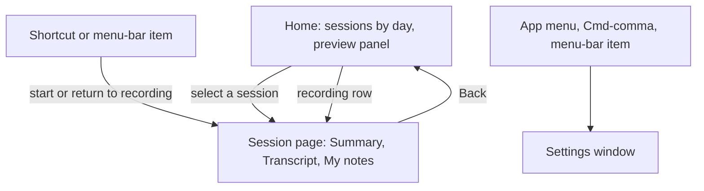
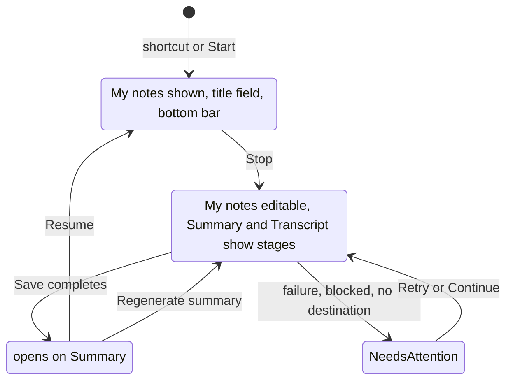
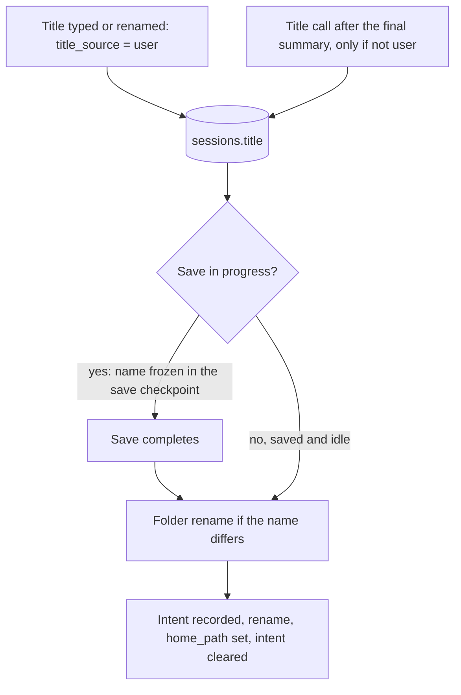
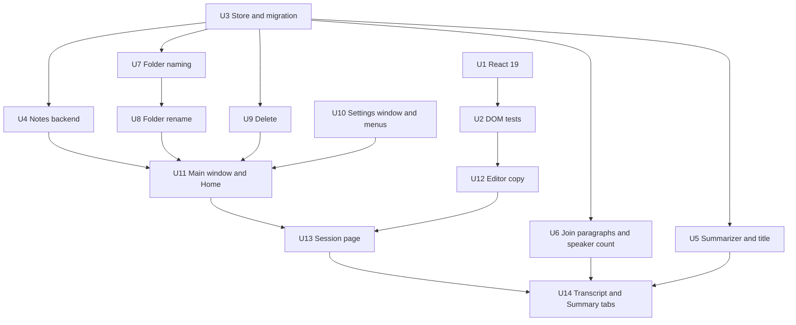

# Longhand UX Redesign - Plan

## Goal Capsule

- **Objective:** A user records a session, takes real markdown notes during it, and later finds, reads, renames and deletes past sessions, all in one main window that works like a finished Mac app.
- **Product authority:** This plan covers the UX redesign and markdown notes only. Model selection, the live transcript and system audio capture are separate work (see How This Work Fits Together) and are not active scope.
- **Open blockers:** None.

---

## Product Contract

### Summary

Longhand changes from one window with a sidebar to a Home list of sessions and one session page, which the user opens and leaves with "← Back". The session page has Summary, Transcript and My notes tabs, and the same page shows recording, processing and reading. Settings moves to its own window. Notes become a free markdown document, and each session gets a title that processing proposes.

### Problem Frame

The walking skeleton works, but the user does not want to use it. At the Phase 2b checkpoint (`docs/plans/2026-09-21-2052-feat-longhand-walking-skeleton-plan.md`, checkpoint log) the user found that nothing was broken and that the experience was still wrong. Settings and Status are sidebar sections inside the main window. Saved sessions are a sidebar list, a pattern the user dislikes in Anarlog. The completed-session view puts the notes in a narrow side column. The scratchpad records one timestamped line per note, which the user never wanted: the intent was a note-taking document that you can edit and rearrange. Every session is named "Longhand session" with a date, so the list and the folders are hard to read. Test sessions stay in the list because nothing can remove them. `docs/ideas/done/ux-redesign.md` holds the full brief and the user confirmed it on 2026-09-24.

### Key Decisions

- KD1. **One main window. The user opens a session from Home and goes back with "← Back".** (session-settled: user-directed — chosen over a sidebar list and over one window for each session: the user wants to open a session and go back.) Governs R1, R3.
- KD2. **The recording page opens on My notes and shows only Stop, the elapsed time and a live-input indicator. Warnings appear only when something is wrong.** (session-settled: user-directed — chosen over a floating always-on-top pill and over a notes-only focus mode.) The walking skeleton's attention budget (U7 two-tier rail) continues to apply. Governs R11, R12, R13.
- KD3. **Processing is a state of the session page, not a separate screen.** (session-settled: user-approved — proposed with direction A and accepted.) Governs R14.
- KD4. **Notes carry no recording positions.** (session-settled: user-directed — chosen over silent anchors on each block, over explicit time stamps, and over both: the user wants a free document.) This replaces walking-skeleton KD6 and R12, R12a and R13. A note no longer opens the transcript at its passage. The timestamped quick-entry mode in the brief is also dropped. Governs R24, R27.
- KD5. **The notes editor works like Anarlog's editor: markdown renders as you type, with a selection toolbar and a `/` menu. The file on disk is plain markdown.** (session-settled: user-approved — chosen over input rules without toolbar or menu, over a raw-text editor, and over Anarlog's JSON storage: the session folder must stay readable by any tool.) Governs R21, R22, R25.
- KD6. **The editor is a reduced copy of Anarlog's editor code, recorded in `PROVENANCE.md`.** (session-settled: user-approved — the user asked whether to borrow or invent, and accepted the scope that included borrowing.) The copy excludes app links, mentions, comments, chat, task storage and session embeds. Governs R21.
- KD7. **Processing proposes a title. The user never has to name a session and can rename it at any time.** (session-settled: user-directed — the user stated that the LLM proposes names during processing and that manual naming must not be required.) Governs R28, R29, R30, R31.
- KD8. **A rename also renames the session folder.** (session-settled: user-directed — chosen over a rename that changes only the displayed title and over folder names with only a date.) `CONCEPTS.md` now says that a session keeps one home folder whose name can change. Resume, regeneration and every later write must find the folder after a rename. Governs R9, R31.
- KD9. **Delete moves the session folder to the system Trash, and offers a permanent delete only when the Trash fails.** (session-settled: user-directed — chosen over a permanent delete and over removing the session from the list only; for a Trash failure, chosen over refusing with an explanation.) Governs R8, R33.
- KD11. **The title can be typed on the session page during a recording.** (session-settled: user-directed — the user asked for it at planning.) Governs R34.
- KD10. **Home lists sessions with a preview, rename and delete. Search is not in this plan.** (session-settled: user-directed — chosen over a list with preview only and over a list with search.) Governs R5, R6, R7.

<!-- ce-section: work-relationships -->
### How This Work Fits Together

This plan covers area A of a broader request to make Longhand real and usable. The areas below are the current understanding, not a committed roadmap.

- **A. UX redesign and markdown notes:** this plan.
- **B. Model selection:** a recognition-model picker and a second engine (`docs/ideas/done/recognition-model-picker.md`).
  - Depends on A for the Recognition pane in the Settings window (R2).
  - Can proceed independently of A in the capture and recognition code.
- **C. Live transcript:** support for streaming models (`docs/ideas/done/live-transcript-view.md`).
  - Depends on B, because a streaming model must be selectable.
  - Depends on A for the Transcript tab during recording (R13).
  - Still to decide: how a live view fits the attention budget (KD2).
- **D. System audio capture:** a second capture source (`docs/ideas/parked/system-audio-capture.md`).
  - Can proceed independently of A, B and C.
  - Still to decide: where the source control goes on the recording page and in Settings.

### Key Flows

- F1. Start a recording
  - **Trigger:** The user presses the recording shortcut.
  - **Steps:** The main window shows the new session page on My notes with the cursor in the editor. The user types notes. The bottom bar shows Stop, the elapsed time and the live-input indicator.
  - **Covered by:** R10, R11, R12
- F2. Stop and read
  - **Trigger:** The user presses Stop.
  - **Steps:** The same page shows processing progress on Summary and Transcript. My notes stays editable. When processing completes, the title changes from the start time to the proposed title and the page shows Summary.
  - **Covered by:** R14, R15, R29
- F3. Leave a recording and return
  - **Trigger:** The user selects "← Back" during a recording.
  - **Steps:** Home shows. The recording continues. A recording row at the top of Home shows the elapsed time. Selecting it, pressing the shortcut or using the menu-bar item opens the session page again.
  - **Covered by:** R1, R3
- F4. Tidy past sessions
  - **Trigger:** The user opens a row's menu on Home.
  - **Steps:** Rename changes the title and the folder name. Delete asks once and then moves the folder to the Trash.
  - **Covered by:** R7, R8, R9

### Requirements

**Window and navigation**

- R1. One main window shows either Home or one session page. Selecting a session on Home opens its page, and "← Back" on the page returns to Home. There is no sidebar.
- R2. Settings opens in a separate standard Settings window from the app menu, from ⌘, (Ctrl+, on Windows) and from the menu-bar item. It holds the current panes: Status, Destination, Summarization, Recognition and Licences.
- R3. While a recording is in progress, Home shows a recording row at the top with the elapsed time, and selecting the row opens the session page. The shortcut and the menu-bar item also open the recording's page.
- R4. While recording, the menu-bar item shows a recording indicator and the elapsed time. Closing the main window does not stop a recording.

**Home**

- R5. Home lists every session, newest first, grouped by day. Each row shows the title, the start time, the duration, the speaker count, and a status when the session is recording, processing or needs attention.
- R6. Selecting a row shows a preview panel with the title, date, summary overview, duration, speaker count and folder name.
- R7. Each row has a menu with Rename and Delete.
- R8. Delete asks for one confirmation, then moves the session folder to the system Trash and removes the session from Longhand. Delete is not available while a session records or processes.
- R33. When the folder cannot go to the Trash (for example on some OneDrive folders, network shares or drives without a Trash), Longhand says so and offers "Delete Permanently" with a second confirmation. Cancel leaves the session and its folder as they were.

**Session page**

- R9. The user can rename a session from its Home row and from the title on its page. The title changes at once. For a saved session that is not recording or processing, the rename also renames its folder in the Destination. For any other session, the folder takes the new name when processing and Save complete.
- R34. While a session records, the top of its page shows an editable title field with the start time as placeholder text. A title typed there is a title the user set (R31).
- R10. The session page shows the title, the date and start time, and three tabs: Summary, Transcript and My notes. The same page serves recording, processing and reading.
- R11. A session page opened for a recording shows My notes, with the cursor in the editor.
- R12. While recording, a bottom bar shows Stop, the elapsed time and a small live-input indicator. The level meter and warnings (quiet input, disk space, destination, and the other exception-tier signals of walking-skeleton U7) appear in the bar only while the condition exists.
- R13. While recording, the Transcript tab says that the transcript is ready after Stop, and the Summary tab says that the summary is written after Stop.
- R14. While processing, the Summary and Transcript tabs show the current stage and its progress, and My notes stays editable.
- R15. A completed session opens on Summary.
- R16. The Transcript tab shows each turn as a speaker label above a text block. A long turn is split into paragraphs, and each paragraph is its own block. A paragraph's time shows when the pointer is on it. A header shows the speaker count and duration, and the tab opens at the end of the transcript.
- R17. Each tab has a copy control that copies that tab's content as markdown.
- R18. In the transcript, a segment recorded by a resume starts after a marker that shows the date and time of the resume.
- R19. The page's "…" menu holds Resume (for any stopped session), Regenerate summary, Rename and Delete.

**Notes**

- R20. My notes is available in every state (recording, processing and saved). An edit after Save updates the notes in the session folder.
- R21. The My notes editor renders markdown as the user types. It has a formatting toolbar that appears on a text selection and a `/` command menu.
- R22. The editor supports headings, bullet lists, numbered lists, task lists, quotes, code, horizontal rules, bold, italic, strikethrough, highlight and links.
- R23. Notes save while the user types. A crash loses at most the last second of typing.
- R24. Notes carry no recording position. The summarizer receives the notes as one document that marks what the user found important, and it still reports significant material that has no note (walking-skeleton KD7, R18).
- R25. The session folder holds the notes as plain markdown, in the form the user typed them.
- R26. Notes saved before this work, which are bullets with a time prefix, open in the editor as bullets. The time prefix stays as text.
- R27. Notes exist only inside a session. The app does not keep notes typed while no session is open.
- R36. Each summary run uses the notes as they were when the run started. Edits made later reach the summary through Regenerate summary.

**Titles and folder names**

- R28. Until a session has a title, Home and the session page show its start time (for example "Today, 14:05").
- R29. Processing proposes a title for each session from its transcript and notes.
- R30. Save names the session folder with the date, the start time and the title, in place of "Longhand session". A session with no title keeps the current name, "YYYY-MM-DD HHMM Longhand session".
- R31. A title the user set is never replaced automatically. When the user regenerates the summary of a session whose title the user never set, processing can propose a new title, and the folder is renamed to match.
- R32. Sessions saved before this work keep their titles and folder names until the user renames them or regenerates their summary (R31).
- R35. Committing an empty title, from the title field or from Rename, clears the title. The session then has no title the user set, processing can propose one later, and the start time shows until then (R28).

### Acceptance Examples

- AE1. **Covers R9, R30.** Given a session is processing, when the user renames it to "Budget review", then the page shows "Budget review" immediately, and Save names the folder with that title.
- AE2. **Covers R9.** Given a saved session in a OneDrive Destination, when the user renames it, then its folder in the Destination has the new name and no copy remains under the old name.
- AE3. **Covers R31.** Given the user renamed a session, when the user regenerates its summary, then the title and folder name do not change.
- AE4. **Covers R31.** Given the user never renamed a session, when the user regenerates its summary, then the title can change and the folder name follows it.
- AE5. **Covers R8.** Given a session is processing, when the user opens its menu, then Delete is not available.
- AE6. **Covers R3, R4.** Given a recording is in progress, when the user selects "← Back", then recording continues and Home shows the recording row with the elapsed time.
- AE7. **Covers R26.** Given a session saved before this work with the note `- [00:12:40] ask about headcount`, when the user opens My notes, then the editor shows a bullet with that text, time prefix included.
- AE9. **Covers R34, R31, R30.** Given a recording is in progress, when the user types "Budget review" in the title field, then the session is saved as "2026-09-24 1405 Budget review" and processing proposes no other title.
- AE10. **Covers R33.** Given a saved session whose folder cannot go to the Trash, when the user confirms Delete, then Longhand offers "Delete Permanently". Cancel keeps the session listed and its folder unchanged.
- AE8. **Covers R19, R18.** Given a completed session from last week, when the user selects Resume in the "…" menu and records again, then the transcript shows the new segment after a marker with the resume date and time.

### Success Criteria

- The user records a real meeting and a Friday Pathfinder session with the redesigned app and reads both afterwards without falling back to another tool.
- The user would show the app to a peer at work without apology (the STRATEGY.md "Shareable without apology" metric).
- From the shortcut to typing in My notes takes no longer than it takes today to start recording.

### Scope Boundaries

**Deferred for later**

- Search across sessions, and the session index it needs (`docs/ideas/someday/library-and-browsing.md`).
- The recognition-model picker and a second engine (area B).
- The live transcript view (area C). R13 is the recording-state text until then.
- System audio capture (area D).
- Anarlog's editor extras: mentions, app-link embeds, links to other sessions, images and attachments.
- A timestamped quick-entry mode for notes.

**Outside this product's identity**

- Names for speakers. Speaker labels stay generic (STRATEGY.md, no speaker identity).
- Links between sessions, tags or any organization scheme beyond folders.
- Calendar or attendee integration, the AI chat box and sharing links seen in Wispr Flow.

### Dependencies / Assumptions

- The Trash is the system Trash on macOS and the Recycle Bin on Windows, and both make a deleted folder recoverable.
- The Anarlog editor lives in `reference-source/anarlog/packages/editor`, outside `enterprise/`. The MIT root licence of Anarlog covers it. It imports Anarlog workspace packages (`@anlg/ui`, `@anlg/store`, `@anlg/utils`, the opener plugin), and the copy must replace those imports.
- The summary stage runs before Save (`crates/pipeline/src/runner.rs` `STAGES`), so the proposed title exists when Save names the folder.
- The user's Destination can be a synced cloud folder. A folder rename must keep the Phase 4 guarantee: one clean folder, no leftover staging files and no conflict copies.

### Outstanding Questions

The questions deferred to planning are answered in the Planning Contract (KTD4, KTD5, KTD7, KTD8, KTD3). None remain for the Product Contract.

### Sources / Research

- `docs/ideas/done/ux-redesign.md`: the redesign brief, confirmed by the user on 2026-09-24. Reference screenshots of Wispr Flow are in the gitignored `docs/ideas/done/ux-redesign-screenshots/`.
- `docs/plans/2026-09-21-2052-feat-longhand-walking-skeleton-plan.md`: KD6, KD7, R12, R12a, R13, R18 (the notes model this plan replaces), U7 (attention budget), U11 (session folder), U24 (resume) and the Phase 2b checkpoint.
- `src/settings/Settings.tsx`: the current single shell with the sidebar, the settings panes and the session list.
- `src/session/SessionView.tsx`: the notes column, the summary and transcript toggle, and the Resume and Regenerate controls.
- `src/processing/describe.ts`: `sessionTitle`, the start-time title that R28 keeps as the fallback.
- `crates/session-core/src/folder.rs`: `render_notes` and `parse_notes`, which write and read `notes.md` as a strict bullet list today.
- `crates/session-core/src/jobs.rs` and `src-tauri/src/managers/capture.rs`: the pending-note buffer that R27 removes.
- `crates/summarize/src/chunk.rs`: notes attached to chunks by position, which R24 changes.
- `src-tauri/src/window.rs`, `src-tauri/src/tray.rs`: the one window and the menu-bar item.
- `reference-source/anarlog/packages/editor`: the ProseMirror note editor (input rules in `src/note/keymap.ts`, `src/widgets/format-toolbar.tsx`, `src/widgets/slash-command.tsx`, markdown parser and serializer in `src/markdown/`).
- `docs/solutions/logic-errors/save-state-machine-crash-window-recovery.md`: the step-then-record checklist that the folder rename (KTD8) and the frozen folder name (KTD7) follow.

---

## Planning Contract

**Product Contract preservation:** changed: R8 split, with the Trash fallback added as R33 (user-directed at planning); R9 clarified: a folder rename waits until processing and Save complete, because Save's crash recovery finds the folder by its name; R30 gains the no-title fallback name; R34, KD11, AE9 and AE10 added (the title field during a recording, requested by the user at planning); R32 amended, R35 and R36 added at document review (user-directed: regeneration may retitle older sessions, an empty title clears, notes are fixed at the start of each summary run). Other R, F and AE IDs are unchanged.

### Key Technical Decisions

- KTD1. **Upgrade React to the latest 19.x before the editor work.** (session-settled: user-directed — chosen over staying on React 18.3 with `react-reconciler` pinned to 0.29: the copied editor then runs on the React line it was written for.) `react`, `react-dom`, `@types/react` and `@types/react-dom` move together, and typecheck and the tests pass before any editor file is copied. Governs R21.
- KTD2. **The main window keeps its single label and chooses between Home and a session page with view state, not a router.** The app has no router today (`src/App.tsx`, `src/settings/Settings.tsx`), and two views do not need one. A `recordingChanged` event with a session id opens that session's page in every state. The shortcut handler (`src-tauri/src/shortcut.rs`) also calls `window::show_main_window` when a recording starts. Governs R1, R3, R11.
- KTD3. **Settings is a second window with the label `settings`, opened by one command.** An `open_settings` command focuses the window when it exists and builds it when it does not (the pattern of `reference-source/anarlog/plugins/windows/src/ext.rs:486-555`). The window loads the same `index.html` with a `window=settings` query that `App.tsx` branches on. On macOS a custom app menu holds "Settings…" (⌘,) and must also hold the standard Edit submenu, or copy, paste and undo stop working in the notes editor (`reference-source/anarlog/plugins/tray/src/ext.rs:54-156`). On Windows a keydown handler for Ctrl+, calls the command, because an app menu would add a menu bar to every window. The tray menu gains "Settings…". The Settings window gets its own capability entry. When the main window hides, the Dock icon stays while Settings is open. Governs R2.
- KTD4. **Copy a reduced set of Anarlog's editor files into `src/editor/`, and write Longhand's own `NoteEditor`.** The file list, trims and dependencies are in the Appendix. Anarlog's `note/index.tsx` (1009 lines) is not copied: a new component of about 150 lines follows its pattern. The task item stores only `checked`, the serializer writes tight lists, and highlight and strikethrough keep nested marks, so a document that is opened and saved again does not change. Longhand draws its own icons as inline SVG, replaces `cn` with a local helper, and maps the editor's colour tokens to the `@theme` tokens in `src/index.css`. `scripts/check-provenance.sh` adds `src/editor` to `BORROWED_DIRS`. Governs R21, R22, R25.
- KTD5. **The store holds each session's notes as one markdown document.** Migration `0002` joins each session's note rows into one document in the current `- [hh:mm:ss] text` form (R26), deletes pending rows (R27), and retires the note-row paths (`begin_note`, `edit_note`, `add_pending_note`, anchors). The editor sends the whole document through a debounced command (500 ms, at most 1 s of loss, R23). After Save, the existing locked rewrite path writes `notes.md` in the home folder as the document itself, with no heading and no per-line flattening. Governs R20, R23, R25, R26, R27.
- KTD6. **The summarizer sends the notes document with every chunk call.** The prompt's weighting text drops "the moment in brackets", and the chunk allowance subtracts the notes' size. The anchored-note path in `crates/summarize/src/chunk.rs` goes. Governs R24.
- KTD7. **A title is a stored field with a source, and Save freezes the folder name for one save.** Sessions gain `title` and `title_source` (`proposed` or `user`), and `session.md` carries the title. After the final summary, one short checkpointed call under the summarize stage proposes a title, but only when `title_source` is not `user`. Save computes the folder name once, when it claims `Working`, and keeps it in its checkpoint. A title change during a save cannot then break the marker scan in `crates/session-save/src/lib.rs:217-230`. One sanitizer in `crates/session-save/src/naming.rs` builds every folder name for every Destination:
  - it removes `" * : < > ? / \ |` and control characters, spaces and dots at either end, and a leading dot;
  - it avoids reserved names (`CON`, `NUL`, `desktop.ini`, …);
  - it cuts the title to 120 characters.
  Governs R28, R29, R30, R31, R34.
- KTD8. **A folder rename is a step-then-record operation with an intent record.** It follows the checklist in `docs/solutions/logic-errors/save-state-machine-crash-window-recovery.md`:
  1. Under the store lock, it records the intended move (from, to, and the temporary name for a case-only change).
  2. It renames the folder with no-replace semantics, then fsyncs the parent. A case-only change moves the folder to the temporary name first, then to the new name.
  3. It rewrites `session.md` in the new folder with the new title through `home_write::write_atomic`.
  4. It sets `home_path`, then clears the intent.

  At launch, a leftover intent resolves from disk:
  - If `to` exists and neither `from` nor the temporary name does, the app finishes steps 3 and 4.
  - If only the temporary name exists, the app finishes the move to `to`, then steps 3 and 4.
  - If `from` still exists, the app clears the intent.

  The rename has its own error mapping: Windows `PermissionDenied` and a sharing violation are "in use", not "name taken". It retries three times with a short delay, then reports the error and keeps the old folder name. The new title stays. A name conflict takes the next free suffix.

  A reconcile step compares a saved, idle session's folder name with the name its title gives, and runs this rename when they differ. It runs after the save stage or `update_home` records `Done`, after a summary regeneration, and at launch after the intents are resolved. A rename that R9 defers, one lost to a crash, and one that failed then all complete later. A rename or reconcile does not start while a session records, is queued, processes or regenerates its summary. Governs R9, R31.
- KTD9. **Delete uses the `trash` crate with `DeleteMethod::NsFileManager` on macOS.** The default Finder method runs AppleScript and shows an Automation permission prompt. The call runs on a blocking thread (Windows COM). A Trash error comes back as a typed "can't move to the Trash" result. The permanent delete of R33 is a separate command. Both remove the session's working directory and its store rows (child tables cascade). The crate needs a `deny.toml` review. Governs R8, R33.
- KTD10. **The join step splits a long turn into paragraphs.** A new same-speaker turn starts at a sentence end once the current turn exceeds about 400 characters, or at a pause longer than 2 s between ASR pieces. Both values are provisional. Each paragraph keeps its own time, and `transcript.md`, `TranscriptPane` and the summarizer already read consecutive same-speaker lines. Governs R16.
- KTD11. **Processing records the number of speakers it found.** The count is taken after `renumber` in `crates/pipeline/src/join.rs` and stored on the session. It is separate from the user's speaker-count bound (walking-skeleton R36). The session list returns it together with the title. The Home preview reads the overview (the first paragraph of `summary.md`) on selection through `session_document`, not once for each row. Governs R5, R6.
- KTD12. **A gap in the transcript carries the wall-clock start of the next segment.** `doc_lines` adds the `wall_start` of the following segment, which `session.md` already records. Governs R18.
- KTD13. **The menu-bar item shows the elapsed time while recording.** It uses the title mechanism in `src-tauri/src/tray.rs` that `set_alert` already uses, updated once a second from the capture clock. An alert title takes precedence. Governs R4.
- KTD14. **Component tests run under a happy-dom preload for `bun test`, with `@testing-library/react`.** The existing pure-function tests keep running. Governs the test scenarios of U12, U13 and U14.

### High-Level Technical Design

The session page is one component whose content follows the session state:

The title and the folder name follow one path:

### Assumptions

- The latest React 19 release works with `@handlewithcare/react-prosemirror` 3.2.x (peer `react >=17 <20`) and the `react-reconciler` version that Anarlog's lockfile uses.
- The `trash` crate's NSFileManager method works on local APFS volumes. On OneDrive File Provider folders and network shares it can fail, and R33 covers that failure.
- Nothing outside Longhand renames session folders. A folder renamed outside Longhand is not found again, as today.

### Sequencing

Backend units U3–U9 and U10 can run in parallel with U1, U2 and U12. Each unit regenerates `src/bindings.ts` when it changes a command or event.

---

## Implementation Units

| U-ID | Title | Key files | Depends on |
|---|---|---|---|
| U1 | React 19 upgrade | `package.json`, `src/**/*.tsx` | none |
| U2 | DOM test environment | `bunfig.toml`, `src/test/setup.ts` | U1 |
| U3 | Store: title, notes document, speaker count | `crates/session-core/migrations/0002_*.sql`, `crates/session-core/src/jobs.rs`, `folder.rs` | none |
| U4 | Notes backend | `src-tauri/src/managers/capture.rs`, `crates/pipeline/src/save.rs`, `src-tauri/src/commands/` | U3 |
| U5 | Summarizer notes and title proposal | `crates/summarize/src/`, `crates/pipeline/src/summarize.rs` | U3 |
| U6 | Paragraph turns, speaker count, resume marker | `crates/pipeline/src/join.rs`, `src-tauri/src/commands/session.rs` | U3 |
| U7 | Folder naming with titles | `crates/session-save/src/naming.rs`, `crates/pipeline/src/save.rs` | U3 |
| U8 | Folder rename | `crates/session-save/src/`, `crates/pipeline/src/save.rs`, `src-tauri/src/commands/session.rs` | U7 |
| U9 | Delete to Trash | `src-tauri/Cargo.toml`, `deny.toml`, `src-tauri/src/commands/session.rs` | U3 |
| U10 | Settings window and menus | `src-tauri/src/window.rs`, `src-tauri/src/menu.rs`, `src-tauri/src/tray.rs`, `src-tauri/capabilities/` | none |
| U11 | Main window shell and Home | `src/App.tsx`, `src/home/`, `src/settings/` | U4, U8, U9, U10 |
| U12 | Editor copy | `src/editor/`, `scripts/check-provenance.sh` | U2 |
| U13 | Session page shell, recording and processing states | `src/session/SessionPage.tsx`, `src/session/` | U11, U12 |
| U14 | Transcript and Summary tabs | `src/session/TranscriptTab.tsx`, `src/session/SummaryTab.tsx` | U13, U5, U6 |

### U1. React 19 upgrade

- **Goal:** The app runs on the latest React 19 release with no change in behaviour.
- **Requirements:** KTD1.
- **Dependencies:** none.
- **Files:** `package.json`, `bun.lock`, any `src/**/*.tsx` that React 19 type changes affect (for example `useRef` needing an argument and `JSX` namespace imports).
- **Approach:**
  1. Move `react`, `react-dom`, `@types/react` and `@types/react-dom` to the latest 19.x with `bun`.
  2. Fix the type errors that the upgrade reports.
  3. Build the bundle once to confirm that Vite and the Tauri webview load it.
- **Patterns to follow:** the React 19 upgrade guide, for removed APIs and type changes.
- **Test scenarios:**
  - The existing `bun test ./src` suite passes unchanged.
  - `bun run typecheck` reports no errors.
- **Execution note:** This is mostly dependency work. Prove it with typecheck, the existing tests and one app launch, not with new unit tests.
- **Verification:** The app opens, records and shows a saved session as before.

### U2. DOM test environment

- **Goal:** `bun test` can render React components in a DOM.
- **Requirements:** KTD14.
- **Dependencies:** U1.
- **Files:** `bunfig.toml`, `src/test/setup.ts`, `package.json` (dev dependencies `@happy-dom/global-registrator`, `@testing-library/react`, `@testing-library/user-event`), `src/test/smoke.test.tsx`.
- **Approach:** Register happy-dom in a preload that `bunfig.toml` names for tests. Mock the Tauri `invoke` and event APIs in one helper, so that components that call `commands.*` can be rendered.
- **Test scenarios:**
  - A smoke test renders a small component and finds its text.
  - A component that calls a mocked command receives the mocked result.
- **Verification:** Pure-function tests and the new component tests run in one `bun test ./src`.

### U3. Store: title, notes document, speaker count

- **Goal:** The store keeps a title with its source, one notes document and the found speaker count for each session, and existing notes move into the new shape.
- **Requirements:** R25, R26, R27, R28, R31, KTD5, KTD7, KTD11.
- **Dependencies:** none.
- **Files:** `crates/session-core/migrations/0002_titles_and_notes.sql`, `crates/session-core/src/schema.rs`, `crates/session-core/src/jobs.rs`, `crates/session-core/src/folder.rs` (`SessionDoc.title`, notes writer), `crates/session-core/tests/jobs.rs`, `crates/session-core/tests/folder.rs`, `crates/session-core/tests/migrations.rs`.
- **Approach:**
  1. The migration adds `title`, `title_source`, `notes` (markdown text) and `found_speakers` to `sessions`. It fills `notes` from each session's rows in their order, rendered as `render_notes` renders them today. It then deletes pending rows. It keeps the `notes` table only if a later step needs it; otherwise it drops the table.
  2. `jobs.rs` gains setters and getters for the title (with its source), the notes document and the speaker count. The pending-note functions and the adoption in `create_session` go.
  3. `SessionDoc` gains an optional `title`. `render_notes` and `parse_notes` are replaced by a writer that writes the document text unchanged.
- **Patterns to follow:** `crates/session-core/src/schema.rs` migration list, and the existing `jobs.rs` setter style.
- **Test scenarios:**
  - Covers AE7. A database with three anchored notes, one gap note and one un-anchored note migrates to one document with the lines `- [00:12:40] …`, `- [01:02:03 ~gap] …` and `- …`, in their order.
  - A pending note row (no session) is gone after the migration.
  - A session with no notes migrates to an empty document.
  - Setting a title as `user` and then as `proposed` keeps the `user` title (the store refuses to replace a user title with a proposal).
  - Setting an empty `user` title clears the title and its source, and a later proposal is then stored (R35).
  - `session.md` round-trips with and without a title.
  - A notes document with headings, a task list and a code block is written to `notes.md` byte for byte.
- **Verification:** The session-core tests pass, and an existing development database opens after the migration with its notes intact.

### U4. Notes backend

- **Goal:** The editor saves one notes document for each session in every state, and the home folder's `notes.md` follows edits made after Save.
- **Requirements:** R20, R23, R25, R27, KTD5.
- **Dependencies:** U3.
- **Files:** `src-tauri/src/managers/capture.rs`, `src-tauri/src/commands/capture.rs` or `commands/session.rs`, `crates/pipeline/src/save.rs` (`render`, `write_notes`, `rewrite_notes`), `src-tauri/src/lib.rs` (specta list), `src/bindings.ts`, `crates/pipeline/tests/runner.rs`.
- **Approach:**
  1. Replace `begin_note`, `edit_note` and `notes` with two commands. `session_notes(session_id)` returns the document. `set_session_notes(session_id, markdown)` stores it and, for a saved session, rewrites `notes.md` under the store lock.
  2. Remove the pending buffer and the anchor resolution from the capture manager.
  3. `render` writes the document as `notes.md` at Save, and `write_notes` after `Done` keeps edits made during the save.
- **Patterns to follow:** the existing `edit_note` → `rewrite_notes` path under one lock, and `home_write::write_atomic`.
- **Test scenarios:**
  - A document set while recording is in `notes.md` after Save.
  - A document set while Save runs is in `notes.md` after `Done`, written once (adapt `runner.rs` "an edit during saving").
  - A document set after Save rewrites the home folder's `notes.md` whole.
  - `set_session_notes` for an unknown session returns an error and changes nothing.
  - With no session open, no command accepts notes (R27).
- **Verification:** The pipeline and capture tests pass with the note-row tests replaced.

### U5. Summarizer notes and title proposal

- **Goal:** The summary uses the notes document as emphasis, and processing proposes a title.
- **Requirements:** R24, R29, R31, KTD6, KTD7.
- **Dependencies:** U3.
- **Files:** `crates/summarize/src/prompts.rs`, `crates/summarize/src/chunk.rs`, `crates/pipeline/src/summarize.rs`, `crates/pipeline/src/save.rs` (`regenerate_summary`), `crates/summarize/tests/prompts.rs`, `crates/summarize/tests/chunk.rs`, `crates/pipeline/tests/runner.rs`.
- **Approach:**
  1. `session_notes` returns the document, read once when the summary run starts (R36). Every chunk call and the title call carry that copy in the notes block, and `WEIGHTING` says that the notes mark what the user found important, with no time.
  2. The chunk allowance subtracts the size of the notes. A notes document too large for the allowance is cut, with a marker that says so.
  3. After the final summary, a checkpointed title call runs when `title_source` is not `user`. It returns one line of plain text, which is trimmed, stripped of quotes and cut to the KTD7 length, and stored as `proposed`. When the call fails, the session keeps no title, and the summary still completes.
  4. `regenerate_summary` clears the title checkpoint with the summary checkpoints, so a new proposal follows (R31). A user title stays. When the proposal changes the title, the regeneration ends with the KTD8 reconcile, which renames the folder and rewrites `session.md`.
  5. The processing manager records each session that has a regeneration in progress, so that rename and delete can see it (U8, U9). `regenerate_summary` reads `home_path` under the store lock just before it writes `summary.md`.
- **Patterns to follow:** the checkpointed calls in `crates/pipeline/src/summarize.rs`, and the stub handling in `save.rs`.
- **Test scenarios:**
  - Each chunk request contains the notes document once.
  - A notes document longer than the allowance is cut, and the request stays within budget.
  - Covers AE9. A session with a `user` title makes no title call.
  - Covers AE4. A regeneration on a `proposed` title stores the new proposal, the folder takes the new name, `home_path` points to it, and `session.md` carries the new title.
  - Covers AE3. A regeneration on a `user` title keeps the title.
  - A regeneration on a session saved before this work (no title) proposes a title and renames its folder (R32).
  - A notes edit made after a summary run starts does not reach that run's chunk or title requests (R36).
  - A title reply of `"Budget Review."` with quotes and surrounding spaces is stored as `Budget Review`.
  - A failing title call leaves the title empty and the summary complete.
- **Verification:** The summarize and pipeline tests pass, and a real summary run against the configured endpoint produces a title.

### U6. Paragraph turns, speaker count, resume marker

- **Goal:** New transcripts have paragraph-sized turns with their own times. Processing records the number of speakers it found. Gaps know when the next segment started.
- **Requirements:** R5, R16, R18, KTD10, KTD11, KTD12.
- **Dependencies:** U3.
- **Files:** `crates/pipeline/src/join.rs`, `crates/pipeline/src/runner.rs` or the join stage caller, `src-tauri/src/commands/session.rs` (`DocLine`, `doc_lines`, `SessionEntry`), `src/bindings.ts`, `crates/pipeline/tests/join.rs`.
- **Approach:**
  1. In `join::build`, flush a same-speaker turn at a sentence end past the length threshold, or at a pause past the gap threshold (KTD10).
  2. After `renumber`, store the distinct speaker count through the U3 setter.
  3. `DocLine::Gap` gains the next segment's `wall_start`. `SessionEntry` gains `title` and `found_speakers`.
- **Patterns to follow:** existing `join.rs` tests with hand-built ASR pieces.
- **Test scenarios:**
  - One speaker with 1,200 characters in six sentences becomes three or more turns, each starting at a sentence start with that sentence's time.
  - A 3 s pause between two pieces of one speaker starts a new turn.
  - A short same-speaker run stays one turn.
  - A transcript with speakers 1, 2 and 3 records a count of 3. A transcript with no speaker marks (walking-skeleton R20a) records none.
  - A gap between segments carries the second segment's `wall_start`.
- **Verification:** The join and runner tests pass, and a real session shows paragraphs in `transcript.md`.

### U7. Folder naming with titles

- **Goal:** Save names folders with the title, safely for every Destination, and a title change during a save cannot break recovery.
- **Requirements:** R30, R32, KTD7.
- **Dependencies:** U3.
- **Files:** `crates/session-save/src/naming.rs`, `crates/pipeline/src/save.rs`, `crates/session-save/tests/naming.rs`, `crates/session-save/tests/save.rs`, `crates/pipeline/tests/runner.rs`.
- **Approach:**
  1. `folder_name(started, title)` returns `YYYY-MM-DD HHMM <sanitized title>`, or today's name when there is no usable title.
  2. `pipeline::save::run` computes the name when it claims `Working`, records it in the save checkpoint, and uses the recorded name on every later run.
- **Patterns to follow:** the checklist in `docs/solutions/logic-errors/save-state-machine-crash-window-recovery.md`, and the lost-record test template in `crates/session-save/tests/save.rs`.
- **Test scenarios:**
  - `Budget: Q3 / review?` becomes `2026-09-24 1405 Budget Q3 review` (forbidden characters removed, spaces collapsed).
  - A title of dots and spaces only gives the no-title name.
  - A 300-character title is cut to 120 characters without a trailing space or dot.
  - A title that sanitizes to `CON` gives a safe name.
  - A title that changes between two runs of the save stage still produces one folder under the first name (the frozen name), with no `-2`.
  - A save that restarts after the final rename, whose record was lost, finds the folder by the recorded name.
- **Verification:** The session-save and pipeline tests pass, including the frozen-name crash case.

### U8. Folder rename

- **Goal:** A rename moves the saved folder safely, now or after processing.
- **Requirements:** R9, R31, AE1, AE2, KTD8.
- **Dependencies:** U7.
- **Files:** `crates/session-save/src/rename_home.rs`, `crates/session-save/src/rename.rs` (error mapping), `crates/session-core/migrations/0003_rename_intent.sql` (added to the `schema.rs` list, because an applied `0002` never runs again), `crates/session-core/src/jobs.rs`, `crates/pipeline/src/save.rs` (after `Done`), `src-tauri/src/managers/processing.rs` (launch recovery), `src-tauri/src/commands/session.rs` (`rename_session`), `crates/session-save/tests/rename_home.rs`, `crates/pipeline/tests/runner.rs`.
- **Approach:**
  1. `rename_session(id, title)` stores the title as `user`, then runs the KTD8 reconcile, which moves the folder now or, when the session is busy, later.
  2. The rename runs the KTD8 sequence under the store lock.
  3. The launch recovery resolves any leftover intent and then runs the reconcile, before the processing queue starts.
- **Execution note:** Write the lost-record tests first, one for each boundary of the intent sequence. The solution doc explains why.
- **Patterns to follow:** `session_save::step` step-then-record, `rename_new`, and `fsync::sync_dir`.
- **Test scenarios:**
  - Covers AE2. A saved session renamed to "Budget review" has one folder under the new name, `home_path` points to it, and the old name is gone.
  - Covers AE1. A rename during processing changes the title at once. The folder takes the new name after `Done`.
  - A crash after the rename and before `home_path` is set resolves at launch to the new path.
  - A crash after the intent is recorded and before the rename resolves at launch to the old path, with the intent cleared.
  - A rename to a name that another folder already uses takes the next suffix.
  - A case-only rename (`budget review` to `Budget review`) ends with the new case.
  - A crash between the two moves of a case-only rename, with only the temporary name on disk, resolves at launch to the new name.
  - After a rename, `session.md` in the renamed folder parses with the new title.
  - A crash after `Done` and before a deferred rename ends, after the next launch, with the folder under the new name.
  - A rename during a summary regeneration moves the folder after the regeneration finishes, and `summary.md` is in the renamed folder.
  - A simulated `PermissionDenied` is retried three times, then reported as "in use", with the old name kept (not reported as "no free name").
  - After a rename, resume, `update_home`, `rewrite_notes` and `regenerate_summary` write into the renamed folder.
- **Verification:** The rename and runner tests pass. A manual rename in a OneDrive Destination on the signed bundle leaves one folder on another device.

### U9. Delete to Trash

- **Goal:** Delete moves a session to the Trash, or deletes it permanently when the user chooses that, and removes it from Longhand.
- **Requirements:** R8, R33, AE5, AE10, KTD9.
- **Dependencies:** U3.
- **Files:** `src-tauri/Cargo.toml` (`trash`), `deny.toml`, `crates/session-core/src/jobs.rs` (`delete_session`), `src-tauri/src/commands/session.rs` (`delete_session`, `delete_session_permanently`), `src/bindings.ts`, `crates/session-core/tests/jobs.rs`, `src-tauri/tests/` or a crate-level test for the command.
- **Approach:**
  1. Refuse when the session is capturing, interrupted, queued, processing or regenerating its summary.
  2. Move the home folder (when the session has one) to the Trash first. On a Trash error, return a typed error. At that point nothing has changed.
  3. Only after the home folder has moved, move the working directory to the Trash, then delete the session's rows last.
  4. The permanent command removes the same directories in the same order.
  5. A directory that is already missing counts as removed, so a delete retried after a crash completes.
- **Patterns to follow:** thin async commands with `spawn_blocking` in `src-tauri/src/commands/capture.rs`.
- **Test scenarios:**
  - A saved session is deleted: the folder is in the Trash (or, in the test, the trash call is recorded), its rows are gone, and it is not in `list_sessions`.
  - Covers AE5. Delete on a processing session returns a refusal and changes nothing.
  - Covers AE10. A trash failure returns the typed error, and the rows and folder remain.
  - A permanent delete removes the folder and the rows.
  - A session with no home folder (never saved) deletes its working directory only.
  - A Trash failure on the home folder leaves the working directory and the rows in place.
  - A delete retried after a crash, with both directories already gone, deletes the rows and succeeds.
  - Delete during a summary regeneration returns a refusal.
- **Verification:** The tests pass, `cargo deny check` passes, and on the signed bundle a delete shows no Automation prompt.

### U10. Settings window and menus

- **Goal:** Settings opens in its own window from the app menu, from ⌘, (Ctrl+,) and from the menu-bar item. The menu-bar item shows the recording time.
- **Requirements:** R2, R4, KTD3, KTD13.
- **Dependencies:** none.
- **Files:** `src-tauri/src/window.rs`, `src-tauri/src/menu.rs` (new, macOS only), `src-tauri/src/tray.rs`, `src-tauri/src/lib.rs`, `src-tauri/capabilities/settings.json`, `src-tauri/src/commands/window.rs` (`open_settings`), `src/bindings.ts`, `src-tauri/PROVENANCE.md` (if Anarlog's menu code is copied).
- **Approach:**
  1. `open_settings` builds or focuses the `settings` window (about 560 × 520, not resizable, closes normally).
  2. On macOS, the app menu has App (About, Settings…, Hide, Quit), Edit (the predefined undo, redo, cut, copy, paste, select all) and Window.
  3. The tray menu gains "Settings…".
  4. The tray title shows "● 1:12:40" while recording and returns to its normal state when recording stops. An alert title takes precedence.
  5. The activation policy stays Regular while any window is visible.
- **Patterns to follow:** `reference-source/anarlog/plugins/windows/src/ext.rs:486-555`, `reference-source/anarlog/plugins/tray/src/ext.rs:54-156`, and `tray::set_alert`.
- **Test scenarios:**
  - A second `open_settings` call focuses the existing window and creates no second one (a unit test on the lookup-or-build function, or a manual check).
  - The tray title formatter gives `● 0:00:05` at 5 s and `● 1:12:40` at 4,360 s, and an alert overrides it.
  - Test expectation for the menu wiring: manual on the signed bundle, because it needs the macOS menu bar.
- **Verification:** On the signed bundle, ⌘, opens Settings once, copy and paste work in a text field, and closing the main window during a recording keeps the Dock icon while Settings is open.

### U11. Main window shell and Home

- **Goal:** The main window shows Home or one session page, with no sidebar, and Home lists and manages sessions.
- **Requirements:** R1, R3, R5, R6, R7, R8, R9, R28, R33, F3, F4, KTD2, KTD11.
- **Dependencies:** U4, U8, U9, U10.
- **Files:** `src/App.tsx`, `src/home/Home.tsx`, `src/home/SessionRow.tsx`, `src/home/PreviewPanel.tsx`, `src/home/RecordingRow.tsx`, `src/home/group.ts`, `src/settings/SettingsWindow.tsx` (the panes of `src/settings/Settings.tsx` without the sidebar), `src-tauri/src/shortcut.rs`, `src/home/group.test.ts`, `src/home/Home.test.tsx`.
- **Approach:**
  1. `App.tsx` branches on the window query: `settings` renders `SettingsWindow`, and the default renders the main shell with view state (Home, or a session page for an id).
  2. `recordingChanged` with an id opens that session's page, and the shortcut shows the window (KTD2).
  3. Home groups `listSessions` by local day, newest first. A row shows the title (or `sessionTitle`), the start time, the duration, the found speaker count and the status from `describe.ts`.
  4. Selecting a row fills the preview panel, which reads the overview through `session_document`. Opening a row (double-click or Return) shows its page.
  5. The row menu has Rename (inline edit that calls `rename_session`) and Delete. Delete shows a confirmation, then the R33 permanent-delete confirmation when the Trash fails.
  6. While recording, a recording row shows at the top.
  7. With no sessions, Home shows one short line that names the recording shortcut. With no row selected, the preview panel shows nothing.
- **Patterns to follow:** `useSessions` for list refresh, the `ui.tsx` primitives, and the `apple-design` skill for list, selection and menus. The attention budget wins over motion.
- **Test scenarios:**
  - `group.ts` puts sessions from today, yesterday and last Monday into three day groups, newest first, across a midnight boundary in local time.
  - A session with no title shows "Today, 14:05". A titled session shows its title.
  - Selecting a row shows its overview in the preview panel.
  - Covers AE6. With a recording in progress, Home shows the recording row with the elapsed time, and selecting it opens the session page.
  - Covers AE5. The row menu of a processing session has Delete disabled.
  - Covers AE10. A mocked Trash failure shows the "Delete Permanently" confirmation, and Cancel leaves the row.
  - Rename commits on Return, and Escape cancels.
  - With no sessions, Home shows the line that names the shortcut.
- **Verification:** The component tests pass. On the signed bundle, the shortcut from another app opens the new session's page, and "← Back" returns to Home.

### U12. Editor copy

- **Goal:** A tested markdown notes editor exists in `src/editor/`, with provenance.
- **Requirements:** R21, R22, R23, R25, KTD4.
- **Dependencies:** U2.
- **Files:** `src/editor/` (the copied files listed in the Appendix, `NoteEditor.tsx`, `icons.tsx`, `cn.ts`, `editor.css`), `src/editor/PROVENANCE.md`, `scripts/check-provenance.sh`, `package.json`, `src/editor/markdown.test.ts`, `src/editor/keymap.test.ts`, `src/editor/autolink.test.ts`, `src/editor/NoteEditor.test.tsx`.
- **Approach:**
  1. Copy and trim the files per the Appendix list, and record each in `PROVENANCE.md` with the Anarlog revision.
  2. Write `NoteEditor({markdown, onChange, autoFocus})`. It builds its state from `md2json` and sends `json2md` through a 500 ms debounce with a maximum wait of 1 s, so continuous typing still saves at least once a second (R23). It flushes on blur and unmount.
  3. Map the editor CSS tokens to `src/index.css`. Move the dark rules into `prefers-color-scheme`.
  4. Add a link button to the format toolbar.
- **Patterns to follow:** Anarlog `note/index.tsx` lines 739–790 and 955–1000 for the component pattern, and `crates/asr/PROVENANCE.md` for the record format.
- **Test scenarios:**
  - Round trip: a document with headings, bullet, numbered and task lists (checked and unchecked), a quote, fenced code with a language, a rule, bold, italic, strike, highlight, a link and `==**bold highlight**==` is unchanged after parse and serialize, twice.
  - A tight list stays tight.
  - Covers AE7. `- [00:12:40] ask about headcount` parses as a bullet with that text.
  - Typing `## ` at a line start makes a heading, `- [ ] ` makes a task, and `---` makes a rule.
  - A pasted URL becomes a link.
  - `onChange` fires once after typing stops, and again on blur when a change is pending.
  - During 3 s of continuous typing with no pause, `onChange` fires at least twice (the 1 s maximum wait).
  - Toggling a task checkbox serializes `- [x]`.
- **Verification:** The editor tests pass, `scripts/check-provenance.sh` passes, and the editor typechecks under React 19.

### U13. Session page shell, recording and processing states

- **Goal:** One session page serves recording, processing and reading, with a title field, tabs, the recording bar and the "…" menu.
- **Requirements:** R10, R11, R12, R13, R14, R15, R17, R19, R20, R34, F1, F2, KD2, KD3.
- **Dependencies:** U11, U12.
- **Files:** `src/session/SessionPage.tsx`, `src/session/TitleField.tsx`, `src/session/RecordingBar.tsx`, `src/session/NotesTab.tsx`, `src/session/ProcessingStatus.tsx`, `src/session/SessionMenu.tsx`, `src/session/SessionPage.test.tsx`, removals: `src/recording/Scratchpad.tsx`, `src/recording/RecordingPane.tsx`, `src/recording/Rail.tsx` (its exception logic moves into `RecordingBar`), `src/session/NotesPane.tsx`, `src/session/navigate.ts`, `src/session/navigate.test.ts`, `src/processing/ProcessingView.tsx` (its exception panels move into `ProcessingStatus`), `src/session/SessionView.tsx`.
- **Approach:**
  1. The header has "← Back", the title field (editable in every state, calling `rename_session` on commit), the date and start time, and the tab control (the `Segmented` pattern).
  2. The default tab follows R11 and R15.
  3. `NotesTab` hosts `NoteEditor` bound to `session_notes` and `set_session_notes`.
  4. `RecordingBar` shows Stop, the elapsed time and a live dot from `useCapture`. It shows the level meter and warnings only while a condition of the walking-skeleton U7 exception tier exists (R12).
  5. While processing, Summary and Transcript show `ProcessingStatus`: stage rows, progress, and the Retry, Continue and Choose Folder panels.
  6. `SessionMenu` holds Resume, Regenerate summary, Rename and Delete, each enabled per state.
- **Patterns to follow:** `useCapture`, `useSessions`, `stageRows` in `describe.ts`, and the `apple-design` skill. The recording surface keeps the attention budget of walking-skeleton U7: no motion on the bar except the live dot.
- **Test scenarios:**
  - A page opened for a capturing session shows My notes with the editor focused.
  - A completed session opens on Summary.
  - Covers AE9. Typing "Budget review" in the title field during recording calls `rename_session` with that title.
  - Clearing the title field and committing clears the title, and the page shows the start time (R35).
  - The bar shows Stop and the elapsed time, and it shows the quiet-input warning only when `inputStatus` reports quiet.
  - During processing, My notes stays editable, and Summary shows the stage rows.
  - A failed session shows Retry on the page.
  - "← Back" returns to Home, and the recording continues (mocked capture state unchanged).
  - The "…" menu hides Delete for a processing session and shows Resume for a stopped one.
- **Verification:** The component tests pass. On the signed bundle, a full record, stop and read cycle stays on one page.

### U14. Transcript and Summary tabs

- **Goal:** The Transcript and Summary tabs show a readable transcript and summary with copy controls.
- **Requirements:** R13, R16, R17, R18, AE8, KTD10, KTD12.
- **Dependencies:** U13, U5, U6.
- **Files:** `src/session/TranscriptTab.tsx`, `src/session/SummaryTab.tsx`, `src/session/TranscriptPane.tsx` (replaced), `src/session/SummaryPane.tsx` (replaced), `src/session/copy.ts`, `src/session/TranscriptTab.test.tsx`, `src/session/copy.test.ts`.
- **Approach:**
  1. The transcript groups consecutive same-speaker turns under one label. Each turn is a block, and its time shows on hover.
  2. A header shows the found speaker count and the duration. The tab opens scrolled to the end.
  3. A gap shows "Resumed <date>, <time>" when it has a next `wall_start`, and otherwise the current "Not recorded" line.
  4. The summary renders with the existing safe `markdown.ts` parser.
  5. Each tab's copy control writes that tab's markdown to the clipboard. `session_document` returns the raw file texts for this.
  6. While recording, both tabs show the R13 text.
- **Patterns to follow:** the current `TranscriptPane` grouping, and `markdown.ts`.
- **Test scenarios:**
  - Three consecutive turns of Speaker 1 show one label and three blocks.
  - Covers AE8. A gap with a `wall_start` of 2026-09-30 10:02 shows "Resumed 30 Sep, 10:02".
  - The header shows "3 speakers · 35:48".
  - Copy on the Transcript tab writes the `transcript.md` body, and on My notes the notes document.
  - A stub summary shows its "No summary was produced" text and the Regenerate control.
  - While recording, Transcript says that the transcript is ready after Stop.
- **Verification:** The component tests pass, and a real session reads well at 4 hours without a visible delay when the tab opens.

---

## Verification Contract

| Gate | Command | Applies to |
|---|---|---|
| Frontend types | `bun run typecheck` | every unit that touches `src/` |
| Frontend tests | `bun test ./src` | U1, U2, U11–U14 |
| Rust format and lint | `cargo fmt --all --check`, `cargo clippy --workspace --all-targets -- -D warnings` | U3–U10 |
| Rust tests | `cargo test --workspace` | U3–U10 |
| Bindings current | `cargo test -p longhand export_bindings`, then no diff in `src/bindings.ts` | units that change commands or events |
| Windows lint | `scripts/check-windows.sh` | U8, U9, U10 |
| Provenance | `scripts/check-provenance.sh` | U10 (if menu code is copied), U12 |
| Dependencies | `cargo deny check` | U9 |
| Signed bundle | `bun tauri build --bundles app` | final manual check |

Manual checks on the signed bundle (microphone, Keychain, menus and the Trash need it):

1. Record with the shortcut from another app. The session page opens on My notes with the cursor in the editor.
2. Type a title during the recording, stop, and confirm the saved folder name (AE9).
3. Open Settings with ⌘, twice. One window opens. Copy and paste work in the editor.
4. Rename a saved session in a local Destination and in a OneDrive Destination. Confirm one folder on a second device.
5. Delete a session in a local Destination: it goes to the Trash with no Automation prompt. Delete one in the OneDrive Destination: confirm the permanent-delete offer if the Trash fails.
6. Go "← Back" during a recording, and return through the recording row, the menu-bar item and the shortcut.

---

## Definition of Done

**Global**

- Every requirement R1–R36 is advanced by at least one unit, and every acceptance example is exercised by a test scenario or a numbered manual check.
- The gates in the Verification Contract pass locally.
- The six manual checks pass on the signed bundle.
- `src/editor/PROVENANCE.md` records every copied file, and `scripts/check-provenance.sh` lists `src/editor`.
- `CONCEPTS.md` matches the renamed-folder and Title meanings.
- `docs/ideas/done/ux-redesign.md` is set to `done` with its row moved to Done in `docs/ideas/README.md`, once the work ships.
- Cleanup: the removed surfaces (sidebar shell, scratchpad, notes column, note anchors, pending notes, `navigate.ts`) leave no dead code, commented-out blocks or unused bindings.

**Per unit**

- The goal is met as stated, and the listed test scenarios are implemented or, for manual scenarios, performed.
- The listed files exist at their paths, or the unit's commit says why a path changed.
- No new warnings, and the gates that apply to the unit pass.
- UI text is plain language, and code and comments follow ASD-STE100 (no "land" or "landed").

---

## Completion record

**Shipped 2026-09-25** in archived PR 4 (merge commit 3e72045). Units U1–U14 are implemented. A code review found 7 actionable findings, and all 7 are fixed.

**The user's review of the signed bundle** made these changes after the units:

- The UI calls a session a "note" ("New Note", the Notes list, "Delete note"). "Session" stays the term in code and docs, and `CONCEPTS.md` records the rule.
- Home has a header with the app icon, the name and New Note. A pointer on a row shows its summary in a preview pane, which shows only while a row is under the pointer. One click opens a note.
- The tabs are in the order the parts come into being: My Notes, Transcript, Summary. Stop moves the page to Summary, which shows the processing. Four level bars next to "Transcript" follow the microphone input while recording.
- Settings has a sidebar of panes, as macOS System Settings does. Licences is one row per model, and a click on a row shows its details.
- The colours are warm beiges in light mode and warm charcoals in dark mode, not greys.
- On macOS the main window has no title bar. An empty strip holds the window buttons, and a drag on it moves the window. Windows keeps its standard title bar. The main window opens at 960 × 680, and then at the size and place it had when the app quit (`tauri-plugin-window-state`).

**Verification.** All the gates in the Verification Contract pass. The bundle was built signed and notarized. The user recorded a note with the notarized bundle on this Mac and on a second Mac. The six manual checks were not reported one by one.

**Deferred findings** (from the PR):

- P2: `crates/pipeline/src/folder_rename.rs`. A crash after a title change whose folder name does not change can leave `session.md` with the old title, until the next rename or regeneration corrects it.
- P3: `src/session/NotesTab.tsx`. A failed notes save shows an error but does not try again.
- P3: No test covers a failed regeneration with a rename pending, or a store-write failure in the middle of a rename.

**Parked:** Settings as a window attached to the main window (`docs/ideas/someday/settings-attached-to-main-window.md`).

---

## Appendix

**Editor files to copy** (from `reference-source/anarlog/packages/editor/src/`, revision `39613e537ba4c2ddbd2eb5fb4f33c6bf9e79d11e`, MIT, Fastrepl, Inc.):

| File | Trim |
|---|---|
| `markdown.ts` | keep `md2json`, `json2md`, `JSONContent`; drop the image helpers and `parseJsonContent` |
| `markdown/schema.ts` | drop tables, image, clip, file attachment, mention, underline, inline code |
| `markdown/parser.ts` | keep strike, highlight, hard break, task list, empty paragraphs; drop the rest; parse nested marks inside highlight and strike |
| `markdown/serializer.ts` | drop tables, image, clip, attachment, mention, underline, inline code; set tight lists |
| `note/schema.ts` | drop tables, image, attachment, app link, mention, session, clip, underline, inline code; `taskItem` with `checked` only |
| `note/keymap.ts` | drop Mod-u, Mod-`, the title navigation handlers and `createTaskItemAttrs`; drop the smart-quote, fraction and symbol rules so that stored text is what was typed |
| `widgets/format-toolbar.tsx` | drop underline, code and comment buttons and the title check; add a link button; Longhand icons |
| `widgets/slash-command.tsx` | Longhand icons; plain task attributes |
| `node-views/task-item-view.tsx`, `node-views/task-checkbox.tsx` | `checked: boolean` only |
| `plugins/doc-change-listener.ts`, `plugins/autolink.ts`, `plugins/url.ts`, `plugins/changed-ranges.ts`, `plugins/clear-marks-on-enter.ts`, `plugins/link-boundary-guard.ts`, `plugins/placeholder.ts` | copy as they are |
| `styles/base.css`, `styles/nodes/task-list.css`, `styles/note-typography.css` | drop image, title and extra highlight rules; Longhand tokens |

Tests to copy and trim: `markdown.test.ts` (task, strike, highlight, heading, list, empty-paragraph and round-trip cases), `note/keymap.test.ts`, `plugins/autolink.test.ts`, `plugins/doc-change-listener.test.ts`, `widgets/format-toolbar.test.ts`, `node-views/task-checkbox.test.tsx`.

Dependencies (Anarlog lockfile versions): `@handlewithcare/react-prosemirror` 3.2.6 with its matching `prosemirror-view` 1.41.7 and `react-reconciler`; `prosemirror-model` 1.25.4, `-state` 1.4.4, `-commands` 1.7.1, `-history` 1.5.0, `-inputrules` 1.5.1, `-keymap` 1.2.3, `-schema-list` 1.5.1, `-markdown` 1.13.4, `-gapcursor` 1.4.0, `-dropcursor` 1.8.2; `markdown-it` 14.2.0; `@floating-ui/dom` 1.7.6; `usehooks-ts` 3.1.1; `tlds` 1.261.0.
