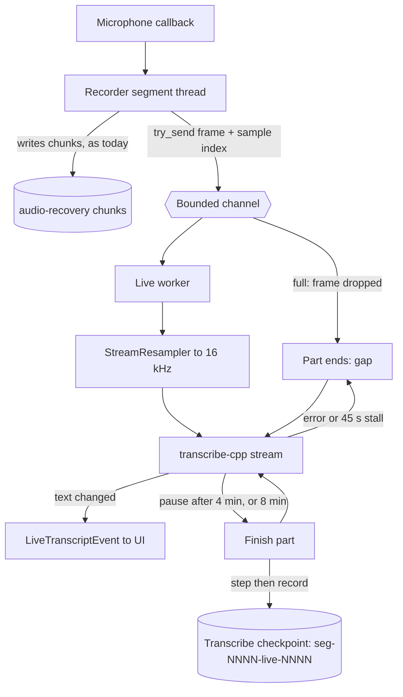
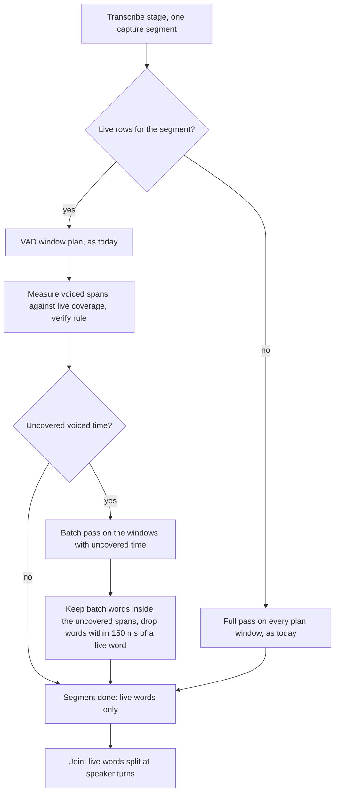
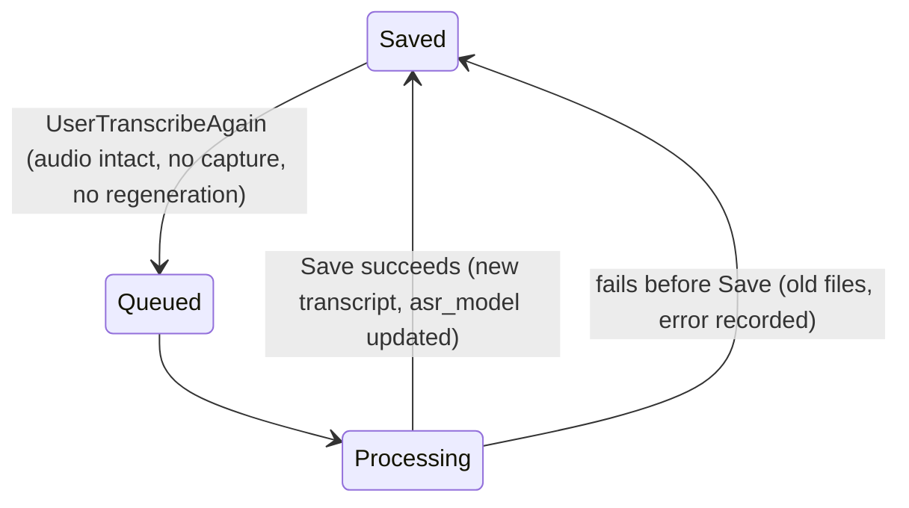

# Recognition Models and Live Transcript - Plan

## Goal Capsule

- **Objective:** The user chooses the recognition model that suits them. With a streaming model, the user can see the transcript while recording, and the note needs no full recognition pass after Stop. When the fast transcript is not good enough, the user can transcribe the note again.
- **Means:** Nine `transcribe-cpp` models from Handy's catalog (KD1, KTD1). A live worker streams recognition during capture and saves each part as it finishes (KTD3, KTD4). Processing after Stop fills only the gaps (KTD6).
- **Product authority:** This plan covers the recognition-model picker, the live transcript, the fast finish, Transcribe Again and the simpler download of the speaker-detection weights. It covers areas B and C of `docs/plans/2026-09-24-1956-feat-ux-redesign-plan.md` (How This Work Fits Together). Speaker labels from the recognition model, a choice of speaker-detection models and system audio capture are not active scope. The Product Contract wins on behavior. A KTD wins on mechanism within the Rs that it cites.
- **Stop conditions:** Stop and ask when a streaming model in R1 cannot produce timed tokens through `transcribe-cpp` 0.2.3, when two models must be in memory at the same time for the live worker to work, or when a change would alter a KD.
- **Execution profile:** Ten units in four phases. `ce-work` implements in a worktree named `recognition-models-and-live-transcript`. Commit per unit. Local checks are the gate (see Verification Contract). Microphone behaviour is tested from the signed bundle.
- **Open blockers:** None.

---

## Product Contract

Product Contract preservation: changed R5, R13 and R16, added R18 and R19, corrected the fast-finish wording (Goal Capsule, Summary, Problem Frame, KD3) after the review measured it, and renamed Reprocess to Transcribe Again (R15–R17, KD6, AE4, AE7). The user approved each change at the plan scoping step. R5 now covers an install whose selected model is absent. R13 now repairs only the parts of a note that the stream did not cover (the pattern that Anarlog uses). R16 now keeps the current title whatever its source. R18 adds the Live transcript switch. R19 adds the return to Saved when Transcribe Again fails, and keeps the previous summary when only the summary fails.

### Summary

Settings gets a recognition-model picker. It offers a curated list of nine models from Handy's catalog, and all nine run on the engine that Longhand already uses. When the selected model streams, the Transcript tab fills in during recording, and processing after Stop skips the full recognition pass. Speaker detection still runs after Stop, about 5 minutes for 30 minutes of audio. A switch turns the live transcript off. A Transcribe Again action runs a full pass on the original audio when the user wants more accuracy. Parakeet Unified EN becomes the default for new installs. The speaker-detection weights become one "Other required models" download.

### Problem Frame

The walking skeleton hard-codes Whisper large-v3-turbo. The user does not want to use this model every day (`docs/ideas/done/recognition-model-picker.md`). Whisper does not stream, so all recognition waits until after Stop. Recognition is not the slowest step: for 30 minutes of audio, speaker detection takes about 300 s and Whisper recognition about 70 s (walking-skeleton plan, Phase 2b checkpoint). The Transcript tab exists during recording, but it shows only "The transcript is ready after you stop recording." (`src/session/SessionPage.tsx`). The Transcription settings pane shows one row for each required weight file: "Speech recognition", "Speaker segmentation" and "Speaker embedding" (`src/settings/Models.tsx`). The user has no choice to make about the last two, but must still read about them.

The skeleton prepared for this change. The catalog lists models and has a `streaming` flag. Settings carry `asr_model`. Each session records its model. Recognition sits behind the `Recognizer` trait. Handy's catalog is a bundled `catalog.json` that a build-time script generates from the `handy-computer` Hugging Face organization, and every entry runs on `transcribe-cpp`. Longhand already uses `transcribe-cpp` 0.2.3, which has a streaming API. Thus the second-engine problem in skeleton KTD6 (a second `ort` pin through `transcribe-rs`) does not apply.

### Key Decisions

- KD1. **A curated list of nine models, not Handy's full catalog.** (session-settled: user-directed — chosen over all compatible models (about 50) and over a verbatim copy of Handy's file: a short list where each model is tested. A later plan can add models.) Governs R1.
- KD2. **The catalog stays bundled in the app. The app does not fetch it at run time.** This keeps the local-first rule and follows Handy. A script refreshes the list from Handy's catalog when a developer runs it. Governs R2.
- KD3. **For a streaming model, the streamed result is the final transcript.** (session-settled: user-directed — chosen over a full pass after every Stop: the user wants the fast finish. Transcribe Again (KD6) gives full accuracy on request.) The review measured the saving as the recognition time only (about 70 s for 30 minutes with Whisper, less with Parakeet), and the user kept this decision on that basis. Governs R11, R13.
- KD4. **Speaker detection stays the same for every model.** (session-settled: user-approved — chosen over the use of a model's own speaker labels: their quality is unknown, and a second speaker-detection path adds cost.) MOSS Transcribe Diarize is in the list only as a recognizer. Governs R10, R12.
- KD5. **The live transcript uses the existing Transcript tab. That tab does not open by default during recording.** (session-settled: user-directed — the user named the existing tab.) The recording page still opens on My notes, so the attention budget in ux-redesign KD2 continues to apply. Governs R8, R9.
- KD6. **Transcribe Again uses the model that is selected now, in a full pass, and it replaces the transcript and the summary.** (session-settled: user-approved — proposed with the tradeoff shown and confirmed: the user can also try an old note with a different model.) Governs R15, R16, R17, R19.
- KD7. **When the user picks a model, the download starts. The model becomes active when it is ready.** (session-settled: user-directed — chosen over a separate download step before a pick: "like how Handy does it now".) Governs R5.
- KD8. **Parakeet Unified EN 0.6B is the default for new installs. An existing install keeps its model.** (session-settled: user-directed — chosen over Whisper large-v3-turbo: a streaming default makes the live transcript and the fast finish work at once.) Governs R3.
- KD9. **One app-wide Live transcript switch, on by default.** (session-settled: user-directed — chosen over a setting for each model and over no setting: one setting saves battery or gives full accuracy for every streaming model.) Governs R18.
- KD10. **The action is named "Transcribe Again…".** (session-settled: user-directed — chosen over "Redo Transcript…" and "Reprocess Note…": plain words.) Governs R15.
- KD11. **Only the parts that the stream did not cover get a full pass.** (session-settled: user-approved — chosen over a full pass for the whole note after a crash or a stream failure: live text that is already saved stays, which follows Anarlog.) Governs R13.

---

### Requirements

**Model list**

- R1. The catalog lists these nine recognition models, with the identifiers from Handy's catalog:

  | Model | Streams | Languages | Handy accuracy / speed |
  |---|---|---|---|
  | Parakeet Unified EN 0.6B (`parakeet-unified-en-0.6b`) | yes | English | 90 / 79 |
  | Nemotron Speech Streaming EN 0.6B (`nemotron-speech-streaming-en-0.6b`) | yes | English | 86 / 80 |
  | Nemotron 3.5 ASR Streaming 0.6B (`nemotron-3.5-asr-streaming-0.6b`) | yes | 28 | 82 / 84 |
  | Multitalker Parakeet Streaming 0.6B (`multitalker-parakeet-streaming-0.6b-v1`) | yes | English | 86 / 96 |
  | Parakeet TDT 0.6B v2 (`parakeet-tdt-0.6b-v2`) | no | English | 89 / 85 |
  | Parakeet TDT 0.6B v3 (`parakeet-tdt-0.6b-v3`) | no | 25 | 88 / 79 |
  | Parakeet TDT 1.1B (`parakeet-tdt-1.1b`) | no | English | 91 / 76 |
  | Whisper large-v3-turbo (the existing entry) | no | 100 | 88 / 35 |
  | MOSS Transcribe Diarize (`moss-transcribe-diarize`) | no | 2 | 88 / 31 |

- R2. Each catalog entry records what the picker and the pipeline need: whether the model streams, its timestamp level, its languages, its size, its licence and attribution, and a pinned source with a checksum. Every entry must produce timestamps, because the speaker join needs them.
- R3. A new install selects Parakeet Unified EN 0.6B. An install that already has a stored model keeps that model.

**Picker**

- R4. The Transcription pane in Settings shows the nine models. For each model it shows the name, a one-line description, the size, the languages, and a tag when the model gives a live transcript. It marks the selected model and the recommended model.
- R5. When the user picks a model that is not downloaded, its download starts. When the selected model is downloaded, it stays in use until the picked model's download and check are complete, and then the picked model becomes the selected model. When the selected model is not downloaded, the pick changes the selected model at once.
- R6. The user can delete a downloaded model that is not selected, to recover disk space. The selected model cannot be deleted.
- R7. The speaker-detection weights appear as one item, "Other required models", with one download action and one combined progress. The pane does not name the individual weight files.
- R18. When the selected model streams, the pane shows a Live transcript switch, which is on by default. When the switch is off, a streaming model does no recognition during recording and runs a full pass after Stop.

**Live transcript**

- R8. When the selected model streams and the Live transcript switch is on, the Transcript tab shows the transcript as it forms during recording. The recording page still opens on My notes, and nothing moves the user to the Transcript tab.
- R9. When the note's model does not stream, or the switch was off when the note started, the Transcript tab during recording says that the transcript is ready after the user stops recording.
- R10. The live text is recognition text only. It has no speaker labels until processing after Stop adds them.

**Fast finish**

- R11. After Stop, a note that has a streamed transcript skips the full recognition pass for every part that the stream covered. Speaker detection, the speaker join, the check, the summary and the save still run.
- R12. Speaker detection runs for every model in the same way as today (KD4).
- R13. After Stop, each part of a note that the stream did not cover gets a full recognition pass. This includes a part lost to a crash, an app quit during recording, a stall or a stream failure. Speech that got no text also gets a full pass.
- R14. A note records the model that it started with. When the user changes the model during a recording, the change applies to the next note.

**Transcribe Again**

- R15. A completed note has a "Transcribe Again…" action. It runs a full recognition pass on the original audio with the model that is selected now, and then runs the steps after recognition again.
- R16. Transcribe Again replaces the note's transcript and summary. It does not change My notes or the note's title.
- R17. When the selected model is not downloaded, Transcribe Again waits for it in the same way that processing waits for missing models today.
- R19. When Transcribe Again fails before it saves, the note returns to Saved with its previous transcript and summary, and the note page tells the user that the new transcript failed. When only the summary step fails, the new transcript is saved, the previous summary stays, and the note page says that the summary could not be updated.

---

### Acceptance Examples

- AE1. **Covers R8, R10.** Given Parakeet Unified EN is selected and the switch is on, when the user records and opens the Transcript tab, text appears as people speak, with no speaker labels. The page opened on My notes.
- AE2. **Covers R9.** Given Whisper large-v3-turbo is selected, when the user opens the Transcript tab during recording, the tab says the transcript is ready after the user stops recording.
- AE3. **Covers R11.** Given a streamed recording of 30 minutes, when the user stops, the transcript with speaker labels is ready without a full recognition pass. Only speaker detection and the later steps run.
- AE4. **Covers R13.** Given the app quits 20 minutes into a streamed recording, when the user opens the app again and the recovered note processes, the saved live text stays, and only the last unsaved part gets a full pass.
- AE5. **Covers R5.** Given Whisper is selected and downloaded and Parakeet TDT 1.1B is not downloaded, when the user picks Parakeet TDT 1.1B, its download starts. A note recorded during the download uses Whisper. After the check completes, Parakeet TDT 1.1B is selected.
- AE6. **Covers R14.** Given a recording started with Parakeet Unified EN, when the user picks Whisper during the recording, the note keeps Parakeet Unified EN, and the next note uses Whisper.
- AE7. **Covers R15, R16.** Given a streamed note with notes the user wrote and a title, when the user runs Transcribe Again with Parakeet TDT 1.1B selected, the transcript and the summary are replaced. My notes and the title do not change.
- AE8. **Covers R6.** Given Parakeet Unified EN is selected, the user cannot delete it. The user can delete a downloaded Whisper.
- AE9. **Covers R3.** Given an existing install with Whisper stored as its model, after the update Whisper stays selected.
- AE10. **Covers R18.** Given Parakeet Unified EN is selected and the user turns the switch off, when the user records, the Transcript tab says the transcript is ready after Stop, and a full pass runs after Stop.
- AE11. **Covers R13.** Given live text stops for 45 seconds during speech, the tab shows that the live transcript is paused, recording continues, and the missing span gets a full pass after Stop.
- AE12. **Covers R19.** Given Transcribe Again fails during recognition, the note shows its previous transcript and summary and says the new transcript failed.
- AE13. **Covers R19.** Given the summary endpoint is offline during Transcribe Again, the note shows the new transcript and its previous summary, and says the summary could not be updated.

---

### Scope Boundaries

- Speaker labels from the recognition model (MOSS, Multitalker Parakeet). `docs/ideas/done/alternative-diarization-architectures.md` records this.
- A choice of speaker-detection models.
- A language setting. The multilingual models detect the language.
- Import of custom model files, and models from Handy's catalog outside R1.
- Models that produce no timestamps (Canary, Cohere, Granite, Qwen3, Voxtral).
- A choice of model for one Transcribe Again run other than the selected model.

#### Deferred to Follow-Up Work

- Gap repair during recording. Anarlog fills gaps from the saved audio while the meeting continues. This plan fills gaps after Stop only.
- Power-aware streaming, for example no live transcript on battery (an idea that was removed on 2026-09-28).
- Handy's accuracy and speed scores in the picker.

### Dependencies / Assumptions

- `transcribe-cpp` 0.2.3 streams with the four streaming models in R1. The stream gives timed tokens only. Words and segments are empty during the stream and after finalize, so Longhand builds words from tokens (KTD5).
- Capture has no 16 kHz feed during recording. Audio is resampled to 16 kHz only in Assemble. The live worker resamples with `pipeline::resample::StreamResampler`.
- Streaming uses the CPU and GPU during recording, which are idle today. This can use more power on battery.
- Handy's catalog and generation script are MIT-licensed (`LICENSES/Handy-MIT.txt`). Borrowed data or code needs a `PROVENANCE.md` record. The model licences include CC-BY-4.0 and "other" (the three NVIDIA Nemotron and Multitalker models), which need attribution.

### Sources / Research

- `reference-source/Handy/src-tauri/src/catalog/catalog.json` and `catalog/mod.rs`: the bundled catalog, its fields, pinned revisions, default quants and checksums. `scripts/gen_catalog.py` generates it.
- `reference-source/Handy/src-tauri/src/managers/transcription.rs` (`run_stream_worker`, `finalize_stream`): Handy's stream worker. It uses the stream text as final and falls back to batch when the stream fails.
- `reference-source/anarlog/crates/listener-core/src/actors/source/pipeline.rs`, `apps/desktop/src/stt/capture-audio-recovery.ts`, `stt/recovered-transcript.ts` and `store/zustand/listener/general-shared.ts`: Anarlog's bounded channels, its gap tracking, its ±150 ms merge of recovered words and its stall watchdog.
- `~/.cargo/registry/.../transcribe-cpp-0.2.3/src/session.rs` (`Session::stream`, `Stream::feed`, `finalize`, `snapshot`) and `transcribe-cpp-sys-0.2.3/src/arch/parakeet/model.cpp` (streaming results have tokens only; the buffered path keeps all PCM).
- `crates/models/catalog.json`, `crates/models/src/catalog.rs`, `crates/models/src/download.rs`, `src-tauri/src/managers/models.rs`.
- `crates/asr/src/engine.rs`: the `Recognizer` trait and the `transcribe-cpp` engine.
- `crates/pipeline/src/runner.rs`, `transcribe.rs`, `join.rs`, `verify.rs`, `checkpoint.rs`, `resample.rs`.
- `src-tauri/src/managers/capture.rs`, `crates/recorder/src/lib.rs`, `src-tauri/src/managers/processing.rs`.
- `crates/session-core/src/state.rs`, `jobs.rs` (`apply_queue_effects`, `set_title`, regenerate claims).
- `src/settings/Models.tsx`, `src/settings/ui.tsx`, `src/session/SessionPage.tsx`, `src/session/SessionMenu.tsx`.
- `docs/solutions/logic-errors/save-state-machine-crash-window-recovery.md`: the step-then-record rule that the live rows and Transcribe Again follow.

---

## Planning Contract

### Key Technical Decisions

- KTD1. **Copy the nine entries from Handy's catalog into `crates/models/catalog.json`, and generate them with a `uv` script.** `scripts/refresh-catalog.py` reads `reference-source/Handy/src-tauri/src/catalog/catalog.json` and writes the nine entries in Longhand's schema. It uses Handy's default quant, pinned revision, file name, size and SHA-256. The URL is `https://huggingface.co/handy-computer/<slug>-gguf/resolve/<revision>/<file>`. The Whisper entry keeps its current Q5_K_M file, so existing installs do not download it again. Multitalker uses the plain file, not the `bundle/` file with the diarizer. Handy's mirror is not used. Rationale: one download path, pinned files, and a repeatable refresh without a network call at run time (KD2). Covers R1, R2.
- KTD2. **The note records its model and its live mode when recording starts.** `record_model_at_stop` becomes a record at start. Resume keeps the note's model. When that model is no longer downloaded, resume records the selected model. A session with no recorded model (a recording that was in progress at the update) gets the model at Stop, as before. This replaces skeleton R20c. Covers R14, R18.
- KTD3. **A live worker runs next to each capture segment and never blocks the recorder.** The recorder sends each 20 ms frame with its sample index through a bounded channel with `try_send`. The worker resamples to 16 kHz and feeds a `transcribe-cpp` stream. When the channel is full, the frame is dropped and the worker ends the current part at the last frame it received. It starts a new part at the next frame. The dropped span becomes a gap (KTD6). A stream error, or 45 seconds of audible input with no new committed text (Anarlog's stall rule), also ends the part as a gap and starts a new stream. The recording never stops for a live failure. Covers R8, R13.
- KTD4. **The worker finishes and restarts the stream in parts.** A part ends at the first pause of at least 600 ms after 4 minutes, and always at 8 minutes. Each finished part is saved at once as a checkpoint row. The row holds the part's audio span and its timed words. The worker saves a part (step) before it records the part as covered (record), following `docs/solutions/logic-errors/save-state-machine-crash-window-recovery.md`. At a forced 8-minute cut, the worker replays the last 2 s of audio into the next part and drops words of the next part that repeat words of the first part by time. Rationale: the `transcribe-cpp` buffered path keeps all PCM (about 230 MB per hour) and decodes all tokens again on each change, so one stream for a whole meeting grows without limit. Anarlog runs one stream, but its recognizer keeps a fixed history. A part also limits what a crash loses. The implementer may change the two durations after a measurement. Covers R8, R13.
- KTD5. **Streaming support is an optional capability of the recognizer.** The `Recognizer` trait gets a method that starts a live stream and returns `None` for a model that does not stream. The stream object has feed, text, finish and reset. `asr::Engine` implements it on `Session::stream` with `StreamOptions::default()`, as Handy does. Words come from the stream's timed tokens: a token that starts with a space starts a new word. For text without spaces between words (Japanese and Chinese in Nemotron 3.5), each token is its own timed unit, so the speaker split in KTD8 can still cut at turn changes. Test fakes implement the same trait. The catalog's `streaming` flag decides whether a live worker starts. At load, a model whose `Capabilities::supports_streaming` disagrees logs a warning and records gaps only, so the note gets a full pass. Covers R8, R11.
- KTD6. **After Stop, recognition fills only the gaps.** Transcribe for a segment with live rows builds the window plan from VAD as today. It then measures each voiced span against the live coverage with the same `verify` coverage function and `SLACK_MS`. It transcribes in batch only the windows that hold uncovered voiced time. A gap-fill run asks for token timestamps and builds words with the same token-to-word builder as KTD5, and its window rows keep those words. Batch words are kept only inside the uncovered spans. A batch word within ±150 ms of a live word is dropped (Anarlog's rule). A segment with no live rows gets a full pass, as today. Rationale: Verify then uses the same coverage rule and passes when recognition succeeds. Covers R11, R13 (KD11).
- KTD7. **Live rows have their own checkpoint keys.** Keys are `seg-NNNN-live-NNNN` in the Transcribe stage. `transcribe::results()`, Join and Verify's text spans read live rows and window rows on purpose. `prepare_retry` keeps live rows and deletes only the flagged windows. A segment discarded under 1 s loses its live rows. Rationale: today every key that starts `seg-NNNN-win-` counts as a finished window, so a shared prefix would create duplicate text.
- KTD8. **Join splits streamed words at speaker changes.** Join assigns each live word to the speaker turn it overlaps most and groups consecutive words of one turn into one line. Batch windows keep today's behaviour, because diarization already cuts them at turn changes. Covers R10, R12.
- KTD9. **The live worker and processing share the one loaded engine.** Processing is suspended during capture. At capture start, the worker takes the engine from the runner's slot if it holds the note's model, and otherwise loads the model into the slot. The runner does not hold the slot lock while it waits in `control.proceed()`: `transcribe::run` receives the slot, locks it for each window only after `proceed()` returns, and loads the note's model again when the slot holds another model or is empty. The suspension stays active after Stop until the worker has saved its last part and returned the engine. Quit stops the worker and frees its stream and engine in the same path as `Runner::shutdown`. Rationale: two loaded models double memory, and ggml's Metal backend asserts at exit when a model is still loaded.
- KTD10. **The live view gets its text from a new event and a catch-up command.** The worker emits `LiveTranscriptEvent { session_id, segment, part, committed, tentative }` when the text changes, and a saved-part event when a part finishes. `live_transcript(session_id)` returns the saved parts plus the current text, for a tab that opens during recording. `SessionDetail` gets the note's model and live mode. Covers R8, R9.
- KTD11. **A pick with a downloaded selected model stores a pending pick.** The settings get `pending_asr_model`. The model manager sets `asr_model` from it after a verified download. A second pick replaces the pending pick and cancels its download. A pick of the selected model clears the pending pick. A failed download clears the pending pick and shows the error. A settings migration to version 3 keeps the stored `asr_model`, and only a store that has no settings gets Parakeet. Covers R3, R5 (KD7, KD8).
- KTD12. **Delete refuses a model that the app still needs.** It refuses the selected model, the pending model, the model of the live worker, and a model that an unfinished note needs. Unfinished means Capturing, Interrupted, Queued, Processing, Blocked, ProcessingFailed or AwaitingDestination, because a note that waits for its destination goes back to the queue and needs its model to be ready. Delete unloads the runner's engine first when it holds that model, because Windows cannot remove an open file. Covers R6.
- KTD13. **The queue skips a note whose model is missing and takes the next ready note.** Notes that are ready keep their order. Rationale: a Transcribe Again that waits for a download (R17) must not stop all other notes. Covers R17.
- KTD14. **Transcribe Again is a new Saved → Queued transition, and a failure returns to Saved.** It follows `Runner::regenerate_summary` and resume from Saved. It refuses while a summary regeneration runs, while any capture is active, and when the note's audio is gone (`home_intact`). It clears the checkpoints of Diarize, Transcribe (live rows too), Join, Verify, Summarize and Save. Assemble decodes the audio again from the note's folder. The session marks the run as a Transcribe Again with the model to use. The note's `asr_model` changes only after Save succeeds. A failure before Save moves the note back to Saved with its files unchanged and records the error for the note page. Summarize does not propose a title for a Transcribe Again, so the folder name does not change. When Summarize fails during a Transcribe Again, Save writes the new transcript and keeps the previous `summary.md` instead of the failure stub (`save::record_summary_failure`), and records that the summary was not updated. A resume of a queued Transcribe Again note clears the marker: the note then processes as a normal resume from Saved, with the model recorded at resume (KTD2), the normal failure path (ProcessingFailed, working directory kept) and the normal title rule. Covers R15, R16, R17, R19.

### High-Level Technical Design

During recording, the recorder writes audio to disk as today. The live worker receives a copy of each frame and must never slow the recorder.

After Stop, each capture segment follows one of two paths. The only change to the stage order is inside Transcribe.

Transcribe Again adds two transitions to the session state machine.

### Assumptions

- Each of the nine GGUF files is one file, so `download.rs` needs no multi-file support. U1 checks this.
- The four streaming models give token times within 100 ms of the batch word times for the same audio. U4 measures this on a fixture.
- A stream restarted at a pause loses no words at the cut. U4 checks this on a fixture with a pause.

### Open Questions

**Deferred to Implementation**

- The exact channel size and the backlog that counts as "behind". Start with 250 frames (5 s).
- The licence name and URL for the three models that Handy lists as "other". Read them from each Hugging Face model card.
- Whether `Recognizer` gets the stream method directly or through a second trait that the engine slot also holds. Choose the shape that keeps the pipeline test fakes simple.

### System-Wide Impact

- **Settings store:** schema version 3 (`pending_asr_model`, `live_transcript`).
- **Session store:** migration `0004` adds the live mode and the Transcribe Again marker and error. The state machine gets two transitions. `set_asr_model` moves from Stop to start.
- **Processing runner:** the queue skips a note that is not ready, the engine slot is shared, and suspension now includes the live drain.
- **Bindings:** new commands and events regenerate `src/bindings.ts` through `cargo test -p longhand export_bindings`.
- **Power:** recognition during recording keeps the CPU and GPU busy. The existing `power::IdleGuard` covers sleep, and battery cost is deferred.

### Risks

| Risk | Mitigation |
|---|---|
| The live worker falls behind real time on a slow machine. | Frames drop into gaps, recording continues, and the gaps get a batch pass (KTD3, KTD6). |
| Live timestamps drift from the assembled 16 kHz file. | Each frame carries its sample index. A test compares live word times with the assembled times within ±50 ms. |
| A stream restart cuts a word. | Parts end at a pause of at least 600 ms. The fixture test checks the cut. |
| A Metal assert at quit while the worker holds the engine. | The worker stops in the same exit path as `Runner::shutdown` (KTD9). |
| A crash during Transcribe Again leaves the note half replaced. | The note's files change only in Save, which is already crash-safe. A failure before Save returns to Saved (KTD14). |

---

## Implementation Units

### Phase 1: Models and settings

### U1. Catalog with nine recognition models

**Goal:** The catalog lists the nine models of R1 with the fields that the picker and the pipeline need.

**Requirements:** R1, R2 (KD1, KD2, KTD1).

**Dependencies:** None.

**Files:**
- `crates/models/catalog.json`
- `crates/models/src/catalog.rs`
- `crates/models/PROVENANCE.md`
- `scripts/refresh-catalog.py` (new)
- `scripts/check-provenance.sh` (only if `scripts/` needs a borrowed-file entry)

**Approach:**
1. Add `languages` (a count and the codes), `recommended` and `quant` to the entry schema. Keep `streaming` and `timestamps`.
2. Write `scripts/refresh-catalog.py` as a `uv` script with inline dependencies. It reads Handy's `catalog.json` for the eight new slugs and prints entries in Longhand's schema. It does not change the Whisper entry.
3. Run it once, and add the output to `catalog.json`. Set `recommended` on Parakeet Unified EN.
4. Change `DEFAULT_ASR_MODEL` to the Parakeet Unified EN id.
5. Record the borrowed catalog data and the script in `crates/models/PROVENANCE.md`, and the model licences in each entry.

**Patterns to follow:** The existing Whisper entry and the catalog tests in `crates/models/src/catalog.rs`. The PROVENANCE record format in `crates/models/PROVENANCE.md`.

**Test scenarios:**
- Every entry has a 40-character revision, an https URL that contains the revision, a 64-character SHA-256 and a licence (the existing check, over nine ASR entries).
- Exactly nine entries have kind `asr`, and their ids match R1.
- The four streaming entries have `streaming: true`, and the other five have `false`.
- Every ASR entry has a timestamp level other than none.
- `required_for(DEFAULT_ASR_MODEL)` returns Parakeet Unified EN plus the segmentation and embedding weights. Update `default_model_needs_three_files`.
- Exactly one entry is `recommended`.

**Verification:** `cargo test -p models` passes, and `scripts/check-provenance.sh` passes.

### U2. Model selection, delete and the Live transcript setting

**Goal:** The backend supports pick-to-download, delete, the single "Other required models" item and the Live transcript switch.

**Requirements:** R3, R5, R6, R7, R18 (KD7, KD8, KD9, KTD11, KTD12).

**Dependencies:** U1.

**Files:**
- `src-tauri/src/managers/settings.rs`
- `src-tauri/src/managers/models.rs`
- `src-tauri/src/commands/models.rs`
- `src-tauri/src/commands/settings.rs`
- `src-tauri/src/commands/readiness.rs`
- `src-tauri/src/lib.rs` (register the commands)
- `src/bindings.ts` (regenerated)
- tests next to the managers, following the existing `#[cfg(test)]` modules

**Approach:**
1. Settings version 3 adds `pending_asr_model: Option<String>` and `live_transcript: bool` (default true). The migration keeps a stored `asr_model` (KTD11).
2. `select_asr_model(id)`: when the model is downloaded, set it. When the selected model is absent, set it at once (R5). Otherwise store the pending pick and start its download.
3. The models manager sets `asr_model` from the pending pick on a verified `Completed` event, clears it on `Failed`, and emits a settings change.
4. `delete_model(id)` applies the refusals of KTD12, unloads the runner's engine when it holds the model, then removes the file and any `.partial` file.
5. `ModelStatus` gets the new catalog fields, and statuses list all nine ASR models. Add a combined status for the speaker-detection weights (one state, summed bytes).
6. `set_live_transcript(bool)`.

**Patterns to follow:** `set_asr_model` in `src-tauri/src/commands/settings.rs`, `apply_settings_migrations`, `start_downloads` and `ModelDownloadEvent` in `src-tauri/src/managers/models.rs`.

**Test scenarios:**
- Covers AE9. A version 2 store with Whisper as `asr_model` reads as Whisper after the migration.
- A store with no settings reads as Parakeet Unified EN and live transcript on.
- Covers AE5. With Whisper selected and downloaded, a pick of an absent model stores a pending pick. `asr_model` stays Whisper until a `Completed` event for that id, and then it changes.
- With the selected model absent, a pick changes `asr_model` at once.
- A second pick replaces the pending pick and cancels the first download.
- A `Failed` event clears the pending pick.
- Covers AE8. Delete of the selected model is refused. Delete of a downloaded model that is not selected removes its file.
- Delete of a model that a Queued note needs is refused.
- Delete of a model that an AwaitingDestination note needs is refused.
- The combined speaker-detection status is Present only when both weights are present, and it sums the bytes.

**Verification:** `cargo test -p longhand` passes, and `src/bindings.ts` matches the export.

### U3. Model picker and Other required models row

**Goal:** The Transcription pane shows the picker, the Live transcript switch and one row for the speaker-detection weights.

**Requirements:** R4, R5, R6, R7, R18.

**Dependencies:** U2.

**Files:**
- `src/settings/Models.tsx`
- `src/settings/SettingsWindow.tsx`
- `src/settings/useAppSettings.ts` (only if the settings refresh needs the new fields)
- `src/settings/Models.test.tsx` (new)

**Approach:**
1. Invoke the `apple-design` skill before building, and `emil-design-eng` for the row details.
2. A list of the nine models. Each row shows the name, description, size, languages, a "Live" tag for a streaming model, a "Recommended" tag, a mark on the selected model, and download progress for the pending pick. When the pending pick's download fails, the row clears its progress and shows "Couldn't download. Try again.", and the selected model stays marked.
3. A click on a row calls `selectAsrModel`. A downloaded row that is not selected has Delete, with a confirmation.
4. The Live transcript switch shows only when the selected model streams.
5. One row, "Other required models", with one Download action and one progress bar. The footer text no longer names the weight files.
6. UI text is plain language and says "note", not "session".

**Patterns to follow:** `Row`, `Button`, `ProgressBar` and `Group` in `src/settings/ui.tsx`. The live download events in `SettingsWindow.tsx`.

**Test scenarios:**
- The pane lists nine models and marks the selected one.
- A click on an absent model calls `selectAsrModel` with its id and shows its progress.
- A downloaded model that is not selected shows Delete. The selected model shows no Delete.
- The Live transcript switch shows for Parakeet Unified EN and not for Whisper. A click calls `setLiveTranscript`.
- A `Failed` download event for the pending pick shows "Couldn't download. Try again." on that row, and the previous selected model stays marked. A click on the row starts the download again.
- With one speaker-detection weight missing, one "Other required models" row shows Download. A click calls `downloadModels` with both ids.
- The pane text never names "Speaker segmentation" or "Speaker embedding".

**Verification:** `bun run test` and `bun run build` pass. A preview page with `mockIPC` shows the pane in light and dark mode.

### Phase 2: Streaming during recording

### U4. Live stream support in the recognizer

**Goal:** The `asr` crate can stream audio through a model and return timed words in finished parts.

**Requirements:** R8, R10, R11 (KTD4, KTD5).

**Dependencies:** U1.

**Files:**
- `crates/asr/src/engine.rs`
- `crates/asr/src/stream.rs` (new)
- `crates/asr/src/lib.rs`
- `crates/asr/tests/stream.rs` (new)
- `crates/pipeline/tests/runner.rs` (extend the `Fake` recognizer)

**Approach:**
1. Add the optional stream method to `Recognizer` (KTD5). Its default returns `None`.
2. `asr::Engine` starts `Session::stream` with `RunOptions` timestamps at the token level and `StreamOptions::default()`.
3. `stream.rs` owns the part policy (KTD4): it feeds 16 kHz audio, reports committed and tentative text, detects the pause and duration limits, and finishes a part into a `LivePart { start_ms, end_ms, words }`.
4. Build words from tokens: join sub-word tokens, keep the first token start and the last token end, and add the part offset.
5. Check `Capabilities::supports_streaming` at load (KTD5).

**Execution note:** Start with the token-to-word grouping and the part policy against a scripted fake stream. Then add the real-model test.

**Patterns to follow:** `Engine::transcribe` and `pad_to_minimum` in `crates/asr/src/engine.rs`. `Voicing` in `crates/asr/src/windows.rs` for incremental audio.

**Test scenarios:**
- Tokens " hel", "lo", " world" become the two words "hello" and "world", with the first and last token times.
- A part does not end before 4 minutes. It ends at the first pause of 600 ms or more after 4 minutes.
- A part with no pause ends at 8 minutes.
- Word times in the second part include the offset of the first part.
- A model with `streaming: false` returns `None` from the stream method.
- Tokens with no leading spaces (a Japanese or Chinese hypothesis) become one timed unit per token, not one long word.
- At a forced 8-minute cut with continuous speech, the 2 s replay keeps every word once: no word is lost and no word repeats.
- An `#[ignore]` test runs every one of the nine catalog models in batch on a fixture and checks that it returns text with timestamps.
- An `#[ignore]` test with `LONGHAND_ASR_MODEL` set to a streaming model streams a fixture, and its word times are within 100 ms of a batch run on the same audio. It prints only counts and times, never text.
- The same ignored test checks that a part cut at a pause keeps the word count of a single stream within one word.

**Verification:** `cargo test -p asr` passes. The ignored batch test passes for all nine models, and the ignored stream tests pass for all four streaming models.

### U5. Model and live mode recorded at recording start

**Goal:** Each note records its model and live mode when it starts.

**Requirements:** R14, R18 (KTD2).

**Dependencies:** U2.

**Files:**
- `crates/session-core/migrations/0004_live_and_transcribe_again.sql` (new)
- `crates/session-core/src/jobs.rs`
- `crates/session-core/src/schema.rs`
- `src-tauri/src/managers/capture.rs`
- `crates/session-core/tests/jobs.rs`
- `crates/session-core/tests/migrations.rs`

**Approach:**
1. Migration 0004 adds `live_transcript INTEGER` to `sessions`. It also adds the Transcribe Again columns that U9 uses (the model to use, and the last error), so there is one migration.
2. `start_session` records `asr_model` and `live_transcript` from settings. The live mode is true only when the model streams and the switch is on.
3. `resume_session` keeps the note's model. When that model is absent, it records the selected model.
4. `stop_in_store` records the model only when none is recorded.

**Patterns to follow:** `record_model_at_stop` and `set_asr_model` in `jobs.rs`. The existing migrations test.

**Test scenarios:**
- Covers AE6. A note started with Parakeet keeps Parakeet after a settings change during recording and after Stop.
- A resumed note keeps its model when that model is present.
- A resumed note whose model was deleted gets the selected model.
- A session with a NULL model at Stop gets the selected model.
- A note started with the switch off, or with Whisper, records live mode false.
- Migration 0004 applies to a version 3 database and keeps existing rows.

**Verification:** `cargo test -p session-core` and `cargo test -p longhand` pass.

### U6. Live worker during capture

**Goal:** A live worker streams each capture segment and saves finished parts, and a live failure never affects the recording.

**Requirements:** R8, R11, R13 (KTD3, KTD4, KTD7, KTD9).

**Dependencies:** U4, U5.

**Files:**
- `crates/recorder/src/lib.rs`
- `src-tauri/src/managers/live.rs` (new)
- `src-tauri/src/managers/capture.rs`
- `src-tauri/src/managers/processing.rs`
- `crates/pipeline/src/runner.rs`
- `crates/pipeline/src/transcribe.rs` (the slot is locked for each window, KTD9)
- `crates/pipeline/src/live.rs` (new: live row keys and read and write helpers)
- `crates/pipeline/src/checkpoint.rs`
- `crates/pipeline/tests/live.rs` (new)
- `crates/recorder/tests/` (extend the existing tests)

**Approach:**
1. `recorder::run_segment` gets an optional frame callback. The callback does a `try_send` of the frame and its sample index and never waits.
2. `open_segment` starts a live worker when the note's live mode is true. The worker owns a `StreamResampler`, the stream and the part policy. It writes each finished part with `pipeline::live` (step, then record).
3. The worker applies the gap rules of KTD3. A drop, an error or a stall ends the part and starts a new stream.
4. Engine sharing and the drain barrier follow KTD9. The runner releases its slot lock before it waits in `control.proceed()`. The `suspended` check also waits for the live drain.
5. `close_segment` finishes the last part. A segment discarded under 1 s deletes its live rows.
6. Segment restarts (sleep, wake, device loss) start a new worker for the new segment. Crash recovery keeps saved live rows. The unsaved part becomes a gap.
7. Emit the events of KTD10.

**Execution note:** Implement the timing test first: live word times must match the assembled 16 kHz file within ±50 ms, including after a dropped span.

**Patterns to follow:** `open_segment` and `close_segment` in `capture.rs`. `checkpoint::put` and the key helpers in `crates/pipeline/src/checkpoint.rs`. `Runner::shutdown` for the engine release.

**Test scenarios:**
- A fake stream that returns words at known sample positions produces live rows whose times match the segment clock within ±50 ms.
- With the channel full for one second, the rows show a gap for that second, and later rows keep correct times.
- A fake stream that returns an error ends the part, starts a new stream, and recording continues.
- Covers AE11. 45 seconds of audible input with no committed text ends the part as a gap.
- A crash after two saved parts leaves two live rows, and the third part is a gap.
- A segment under 1 s leaves no live rows.
- Processing stays suspended after Stop until the worker has saved its last part.
- A recording starts during another note's Transcribe stage with a different model. After Stop, every remaining window of the other note is transcribed by that note's own model.
- The recorder's frame loop never blocks when the worker is slow (a fake worker that sleeps).
- Quit during a live stream frees the engine without an assert (manual check in the signed bundle).

**Verification:** `cargo test -p pipeline`, `cargo test -p recorder` and `cargo test -p longhand` pass. A 10-minute recording in the signed bundle with Parakeet Unified EN produces live rows.

### Phase 3: Processing after Stop

### U7. Gap fill, merge and speaker split

**Goal:** Processing uses the live words, transcribes only the gaps, and gives each word the right speaker.

**Requirements:** R10, R11, R12, R13, R17 (KD11, KTD6, KTD7, KTD8, KTD13).

**Dependencies:** U6.

**Files:**
- `crates/asr/src/engine.rs` (token timestamps for gap-fill windows)
- `crates/pipeline/src/transcribe.rs`
- `crates/pipeline/src/join.rs`
- `crates/pipeline/src/verify.rs`
- `crates/pipeline/src/live.rs`
- `crates/pipeline/src/runner.rs`
- `crates/pipeline/tests/live.rs`
- `crates/pipeline/tests/join.rs`
- `crates/pipeline/tests/verify.rs`
- `crates/pipeline/tests/runner.rs`

**Approach:**
1. Transcribe applies KTD6 to each segment with live rows. Gap-fill windows ask the engine for token timestamps (`crates/asr/src/engine.rs`), and `WindowText` and `WindowResult` get an optional list of words. Join treats those words like live words (KTD8).
2. Expose the coverage function in `verify.rs` so that Transcribe and Verify share it.
3. `transcribe::results()` returns live rows and window rows in time order. It does not return batch words that the merge dropped.
4. Join applies KTD8 to live words.
5. `prepare_retry` keeps live rows (KTD7).
6. `run_next` skips a head note whose model is not ready and takes the next ready note (KTD13).

**Patterns to follow:** `transcribe::run` and its per-window checkpoints. `verify::measure` and `SLACK_MS`. The turn assignment in `join.rs`.

**Test scenarios:**
- Covers AE3. A segment whose live rows cover all voiced time runs no batch window. The fake recognizer's transcribe count is zero.
- A segment with one uncovered voiced span of 20 s transcribes only the windows that overlap it.
- A batch word inside the span within 150 ms of a live word is dropped. A batch word outside the span is dropped.
- Covers AE4. A segment with two saved parts and a lost third part transcribes only the third part's windows.
- A segment with no live rows transcribes every window, as today.
- Verify passes on a segment after a successful gap fill.
- A live phrase that crosses a speaker change becomes two lines with two speakers.
- A Verify failure followed by Retry keeps the live rows and transcribes only the flagged windows.
- With the head note waiting for a model, the next note with a ready model processes first. When the model arrives, the waiting note processes.

**Verification:** `cargo test -p pipeline` passes. The ignored end-to-end test passes with a streaming model and with Whisper.

### U8. Live transcript in the Transcript tab

**Goal:** The Transcript tab shows the live text during recording and keeps it until the saved transcript is ready.

**Requirements:** R8, R9, R10 (KD5, KTD10).

**Dependencies:** U6.

**Files:**
- `src-tauri/src/commands/session.rs`
- `src-tauri/src/lib.rs`
- `src/bindings.ts` (regenerated)
- `src/session/SessionPage.tsx`
- `src/session/LiveTranscript.tsx` (new)
- `src/session/useLiveTranscript.ts` (new)
- `src/session/LiveTranscript.test.tsx` (new)
- `src/session/SessionPage.test.tsx`

**Approach:**
1. Invoke `apple-design` before building. The attention budget of ux-redesign KD2 wins over motion.
2. `SessionDetail` gets the note's model and live mode. Add the `live_transcript` command and register the events.
3. `useLiveTranscript` loads the catch-up text when the tab opens and then applies events for the note's id.
4. `LiveTranscript` shows saved parts as paragraphs and the tentative text in a lighter style. It follows new text while the view is at the bottom. When the user scrolls up, it stops following and shows a "Scroll to bottom" button (Anarlog's pattern).
5. States, each with one plain line: model loading ("Starting the live transcript…"), paused after a gap ("Live transcript paused. The missing part is transcribed after you stop."), and interrupted (the text from before the break stays).
6. The tab chooses the R9 text from the note's live mode, not from the selected model.
7. After Stop, the live text stays on the tab with a status line until the saved transcript loads.

**Patterns to follow:** `src/recording/useCapture.ts` for event subscriptions. `TranscriptTab` for the text style. `AfterStop` in `SessionPage.tsx`.

**Test scenarios:**
- Covers AE1. With live mode true, events for the note's id add text to the tab. Events for another id add nothing.
- The tab opens on My notes during recording, and an event does not change the tab.
- A tab opened after three saved parts shows them from the catch-up command.
- Covers AE2 and AE10. With live mode false, the tab shows the R9 text, even when the selected model streams.
- A note whose model changed during recording still shows its live text.
- A scroll up stops the follow and shows "Scroll to bottom". A click scrolls down and follows again.
- After Stop, the live text stays until `sessionDocument` returns.

**Verification:** `bun run test` and `bun run build` pass. A 10-minute recording in the signed bundle shows live text in the tab.

### Phase 4: Transcribe Again and documents

### U9. Transcribe Again

**Goal:** A saved note can be transcribed again with the selected model, and a failure keeps the previous transcript.

**Requirements:** R15, R16, R17, R19 (KD6, KD10, KTD13, KTD14).

**Dependencies:** U5, U7.

**Files:**
- `crates/session-core/src/state.rs`
- `crates/session-core/src/jobs.rs`
- `crates/pipeline/src/runner.rs`
- `crates/pipeline/src/save.rs`
- `crates/pipeline/src/summarize.rs` (the title rule)
- `src-tauri/src/commands/processing.rs`
- `src-tauri/src/lib.rs`
- `src/bindings.ts` (regenerated)
- `src/session/SessionPage.tsx`
- `src/session/SessionMenu.tsx`
- `crates/session-core/tests/state_machine.rs`
- `crates/session-core/tests/jobs.rs`
- `crates/pipeline/tests/runner.rs`
- `src/session/SessionPage.test.tsx`

**Approach:**
1. Add the event `UserTranscribeAgain` (Saved → Queued) and the transition from a failed Transcribe Again run back to Saved (KTD14).
2. `transcribe_again(id)` applies the refusals of KTD14, clears the checkpoints, records the selected model to use, and queues the note.
3. The runner uses the recorded model for the run. Save writes the new transcript and summary into the note's folder, keeps `notes.md`, and updates `asr_model`. Summarize does not propose a title for the run.
4. A menu item "Transcribe Again…" on a saved note opens a confirmation. It names the model, says when that model is the note's current model, and says that the transcript and summary will be replaced.
5. The note page shows a plain line after a failure: "The new transcript failed. The previous transcript is unchanged."

**Patterns to follow:** `Runner::regenerate_summary` and `save::regenerate_summary`. `apply_queue_effects` for resume from Saved. The Regenerate Summary menu item in `SessionPage.tsx`.

**Test scenarios:**
- Covers AE7. A saved note with notes and a user title, run with a different model: the transcript and summary change, `notes.md` and the title stay, and `asr_model` becomes the new model.
- A saved note with a proposed title keeps that title, and its folder name does not change.
- Covers AE12. A fake recognizer that fails during Transcribe returns the note to Saved with the old `transcript.md` and records the error.
- Covers AE13. A summary endpoint that fails during Transcribe Again: the new `transcript.md` is saved, the previous `summary.md` stays, and the note records that the summary was not updated.
- Transcribe Again is refused while a summary regeneration runs, while a capture is active, and when the audio is gone.
- With the selected model not downloaded, the note waits in the queue, and other notes still process (R17, KTD13).
- A crash during the run resumes it from its checkpoints after launch.
- A queued Transcribe Again that the user resumes and records, and whose processing then fails, ends in ProcessingFailed, and the new segment's audio is still present.
- The confirmation names the selected model, and Cancel changes nothing.

**Verification:** `cargo test -p session-core`, `cargo test -p pipeline`, `cargo test -p longhand` and `bun run test` pass.

### U10. Vocabulary and ideas

**Goal:** The shared documents use the new terms and show the new state of the ideas.

**Requirements:** None directly. It supports the Language rules in `CLAUDE.md`.

**Dependencies:** U9.

**Files:**
- `CONCEPTS.md`
- `docs/ideas/README.md`
- `docs/ideas/done/recognition-model-picker.md`
- `docs/ideas/done/live-transcript-view.md`
- The power-aware processing idea (removed on 2026-09-28)

**Approach:**
1. Add to `CONCEPTS.md`: Recognition model, Live transcript, Part (of a live stream), Gap and Transcribe Again.
2. Set both ideas to `done` and move their rows to Done.
3. Add a note to `power-aware-processing.md` about the live transcript on battery.

**Test scenarios:** Test expectation: none — documentation only.

**Verification:** Each new term has one meaning, and every other document uses the same term.

---

## Verification Contract

| Gate | Command | Applies to |
|---|---|---|
| Format | `cargo fmt --all --check` | every Rust unit |
| Lint | `cargo clippy --workspace --all-targets -- -D warnings` | every Rust unit |
| Rust tests | `cargo test --workspace` | U1, U2, U4–U7, U9 |
| Bindings | `cargo test -p longhand export_bindings`, then no diff in `src/bindings.ts` | U2, U8, U9 |
| Frontend | `bun run build` and `bun run test` | U3, U8, U9 |
| Windows lint | `scripts/check-windows.sh` | every Rust unit |
| Provenance | `scripts/check-provenance.sh` | U1 |
| Real model | `cargo test -p asr -- --ignored` for all nine models (batch) and all four streaming models (stream), and the pipeline end-to-end test with `LONGHAND_ASR_MODEL` set to a streaming model | U4, U7 |
| Signed bundle | `bun tauri build --bundles app`, then a 10-minute recording with Parakeet Unified EN, a quit during recording, and a Transcribe Again | U6, U8, U9 |

CI runs only on the pull request into main. Local checks are the gate.

## Definition of Done

- Every R1–R19 is true, and AE1–AE13 pass as tests or as the signed-bundle check.
- Every gate in the Verification Contract passes.
- A 10-minute recording with Parakeet Unified EN shows live text, and the note is ready without a batch window when no gap exists.
- A quit during a streamed recording keeps the saved parts, and only the lost part gets a batch pass.
- No code from an abandoned approach stays in the diff, and no temporary preview page is committed.
- `CONCEPTS.md` and `docs/ideas/` match the shipped behavior (U10).
