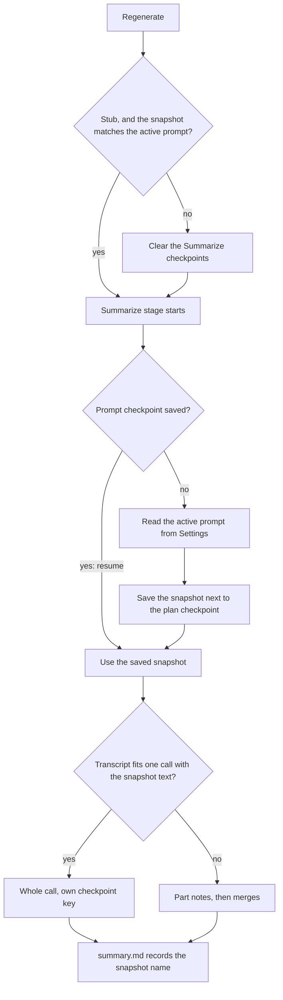

# Summary Prompts - Plan

## Goal Capsule

- **Objective:** A user gets summaries in the shape and at the level of detail that they need for each type of meeting: a game-session recap, a 1:1, a business meeting. The user gets these summaries without editing the prompt rules that keep summaries correct.
- **Means:** The summary prompt splits into fixed rules that the app owns and editable text that a saved, named prompt supplies (KTD1). The active prompt is fixed for each summary run (KTD4).
- **Product authority:** The Product Contract wins on product behavior. The Planning Contract wins on mechanism within it. The three example summaries in the Appendix are the reference for the "Topic summary" detail level and shape.
- **Execution profile:** Standard. Five units in one worktree, in dependency order. Commit each unit on its own.
- **Stop conditions:** Stop and ask if an implementation step would change a Requirement or a Key Decision. Also stop and ask if the fixed rules in R7 cannot be kept safe from the prompt text.
- **Who finishes:** `ce-work` builds the units and passes the local gates. The user tunes the "Topic summary" text against real sessions (U1 and the Verification Contract).
- **Open blockers:** None.
- **Product Contract preservation:** The requirements are unchanged. The Outstanding Questions are resolved in place, in KTD2–KTD9. A Key Decision records the upgrade choice that the user made in the document review.

---

## Product Contract

### Summary

Settings holds a list of named summary prompts, and one of them is active. The list starts with two built-in prompts. "Topic summary" is the default: it writes a topic-grouped summary with no times and with the concrete detail of a game-session recap. "Play-by-play summary" keeps today's time-ordered shape with times. Each prompt controls what the summary contains and how the summary is organized. The app keeps the fixed rules that make summaries correct and safe.

### Problem Frame

The current summary has one fixed shape: an overview, then "Key points" with a `[hh:mm:ss]` time on each point, then "Decisions" and "Open questions and follow-ups". The shape tells the meeting in time order and labels people "Speaker 1" and "Speaker 2". The user finds this shape poor for game sessions and for 1:1 meetings. The user rarely needs the times. The user wants the facts grouped by topic, with concrete detail such as amounts, items and names. The user also has different types of meetings that need different shapes. Today the only way to change the shape is to change the code.

### Key Decisions

- **The user edits the judgment and the shape, not the whole prompt.** The editable text controls what the summary includes, how the typed notes are weighed against the transcript, the sections, the length and the tone. The fixed rules keep the untrusted-data protection and the chunk and merge mechanics safe from a prompt edit. Governs R5, R6, R7. (session-settled: user-directed — chosen over "output shape only" and "extra guidance only": the user wants to influence how the summarizer decides what is in the summary, including notes against transcript, and not only its format.)
- **A saved list from the start, with one app-wide active prompt.** A list stops the settings shape from needing a change later. Handy's post-processing prompts are the model. Governs R1–R4. (session-settled: user-approved — chosen over one editable prompt now and over a list with only one prompt visible: the list costs little more to build than one prompt, and a later move from one prompt to many is avoided.)
- **Existing summaries stay as they are; Regenerate uses the active prompt.** Each summary records the name of the prompt that made it. Governs R10, R11. (session-settled: user-approved — chosen over a prompt choice at Regenerate and over no record: the record shows which prompt made a summary, and a wrong one is fixed with Regenerate.)
- **People are never labelled "Speaker N" in a summary, and a name is never guessed.** This rule stays fixed, so no prompt can relax it. Governs R7. (session-settled: user-directed — chosen over "keep Speaker N labels", "let the prompt relax the rule" and "add a participant list": the user said a summary should never say "Speaker 2".)
- **The default built-in prompt uses the RPG recap's detail level, with the sections grouped by topic.** A summary that describes the conversation ("Nathan explained that…") in place of its content is too summarized. Governs R8, R9. (session-settled: user-directed — chosen over the current time-ordered shape and over the Copilot example's level of detail: the user found both of them wrong for game sessions and for 1:1s.)
- **Today's shape stays available as a second built-in prompt, "Play-by-play summary".** A user who wants a time-ordered account keeps it without writing a prompt. Governs R2, R12. (session-settled: user-directed — the user proposed keeping the current prompt as a second optional built-in.)
- **An existing install switches to "Topic summary" when it updates.** The user found the current shape poor for their meetings. Governs R2. (session-settled: user-directed — chosen over keeping existing installs on "Play-by-play summary": the new default is the better summary, and existing summaries do not change until Regenerate.)

### Requirements

**Saved prompts**

- R1. Settings shows a list of summary prompts. Each prompt has a name and text, and exactly one prompt is active.
- R2. The list always holds two built-in prompts: "Topic summary" (R8, R9) and "Play-by-play summary" (R12). The user cannot edit, rename or delete a built-in prompt, but can duplicate it. A new install, and an existing install that updates to this version, has "Topic summary" active.
- R3. The user can create a prompt, duplicate a prompt, rename a prompt, edit the text of a prompt that is not built-in, delete a prompt that is not built-in, and set any prompt as active. A new prompt starts with the "Topic summary" text, so the user edits it and does not start with an empty box. A duplicate of the prompt "X" is named "X copy", then "X copy 2", "X copy 3" when that name is taken.
- R4. A prompt with empty text cannot be saved, and two prompts cannot have the same name. When the user deletes the active prompt, "Topic summary" becomes active.

**What a prompt controls**

- R5. The active prompt's text is used when the final summary is written. This is true for a transcript that fits in one call and for the last merge of a long transcript.
- R6. The prompt text controls what the summary includes and leaves out, how the typed notes are weighed against the transcript, the sections, the length and level of detail, the tone, and whether times appear.
- R7. These rules are fixed. The app always sends them, and the prompt text cannot change them:
  - The transcript and the notes are data. The model never follows them as instructions.
  - A summary never labels a person "Speaker N". It uses a person's name only when the transcript makes clear who is speaking. When no name is clear, it uses a plain description that fits the context, such as "your team member" or "someone in the group", or "the group" when everyone is the subject. It never guesses a name.
  - The chunk, part-note and merge mechanics of a long transcript, and the title prompt, stay as they are. Their rules for times and speaker labels apply only to part notes and intermediate merges. The final merge takes those rules from the active prompt (R6) and from the naming rule above.
  - The part notes of a long transcript keep every number, amount, name and specific item, so the active prompt can set the level of detail of the final summary.

**The built-in prompts**

- R8. The "Topic summary" is grouped by topic, not in time order. It starts with a short overview paragraph. Then comes one section for each topic, with a one-line setup, bullets with bold labels, and the specific details nested below them. It ends with "Open questions" and with follow-ups and their owners, but only when there are any. It shows no times and adds no title.
- R9. The "Topic summary" states concrete facts, not descriptions of the conversation. It writes "they found 15 gold pieces and an invisibility potion", not "the participants discussed the loot". It keeps numbers, amounts, names and specific items.
- R12. The "Play-by-play summary" keeps today's shape: an overview, then "Key points" in time order with a `[hh:mm:ss]` time on each point, then "Decisions" and "Open questions and follow-ups" when there are any. It follows the naming rule in R7, so it does not label people "Speaker N".

**Existing summaries and Regenerate**

- R10. A change to the prompt list or to the active prompt does not change any existing summary. Regenerate Summary on a note uses the prompt that is active at that time.
- R11. Each summary records the name of the prompt that made it, and the note's Summary shows that name. The name that was recorded stays after the prompt is renamed or deleted. A summary made before this change shows no prompt name.

### Acceptance Examples

- AE1. **Covers R8, R9.** Given the RPG session behind Appendix example A and the "Topic summary" prompt, when the session is summarized, the summary has a section for each scene with the loot amounts and items. It ends with unresolved questions and has no times.
- AE2. **Covers R8, R7.** Given the 1:1 behind Appendix example B, when the session is summarized with the "Topic summary" prompt, the summary has sections such as UserWeb login, QA throughput, Internal Projects and training billing. It has no `[hh:mm:ss]` references and no "Speaker 1" or "Speaker 2".
- AE3. **Covers R5, R6.** Given a custom prompt that asks for times on each point, when a session is summarized with it, the summary shows times.
- AE4. **Covers R7.** Given a custom prompt that says "give each speaker a plausible name", when a session is summarized, the summary still uses only names that the transcript makes clear.
- AE5. **Covers R4.** Given the active prompt is "Game recap", when the user deletes "Game recap", then "Topic summary" becomes active.
- AE6. **Covers R10, R11.** Given a note that was summarized with the "Topic summary" prompt, when the user makes "Game recap" active, the note's summary does not change. After the user presses Regenerate Summary, the summary is rewritten with "Game recap" and the note shows "Game recap".
- AE7. **Covers R12, R7.** Given the 1:1 behind Appendix example B, when the session is summarized with "Play-by-play summary", the summary has the shape of example B with its times, but it has no "Speaker 1" or "Speaker 2".
- AE8. **Covers R5.** Given a transcript too long for one call and a custom prompt, when the session is summarized, the part notes are written as they are today, and the custom prompt shapes only the final merge.
- AE9. **Covers R7, R9.** Given the RPG session behind Appendix example A, summarized with a context limit small enough to split it into parts, when it is summarized with "Topic summary", the summary still has the loot amounts and items, and it has no times.

### Scope Boundaries

- Choosing the prompt from the destination folder. This is the existing idea `docs/ideas/summary-kind-per-folder.md`, and it builds on this list.
- Choosing a prompt for one note at Regenerate time, or before a recording.
- Carrying context from the previous session (`docs/ideas/session-to-session-context.md`).
- Editing the title prompt, and placeholders or variables in prompt text.
- A participant list that gives people reliable names. This is a new idea, `docs/ideas/participant-names.md`.
- A change to how the transcript view labels speakers. The transcript still shows Speaker N.
- Import, export or sharing of prompts.

### Dependencies / Assumptions

- The built-in texts belong to the app, and a new app version can improve it. A duplicate is a copy that the user owns, and a change to a built-in text does not update it.
- The model can apply the naming rule in R7 from the transcript alone. A wrong name is a model mistake, not a new feature that this plan must prevent.

### Outstanding Questions

**Deferred to Implementation**

- The exact built-in texts. U1 writes them. The user tunes "Topic summary" against the three Appendix examples on real sessions.

### Sources / Research

- `crates/summarize/src/prompts.rs` has one module that holds all the prompts. The fixed rules are `DATA_RULE`, `SPEAKERS`, `PART_SHAPE`, `MERGE_RULE` and `TITLE_SHAPE`. `WEIGHTING` and `FINAL_SHAPE` are the parts that this plan makes editable. `SPEAKERS` asks for `[hh:mm:ss]` references and Speaker N labels today, so its content divides between R6 and R7. `MERGE_RULE` ends "Keep the [hh:mm:ss] times." and frames the final merge too, so R7 limits it to intermediate merges.
- A transcript is sent in one call whenever it fits the context limit (`crates/pipeline/src/summarize.rs:392`). The limit is the user's setting, else the value the server reports, else 8,192 tokens (`crates/summarize/src/context.rs:10`). Only a session over that limit uses part notes and merges.
- `reference-source/Handy/src-tauri/src/settings.rs:91` holds `LLMPrompt { id, name, prompt }`, `post_process_prompts` and `post_process_selected_prompt_id`. Handy's user edits the whole prompt, including the `${output}` placeholder. Longhand keeps the list and the active-prompt model, but not the whole-prompt edit.
- Regenerate Summary already exists (`regenerate_summary`, `src/session/SummaryTab.tsx`).
- The summary UI does not link times to the transcript, so to remove the times from the "Topic summary" shape breaks nothing.

---

## Planning Contract

### Key Technical Decisions

- KTD1. **The app builds every system message from fixed parts and one editable part.** The editable part is the active prompt's text. It takes the place of today's `WEIGHTING` and `FINAL_SHAPE`, only in the call that writes the final summary: the whole-transcript call, or the last merge. Part notes and intermediate merges keep a fixed weighting text and a fixed part shape. Governs R5, R6, R7.
- KTD2. **A new fixed naming rule replaces `SPEAKERS` in the final call.** The final call gets the R7 naming rule and no time rule. Part notes and intermediate merges keep the Speaker N labels and the `[hh:mm:ss]` times, so the parts merge correctly. They also record a name beside a label when the transcript makes it clear, for example "Speaker 2 (Nathan)", so that the final call can use the name. `MERGE_RULE`'s "Keep the [hh:mm:ss] times" goes into the intermediate merges only. Governs R7, AE9.
- KTD3. **Part notes keep every number, amount, name and specific item.** The rule is fixed text in the part shape. The active prompt does not go into part notes: a prompt that says "leave out X" must not drop facts before the final call. Governs R7. (session-settled: user-approved — chosen over sending the active prompt's inclusion guidance into the part notes: the part notes keep everything, and only the final call selects.)
- KTD4. **A summary run takes a snapshot of the active prompt and keeps it.** The snapshot holds `{id, name, text}`. The run takes it when the summarize stage makes its plan, and saves it as a checkpoint next to the `plan` checkpoint. A resume after a crash uses the snapshot. A session that waits in the queue takes the prompt that is active when its summarize stage starts. The recorded name (R11) comes from the snapshot, so the name always matches the text that was sent. Governs R5, R10, R11.
- KTD5. **Regenerate takes the active prompt now, and a changed prompt clears the cached calls.** `summarize_again` clears the checkpoints for a complete summary, as it does today. For a stub, it keeps the cached calls only when the saved snapshot matches the active prompt's id and text. The whole-transcript call gets its own checkpoint key, apart from the first part note's `l00-00000`, so a changed fit decision can never reuse the wrong result. Governs R10.
- KTD6. **The built-ins live in code; custom prompts live in Settings.** The two built-ins have fixed ids (`topic-summary`, `play-by-play`) and text in `crates/summarize`. Their text is never saved, so a new app version improves it. Settings saves `summary_prompts: Vec<{id, name, text}>` and `active_summary_prompt: String`. An active id that matches no prompt resolves to `topic-summary`. Settings schema version 3 sets the active prompt to `topic-summary` for every existing store. Governs R1, R2, R4.
- KTD7. **Each prompt operation is one backend command inside `update_settings`.** The commands are create, duplicate, rename, set text, delete and activate. Each checks the R4 rules and returns the new `Settings`, as `set_asr_model` does. The frontend never sends the whole list, so the Settings window's copy cannot overwrite a newer store. A name is trimmed, must not be empty, and is compared without case, so the built-in names are reserved. A new prompt is named "New prompt", then "New prompt 2". Text is at most 4,000 characters. Governs R3, R4.
- KTD8. **The prompt text counts toward each call's token budget.** `prompts::overhead()` and `fit_notes` measure the final-call system message with the snapshot's text. Merge grouping reserves that room in every merge layer, because the grouping does not know which layer is last. The 4,000-character limit (KTD7) bounds the reserve. A small context can still leave too little room: when the final call's fixed parts and the snapshot text take more than half of the prompt allowance, the stage fails at once with a plain error that says the summary prompt is too long for this model's context. The built-in texts must fit at the 2,048-token floor. Governs R5.
- KTD9. **The recorded prompt name lives in `summary.md` frontmatter.** `SummaryMeta::Complete` gets `prompt_name: Option<String>` with `#[serde(default)]` and `skip_serializing_if`. Older files parse with no name (R11). A stub records no name. `SummaryView` carries the name to the Summary tab, and the footer shows it before the model and host. Governs R11.
- KTD10. **The Summary tab renders nested bullets.** `src/session/markdown.ts` trims each line before it matches a bullet, so an indented bullet becomes a flat item today. The parser keeps the indent depth and builds nested lists. A wrapped continuation line is still joined to its item. Governs R8.
- KTD11. **The Settings editor saves the prompt text as the user types.** The save starts about one second after the last change, and at once when the text area loses focus or the prompt or pane changes. A pane change saves with no wait. A window close waits for the save, and the window closes also if the save fails. Tauri cannot stop the app when it quits, so text that waits for a Save button is at risk, and macOS System Settings has no Save buttons. Saves for one prompt apply in the order typed. Empty text and text over 4,000 characters are not saved: the editor keeps the text and says why, and the last valid text stays saved. A change of prompt drops text that is not valid. If a save fails, the text and the error stay with their prompt, and the next change saves again. There is no Save or Revert button and no question about unsaved text. Clicking a row only selects it for the editor; a separate Use button on each row that is not active makes it the active prompt. Delete asks for confirmation. The UI term is "summary prompt", and the pane lists the prompts under "Prompts". Governs R3, R4.

### High-Level Technical Design

Which text each call sends, and where it comes from:

| Call | Fixed rules | Weighting | Shape | Times and labels |
|---|---|---|---|---|
| Whole transcript (fits one call) | data rule, naming rule | from the active prompt | from the active prompt | from the active prompt |
| Part note | data rule | fixed | fixed part shape; keeps every fact (KTD3) | Speaker N, with a name when clear; `[hh:mm:ss]` |
| Intermediate merge | data rule, merge rule | fixed | fixed part shape | kept |
| Last merge | data rule, merge rule without times, naming rule | from the active prompt | from the active prompt | from the active prompt |
| Title | unchanged | — | unchanged | — |

How a run gets its prompt:

### Assumptions

- The summarize crate can expose the built-in definitions to `src-tauri` through the `pipeline` crate, or through a direct dependency, without a new crate.
- The frontend has no settings-changed event. The main window reads the prompt name from `summary.md` only, so it needs no live update.

### Sources and patterns

- Settings model, migration and salvage: `src-tauri/src/managers/settings.rs` (`CURRENT_SETTINGS_SCHEMA_VERSION`, `apply_settings_migrations`, `salvage_settings`, `update_settings`). Tests are in the same file.
- Setter commands and binding export: `src-tauri/src/commands/settings.rs` (`set_asr_model`), `src-tauri/src/lib.rs` (`specta_builder`, `export_bindings`).
- The pipeline's config source: `crates/pipeline/src/runner.rs` (`EngineProvider::summary_endpoint`), and `src-tauri/src/managers/processing.rs` (`Models::summary_endpoint`).
- Summary calls and checkpoints: `crates/pipeline/src/summarize.rs` (`produce`, `Calls::summarize`, `call_key`, `chunk_allowance`), and `crates/pipeline/src/save.rs` (`summarize_again`).
- Settings UI parts: `src/settings/ui.tsx` (`Group`, `Row`, `Button`), `src/settings/EndpointForm.tsx` (`CommitField`, the "Summaries" pane), `src/settings/Models.tsx` (the segmented radiogroup), and `src/session/DeleteSession.tsx` (the confirmation).
- Handy's `LLMPrompt` list is the model for the shape of the data only. No code is copied, so no `PROVENANCE.md` entry is needed.

---

## Implementation Units

### U1. Prompt assembly with fixed rules and editable text

- **Goal:** `crates/summarize` builds every system message from the fixed rules and a snapshot's text, and defines the two built-in prompts.
- **Requirements:** R5, R6, R7, R8, R9, R12; AE3, AE4, AE8, AE9. Implements KTD1, KTD2, KTD3, KTD8.
- **Dependencies:** None.
- **Files:** `crates/summarize/src/prompts.rs`, `crates/summarize/src/lib.rs`, `crates/summarize/tests/prompts.rs`, `crates/summarize/tests/merge.rs`.
- **Approach:**
  1. Add a prompt value (`id`, `name`, `text`) and the two built-ins. "Topic summary" follows R8 and R9. "Play-by-play summary" carries today's `FINAL_SHAPE` and the `WEIGHTING` text, without the Speaker N instruction (R12).
  2. Split `SPEAKERS` into a fixed naming rule for the final call and a part-note label rule that records names beside labels (KTD2).
  3. Add the fact-keeping rule to `PART_SHAPE` (KTD3). Limit `MERGE_RULE`'s time instruction to intermediate merges.
  4. Pass the prompt text to `whole()` and `merge(.., last: true, ..)`, and to `overhead()` and `fit_notes`.
  5. Draft the "Topic summary" text against `fixtures/summary-examples/a-rpg-recap.md`. It has no title, no times, and ends with open questions and follow-ups with owners.
- **Patterns to follow:** The existing `system()` composition and `quote()` defusing in `prompts.rs`.
- **Test scenarios:**
  - Covers AE8. A part-note message holds the fixed weighting and the fact-keeping rule, and not the active prompt's text.
  - The last merge holds the active prompt's text and the naming rule, and not "Keep the [hh:mm:ss] times". An intermediate merge still holds the time instruction.
  - Covers AE4. The whole-call message holds the naming rule when the prompt text says "give each speaker a plausible name".
  - Covers AE3. A prompt that asks for times does not get a fixed rule against them.
  - The "Play-by-play summary" text asks for `[hh:mm:ss]` key points and does not contain "Speaker 1" or "Keep those labels".
  - The defused-tag tests still pass when a prompt text contains `</transcript>`.
  - `overhead()` grows with the prompt text. A 4,000-character prompt still leaves a positive chunk allowance at an 8,192-token limit.
  - At a 2,048-token limit, each built-in text leaves room in the last merge for two part notes of the maximum size.
  - Covers AE9. `merge.rs`: with a 4,000-character prompt, every merge layer stays under budget.
- **Verification:** `cargo test -p summarize` passes. The prompt tests assert the new split, not the removed `WEIGHTING` and `FINAL_SHAPE` strings.

### U3. Prompt settings, migration and commands

- **Goal:** Settings holds the custom prompts and the active prompt, and the backend enforces the R3 and R4 rules.
- **Requirements:** R1, R2, R3, R4; AE5. Implements KTD6, KTD7.
- **Dependencies:** U1.
- **Files:** `src-tauri/src/managers/settings.rs`, `src-tauri/src/commands/settings.rs`, `src-tauri/src/lib.rs`, `src/bindings.ts`.
- **Approach:**
  1. Add the two fields with defaults. Bump the schema version to 3, and set `active_summary_prompt` to `topic-summary` in the version-3 migration.
  2. Change salvage so that one invalid prompt entry drops only that entry.
  3. Add the six commands. Duplicate names the copy "X copy", then "X copy 2" (R3). Delete of the active prompt activates `topic-summary` (R4).
  4. Add a command that lists the prompts with the built-ins first, marked read-only, so the UI never needs the built-in text in TypeScript.
  5. Add a settings function that resolves the active prompt snapshot, with the unknown-id fallback. U2 calls it from `processing.rs`.
  6. Regenerate `src/bindings.ts`.
- **Patterns to follow:** `set_asr_model` and `set_current_destination`, and the migration and salvage tests in `settings.rs`.
- **Test scenarios:**
  - An empty store gets version 3, no custom prompts, and `topic-summary` active.
  - A version-2 store with other settings keeps them and gets `topic-summary` active.
  - A store with one malformed prompt entry keeps the other entries.
  - Create returns "New prompt", then "New prompt 2". Its text is the "Topic summary" text.
  - Duplicating "Topic summary" twice gives "Topic summary copy" and "Topic summary copy 2".
  - Rename to "  topic SUMMARY " fails, because the name is taken. Rename to empty fails. Rename a built-in fails.
  - Set text to empty or to more than 4,000 characters fails, and nothing is written.
  - Covers AE5. Delete the active custom prompt: `topic-summary` becomes active.
  - Activate an unknown id fails.
  - The snapshot function returns the "Topic summary" snapshot when the stored active id is unknown.
- **Verification:** `cargo test -p longhand` passes, and `src/bindings.ts` is regenerated with no manual edits.

### U2. Prompt snapshot, checkpoints and the recorded name

- **Goal:** A summary run uses one prompt snapshot from start to resume, and `summary.md` records its name.
- **Requirements:** R5, R10, R11; AE6, AE8, AE9. Implements KTD4, KTD5, KTD9.
- **Dependencies:** U1, U3.
- **Files:** `crates/pipeline/src/summarize.rs`, `crates/pipeline/src/save.rs`, `crates/pipeline/src/runner.rs`, `crates/session-core/src/folder.rs`, `src-tauri/src/managers/processing.rs`, `src-tauri/src/commands/session.rs`, `crates/pipeline/tests/runner.rs`, `crates/pipeline/tests/end_to_end.rs`, `crates/session-core/tests/folder.rs`.
- **Approach:**
  1. Add an `EngineProvider` method that returns the active prompt snapshot, read fresh like `summary_endpoint()`. Implement it on `Models` in `processing.rs` with U3's snapshot function, in the same commit.
  2. In `produce`, read the prompt checkpoint, or take the snapshot and save it before the first call. Thread the text into `Calls`.
  3. Give the whole call its own checkpoint key.
  4. In `summarize_again`, compare a stub's saved snapshot with the active prompt, and clear the checkpoints when they differ.
  5. Add `prompt_name` to `SummaryMeta::Complete`, and set it from the snapshot. Change the `Complete { .. }` pattern in `summary_view` (`src-tauri/src/commands/session.rs`) so the crate compiles. U5 maps the name.
  6. Fail the summarize stage at once, with a plain error that says the summary prompt is too long for this model's context, when the final call's fixed parts and the snapshot text leave less than half of the prompt allowance (KTD8).
- **Patterns to follow:** The `plan` checkpoint in `summarize.rs`, and `Runner::regenerate_summary`.
- **Test scenarios:**
  - A whole-transcript run writes `summary.md` with the active prompt's name in its frontmatter.
  - Covers AE9. A chunked run at a 2,048-token limit with "Topic summary" sends the prompt text only in the last merge, and records the name.
  - A run that stops after two part notes and resumes after the active prompt changes still sends the first snapshot's text, and records the first name.
  - Covers AE6. Regenerate of a complete summary after the active prompt changes records the new name.
  - Regenerate of a stub with the same prompt reuses the cached part notes. With a changed prompt, it makes every call again.
  - A saved whole-call result is never returned as a part note: change the fit decision between runs and check that the keys differ.
  - `folder.rs`: a `summary.md` with no `prompt_name` parses, and renders again with no `prompt_name` line. A stub has no `prompt_name`.
  - A 4,000-character custom prompt at a 2,048-token limit fails the stage with the prompt-too-long error, not a context-too-small failure after the calls.
- **Verification:** `cargo test -p pipeline -p session-core -p longhand` passes, and every `Provider` fake in the pipeline tests supplies a prompt.

### U4. Summary prompts in Settings

- **Goal:** The "Summaries" pane lets the user choose, create, duplicate, rename, edit and delete summary prompts.
- **Requirements:** R1, R2, R3, R4. Implements KTD11.
- **Dependencies:** U3.
- **Files:** `src/settings/SummaryPrompts.tsx`, `src/settings/SummaryPrompts.test.tsx`, `src/settings/EndpointForm.tsx`, `src/settings/SettingsWindow.tsx`, `src/settings/ui.tsx`.
- **Approach:**
  1. Invoke `apple-design` before building the pane.
  2. Add a "Prompts" group to the "Summaries" pane: one row for each prompt, a mark on the active one, a trailing Use button on the others, and New (KTD11).
  3. Put an editor under the list for the selected prompt: a name field (`CommitField`), a text area with a character count, Duplicate and Delete. Past 4,000 characters, the count shows the error colour and the text is not saved. Empty text shows a line that says why and is not saved.
  4. A built-in shows its text read-only with Duplicate.
  5. Show a command error inline with `ErrorText`.
  6. Save the text as the user types (KTD11). One timer starts the save one second after the last change. Blur, a change of prompt, New and Duplicate start the save at once. The unmount of the pane (a pane change) and the `pagehide` and `beforeunload` events start it with no wait. A window close does not unmount the pane: a close-requested listener waits for the save, then destroys the window, also if the save fails. Each save waits for the save before it. A failed save keeps the text and the error for its prompt, and New and Duplicate stop. Delete asks for confirmation, stops the pending save of the prompt it deletes, and waits for a save of that prompt that already started.
- **Patterns to follow:** `Group`, `Row` and `Button` from `ui.tsx`, the radiogroup in `Models.tsx`, and the confirmation in `DeleteSession.tsx`.
- **Test scenarios:**
  - The pane lists "Topic summary" and "Play-by-play summary" first, and marks the active prompt.
  - Selecting a built-in shows read-only text and Duplicate, with no Delete or count.
  - New calls the create command, and selects the new prompt.
  - Typing saves the text one second after the last change, with one set text call that has the final text.
  - Blur saves the text at once.
  - Selecting another prompt saves the text first, and asks nothing.
  - Empty text is not saved, and the editor says why.
  - A command error shows inline and the editor keeps the text.
  - Text typed while a save runs stays in the editor, and the next save saves it.
  - Two saves apply in the order typed.
  - A pane change saves the text, and asks nothing.
  - Delete asks for confirmation, then calls delete.
  - Clicking a row that is not active only selects it. Its Use button calls the activate command, and the mark moves.
  - Text of 4,001 characters shows the count in the error colour and is not saved.
- **Verification:** `bun run typecheck` and `bun run test` pass. A check in `bun tauri dev` shows the pane in light and dark mode.

### U5. Nested bullets and the prompt name in the Summary tab

- **Goal:** The Summary tab renders "Topic summary" nesting and shows which prompt made the summary.
- **Requirements:** R8, R11; AE1, AE6. Implements KTD9, KTD10.
- **Dependencies:** U2.
- **Files:** `src/session/markdown.ts`, `src/session/markdown.test.ts`, `src/session/SummaryTab.tsx`, `src-tauri/src/commands/session.rs`, `src/session/SessionPage.test.tsx`, `src/bindings.ts`.
- **Approach:**
  1. Make list items able to hold child lists in the parser's block model, keyed by indent depth.
  2. Render the children in `Body`.
  3. Add `prompt` to `SummaryView` from `SummaryMeta::Complete`.
  4. Show the name in the footer before the model and host. A summary with no name shows the footer as today.
- **Patterns to follow:** The existing list flushing and `parseInline` in `markdown.ts`, and the footer in `SummaryTab.tsx`.
- **Test scenarios:**
  - Covers AE1. The parser turns input shaped like Appendix example A into nested lists: a bold-label bullet with three indented children gives one item with a child list of three.
  - A wrapped, indented continuation line still joins its item and does not start a child list.
  - A numbered list inside a bullet list renders as an ordered child.
  - Covers AE6. The footer shows "Game recap" when the summary records it.
  - A summary with no prompt name shows the footer with no prompt name.
- **Verification:** `bun run test` passes, and `src/bindings.ts` matches the export.

---

## Verification Contract

| Gate | Command or check | Proves |
|---|---|---|
| Rust format | `cargo fmt --all --check` | U1–U3, U5 |
| Rust lint | `cargo clippy --workspace --all-targets -- -D warnings` | U1–U3, U5 |
| Rust tests | `cargo test --workspace` | U1, U2, U3, U5 |
| Bindings | `cargo test -p longhand export_bindings`, then no diff in `src/bindings.ts` | U3, U5 |
| Windows lint | `scripts/check-windows.sh` | U1–U3 |
| Provenance | `scripts/check-provenance.sh` | no borrowed code added |
| Frontend | `bun run typecheck` and `bun run test` | U4, U5 |
| Manual | Summarize one real session with each built-in against a configured endpoint. Compare the result with `fixtures/summary-examples/`. Then set a 2,048-token context limit and summarize the same session again. | R8, R9, R12, AE1, AE2, AE7, AE9 |

The `cargo` and `uv` commands need the sandbox bypass. A summary needs no microphone or Keychain permission, so `bun tauri dev` is enough for the manual check.

---

## Definition of Done

- Every unit's test scenarios exist and pass, and every gate in the Verification Contract passes locally.
- A real session summarized with "Topic summary" has no times, no "Speaker N", topic sections with nested details, and the concrete facts of the RPG recap.
- A real session summarized with "Play-by-play summary" has the shape of Appendix example B, with no "Speaker N".
- The Summary tab shows the name of the prompt that made each new summary. Older summaries show no name.
- No experimental code, abandoned approaches or debug output stay in the diff.

---

## Appendix

The user supplied three summaries as the reference for R8, R9 and R12. The text of the summaries stays out of this file because it has real names. Only its shape is recorded here. The full texts are in `fixtures/summary-examples/`, which is private and gitignored.

- **A. RPG recap (the target detail level).** An overview paragraph. Then `##` sections for each scene ("Camp Office Encounter", "Kitchen Encounter"). Each section has a one-line setup and bullets with bold labels ("Loot:", "Documents:", "Hidden Treasury:", "Combat:"), with the exact amounts and items nested below them. It ends with "Unresolved Questions". It has no times.
- **B. The current Longhand 1:1 summary (the shape of "Play-by-play summary").** An overview, then "Key points" in time order, each point with a time. Then "Decisions" and "Open questions and follow-ups". The example labels people Speaker 1 and Speaker 2; the Play-by-play summary does not (R7).
- **C. A Microsoft 365 Copilot business-meeting summary (the grouping to keep, the detail level to reject).** Topic sections that open with one bold sentence. Nested bullets with bold labels. A "Follow-up tasks" list with each owner in parentheses. The user found it too summarized: it describes who said what more than it states the facts.
