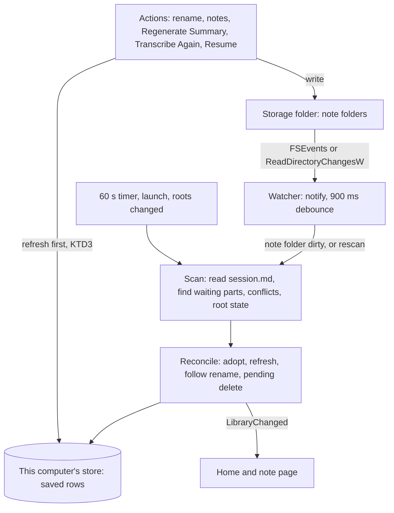
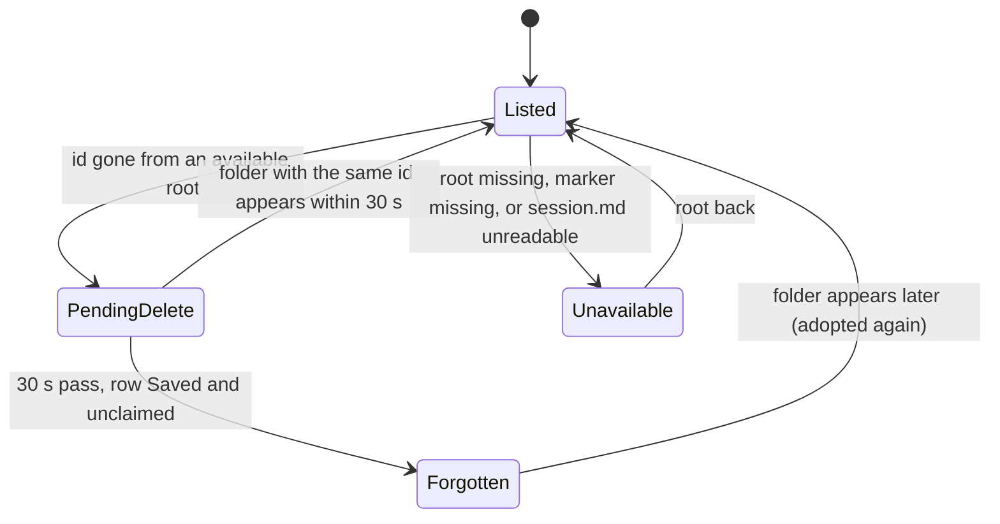
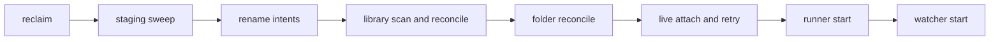

# One Library Across Computers - Plan

## Goal Capsule

- **Objective:** A person who uses Longhand on several computers that sync one folder sees the same notes in Home on each computer, and can do anything with a note on any of them, whichever computer recorded it.
- **Means:** `session.md` becomes the complete record of a saved note (KD2, KTD2). Notes from other computers become ordinary saved rows in this computer's database, built from their folders (KTD1). Every writer follows the folder first (KD4, KTD3). A library scan at launch and a folder watcher while open keep the rows current (KTD5–KTD7).
- **Product authority:** This plan covers the shared library, the complete `session.md`, folder watching, and the change of the UI term "Destination" to "Storage". Search and the other parts of `docs/ideas/library-and-browsing.md` are not active scope. The Product Contract wins on behavior. A KTD wins on mechanism within the Rs that it cites.
- **Stop conditions:** Stop and ask when a saved-row import cannot fit the session state machine without a new state, when `notify` cannot watch a folder under `~/Library/CloudStorage` at all, or when a change would alter a KD.
- **Execution profile:** Eight units in four phases. `ce-work` implements in a worktree named `one-library-across-computers`. Commit per unit. Local checks are the gate (see Verification Contract). The synced-folder behavior is tested manually from the signed bundle on two computers.
- **Open blockers:** None.

---

## Product Contract

Product Contract preservation: changed KD3 — its line on a computer with no stored recognition results now says that Resume reuses the text of `transcript.md`; the user approved this at the plan review. The Outstanding Questions section now points to the KTDs that resolve each question.

### Summary

Each computer lists every saved note in its storage folders. That includes notes that another computer recorded and a sync service delivered. `session.md` holds everything that Home and the note page need, so a computer can rebuild its list from the folders alone. While Longhand is open, it watches the storage folders, so notes appear, change and disappear within seconds after a sync. Every action on a saved note works on every computer, including Resume and Transcribe Again. When a sync service makes a conflict copy, the note shows a small notice. The UI calls the storage folder "Storage" everywhere.

### Problem Frame

The user records on more than one computer, for example a work laptop and a home desktop, and all of them save to one folder that OneDrive, Google Drive or Dropbox syncs. Saving already works: the folders from each computer sit side by side, and each computer writes only to folders that it created. But Home is built from each computer's own database (`list_sessions` in `src-tauri/src/commands/session.rs`). So each computer lists only the notes that it recorded, and a note from the other computer is visible only in Finder.

Walking-skeleton `KD5` and `R25` already say that the folders hold the content and that the index holds nothing that cannot be rebuilt from them. The code does not fully meet that rule yet. The title source, the recognition model and the number of speakers found are only in the database. Several writers also treat the database as the authority for a saved note:
- The launch reconcile renames a folder back to the stored title.
- A notes save writes the database copy.
- Regenerate Summary builds its input from this computer's stored recognition results (`transcript_turns` in `crates/pipeline/src/summarize.rs`). On a computer without them, it makes a summary of an empty transcript and reports no error.
- Resume and Transcribe Again rewrite `notes.md` and `session.md` from the database (`update_home` in `crates/pipeline/src/save.rs`).

### Key Decisions

- KD1. **One person, several computers, not several people.** The library is one user's notes across the user's own computers. Shared use by colleagues is out of scope. *(session-settled: user-directed — chosen over a folder that several people share: the user named this case explicitly.)*
- KD2. **The missing fields go into `session.md` frontmatter, not a second metadata file.** The frontmatter is already the authoritative manifest (`SessionDoc::parse` in `crates/session-core/src/folder.rs`), and one manifest cannot disagree with itself when a sync delivers only part of a folder. *(session-settled: user-directed — chosen over a separate machine-only metadata file and over deriving defaults with no new fields: two files can disagree after a partial sync, and defaults leave the R25 gap open.)* Governs R3, R4.
- KD3. **Every action works on every computer, including Resume and Transcribe Again.** Both decode the earlier segments from the audio in the note folder (walking-skeleton R6d, `assemble.rs`), and that audio syncs, so neither needs the recording computer. On Resume, a computer that has no stored recognition results for the note takes the earlier segments' text from `transcript.md` and transcribes only the new segment. Transcribe Again always makes a full new pass. *(session-settled: user-directed — chosen over Resume only on the recording computer, after review showed that the working-state reason for that limit was false.)* Governs R13, R14.
- KD4. **The note folder is the authority for a saved note on every computer, including the one that recorded it.** This computer's database is a copy that follows the folder. Governs R9, R14, R18.
- KD5. **Live updates, not only at launch.** *(session-settled: user-directed — chosen over a rescan at launch and on window focus, and over a rescan at launch plus a Refresh action.)* Governs R7, R8, R11.
- KD6. **Longhand reads the real file and shows a notice when a conflict copy exists.** The user resolves the conflict in Finder, and the notice says that there is something to resolve. *(session-settled: user-directed — chosen over ignoring conflict copies silently, after review showed that edits on every computer make conflicts more likely, and over listing the copy as a second note.)* Governs R15.
- KD7. **A missing storage folder is not a delete.** When a whole storage folder is unavailable (an unmounted drive, a sync client that is signed out), its notes stay listed. Only a note folder that is gone from an available storage folder counts as deleted. Governs R10, R16.
- KD8. **The rename to "Storage" is UI text only.** "Destination" stays the term in code, docs and `CONCEPTS.md`, the same way that the UI says "note" and the code says "session". *(session-settled: user-directed — the user limited the rename to the UI.)* Governs R17.
- KD9. **Notes from the user's other computers do not conflict with the "Nothing writes into Longhand" boundary in `STRATEGY.md`.** They are the user's own recordings, made by Longhand. The boundary is about outside context.
- KD10. **An action uses the settings of the computer that runs it.** Settings are per computer: the recognition model, the active summary prompt and its text, the summary endpoint and model, the microphone and the Computer audio default. A summary names its prompt in `summary.md`, and that name can belong to a prompt that another computer does not have. Governs R13.

### Requirements

**The library**

- R1. Home lists every saved note in every storage folder that this computer retains (walking-skeleton R25a), whichever computer recorded it.
- R2. Home also lists this computer's notes that are not saved yet (recording, processing, waiting for a folder), as it does today. A note that is recording or processing on another computer does not appear until that computer saves it.
- R3. `session.md` frontmatter holds every field that Home and the note page need to show a saved note: at least the title and whether the user set it, the recognition model and the speakers found. Each segment record already holds its channel count, so a note's stereo segments are known from `session.md`. The body of `session.md` stays readable for people.
- R4. A computer that has no database row for a note builds its view of the note from the note folder alone, with no loss. Deleting the database on any computer loses no user content (walking-skeleton R25). Data that only one computer's database holds is never needed to show or act on a saved note: its stored recognition results, the prompt snapshot of a summary run, the microphone choice, and the status of a Transcribe Again run.
- R5. Notes saved before this change, whose `session.md` lacks the new fields, still appear and open. Missing fields get safe defaults: a title counts as set by the user, so it is never replaced automatically.
- R6. A note appears in Home when its `session.md` is valid. Until its transcript, summary and notes files arrive, the note page shows those parts as waiting for the sync, and notes edits, Regenerate Summary, Transcribe Again and Resume wait for them. The same applies when a listed note's files are updated one at a time. A hidden staging folder is never listed.

**Watching the storage folders**

- R7. While Longhand is open, a note folder that a sync adds to a storage folder appears in Home within seconds after its `session.md` is valid.
- R8. A change that a sync delivers to a listed note (a new summary, edited notes, a new title, a renamed folder) shows in Home and on an open note page within seconds. Longhand follows a renamed folder by the note's id, not by its path.
- R9. Before Longhand writes to a saved note (rename, notes, Regenerate Summary, Transcribe Again, Resume, the launch reconcile), it updates its own record of the note from the folder. No automatic step rewrites a title, notes or a folder name that a sync delivered.
- R18. When a sync delivers a transcript for a note that another computer made, this computer stops using its own stored recognition results for that note. A later Resume or Transcribe Again on this computer then works from the folder, and does not bring back the older transcript.
- R10. A note counts as deleted only when its folder is gone from an available storage folder and no folder with the same note id appears there within a short wait. Then the note leaves Home, and an open note page for it stays open and says that the note was deleted.
- R11. At launch, Longhand brings Home up to date with changes that happened while it was closed, with no user action.
- R12. When an audio file is online-only on the sync service, the note still lists and opens. Playback, Resume and Transcribe Again wait for the audio to download.

**Working with a note from another computer**

- R13. On any computer, the user can open a saved note, read its transcript and summary, edit its notes, rename it, regenerate its summary, transcribe it again, resume it and move it to the Trash.
- R14. On every computer, Regenerate Summary reads the transcript from `transcript.md`, and Regenerate Summary, Transcribe Again and Resume read the notes from `notes.md` in the note folder.
- R15. When a sync service makes a conflict copy of a note's file, or a second folder with the same note id, Longhand reads the real file or folder and ignores the copy for content. The note page shows a short notice that another version of the note exists and names the file, so the user can resolve it in Finder. A folder with a different note id is a different note and is listed, whatever its name.
- R16. A note whose storage folder is unavailable stays in Home and shows that its storage folder is unavailable. Opening it and all actions wait until the folder is available again.

**The term "Storage"**

- R17. Every place in the UI that names the folder where notes are saved says "Storage" or "storage folder". Today the remaining places are the recording-bar warning (`src/session/RecordingBar.tsx`, `Destination: …`) and the save errors that the note page can show (`crates/pipeline/src/save.rs`, `crates/session-save/src/lib.rs`: "the destination folder …").

### Acceptance Examples

- AE1. **Covers R1, R7.** Given the laptop and the desktop both save to one OneDrive folder, and the desktop app is open on Home. When the laptop saves a note and OneDrive syncs it to the desktop, then the note appears in the desktop's Home within seconds, with its title and date.
- AE2. **Covers R4, R11.** Given the desktop has a new install with an empty database. When the user chooses the shared folder in Settings > Storage, then Home lists every note that is already in that folder.
- AE3. **Covers R13, R14.** Given a note that the laptop recorded. When the user resumes it on the desktop, records two minutes and stops, then the note folder ends with the old audio, one new audio file, and a transcript and summary that cover both recordings. The laptop then shows the updated note.
- AE4. **Covers R8, R10.** Given the user renamed a note on the desktop, and the sync delivers the rename to the laptop as a removed folder followed by a new one. Then the laptop's Home shows the new title, and the laptop's open note page stays open on the same note.
- AE5. **Covers R9.** Given the laptop recorded a note, and the user renamed it and edited its notes on the desktop. When the user later runs Regenerate Summary on the laptop, then the summary uses the desktop's notes, and the folder keeps the desktop's title.
- AE6. **Covers R10, R16, KD7.** Given notes in a storage folder on an external drive. When the drive is unmounted, then the notes stay in Home and say that their storage folder is unavailable. When the user moves one note to the Trash on the other computer and the sync removes its folder, then that note leaves Home.
- AE7. **Covers R6.** Given a sync that delivered a note's `session.md` but not yet its `notes.md`. Then the note is listed, its notes show as waiting for the sync, and the notes editor does not accept edits. When `notes.md` arrives, the notes show and the editor accepts edits.
- AE8. **Covers R15.** Given the user edited notes on both computers before the sync caught up, and the sync service made `notes (1).md` beside `notes.md`. Then Longhand shows `notes.md`, and the note page shows a notice that names `notes (1).md`.
- AE9. **Covers R18.** Given the laptop recorded a note, and the user ran Transcribe Again on the desktop with another recognition model. When the user later resumes the note on the laptop, then the transcript keeps the desktop's text for the earlier segments.

### Scope Boundaries

- Several people sharing one library (KD1).
- Search, and any other part of `docs/ideas/library-and-browsing.md`.
- Any in-app way to merge or resolve a sync conflict (KD6).
- Showing notes that another computer is recording or processing (R2).
- Renaming "Destination" in code, docs or `CONCEPTS.md` (KD8).
- Longhand syncs nothing itself. It depends on the sync service that the user already runs.

### Dependencies / Assumptions

- The user's sync service delivers each file whole, even if it delivers the files of one folder at different times. OneDrive, Google Drive and Dropbox all write to a temporary name and then rename.
- The user rarely works on one note on two computers at the same time. When that happens, R15 is the safety net.

### Outstanding Questions

None remain. Planning resolved each question that the brainstorm deferred:
- How Home and the database divide the work: KTD1, KTD6.
- The wait in R10 and the watcher's behavior on synced folders: KTD6, KTD7.
- Same-minute folder names on two computers: Risks.
- The real folder versus a conflict copy on a computer with no row: KTD5.
- A signed-out sync client: KTD5, KTD6.
- An older Longhand that drops the new fields: KTD2, KTD3.
- An open note page whose file a sync changes during an edit: KTD10.
- Another computer's edit during a Resume or Transcribe Again: KTD3.
- The status of a Transcribe Again run: KTD11.
- The launch order: KTD9.

### Sources / Research

- `docs/ideas/done/cross-machine-library.md`: the idea this plan picks up.
- `docs/plans/2026-09-21-2052-feat-longhand-walking-skeleton-plan.md`: KD5, R6d (resume reprocesses from the folder's audio), R25, R25a, KTD10 (the database as working state plus a rebuildable row per saved session).
- `crates/session-core/src/folder.rs`: `SessionDoc`, the `session.md` frontmatter (id, started, title, speaker count, segments).
- `crates/session-core/migrations/0001_init.sql` to `0006_capture_choice_and_channels.sql` (store version 6): `title_source`, `asr_model`, `found_speakers` and `home_path`, which only the database holds, and the per-computer columns added since (`live_transcript`, the Transcribe Again marks, `mic_id`, `system_audio`, `stereo_from`).
- `docs/solutions/workflow-issues/parallel-branches-bump-same-schema-version.md` and `edited-applied-migration-breaks-older-databases.md`: a migration from this plan takes the next free number at merge time, and applied migrations are never edited.
- `crates/pipeline/src/save.rs`: the files a save writes (`session.md`, `transcript.md`, `summary.md`, `notes.md`), `set_notes`, which rewrites `notes.md` from the database, and `home_intact`, which checks the folder's audio before Resume.
- `crates/pipeline/src/summarize.rs`: `transcript_turns` and the notes read, which take Regenerate Summary's input from this computer's database (recognition results, live parts, echo spans).
- `crates/pipeline/src/assemble.rs`: Resume and Transcribe Again decode each segment from the audio in the home folder, including stereo segments and echo removal, so they need only the folder's audio plus a working location.
- `crates/pipeline/src/folder_rename.rs`, `crates/session-save/src/naming.rs`: rename, the launch reconcile and the `-2` suffix rule.
- No crate in the workspace watches files today.

---

## Planning Contract

### Key Technical Decisions

- KTD1. **A note from another computer becomes an ordinary Saved row in this computer's store.** A new store method adopts a note from its folder. It inserts a row in state Saved with the fields of `session.md`, its segments, the text of `notes.md` and its home path. It does this only for an id that has no row, and it goes around the state machine because the note never passed through Capturing on this computer. A second new method, forget, removes a row and its checkpoints without touching any folder. Rationale: every command already resolves a saved note through its row (`home_path`, `busy`, rename, delete, Regenerate Summary, Transcribe Again, Resume), so an adopted row makes each action work with no second code path. A separate read-only library table was rejected: every action would need two sources, and KD3 needs full actions. Covers R1, R4, R13.
- KTD2. **`session.md` gets three new frontmatter fields: `title_source`, `asr_model` and `found_speakers`.** Each is optional, is read with a default and is written only when set, like `title` today. The frontmatter parser also accepts CRLF line ends, because a Windows tool can rewrite the file. `session.md` also records the fingerprints of `transcript.md` and `summary.md`. Every writer of either file writes `session.md` after it, with the new fingerprints. `notes.md` has no fingerprint in `session.md`, because it changes on every keystroke. The per-computer data stays out of the file (R4): the live mode, the microphone, the Computer audio switch, the prompt snapshot and the Transcribe Again marks. `stereo_from` is derived from the first segment record with two channels. A file with a title and no `title_source` counts as set by the user (R5). Covers R3, R5.
- KTD3. **One refresh step brings a row up to date from its folder, and every writer calls it first.** The refresh reads `session.md`, `notes.md` and the fingerprint of `transcript.md` (KTD12), and updates the title, title source, recognition model, speakers found, segments and notes. It is idempotent: an unchanged folder changes nothing and emits nothing. When an older Longhand wrote `session.md` without `title_source` and the title did not change, the refresh keeps the row's stored title source. The scan and the launch reconcile run it only for a Saved row that no stage has claimed (`busy`). A writer runs it on the row that the writer itself holds, whatever its claim: at the start of rename, notes save, Regenerate Summary (under the regenerate claim), Transcribe Again and Resume. `update_home` runs it again under the save claim before it renders the documents into the working directory, and once more under the store lock before the final `write_notes`. So a notes edit or rename that another computer made during a long run is kept. The new transcript and summary of that run still replace the old ones. Covers R9, R14 (KD4).
- KTD4. **Regenerate Summary reads its transcript from `transcript.md`.** `Transcript::parse` gives the same speaker, position and text as `summarize::Turn`, so it replaces `transcript_turns` on every computer. Echo spans and live parts do not matter at that point, because `transcript.md` already holds the final text. Covers R14.
- KTD5. **The library scan reads only `session.md` in each note folder.** For each retained root that is present, it lists the top-level folders, skips names that start with a dot (staging, rename and temporary folders), and parses `session.md`. It never opens audio, so an online-only audio file is not downloaded by the scan. Reading `session.md` downloads that one small file, which is acceptable. The scan also records:
  1. Waiting parts: `transcript.md`, `summary.md` or `notes.md` missing, a transcript or summary whose fingerprint differs from the one in `session.md` (a file from another version of the note), or a segment's audio missing (R6).
  2. Conflict copies: a sibling file whose name matches a conflict pattern of one of the four documents. The patterns are the OneDrive, Dropbox, Google Drive and iCloud forms (`notes (1).md`, `notes (Erv's conflicted copy 2026-09-25).md`, `notes-DESKTOP-ABC.md`, `notes 2.md`).
  3. Duplicate ids: when two folders hold one note id, the real folder is the one at the row's home path, then the one whose name has no conflict pattern, then the older one. The other folder becomes a conflict notice (R15).
  4. Root availability uses a marker file, `.longhand/library` (the hidden `.longhand` folder holds Longhand's own files in a root), that Longhand writes in each retained root the first time it saves to or scans a root that has note folders or no saved rows. A root that is missing, not a folder, or present without its marker while the store holds saved rows under it is unavailable. This covers a signed-out sync client, which removes the marker with its other online-only files (KD7). A root with its marker and no note folders is available and empty, so the rows under it follow the pending delete (KTD6).
  5. Unreadable notes: a folder whose `session.md` exists but cannot be read (an I/O error, a read that times out, a placeholder that does not download) is unreadable, not missing. Its row stays, it starts no pending delete, and the note shows as storage unavailable. A read has a timeout, so an offline computer does not stall the scan.
  Covers R1, R6, R10, R12, R15, R16.
- KTD6. **Reconcile applies a scan to the store.** A new id is adopted (KTD1). A known id is refreshed (KTD3). A new folder path updates the home path, which follows a rename by id (R8). The home path follows for any row that has one and has no rename intent on this computer, whatever its state or claim, so a run whose folder another computer renamed saves into the new folder. Only the refresh of KTD3 is limited to Saved, unclaimed rows. An id that is gone from an available root gets a pending delete. It is forgotten only after 30 seconds with no folder for that id. It is forgotten only when its row is Saved and unclaimed, and has no rename in progress. Rows under an unavailable root are left alone. Forget removes only rows and checkpoints: a Saved row has no working copy. A note that comes back later is adopted again, and loses only this computer's stored recognition results. Covers R8, R10, R16.
- KTD7. **The watcher is `notify` 8 with `notify-debouncer-full` 0.5, from anarlog's notify plugin (MIT).** There is one recursive watch for each retained root that is present, with a 900 ms debounce. An event only marks its top-level note folder for a targeted scan. A rescan or overflow event, an event with no usable path, or an unpaired rename runs a full scan of that root. A full scan of every root also runs every 60 seconds as a safety net, because FSEvents can drop events and File Provider folders behave in unusual ways. The watcher restarts when the retained roots change. Each 60-second scan also adds a watch for a retained root that is present again, and drops the watch of a root that went away. Longhand's own writes need no own-writes registry, because the refresh is idempotent (KTD3). The path filter follows anarlog's `should_skip_path`, plus Longhand's hidden names. Covers R7, R8, R11.
- KTD8. **A new crate `crates/library` holds the scan, conflict detection and reconcile, and `src-tauri/src/managers/library.rs` holds the watcher.** The crate has no Tauri dependency, so the two-computer tests run with two stores over one temporary folder. `crates/library` depends on session-core and session-save only. `pipeline` depends on `library`, and `library` has `pipeline` only as a dev-dependency for the two-computer harness. `folder_rename::busy` moves into session-core, so that both crates can call it. The manager owns the debouncer, the 60-second timer and the pending-delete timers, and it emits a `LibraryChanged` event. Runtime state (unavailable roots, waiting parts, conflict notices, pending deletes) stays in memory and is rebuilt by each scan. It is never stored. Covers R7–R12, R15, R16.
- KTD9. **The launch order puts the library scan before the folder reconcile.** The steps are: reclaim, staging sweep, rename intents (`folder_rename::resolve_intents`), library full scan and reconcile, folder reconcile (the rest of `folder_rename::recover`), live attach, retry of notes waiting for a folder, the runner start and the watcher start. `recover` splits into its two halves. The steps from the library scan to the watcher start run in this order on one background thread that setup starts after the instance-lock check. The window opens at once with the stored rows, and the first reconcile emits `LibraryChanged`. The staging sweep stays as it is: it removes staging only for an id recorded as completed, and a first save's staging has an id that no other computer has adopted. A test holds that rule. Covers R9, R11.
- KTD10. **The UI refreshes on `LibraryChanged { changed, removed }`.**
  - `useSessions` refreshes the list and bumps the version of each changed id.
  - The note page reloads the detail and the document on a bump for its id. Today it reloads the document only on a phase change.
  - The notes tab reloads the notes only when no save is waiting and the last keystroke was more than 2 seconds ago.
  - A notes save sends the fingerprint of the `notes.md` that the editor loaded. When the file changed since then, the save leaves `notes.md` as it is, writes the draft beside it as `notes (Longhand conflict YYYY-MM-DD HHMM).md`, and the editor loads the current file. The conflict notice then names the draft (R15). The name matches a conflict pattern of KTD5.
  - A removed id turns an open page into "This note was deleted."
  - `SessionEntry` gets the storage-unavailable flag. `SessionDetail` gets the waiting parts, the conflict file names and the storage-unavailable flag.
  Covers R6, R8, R10, R15, R16.
- KTD11. **The status of a Transcribe Again run stays on the computer that ran it.** Its error and its "summary not updated" mark are about a run on this computer. Other computers see the new files. Covers R4.
- KTD12. **R18 uses a fingerprint of `transcript.md`.** The row stores a hash of the `transcript.md` that this computer last wrote or read. When the refresh finds a different hash, it removes this computer's stored recognition results for the note: its Assemble, Transcribe (window rows and live parts) and Diarize checkpoints. A Resume of any note that has no stored recognition results (an adopted note, or one that a fingerprint change cleared) takes the text of the earlier segments from `transcript.md`: the turns that `Transcript::parse` reads, split into segments by each segment's offset and duration in `session.md`. Resume then transcribes only the new segment. Transcribe Again makes a full new pass, as it does today. This needs one new column, added by the next free migration number at merge time (`docs/solutions/workflow-issues/parallel-branches-bump-same-schema-version.md`). Covers R18.
- KTD13. **Backend errors that the note page can show say "storage folder".** The three save errors in `crates/pipeline/src/save.rs` and `crates/session-save/src/lib.rs` change their text. Identifiers and log text keep "destination". Covers R17 (KD8).

### High-Level Technical Design

How a synced change reaches the UI:

The life of a row that a scan cannot find:

The launch order:

### Assumptions

- A person rarely records on two computers in the same minute, so two notes rarely get one folder name (see Risks).
- One recursive watch per root is enough for a library of hundreds of notes.

### System-Wide Impact

- **Store:** a new way to create a Saved row and to forget one. Every existing check that assumes a Saved row came through Processing must accept an adopted row.
- **Every writer to a home folder** gains a refresh step. A missed writer brings back the database-wins defect.
- **Launch time:** a full scan of every retained root. On a large synced library, reading every `session.md` can take seconds on the first launch.
- **Per-computer settings** decide how an action runs on another computer's note (KD10).

### Risks

| Risk | Mitigation |
|---|---|
| Two computers start notes in the same minute with the same default name, and a sync service merges the two folders. The files of two notes then mix. | Rare for one person. The scan reports two `session.md` conflict copies as a notice (KTD5). A folder-name change is not in scope. |
| FSEvents drops events or behaves in unusual ways in `~/Library/CloudStorage`. | The 60-second full scan (KTD7). The manual test covers OneDrive and Dropbox on macOS. |
| A signed-out sync client keeps some files, so the root is neither empty nor complete. | The 30-second pending delete limits the damage to rows. Notes come back when the files return (KTD6). The manual test checks sign-out. |
| An adopted row trips a check that expects a row that was processed on this computer. | Two-computer integration tests for every action (U4, U5). |
| Transcribe Again on another computer uses that computer's recognition model, so the text can change. | Accepted (KD3, KD10). |

---

## Implementation Units

### Phase 1: The folder is the complete record

### U1. Complete `session.md`

**Goal:** `session.md` holds every field that Home and the note page need, and it parses from any line ending.

**Requirements:** R3, R5 (KD2, KTD2).

**Dependencies:** None.

**Files:**
- `crates/session-core/src/folder.rs`
- `crates/pipeline/src/save.rs` (`session_doc`)
- `crates/pipeline/src/folder_rename.rs` (`write_document`)
- `crates/session-core/tests/folder.rs`
- `crates/pipeline/tests/runner.rs`

**Approach:**
1. Add `title_source`, `asr_model`, `found_speakers` and the transcript and summary fingerprints to `SessionDoc`, each optional and skipped when unset. Regenerate Summary rewrites `session.md` after `summary.md`.
2. Make the frontmatter split accept CRLF.
3. Write the new fields from the row in `session_doc` and in the rename rewrite.
4. Add a reader that gives the defaults of KTD2 for a file without the fields.

**Patterns to follow:** the `title` field and `SegmentRecord.channels` in `folder.rs`.

**Test scenarios:**
- A saved note's `session.md` round-trips with all three new fields.
- A `session.md` written before this change parses, and its title counts as set by the user.
- A `session.md` with CRLF line ends parses.
- A rename rewrites `session.md` and keeps the new fields.
- A stereo segment keeps `channels: 2`, and `stereo_from` is derived from it.
- After a save and after Regenerate Summary, the fingerprints in `session.md` match `transcript.md` and `summary.md`.

**Verification:** `cargo test -p session-core` and `cargo test -p pipeline` pass.

### U2. Adopt and forget in the store

**Goal:** The store can create a Saved row from a folder and remove a row without touching folders, and it records the transcript fingerprint.

**Requirements:** R1, R4, R18 (KTD1, KTD12).

**Dependencies:** U1.

**Files:**
- `crates/session-core/src/jobs.rs`
- `crates/session-core/src/schema.rs`
- `crates/session-core/migrations/0007_transcript_fingerprint.sql` (the next free number at merge time)
- `crates/session-core/tests/jobs.rs`
- `crates/session-core/tests/migrations.rs`

**Approach:**
1. `adopt` inserts a Saved row with its segments, notes, title, title source, recognition model, speakers found and home path. It refuses an id that already has a row.
2. `forget` deletes a row, its segments, notes and checkpoints, and touches no folder.
3. A new column holds the `transcript.md` fingerprint. A method clears the Assemble, Transcribe and Diarize checkpoints of one note.

**Patterns to follow:** `create_session` and `delete_session` in `jobs.rs`. The migration tests from an old schema with rows (`docs/solutions/workflow-issues/edited-applied-migration-breaks-older-databases.md`).

**Test scenarios:**
- An adopted row is Saved, lists in `sessions()`, and accepts `SavedEdit` and `UserResume`.
- Adopt refuses an id that has a row.
- Forget removes the row and its checkpoints, and the home folder still exists.
- The migration runs on a version-6 store that has saved rows, and the rows keep their data.

**Verification:** `cargo test -p session-core` passes.

### Phase 2: The library

### U3. Library scan

**Goal:** A scan of the retained roots finds every note folder, its waiting parts, its conflict copies and the state of each root.

**Requirements:** R1, R6, R10, R12, R15, R16 (KTD5, KTD8).

**Dependencies:** U1.

**Files:**
- `crates/library/Cargo.toml`
- `crates/library/src/lib.rs`
- `crates/library/src/scan.rs`
- `crates/library/src/conflict.rs`
- `crates/library/tests/scan.rs`
- `Cargo.toml` (workspace member)

**Approach:**
1. List the top-level folders of each root and skip dot names.
2. Parse `session.md` only. A folder without a valid one is not a note yet.
3. Record the waiting parts, the conflict copies, and the real folder for each duplicate id (KTD5).
4. Decide root availability with the marker file, and write the marker where KTD5 says.
5. Read `session.md` with a timeout, and report an unreadable file apart from a missing one.

**Patterns to follow:** anarlog `crates/fs-sync-core/src/scan.rs` for the directory scan.

**Test scenarios:**
- Covers AE7. A folder with `session.md` and no `notes.md` lists with notes waiting.
- A folder with only audio is not listed.
- `.longhand-staging-*`, `.longhand-rename-*` and temporary files are skipped.
- Covers AE8. `notes (1).md` beside `notes.md` gives a conflict notice. The same holds for each of the four services' patterns.
- Two folders with one id: the real one is chosen by the rule, and the other gives a notice.
- A missing root is unavailable. A present root without its marker and with saved rows under it is unavailable. A root with its marker and no note folders is available and empty.
- A folder whose `session.md` cannot be read is unreadable, not missing.
- A `transcript.md` whose fingerprint differs from the one in `session.md` shows the transcript as waiting.
- No audio file is opened.

**Verification:** `cargo test -p library` passes.

### U4. Reconcile into the store

**Goal:** A scan adopts new notes, refreshes changed ones, follows renames and forgets deleted ones, as KTD3, KTD6 and KTD12 define.

**Requirements:** R1, R4, R8, R9, R10, R11, R16, R18 (KTD3, KTD6, KTD12).

**Dependencies:** U2, U3.

**Files:**
- `crates/library/src/reconcile.rs`
- `crates/library/src/refresh.rs`
- `crates/library/tests/two_computers.rs`

**Approach:**
1. The refresh step of KTD3, public so that the pipeline can call it.
2. Reconcile applies a scan: adopt, refresh, a new home path, and pending deletes with their 30-second rule. The clock is injected.
3. A different transcript fingerprint clears the stored recognition results (KTD12).

**Execution note:** Build the two-computer test harness first: two stores and one shared temporary root, with a helper that saves a note through the real pipeline on one store.

**Test scenarios:**
- Covers AE1, AE2. A note that store A saved is adopted by store B with its title, date and notes.
- Covers AE4. A folder renamed and then re-created with the same id within 30 seconds: B keeps the row and follows the new path.
- Covers AE6. A folder removed from an available root is forgotten after 30 seconds, and its home folder is not touched. A root that goes missing leaves every row.
- A claimed row, or a row that is not Saved, is never refreshed or forgotten, but its home path follows a rename by id.
- An existing row whose `session.md` cannot be read keeps its row after 30 seconds.
- The last note of a root with its marker is removed on B: after 30 seconds, A forgets its row.
- A folder that Longhand just wrote refreshes to no change and emits nothing.
- A refresh with an unchanged folder changes nothing.
- An older `session.md` without `title_source`, with the same title: the row keeps its title source.
- Covers AE9. A new `transcript.md` from B clears A's recognition results for that note and marks it to use the folder text.

**Verification:** `cargo test -p library` passes.

### Phase 3: Writers and launch

### U5. Every writer follows the folder

**Goal:** Every action refreshes from the folder first, Regenerate Summary reads `transcript.md`, and the launch order puts the scan before the folder reconcile.

**Requirements:** R9, R13, R14, R17, R18 (KD3, KD4, KD10, KTD3, KTD4, KTD9, KTD11, KTD13).

**Dependencies:** U4.

**Files:**
- `crates/pipeline/src/save.rs` (`set_notes` with the loaded fingerprint and the conflict draft, `update_home`, `summarize_again`, the error text)
- `crates/pipeline/src/summarize.rs`
- `crates/pipeline/src/folder_rename.rs` (`rename_session`, the split of `recover`)
- `crates/pipeline/src/runner.rs` (Transcribe Again)
- `crates/session-save/src/lib.rs` (the error text)
- `src-tauri/src/managers/capture.rs` (`resume_session`)
- `src-tauri/src/managers/processing.rs` (the launch order)
- `crates/pipeline/tests/runner.rs`

**Approach:**
1. Call the refresh at the start of each writer on the row that it holds. In `update_home`, call it before the render into the working directory and again under the store lock before the final `write_notes`. Read the home path again under the lock before each write to the folder, as `summarize_again` does (KTD3, KTD6).
2. Resume of a note with no stored recognition results takes the earlier segments' turns from `transcript.md` and transcribes only the new segment (KTD12).
3. Regenerate Summary builds its turns from `Transcript::parse` of `transcript.md` (KTD4).
4. Split `folder_rename::recover` into intents and reconcile, run the library scan between them, and move the steps from the scan to the watcher start onto one background thread (KTD9).
5. Move `busy` into session-core (KTD8).
6. Change the three error texts (KTD13).

**Patterns to follow:** `refresh_document` in `folder_rename.rs`. The rename crash tests in `crates/pipeline/tests/runner.rs`.

**Test scenarios:**
- Covers AE5. B renames the note and edits its notes. A runs Regenerate Summary: the summary uses B's notes, and the folder keeps B's title.
- Covers AE3. B resumes a note that A recorded, records a new segment and stops. The folder holds the old audio, one new file and a transcript of both, and the earlier segments keep A's text.
- B runs Transcribe Again on A's note. It decodes from the folder audio and keeps the notes and title.
- Regenerate Summary on a computer with no recognition results summarizes the text of `transcript.md`, not an empty transcript.
- A notes edit on B during A's Transcribe Again is still in `notes.md` after A's save.
- B renames the folder during A's Transcribe Again: A's run saves into the new folder.
- Covers AE9. After B runs Transcribe Again with another model, a Resume on A keeps B's text for the earlier segments and transcribes only the new segment.
- The window opens before the library scan finishes, and the list updates when the scan completes.
- The launch reconcile does not rename a folder back after a synced rename.
- The staging sweep never removes the staging folder of an id with no row.
- The save error for a missing folder says "storage folder".

**Verification:** `cargo test -p pipeline` and `cargo test --workspace` pass.

### U6. The watcher

**Goal:** While Longhand runs, a synced change reaches the store and the UI within seconds.

**Requirements:** R7, R8, R10, R11 (KTD7, KTD8).

**Dependencies:** U4, U5.

**Files:**
- `src-tauri/src/managers/library.rs`
- `src-tauri/src/managers/mod.rs`
- `src-tauri/src/lib.rs` (manage, event, launch order)
- `src-tauri/src/commands/settings.rs` (`destination_changed` restarts the watcher)
- `src-tauri/Cargo.toml` (`notify`, `notify-debouncer-full`)
- `src-tauri/PROVENANCE.md`
- `src/bindings.ts` (regenerated)

**Approach:**
1. Start one debounced recursive watch for each present root after the runner starts.
2. Map events to targeted scans, and rescan events to full scans. Run a full scan every 60 seconds.
3. Run reconcile off the UI thread, and emit `LibraryChanged` with the changed and removed ids.
4. Restart the watches when the roots change. Stop them on quit.

**Patterns to follow:** anarlog `plugins/notify/src/ext.rs` and `path.rs`. The thread and Drop shape of `crates/power/src/sleep/mod.rs`.

**Test scenarios:**
- A folder added under a watched temporary root emits `LibraryChanged` with its id within the debounce plus scan time.
- A rescan event runs a full scan.
- A roots change restarts the watches on the new set.
- A root that is missing at start and appears later gets a watch after the next 60-second scan.
- The path filter skips Longhand's hidden names and temporary files.

**Verification:** `cargo test -p longhand` passes, and `scripts/check-provenance.sh` passes.

### Phase 4: The UI and documents

### U7. Home and the note page

**Goal:** Home and an open note page show synced changes, waiting parts, conflict notices, an unavailable storage folder and a deleted note, and the UI says "Storage".

**Requirements:** R6, R8, R10, R12, R15, R16, R17 (KTD10, KTD13).

**Dependencies:** U6.

**Files:**
- `src-tauri/src/commands/session.rs` (`SessionEntry`, `SessionDetail`)
- `src/session/useSessions.ts`
- `src/session/SessionPage.tsx`
- `src/session/NotesTab.tsx`
- `src/session/RecordingBar.tsx`
- `src/home/Home.tsx`
- `src/session/SessionPage.test.tsx`
- `src/home/Home.test.tsx`
- `src/session/NotesTab.test.tsx`

**Approach:**
1. Add the flags and lists of KTD10 to the commands.
2. Refresh on `LibraryChanged` as KTD10 describes.
3. Show the lines on the note page: parts waiting for the sync; another version of the note exists (with the file names); storage folder unavailable; this note was deleted. In Home, a note whose storage folder is unavailable shows "Storage folder unavailable" as one line of secondary text under its title.
4. Disable notes edits, Regenerate Summary, Transcribe Again and Resume while a part waits or the storage folder is unavailable.
5. Change the recording-bar text to "Storage: …".

**Execution note:** Invoke the `apple-design` skill before the UI work, as `CLAUDE.md` requires. Keep the notices quiet: one line in the page's secondary text style, with no motion.

**Test scenarios:**
- A `LibraryChanged` for the open note reloads its detail and document.
- A synced notes change reloads the notes tab when no save waits, and does not replace a local edit that is still waiting.
- A save whose loaded `notes.md` changed on disk writes the draft as a Longhand conflict file, keeps `notes.md`, and shows the conflict notice.
- A removed id shows "This note was deleted" on the open page.
- Covers AE7. A note with notes waiting shows the line, and the editor does not accept input.
- Covers AE8. A conflict notice names the file.
- Covers AE6. A note in an unavailable storage folder shows its line in the Home row, and on its page its actions are disabled.
- The recording bar says "Storage: …" when the folder is not ready.

**Verification:** `bun run build` and `bun run test` pass, and the bindings test leaves no diff.

### U8. Vocabulary and ideas

**Goal:** The shared documents use the terms of this work and show the state of the ideas.

**Requirements:** None directly. It supports the Language rules in `CLAUDE.md`.

**Dependencies:** U7.

**Files:**
- `CONCEPTS.md`
- `docs/ideas/README.md`
- `docs/ideas/done/cross-machine-library.md`
- `docs/ideas/library-and-browsing.md`

**Approach:**
1. Add to `CONCEPTS.md`: Library (every saved note in the retained storage folders), Adopt, and Conflict copy.
2. Set the idea to `done` and move its row to Done. Update the note in `library-and-browsing.md`.

**Test scenarios:** Test expectation: none — documentation only.

**Verification:** Each new term has one meaning, and every other document uses the same term.

---

## Verification Contract

| Gate | Command | Applies to |
|---|---|---|
| Format | `cargo fmt --all --check` | every Rust unit |
| Lint | `cargo clippy --workspace --all-targets -- -D warnings` | every Rust unit |
| Rust tests | `cargo test --workspace` | U1–U6 |
| Bindings | `cargo test -p longhand export_bindings`, then no diff in `src/bindings.ts` | U6, U7 |
| Frontend | `bun run build` and `bun run test` | U7 |
| Windows lint | `scripts/check-windows.sh` | every Rust unit |
| Provenance | `scripts/check-provenance.sh` | U3, U6 |
| Signed bundle, two computers | `bun tauri build --bundles app` on two Macs (or a Mac and Windows) that share a OneDrive or Dropbox folder. Check AE1–AE9 by hand. Also check an online-only audio file, a sync-client sign-out, an offline launch, and a quit during a scan. | U6, U7 |

CI runs only on the pull request into main. Local checks are the gate.

## Definition of Done

- Every R1–R18 is true, and AE1–AE9 pass as tests or in the two-computer check.
- Every gate in the Verification Contract passes.
- A note recorded on one computer appears on the other within seconds while both apps are open.
- No code from an abandoned approach stays in the diff.
- `CONCEPTS.md` and `docs/ideas/` match the shipped behavior (U8).
