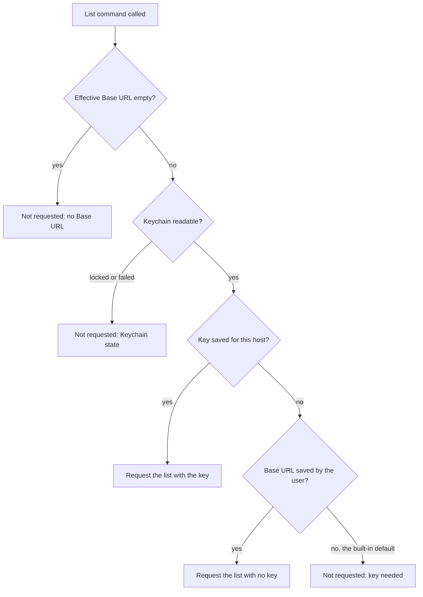
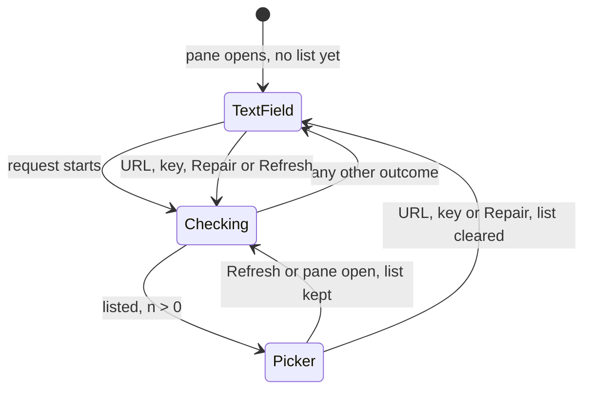

# Summary Model Picker - Plan

## Goal Capsule

- **Objective:** A person who sets up summaries chooses a model from the models that their server actually offers, and sees whether the Base URL and API key work before the first summary fails.
- **Means:** The Model text field becomes a searchable picker that Longhand fills from the endpoint's list of models (R9). A status line reports the result of each list request (R14). Base URL starts as OpenAI's endpoint (R1).
- **Product authority:** This plan covers the Endpoint and Credential groups of the Summaries pane in Settings. Provider presets and per-model details are not active scope. The Product Contract wins on behavior. The Planning Contract wins on mechanism within it.
- **Execution profile:** Standard. Five units in one worktree, in dependency order. Commit each unit on its own.
- **Stop conditions:** Stop and ask if an implementation step would change a Requirement or a Key Decision. Also stop and ask if Keychain access from the list command needs a permission prompt that summary processing does not already cause.
- **Who finishes:** `ce-work` builds the units and passes the local gates. The user runs the manual check in the signed bundle (Verification Contract).
- **Open blockers:** None.
- **Product Contract preservation:** Changed: R2 (an empty Base URL saved before this change counts as never saved, because the saved settings cannot tell the two apart) and R14 (the status line has more states: the key cannot list models, a server error, a redirect, an empty list and a locked Keychain). Added: R16, R17, R18, AE7 and AE8, for gaps that the flow analysis found. The user confirmed these changes. The Outstanding Questions are resolved in place, in KTD1, KTD4 and KTD6.

---

## Product Contract

### Summary

In Settings, Model becomes a searchable picker that shows every model the server lists. Base URL starts as `https://api.openai.com/v1`, and the API key field moves above Model, because the list needs the key. A status line reports each list request: connected with a count of models, key rejected, server unreachable, or server that does not list models. The user can still type any model name.

### Problem Frame

Today Model is a free-text field (`src/settings/EndpointForm.tsx`). The user must know the exact model id, find it on the provider's website, and type it without a mistake. Nothing tells the user that the Base URL, the key or the model name is wrong until a note finishes and its summary fails. The note is then saved with a stub summary (`src/session/ProcessingStatus.tsx`). A new install also starts with an empty Base URL, so the user must find the OpenAI URL too, although OpenAI is the most common choice.

Longhand already reads the models list, but only to find the context limit of the saved model (`crates/summarize/src/context.rs`). No code gives the list to the UI.

### Key Decisions

- KD1. **The model list is also the connection check.** A list request proves that the server is reachable and that it accepts the key. *(session-settled: user-directed — chosen over a model list with no status and over a model list with provider presets: an early visible error is worth more than presets.)* Governs R14, R15.
- KD2. **Show every model, with search.** Name rules that remove embedding, speech or image models can hide a valid model on a gateway or a local server, and they need upkeep. *(session-settled: user-directed — chosen over hiding models that do not look like chat models, and over hiding them with a "Show all" control.)* Governs R9.
- KD3. **OpenAI is the default Base URL.** The user asked for it, so that a new install needs only a key and a model choice. Governs R1, R2.
- KD4. **No model is chosen for the user.** Model names change, and a hardcoded default goes out of date. *(session-settled: user-directed — chosen over a named default model and over an automatic choice from the list by a rule such as "newest small model".)* Governs R12.
- KD5. **A typed model name is always accepted.** Azure deployment names, gateway wildcard routes and servers without a models list need a name that the list does not show. *(session-settled: user-approved — proposed with the gateway and Azure cases shown; the user confirmed.)* Governs R10, R11, R13.
- KD6. **The check lists models only and sends no chat request.** A list request uses no tokens and costs nothing. The trade-off: a key that can list models but cannot chat still fails only at the first summary. *(session-settled: user-approved — proposed with that trade-off shown; the user confirmed.)* Governs R5.
- KD7. **Longhand sends no request to the default endpoint until the user acts.** The OpenAI default comes from Longhand, not from the user. So Longhand does not contact OpenAI until a key is saved, and opening Settings sends nothing. *(session-settled: user-approved — proposed with the privacy reason shown; the user confirmed.)* Governs R4.

### Requirements

**Default endpoint**

- R1. When no Base URL was ever saved, Base URL shows `https://api.openai.com/v1`, and Model is empty.
- R2. A saved Base URL does not change, and a Base URL that the user clears stays empty. An empty Base URL saved before this change counts as never saved.

**Layout**

- R3. The Summaries pane shows Base URL, then API key, then Model, then the status line (R14). The Context limit field and the plain-HTTP warning stay as they are.

**Requesting the list**

- R4. Longhand requests the model list only for an endpoint that the user acted on: a key is saved for its host, or the user entered the Base URL. The built-in default Base URL with no saved key is never contacted.
- R5. The list request reads the list of models from the Base URL and sends no chat request.
- R6. Longhand requests the list again when the user commits a new Base URL, saves or removes the key, opens the Summaries pane, or selects a Refresh control next to the status line. Each request follows R4.
- R7. A list result applies only to the Base URL and key that it was requested for. A result for a Base URL or key that has since changed is discarded.
- R8. The list request follows the rules that apply to summary requests: it follows no redirect, and it sends the key only to the host that it is saved for.
- R16. When Keychain is locked or cannot be read, Longhand sends no list request. The status line shows the Keychain state, and the existing Repair control stays available.
- R17. When Base URL is empty, the API key field is hidden, the status line asks for a Base URL, and Longhand sends no list request.

**The picker**

- R9. Model is a searchable picker. It lists every model id that the server returns, sorted by name, with no filter.
- R10. The user can type a model name that is not in the list and save it.
- R11. When a list loads and the saved model is not in it, the picker still shows the saved model. A note says that this server does not list it. The saved model does not change.
- R12. Until the user chooses, Model is empty and shows "Choose a model". Longhand never chooses a model.
- R13. When no list is available because Longhand did not request it, the request failed, the server does not list models, or the server's list contains no models, Model works as a text field.
- R18. While the picker shows a list, leaving the field without a choice keeps the saved model, so a partly typed search is not saved. Enter saves the typed text when no model matches it. In text-field mode (R13), leaving the field saves the text, as today.

**Status**

- R14. The status line reports the latest list request: checking, connected with the number of models, connected with no models listed, API key needed, API key rejected, this key cannot list models, server unreachable, server error, redirected to another URL, this server does not list models, Keychain locked or Keychain failed (R16), or Base URL needed (R17). KTD6 holds the exact text, in plain language.
- R15. The status line only reports. It does not block saving settings or recording, and processing still uses a typed model after a failed list request.

### Key Flows

- F1. First setup with OpenAI
  - **Trigger:** The user opens the Summaries pane on a new install.
  - **Steps:** Base URL shows the OpenAI URL, and the status line says that an API key is needed. Longhand sends no request. The user saves a key. The status line shows checking, then connected with the number of models. The user searches for a model and chooses it.
  - **Covered by:** R1, R3, R4, R6, R9, R12, R14
- F2. Local server with no key
  - **Trigger:** The user replaces the Base URL with a server on this computer, such as Ollama or LM Studio.
  - **Steps:** The user commits the URL. Longhand requests the list with no key, and the picker shows the local models.
  - **Covered by:** R4, R6, R9
- F3. Gateway that does not list models
  - **Trigger:** The user enters a gateway URL that returns no models list.
  - **Steps:** The status line says that this server does not list models. Model works as a text field, and the user types the model name.
  - **Covered by:** R10, R13, R14

### Acceptance Examples

- AE1. **Covers R4, KD7.** Given a new install with no key, when the user opens the Summaries pane, Longhand sends no request to `api.openai.com`.
- AE2. **Covers R2.** Given an install with the Base URL `http://localhost:11434/v1`, when the user updates Longhand, Base URL stays `http://localhost:11434/v1`.
- AE3. **Covers R11.** Given the saved model `gpt-4o`, when the server's list does not contain `gpt-4o`, the picker shows `gpt-4o` with the note, and summaries still use `gpt-4o`.
- AE4. **Covers R14, R15.** Given a key that the server rejects, when the list request returns, the status line says that the key was rejected, and the user can still type a model and save it.
- AE5. **Covers R7.** Given a list request that is still running, when the user changes the Base URL, the result of the first request does not change the picker or the status line.
- AE6. **Covers R9.** Given OpenAI's list of about 100 models, when the user types "mini", the picker shows only the models whose ids contain "mini", including embedding models if their names match.
- AE7. **Covers R18.** Given the saved model `gpt-4o` and a loaded list, when the user types "mini" and clicks elsewhere, Model still shows `gpt-4o` and nothing is saved.
- AE8. **Covers R16.** Given a locked Keychain, when the user opens the Summaries pane, Longhand sends no list request, and the status line shows the locked state with the Repair control.

### Scope Boundaries

- Provider presets (OpenRouter, Ollama, LM Studio and others) are not part of this plan. OpenAI is the only built-in default.
- The picker does not filter by model type.
- The picker does not show context length, price or other details for each model.
- The check sends no test chat request.
- A different model for each summary prompt is out of scope. The summary-prompts plan uses one app-wide model.
- API shapes other than OpenAI-compatible stay out of scope (walking-skeleton plan, KD12).

### Sources / Research

- `src/settings/EndpointForm.tsx` — the current Endpoint and Credential groups. The Credential group shows only when a Base URL is set.
- `src-tauri/src/managers/settings.rs` — `endpoint_configured()` needs a Base URL and a model. The defaults are empty.
- `crates/summarize/src/context.rs` — the existing request to the models list, used for the context limit. Its path is relative to the Base URL.
- `crates/summarize/src/client.rs` — no redirects, bearer key.
- `crates/secrets/src/lib.rs` — keys are saved in Keychain for each host and port.
- `reference-source/Handy/src-tauri/src/llm_client.rs` (`fetch_models`) and `reference-source/anarlog/apps/desktop/src/settings/ai/shared/list-openai.ts` — how both apps read `data[].id` from the models list. anarlog's `model-combobox.tsx` is a searchable picker that accepts typed names.

---

## Planning Contract

### Key Technical Decisions

- KTD1. **`crates/summarize` gets one list function beside the context probe.** It uses the existing `Client`, with `Limits::probe()` (5 s connect, 15 s total, 4 MiB), `api_url("models")` and `redirect::Policy::none()`, so R8 holds with no new transport code. It parses `data[].id`, then `data[].name`, then a bare array of strings (the shapes that Handy's `fetch_models` accepts). It removes duplicates and sorts without regard to case. A 2xx body with no usable list is "does not list models", not an empty list. The context-limit probe keeps its own request: the two requests run at different times, and joining them would couple the Settings pane to processing. Governs R5, R8, R9.
- KTD2. **The list result is a typed outcome, not an error string.** The outcomes are: listed (ids, which can be empty), key needed, key rejected, key cannot list models, not listed, redirected (target host), server error (status), unreachable, and not requested. The mapping from `SummarizeError`:
  1. 401 or 403 with no key sent gives key needed.
  2. 401 with a key gives key rejected.
  3. 403 with a key gives key cannot list models. OpenAI restricted keys can chat but get 403 on the models list.
  4. 404, `Malformed` or a body with no list gives not listed.
  5. `Redirect` gives redirected.
  6. Any other non-2xx status, and `TooLarge`, give server error.
  7. `Transport` and `Deadline` give unreachable.

  Governs R14.
- KTD3. **The Rust command owns the R4 and R16 gates and reads the key itself.** The command takes no arguments. It reads the effective Base URL and the saved state from Settings, and the key through `SecretsManager`, in the same way that `credential_status` does. The webview never holds the key. It returns "not requested" with a reason (default endpoint with no key, no Base URL, Keychain locked, Keychain failed) instead of sending a request. A UI mistake therefore cannot contact OpenAI. Processing uses the same gate before a summary request. When the effective Base URL is the built-in default, the user did not save it, and no key is saved for its host, `summary_endpoint` returns `EndpointProblem::Unconfigured` with the text "Add an API key for api.openai.com, or enter a Base URL", and sends nothing. Without this gate, a model typed on a new install would send the transcript to OpenAI with no key, which is the case KD7 excludes. The gate is one pure function that both paths call. Governs R4, R16, R17.
- KTD4. **Settings saves the Base URL as "never saved" or a saved value.** `endpoint_base_url` becomes an optional value. The absent value means never saved, and the effective Base URL is then `https://api.openai.com/v1`. A saved empty string means cleared. The migration maps a stored `""` to the absent value (R2). `endpoint_configured()`, `learned_limit_key` and the processing read use the effective Base URL. The schema version is the next unused number when this unit is built: the summary-prompts and recognition-models plans also claim version 3. Governs R1, R2.
- KTD5. **`set_endpoint` splits into a Base URL setter and a Model setter.** Today one command sends both values, so a Model commit would save the displayed default URL. The default would then count as "entered by the user", and AE1 would fail. Each setter changes only its own field. The Base URL setter keeps today's trim and host check. Governs R2, R4.
- KTD6. **The status text.** It uses the existing `Status` tone in `src/settings/ui.tsx`. `{n}` and `{host}` are filled in.

  | Outcome | Text | Model field |
  |---|---|---|
  | Checking | Checking… | the last list on Refresh or pane open, otherwise text field |
  | Listed, n > 0 | Connected · {n} models | picker |
  | Listed, n = 0 | Connected · this server lists no models | text field |
  | Key needed | Add an API key to see the models | text field |
  | Key rejected | The server rejected this API key | text field |
  | Key cannot list models | This API key can't list models. Type a model name. | text field |
  | Not listed | This server doesn't list its models. Type a model name, or check that the URL ends in /v1. | text field |
  | Redirected | The server redirected to {host}. Use that URL instead. | text field |
  | Server error | The server returned an error ({status}). Try again. | text field |
  | Unreachable | Can't reach {host} | text field |
  | Keychain locked | Keychain is locked. Use Repair Keychain Access above. | text field |
  | Keychain failed | the existing Credential failed message | text field |
  | No Base URL | Enter a Base URL | text field |

  The status line has no Repair button of its own. The Repair control stays in the Credential group, which owns its state (KTD9). Governs R14, R16.
- KTD7. **The form drops stale results with a request counter.** Each Base URL commit, key save, key removal, pane open and Refresh increments a counter in the form, and a result is applied only when its counter value is still the latest. The webview never sees the key, so it cannot compare keys, but every key change goes through the form. On Refresh and on pane open, the form keeps the last list in memory while the new request runs, so the picker does not go blank. A Base URL commit, a key save, a key removal or a Repair clears the list, because the old list belongs to another endpoint or key (R7), and Model is a text field until the new result arrives. The form keeps no list after the pane closes. When a list arrives while the Model text field has focus and unsaved text, the form shows the picker only after the field loses focus, so the arrival of a list does not discard what the user typed. Governs R6, R7.
- KTD8. **The picker is a new component with no new dependency.** It follows the ARIA combobox pattern: an input with `role="combobox"`, a `role="listbox"` popup and `aria-activedescendant`. It uses `@floating-ui/dom` for the popup position, as the slash-command menu does, and the keyboard handling of the Home list. The filter is a case-insensitive substring match. When the typed text matches no id exactly, a last row offers to use the typed text (R10). anarlog's `model-combobox.tsx` is the model for the behavior only. It depends on cmdk, Radix and Lingui, and no code is copied, so no `PROVENANCE.md` record is needed. Governs R9, R10, R11, R12, R18.
- KTD9. **The Credential group renders for the effective Base URL and reports changes to the form.** It renders above Model whenever the effective Base URL is not empty, including the default. Every action of the Credential group (save, removal and Repair) calls back to the form at the end of its existing `run()` refresh, and the form starts a new list request (KTD7). Governs R3, R6, R17.

### High-Level Technical Design

The request gate that the command applies (KTD3):

The Model field states in the form (KTD6, KTD7):

A result whose counter value is old is dropped in the Checking state and does not cause a transition.

### Assumptions

- `src-tauri` can call `crates/summarize` through a direct path dependency. It depends on `secrets` and `pipeline` today.
- Reading the key from the list command causes no Keychain prompt that summary processing does not already cause. Both read the same item through `SecretsManager`.

### Sources and patterns

- Client, limits, errors and the loopback test server: `crates/summarize/src/client.rs` (`Client::new`, `Limits::probe`, `probe_json`, `http_error`), `crates/summarize/tests/common/mod.rs` (`serve`, `Reply`, `Seen`), and `crates/summarize/tests/client.rs` (the redirect, bearer and deadline tests).
- The existing models-list parsing: `crates/summarize/src/context.rs` (`probe`, `rows`).
- Command and binding patterns: `src-tauri/src/commands/settings.rs` (`set_endpoint`, `credential_status`, `CredentialStatus`), and `src-tauri/src/lib.rs` (`specta_builder`, `export_bindings`).
- Settings, migration and salvage: `src-tauri/src/managers/settings.rs` (`endpoint_configured`, `learned_limit_key`, `apply_settings_migrations`, `salvage_settings`), and the credential read in `src-tauri/src/managers/processing.rs`.
- UI parts: `src/settings/EndpointForm.tsx` (`CommitField`, `Credential`), `src/settings/ui.tsx` (`Group`, `Row`, `Button`, `Status`, `ErrorText`), `src/home/Home.tsx` (listbox keyboard handling), and `src/editor/widgets/slash-command.tsx` (`computePosition`, `autoUpdate`).
- Frontend tests: `src/test/tauri.ts` (`mockTauri`), `src/test/setup.ts`, and `src/settings/Licences.test.tsx`.
- Reference only, no code copied: `reference-source/Handy/src-tauri/src/llm_client.rs` (`fetch_models`) and `reference-source/anarlog/apps/desktop/src/settings/ai/shared/model-combobox.tsx`.

---

## Implementation Units

### U1. List the models of an endpoint

- **Goal:** `crates/summarize` lists the model ids of an endpoint and returns a typed outcome.
- **Requirements:** R5, R8, R9, R14. Implements KTD1, KTD2.
- **Dependencies:** None.
- **Files:** `crates/summarize/src/models.rs` (new), `crates/summarize/src/lib.rs`, `crates/summarize/tests/models.rs` (new).
- **Approach:**
  1. Add a parse function for the three list shapes (KTD1). Keep it separate from the context parsers, because it must tell "no list" apart from "empty list".
  2. Add an async list function that takes a `Client`, requests `models` with the probe limits, and maps the result to the KTD2 outcome. It records whether a key was sent, for the 401 and 403 mapping.
  3. Re-export the function and the outcome type from `lib.rs`.
- **Patterns to follow:** `context::probe` for the request, and the loopback-server tests in `tests/client.rs`.
- **Test scenarios:**
  - `{"data":[{"id":"b"},{"id":"A"},{"id":"b"}]}` gives listed `["A","b"]`.
  - `{"data":[{"name":"llama3"}]}` gives listed `["llama3"]`, and a bare `["x","y"]` gives listed `["x","y"]`.
  - `{"data":[]}` gives listed with no ids.
  - `{}` and a 200 with a non-JSON body give not listed.
  - A 404 gives not listed.
  - A 401 with a key gives key rejected. A 401 with no key gives key needed.
  - A 403 with a key gives key cannot list models. A 403 with no key gives key needed.
  - A 302 to `https://other.example/v1/models` gives redirected with host `other.example`, and the server records one request.
  - A 500 and a 429 give server error with that status.
  - A server that never answers gives unreachable within the probe deadline, with `Client::with_limits` set to short limits.
  - A closed port gives unreachable.
  - The request path is `{base}/models`, it is a GET, and the key goes only as a bearer header.
  - A body larger than the byte cap gives server error.
- **Verification:** `cargo test -p summarize` passes.

### U2. Base URL "never saved" state, migration and split setters

- **Goal:** Settings tells a never-saved Base URL apart from a cleared one, gives the OpenAI default as the effective Base URL, and saves Base URL and Model separately.
- **Requirements:** R1, R2, R4; AE2. Implements KTD4, KTD5, and the processing half of KTD3.
- **Dependencies:** None.
- **Files:** `src-tauri/src/managers/settings.rs`, `src-tauri/src/commands/settings.rs`, `src-tauri/src/managers/processing.rs`, `src-tauri/src/lib.rs`, `src/bindings.ts`.
- **Approach:**
  1. Change `endpoint_base_url` to an optional value, and add an accessor for the effective Base URL and one for "saved by the user".
  2. Bump the schema version to the next unused number. In the migration, map a stored `""` to the absent value and keep every other value.
  3. Point `endpoint_configured()`, `learned_limit_key` and the processing credential read at the effective Base URL.
  4. Add the gate as a pure function over (effective Base URL, saved by the user, key state), so that tests need no Keychain. Call it from `summary_endpoint` before a summary request (KTD3). U3 calls the same function.
  4. Replace `set_endpoint` with `set_endpoint_base_url` and `set_endpoint_model`. An empty Base URL from the setter saves `Some("")` (R2).
  5. Regenerate `src/bindings.ts`.
- **Patterns to follow:** `apply_settings_migrations` and its tests, and `set_asr_model`.
- **Test scenarios:**
  - A new store has no saved Base URL, and the effective Base URL is `https://api.openai.com/v1`.
  - Covers AE2. A store at the previous version with `http://localhost:11434/v1` keeps it after the migration.
  - A store at the previous version with `""` has no saved Base URL after the migration.
  - `set_endpoint_base_url("")` saves an empty value. The effective Base URL is then empty and `endpoint_configured()` is false.
  - `set_endpoint_model("gpt-4o")` on a new store does not save a Base URL.
  - On a new store with a Model set and no key, `summary_endpoint` returns `Unconfigured` with the KTD3 text and sends no request.
  - On a new store with a Model set and a key saved for `api.openai.com`, `summary_endpoint` returns the default endpoint with that key.
  - With `http://localhost:11434/v1` saved, a Model set and no key, `summary_endpoint` returns the endpoint with no key, as today.
  - `set_endpoint_base_url("not a url")` fails with today's error, and nothing is written.
  - The salvage path keeps a valid Base URL when another field is invalid.
- **Verification:** `cargo test -p longhand` passes, and `src/bindings.ts` is regenerated with no manual edits.

### U3. The list command

- **Goal:** A Tauri command applies the R4, R16 and R17 gates, reads the key, and returns the U1 outcome to the frontend.
- **Requirements:** R4, R8, R16, R17; AE1, AE8. Implements KTD3.
- **Dependencies:** U1, U2.
- **Files:** `src-tauri/Cargo.toml`, `src-tauri/src/commands/settings.rs`, `src-tauri/src/lib.rs`, `src/bindings.ts`.
- **Approach:**
  1. Add the `summarize` path dependency.
  2. Add the command. It reads the effective Base URL and the saved state, then reads the key through `SecretsManager::run`, as `credential_status` does.
  3. Apply the U2 gate function (the HTD flowchart) before any request.
  4. Build a `Client` with an empty model and call the U1 function.
  5. Give the outcome a specta `Type` as a tagged enum, in the style of `CredentialStatus`. Register the command and regenerate the bindings.
- **Patterns to follow:** `credential_status` and `CredentialStatus` in `commands/settings.rs`.
- **Test scenarios:**
  - Covers AE1. Default Base URL, not saved, no key: not requested (key needed).
  - Default Base URL, not saved, key saved: request.
  - `http://localhost:11434/v1` saved, no key: request with no key.
  - Empty Base URL: not requested (no Base URL).
  - Covers AE8. Keychain locked: not requested (locked). Keychain failed: not requested (failed).
  - The outcome serializes to the tagged shape that `src/bindings.ts` declares.
- **Verification:** `cargo test -p longhand` passes, `cargo clippy` is clean, and `scripts/check-windows.sh` passes.

### U4. The model picker component

- **Goal:** A searchable, keyboard-accessible model picker that accepts typed names.
- **Requirements:** R9, R10, R11, R12, R18; AE3, AE6, AE7. Implements KTD8.
- **Dependencies:** None.
- **Files:** `src/settings/ModelPicker.tsx` (new), `src/settings/ModelPicker.test.tsx` (new).
- **Approach:**
  1. Props: the saved model, the list of ids, and a commit callback. The picker never calls a command itself.
  2. The input shows the saved model, or the placeholder "Choose a model" (R12). Typing opens the popup and filters it.
  3. Arrow keys move the active row, Enter commits the active row, and Escape closes the popup and restores the saved model.
  4. When the typed text matches no id exactly, the last row reads `Use "{text}"` and commits the typed text (R10).
  5. Blur restores the saved model and commits nothing (R18).
  6. When the saved model is not in the list, a line under the field reads "This server doesn't list this model" (R11).
  7. Invoke the `apple-design` and `emil-design-eng` skills before building the component. Keep the popup plain, with no motion beyond the Settings pane's existing transitions (the CLAUDE.md attention rule).
- **Patterns to follow:** The listbox keyboard handling in `src/home/Home.tsx`, `computePosition` and `autoUpdate` in `src/editor/widgets/slash-command.tsx`, and `fieldClass` in `src/settings/ui.tsx`.
- **Test scenarios:**
  - Covers AE6. With 100 ids, typing "mini" shows only the ids that contain "mini", in any case, including `text-embedding-mini` if present.
  - Arrow Down then Enter commits the first match.
  - Typing `my-deployment` with no match shows `Use "my-deployment"`, and Enter commits `my-deployment`.
  - Typing an id that matches exactly shows no `Use` row.
  - Covers AE7. With `gpt-4o` saved, typing "mini" and blurring shows `gpt-4o` and commits nothing.
  - Escape closes the popup and restores the saved value.
  - Covers AE3. With `gpt-4o` saved and a list without it, the field shows `gpt-4o` and the note.
  - With no saved model, the field shows the "Choose a model" placeholder.
  - The input has `role="combobox"` and `aria-expanded`, and the active row is referenced by `aria-activedescendant`.
- **Verification:** `bun run typecheck` and `bun run test` pass.

### U5. The Summaries pane: order, status line and requests

- **Goal:** The Summaries pane shows Base URL, API key, Model and the status line, and starts and applies list requests.
- **Requirements:** R3, R6, R7, R13, R14, R15, R16, R17; F1, F2, F3; AE1, AE4, AE5, AE8. Implements KTD6, KTD7, KTD9.
- **Dependencies:** U2, U3, U4.
- **Files:** `src/settings/EndpointForm.tsx`, `src/settings/EndpointForm.test.tsx` (new).
- **Approach:**
  1. Render the Credential group between Base URL and Model, for the effective Base URL (KTD9). Hide it when the effective Base URL is empty (R17).
  2. Switch the Base URL and Model fields to the split setters (KTD5).
  3. Add the request counter and the last list (KTD7). Call the list command on pane open, on Base URL commit, on the Credential callback and on Refresh.
  4. Render the status line under Model from the KTD6 table, with a Refresh button. The status line is a `role="status"` live region, so a screen reader announces each change.
  5. Render `ModelPicker` when the latest outcome is listed with ids. Otherwise render the existing `CommitField` (R13).
  6. Keep the plain-HTTP warning and the Context limit field as they are.
- **Patterns to follow:** The existing `Credential` `run()` refresh pattern, and `mockTauri` in `src/test/tauri.ts`.
- **Test scenarios:**
  - Covers AE1 / F1. A new install with no key: the pane shows the OpenAI URL and "Add an API key to see the models", and Model is a text field. The mock records one list-command call, which returns not requested.
  - F1. After a key save, the form calls the list command again, shows "Checking…", then "Connected · 3 models", and Model is the picker.
  - Covers F2. After a Base URL commit of `http://localhost:11434/v1`, the form calls the list command and shows the picker.
  - Covers F3. A not-listed outcome shows the KTD6 text, and Model is a text field that saves on blur.
  - Covers AE4. A key-rejected outcome shows "The server rejected this API key", and a typed model still saves through `set_endpoint_model`.
  - Covers AE5. A first list call that resolves after a Base URL commit does not change the status or the picker. Only the second result applies.
  - While a Refresh request runs, the picker still shows the first list.
  - After a Base URL commit, Model is a text field until the new result arrives. The old list is not selectable.
  - After Repair Keychain Access, the form calls the list command again.
  - Covers AE8. The list command returns not requested (Keychain locked) and `credentialStatus` returns `needs_unlock`. The status line shows the locked text, Model is a text field, and the Credential group shows the Repair control.
  - The list command returns not requested (Keychain failed). The status line shows the Credential failed message.
  - Refresh calls the list command once more.
  - A list that arrives while the user types in the Model text field does not replace the field. After blur, the typed text is saved (R18's text-field rule) and the picker shows.
  - The status line has `role="status"`.
  - An empty Base URL hides the API key field and shows "Enter a Base URL".
  - A Model commit calls `set_endpoint_model` and never `set_endpoint_base_url`.
- **Verification:** `bun run typecheck` and `bun run test` pass. The Playwright mockIPC preview shows the three layouts (default with no key, listed, not listed) with no overlap at the Settings window's minimum width.

---

## Verification Contract

| Gate | Command or check | Proves |
|---|---|---|
| Rust format | `cargo fmt --all --check` | U1–U3 |
| Rust lint | `cargo clippy --workspace --all-targets -- -D warnings` | U1–U3 |
| Rust tests | `cargo test --workspace` | U1, U2, U3 |
| Bindings | `cargo test -p longhand export_bindings`, then no diff in `src/bindings.ts` | U2, U3 |
| Windows lint | `scripts/check-windows.sh` | U1–U3 |
| Provenance | `scripts/check-provenance.sh` | no borrowed code added |
| Frontend | `bun run typecheck` and `bun run test` | U4, U5 |
| UI review | The Playwright mockIPC preview of the Summaries pane, per the project memory | U4, U5 |
| Manual | In the signed bundle (`bun tauri build --bundles app`): open Settings on a fresh settings file with no key and confirm that no request goes to `api.openai.com`. Save an OpenAI key and choose a model from the list. Point the Base URL at a local Ollama or LM Studio server and choose a local model. Then enter a URL without `/v1` and confirm the not-listed text. Then lock the login Keychain, reopen Settings, and confirm the locked text and that Repair Keychain Access restores the model list. | R1, R4, R9, R14, R16, F1, F2, F3, AE1, AE8 |

The `cargo` and `uv` commands need the sandbox bypass. Keychain reads must be tested from the signed bundle, not `tauri dev`.

---

## Definition of Done

- Every unit's test scenarios exist and pass, and every gate in the Verification Contract passes locally.
- On a new install, Settings shows the OpenAI Base URL and sends nothing until a key is saved.
- With a real OpenAI key, the picker lists the account's models, and a chosen model writes a summary.
- With a local server, the picker lists its models with no key.
- `docs/ideas/summary-model-picker.md` has status `done` and its row is in the Done list of `docs/ideas/README.md`.
- No experimental code, abandoned approaches or debug output stay in the diff.
