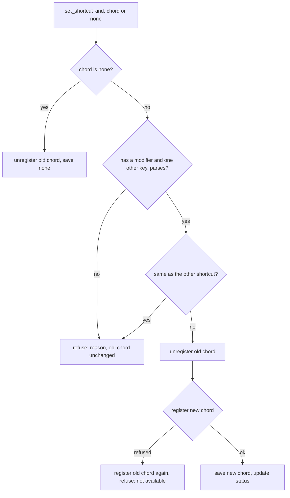
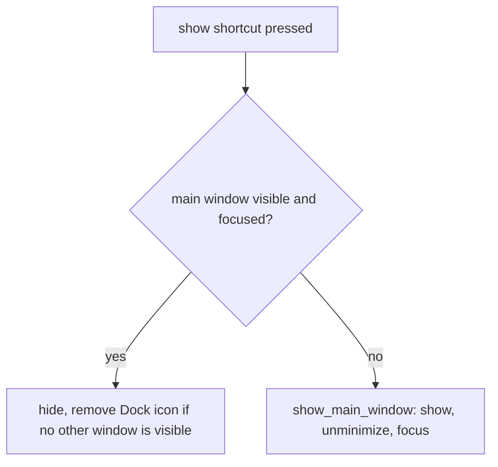

# Custom Shortcuts - Plan

## Goal Capsule

- **Objective:** A user starts and stops a recording with keys that they choose, and brings Longhand forward from the menu bar with a key when they want to. A user who does not want a global key for recording can have none.
- **Means:** Two shortcut rows in the General pane of Settings. Each row is set by pressing the keys in a control adapted from anarlog (KTD2), and each chord is registered through `tauri-plugin-global-shortcut` (KTD1).
- **Product authority:** The Product Contract wins on product behavior. The Planning Contract wins on mechanism within it. The walking-skeleton plan (`docs/plans/2026-09-21-2052-feat-longhand-walking-skeleton-plan.md`) still governs what a press of the recording shortcut does (R6c, KD14).
- **Execution profile:** Standard. Five units in one worktree, in dependency order. Commit each unit on its own.
- **Stop conditions:** Stop and ask if an implementation step would change a Requirement or a Key Decision. Also stop and ask if R6 cannot tell a window that is in front from one that is behind another app on macOS.
- **Who finishes:** `ce-work` builds the units and passes the local gates. The user runs the manual checks from the signed bundle (Verification Contract).
- **Open blockers:** None.
- **Product Contract preservation:** The requirements are unchanged. The Outstanding Questions are resolved in place, in KTD2 and KTD5. The Means line names anarlog's control instead of Handy's, as the user approved in planning.

---

## Product Contract

### Summary

The General pane of Settings gets two shortcut rows. The user sets each one by pressing the keys. The recording shortcut keeps its default chord and its start and stop behavior, and the user can change it, reset it or clear it. A new "Show Longhand" shortcut has no chord by default. When set, it shows the main window, and a second press hides the window again.

### Problem Frame

The recording shortcut is fixed at `CommandOrControl+Alt+Shift+L`. It is registered once at launch from settings, and no screen changes it. A user whose other apps already use that chord, or who wants a shorter chord, has no choice. When the main window is closed, Longhand stays in the menu bar. The only way to bring the window back is the menu-bar item, or the recording shortcut, which also starts a recording.

### Key Decisions

- **The recording shortcut can be cleared.** A user who starts recordings only from New Note can have no global key. Governs R3, R13. (session-settled: user-directed — chosen over "change only, never empty": the user wants the choice to have no recording shortcut.)
- **A cleared recording shortcut does not make Longhand "Not ready".** No shortcut is a choice, not a fault. A chord that fails to register is still a fault. Governs R13. (session-settled: user-approved — chosen over treating a cleared shortcut as Not ready: readiness is about whether a recording can start, and New Note still starts one.)
- **The show shortcut toggles.** One key brings the window forward and puts it away again. Governs R6. (session-settled: user-approved — chosen over a show-only shortcut that does nothing when the window is in front.)
- **The show shortcut has no chord by default.** A global chord that the user did not ask for can take a key from another app. Governs R5.
- **Chord rules follow Handy.** A chord needs a modifier, the two shortcuts cannot share a chord, and a chord that the system refuses leaves the previous chord in place. Governs R8–R10.

### Requirements

**The recording shortcut**

- R1. The General pane shows the recording shortcut with its current chord. The user changes it by selecting the row's control and pressing the new keys. The new chord works at once, with no relaunch.
- R2. A reset control returns the recording shortcut to the default chord, `CommandOrControl+Alt+Shift+L`.
- R3. The user can clear the recording shortcut. With no chord, no global key starts or stops a recording. New Note in the main window still starts one.
- R4. A press of the recording shortcut does what it does today: it starts a new recording, or stops the recording in progress (walking-skeleton R6c).

**The show shortcut**

- R5. A second row, "Show Longhand", has no chord by default. The user can set, change and clear it the same way as the recording shortcut. It has no reset control, because its default is no chord.
- R6. When the main window is visible and is the focused window of the frontmost app, a press hides the main window. At any other time, a press shows the main window, unminimizes it and focuses it. This includes when the window is closed, minimized, or behind another app or the Settings window.
- R7. Showing or hiding the main window has no effect on a recording. The window shows the page that it showed when it was hidden.

**Setting a chord**

- R8. A chord has one or more modifier keys (Command, Control, Option or Alt, Shift) and one other key. The row refuses a chord with no modifier and says why.
- R9. The two shortcuts cannot have the same chord. The row refuses the duplicate and says why.
- R10. When the system or another app refuses a chord, the row says that the chord is not available. The previous chord stays saved and active.
- R11. While the user sets a chord, both shortcuts are paused, so the keys pressed do not start a recording or show the window. Escape, or a click away from the control, cancels and keeps the previous chord.
- R12. Both chords are saved and are registered again at each launch. Each row shows its chord in the form that the platform uses (symbols on macOS, `Ctrl+Alt+…` on Windows).

**Status and text that names the shortcut**

- R13. "Ready to record" depends only on the microphone and the destination when the recording shortcut is cleared. The shortcut row then says "Off" in a neutral tone. A saved chord that fails to register at launch still shows as a problem and makes the status "Not ready", as it does today.
- R14. When the notes list is empty, its line names the recording shortcut if one is set. If none is set, the line names the New Note button.

### Acceptance Examples

- AE1. **Covers R1, R11.** **Given** the recording shortcut is `⌘⌥⇧L`, **when** the user selects its control and presses `⌃⌥R`, **then** the row shows `⌃⌥R`, `⌃⌥R` starts a recording from another app, `⌘⌥⇧L` does nothing, and no recording started while the user pressed the keys.
- AE2. **Covers R3, R13, R14.** **Given** the user clears the recording shortcut and there are no notes, **when** they look at Settings and Home, **then** the shortcut row says "Off", the status says "Ready", and the empty notes list names New Note.
- AE3. **Covers R6.** **Given** a "Show Longhand" chord is set and the main window is closed, **when** the user presses it from another app, **then** the main window comes forward with focus. **When** they press it again, **then** the window hides and Longhand stays in the menu bar.
- AE4. **Covers R6.** **Given** the main window is open but behind another app, **when** the user presses the show chord, **then** the window comes forward. It does not hide.
- AE5. **Covers R7, R4.** **Given** a recording is in progress and the main window is in front, **when** the user presses the show chord, **then** the window hides and the recording continues. A press of the recording shortcut then stops the recording.
- AE6. **Covers R9.** **Given** the recording shortcut is `⌘⌥⇧L`, **when** the user presses `⌘⌥⇧L` in the "Show Longhand" control, **then** the control refuses it and the show shortcut keeps its previous value.
- AE7. **Covers R10.** **Given** another app holds `⌘⇧Space`, **when** the user presses it in the recording shortcut control, **then** the row says the chord is not available and the previous chord still starts a recording.

### Scope Boundaries

- One recording shortcut for each destination folder. The idea was removed on 2026-09-28.
- A chord made only of modifier keys, or one that uses the fn key or Right Command. These need a keyboard event tap, which needs the Accessibility permission on macOS (KTD1).
- Shortcuts for other actions, such as opening Settings or adding a note.
- A shortcut that works only while Longhand is the frontmost app. Both shortcuts are global.

### Dependencies / Assumptions

- The user is the only user and asked for this directly. There is no other evidence of need to find.
- A chord that another app holds is refused at registration on Windows. On macOS the registration is not exclusive, so another app's chord can be accepted with no error. A clash between Longhand's own two shortcuts is always refused (R9). On macOS, some system chords can be registered but never reach Longhand. KTD4 covers what the row can report.

### Sources / Research

- `src-tauri/src/shortcut.rs` — today's registration, once at launch, and the start or stop toggle.
- `src-tauri/src/managers/settings.rs` — the `shortcut` field and `DEFAULT_SHORTCUT`.
- `src-tauri/src/commands/readiness.rs` — `armed` requires `shortcut.registered` today.
- `src/settings/Status.tsx` — the General pane's shortcut row, which only shows status today.
- `src-tauri/src/window.rs` — `show_main_window`, and the close handler that hides the window and removes the Dock icon.
- `reference-source/Handy/src-tauri/src/shortcut/mod.rs` — `change_binding`, `reset_binding`, `suspend_all_bindings` and `resume_all_bindings`, and the restore of the previous binding after a failed change.
- `reference-source/Handy/src-tauri/src/secure_input.rs` — why Handy's event-tap method needs a fallback to the plugin.
- `reference-source/anarlog/apps/desktop/src/settings/dictation-shortcut.tsx` — the press-the-keys control.
- `reference-source/anarlog/plugins/shortcut/src/global.rs` — anarlog uses the plugin for ordinary chords and an event tap only for Fn and Right Command.

---

## Planning Contract

### Key Technical Decisions

- KTD1. **Register both chords through `tauri-plugin-global-shortcut`, the plugin that Longhand already uses.** Handy's default method, `handy_keys`, reads keys through an event tap. That method exists for push-to-talk: it sees key releases and chords made only of modifiers. On macOS it needs the Accessibility or Input Monitoring permission, and it stops receiving keys while any app has secure keyboard input on. Handy needs `secure_input.rs` to fall back to the plugin in that case. A Longhand press only toggles, so the tap adds a permission and a failure mode for no gain. Governs R8. (session-settled: user-approved — chosen over Handy's `handy_keys` event tap: Longhand needs no key release and no fn chords.)
- KTD2. **The Settings control follows anarlog's `dictation-shortcut.tsx`, not Handy's `GlobalShortcutInput.tsx`.** The chord is complete at the key-down of the first key that is not a modifier. It is built from the modifier flags plus `KeyboardEvent.code` (for example `Super+Shift+KeyR`), which the plugin parses directly and which does not change with the keyboard layout. Escape cancels. Tab or a blur ends capture with no change. Handy's version waits for all keys to be released and builds names from `event.key`, which needs a separate normalizing table. Governs R1, R8, R11. (session-settled: user-approved — chosen over Handy's key-up capture: simpler, and it already has Escape and blur handling.)
- KTD3. **Both chords are `Option<String>` in settings, and no schema migration is needed.** `shortcut` changes from `String` to `Option<String>`. A stored string reads as `Some`, a missing field takes the default `Some(DEFAULT_SHORTCUT)`, and a stored `null` means cleared (R3). The new `show_window_shortcut` defaults to `None` (R5). A migration is not needed because every stored form still reads correctly.
- KTD4. **One backend command changes a chord, and it restores the previous chord on any failure.** The command checks the chord (R8), checks it against the other shortcut (R9), unregisters the old chord, and registers the new chord. It saves only after the registration succeeds. On failure it registers the old chord again and returns a plain reason (R10). This is Handy's `change_binding` and `restore_registration` shape, reduced to two named shortcuts. The plugin reports a chord that another process holds when the system refuses it. A chord that registers but never reaches Longhand, such as one that macOS keeps for itself, cannot be detected. The row text does not claim that it can.
- KTD5. **"In front" means the main window is visible and focused.** The show handler reads `is_visible()` and `is_focused()` on the main window. On macOS a window loses key status when its app becomes inactive, so a window behind another app reads as not focused. The Settings window in front also makes the main window not focused, so the press shows the main window. The hide path is the close path: hide the window, then remove the Dock icon when no other window is visible. Governs R6, R7.
- KTD6. **Pausing the shortcuts during capture has a backend safety net.** The control pauses both shortcuts before capture and resumes them when capture ends (R11). If the Settings window closes during capture, its `Destroyed` event also resumes them. A resume re-registers only the saved chords, so it is safe to call more than once.
- KTD7. **Readiness treats a cleared recording shortcut as ready.** `armed` becomes microphone, destination, and either no recording chord or a registered one. The shortcut status reports three states: off, registered, or failed with a reason. Governs R13.

### High-Level Technical Design

The change and restore sequence of KTD4 has several steps and two failure exits. This sketch shows its shape. It is not code.

The show shortcut's press handler has one decision (KTD5):

### Assumptions

- PR #6 and PR #8 are merged. The summary-model-picker branch is in progress, and it also changes `managers/settings.rs`, `lib.rs`, `src/bindings.ts` and the `Settings` type. Merge `main` into this branch before this branch merges, and regenerate `src/bindings.ts` after the merge.
- KTD3's approach stays: no settings migration. A build from a branch without this work reads a cleared shortcut as the default and drops the show chord at its next settings save. That is acceptable, but no such build runs between the manual set checks and the relaunch check (Verification Contract).
- The app menu's own key equivalents (Cmd+Q, Cmd+W, Cmd+,) are caught by the menu before the web view sees them, so the control cannot capture them. That is acceptable: those chords would take a key from Longhand itself.

---

## Implementation Units

### U1. Settings fields and chord rules

- **Goal:** Settings hold both chords as optional values, and one pure function decides whether a chord is valid.
- **Requirements:** R3, R5, R8, R9, R12. KTD3.
- **Dependencies:** None.
- **Files:** `src-tauri/src/managers/settings.rs`, `src-tauri/src/shortcut.rs`, `src/settings/Models.test.tsx`, `src/settings/SummaryPrompts.test.tsx`.
- **Approach:**
  1. `shortcut` becomes `Option<String>` with default `Some(DEFAULT_SHORTCUT)`. Add `show_window_shortcut: Option<String>` with default `None`.
  2. Add a pure chord check in `shortcut.rs`: the chord parses as a plugin `Shortcut`, has at least one modifier, and has one key that is not a modifier and not fn. It returns a plain-language reason on failure (R8).
  3. Add a pure duplicate check that compares parsed shortcuts, not strings, so `Super+KeyR` and `Command+KeyR` count as the same chord on macOS (R9).
  4. Add `show_window_shortcut` and the nullable `shortcut` to the literal `Settings` fixtures in `src/settings/Models.test.tsx` and `src/settings/SummaryPrompts.test.tsx`. Without them, `tsc` fails after `src/bindings.ts` regenerates.
- **Patterns to follow:** `validate_shortcut` in `reference-source/Handy/src-tauri/src/shortcut/tauri_impl.rs`. Tests next to `settings_from_value` in `managers/settings.rs`.
- **Test scenarios:**
  - A stored settings value with `"shortcut": "CommandOrControl+Alt+Shift+L"` reads as `Some` of that chord, and no rewrite is reported.
  - A stored value with no `shortcut` field reads as `Some(DEFAULT_SHORTCUT)`, and `show_window_shortcut` reads as `None`.
  - A stored `"shortcut": null` reads as `None`.
  - `Super+Shift+KeyR` is valid.
  - `KeyR` alone is refused with the no-modifier reason.
  - `Shift+Alt` alone is refused with the no-key reason.
  - `Fn+KeyR` and an unparseable string are refused.
  - `Super+KeyR` and `Command+KeyR` count as the same chord for the duplicate check.
- **Verification:** The settings tests pass, and a settings file written by today's build loads unchanged.

### U2. Registration, change and pause commands

- **Goal:** Both shortcuts register at launch, and the Settings window can change, clear, reset, pause and resume them without a relaunch.
- **Requirements:** R1, R2, R3, R4, R5, R9, R10, R11, R12, R13. KTD4, KTD6, KTD7.
- **Dependencies:** U1.
- **Files:** `src-tauri/src/shortcut.rs`, `src-tauri/src/commands/capture.rs`, `src-tauri/src/commands/readiness.rs`, `src-tauri/src/window.rs`, `src-tauri/src/lib.rs`, `src/bindings.ts`, `src-tauri/PROVENANCE.md`.
- **Approach:**
  1. `ShortcutRegistration` holds a status for each shortcut: off, registered, or failed with a reason. `register` at launch registers each saved chord and records its status.
  2. The recording shortcut's handler stays `toggle` (R4). Registration takes the handler for each shortcut kind, so U3 supplies the show handler without changing this unit.
  3. Add `set_shortcut(kind, chord: Option<String>)`, which follows the KTD4 sequence and returns the new status or the refusal reason. Reset is `set_shortcut(Recording, Some(DEFAULT_SHORTCUT))`, and the frontend needs no separate command.
  4. Add `suspend_shortcuts` and `resume_shortcuts`. Resume re-registers the saved chords only, and a chord that is already registered is not an error.
  5. One mutex, like the `TOGGLE` mutex in `shortcut.rs`, is held across every register, `set_shortcut`, suspend and resume call, so their plugin calls never interleave. Without it, a resume that runs between a change's unregister and register re-registers the old chord, and that chord stays live after the change (AE1).
  6. The Settings window's `Destroyed` event in `window::on_window_event` calls resume (KTD6).
  7. `shortcut_status` returns both statuses. `readiness` computes `armed` per KTD7.
  8. Update the `src/shortcut.rs` record in `src-tauri/PROVENANCE.md`: the change and restore sequence from Handy's `change_binding` and the pause commands from `suspend_all_bindings`.
- **Execution note:** Put the KTD4 decision in a pure function over the old chord, the new chord and the other chord, with the plugin calls passed in as closures, in the style of `window::open_or_build`. The function is then testable without an `AppHandle`.
- **Patterns to follow:** `change_binding`, `restore_registration`, `suspend_all_shortcuts` and `resume_all_shortcuts` in `reference-source/Handy/src-tauri/src/shortcut/mod.rs`. `open_or_build` and its tests in `src-tauri/src/window.rs`.
- **Test scenarios:**
  - Covers AE1. A change from chord A to chord B, where B registers, unregisters A, registers B and saves B.
  - Covers AE7. A change to chord B, where B's registration is refused, registers A again, saves nothing and returns the "not available" reason.
  - Covers AE6. A change to the chord that the other shortcut holds is refused before anything is unregistered.
  - A change to an invalid chord is refused before anything is unregistered.
  - A clear unregisters the old chord and saves `None`. A clear when there is no chord is a no-op that succeeds.
  - A reset sets the default chord through the same sequence.
  - Readiness: microphone and destination set with the recording chord `None` is armed. The same with a failed chord is not armed. With a registered chord, it is armed.
- **Verification:** The Rust tests pass. `src/bindings.ts` regenerates with the new commands and the new status shape.

### U3. Show and hide the main window from the show shortcut

- **Goal:** A press of the show shortcut hides the main window when it is in front and shows it at any other time.
- **Requirements:** R6, R7. KTD5.
- **Dependencies:** U2.
- **Files:** `src-tauri/src/window.rs`, `src-tauri/src/shortcut.rs`.
- **Approach:**
  1. Add a pure decision function: visible and focused gives hide, and anything else gives show.
  2. Add `toggle_main_window`, which reads the two states and then calls `show_main_window` or the hide path.
  3. Move the close handler's hide steps into one function that both the close handler and the toggle call, so the Dock icon rule has one owner.
  4. Recording state is not read or changed (R7).
  5. Pass `toggle_main_window` to U2's registration as the show shortcut's handler.
- **Patterns to follow:** `show_main_window`, `hide_dock_icon_if_no_window` and the `CloseRequested` branch in `src-tauri/src/window.rs`.
- **Test scenarios:**
  - Covers AE3. Visible and focused gives hide.
  - Covers AE4. Visible and not focused gives show.
  - Not visible gives show, whether or not the focus reads true.
- **Verification:** The decision tests pass. The manual checks in the Verification Contract confirm the real window behavior.

### U4. The shortcut control and the two Settings rows

- **Goal:** The General pane shows both shortcuts, and the user sets, clears and resets them by pressing keys.
- **Requirements:** R1, R2, R3, R5, R8, R9, R10, R11, R12, R13. KTD2.
- **Dependencies:** U2.
- **Files:** `src/settings/ShortcutField.tsx` (new), `src/settings/chord.ts` (new), `src/settings/chord.test.ts` (new), `src/settings/Status.tsx`, `src/processing/describe.ts`, `src/processing/describe.test.ts`, `src/lib/timeline.ts`, `src/lib/timeline.test.ts`, `src/settings/PROVENANCE.md` (new), `scripts/check-provenance.sh`.
- **Approach:**
  1. `chord.ts` holds the pure part of KTD2: from a key event's modifier flags and `code`, return nothing for a modifier key alone, "cancel" for Escape, "end" for Tab, or the chord string.
  2. `ShortcutField` is a button that shows the chord. Selecting it pauses the shortcuts, and the control accepts keys only after the pause returns, as anarlog waits for its prepare step. It then shows "Press the new shortcut". The first complete chord calls `set_shortcut`, and the row keeps the "Press the new shortcut" state until the call returns. On success the row shows the new chord. On refusal it shows the old chord, with the reason below the row. Escape, Tab and blur end capture. Every end resumes the shortcuts, after any `set_shortcut` call has returned.
  3. The recording row has Reset and Clear controls. The show row has Clear only (R5). A cleared row shows "Off" in the neutral tone.
  4. `Status.tsx` replaces today's read-only shortcut row with the two `ShortcutField` rows. The recording row keeps its registration status. A failed chord shows the reason in the negative tone (R13). The Recording group's footer names the shortcut only when one is registered.
  5. `missingPreconditions` in `describe.ts` adds "choose a different shortcut" only for the failed state, not for off (R13).
  6. `formatChord` accepts `KeyboardEvent.code` names (`KeyR` shows as R, `Digit1` as 1), `Super` and `Meta` (⌘ on macOS, Win on Windows), and `Option`.
  7. Add `src/settings/PROVENANCE.md` with a record for `ShortcutField.tsx` from anarlog, and add `src/settings` to `BORROWED_DIRS`.
- **Patterns to follow:** `reference-source/anarlog/apps/desktop/src/settings/dictation-shortcut.tsx`. `Row`, `Button` and `Status` in `src/settings/ui.tsx`. The anarlog records in `src-tauri/PROVENANCE.md`.
- **Test scenarios:**
  - `chord.ts`: Meta and Shift held with `KeyR` gives `Super+Shift+KeyR`.
  - `chord.ts`: a key-down of `ShiftLeft` alone gives nothing.
  - `chord.ts`: Escape gives cancel, and Tab gives end.
  - `chord.ts`: `KeyR` with no modifier still gives `KeyR`, and the backend refuses it (U1), so the rule has one owner.
  - `formatChord`: `Super+Shift+KeyR` is `⇧⌘R` on macOS and `Win+Shift+R` on Windows.
  - `formatChord`: `CommandOrControl+Alt+Shift+L` keeps its current output on both platforms.
  - `formatChord`: `Control+Digit1` is `⌃1` on macOS.
  - `missingPreconditions`: microphone missing and the shortcut off gives only "allow microphone access". A failed shortcut still adds "choose a different shortcut".
- **Verification:** `bun run typecheck` and `bun run test` pass, and `scripts/check-provenance.sh` passes. The UI review follows the `apple-design` skill, with a mockIPC preview page for the rows at rest, during capture, when refused and when off.

### U5. The notes list text when no shortcut is set

- **Goal:** Home's empty line names the shortcut when there is one, and names New Note when there is none.
- **Requirements:** R14.
- **Dependencies:** U1.
- **Files:** `src/App.tsx`, `src/home/Home.tsx`, `src/home/Home.test.tsx`.
- **Approach:** `App.tsx` passes `null` as the chord when `settings.shortcut` is `None`. `EmptyState` renders the New Note text for `null`.
- **Patterns to follow:** `EmptyState` in `src/home/Home.tsx`, and the existing Home component tests.
- **Test scenarios:**
  - Covers AE2. With no sessions and a `null` chord, the empty line names New Note and shows no key cap.
  - With no sessions and a chord, the empty line shows the key cap, as today.
- **Verification:** The Home tests pass.

---

## Verification Contract

| Gate | Command or check | Proves |
|---|---|---|
| Rust format | `cargo fmt --all --check` | U1–U3 |
| Rust lint | `cargo clippy --workspace --all-targets -- -D warnings` | U1–U3 |
| Rust tests | `cargo test --workspace` | U1–U3 |
| Bindings | `cargo test -p longhand export_bindings`, then no diff in `src/bindings.ts` | U2 |
| Windows lint | `scripts/check-windows.sh` | U1–U3 |
| Provenance | `scripts/check-provenance.sh` | U2, U4 |
| Frontend | `bun run typecheck` and `bun run test` | U4, U5 |
| Manual, signed bundle | From `bun tauri build --bundles app`: set a new recording chord and start a recording from another app. Clear the chord and confirm that Settings shows "Off" and "Ready". Set a show chord and toggle the window from the menu bar, from behind another app and during a recording. Try a chord that another app holds: Windows refuses it, and on macOS the check passes when the row either says "not available" or accepts the chord (KTD4). Relaunch and confirm that both chords stay. | R1–R7, R10, R12, R13, AE1–AE5, AE7 |

The `cargo` commands need the sandbox bypass. A global shortcut from another app is tested from the signed bundle, not `tauri dev`. Run no build from another branch between the manual set checks and the relaunch check: such a build resets a cleared shortcut and drops the show chord at its next save, and the relaunch check then fails for a reason that is not in this work.

---

## Definition of Done

- Every unit's test scenarios exist and pass, and every gate in the Verification Contract passes locally.
- On the signed bundle, both shortcuts can be set, cleared and used from another app, and a refused chord leaves the previous chord working.
- A cleared recording shortcut shows "Off" and still counts as ready to record.
- No experimental code, abandoned approaches or debug output stay in the diff.

---

## Completion record

**Shipped 2026-09-26** in PR #10 (merge commit fcf59ea). Units U1–U5 are implemented.

**Changes after the units:**

- Simplification: the settings are read once at launch and at resume. The default chord comes from Rust through the `DEFAULT_SHORTCUT` binding constant. The recording row reads its status only from readiness.
- The code review confirmed 3 findings, and all 3 are fixed. Both rows share one pause, and its calls go in order, so the finish of one row does not resume the shortcuts while the other row captures. The pane reads the statuses after the resume. `set_shortcut` records the status before it saves the settings.
- The chord button keeps one width while it captures keys.

**The user's test of the signed bundle** found two defects, which PR #10 also fixes:

- Keys and Escape did nothing during capture. WebKit does not focus a button when it is clicked, so the key handler on the button did not receive the keys. The row now focuses its button when capture starts. The unit tests did not find this defect, because they send key events to the button directly, and the Chromium preview gives focus on a click.
- Both rows could wait for keys at the same time. A row that starts to wait now ends the wait of the other row.

**Verification.** All the gates in the Verification Contract pass. The user confirmed from the signed bundle that a chord can now be set.

**Not done:**

- The other manual checks in the Verification Contract (a chord held by another app, and the relaunch check) are not recorded as run.
- Deferred from the review:
  - When a new chord is refused and the old chord cannot be registered again, only a log line records it.
  - A chord saved in one row registers at once.
