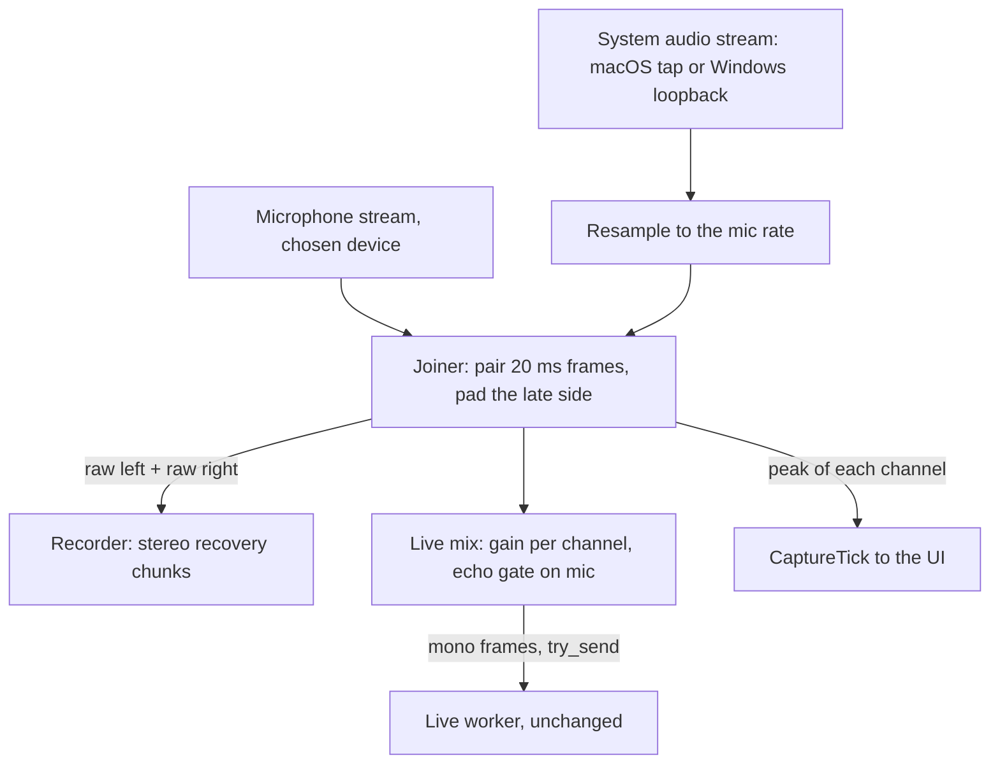
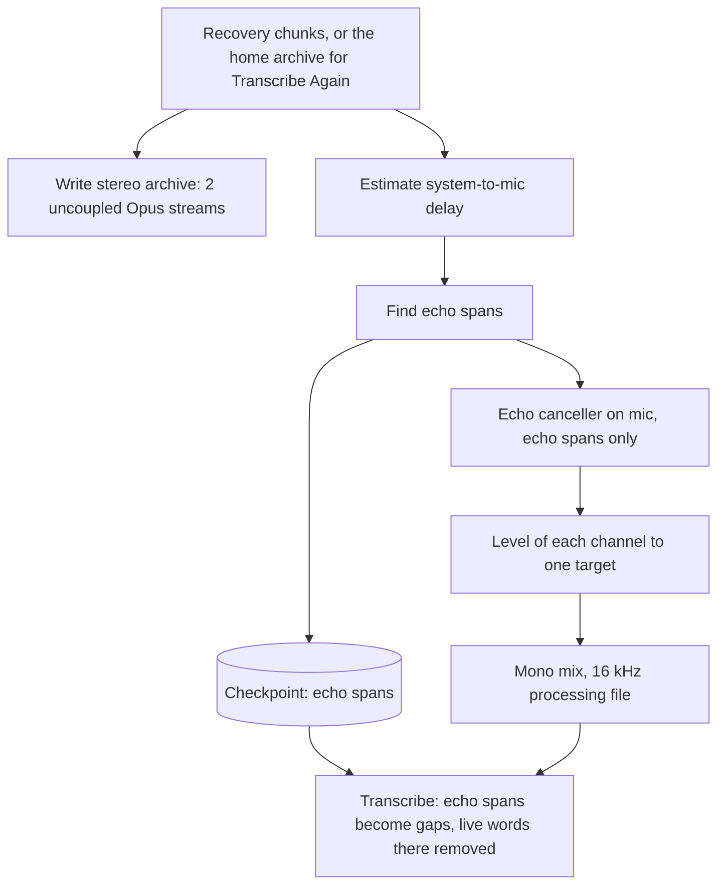
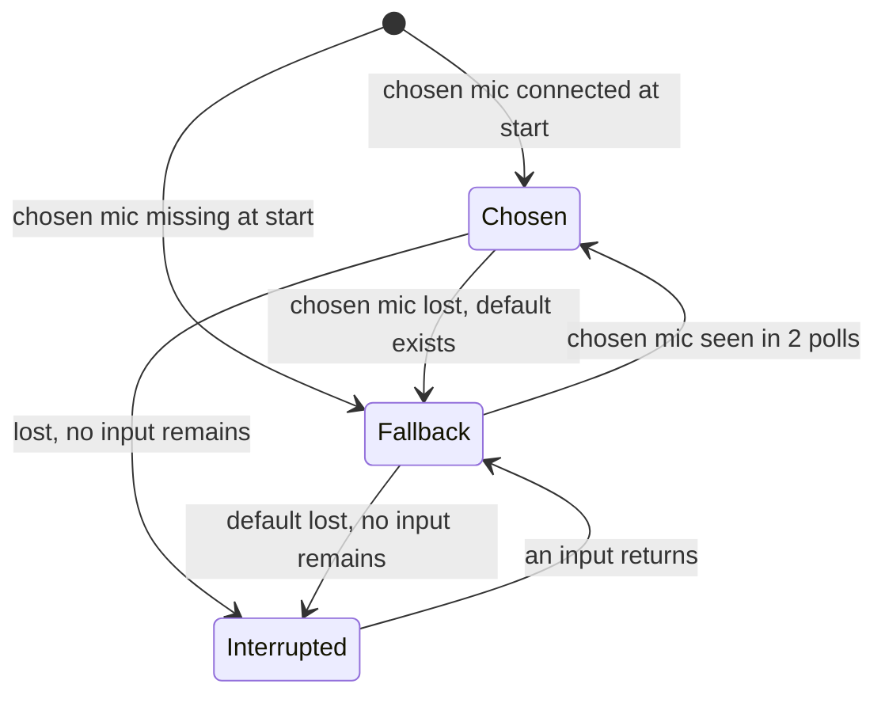

# System Audio and Microphone Choice - Plan

## Goal Capsule

- **Objective:** A note records a meeting on a call as completely as a meeting in a room. The remote people, the people in the room and the user are all in the transcript, whether the user wears headphones or uses the speakers, and whichever call app or browser tab the call uses. The user also records from the microphone of their choice, not only the system default.
- **Means:** anarlog's system audio capture and echo canceller, borrowed into Longhand (KTD4, KTD9). Every input change is a segment boundary through the existing capture restart path (KTD3). Echo removal and the mix run inside Assemble (KTD8).
- **Product authority:** This plan covers the microphone choice, the Computer audio switch, the stereo recording, echo removal and the mono mix for processing. It is area D of `docs/plans/2026-09-24-1956-feat-ux-redesign-plan.md` (How This Work Fits Together). Room/Call marks on transcript turns and per-channel diarization are not active scope. The Product Contract wins on behavior. A KTD wins on mechanism within the Rs that it cites.
- **Stop conditions:** Stop and ask when the licence of anarlog's echo-canceller model weights does not permit redistribution, when a global process tap cannot exclude Longhand's own process, or when a change would alter a Key Decision.
- **Execution profile:** Twelve units in four phases. `ce-work` implements in a worktree named `system-audio-and-microphone-choice`. Commit per unit. Local checks are the gate (see Verification Contract). Microphone, system audio and permission behavior are tested from the signed bundle.
- **Open blockers:** None.
- **Status (2026-09-26, after the signed-bundle tests):**
  - All units are built. The microphone choice (U1–U3) and R18 (U11) ship.
  - Computer audio is hidden and turned off (`SYSTEM_AUDIO_AVAILABLE`, `features.systemAudio`). Two Teams test calls failed Verify because the mono mix of KD4 fails when one channel has a fault. In the first call, a mixer app put a late copy of the microphone and extra copies of the call on the system channel. In the second, speaker echo gave false copy hits.
  - KD4 and KD6 are open again. The likely replacement is [per-channel processing](../ideas/per-channel-processing.md), which needs [faster diarization](../ideas/faster-diarization.md) first.
  - The findings are in [mixer apps and microphone copies](../ideas/mixer-apps-and-microphone-copies.md).

---

## Product Contract

Product Contract preservation: changed R7 and R11, and added R18 and KD14 and KD15. R7 now follows the output device that the call uses on Windows (anarlog's method), in place of recording two devices at once; the intent, call audio on a device other than the default output, is kept. R11 now states that a note turns stereo when Computer audio first turns on, and that the part before it stays mono. R18 (user-directed scope increase) removes the forced test of the alert sound. KD15 raises the minimum macOS to 15.0. The user approved each change at the plan scoping step.

### Summary

Settings gets a Recording pane. It holds the usual microphone and the default of a new Computer audio switch. The recording page shows the microphone in use, can change it for one note, and has the Computer audio switch, which records everything the computer plays. Longhand saves the raw microphone and the raw system audio as the two channels of one recording. The live transcript reads a live mono mix. After Stop, processing removes speaker echo from the microphone, mixes the two channels to mono, and transcribes again only the spans where it found echo.

### Problem Frame

Longhand records one microphone, the system default (R2 of `docs/plans/2026-09-21-2052-feat-longhand-walking-skeleton-plan.md`). `STRATEGY.md` names sessions "in a room or on a call", but on a call the note gets the remote people only as sound from the laptop speakers that the microphone hears. With headphones the note does not get them at all. The user's calls use Teams, Zoom, Discord and Google Meet in a browser. The user sometimes wears headphones and sometimes does not, and sometimes people are also in the room.

The user also cannot choose a microphone. The capture code can already open an input by name (`crates/audio-cpal/src/config.rs`), but every call site passes no name, and Settings has no microphone field (`src-tauri/src/managers/settings.rs`). A user with a USB conference microphone or a headset must change the system default before each meeting.

Since the recognition models plan (`docs/plans/2026-09-25-1121-feat-recognition-models-and-live-transcript-plan.md`), a streaming model's live text is the final transcript, and processing after Stop fills only the gaps. Any new audio source must reach the live transcript, or the fast finish loses it.

### Key Decisions

- KD1. **Computer audio records all system audio, not one app.** (session-settled: user-directed — chosen over a choice of apps and over an automatic start when a call app runs: calls use several apps and browser tabs, and an app list fails for Meet in a browser.) anarlog does the same. Governs R7.
- KD2. **The user turns Computer audio on or off for each note. Settings holds the default.** (session-settled: user-directed — chosen over always on: a room meeting does not pick up alert sounds, videos or music.) Governs R6, R8.
- KD3. **Computer audio can change at any time during a recording.** (session-settled: user-directed — chosen over a fixed choice at the start: a remote person can join a room meeting late.) Governs R8.
- KD4. **Longhand saves the raw microphone and the raw system audio as two channels, and processing uses a mono mix.** (session-settled: user-directed — chosen over per-channel recognition and diarization, as anarlog does: the existing pipeline stays unchanged. The stereo recording keeps per-channel processing possible later.) Governs R11, R14.
- KD5. **Echo removal runs after Stop, on the saved raw audio, not live.** (session-settled: user-directed — chosen over live echo removal as in anarlog, and over a muted microphone while the call speaks: recording stays as light as today, the raw audio is always kept, and a better canceller can process old notes again. Muting loses room speech that overlaps the call.) Governs R12, R13.
- KD6. **The live transcript reads a live mono mix. After Stop, only the spans with echo are transcribed again.** (session-settled: user-directed — chosen over live echo removal for the live feed and over no live transcript when Computer audio is on: with headphones the live text stays final. With speakers, echo spans can cover most of a call, so the extra cost after Stop is up to one recognition pass of the call.) Governs R15, R16.
- KD7. **The live mix uses anarlog's cheap echo gate on the microphone.** (session-settled: user-approved — proposed at the scope confirmation after the anarlog comparison: it keeps the call's voices from reaching the live transcript twice, at almost no cost.) Governs R15.
- KD8. **The usual microphone is chosen in Settings, and the recording page can change it for one note.** (session-settled: user-directed — chosen over Settings only, as in Handy, and over the recording page only: the shortcut still starts at once with the usual microphone.) Governs R1, R2, R3.
- KD9. **A chosen microphone that is missing is replaced by the system default, and the choice is kept.** (session-settled: user-directed — chosen over Handy's reset of the setting to Default and over a refusal to start: a USB microphone left at the office must not erase the choice or delay the note.) Governs R4.
- KD10. **A chosen microphone that disconnects during a note is replaced by the system default at once, and Longhand moves back when it returns.** (session-settled: user-directed — chosen over staying on the default and over today's pause: nothing is lost, and the note ends on the better microphone.) Governs R5.
- KD11. **The mix balances the levels of the two channels.** (session-settled: user-approved — proposed at the scope confirmation: a quiet call or a loud room must not make the other source too quiet to recognize. anarlog applies no gain, but it never mixes.) Governs R14, R15.
- KD12. **Windows is in scope, through WASAPI loopback.** (session-settled: user-approved — proposed at the scope confirmation, following "cross-platform correctness from day one" in `STRATEGY.md`.) Governs R7.
- KD13. **The Computer audio default in Settings is off.** A room meeting is the main case (`STRATEGY.md`), and off keeps today's behavior for an existing install. Governs R6.
- KD14. **The alert sound needs no test.** (session-settled: user-directed — chosen over today's required test with a persistent warning: the test was left over from the prototype.) Governs R18.
- KD15. **Longhand needs macOS 15.0 or later.** (session-settled: user-approved — proposed after the user said a modern macOS can be assumed, chosen over a runtime check that hides Computer audio before macOS 14.4: one code path, and the version that anarlog's tap code targets.) Governs R7.

---

### Requirements

**Microphone choice**

- R1. The Recording pane in Settings lists the connected inputs and "System default", and stores the user's choice. "System default" is the choice on a new install and after the update.
- R2. The recording page shows the microphone in use. Before or during a recording the user can change it for this note, and the change does not change the choice in Settings.
- R3. The recording shortcut and New Note start at once with the microphone from Settings. The choice adds no step and no noticeable delay to the start of a recording.
- R4. When the chosen microphone is missing at the start of a note, the note records from the system default, and the recording page shows which microphone it uses. The choice in Settings stays. The next note uses the chosen microphone again when it is connected.
- R5. When the chosen microphone disconnects during a note, recording continues on the system default at once, and the recording page shows the change. When the chosen microphone returns during the note, recording moves back to it. When the lost input was the system default and no input remains, today's behavior applies: the note is interrupted and waits for an input to return.

**Computer audio**

- R6. The Recording pane holds the default of the Computer audio switch. Each new note starts with that default.
- R7. When Computer audio is on, the note records all audio that the computer plays, from any app, on macOS and on Windows. On Windows, when a call app plays to an output device other than the default, for example the default communications device, the note records that device.
- R8. The recording page shows the Computer audio switch. The user can turn it on or off at any time during a recording, and the note records system audio only while it is on.
- R9. The first time Computer audio turns on, macOS asks for the "Screen & System Audio Recording" permission. The General pane shows this permission next to the microphone permission and lets the user grant it in advance.
- R10. When the permission is denied, or system audio fails during a note, the microphone recording continues. The recording page says that computer audio is not recorded, and for a denied permission it tells the user how to allow it. While the macOS permission prompt waits for an answer, the recording page shows the same message.

**Recording**

- R11. From the moment Computer audio first turns on, the note saves the raw microphone and the raw system audio as two channels of one recording: the microphone on the left, system audio on the right. Spans with Computer audio off after that hold silence on the right. The part of the note before Computer audio first turned on stays one channel. This recording is the note's saved audio in its home folder. Its compression keeps the two channels independent, each at today's mono quality, so neither channel holds audio from the other. A note that never had Computer audio on saves its audio as today.

**Processing**

- R12. After Stop, processing removes the echo of the system audio from the microphone channel where it finds echo. Where it finds no echo, for example because the user wore headphones, it leaves the microphone unchanged.
- R13. The saved recording keeps the raw channels. Echo removal changes only the audio that processing uses.
- R14. Processing mixes the two channels to mono with balanced levels, so that neither source is too quiet to recognize next to the other. Recognition and speaker detection run on the mix as they run on the microphone today.
- R15. With a streaming model and the Live transcript switch on, the live transcript reads a live mono mix of the microphone and system audio, with levels balanced as in R14. A microphone chunk that is mostly echo of the system audio is left out of the live mix. The gate never changes the saved recording.
- R16. After Stop, each span where processing found echo gets recognition again on the cleaned mix, and that text replaces the live text for the span. Spans without echo keep the live text, as the fast finish requires (R11 of the recognition models plan).
- R17. Transcribe Again on a note with both channels uses the cleaned mix.

**Alert sound**

- R18. The user does not have to test the alert sound. The recording page shows no warning about an untested alert sound, and Settings still has a button that plays the sound.

---

### Acceptance Examples

- AE1. **Covers R7, R12, R16.** Given a Teams call with headphones and Computer audio on, when the user stops, processing finds no echo, the live text stays, and the transcript holds the remote people and the user.
- AE2. **Covers R12, R14, R15, R16.** Given a Zoom call on the laptop speakers with Computer audio on, the live transcript does not show the remote people's words twice. After Stop, the spans with echo are transcribed again from the cleaned mix, and each remote sentence appears once.
- AE3. **Covers R8, R11, R14.** Given a room meeting with Computer audio off, when a remote person joins after 20 minutes and the user turns Computer audio on, the transcript holds the room for the whole note and the remote person from minute 20.
- AE4. **Covers R4.** Given a USB microphone chosen in Settings and not connected, when the user presses the shortcut, recording starts at once on the system default, and the recording page names the default microphone. After the user connects the USB microphone, the next note uses it.
- AE5. **Covers R5.** Given a note recording on a chosen headset, when the headset goes out of range, recording continues on the built-in microphone with no lost audio beyond the switch. When the headset returns, recording moves back to it.
- AE6. **Covers R9, R10.** Given the permission was denied, when the user turns Computer audio on during a note, the microphone recording continues, and the recording page says computer audio is not recorded and how to allow it.
- AE7. **Covers R11.** Given a note with Computer audio off from start to Stop, its saved audio and its processing are the same as today.
- AE8. **Covers R2.** Given a note recording on the usual microphone, when the user chooses another microphone on the recording page, recording continues on it, and the choice in Settings does not change.

---

### Scope Boundaries

- Room/Call marks on transcript turns, and speaker detection for each channel. The stereo recording keeps these possible later.
- Capture from one app only, and a choice of output device.
- Live echo removal. The live mix uses only the gate in R15.
- A microphone default for each folder.
- Echo removal and a new mix for notes recorded before this work. Those notes have one channel.

---

### Dependencies / Assumptions

- Longhand has no system audio capture yet. `open_speaker_capture` in `crates/audio-cpal` fails on every call, and a test asserts it. The macOS backend follows anarlog's Core Audio process tap (`reference-source/anarlog/crates/audio-actual/src/speaker/macos.rs`), and the Windows backend follows its WASAPI loopback (`speaker/windows.rs`).
- Core Audio process taps need macOS 14.2 or later, and 14.4 gives consistent permission behavior. `src-tauri/tauri.conf.json` sets the minimum to 13.0 today. KD15 raises it to 15.0.
- The recorder writes only mono today: the recovery chunks and the Opus archive are both one channel (`crates/recorder/src/wav.rs`, `crates/pipeline/src/assemble.rs`). R11 needs new recorder and archive code, not only a mix step.
- The app declares only the microphone permission (`src-tauri/Info.plist`). R9 needs a new usage description for system audio capture. Like the microphone, it must be tested from the signed bundle.
- The system audio permission is not the Screen Recording permission, and macOS has no public API to check it. The permissions plugin that Longhand uses checks only Screen Recording. A tap without the permission records silence and returns no error. So R9 and R10 follow anarlog: a private preflight check of the permission (`reference-source/anarlog/crates/tcc`) and a short test tap to ask for it. This borrowed code needs a `PROVENANCE.md` record.
- anarlog's echo canceller is MIT-licensed (`LICENSES/anarlog-MIT.txt`), and Longhand has an ONNX crate (`crates/onnx`). Borrowed code and model files need a `PROVENANCE.md` record. The licence of the model weights needs a check.
- The live worker reads the microphone frames that the recorder copies to it (`src-tauri/src/managers/capture.rs`, KTD3 of the recognition models plan). R15 changes what it reads to the live mix.

---

### Sources / Research

- `reference-source/Handy/src-tauri/src/managers/audio.rs` (`desired_microphone`, `persist_default_microphone_after_fallback`) and `src/components/settings/MicrophoneSelector.tsx`: Handy's microphone setting, its cached name lookup, its fallback and its dropdown. R4 differs: Longhand keeps the choice.
- `reference-source/anarlog/crates/audio-actual/src/capture/stream.rs` and `joiner.rs`: pairing of microphone and speaker chunks, the reference aligner and `cancel_linear_echo`.
- `reference-source/anarlog/crates/aec/`: the two-stage ONNX echo canceller (about 7.3 MB at the default size, CPU).
- `reference-source/anarlog/crates/listener-core/src/actors/source/stream.rs`: echo removal off for headphone output. `recorder/disk.rs`: the stereo file, microphone left and speaker right.
- `reference-source/anarlog/crates/owhisper-client/src/local_soniqo_live.rs` (`suppress_echo_dominant_mic`): the live echo gate in R15.
- `reference-source/anarlog/plugins/permissions/src/guidance.rs`: the Screen Recording permission for system audio.
- `crates/audio/src/lib.rs`: `CaptureFrame` and `AudioProvider` already name a microphone and a speaker stream.
- `src-tauri/src/managers/capture.rs` (`watch_for_device`, `device_returned`): today's device-loss path, which R5 keeps for the case of no input.
- `docs/plans/2026-09-25-1121-feat-recognition-models-and-live-transcript-plan.md`: the live worker, parts, gap fill and Transcribe Again that R15 to R17 build on.
- `reference-source/anarlog/crates/tcc/swift-lib/src/lib.swift` (from AudioCap, `insidegui/AudioCap`): the private permission preflight that KTD12 calls from Rust.
- `reference-source/anarlog/crates/audio-actual/src/speaker/windows.rs` (`EndpointFollower`): the Windows output-device rule in R7.
- External: AudioCap README (no public API to check the permission, `NSAudioCaptureUsageDescription`), RFC 7845 section 5.1.1 (Ogg Opus mapping family 1), cpal 0.18 `DeviceTrait::id` (a stable device ID).

---

## Planning Contract

### Key Technical Decisions

**Microphone choice**

- KTD1. **The saved microphone choice is cpal's stable device ID, with the device name as its label.** Lookup is by ID first, then by exact name. Rationale: cpal 0.18 gives an ID that survives reconnects and reboots (the CoreAudio device UID, the WASAPI endpoint ID). Names are not unique, for example two identical USB microphones. Handy saves the name. The label lets Settings name a chosen microphone that is not connected. The config cache in `crates/audio-cpal/src/lib.rs` is keyed by ID too, so two identical microphones do not share a cached config. Covers R1, R4.
- KTD2. **A note records its capture choice in the store when recording starts.** The choice is the microphone ID and whether Computer audio is on, and a change on the recording page updates it. This follows `recording_model` in `src-tauri/src/managers/capture.rs`. The store also records a "stereo from segment N" mark, set when the first stereo segment is kept. Rules:
  - The microphone and Computer audio commands write only the stored choice. They call `reopen` only while a segment records. During Interrupted, restart backoff or a sleep pause, the next segment reads the stored choice.
  - A choice made on the recording page before the session row exists is held in the capture manager and written with the row.
  - A user resume and a crash resume keep the note's stored choice. A note from an older build, with no stored choice, resumes as "System default" with Computer audio off.

  Rationale: restart, resume and the capture watcher (KTD3) must read the note's choice, not the current Settings. Covers R2, R6, R8, R11.
- KTD3. **Every input change is a segment boundary, and it uses the existing `reopen` path.** A microphone change on the recording page, a fallback to the system default, a move back to the chosen microphone, and the first time Computer audio turns on each close the segment and open the next one. Turning Computer audio off does not split the segment: the system channel gets silence. After the stereo mark is set, every open path (restart, fallback, move back, wake, user resume, crash resume) opens a stereo segment, and it opens the speaker stream only while the switch is on. Source selection:
  - Chosen microphone present after a stream error: restart on it through the normal restart budget.
  - Chosen microphone absent: fall back to the system default at once.
  - After a wake or a resume: open the chosen microphone when it is present, with no poll wait.
  - In fallback: move back when the chosen microphone is present in two polls in a row (`DEVICE_POLL`, 2 s), so a headset at the edge of its range does not switch the note back and forth.

  One new capture watcher per note does the polls while the note records: the move back, the speaker stream reopen (KTD18) and the permission check (KTD12). It starts on fallback, on a speaker failure or on a permission that is not allowed. Stop, sleep, supersede and restart cancel it. It takes the inner lock like `reopen`, and it does nothing while a restart runs. A segment that ends at a switch is kept even when it is shorter than `MIN_SEGMENT_MS`, so a quick change or a Stop just after a switch loses no audio. Rationale: each segment has one native rate and one channel count, and `reopen` already keeps the timeline correct. A switch leaves a gap of a few milliseconds. Covers R2, R4, R5, R8, R11 (KD10).

**System audio capture**

- KTD4. **A new crate, `crates/audio-system`, holds the system audio backends that are borrowed from anarlog.** On macOS it creates a global Core Audio process tap through `cidre` 0.15. The tap excludes Longhand's own process, so the alert sound and other Longhand sounds are not in the note. It reads the tap's actual sample rate, not only the reported format. On Windows it uses WASAPI loopback through `wasapi` 0.23 and anarlog's `EndpointFollower`: the default output device, unless another process plays to a different device while the default has no active session. It switches only after two polls agree. The user kept this rule (session-settled): an app with an open, silent stream on the default keeps capture on the default, and the recording page then warns (U4 step 6, U7). On a Windows endpoint switch, the backend downmixes the new endpoint to mono and resets its resampler, with no segment boundary. The macOS own-process exclusion translates Longhand's PID to a Core Audio process object; when that lookup fails, the tap excludes nothing and logs it. Crate layout:
  - `FrameResampler` moves from `crates/audio-cpal` to `crates/audio`, so both backends use it with no dependency cycle.
  - `crates/audio-cpal` stays microphone-only.
  - A provider in `src-tauri` combines `CpalAudio` and `audio-system`.

  Covers R7 (KD1, KD12, KD15).
- KTD5. **The microphone is the clock. The joiner emits one pair for each microphone frame and never pads or drops the microphone.** System audio is resampled to the microphone's native rate. For each microphone frame, the joiner takes the next speaker frame. When the speaker queue is empty, it pads the speaker with silence at once and does not wait. The speaker queue holds at most 60 ms of audio. Above that bound, the joiner drops the oldest speaker samples until the queue is at the bound, and logs it. So the joiner adds at most 60 ms of offset between the channels, which stays inside the live gate's and the Assemble probe's 400 ms maximum lag (KTD8, KTD11). At 50 ppm drift, it drops about 20 ms of speaker audio every 7 minutes, in small parts. Rationale: segment time and the live tap index count microphone samples (`crates/recorder/src/lib.rs`), and WASAPI sends no packets while nothing plays. anarlog's joiner pads and drops the microphone too, which would break that clock. This bounds the drift between the two device clocks over a four-hour note without a drift-correcting resampler. Covers R11.
- KTD6. **A stereo segment writes two-channel recovery chunks, and the store records each segment's channel count.** The WAV header, `repair` and the chunk millisecond math take a channel count. A new session-core migration adds the channel count to the segment row, with a default of one. The storage estimate doubles the chunk and archive bytes for a stereo segment. After a crash, recovery takes the channel count from the first chunk's WAV header, because the open segment has no row yet (`crates/pipeline/src/recover.rs`). Covers R11.
- KTD7. **A stereo segment's archive is Ogg Opus with mapping family 1: two streams, none coupled, 64 kbit/s each.** The encoder and decoder use libopus multistream calls through `opusic-sys` 0.7.5 as a direct dependency of `crates/pipeline`, with a small safe wrapper. Rationale: `opus` 0.4.0 has no multistream API. A family 0 stereo stream couples the channels, so system audio would leak into the microphone channel. Two mono files would change the `Segment.audio_file` model. Covers R11, R13.
- KTD12. **The permission check calls the private `TCCAccessPreflight` function from Rust, and a short tap asks for the permission.** The check loads `TCC.framework` at run time and asks about `kTCCServiceAudioCapture`. It reports allowed, denied or not asked, and it reports "unknown" when the function is missing, so a macOS change cannot stop a recording. To ask, Longhand starts a tap for about half a second and stops it. `Info.plist` gets `NSAudioCaptureUsageDescription`. Rationale: macOS has no public API for this permission, and a denied tap gives silence with no error (AudioCap). anarlog calls the same function through a Swift helper. A direct call needs no Swift build step. On Windows the permission is always allowed. While the switch is on and the status is not "allowed", the capture watcher (KTD3) checks again every 2 s. On "allowed", it reopens only the speaker stream, because a tap made before the grant records silence. `request()` runs away from the command and the segment thread, and Stop cancels it. Covers R9, R10.
- KTD13. **The minimum macOS in `src-tauri/tauri.conf.json` becomes 15.0, and `cidre` builds with its `macos_15_0` feature.** This implements KD15. Covers R7.
- KTD18. **The segment thread owns the joined stream and takes attach and detach commands for the speaker stream.** Speaker streams, including the short permission tap, open away from the inner lock and the segment thread, and then attach. When Computer audio first turns on, the speaker stream opens before the mono segment closes, so the gap stays a few milliseconds (KTD3). A detach writes silence on the right. Rationale: today `open_segment` passes one microphone stream to `run_segment_with`, and turning Computer audio on and off inside a stereo segment must not reopen the microphone. Covers R8, R10, R11.

**Processing**

- KTD8. **Assemble does the echo removal and the mix for a stereo segment. No new stage is added.** Assemble reads the recovery chunks, or the home archive for Transcribe Again, and then:
  1. Pass 1 streams the source into the raw stereo archive (KTD7) and a temporary 16 kHz stereo file. The echo canceller and the delay probe work at 16 kHz, and a four-hour segment is too large to hold in memory.
  2. It tracks the delay of the system channel in the microphone channel for each window with anarlog's GCC-PHAT probe (`crates/audio-sync`), with a maximum lag of 400 ms. The delay changes when the joiner pads or drops a speaker frame and when the output device changes, and Bluetooth output adds 150–250 ms.
  3. It finds the echo spans: windows where the system channel has speech above the floor and the probe (step 2) gives a confident peak at the tracked delay. This tests for echo that is present, not echo that is dominant, so a window with room speech over echo is an echo span too. The dominance test (the residual ratio) stays only in the live gate (KTD11).
  4. It runs the echo canceller (KTD9) on the microphone channel inside the echo spans only. It starts the canceller 1 s before each span, so the model state is ready at the span's start.
  5. It measures the speech level of each channel, only over the spans where Computer audio was on, and applies a clamped gain to each so both sit at one target level. A channel with no speech above a floor gets a gain of 1, so a silent system channel adds no noise.
  6. It mixes to mono and writes the 16 kHz processing file as today, then deletes the temporary file.
  7. It saves the echo spans for the segment as a checkpoint row under `Stage::Assemble`, replaced on a rerun, then records the segment as done (step, then record). The resume check skips a stereo segment only when this row exists too.

  The disk check (`check_space`) counts the temporary file. `decode_archive` chooses mono or stereo for each segment, because a note can have both. Transcribe Again restores or sets aside the echo spans row with the other Assemble checkpoints. Rationale: every later stage stays mono and unchanged, and the `Stage` enum and the Transcribe Again stage list do not change. Covers R12, R13, R14, R17 (KD4, KD5, KD11).
- KTD9. **A new crate, `crates/aec`, holds anarlog's echo canceller.** It has the two-stage ONNX model at the 128 size (about 7.3 MB, embedded), and the linear residual step `cancel_linear_echo`. It runs on the CPU through `crates/onnx`. It needs a `PROVENANCE.md` record. It is linted on Windows like `crates/onnx`, because `ort` ships prebuilt binaries. The licence of the model weights must permit redistribution (Goal Capsule stop condition). Covers R12.
- KTD10. **Transcribe treats each echo span as a gap.** For a segment with echo spans, gap fill removes the live words inside each span and recognizes the windows that cover the span on the cleaned processing file, with the same ±150 ms merge rule (recognition models plan KTD6). Transcribe Again already runs a full recognition pass, so there the echo spans matter only for echo removal. Rationale: this reuses the gap-fill path. A narrower trigger (only spans where the live gate removed microphone speech) was rejected: where echo was present but the gate did not fire, the live text came from echoed audio and needs the second pass. Covers R16 (KD6).
- KTD11. **Capture builds the live mix before it offers frames to the live worker.** Each paired frame is mixed to mono with a slow gain for each channel, from a running speech level with bounded gain, before `tap.offer`. The echo gate follows anarlog's `suppress_echo_dominant_mic`: it zeroes the microphone part of a frame when the microphone is mostly a delayed copy of the system channel. Its constants are sample counts at 16 kHz, so the gate runs on a 16 kHz copy and searches lags up to 400 ms (6400 samples), the same as the Assemble probe, because Bluetooth output adds 150–250 ms. It keeps a speaker history of that lag plus one window. A channel with no speech above a floor gets a gain of 1. The live worker stays mono and unchanged. The recorder always writes the raw channels. Covers R15 (KD7, KD11).

**Interface**

- KTD14. **The recording page shows its capture state as static text, and its controls are in the page's "…" menu.** This follows the two-tier rail in `src/session/RecordingBar.tsx`.
  - The rail shows the microphone name and, while Computer audio is on, "Computer audio". This is secondary text, with no motion.
  - The "…" menu gets a "Microphone" submenu that lists the connected inputs, and a "Record Computer Audio" item with a check mark.
  - A fallback, a denied permission, a pending permission prompt and a system audio failure use the existing conditional warnings (`warnings()`).

  Rationale: the attention budget (ux-redesign KD2) allows no new controls that are always visible. The per-note speaker count is set the same way (`SpeakerField`). The apple-design skill is applied during implementation. Covers R2, R4, R5, R8, R10.
- KTD15. **Settings gets a "Recording" pane after General.** The pane has:
  - a "Microphone" radio group with "System default" first, which follows the radio groups in `src/settings/Models.tsx`. A chosen microphone that is not connected shows "Not connected".
  - the "Computer audio" default switch.

  The General pane gets a "Computer audio" permission row next to the Microphone row, with an "Allow…" button that runs KTD12's request and then checks the status again, like the microphone row does. Covers R1, R6, R9.
- KTD16. **The alert sound loses its test flow.** The recording-page warning, the "Did you hear it?" step, the `confirm_alert_sound` command, the `tone_heard` field in `AlertCheck` and the `alert_tone_heard` setting are removed. "Play Sound" stays as a plain button. Settings are `#[serde(default)]` with no unknown-field check, so an old settings file with the key still loads. Covers R18 (KD14).
- KTD17. **The new settings fields need no settings migration.** `microphone` (ID and label, optional) and `system_audio_default` (false) use `#[serde(default)]`, so `CURRENT_SETTINGS_SCHEMA_VERSION` stays at 4. The session-core migration of KTD6 takes the next free number at merge time (`docs/solutions/workflow-issues/parallel-branches-bump-same-schema-version.md`), and no applied migration file changes (`docs/solutions/workflow-issues/edited-applied-migration-breaks-older-databases.md`).

### High-Level Technical Design

Capture during recording (KTD4, KTD5, KTD11). The recorder writes raw audio. Only the live tap gets the mix.

Processing of one stereo segment in Assemble (KTD8), and its effect on Transcribe (KTD10):

The microphone source of a note (KTD3). Each arrow is a segment boundary.

A note whose choice is "System default" has only the Chosen and Interrupted states, as today.

### Assumptions

- A global tap that excludes Longhand's own process keeps capturing when the output changes between headphones and speakers. The design of the process tap supports this. It must be checked on hardware (U4).
- The echo gate and echo-span thresholds from anarlog work for Longhand's rooms. The level of an echo in a room can differ from anarlog's test data, so the fixtures in U9 and U10 set the final values.

### Risks

| Risk | Mitigation |
|---|---|
| The permission check uses a private function that a macOS update can remove or change. | The check reports "unknown" when the function is missing, recording continues, and the recording page shows a warning when the system channel stays silent while the output plays audio (U5 step 6, U7). |
| On Windows, an app with an open but silent stream on the default output keeps the follower on the default while the call plays on a headset (KTD4). | The user kept anarlog's rule. When the followed output stays silent for 30 s while another output's peak meter shows sound, the recording page warns (U4 step 6, U7). A manual hardware scenario in U4 records the behaviour. |
| A denied or pending tap gives silence that looks like a quiet computer. | The status comes from the preflight check, not from the audio (KTD12). A pending prompt shows the R10 message. |
| The echo canceller is slow for a four-hour note. | It runs only inside echo spans, after Stop, when processing already takes minutes. U8 measures the real-time factor on a 30-minute fixture. |
| The permission is granted during a note, but the tap made before it stays silent. | The capture watcher reopens the speaker stream on "allowed" (KTD12). |
| Clock drift between the two devices over four hours. | The joiner pads and drops speaker audio with a 60 ms queue bound (KTD5). A soak test of four hours at simulated drift, in both directions, keeps the channel offset within the bound for the whole run. |
| The model weights of the echo canceller have an unclear licence. | Stop condition in the Goal Capsule. Check before U8 copies them. |
| Windows follows one output device, so a call and another app that play to two devices give only one of them. | This is anarlog's rule, and it covers the common case where the call uses a headset and the speakers are idle (R7). |

### System-Wide Impact

- **Storage:** a stereo segment doubles the recovery chunk and archive size (KTD6). The low-disk warning uses the new estimate.
- **Store schema:** one new session-core migration (KTD6, KTD17).
- **Settings file:** two new fields and one removed field, with no migration (KTD17).
- **Bindings:** new commands and event fields change `src/bindings.ts`, and CI checks that file for a diff.
- **Bundle:** a new `Info.plist` key, a higher minimum macOS, about 7.3 MB of embedded model weights, and two new crates.
- **CI on Windows:** `crates/audio-system`, `crates/aec` and `crates/audio-sync` compile on Windows and are linted there. `crates/pipeline` is already excluded. Keep one cargo feature selection across CI steps (`docs/solutions/performance-issues/cargo-feature-unification-ci-rebuilds.md`).

---

## Implementation Units

| U-ID | Title | Main files | Depends on |
|---|---|---|---|
| U1 | Microphone list and setting | `src-tauri/src/managers/settings.rs`, `crates/audio-cpal/src/lib.rs` | none |
| U2 | Recording pane in Settings | `src/settings/Recording.tsx`, `src/settings/SettingsWindow.tsx` | U1 |
| U3 | Capture on the chosen microphone | `src-tauri/src/managers/capture.rs` | U1 |
| U4 | System audio backends and macOS 15 | `crates/audio-system/`, `src-tauri/src/audio.rs` | none |
| U5 | Computer audio permission | `src-tauri/src/commands/readiness.rs`, `src/settings/Status.tsx` | U4 |
| U6 | Paired capture and stereo recording | `crates/recorder/`, `src-tauri/src/managers/capture.rs`, `crates/session-core/` | U3, U4, U5 |
| U7 | Recording page controls | `src/session/RecordingBar.tsx`, `src/session/SessionPage.tsx` | U3, U6 |
| U8 | Echo canceller crate | `crates/aec/` | none |
| U9 | Stereo Assemble: archive, echo removal, mix | `crates/pipeline/src/assemble.rs` | U6, U8 |
| U10 | Live mix and echo re-recognition | `src-tauri/src/managers/capture.rs`, `crates/pipeline/src/transcribe.rs` | U6, U9 |
| U11 | Alert sound without a test | `src/settings/Status.tsx`, `src-tauri/src/managers/alerts.rs` | none |
| U12 | Vocabulary, ideas and provenance | `CONCEPTS.md`, `docs/ideas/`, `PROVENANCE.md` files | U1–U11 |

### Phase 1: Microphone choice

### U1. Microphone list and setting

**Goal:** Settings stores a chosen microphone, and the app can list inputs with stable IDs.

**Requirements:** R1, R4 (KTD1, KTD17).

**Dependencies:** None.

**Files:**
- `crates/audio-cpal/src/lib.rs` (inputs with ID and name)
- `crates/audio-cpal/src/config.rs` (resolve by ID, then by name)
- `src-tauri/src/managers/settings.rs`
- `src-tauri/src/commands/settings.rs` (list inputs, set microphone, set Computer audio default)
- `src-tauri/src/lib.rs` (register commands)
- `src/bindings.ts` (generated)

**Approach:**
1. `Inputs` gains each device's ID and name. `resolve_input` takes a choice (ID plus label) and matches the ID first, then the exact name. The Bluetooth swap still applies only to the system default.
2. Settings gets `microphone` and `system_audio_default` (KTD17). "System default" is `None`.
3. Commands follow `set_live_transcript`: each returns the updated settings.

**Patterns to follow:** `set_live_transcript` in `src-tauri/src/commands/settings.rs`. The settings tests that build JSON and call `settings_from_value`.

**Test scenarios:**
- A settings file without the new keys loads with "System default" and Computer audio off.
- A settings file with `alert_tone_heard` still loads (together with U11).
- `resolve_input` with a choice whose ID matches returns that device, even when two devices share its name.
- `resolve_input` with an ID that is not present but a name that matches returns the named device.
- `resolve_input` with neither returns "no input", and the caller falls back (U3).
- Setting the microphone to a device and back to "System default" round-trips through the settings file.

**Verification:** `cargo test -p audio-cpal` and `cargo test -p longhand` pass, and the bindings have no diff after export.

### U2. Recording pane in Settings

**Goal:** The user chooses the usual microphone and the Computer audio default in a Settings pane.

**Requirements:** R1, R6 (KTD15).

**Dependencies:** U1.

**Files:**
- `src/settings/Recording.tsx` (new)
- `src/settings/Recording.test.tsx` (new)
- `src/settings/SettingsWindow.tsx`
- `src/settings/Status.tsx` (`PaneId`)

**Approach:**
1. Add the pane after General in the sidebar and in `PaneId`.
2. The Microphone group is a radio group: "System default" first, then the connected inputs by name. When two inputs have the same name, each gets a number after the name ("USB Audio 2"), in the order of the device list. A chosen input that is not connected stays in the list with "Not connected".
3. The list refreshes when the Settings window gets focus.
4. The Computer audio row is a `Switch` with a short footer that says it records all sound that the computer plays.

**Patterns to follow:** the radio groups in `src/settings/Models.tsx`, and `Row`, `Group` and `Switch` in `src/settings/ui.tsx`. Apply the apple-design skill. Verify the controls from the signed bundle (`docs/solutions/ui-bugs/wkwebview-click-does-not-focus-button-breaks-shortcut-capture.md`).

**Test scenarios:**
- With two inputs and no choice, "System default" is selected.
- Choosing an input calls the set-microphone command and marks the input selected.
- Two inputs with the same name show as two rows with different labels, and choosing the second sends its own ID.
- Covers AE4. A chosen input that is not in the list shows "Not connected" and stays selected.
- Turning the Computer audio switch on calls the command and shows the switch on.
- The pane appears after General in the sidebar and opens with the arrow keys like the others.

**Verification:** `bun run typecheck` and `bun run test` pass. In the signed bundle, the pane lists the real inputs.

### U3. Capture on the chosen microphone

**Goal:** A note records from the chosen microphone, falls back to the default without stopping, and moves back when the chosen microphone returns.

**Requirements:** R2, R3, R4, R5 (KTD1, KTD2, KTD3, KD8, KD9, KD10).

**Dependencies:** U1.

**Files:**
- `src-tauri/src/managers/capture.rs`
- `src-tauri/src/commands/capture.rs` (set the note's microphone)
- `crates/session-core/src/` (the note's capture choice, with the KTD6 migration)
- `crates/session-core/migrations/` (new migration)
- `crates/session-core/tests/migrations.rs`

**Approach:**
1. At start, record the note's capture choice (KTD2). `prepare` and `open_segment` pass the choice to the audio provider. Prepare runs off the start path, as today, so R3 adds no delay.
2. When the choice does not resolve, open the system default and set a fallback flag in `RecordingStatus`.
3. A lost segment follows the source selection in KTD3. When no input remains, today's restart and interrupt path applies.
4. Add the per-note capture watcher (KTD3). In fallback it looks for the chosen ID, and after two polls in a row `reopen` moves back.
5. A change from the recording page updates the stored choice and calls `reopen`.
6. `RecordingStatus` gains the microphone name in use and the fallback flag.

**Execution note:** Start with unit tests of the source-selection function (the state diagram) before touching the segment thread.

**Patterns to follow:** `recording_model` and `live_model` for the per-note snapshot. `reopen`, `watch_for_device` and `device_returned` for switches and polls.

**Test scenarios:**
- Covers AE4. The chosen ID is missing at start: the note opens on the default, and the status has the default's name and the fallback flag. Settings is unchanged.
- Covers AE5. The chosen microphone is lost mid-note: the next segment opens on the default with no restart backoff.
- A stream error while the chosen microphone is still present restarts on it through the restart budget, and the note does not fall back.
- After a wake with the chosen microphone present, the note opens on it with no poll wait.
- A microphone change while the note is Interrupted or in restart backoff stores the choice and does not call `reopen`. The next segment uses it.
- A microphone chosen on the recording page before the session row exists is in the row after start.
- A note from an older build with no stored choice resumes on "System default".
- A change followed by Stop within 1 s keeps the short segment.
- Stop, sleep and supersede cancel the capture watcher.
- The chosen ID appears in one poll only: no switch. It appears in two polls in a row: the note moves back, in a new segment.
- The lost input is the system default and no input remains: the note enters Interrupted(device), as today.
- Covers AE8. A change from the recording page stores the new choice, starts a new segment on it, and does not change Settings.
- Resume after a crash reads the stored choice, not Settings.
- The new migration applies to a database made by the previous schema, and the channel count of existing segments is 1.

**Verification:** `cargo test -p longhand` and `cargo test -p session-core` pass. In the signed bundle, unplugging and replugging a USB microphone during a note gives one continuous transcript.

### Phase 2: System audio capture

### U4. System audio backends

**Goal:** Longhand can capture all audio that the computer plays, on macOS and on Windows.

**Requirements:** R7 (KTD4, KTD13).

**Dependencies:** None.

**Files:**
- `crates/audio-system/Cargo.toml` (new; `cidre` on macOS, `wasapi` on Windows)
- `crates/audio-system/src/lib.rs` (new)
- `crates/audio-system/src/macos.rs` (new, from anarlog `speaker/macos.rs`)
- `crates/audio-system/src/windows.rs` (new, from anarlog `speaker/windows.rs`)
- `crates/audio-system/PROVENANCE.md` (new)
- `crates/audio/src/resampler.rs` (moved from `crates/audio-cpal/src/resampler.rs`, with its PROVENANCE record)
- `crates/audio-cpal/src/lib.rs` (microphone only; the speaker methods and the test `the_speaker_is_never_captured` move to the combined provider)
- `src-tauri/src/audio.rs` (new: the provider that combines `CpalAudio` and `audio-system`)
- `src-tauri/tauri.conf.json` (minimum macOS 15.0)
- `Cargo.toml` (workspace member)
- `scripts/check-provenance.sh` (`BORROWED_DIRS`)

**Approach:**
1. Move `FrameResampler` into `crates/audio` (KTD4).
2. Copy anarlog's two speaker backends, then change them: the macOS tap excludes Longhand's own process (KTD4). The mono tap stays mono.
3. Read the tap's actual sample rate on the first callback and when it changes, and resample with `FrameResampler`.
4. The Windows backend keeps `EndpointFollower`, its 2 s poll and its two confirmations. On a switch it downmixes and resets the resampler (KTD4).
5. A backend error ends the speaker stream with `SpeakerStreamEnded`. It never ends the microphone stream.
6. On Windows, the backend reads the peak meter (`IAudioMeterInformation`) of each active output at each follower poll. When the followed output stays silent for 30 s while another output shows sound, `RecordingStatus` sets an other-output flag. The flag clears when the followed output has sound or the follower switches.

**Execution note:** The backends need real hardware. Prove them with a hardware test that is ignored by default, like `crates/audio-cpal/tests/hardware.rs`, run from the signed bundle's identity.

**Patterns to follow:** `crates/audio-cpal/src/lib.rs` (`open`, `drain`, `feed_with_silence`), and the PROVENANCE format in `crates/audio-cpal/PROVENANCE.md`.

**Test scenarios:**
- The `EndpointFollower` rule, as a unit test: the default has no active session and another device has one: follow it after two polls. One poll only: stay.
- The actual-rate reader changes the resampler ratio when the rate changes from 48 kHz to 44.1 kHz.
- A Windows endpoint switch from a 6-channel device to a 2-channel device gives mono frames at the same output rate.
- When the PID lookup fails, the tap is created with no exclusion and a log line.
- Hardware (ignored by default): with a test tone playing, the tap returns audio above the noise floor. A tone that Longhand itself plays is not in the tap.
- Hardware (manual, signed bundle): switching the output from speakers to headphones during capture keeps audio coming, with no restart.
- Hardware (manual, Windows): a call on a headset while a browser tab holds an open, silent stream on the default speakers. Record whether the follower picks the headset. When it does not, the other-output warning shows after 30 s.
- The other-output rule, as a unit test: the followed output silent for 30 s while another shows sound sets the flag. Sound on the followed output clears it.

**Verification:** `cargo test -p audio-system` passes, `scripts/check-windows.sh` passes, and `scripts/check-provenance.sh` passes.

### U5. Computer audio permission

**Goal:** The app knows the Computer audio permission, asks for it, and shows it.

**Requirements:** R9, R10 (KTD12, KTD15).

**Dependencies:** U4.

**Files:**
- `crates/audio-system/src/permission.rs` (new: preflight and request)
- `src-tauri/Info.plist` (`NSAudioCaptureUsageDescription`)
- `src-tauri/src/commands/readiness.rs` (a Computer audio permission field)
- `src/settings/Status.tsx` (a Computer audio row)
- `src/settings/Status.test.tsx` (new)
- `crates/audio-system/PROVENANCE.md` (the AudioCap record)

**Approach:**
1. `preflight()` loads `TCC.framework` at run time and returns allowed, denied, not asked, or unknown. Windows returns allowed.
2. `request()` starts a tap for about half a second and stops it, then calls `preflight()` again.
3. `Readiness` gets the Computer audio permission. It does not change `armed`, because the microphone alone is enough to record.
4. The General pane row follows the Microphone row: a status and one button.
   - not asked: "Not allowed yet" and an "Allow…" button that runs the request and then polls the status.
   - denied: "Not allowed" and an "Open System Settings" button that opens the Screen & System Audio Recording page.
   - unknown: "Cannot check" and an "Open System Settings" button.
   - allowed: "Allowed" and no button.
5. The usage text is plain: Longhand records the computer's sound only when Computer audio is on.
6. While Computer audio is on and the status is "unknown", the capture watcher checks the output device. When it is running (`kAudioDevicePropertyDeviceIsRunningSomewhere`) and the right channel stays digital silence for 10 s, `RecordingStatus` sets a silent-computer-audio flag. The flag clears when audio appears on the right.

**Test scenarios:**
- `preflight()` returns "unknown" when the function cannot be loaded (a test seam that replaces the loader).
- With the status "unknown", a running output device and 10 s of silence on the right, the status sets the silent flag. With the output device not running, it does not.
- Each preflight result maps to the right row text and button in the General pane.
- Covers AE6. With the permission denied, `Readiness` reports it, and the recording page's warning source (U7) gets it.
- Manual, signed bundle: the first "Allow…" shows the macOS prompt, and after "Allow" the row shows allowed.

**Verification:** `cargo test -p audio-system`, `bun run test` and `bun run typecheck` pass. The signed bundle shows the prompt and the correct status.

### U6. Paired capture and stereo recording

**Goal:** A note with Computer audio on records the raw microphone and raw system audio as a stereo segment, and the user can turn Computer audio on and off during the note.

**Requirements:** R6, R8, R10, R11 (KTD2, KTD3, KTD5, KTD6, KTD12, KTD17, KTD18).

**Dependencies:** U3, U4, U5.

**Files:**
- `crates/audio/src/joiner.rs` (new, from anarlog `joiner.rs`)
- `crates/audio/PROVENANCE.md`
- `crates/recorder/src/lib.rs`, `wav.rs`, `chunks.rs`, `storage.rs`
- `crates/recorder/tests/chunks.rs`, `crates/recorder/tests/soak.rs`
- `crates/session-core/src/timeline.rs` (segment channel count)
- `crates/pipeline/src/recover.rs` (channel count from the WAV header)
- `crates/pipeline/tests/recover.rs`
- `src-tauri/src/managers/capture.rs`
- `src-tauri/src/commands/capture.rs` (set the note's Computer audio)

**Approach:**
1. The segment thread owns the joined stream and takes attach and detach commands (KTD18). The joiner follows KTD5.
2. A segment is stereo when the note's stereo mark is set or Computer audio is on at open (KTD2, KTD3). The store records two channels.
3. `run_segment_with` writes interleaved frames to a stereo `ChunkedWriter`. The tick carries a peak for each channel. The sample index counts microphone frames.
4. The first time Computer audio turns on, the speaker stream opens, then `reopen` starts a stereo segment and attaches it. Turning it off detaches the speaker stream. Turning it on again in a stereo segment attaches a new speaker stream.
5. A speaker stream that ends does not end the segment. The right channel gets silence, `RecordingStatus` gets a system audio failure, and the capture watcher (KTD3) reopens the speaker stream.
6. A denied or pending permission (U5) keeps the switch's state and records silence on the right, and the capture watcher follows KTD12. The status tells the page why.
7. Recovery reads the channel count from the WAV header (KTD6).
8. `session_demand` uses the channel count.

**Execution note:** Write the stereo WAV header and `repair` tests first. A wrong block align corrupts every chunk after a crash.

**Patterns to follow:** `run_segment_with` and `ChunkedWriter`, `feed_with_silence`, the recorder soak test.

**Test scenarios:**
- A stereo chunk has two channels in its header, and `repair` of a truncated stereo chunk keeps whole frames.
- The joiner with an empty speaker queue pairs each microphone frame with speaker silence, and the microphone frame count equals the input count.
- The joiner with a full speaker queue drops the oldest speaker samples down to the 60 ms bound and never drops a microphone frame.
- Three injected speaker stalls of 60 ms, each followed by the late audio: the channel offset never goes past 60 ms.
- Simulated drift of 50 ppm in each direction over four hours of frames keeps the channel offset within 60 ms for the whole run (soak).
- Covers AE3. A note that starts with Computer audio off and turns it on at minute 20 has a mono first segment and a stereo second segment. The timeline has no overlap and a gap under 50 ms.
- Covers AE7. A note with Computer audio off from start to Stop writes only mono chunks, as today.
- Turning Computer audio off in a stereo segment writes silence on the right and keeps one segment.
- A speaker stream error keeps the microphone recording and sets the system audio failure in the status. The watcher reopens the speaker stream when the device is back.
- Computer audio on, then off, then a microphone loss: the next segment is stereo with silence on the right.
- Permission pending, then allowed during the note: the speaker stream reopens, and audio appears on the right.
- Stop within 1 s of the first turn-on keeps a stereo segment of that length.
- A crash during a stereo segment, then recovery: the segment row has two channels, and Assemble accepts it.
- The storage estimate for a stereo segment is double the mono estimate for the chunk and archive parts.

**Verification:** `cargo test -p recorder`, `cargo test -p audio` and `cargo test -p longhand` pass. A signed-bundle recording with a video playing gives a stereo chunk with sound on the right.

### U7. Recording page controls

**Goal:** The recording page shows the microphone in use and Computer audio, lets the user change both, and explains every capture problem.

**Requirements:** R2, R4, R5, R8, R10 (KTD14).

**Dependencies:** U3, U6.

**Files:**
- `src/session/RecordingBar.tsx`
- `src/session/SessionPage.tsx` (the "…" menu items)
- `src/recording/useCapture.ts`
- `src/session/SessionPage.test.tsx`, `src/App.test.tsx` (fixtures for the new status fields)

**Approach:**
1. The rail shows the microphone name and "Computer audio" as secondary static text (KTD14).
2. The "…" menu gets the "Microphone" submenu and the "Record Computer Audio" item. Both call the U3 and U6 commands.
3. `warnings()` gets six texts:
   - fallback: "Using {name}: {chosen} is not connected."
   - denied: "Computer audio is not recorded. Allow it in System Settings."
   - pending: "Computer audio is not recorded until you allow it."
   - failure: "Computer audio stopped. The microphone is still recording."
   - silent (U5 step 6): "Computer audio is silent. Check the permission in System Settings."
   - other output (U4 step 6): "Computer audio is silent. Sound is playing on another output."
4. Level bars stay on the microphone peak, so the only motion on the page does not change.

**Patterns to follow:** `SpeakerField` and its menu item, and `warnings()` in `RecordingBar.tsx`. Apply the apple-design skill.

**Test scenarios:**
- The rail shows the microphone name from the status. With Computer audio on, it also shows "Computer audio".
- Covers AE4. With the fallback flag, the fallback warning names both microphones.
- Covers AE6. With the permission denied and Computer audio on, the denied warning shows.
- With the permission not yet answered, the pending warning shows.
- With the silent flag, the silent warning shows.
- With the other-output flag, the other-output warning shows.
- Choosing another microphone in the submenu calls the command with its ID.
- The "Record Computer Audio" item shows a check mark when on and calls the command when chosen.

**Verification:** `bun run typecheck` and `bun run test` pass. In the signed bundle, the menu items work during a recording and nothing moves except the level bars.

### Phase 3: Processing

### U8. Echo canceller crate

**Goal:** Longhand has a CPU echo canceller that removes a reference signal from a microphone signal.

**Requirements:** R12 (KTD9).

**Dependencies:** None. Check the licence of the model weights first (Goal Capsule stop condition).

**Files:**
- `crates/aec/Cargo.toml`, `crates/aec/src/lib.rs`, `crates/aec/src/onnx/` (new, from anarlog `crates/aec`)
- `crates/aec/data/` (the two 128-size model files)
- `crates/aec/PROVENANCE.md`
- `crates/audio-sync/` (new, from anarlog `crates/audio-sync`: the GCC-PHAT delay probe)
- `scripts/check-provenance.sh`

**Approach:**
1. Copy anarlog's crate at the 128 size, and change it to load through `crates/onnx`.
2. Move `cancel_linear_echo` and its constants from anarlog's capture code into this crate.
3. Copy the delay probe as its own small crate.

**Execution note:** Add a real-time-factor measurement on a 30-minute fixture before U9 depends on it.

**Test scenarios:**
- A synthetic microphone signal (speech plus a delayed, scaled copy of a reference) loses at least 15 dB of the reference after the canceller.
- A microphone signal with no reference in it passes with less than 1 dB change in level.
- The delay probe finds a 250 ms delay in a synthetic pair within one 10 ms step, with its maximum lag set to 400 ms.
- The delay probe follows a delay that changes from 60 ms to 250 ms in the middle of a synthetic pair.
- The canceller processes 30 minutes of 16 kHz audio in under 60 seconds on the development machine (measured, reported in the unit's commit).

**Verification:** `cargo test -p aec` and `cargo test -p audio-sync` pass. The check scripts pass.

### U9. Stereo Assemble: archive, echo removal and mix

**Goal:** Processing of a stereo segment keeps the raw channels in the archive and gives the later stages a cleaned, balanced mono mix and the echo spans.

**Requirements:** R11, R12, R13, R14, R17 (KTD7, KTD8).

**Dependencies:** U6, U8.

**Files:**
- `crates/pipeline/src/assemble.rs`
- `crates/pipeline/src/opus_ms.rs` (new: the multistream wrapper)
- `crates/pipeline/src/echo.rs` (new: span detection, level balance and mix)
- `crates/pipeline/Cargo.toml` (`opusic-sys`, `aec`, `audio-sync`)
- `crates/pipeline/tests/assemble.rs`, `crates/pipeline/tests/end_to_end.rs`
- `crates/pipeline/tests/common/mod.rs` (a stereo segment helper)

**Approach:**
1. `assemble_segment` accepts chunks with the segment's channel count. For one channel, nothing changes. `AssembledSegment.native_samples` counts samples per channel.
2. For two channels, follow the steps of KTD8.
3. `decode_archive` reads mapping family 0 or 1 for each segment and returns one or two channels, so Transcribe Again follows the same path (R17).
4. The level target and gain clamp are constants in `echo.rs`, set from the fixtures.

**Patterns to follow:** today's `OpusWriter` and `decode_archive`, and the step-then-record rule (`docs/solutions/logic-errors/save-state-machine-crash-window-recovery.md`).

**Test scenarios:**
- A stereo archive has an OpusHead with family 1, two streams and no coupled streams. Decoding it returns two channels, and a tone on the right only does not appear on the left above -40 dB.
- Covers AE1. A fixture with no echo (headphones) gives no echo spans, and the mix equals the level-balanced sum of the raw channels.
- Covers AE2. A fixture with speaker echo gives echo spans over the echoed speech, and each remote sentence appears once in the transcript after the full pipeline.
- A fixture with room speech over speaker echo gives an echo span there, and each remote sentence appears once.
- A remote sentence that starts at an echo span's start appears once (the 1 s start before the span).
- A quiet system channel (-20 dB relative to the microphone) is raised to within 3 dB of the microphone speech level in the mix.
- Transcribe Again on a saved stereo note decodes the archive and gives echo spans that match the first run's spans within 100 ms at each edge.
- Transcribe Again on a note with one mono and one stereo segment decodes each segment in its own format.
- A cancelled Transcribe Again restores the previous echo spans row with the other Assemble checkpoints.
- A stereo segment whose system channel is silent gives a mix equal to the microphone channel.
- The disk check fails before Assemble starts when the free space does not cover the temporary 16 kHz stereo file.
- A crash after the echo spans row is saved and before Assemble records done: the resume recomputes and gives one row, not two.
- A stereo segment with its files and checkpoint but no echo spans row is not skipped on resume.
- A mono segment gives the same output as before this plan (regression).

**Verification:** `cargo test -p pipeline` passes, including the end-to-end test with a stereo fixture.

### U10. Live mix and echo re-recognition

**Goal:** The live transcript hears both sources without doubled call speech, and the final transcript fixes the spans where echo reached the live text.

**Requirements:** R15, R16 (KTD10, KTD11).

**Dependencies:** U6, U9.

**Files:**
- `crates/audio/src/live_mix.rs` (new: mix, gain and gate; the gate is from anarlog `local_soniqo_live.rs`)
- `src-tauri/src/managers/capture.rs` (offer the mix to the tap)
- `crates/pipeline/src/transcribe.rs` (echo spans as gaps)
- `crates/pipeline/tests/live.rs`, `crates/pipeline/tests/end_to_end.rs`

**Approach:**
1. In a stereo segment, `on_frame` builds the live mix (KTD11) and offers it to the tap. A mono segment offers the microphone as today.
2. Transcribe reads the segment's echo spans. For each span it removes live words inside the span and adds the span to the gap-fill set (KTD10).

**Patterns to follow:** `GapFill`, `gaps`, `windows_in` and `merge` in `crates/pipeline/src/transcribe.rs`.

**Test scenarios:**
- The gate zeroes microphone audio that is a copy of the system audio delayed by 60 ms, and also at 250 ms, and keeps microphone audio with different speech.
- With a silent system channel, the live mix equals the microphone.
- The live mix gain rises for a quiet system channel and never exceeds its bound.
- Covers AE2. Live words inside an echo span are removed, and batch words from the cleaned file take their place.
- Covers AE1. A segment with no echo spans keeps all live words and runs no batch window (the fast finish).
- A segment with a stream gap and an echo span that overlap gets one batch pass over the union, with no duplicate words.

**Verification:** `cargo test -p audio`, `cargo test -p pipeline` and `cargo test -p longhand` pass. A signed-bundle call on speakers shows no doubled live text, and the final transcript has each remote sentence once.

### Phase 4: Alert sound and documents

### U11. Alert sound without a test

**Goal:** The user is never asked to test the alert sound.

**Requirements:** R18 (KTD16).

**Dependencies:** None.

**Files:**
- `src/session/RecordingBar.tsx` (remove the warning)
- `src/settings/Status.tsx` (`AlertSound`: a plain "Play Sound" button)
- `src-tauri/src/managers/alerts.rs`, `src-tauri/src/commands/alerts.rs`
- `src-tauri/src/managers/settings.rs`
- `src-tauri/src/lib.rs` (unregister `confirm_alert_sound`)
- `src/bindings.ts` (generated)
- The test fixtures that set `alert_tone_heard` or `tone_heard`

**Approach:** Remove the field, the command and the warning (KTD16). The row detail says what the sound is for, and the footer text stays.

**Test scenarios:**
- A settings file with `alert_tone_heard: false` loads, and no warning appears on the recording page.
- "Play Sound" calls the play command and shows no Yes or No buttons.
- The output-problem warning ("If recording fails, …") still appears when the output is muted.

**Verification:** `cargo test -p longhand`, `bun run typecheck` and `bun run test` pass, and the bindings have no diff after export.

### U12. Vocabulary, ideas and provenance

**Goal:** The documents match the shipped behavior.

**Requirements:** R1–R18.

**Dependencies:** U1–U11.

**Files:**
- `CONCEPTS.md` (Microphone choice, System audio and Echo removal, updated to the shipped behavior)
- `docs/ideas/system-audio-capture.md` and `docs/ideas/README.md` (status done, row moved to Done)
- The `PROVENANCE.md` files that U4, U6, U8 and U10 created or changed

**Approach:** Update the entries, and check that each borrowed file has a record.

**Test expectation:** none -- documentation only. `scripts/check-provenance.sh` passes.

**Verification:** The check scripts pass, and each document matches the code.

---

## Verification Contract

| Gate | Command | Applies to |
|---|---|---|
| Format | `cargo fmt --all --check` | every Rust unit |
| Lint | `cargo clippy --workspace --all-targets -- -D warnings` | every Rust unit |
| Rust tests | `cargo test --workspace` | U1, U3–U6, U8–U11 |
| Hardware | `cargo test -p audio-system -- --ignored` and `cargo test -p audio-cpal -- --ignored`, from the signed identity | U4, U5 |
| Bindings | `cargo test -p longhand export_bindings`, then no diff in `src/bindings.ts` | U1, U3, U5, U6, U11 |
| Frontend | `bun run build` and `bun run test` | U2, U5, U7, U11 |
| Windows lint | `scripts/check-windows.sh` | every Rust unit |
| Provenance | `scripts/check-provenance.sh` | U4, U6, U8, U10, U12 |
| Signed bundle | `bun tauri build --bundles app`, then: a 10-minute call on speakers with Computer audio on; a call on headphones; a USB microphone unplugged and replugged during a note; Computer audio turned on at minute 2 of a room note; the first "Allow…" for Computer audio | U2–U7, U9, U10 |

CI runs only on the pull request into main. Local checks are the gate.

## Definition of Done

- Every R1–R18 is true, and AE1–AE8 pass as tests or as the signed-bundle check.
- Every gate in the Verification Contract passes.
- A call on speakers gives a final transcript where each remote sentence appears once, and a call on headphones finishes with no batch window when no gap exists.
- A note never stops because of a microphone switch, a missing chosen microphone, or a system audio failure.
- No code from an abandoned approach stays in the diff, and no temporary preview page is committed.
- `CONCEPTS.md`, `docs/ideas/` and the `PROVENANCE.md` files match the shipped behavior (U12).
