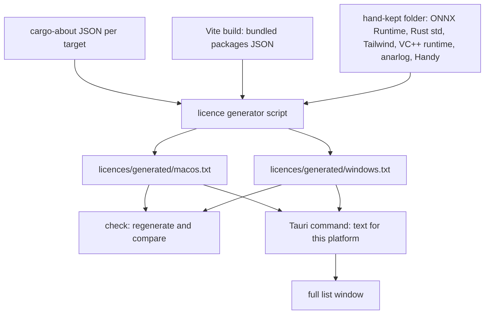

# About Pane with Acknowledgements and Licences - Plan

## Goal Capsule

- **Objective:** A person who opens Longhand's settings can see which projects Longhand is built on, read a personal thank-you to anarlog and Handy, and read the licence of every component that Longhand ships.
- **Means:** A build-derived licence list per platform, stored in the repo and checked for drift, shown in its own window (KTD1–KTD7).
- **Product authority:** This Product Contract. The personal texts in R3 and R4 are the author's words and change only with the author's approval.
- **Stop conditions:** Stop and ask when a shipped component has no licence text that the tools or the hand-kept files can supply, or when DirectML or another non-open-source library is found in a shipped bundle.
- **Execution profile:** Four units in one worktree and one pull request. Microphone and Keychain are not touched, but the new window, the links and the CSP need a manual check in the signed bundle.
- **Open blockers:** None.

---

## Product Contract

**Product Contract preservation:** changed: R11 — the named native code now also lists libopus, SQLite, the Rust standard library, Tailwind's generated base styles and the Windows VC++ runtime (user-approved at the planning synthesis). Deferred questions resolved in place by KTD1–KTD5.

### Summary

The Licences pane becomes an About pane with three layers. Acknowledgements thanks the projects that Longhand is built on, with a personal entry each for anarlog and Handy. Licences lists the models and a small set of major components. A last row opens a separate window that shows the full licence text of every component the app ships, as plain scrolling text.

### Problem Frame

The Licences pane lists only the downloaded models. Longhand also ships code that it copied from anarlog and Handy, two inference engines, an app framework, an editor and hundreds of smaller crates and packages. MIT, BSD and Apache licences ask that the copyright and permission text go with the app, so a list of models alone does not meet that duty. The pane also gives no credit to the two projects that Longhand grew from.

Neither reference app has a full licence screen. anarlog's `LICENSING.md` says to generate a distribution's third-party notices from the provenance records. Handy's About pane has an Acknowledgments group with one entry, which thanks transcribe.cpp, ggml and Georgi Gerganov.

### Key Decisions

- **Three layers, not one list.** Thanks, a curated licence list and the full text each have a different reader, and one long list would hide all three. Governs R1, R5, R9. (session-settled: user-directed — chosen over a curated list with a generated notice file: the user wanted the full list inside the app, not in a file.)
- **The full list is plain scrolling text in its own window.** A formatted list of hundreds of rows would cost effort and help nobody. Governs R9, R10. (session-settled: user-directed — chosen over a formatted row per component in the pane.)
- **anarlog and Handy get personal entries in the author's voice.** Longhand exists because of these two projects, and this credit is a courtesy, not a legal duty. Governs R3, R4. (session-settled: user-directed — chosen over a single technical thanks line for each.)
- **Technical acknowledgements go only to components that are large, complex and central to what Longhand does.** Common building blocks such as React, ProseMirror, cpal and Opus appear in the curated licence list but not in the thanks. Governs R5, R7. (session-settled: user-approved — the user asked for this judgment and accepted the proposed set.)
- **The pane is renamed About.** "Licences" does not describe a pane that also holds thanks, and Handy uses About for the same content. Governs R1. (session-settled: user-approved — proposed as a call-out and confirmed.)
- **The full list covers every component that ships, direct and indirect.** The notice duty applies to all code in the app, not only to what Longhand names itself. Governs R11. (session-settled: user-directed — chosen over listing only the 55 direct Rust crates and 20 direct JavaScript packages: indirect dependencies ship code too.)
- **The full list comes from the build, not from a hand-kept file.** Nobody can keep hundreds of entries current by hand. Governs R11, R12.

### Requirements

**Pane**

- R1. The settings pane named "Licences" is renamed "About". It shows, in this order: Acknowledgements, Licences, and a row that opens the full list.
- R2. The pane text follows the UI language rules: short, plain words, and the term "note", not "session", when it speaks about recordings.

**Acknowledgements**

- R3. An anarlog entry comes first and carries this text, with only small changes to wording: "anarlog inspired me to make Longhand. The work its team is doing is outstanding. I wanted something smaller and simpler for my own use, and I started from what they built." A short clause then says which parts of Longhand come from anarlog.
- R4. A Handy entry comes next and carries this text, with only small changes to wording: "Thank you for an amazing local-only dictation tool that I still use every day." A short clause then says which parts of Longhand come from Handy.
- R5. A separate, shorter group of technical thanks follows the personal entries. It names whisper.cpp, ggml and transcribe.cpp (Georgi Gerganov and contributors), ONNX Runtime, pyannote and Tauri, with one line each on what it does for Longhand.
- R6. Each acknowledgement names its project and is a link that opens the project's page in the default browser.

**Curated licences**

- R7. The Licences group lists every model, as it does now, plus one row for each major component: ggml, transcribe.cpp, ONNX Runtime, Tauri, ProseMirror, React, cpal, Opus, the code copied from anarlog, and the code copied from Handy. whisper.cpp gets no row, because Longhand does not contain its code: transcribe.cpp only reads whisper.cpp's model file format.
- R8. A component row behaves as a model row does: a click shows its licence name, attribution, licence address and source.

**Full list**

- R9. The last row of the pane opens a separate window that shows the licence of every component the app ships.
- R10. The window shows plain scrolling text. Each distinct licence body appears once, followed by the components that use it, each with its own copyright line. The text can be selected and copied.
- R11. For each platform that Longhand ships (macOS and Windows), the full list covers every Rust crate linked into that platform's binary, every JavaScript package bundled into the interface, and the code copied from anarlog and Handy. It also covers the native code that ships inside or beside the binary, with its own licence and notice texts: ggml and miniz inside transcribe-cpp-sys, kaldi-native-fbank inside knf-rs-sys, libopus inside opusic-sys, SQLite inside libsqlite3-sys, the ONNX Runtime library that ort-sys links with its third-party notices, the Rust standard library, Tailwind's generated base styles, and on Windows the VC++ runtime DLLs. It leaves out tools used only to build or test the app. Each build shows the list for its own platform.
- R12. A check that runs with the local gates and in CI fails when the full list for any shipped platform does not match the components that platform ships, including the native code in R11.

### Acceptance Examples

- AE1. **Covers R12.** **Given** a change that adds a new crate to the binary, **when** the local gates run, **then** the check fails until the full list includes that crate and its licence text.
- AE2. **Covers R11.** **Given** a crate used only by a test or a build script, **when** the full list is produced, **then** that crate does not appear in it.
- AE3. **Covers R10.** **Given** 40 crates under the same MIT text, **when** the window opens, **then** that MIT text appears once, with the 40 crate names listed with it, each with its own copyright line.

### Scope Boundaries

- No change to how model rows work or to the model data behind them.
- No app version display in the About pane. It is a natural later addition, but this work does not need it.
- No licences for tools that are used only to build, test or develop the app.

### Sources / Research

- `src/settings/Licences.tsx` and `src/settings/SettingsWindow.tsx`: the current pane and its place in the sidebar.
- `deny.toml`: the licence allow-list and the MPL-2.0 exceptions for Tauri's crates, which the full list must include.
- `LICENSES/anarlog-MIT.txt`, `LICENSES/Handy-MIT.txt` and the `PROVENANCE.md` files beside the copied code.
- `reference-source/anarlog/LICENSING.md`, "Third-party provenance": notices are generated from the provenance records.
- `reference-source/Handy/src/components/settings/about/AboutSettings.tsx` and the `settings.about.acknowledgments` strings: Handy's acknowledgement group.

---

## Planning Contract

### Key Technical Decisions

- KTD1. **cargo-about 0.9.2 produces the Rust part, once per target.** It is the only Rust licence tool with per-target filtering and checksummed `clarify` entries for licence files deeper in a crate. It runs with `--format json`, `--locked`, `--fail` and one `--target` per run (`aarch64-apple-darwin`, `x86_64-pc-windows-msvc`). It reads `cargo metadata` and compiles nothing, so it does not trigger the ggml rebuild that `docs/solutions/performance-issues/cargo-feature-unification-ci-rebuilds.md` describes. `about.toml` carries `clarify` entries for the vendored native licences: `transcribe-cpp-sys` (`ggml/LICENSE`, `src/third_party/miniz/LICENSE`), `knf-rs-sys`, `opusic-sys` and `libsqlite3-sys`. SQLite has no licence file: its public-domain notice is the "blessing" comment at the top of `sqlite3/sqlite3.h`, so its entry selects those lines by start and end, and `about.toml` accepts `blessing` in addition to the `deny.toml` list. Its raw JSON holds absolute registry paths, so a script turns it into the stored text (KTD4). Covers R11, AE2. Rejected: cargo-bundle-licenses (no target filter, no clarify) and `cargo deny list` (no licence text).
- KTD2. **rollup-plugin-license 3.7.1 in `vite.config.ts` produces the JavaScript part.** It keeps only modules with rendered code in the bundle, so build tools such as Tailwind and TypeScript stay out without a hand-kept deny list. It writes a sorted JSON file of package name, version, licence text and notice text, and it fails the build on an unlicensed package. Tailwind's generated base styles ship as CSS, not as a module, so the hand-kept files add them (KTD3). Covers R11, AE2. Rejected: license-checker and reading `bun.lock`, which list every installed package, build tools included.
- KTD3. **A small hand-kept folder holds what no tool can read.** It contains the ONNX Runtime `LICENSE` and `ThirdPartyNotices.txt` pinned to v1.22.0, the version that `ort-sys` 2.0.0-rc.10 downloads (its `dist.txt` names `ms@1.22.0`); the Rust standard library notice; Tailwind's licence; for Windows, the Microsoft VC++ runtime notice and the Khronos Vulkan-Headers and Vulkan-Hpp licence (Apache-2.0), which `ggml-vulkan.dll` compiles in from the Vulkan SDK that CI pins; and the anarlog and Handy licences, taken from `LICENSES/`. A small manifest names each entry, its platforms and its source. The generator fails when `dist.txt` names a different ONNX Runtime version from the manifest's. Covers R11.
- KTD4. **The full text for each platform is stored in the repo, and the check regenerates and compares it.** One bun script merges the cargo-about JSON, the JavaScript JSON and the hand-kept folder into `licences/generated/macos.txt` and `licences/generated/windows.txt`. The check runs the script and fails on any difference. A dependency change then shows as a readable diff, and a normal app build needs neither licence tool. `.gitattributes` fixes the stored files to LF, and the script turns CRLF licence texts into LF. Covers R12, AE1. (session-settled: user-approved — chosen over a compact manifest checked in the repo with the full text made during each build: that needs cargo-about in every app build.)
- KTD5. **The script groups identical licence bodies and keeps each component's copyright line.** For each licence text it separates the leading copyright lines from the body, normalizes whitespace, and groups components by body. The output prints each body once, preceded by its component lines: name, version and copyright. It sorts groups and components so that the output does not depend on the host. Covers R10, AE3.
- KTD6. **The app carries the list as text compiled into the binary, and the window asks for it through one command.** A Tauri command returns the text for the platform the binary was built for, chosen at compile time. No file access or CSP change is needed, and the window reads the text once when it opens. Covers R9, R11.
- KTD7. **The full list window follows the Settings window pattern with its own label.** It loads `index.html?window=licences`, is built by the existing open-or-build helper so a second open brings it to the front, and uses a standard title bar. It has its own capability file with only `core:default`. It registers no close listener, which avoids the stale-listener failure in `docs/solutions/ui-bugs/tauri-stale-close-listener-blocks-next-window.md`. Covers R9.
- KTD8. **Links open through `tauri-plugin-opener`, as in Handy.** The Settings capability gets `opener:allow-open-url` scoped to the https addresses the acknowledgements use, so the webview never navigates away and the CSP does not change. Covers R6.
- KTD9. **Acknowledgements and curated component rows are static frontend data, and a single expanding row serves models and components.** The current model row takes a general shape (name, detail line, attribution, licence address, source), and model statuses map into it. Covers R7, R8. Rejected: a Rust command for static text that only the interface reads.

### High-Level Technical Design

The full list moves from three sources, through one script, into stored text that the binary compiles in.

### Risks & Dependencies

- **A Vite upgrade to Rolldown can break the JavaScript part.** rollup-plugin-license reads Rollup's chunk module data, and it does not state Rolldown support. The check fails loudly if the output empties, so a later Vite upgrade must confirm the plugin still lists packages.
- **An ort upgrade changes the ONNX Runtime version.** The generator's version check (KTD3) fails until the pinned notice files are refreshed, so the notice cannot fall behind silently.
- **The stored text adds about 1–2 MB to each binary and to the repo.** This is small next to the models, and the text changes only when dependencies change.

### Assumptions

- DirectML is not in any shipped bundle: the `directml` feature is off, and the Windows bundle adds only `transcribe-libs/`. U2 confirms this against a Windows build.
- The Microsoft VC++ runtime DLLs need no open-source licence text. A short notice that names them and Microsoft's redistribution terms satisfies R11.

---

## Implementation Units

### U1. Licence sources: cargo-about, the Vite plugin and the hand-kept folder

- **Goal:** Each of the three sources produces its part of the list without absolute paths or host-dependent order.
- **Requirements:** R11, AE2; KTD1, KTD2, KTD3.
- **Dependencies:** None.
- **Files:**
  - `about.toml` (new)
  - `vite.config.ts`
  - `package.json`, `bun.lock` (rollup-plugin-license as a dev dependency)
  - `licences/native/manifest.json` and one text file per entry (new)
  - `.gitattributes`
- **Approach:**
  1. Write `about.toml` with the accepted licences from `deny.toml`, and ignore build and dev dependencies and private workspace crates. Add one `clarify` entry, with its checksum, for each vendored native licence named in KTD1.
  2. Add the plugin to `vite.config.ts`. It writes `licences/generated/js-packages.json`, sorted by name, with `failOnUnlicensed`.
  3. Fetch the ONNX Runtime v1.22.0 `LICENSE` and `ThirdPartyNotices.txt` from the pinned tag, and write the Rust standard library, Tailwind, VC++ runtime and Vulkan header notices (the last pinned to the Vulkan SDK version in `.github/workflows/ci.yml`). Record each in the manifest with its platforms and source address.
  4. Mark `licences/**` as `text eol=lf` in `.gitattributes`.
- **Patterns to follow:** `deny.toml` for the licence allow-list; `scripts/refresh-catalog.py` for a pinned upstream download recorded with its source.
- **Test scenarios:**
  - Covers AE2. Run cargo-about for the macOS target: no crate that only `[dev-dependencies]` or `[build-dependencies]` use (for example `tauri-build`) appears.
  - Run cargo-about for the Windows target on macOS: Windows-only crates such as `windows-sys` appear, and macOS-only crates such as `objc2-app-kit` do not.
  - The macOS output contains the ggml licence text ("The ggml authors") and the miniz licence text as separate entries from transcribe.cpp's own licence.
  - `bun run build` writes `js-packages.json` with react and prosemirror-view, and without tailwindcss or vite.
  - Change one byte in a clarified licence file's recorded checksum: cargo-about fails.
- **Verification:** All three sources run on macOS and produce their output with no absolute path in it.

### U2. Licence generator, drift check and CI step

- **Goal:** One script produces the stored full text for each platform. The check fails when that text is stale.
- **Requirements:** R10, R11, R12, AE1, AE3; KTD3, KTD4, KTD5.
- **Dependencies:** U1.
- **Files:**
  - `scripts/licences/generate.ts` (new)
  - `scripts/licences/group.ts` (new: pure grouping and formatting)
  - `scripts/licences/group.test.ts` (new)
  - `scripts/check-licences.sh` (new, with `--self-test`)
  - `licences/generated/macos.txt`, `licences/generated/windows.txt`, `licences/generated/js-packages.json` (generated, committed)
  - `.github/workflows/ci.yml`
  - `CLAUDE.md` (the local gates line names the new check)
- **Approach:**
  1. `generate.ts` runs cargo-about once for each target, reads `js-packages.json` and the hand-kept manifest, and passes all entries to `group.ts`. It also fails when `ort-sys`'s `dist.txt` names a different ONNX Runtime version from the manifest's.
  2. `group.ts` follows KTD5. It removes absolute paths and gives a fixed order.
  3. The output starts with a short plain heading for each part (Rust crates, interface packages, native libraries), so a reader can find their way in the plain text.
  4. `check-licences.sh` always runs `bun run build` first, so a dependency change without a build cannot pass locally with a stale `js-packages.json`. It then runs the generator and fails on any `git diff` in `licences/generated/`. `--self-test` runs `bun test scripts/licences`.
  5. In CI, install cargo-about 0.9.2 with a prebuilt-binary install action in the macOS checks job, and run the check after "Frontend build". It needs no cargo compile, so the rust-cache key stays the same.
  6. Confirm on the Windows CI build that no DirectML DLL is in the bundle (Assumptions).
- **Patterns to follow:** `scripts/check-provenance.sh` for the gate's shape and `--self-test`; the "Bindings are current" CI step for the regenerate-and-diff check.
- **Test scenarios:**
  - Covers AE3. Three packages with the same MIT body and different copyright lines: the output has the body once and three component lines, each with its own copyright.
  - Two texts that differ only in CRLF and trailing spaces group together.
  - The same entries in a different input order give byte-identical output.
  - A licence text with no copyright line keeps its component line with the name and version only.
  - A hand-kept entry marked Windows-only appears in `windows.txt` and not in `macos.txt`.
  - Covers AE1. Add a crate to a workspace member without regenerating: `check-licences.sh` fails and names the stale file.
  - The manifest names ONNX Runtime 1.21.0 while `dist.txt` names 1.22.0: the generator fails with a message that names both versions.
- **Verification:** `scripts/check-licences.sh` passes on a clean tree and fails after a dependency change. The CI macOS job runs it.

### U3. Full list window

- **Goal:** A separate window shows the full list for the running platform as plain selectable text.
- **Requirements:** R9, R10; KTD6, KTD7.
- **Dependencies:** U2.
- **Files:**
  - `src-tauri/src/commands/licences.rs` (new: the command that returns the text, and a test)
  - `src-tauri/src/commands/mod.rs`, `src-tauri/src/lib.rs` (register the commands in `collect_commands!`; add `LICENCES_WINDOW` to the window-state plugin's denylist)
  - `src-tauri/src/window.rs` (a `LICENCES_WINDOW` label, its builder, and the `WindowEvent::Destroyed` arm)
  - `src-tauri/src/commands/window.rs` (an async open command, as `open_settings` is)
  - `src-tauri/capabilities/licences.json` (new)
  - `src/bindings.ts` (regenerated)
  - `src/licences/LicencesWindow.tsx`, `src/licences/LicencesWindow.test.tsx` (new)
  - `src/App.tsx` (choose the view from `?window=licences`)
- **Approach:**
  1. The command compiles in `licences/generated/macos.txt` or `windows.txt` according to the target OS, and returns it.
  2. Build the window in `window.rs` with `open_or_build`: title "Open Source Licences", a standard title bar, and a size that fits a text column.
  3. The open command is async, because a synchronous command that builds a window deadlocks on Windows (the note beside `open_settings`).
  4. Give the new window the Settings window's lifecycle handling outside its builder: the `WindowEvent::Destroyed` arm also calls `hide_dock_icon_if_no_window` for `LICENCES_WINDOW`, so closing it with no other window open removes the Dock icon, and the window-state denylist keeps the plugin from restoring an old size and place.
  5. The view fetches the text once and renders it in a monospace, selectable, scrolling block with the pane's colour tokens. It marks the three part titles from U2 (Rust crates, interface packages, native libraries) as headings, so VoiceOver users can jump between parts; nothing changes on screen. While it waits it shows nothing. If the fetch fails, it shows one plain line that asks the person to reopen the window.
- **Patterns to follow:** `open_settings` in `src-tauri/src/window.rs` and `src-tauri/src/commands/window.rs`; the `window === "settings"` switch in `src/App.tsx`; `src-tauri/capabilities/settings.json`.
- **Test scenarios:**
  - Rust: the command's text is not empty and contains "ggml", "ONNX Runtime" and "tauri".
  - Rust, macOS build: the text contains no Windows-only entry, such as the VC++ runtime notice.
  - The view renders the text from a mocked command, and the text node allows selection.
  - The three part titles render as headings (`getAllByRole("heading")` finds three), and the text under each title follows it.
  - The view shows the reopen line when the mocked command rejects.
  - `App` renders the licences view, not the main window, for `?window=licences`.
- **Verification:** In the signed bundle the window opens, a second open brings the same window to the front, closing it and opening it again works, the text scrolls and copies, and closing it with the main window hidden leaves no Dock icon.

### U4. About pane: acknowledgements, curated rows and the full-list row

- **Goal:** The pane is named About and shows Acknowledgements, Licences and the row that opens the full list.
- **Requirements:** R1, R2, R3, R4, R5, R6, R7, R8, R9; KTD8, KTD9.
- **Dependencies:** U3.
- **Files:**
  - `src/settings/About.tsx` (renamed from `Licences.tsx`)
  - `src/settings/About.test.tsx` (renamed from `Licences.test.tsx`)
  - `src/settings/acknowledgements.ts` (new: static acknowledgement and component data)
  - `src/settings/SettingsWindow.tsx`, `src/settings/Status.tsx` (pane id `about`, label "About")
  - `src/App.test.tsx` (the sidebar names list)
  - `src-tauri/Cargo.toml`, `src-tauri/src/lib.rs` (`tauri-plugin-opener`)
  - `package.json`, `bun.lock` (`@tauri-apps/plugin-opener`)
  - `src-tauri/capabilities/settings.json` (scoped `opener:allow-open-url`)
- **Approach:**
  1. Rename the pane id and label. The `paneTone` switch returns no tone for `about`, as it does now for `licences`.
  2. Write the anarlog and Handy entries with the R3 and R4 text. Take each "what came from it" clause from the `PROVENANCE.md` records: anarlog supplied recording, audio, diarization, embedding and the editor; Handy supplied the model catalog and downloads, speech recognition, voice detection and parts of the pipeline.
  3. Write the technical thanks in R5's order, one short line each, as a second `Group` with its own short header below the personal entries' `Group`.
  4. Every entry is a button that calls the opener with the project's https address. It has an accessible name that says it opens in the browser.
  5. Generalize the row component (KTD9), map models into it, and add the R7 component rows with licence name, attribution, licence address and source. Take each value from the component's own licence file. A model row's collapsed line keeps its role and licence name; a component has no role, so its collapsed line shows the licence name only.
  6. The last row calls the open command from U3.
- **Patterns to follow:** `LicenceRow` and `Detail` in the current `src/settings/Licences.tsx`; `Group`, `Pane` and `settings-row` in `src/settings/ui.tsx`; Handy's `AboutSettings.tsx` for the opener call.
- **Test scenarios:**
  - The pane title is "About", and the sidebar in `App.test.tsx` lists "About" and not "Licences".
  - The groups appear in the order Acknowledgements, Licences, then the full-list row.
  - anarlog comes first and Handy second, and each shows the author's sentence from R3 and R4.
  - The technical thanks render in their own group, separate from the anarlog and Handy group.
  - A component row's collapsed line shows its licence name, such as "MIT" for ggml.
  - Clicking the anarlog entry calls the opener once with anarlog's address, and clicking ggml calls it with ggml's address.
  - The Licences group shows one row per model from the `models` prop and the ten component rows. There is no whisper.cpp row.
  - Clicking a component row expands it and shows its licence name, attribution, licence address and source. Clicking again collapses it.
  - With an empty `models` list, the component rows still show.
  - Clicking the full-list row calls the open command once.
- **Verification:** In the signed bundle each link opens the default browser, the pane reads correctly in light and dark mode, and keyboard focus moves through the entries (`docs/solutions/ui-bugs/wkwebview-click-does-not-focus-button-breaks-shortcut-capture.md`).

---

## Verification Contract

| Check | Command | Proves |
|---|---|---|
| Types and bundle | `bun run build` | typecheck passes; the JavaScript part regenerates |
| Frontend tests | `bun run test` | U3 and U4 view tests |
| Generator tests | `scripts/check-licences.sh --self-test` | U2 grouping tests |
| Licence drift | `scripts/check-licences.sh` | R12, AE1 |
| Rust format and lint | `cargo fmt --all --check`; `cargo clippy --workspace --all-targets -- -D warnings`; `scripts/check-windows.sh` | Rust changes are clean on both platforms |
| Rust tests | `cargo test --workspace` | U3 command test |
| Bindings | `git diff --exit-code src/bindings.ts` after `cargo test -p longhand export_bindings` | new commands are exported |
| Provenance | `scripts/check-provenance.sh` | no borrowed code is left unrecorded |
| Licence policy | `cargo deny check licenses sources bans` | no new licence falls outside the allow-list |
| Signed bundle | `bun tauri build --bundles app` | the window, the links and the CSP work outside `tauri dev` |

---

## Definition of Done

- Every requirement R1–R12 is met, and AE1–AE3 are shown by tests.
- The Verification Contract passes locally. On the pull request, CI passes on macOS and Windows, including the new licence check.
- A manual check in the signed macOS bundle confirms the About pane, every link, and the full list window: open, bring to the front, close and reopen, scroll, copy.
- `licences/generated/` matches a fresh run of the generator.
- No code from abandoned attempts is left in the diff.
