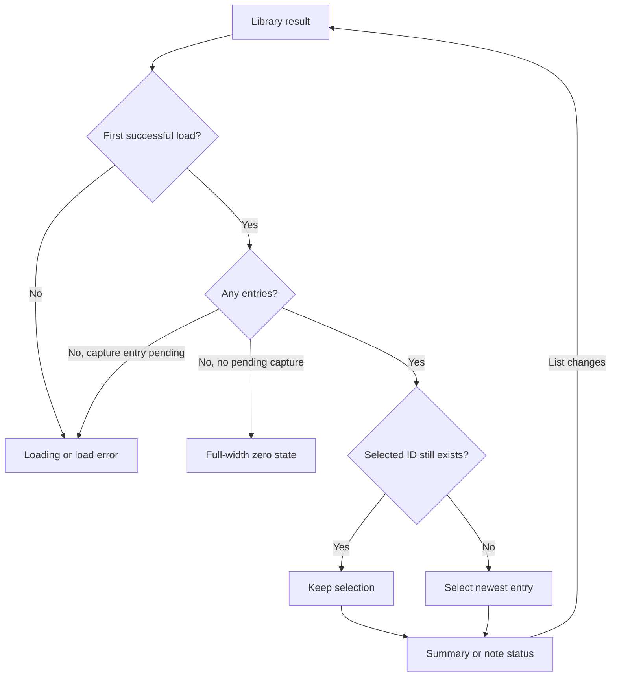
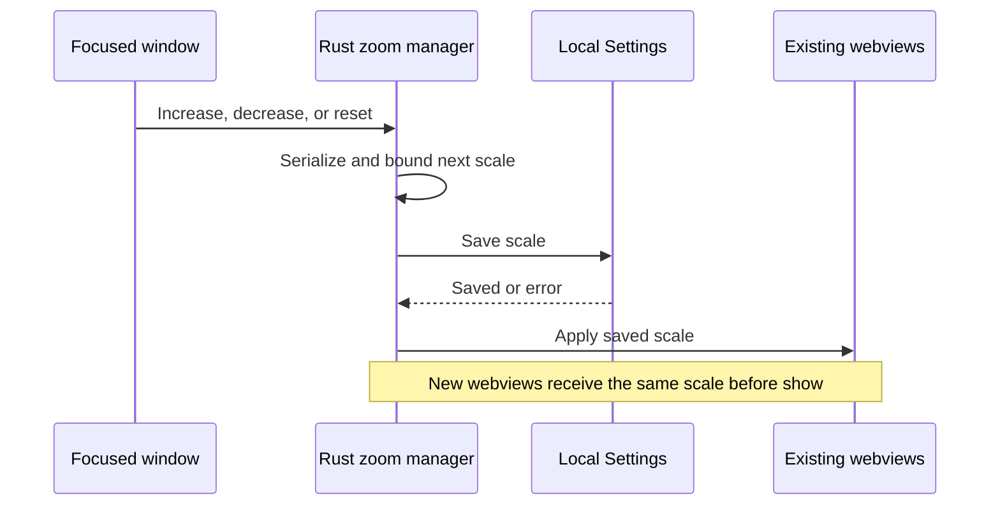
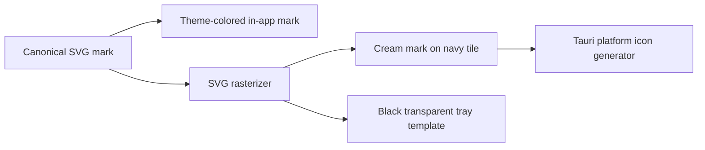

# Library and Desktop UI Polish - Plan

## Goal Capsule

- **Objective:** Longhand users can browse notes without hover-driven layout changes, adjust interface size, choose login startup, and see consistent branding without alert-sound nagging.
- **Product authority:** This Product Contract records the user-confirmed scope, including the supplied icon-generation script and the subsequent instruction to keep generated icons consistent with the SVG.
- **Open blockers:** None.

---

## Product Contract

### Problem Frame

Hover previews make the library difficult to browse. Sound warnings, a small home title, and the tiled in-app mark add distractions. Desktop zoom and login startup controls are missing.

### Summary

Make the library use stable selection and deliberate opening, remove alert-audibility warnings, and add keyboard zoom and optional login startup. Use a shared vector mark for Longhand's branding and strengthen the home header's visual hierarchy. These changes stay in one plan at the user's explicit request.

### Key Decisions

- **Click to preview, double-click to open.** Governs R3–R7. (session-settled: user-directed — chosen over hover previews and single-click opening: actual use proved too finicky.)
- **Trust the user's sound setup.** Governs R1–R2. (session-settled: user-directed — chosen over muted-output and untested-sound warnings: audibility is the user's responsibility.)
- **Keep machine preferences local.** Governs R11–R14; the confirmed defaults preserve zoom across launches and start quietly at login.
- **One vector source for the mark.** Governs R15–R17. (session-settled: user-directed — chosen over leaving the old app icon if the mark changes: all variants must remain consistent.)

### Requirements

**Alert sound**

- R1. Remove all proactive warnings or reminders about whether the alert sound can be heard, including muted output, an untested sound, and cautionary Settings copy about notification audibility.
- R2. Keep the existing failure alert and optional Play Sound action; actual recording failures and errors from a user-requested action remain reportable.

**Library selection and summary**

- R3. A single click on a note selects it and displays its summary sidebar; a double-click opens that note's detail page.
- R4. Hovering or leaving a note never changes the selection, sidebar content, or sidebar visibility.
- R5. Once the library is loaded, exactly one existing note is selected whenever any notes exist, including when the only note is recording, interrupted, processing, or lacks a summary.
- R6. Preserve a valid selection through navigation, list refreshes, and newly arriving notes; when no valid selection exists, select the most recent note by recording start time.
- R7. On a fresh launch, select the most recent note; after deleting or otherwise losing the selected note, apply R6 to the remaining notes.
- R8. The selected note's sidebar shows the available summary or its current status when a summary is unavailable, including while a note is still recording.
- R9. Only a genuinely empty library hides the summary sidebar and its shaded region, showing a full-width zero state with clear guidance to create the first note.
- R10. Preserve keyboard browsing and opening: arrow keys move selection and Enter opens the selected note, while rename and action-menu interactions retain their own behavior.

**Interface zoom**

- R11. Support standard application-focused zoom shortcuts on macOS and Windows: Command/Ctrl plus `+` or `=` to enlarge, `-` to reduce, and `0` to reset to 100%, without a visible Settings control.
- R12. Remember zoom on this machine across launches and apply the chosen scale consistently across app windows, including newly opened windows.

**Login startup**

- R13. Add a Start at login toggle that is off on a machine with no existing preference and reflects whether login startup is actually enabled.
- R14. Enabling Start at login starts Longhand quietly in the menu bar or tray after login, without opening its window or beginning a recording; disabling it stops future login launches.

**Logo and hierarchy**

- R15. Use a transparent SVG L with the pen dot for in-app branding, with a foreground color appropriate to the current light or dark appearance and no icon background rectangle.
- R16. Preserve the supplied generator's mark geometry as closely as practical, using the SVG as the shared source for the in-app logo, app icon, and tray icon.
- R17. Regenerate platform app icons from that source whenever the SVG mark differs from the existing icon, retaining the app icon's navy background and cream mark and the tray icon's template treatment.
- R18. Increase the home header's Longhand text and logo so that the branding is visually larger and more prominent than the Notes heading.

### Acceptance Examples

- AE1. **Covers R1–R2.** With laptop output muted, opening Settings or recording a note shows no audibility warning; failure alerts still operate and Play Sound remains available.
- AE2. **Covers R3–R4.** Click note A, then move the pointer over note B and outside the list: A remains selected and its sidebar remains visible; double-click B opens B.
- AE3. **Covers R5–R7.** Launch with several notes: the newest is selected. Select an older note, open it, return, and refresh the list: it remains selected even if a newer note arrives.
- AE4. **Covers R5–R9.** Delete the selected note: the newest remaining note becomes selected. Delete the final note: the shaded sidebar disappears and the zero state appears. Create the first note: on the library page, that note is selected and its sidebar shows the available status.
- AE5. **Covers R5, R8.** A library containing only a recording or processing note has a selection and a status sidebar, without pretending that a summary already exists.
- AE6. **Covers R10.** Arrow through notes and press Enter to open one; using Rename or Delete does not accidentally open the note.
- AE7. **Covers R11–R12.** Enlarge the interface with the platform shortcut, open Settings, and relaunch: the chosen scale is retained. The reset shortcut restores 100%.
- AE8. **Covers R13–R14.** On a fresh machine the toggle is off. Enable it and log in again: Longhand runs in the menu bar or tray without a window or recording. Disable it and confirm a later login does not launch it.
- AE9. **Covers R15–R18.** In light and dark appearances, the in-app L has no colored tile behind it, matches the mark in generated icons, and pairs with a Longhand title visually larger than Notes.

### Scope Boundaries

- Applies to the existing macOS and Windows desktop app.
- Existing recording navigation and real recording-readiness checks remain; R1 concerns alert audibility, not microphone or model readiness.
- No visible zoom preference, account-level preference sync, or requirement to restore the selected note across fresh launches.
- This is a polish pass, not a replacement library layout or a new logo concept.

### Outstanding Questions

- **Resolve Before Planning:** None.
- Zoom increments, bounds, shortcuts, and layout are resolved by KTD3–KTD4.
- Login registration, state, and errors are resolved by KTD5–KTD6.
- SVG geometry, export, and header sizing are resolved by KTD7; pixel-identical raster antialiasing is not required.

### Sources / Research

- User-confirmed scope in this conversation, including quiet startup, persistent machine-local zoom, selection for recording-only libraries, and the shared icon source.
- `src/home/Home.tsx`, `src/home/SessionRow.tsx`, and `src/home/PreviewPanel.tsx`: existing hover preview, single-click opening, selection, and empty-state behavior.
- `src/home/group.ts`: existing newest-first ordering by recording start time.
- `src/App.tsx`: Home remains mounted during note navigation, preserving its state.
- `src/session/RecordingBar.tsx` and `src/settings/Status.tsx`: muted-output warning and alert Settings copy.
- `src/settings/icons.tsx` and `scripts/icons/make_icons.py`: raster in-app icon and the same generator supplied by the user. The mark is two rounded rectangles plus a circular pen dot; the app background is RGB 28, 36, 52 and its mark is RGB 242, 236, 222.
- [Tauri webview API](https://v2.tauri.app/reference/javascript/api/namespacewebviewwindow/) and [autostart plugin](https://v2.tauri.app/plugin/autostart/): framework support for webview zoom and login startup; exact integration belongs to implementation planning.

---

## Planning Contract

Product Contract preservation: unchanged. R1–R18 and AE1–AE9 retain their meaning and identifiers.

### Key Technical Decisions

- KTD1. Remove the proactive sound-check path through React, typed IPC, and the native alert manager. Remove output-probing code only where it has no remaining caller. Preserve playback and recording-failure handling per R1–R2. This prevents a hidden poll from continuing after its warning disappears. (session-settled: user-directed — chosen over retaining muted-output warnings: the user accepts responsibility for audibility.)
- KTD2. Keep one selected note ID in Home and derive a valid selected entry from every listed note, including recording and interrupted notes. Use newest recording start time, then ID as a deterministic tie-break, only when that ID is absent. Keep Home mounted during navigation. Explicitly focus a row on pointer selection without moving focus during background refresh. These choices implement R3–R10 without hover timers. (session-settled: user-directed — chosen over hover preview and click-to-open: actual use proved too finicky.)
- KTD3. Own interface zoom in Rust, separately from the existing window-maximize module `src-tauri/src/zoom.rs`. Persist a machine-local integer percentage in Settings: default 100, steps of 10, range 50–200 inclusive. Normalize invalid saved values to 100. Serialize increase, decrease, and reset through one manager so concurrent windows cannot overwrite a newer value. Use native webview scaling, not CSS transforms, and apply the stored value before showing each window. This meets R11–R12 without a second settings store.
- KTD4. Install one application-focused key handler at the common App root for all three window types. Match Command on macOS and Ctrl on Windows with `+`, `=`, `-`, or `0`; allow Shift for plus, reject Alt and composition events, and consume handled events before editor handlers. Held keys may repeat through the serialized command. Disable Tauri's independent zoom hotkeys on every webview to prevent duplicate changes. Keep shortcut recording exclusive while its control captures a key. Use shrinkable list and preview columns, wrapping text, and scrollable content so zoom does not hide the selected sidebar or make controls unreachable. R11–R12 do not require adding native menus.
- KTD5. Query the operating system for Start at login state instead of persisting a second enabled boolean. Use Handy's `SMAppService.mainAppService` approach on macOS 15+, and `tauri-plugin-autostart` on Windows. Refresh status when General opens or regains focus, and after every change. Show enabled only for a confirmed enabled registration. Report registration failure or required OS approval beside the toggle; never silently retry registration at each launch. This meets R13 and respects changes made in system settings.
- KTD6. Classify login launches independently from registration state. On Windows register an internal background-launch argument. On macOS read the launch Apple event's login-item marker at the start of setup and retain that classification for the process. Start the macOS app with Accessory activation policy before the event loop, following Handy; ordinary launches promote to Regular when shown. Keep the main window hidden until startup classification and saved zoom are applied. A confirmed login launch stays hidden; manual launch, tray Show, and Dock reopen show normally. A background second-instance request must not show the existing window. This implements R14 without hiding ordinary launches whenever the toggle is on.
- KTD7. Store the mark once as `src/assets/longhand-mark.svg`, with a 100-unit viewBox and `currentColor` fill. Preserve the nominal generator geometry: upright x30/y18, width11/height56, radius5.5; foot x30/y63, width30/height11, radius5.5; dot center71.5/68.5, radius5.5. Render the same SVG in the UI and raster exporter. Regenerate all app and tray assets because vector rasterization can differ from Pillow's rounded coordinates. Keep the original tile colors, inset, and corner radius. Use a 2rem home title, larger than the 1.75rem Notes heading, and size the visible mark to approximately the title's cap height. Apply semantic foreground color and remove tile-era shadows. This implements R15–R18. (session-settled: user-directed — chosen over keeping a mismatched app icon: the mark must stay consistent across variants.)

### High-Level Technical Design

These sketches describe ownership and observable transitions. They do not prescribe function signatures or component boundaries.

**Library state and selection decisions — KTD2.**

**Zoom ownership, data flow, and update sequence — KTD3–KTD4.**

**Startup modes and window lifecycle — KTD5–KTD6.**

| Entry point | Main window | macOS activation | Recording |
|---|---|---|---|
| Confirmed login launch | Hidden | Accessory | Do not start |
| Ordinary first launch | Show after initialization | Regular when shown | Existing recovery behavior |
| Manual second instance, Dock reopen, or tray Show | Show existing window | Regular when shown | Leave unchanged |
| Background second instance | Leave visibility unchanged | Leave unchanged | Leave unchanged |
| Close final visible window | Existing hide/destroy behavior | Accessory | Existing behavior |

**Shared asset generation — KTD7.**

### Risks and Dependencies

- The installed lockfile uses Tauri 2.11.6. Do not add an unrelated framework upgrade. Its built-in zoom handler keeps separate state, which is why KTD4 disables it.
- Apple's `currentAppleEvent` is valid only during event handling. The installed tao launch callback reaches Tauri setup synchronously, but that is a source-based inference about timing. U4 must prove detection in a signed, real login launch. If that check fails, fix the native lifecycle integration before declaring U4 complete; do not infer launch reason from enabled registration.
- Native login launch can briefly affect activation even with a hidden window. Check for a window, Dock icon, or focus change during login. Keep the established Accessory startup pattern; do not replace Tauri's application delegate without evidence that it is necessary.
- Save zoom before applying it. A save failure leaves the previous scale active and reports an operation error. A failed webview application reports the affected window, retains the saved authoritative value, and reapplies it when that window next opens. Do not claim every window updated if one failed.
- New Settings fields use existing defaults; no legacy migration is required. Update typed fixtures and regenerate Specta bindings. Borrowed native code needs a `src-tauri/PROVENANCE.md` entry. New dependencies require the licence checks and generated notices.

### Research References

- `src/home/Home.tsx`, `RecordingRow.tsx`, `SessionRow.tsx`, and `PreviewPanel.tsx`; `src/session/useSessions.ts`: selection excludes open notes today, and preview cache keys omit library revisions.
- `src-tauri/src/window.rs`, `lib.rs`, and `managers/settings.rs`: window creation, single-instance behavior, activation policy, and serialized Settings persistence.
- `reference-source/Handy/src-tauri/src/autostart.rs` and `lib.rs`: native macOS login registration and startup activation policy. Do not copy legacy LaunchAgent cleanup or automatic preference reapplication.
- [Apple SMAppService](https://developer.apple.com/documentation/servicemanagement/smappservice), [login launch event marker](https://developer.apple.com/documentation/coreservices/1556410-launch_apple_event_constants/keyaelaunchedasloginitem), and [NSAppleEventManager](https://developer.apple.com/documentation/foundation/nsappleeventmanager): KTD5–KTD6.
- [Tauri autostart](https://v2.tauri.app/plugin/autostart/), [webview scaling](https://v2.tauri.app/reference/javascript/api/namespacewebview/), and [WebView2 zoom controls](https://learn.microsoft.com/en-us/dotnet/api/microsoft.web.webview2.core.corewebview2settings.iszoomcontrolenabled): KTD3–KTD6. Disabling browser zoom controls does not prohibit programmatic scale changes on Windows.
- `docs/solutions/ui-bugs/wkwebview-click-does-not-focus-button-breaks-shortcut-capture.md`: explicit focus and native keyboard verification in U2.
- `docs/solutions/ui-bugs/tauri-stale-close-listener-blocks-next-window.md`: test recreated windows in U3.
- `docs/solutions/ui-bugs/grid-column-grows-to-fit-nowrap-text.md`: shrinkable columns and long-content checks in U3.
- `docs/solutions/ui-bugs/tauri-csp-img-src-blocks-inlined-app-icon.md`: production SVG and CSP verification in U5.

## Implementation Units

### U1. Remove proactive alert-audibility checks

**Goal:** Remove warnings and their unused polling path while preserving actual failure alerts.

**Requirements:** R1–R2, AE1, KTD1. **Dependencies:** None.

**Files:** `src/session/RecordingBar.tsx`, `src/recording/useCapture.ts`, `src/settings/Status.tsx`, `src-tauri/src/commands/alerts.rs`, `src-tauri/src/managers/alerts.rs`, `src-tauri/src/lib.rs`, `crates/sfx/src/output.rs` and its exports, generated `src/bindings.ts`; existing SessionPage, Status, and capture tests and fixtures.

**Approach:** Remove `alertCheck`, `Capture.alert`, and unused output probing after checking callers. Keep the playback command and failed-capture cue schedule. Remove the audibility footer from Settings. Use the existing typed-command export process.

**Test scenarios:** Muted output creates no recording warning and no periodic output-check invocation. Play Sound still calls playback and reports an actual playback error. Recording failure still produces the existing alert path. Obsolete alert-check mocks and bindings disappear.

**Verification:** AE1 passes in the signed app; frontend and affected Rust tests pass.

### U2. Make library selection stable and complete

**Goal:** Every loaded, nonempty library has one selected note and a useful sidebar.

**Requirements:** R3–R10, AE2–AE6, KTD2. **Dependencies:** None.

**Files:** `src/home/Home.tsx`, `SessionRow.tsx`, `RecordingRow.tsx`, `PreviewPanel.tsx`, `group.ts`, `src/session/useSessions.ts`, `src/App.tsx`, `src/index.css`; `src/home/Home.test.tsx`, `src/App.test.tsx`, and focused preview/selection tests where needed.

**Approach:** Remove hover state and timers. Give all note rows one listbox selection and keyboard order, while retaining their existing status presentation. Select on click, focus explicitly, and open on double-click or Enter. Stop action-menu and rename events from reaching row opening. Distinguish initial loading and a capture entry pending insertion from a genuinely empty response. Preserve last successful data on refresh error. Feed library revisions into preview invalidation; keep late responses from replacing another note's preview. Show status for recording, processing, interrupted, and saved-without-summary entries, and distinguish read errors from missing summaries. Keep the panel mounted through selection changes and remove repeated entry animation.

**Focus after deletion:** When deletion starts in the focused library, focus the replacement selected row after the dialog closes and the list updates. If no rows remain, focus the zero-state New Note control when available. Exclude a successfully deleted ID while its list refresh is pending so stale entries cannot reselect it. Background refresh must not steal focus from another control.

**Test scenarios:** Fresh load chooses newest; tied starts resolve deterministically. Selecting older A survives navigation, sync, and arrival of newer B. Hover cannot change A. Double-click opens only the clicked row. Recording-only and interrupted-only libraries have an active option. Arrow navigation includes those rows, and click followed by arrows works with `document.activeElement` asserted. Rename, Delete, and action-menu double-clicks do not open a note. Successful selected-note deletion chooses newest remaining; arrows and Enter work immediately after confirmation closes. Failed deletion preserves selection. Final deletion shows the zero state, and first creation replaces it. Loading and failed initial load do not claim the library is empty. A revised saved summary refreshes; a late response for A cannot replace B.

**Verification:** AE2–AE6 pass; browser interaction tests and signed WKWebView focus checks agree.

### U3. Add persistent keyboard zoom across windows

**Goal:** One machine-local scale controls main, Settings, and licences windows.

**Requirements:** R11–R12, AE7, KTD3–KTD4. **Dependencies:** U2 for final library layout checks.

**Files:** New `src-tauri/src/interface_zoom.rs` and frontend zoom hook with focused tests; `src-tauri/src/managers/settings.rs`, `commands/settings.rs`, `lib.rs`, `window.rs`, `src/App.tsx`, `src/home/Home.tsx`, affected Settings layouts, and generated `src/bindings.ts` plus typed fixtures.

**Approach:** Follow existing Settings serialization and thin command patterns. Apply native scale on creation before visibility for each window type, including rebuilt Settings and licences windows. Use the common root hook for key handling, with no global shortcut registration. Preserve the existing maximize behavior in `zoom.rs`. Correct layout overflow revealed by the supported scale range; do not hide the sidebar at a breakpoint. Keep the macOS native title controls and draggable region usable when web content scales.

**Test scenarios:** Increase/decrease reaches each bound without drift; reset returns exactly 100. Invalid saved scale defaults safely. Rapid operations from two windows use one ordered value. Save and apply failures follow the stated error behavior. Standard keys work with an editor focused, including shifted plus; unrelated modifiers and composition do not zoom. Shortcut capture retains its exclusive behavior. Reopened Settings, newly opened licences, and a restarted app use the stored scale. No zoom occurs while another app has focus. At 50%, 100%, and 200%, long titles, unbroken paths, forms, and summary text remain reachable at each window's minimum size.

**Verification:** AE7 passes on macOS and Windows; native content scales once per keypress. Recreated windows close normally and receive the current scale.

### U4. Add Start at login with quiet native startup

**Goal:** The toggle reflects OS registration and login launches stay in the tray.

**Requirements:** R13–R14, AE8, KTD5–KTD6. **Dependencies:** U3 for startup scale initialization.

**Files:** New `src-tauri/src/autostart.rs` with platform adapters and policy tests; `src-tauri/src/lib.rs`, `window.rs`, typed settings commands, `src/settings/Status.tsx` and tests, generated bindings, `src-tauri/Cargo.toml`, `Cargo.lock`, `src-tauri/PROVENANCE.md`, and generated licence notices as required.

**Approach:** Borrow Handy's platform structure. Add a General toggle using existing Row/Switch and inline error patterns. Keep it pending during registration, then read actual OS status. Represent status-query failure as unavailable, not confirmed off. Start with no registration on a new machine; do not register on ordinary startup. Preserve normal show/reopen behavior and recording recovery. Prove the macOS launch marker before polishing the toggle so a lifecycle defect is found early.

**Test scenarios:** New machine is off. Enable and disable return observed OS state. Registration rejection, approval-required status, and read failure cannot display a successful enable. An OS change appears after focus returns. Login and ordinary launch take different visibility paths even when registration is enabled. A background second instance does not reveal the main window. Manual second launch, tray Show, and Dock reopen do. Login starts no recording. Restarting does not re-enable a registration disabled through OS settings.

**Verification:** AE8 passes with installed signed builds on macOS and Windows, including a real logout/login cycle. Record launch reason and visibility evidence without private note content. Unit tests of launch policy do not replace this check.

### U5. Unify the vector mark and strengthen the home header

**Goal:** The in-app mark follows the theme and matches all generated icons.

**Requirements:** R15–R18, AE9, KTD7. **Dependencies:** U3 for final zoom checks.

**Files:** New `src/assets/longhand-mark.svg`, `src/settings/icons.tsx`, `src/home/Home.tsx`, `scripts/icons/make_icons.py`, `src-tauri/icons/`, and any remaining references to `src/assets/longhand-icon.png`; icon-generation documentation and dependency declarations as needed.

**Approach:** Use the SVG as a CSS mask filled with `currentColor`, so UI rendering consumes the same file as the exporter without duplicating coordinates. Keep the asset internal and verify production CSP. Add `resvg-py==0.5.0` to the uv script metadata and use its PNG output with Pillow to recolor the mark and compose the existing tile. Its published CPython wheels cover macOS and Windows without system Cairo. Pin the Pillow version used for regeneration. Generate tray and platform icons from that output. Remove the unused raster UI asset only after checking callers. Apply the larger home title and mark without changing Settings and About heading hierarchy. See the [rasterizer API](https://resvg-py.readthedocs.io/en/latest/api.html) and [published wheels](https://pypi.org/project/resvg_py/0.5.0/).

**Test scenarios:** Light and dark themes show a transparent mark in the intended foreground color. Small and large zoom show a clear pen dot and no tile. Generated app and tray marks match the canonical SVG silhouette. Packaged macOS and Windows icons retain the established tile treatment; the macOS tray remains a template image. The home brand is visibly larger than Notes.

**Verification:** AE9 passes in the production signed app. Regeneration is reproducible. Inspect generated icons and light/dark screenshots using synthetic note content; no screenshot snapshot suite is required for the size-only styling changes.

## Verification Contract

- Run `bun run typecheck`, `bun run test`, and `bun run build` after frontend and binding changes.
- Run `cargo fmt --all --check`, `cargo clippy --workspace --all-targets -- -D warnings`, and `cargo test --workspace` for the integrated Rust change.
- Generate bindings with `cargo test -p longhand export_bindings`; confirm a second generation leaves `src/bindings.ts` unchanged.
- Run `scripts/check-windows.sh`, `scripts/check-provenance.sh`, and `scripts/check-licences.sh`. The licence check requires cargo-about 0.9.2; update generated notices for dependency changes.
- Build the signed macOS app with `bun tauri build --bundles app` when the work reaches manual verification. Follow `CLAUDE.md` for exact local launch instructions and the notarized remote-install path if testing remotely. Do not use `tauri dev` as evidence for native microphone, Keychain, login, or focus behavior.
- Run AE1–AE9 with synthetic notes. Cover empty, saved, processing, recording, interrupted, missing-summary, and read-error states. Check light/dark appearance, each window type, and supported zoom bounds.
- Native checks must cover real login startup and disablement, ordinary launch, tray/Dock reopening, key shortcuts inside the editor, pointer-to-keyboard focus, and production asset rendering. Windows cross-compilation alone cannot establish these runtime outcomes. Report unavailable native verification as incomplete.

## Definition of Done

- U1: proactive audibility checks are absent; actual playback and failure alerts remain verified.
- U2: AE2–AE6 pass, with one selected note in every loaded nonempty library.
- U3: AE7 passes across existing, recreated, and newly opened windows, with bounded persistent zoom.
- U4: AE8 passes against actual OS registration and real login startup on supported platforms.
- U5: AE9 passes and all generated marks come from the canonical SVG.
- All applicable Verification Contract checks pass. Native checks have recorded outcomes; untested platform behavior is not reported as complete.
- Remove unused hover, sound-probing, duplicate icon, and abandoned experimental code. Keep unrelated changes out of the implementation.
- Update the associated idea to done only when the implementation ships. Track execution progress outside this plan.
- Follow repository workflow: planning documents stay on main; implementation uses a managed worktree from the pushed plan, with commits per unit and one reviewed PR for this combined change. Do not merge without user authorization.
