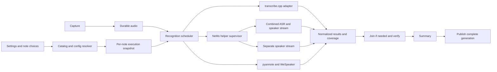
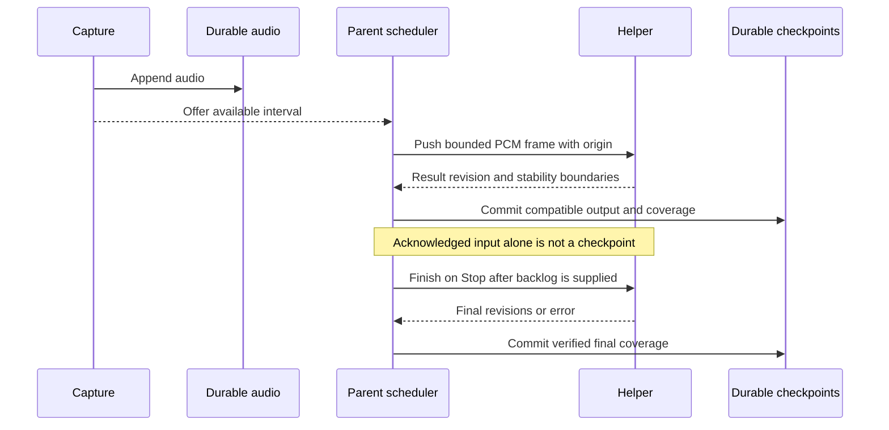
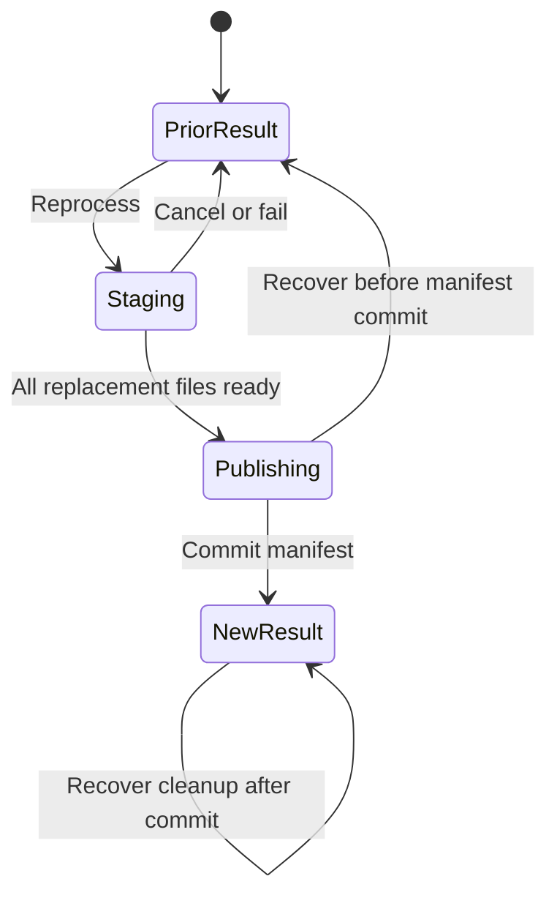

# Flexible speaker recognition - Plan

## Goal Capsule

- **Objective:** Users can choose transcription models, speaker-recognition methods, and processing during recording or after Stop, with clear information about capabilities, speed, and quality.
- **Means:** Capability-based routing, native model labels, and separate speaker analysis through an app-owned NeMo helper or the accelerated existing pipeline (KTD1-KTD4).
- **Authority:** The user approved this Product Contract on 2026-09-27, including Granite Speech 4.1 2B Plus. It governs the Planning Contract, which governs the implementation units. R1-R29, KD1-KD8, F1-F4, and AE1-AE8 retain their approved meaning.
- **Execution profile:** Implement the full scope after execution is authorized. The executor owns the units, verification, documentation, and shipping under the repository workflow. Track execution outside this plan.
- **Stop conditions:** Report a required capability that cannot be provided within R14 or R15. Do not remove it silently. A missed R27 target requires measured results and a user decision before declaring performance complete. The intended laptop must be identified before that acceptance test; it does not block implementation.
- **Landing strategy:** Push this planning document on main. Implement in a managed worktree from origin/main. Commit by unit, open a PR, and watch required CI. Follow the active user's authorization for merge and cleanup.

---

## Product Contract

### Summary

Longhand will offer speaker recognition from the transcription model or a separate model, plus an off option. The model picker will explain capabilities and tradeoffs. Compatible choices will process during recording, and active processing will prevent idle system sleep.

### Problem Frame

Speaker analysis delays completion of long notes. Live transcription reduces work after Stop, but Longhand does not use speaker labels from that stream. The picker does not explain which models supply those labels. Processing does not hold the idle-sleep assertion that recording holds.

The user's preferred wait is a couple of minutes for a three-hour recording. Other users may accept five minutes per recorded hour or longer. One fixed speaker pipeline cannot serve both preferences.

### Requirements

**Choices and language**

- R1. User-facing text calls diarization "speaker recognition" and describes anonymous speaker labels, without implying identification of named people.
- R2. Users can choose the transcription model's speaker labels, a separate speaker model, or speaker recognition off, where the selected models support the choice.
- R3. Users can set app-wide defaults and override transcription and speaker-recognition choices for one note before recording.
- R4. Each note records its effective models, speaker-recognition source, and processing mode so later default changes do not alter its processing.
- R5. Compatible choices support processing during recording or after Stop; the UI distinguishes live transcription, live speaker analysis, and live text with speaker labels.
- R6. Users can reprocess a finished note with different choices, reusing compatible completed work and keeping the previous result until replacement succeeds.
- R7. Reprocessing explains when a change requires transcription again, and refreshes the summary from the resulting transcript.
- R8. Longhand does not automatically run a second quality-refinement pass after a successful live result.

**Models and runtime selection**

- R9. The transcription catalog adds Granite Speech 4.1 2B Plus and retains the existing nine transcription choices.
- R10. Model-provided speaker recognition includes MOSS Transcribe Diarize, Granite Speech 4.1 2B Plus, and the speaker-capable Multitalker Parakeet bundle.
- R11. Separate speaker choices include Nemotron 3 Diarization, Sortformer, and the existing pyannote/WeSpeaker pipeline.
- R12. Longhand selects the runtime from the model and speaker-recognition choice without exposing pipeline selection as a setting.
- R13. Planning evaluates both combined NeMo-Speech.cpp transcription with speaker recognition and transcription through transcribe.cpp with separate NeMo-Speech.cpp speaker analysis.
- R14. Runtime changes are allowed, but the solution must not require a maintained transcribe.cpp fork.
- R15. The design must provide a documented native macOS and Windows route; platform support and acceleration are assessed separately.
- R16. Longhand downloads and validates the artifacts required for the selected capabilities, including the speaker-capable Multitalker bundle.
- R17. The existing pyannote/WeSpeaker option uses supported acceleration on macOS with a correct fallback when acceleration is unavailable.

**Model information**

- R18. Model selection shows live transcription support, speaker-label support and timing, speaker limits, languages, download size, and available speed and accuracy assessments.
- R19. Longhand reuses Handy's published assessments with attribution and available benchmark context; ASR accuracy does not stand in for speaker accuracy, and missing assessments remain unknown.
- R20. Capability information describes the exact downloaded artifact and runtime combination, rather than assuming all variants of a model have the same capabilities.
- R21. Users see incompatibilities and known speaker limits before recording; an explicit speaker count above a supported maximum cannot silently select that combination.

**Long recordings and completion**

- R22. Recording retains priority over recognition work, and a recognition backlog or failure cannot stop capture or discard recorded audio.
- R23. Longhand handles provisional text and speaker labels, stream restarts, and finalization without presenting unfinished output as final.
- R24. Speaker labels retain their meaning across processing boundaries where the model permits it; uncertain continuity must not silently assign a known label to an unrelated speaker.
- R25. Interrupted processing can resume from durable progress, and cancellation preserves the recording and any prior finished result.
- R26. Active post-recording processing prevents idle system sleep and releases that protection on completion, failure, or cancellation; display sleep and screen locking remain available.
- R27. The preferred fast choice targets a usable transcript and summary within two minutes after a three-hour recording stops on the intended laptop, including all remaining processing and summary time.
- R28. Longhand supports slower user-selected choices without using the fast target as a recording-duration limit or processing cutoff.
- R29. Focused validation uses the existing long RPG recording to check completion time, coverage, memory use, cancellation, and speaker-label continuity; it does not create a model-accuracy leaderboard.

### Key Decisions

- KD1. **Offer integrated and separate speaker recognition.** (session-settled: user-directed) The user explicitly requested both approaches. Governs R2, R10, R11, R13.
- KD2. **Select runtimes inside the application.** (session-settled: user-directed) Two transcription runtimes are acceptable. Existing architecture alone is not a reason to reject a capability. Governs R12-R15.
- KD3. **Prefer a combined NeMo route when the combination works well.** (session-settled: user-approved) Compare combined and separate processing before selecting routes; simplicity alone does not decide. Governs R13.
- KD4. **Use the working Multitalker bundle and add Granite Plus.** (session-settled: user-directed) The installed plain Multitalker artifact is not a constraint on this proposal. Governs R9, R10, R16.
- KD5. **Give users informed choices.** (session-settled: user-directed) Published Handy assessments are sufficient catalog evidence. Governs R18-R21, R28, R29.
- KD6. **Use defaults, per-note overrides, and explicit reprocessing.** (session-settled: user-approved) Governs R3-R8.
- KD7. **Validate the fast finish on the intended laptop.** (session-settled: user-directed) Short M3 Ultra tests do not establish laptop performance. Governs R27, R29.
- KD8. **Protect processing from idle sleep.** (session-settled: user-approved) Locking and display sleep are distinct from system sleep. Governs R26.

### Model and Route Coverage

This candidate mapping supports R9-R15. It does not claim that every integration has passed acceptance tests. "Separate" means Longhand joins transcription timestamps with a speaker timeline.

| Transcription model | Live text | Model-provided speaker labels | Candidate route with a separate NeMo speaker model |
|---|---|---|---|
| Parakeet Unified EN 0.6B | Yes | Not established | transcribe.cpp plus separate analysis |
| Nemotron Speech Streaming EN 0.6B | Yes | Requires a speaker model | Compare combined NeMo with separate analysis |
| Nemotron 3.5 ASR Streaming 0.6B | Yes | Requires a speaker model | Compare combined NeMo with separate analysis |
| Multitalker Parakeet Streaming 0.6B | Yes | Speaker-capable bundle; live attribution needs validation | transcribe.cpp plus separate analysis when chosen |
| Parakeet TDT 0.6B v2 | No | Not established | transcribe.cpp plus separate analysis |
| Parakeet TDT 0.6B v3 | No | Requires a speaker model | Compare combined NeMo with separate analysis; ASR remains offline |
| Parakeet TDT 1.1B | No | Not established | transcribe.cpp plus separate analysis |
| Whisper large-v3-turbo | No | Not established | transcribe.cpp plus separate analysis |
| MOSS Transcribe Diarize | No | Offline; locally demonstrated | transcribe.cpp plus separate analysis when chosen |
| Granite Speech 4.1 2B Plus | No | Offline; upstream documented | transcribe.cpp plus separate analysis when chosen |

NeMo-Speech.cpp supports Parakeet CTC 1.1B; that does not establish support for Longhand's TDT 1.1B. A combined Nemotron route also loads a speaker model. For integrated labels, the candidate route is transcribe.cpp. With speaker recognition off, use the catalog-selected ASR runtime. The existing pyannote/WeSpeaker option remains a separate pipeline beside the selected ASR runtime.

| Speaker option | Capacity and timing | Evidence and limit |
|---|---|---|
| Nemotron 3 Diarization | Up to eight speakers; streaming and offline | NeMo-Speech.cpp documentation; not tested locally |
| Sortformer | Up to four speakers; streaming and offline through a suitable runtime | NeMo-Speech.cpp documents v2; Multitalker's bundle uses v2.1; exact artifacts need selection |
| pyannote/WeSpeaker | Existing clustering pipeline | No equivalent fixed four- or eight-speaker output cap; duration boundaries need validation |
| Multitalker bundle | Up to four speakers through bundled Sortformer | Validate live attributed output, not just live text |
| MOSS / Granite Plus | Offline integrated output | Validate long-audio coverage and timestamps for each artifact |
| Off | No speaker analysis | Transcription and summarization remain available |

A fixed speaker capacity limits distinct labels. Additional speakers can be merged or confused; the limit does not promise a crash or reliable overflow detection. R21 governs known limits before recording.

### Key Flows

- F1. **Choose a configuration.** In Settings, the user compares capabilities, selects transcription and speaker options, and downloads the required artifacts. A new note inherits the defaults and allows an override. Covers R2-R5, R16, R18-R21.
- F2. **Finish a long live recording.** Longhand records continuously while compatible recognition runs. Stop finalizes live results and completes missing work before the summary and Save. Covers R22-R28.
- F3. **Use an offline model.** A user selects MOSS or Granite Plus. The UI shows that transcription and integrated labels arrive after Stop, even when an independently selected speaker model can analyze audio during recording. Covers R5, R10, R18, R20.
- F4. **Change the result.** A user reprocesses a saved note with another speaker option. Longhand explains required retranscription, retains the prior result during processing, and updates the summary after success. Covers R6-R8, R25.

### Acceptance Examples

- AE1. **Fast completion.** A paced replay or signed recording test measures Stop-to-result time for the long RPG recording on the intended laptop. The report records hardware, models, backlog, and summary endpoint time. Covers R27, R29.
- AE2. **Speaker limit.** Five expected speakers cannot silently use a four-speaker option as if five distinct labels were available. The user can select a suitable alternative. Covers R21.
- AE3. **Integrated labels.** MOSS and Granite Plus labels reach the transcript without an unnecessary separate speaker pass. A Multitalker live test demonstrates attributed output from the correct bundle. Covers R10, R16, R20.
- AE4. **Separate choices.** Whisper with Nemotron 3 Diarization joins offline text with the speaker timeline. Nemotron Speech Streaming with that diarizer is compared in combined and separate execution before routing is settled. Covers R11-R13.
- AE5. **Long-session boundaries.** A recording that exceeds existing stream and clustering boundaries has no missing audio span or silent speaker-number reuse caused by a restart. Covers R22-R25, R29.
- AE6. **Lock and idle.** During active processing, screen lock does not cancel the job and idle system sleep does not suspend it. Completion, failure, and cancellation release the assertion. Covers R26.
- AE7. **Failed replacement.** A failed or cancelled replacement leaves the saved note's audio, notes, title, and previous finished files usable. Covers R6, R25.
- AE8. **Capability display.** A missing speaker-accuracy assessment stays unknown. A streaming transcription flag alone does not enable a live-speaker capability. Covers R18-R20.

### Scope Boundaries

Speaker identity, enrollment, voiceprints, and automatic naming remain outside scope under [STRATEGY.md](../../STRATEGY.md). R1 uses familiar UI language for anonymous turn attribution.

Per-channel stereo processing, a scientific diarization benchmark suite, and power-aware scheduling remain separate ideas. The recording surface retains its existing attention budget. R14 excludes a maintained transcribe.cpp fork. R8 excludes automatic refinement.

This brainstorm uses Windows documentation, not a Windows execution test. Under R15, implementation planning must distinguish documented feasibility from subsequent build and release validation.

### Success Criteria

The R2 choices have supported routes, and R18-R21 let users compare capabilities without knowing runtime names. R29 establishes the limits of those routes before a new default is selected.

The R27 report must state whether the target was met on the intended laptop. If no candidate meets it, retain the target, report measured times and limiting stages, and return the default/performance tradeoff to the user. Do not redefine success from excerpt extrapolation.

### Outstanding Questions

Planning resolves these questions in KTD1-KTD14 and the decision table below. Measurements remain execution gates, not claims of completed validation.

| Question | Evidence and decision boundary |
|---|---|
| Which NeMo combinations should use one runtime? | Compare combined and separate execution on the same audio and models; assess timestamps, memory, cancellation, and total time under R13. |
| What does the Multitalker bundle expose live? | Exercise attributed streaming output. If absent, find a no-fork upstream route or report the capability gap under R10 and R14. |
| Which exact artifacts and versions ship? | Pin runtimes and models; verify licences, checksums, platform builds, and metadata under R15, R16, R20. |
| How do live results become durable? | Define provisional-to-final updates, speaker continuity, backlog recovery, and resume under R22-R25. Current fixed stream resets are not a constraint. |
| Which default meets the user's target best? | Measure R27 and R29. Streaming Nemotron with Nemotron 3 Diarization is a leading candidate, not a settled default. Preserve existing selections during migration. |
| How does acceleration fail over? | Verify Core ML availability, numerical validity, and CPU fallback under R17; identify the active backend in diagnostics. |
| How does the picker handle unsupported speaker counts? | Select the interaction under R21 without implying that an over-capacity model can distinguish every speaker. |

### Evidence and Sources

Repository inspection on 2026-09-27 found CPU ONNX sessions with one intra-op and one inter-op thread in [crates/onnx/src/lib.rs](../../crates/onnx/src/lib.rs). Core ML embedding support exists behind an opt-in feature that the application does not enable; segmentation remains CPU. [crates/asr/src/engine.rs](../../crates/asr/src/engine.rs) disables native attribution with its default run options and does not preserve available speaker output. [crates/asr/src/stream.rs](../../crates/asr/src/stream.rs) resets streams at bounded part lengths. [crates/diarize/src/lib.rs](../../crates/diarize/src/lib.rs) bounds clustering chunks. These boundaries require continuity checks. Recording uses [crates/power/src/assertion.rs](../../crates/power/src/assertion.rs); processing does not acquire that protection.

Local tests used release builds, Rust 1.94.0, transcribe-cpp 0.2.3, and a mono 16 kHz excerpt from minutes 30-35 of the 176.2-minute RPG recording. The host was an Apple M3 Ultra, not the intended laptop. Scratch harnesses used separate dependency locks. Original audio and application code were unchanged.

| Test | Observation | Limit |
|---|---|---|
| Existing pipeline, five-minute excerpt, CPU | 60.547 s analysis; 146 windows; 289 embeddings | Excerpt baseline only |
| Same pipeline, warm Core ML embeddings | 9.200 s analysis; same windows and embeddings | About 6.58 times faster analysis, not end-to-end completion |
| Numerical comparison | Segmentation identical; embeddings finite; minimum cosine similarity 0.999994; four speakers in both, 109 versus 110 turns | Numerical agreement, not an accuracy ranking |
| MOSS Q8 on Metal, five-minute excerpt | 14.918 s inference; 89 attributed segments; latest end 299.980 s; truncation flag false | Labels demonstrated; complete word coverage not established |

The Core ML result is an uncontended warm run. A sandbox compilation failure fell back to CPU and was excluded. Host execution assigned 102 of 106 embedding graph nodes to Core ML. Linear extrapolation gives about 5.4 minutes of analysis for the full recording, excluding transcription and summarization. This is not a full-recording measurement.

NeMo-Speech.cpp, Granite Plus, and the speaker-capable Multitalker bundle were not benchmarked locally. No Windows execution test or full three-hour completion test was performed. The installed plain Multitalker artifact's missing labels do not establish a limitation of the required bundle.

- [NeMo-Speech.cpp](https://github.com/NVIDIA/NeMo-Speech.cpp), [model support](https://github.com/NVIDIA/NeMo-Speech.cpp/blob/main/docs/asr/models.md), [SDK](https://github.com/NVIDIA/NeMo-Speech.cpp/blob/main/docs/sdk.md), and [build instructions](https://github.com/NVIDIA/NeMo-Speech.cpp/blob/main/docs/build.md): combined and separate components, streaming differences, and native platform routes.
- [Nemotron 3 Diarization model card](https://huggingface.co/nvidia/Nemotron-3-Diarization): eight-speaker streaming/offline model, distinct from Nemotron ASR.
- [Multitalker documentation](https://github.com/handy-computer/transcribe.cpp/blob/main/docs/models/multitalker-parakeet-streaming-0.6b-v1.md): speaker-capable bundle and embedded Sortformer.
- [Granite Speech 4.1 2B Plus documentation](https://github.com/handy-computer/transcribe.cpp/blob/main/docs/models/granite-speech-4.1-2b-plus.md): the specific variant in R9.
- [Sortformer source](https://github.com/handy-computer/transcribe.cpp/blob/main/src/arch/sortformer/model.cpp): pinned 0.2.3 and inspected upstream source lack public live-stream hooks. Internal streaming computation does not establish a public live API.
- [Current catalog](../../crates/models/catalog.json): retain Handy assessments and their available context under R19. Model-family claims must not overwrite pinned-artifact capabilities.

### Work Relationships

<!-- ce-section: work-relationships -->

This extends the [recognition-model and live-transcript plan](2026-09-25-1121-feat-recognition-models-and-live-transcript-plan.md). Its fixed speaker pipeline decision, KD4, is superseded for this scope by R2 and R10-R13. Its final-live-text assumption changes under R23. Completed plans remain historical records.

The [faster diarization](../ideas/faster-diarization.md) and [alternative architectures](../ideas/alternative-diarization-architectures.md) ideas now use this plan. [Per-channel processing](../ideas/per-channel-processing.md) stays separate. The sleep fix can be delivered independently within this scope. The [capability display](../ideas/model-capabilities-and-speaker-options.md) and [processing sleep protection](../ideas/prevent-sleep-during-processing.md) entries track their parts of this outcome.

---

## Planning Contract

### Context and Research

The current runner executes Assemble, Diarize, Transcribe, Join, Verify, Summarize, and Save in that order. Diarization provides transcription window cuts. This order cannot directly represent integrated labels or speaker recognition off. The ASR wrapper also removes speaker fields that some models provide. KTD3 replaces these assumptions while retaining the existing coverage and save checks.

The current live path has bounded queues and durable audio, but its text checkpoints do not identify all model options or audio transformations. Its stream resets cannot establish speaker continuity. Saved Markdown also lacks neutral word timing for later speaker-only changes. KTD5-KTD8 define the additional durable state.

NeMo-Speech.cpp has native macOS and Windows builds. Pin candidate commit `97a15afa5caa9bce5baaa86c1184103877af4101` and its recursive dependencies. Its VERSION file says 0.1.0, but the v0.1.0 tag identifies an older commit. The public C ABI supports standalone diarization and combined recognition. Combined live word-label corrections require existing internal C++ methods that the C ABI does not expose. This is an adapter dependency, not a need to modify upstream code. KTD2 makes that dependency explicit.

The inspection and excerpt measurements in the Product Contract are the current evidence. No new NeMo, Granite, Windows, or full-session benchmark was run during implementation planning.

### Key Technical Decisions

- **KTD1. Resolve exact capabilities before processing.** Implement a typed catalog of model families, versioned artifacts, supported runtimes, and recognition modes. Resolve a `RecognitionConfig` into an immutable execution specification before capture or reprocessing. The specification records artifact hashes, runtime revision, language, expected speaker count, source of labels, timing, and preprocessing revision. Resolve downloads from that specification instead of always requiring pyannote and WeSpeaker. Keep model identity separate from artifact identity: a NeMo GGUF is not interchangeable with a transcribe.cpp GGUF. Copy Handy assessments with source revision and available benchmark context; keep absent values unknown. Governs R2-R5, R9-R16, R18-R21.

- **KTD2. Isolate NeMo in a native helper.** Add one app-owned helper executable with a private native-library directory. Rust owns its lifecycle and versioned framed pipes; the frontend uses typed app commands. Use the public C ABI for standalone and offline operations. Use a narrow C++ adapter for combined streaming to call `set_interim_words`, `stable_speaker_time`, and `refresh_speaker_tags`. Pin and test those internal interfaces at every runtime update. Do not scrape CLI display output. A helper avoids sharing two ggml builds in one process and permits bounded cancellation of an unresponsive native call; an actual in-process symbol collision has not been demonstrated. Package the full native dependency closure and resolve libraries without developer PATH entries. On Windows use MSVC/Ninja with CPU and Vulkan support; on Apple Silicon use Metal with CPU fallback. Do not depend on Windows ITN/TN support. Governs R12-R15, R22, R25.

- **KTD3. Use one result contract and route-specific scheduling.** Represent timed tokens or segments, timestamp precision, optional speaker assignment, revision, text finality, speaker finality, and coverage independently of the backend. Use integer sample offsets on the canonical recording timeline; convert runtime timestamps once. A speaker key includes an analysis generation and stream epoch. Native labels are authoritative for the integrated choice. A separate choice joins its timeline to ASR timestamps; Off skips speaker analysis. Retain TurnCuts only where the ASR route benefits from them. Schedule required tasks before Verify, Summarize, and Save rather than making every route run Diarize first. Preserve compatibility with completed legacy stages. Governs R2, R5-R8, R10-R13, R23-R25.

- **KTD4. Support both NeMo routes and accelerate the existing option.** Implement combined NeMo ASR plus the selected diarizer for its supported ASR families, and transcribe.cpp ASR plus standalone NeMo diarization for all compatible transcription choices. U11 compares them before the catalog chooses its internal route, following KD3. Keep transcribe.cpp for MOSS, Granite Plus, and Multitalker integrated labels. For pyannote/WeSpeaker, enable supported Core ML embeddings on macOS; segmentation remains CPU unless a separately verified upstream path is available. Check inference failures and non-finite outputs, not just initialization. Recompute an affected chunk on CPU before committing it. Keep during-recording segmentation and embedding extraction with clustering after Stop as an evaluated pyannote mode. Ship that mode only if U11 validates it. Governs R10-R17, R27-R29.

- **KTD5. Separate live transcription from live speaker analysis.** Start workers according to the resolved configuration, not the existing live-transcript Boolean. Offline ASR can coexist with a live separate diarizer. Capture persists audio before offering recognition work. Bounded queues never block capture; a missed interval becomes durable backlog. Drain helper output and diagnostics independently of input. Each native stream owns a next-input cursor. After a queue gap, supply missing audio from disk before feeding later samples to that stream. Never insert an earlier gap into a stream that has already advanced. Restart under KTD6-KTD7 when ordered catch-up is impossible. After Stop, supply backlog in order to the intended end, then finish and finalize labels before summary generation. Assemble's echo-removal changes invalidate both text and speaker artifacts for affected spans. Do not perform a second successful-result refinement pass. Governs R5, R8, R22, R23, R27.

- **KTD6. Treat text and speaker stability separately.** A final ASR utterance does not make its speaker assignment final. In combined NeMo, refresh recent labels before probability history is compacted, and commit only labels before the runtime's stable speaker boundary. Standalone NeMo uses its segment and compaction contracts. Long saved recordings use stateful streaming execution even when processing starts after Stop; do not pass three hours to a length-limited full-attention call. Keep native state across application checkpoint boundaries when possible. Reset only at a defined stream epoch; never reuse an old speaker key for a fresh native speaker slot. Match across epochs only with validated evidence. Otherwise use new anonymous labels and retain the uncertainty. Integrated chunked models need the same scope rule. Governs R10, R11, R23-R25, R29.

- **KTD7. Persist results without claiming native state restoration.** A checkpoint is valid only after the parent commits the output and its execution fingerprint, audio identity, interval, revision, and speaker namespace. Keep received, computed, provisional, and committed coverage distinct. NeMo exposes no inspected native state serialization API. Resume completed tasks; reconstruct an interrupted native stream by replaying durable audio from its epoch start while retaining the previous committed output. Deduplicate replayed output by interval and revision. Publish reconstructed output only when compatible or under a new explicit namespace. Never substitute a saved cursor for native speaker state. Bound resident memory by persisting completed output and retaining only the active correction window; measure replay time and long-session memory in U11. Governs R22-R25, R29.

- **KTD8. Make reprocessing a saved-result transaction.** Persist a versioned neutral recognition artifact in the note's home folder with timing, coverage, source labels, and provenance. The portable manifest references its checksum. Reuse it for compatible speaker-only work; legacy notes without usable timing require explicit retranscription under R7. Build a replacement generation in staging, including refreshed summary and manifest. Preserve the old generation until every new file is ready. Journal publication, keep rollback copies, and commit the generation in the manifest last. Before commit, crash recovery restores the old complete result; after commit it completes cleanup. App readers and adoption reject incomplete generations. External file observers can briefly see individual replacements; this is not a claim of atomic multi-file visibility. Honor external edits by fingerprint check before publication; a conflict preserves both the prior note and staged work for explicit retry. Governs R4, R6, R7, R25.

- **KTD9. Hold power assertions on an owned thread.** Add counted processing leases to a dedicated power owner thread. It creates and drops the existing non-Send guard on the same thread, as Windows requires. Hold a lease through active recognition, finalization, summary requests, and Save, including summary-only regeneration. Release it while queued, suspended for capture, or waiting for user input, and on all terminal paths. Downloads alone do not acquire it. Recording retains its own assertion. This prevents idle system sleep; explicit sleep, lid closure, shutdown, display sleep, and screen lock remain separate events with normal recovery. Governs R25, R26.

- **KTD10. Snapshot settings and preserve old notes.** Store defaults in settings and each note's resolved configuration in both the session store and portable manifest. A new note's override is local to that note. New Note, shortcut, tray, and Resume use one backend validator; snapshot and start are one controlled operation. A pending download keeps the previous complete default active. Mid-recording count edits must pass the same capacity check without changing models. Settings migration preserves explicit ASR and live choices and maps existing speaker behavior to the existing separate pipeline. Resume follows the note snapshot; unavailable artifacts prompt download rather than silent model substitution. Use a new migration with the next unused sequence number; do not edit applied migrations. Receiving computers adopt published state without starting owner jobs. Delete protection includes artifacts referenced by active jobs. Finished notes can redownload pinned artifacts when reprocessed. Governs R3, R4, R6, R16, R25.

- **KTD11. Extend the existing selection surfaces.** Use the Settings picker and pre-recording and reprocessing dialogs. Show transcription, speaker source, separate speaker model when applicable, and processing timing. Distinguish live text, live speaker analysis, and live attributed text. Disable incompatible combinations with a short reason and an available alternative; a known count or range above capacity must be corrected before starting. Unknown count is permitted with the documented limit visible. Use compact capability fields with expandable assessment context. Keep download state separate from capability state. Live labels update in the Transcript tab; no new attention-seeking recording indicator is required. Apply apple-design and the existing recording attention budget during implementation. Governs R1-R7, R18-R21, R23.

- **KTD12. Select defaults from bounded acceptance evidence.** Validate exact artifacts before enabling a capability. Begin with excerpts and installed-package smoke tests, then use the full RPG recording with paced input on the intended laptop. Include summary endpoint time and final Save in Stop-to-result timing. Compare combined and separate routes with equivalent models and quantization where available; record differences when artifacts are not equivalent. Include accelerated pyannote with during-recording feature extraction. Listen to representative early, middle, late, overlap, and restart spans to check useful labels and obvious omissions. This is a focused acceptance check, not an accuracy leaderboard. A new default needs working labels, full coverage, bounded memory, recovery, and R27 evidence. Preserve existing users' choices. Governs R19, R27-R29 and KD3, KD5, KD7.

- **KTD13. Make the committed generation readable and authoritative.** Retain immutable generation files for the active result and its replacement, alongside the existing user-facing files. Readers resolve one verified generation; they do not rely on partially replaced canonical files. Existing receiving computers retain their last verified result while synchronization is incomplete. New adopters wait for all referenced hashes. Stage and sync new content, rollback material, and owner-local intent before publication. Sync replaced files, then atomically publish and sync the manifest. Its generation identity and hashes decide whether commit occurred, even if the journal or SQLite update is missing. Promote local configuration and job state afterward; remove recovery evidence last. Cancellation after commit completes bookkeeping and reports the new result. Rollback restores only bytes that still match this transaction's own writes. Later edits, another committed manifest, or a moved/deleted folder cause a conflict; retain recoverable generations without overwriting external content or recreating a stale path. A local lock does not coordinate another computer. Governs R4, R6, R25.

- **KTD14. Include existing writers in result consistency.** Summary regeneration, resumed-note Save, title/rename manifest writes, library refresh/adoption, and document reads must preserve generation and neutral-artifact metadata. Result-changing writers use KTD13. Keep user notes and title outside recognition rollback. Bind neutral reuse to the current rendered transcript identity as well as audio and ASR provenance. An external transcript edit invalidates automatic timed-text reuse unless a tested mapping preserves that edit; otherwise explain retranscription before work starts. Detect external canonical-file edits separately from incomplete app publication, retain those edits, and surface the conflict instead of silently displaying stale generated content. Check the note/metadata inputs used by a replacement summary before commit. Governs R4, R6, R7, R25.

### High-Level Technical Design

These sketches define boundaries and ordering. Exact types and module placement can change during implementation if the KTD contracts remain true.

```mermaid
flowchart TD
  Ready[Assembled audio and compatible live checkpoints] --> Choice{Speaker source}
  Choice -->|Model| Native[ASR with native labels]
  Choice -->|Separate| Both[ASR and selected speaker analysis]
  Choice -->|Off| Text[ASR without labels]
  Native --> Verify[Coverage and finality verification]
  Both --> Join[Join on canonical audio timeline]
  Join --> Verify
  Text --> Verify
  Verify --> Summarize[Summarize verified transcript]
  Summarize --> Publish[Stage and publish result]
```









| Boundary | Minimum contract |
|---|---|
| Configuration | Catalog version, model and artifact IDs, runtime revision, speaker source, timing, language, expected count, preprocessing revision |
| Helper protocol | Version and capability handshake, generation/job ID, bounded frame length, command type, canonical sample interval, stream origin, structured errors |
| Result update | Stable result ID, increasing revision, text and optional labels, timestamp precision, text-final and speaker-final boundaries, stream epoch |
| Durable result | Execution and audio fingerprints, accepted coverage, output checksum, neutral artifact schema, generation and speaker namespace |
| Cancellation | Cooperative request, bounded grace period, forced termination if needed, pipe closure, wait/reap, no publication from the cancelled generation |

One supervisor owns each helper and its pipes. Use a Windows kill-on-close job and an independently responsive parent-liveness mechanism on macOS. Do not destroy handles concurrently with inference. Model loading, push, finish, app exit, and parent crash all need cleanup tests. The helper runs one owned native stream on one thread; transport and liveness monitoring remain responsive separately.

### System-Wide Impact

The changes cross the catalog, downloads, settings, capture snapshots, live events, pipeline checkpoints, portable home folders, generated TypeScript bindings, and native packaging. Migrate these contracts together within their dependent units. Retain legacy decoding until old recordings and checkpoints can be adopted or explicitly reprocessed.

Recognition errors leave durable audio and uncovered intervals. A new note may retain the existing explicit incomplete-result behavior, but cannot claim successful speaker recognition when a required stream failed. Replacement errors follow KTD8. Summary failure cannot publish a new transcript beside an old summary as a successful replacement. UI refresh uses the committed generation so an open note updates after local Save or folder sync.

The helper increases binary size and runtime memory. Packaging must inventory linked and dynamically loaded dependencies, including platform-specific libraries and model terms. Update the licence manifest, generated notices, About data, and provenance records together. Do not copy reference-source files into the tracked tree without attribution.

### Open Questions and Execution Gates

| Item | Classification | Owner and resolution |
|---|---|---|
| Helper versus direct linking; result and recovery contracts | Resolved during planning | KTD2, KTD3, KTD5-KTD9 |
| Unsupported count and timing interactions | Resolved during planning | KTD11; U10 tests explicit and unknown counts |
| Exact new model artifacts and checksums | Deferred to implementation | U3 pins immutable revisions after licence and format verification; no capability is enabled from a family name alone |
| Combined versus separate routing for supported NeMo ASR | Deferred measurement gate | U4/U5 provide both; U11 selects per compatible model/backend combination under KD3 and KTD12 |
| Multitalker live labels and Granite long-audio timing | Deferred capability gate | U5 exercises the exact artifacts. Report a missing no-fork route before claiming R10/AE3 complete |
| NeMo internal adapter and installed package viability | Early implementation gate | U4 proves actual pinned interfaces, CPU/accelerated loading, and signed packaging before live UI work |
| Intended laptop identity | Deferred acceptance prerequisite | Obtain chip, memory, and OS from the user before U11's target run; host M3 Ultra evidence is insufficient |
| Preferred default and accelerated pyannote live mode | Deferred measurement gate | U11 evaluates KTD4/KTD12. A missed R27 target returns to the user with measured stages |

No launch-blocking product decision remains. These gates have named owners and failure actions. They are not permission to reduce the approved model or platform scope.

### Sources and Repository Lessons

- [Pinned NeMo SDK](https://github.com/NVIDIA/NeMo-Speech.cpp/blob/97a15afa5caa9bce5baaa86c1184103877af4101/docs/sdk.md), [ASR header](https://github.com/NVIDIA/NeMo-Speech.cpp/blob/97a15afa5caa9bce5baaa86c1184103877af4101/include/nemo_speech/asr.h), [internal stream interface](https://github.com/NVIDIA/NeMo-Speech.cpp/blob/97a15afa5caa9bce5baaa86c1184103877af4101/src/asr/recognizer.h), and [diarization header](https://github.com/NVIDIA/NeMo-Speech.cpp/blob/97a15afa5caa9bce5baaa86c1184103877af4101/include/nemo_speech/diar.h) establish KTD2 and KTD6-KTD7. The ASR maximum-speaker request field is ignored; the loaded diarizer sets capacity.
- [Pinned Windows build guide](https://github.com/NVIDIA/NeMo-Speech.cpp/blob/97a15afa5caa9bce5baaa86c1184103877af4101/docs/development/windows-build.md) documents native MSVC and Vulkan support. Keep the upstream-disabled Vulkan graph optimization disabled; enabling it can corrupt streaming output. This is feasibility evidence, not completed Windows execution.
- [Tauri external binaries](https://v2.tauri.app/develop/sidecar/), [Apple nested-code signing](https://developer.apple.com/library/archive/technotes/tn2206/), and [Windows job objects](https://learn.microsoft.com/en-us/windows/win32/procthread/job-objects) shape helper packaging and lifecycle tests.
- [Save crash recovery](../solutions/logic-errors/save-state-machine-crash-window-recovery.md) requires testing effects before journal acknowledgements in U9.
- [Applied migration changes](../solutions/workflow-issues/edited-applied-migration-breaks-older-databases.md) and [parallel migration numbering](../solutions/workflow-issues/parallel-branches-bump-same-schema-version.md) require a new migration and sequence reconciliation in U3.
- [Synced summary refresh](../solutions/logic-errors/synced-summary-did-not-refresh-open-note.md) and [receiving-computer mutation](../solutions/logic-errors/receiving-computer-renamed-synced-folder-back.md) constrain U9's adoption and refresh behavior.
- [Licence coverage](../solutions/workflow-issues/full-licence-list-blind-spots.md), [Cargo feature unification](../solutions/performance-issues/cargo-feature-unification-ci-rebuilds.md), and [picker width](../solutions/ui-bugs/grid-column-grows-to-fit-nowrap-text.md) constrain U4 packaging, U11 validation, and U10 layout.

## Implementation Units

Unit IDs below belong to this plan. They do not refer to the walking-skeleton plan's units. New paths are proposals; verify nearby code before editing.

| Unit | Goal | Primary files | Depends on |
|---|---|---|---|
| U1 | Protect active processing from idle sleep | crates/power, pipeline runner | None |
| U2 | Accelerate existing speaker analysis | crates/onnx, crates/diarize | None |
| U3 | Resolve catalog choices and persist configurations | crates/models, session-core, app settings | None |
| U4 | Package and supervise the NeMo helper | native/nemo-helper (new), app native build | U3 |
| U5 | Preserve native speaker output | crates/asr | U3 |
| U6 | Schedule each recognition route | crates/pipeline runner and join | U3, U4, U5 |
| U7 | Persist neutral results and compatible coverage | session-core, pipeline checkpoints | U3, U5, U6 |
| U8 | Run live speaker work and recover interrupted streams | pipeline live, ASR stream | U2, U4, U6, U7 |
| U9 | Publish safe replacements and portable results | session-save, pipeline reprocessing | U6, U7 |
| U10 | Expose informed choices and provisional labels | Settings and Session React components | U3, U8, U9 |
| U11 | Validate routes, select defaults, and document limits | acceptance harness, catalog, docs, CI | U1-U10 |

### U1. Protect active processing from idle sleep

- **Goal:** Complete AE6 for all active processing paths.
- **Requirements:** R25, R26; F2, F4; AE6; KTD9.
- **Dependencies:** None.
- **Files:** `crates/power/src/{lib,assertion}.rs`; new `crates/power/src/processing.rs`; `crates/pipeline/src/runner.rs`; app processing and summary-regeneration entry points; `crates/power/tests/assertion.rs`; `crates/pipeline/tests/runner.rs`.
- **Approach:** Add the owned-thread lease service. Acquire at active job boundaries, including summary-only work. Preserve the separate capture assertion. Report acquisition failure through existing diagnostics without discarding work.
- **Test scenarios:** Two concurrent leases release only after both owners finish; the Windows guard is created and dropped on its owner thread. Cancellation, stage failure, and panic cleanup release the lease. Queue wait and capture suspension release it, and resumption reacquires it. A signed-app lock test continues processing with the display asleep.
- **Verification:** AE6 passes; no processing lease remains after a terminal job.

### U2. Accelerate the existing speaker pipeline

- **Goal:** Provide the verified macOS embedding acceleration path with correct CPU fallback.
- **Requirements:** R11, R17, R29; F2; AE5; KTD4, KTD12.
- **Dependencies:** None.
- **Files:** `crates/onnx/{Cargo.toml,src/lib.rs}`; `crates/diarize/{Cargo.toml,src/lib.rs}`; app feature wiring; `crates/diarize/tests/{models,turns,wav_source}.rs`; new focused backend tests near the ONNX loader.
- **Approach:** Enable the supported embedding backend through the app build. Record actual backend and fallback reason. Keep segmentation behavior unchanged. Expose chunk output suitable for later durable live feature extraction without forcing clustering on every frame.
- **Test scenarios:** Unavailable Core ML initializes CPU; failed or non-finite inference recomputes the affected chunk without committing bad output. The excerpt preserves complete coverage and finite embeddings on each backend. A duration above the clustering boundary does not silently reuse speaker IDs.
- **Verification:** Report measured CPU and accelerated timings and numerical validity; do not infer R27 from the excerpt.

### U3. Add capability-aware artifacts and configuration snapshots

- **Goal:** Resolve valid choices and their exact downloads before work starts.
- **Requirements:** R2-R5, R9, R11-R16, R18-R21; F1; AE2, AE8; KTD1, KTD10, KTD11.
- **Dependencies:** None.
- **Files:** `crates/models/src/catalog.rs`, `crates/models/catalog.json`, `scripts/refresh-catalog.py`; `src-tauri/src/managers/{models,settings,capture}.rs`; `src-tauri/src/commands/{models,settings,readiness,capture}.rs`; `crates/session-core/src/{jobs,folder}.rs`; next new `crates/session-core/migrations/` file; generated `src/bindings.ts`; catalog/download tests, settings tests, and `crates/session-core/tests/{jobs,migrations,folder}.rs`.
- **Approach:** Add the resolver and immutable snapshot. Keep all nine existing ASR choices and add Granite Plus. Pin speaker-capable Multitalker and separate NeMo artifacts with hashes and licences. Separate catalog claims from locally verified capabilities. Include Handy assessment provenance and unknown values. Replace unconditional speaker-model readiness with selected-route readiness. Preserve installed models until safe deletion.
- **Test scenarios:** Off and integrated routes do not require pyannote files; separate routes download their selected artifacts. A family with two runtimes resolves the correct format. Counts and count ranges above capacity are rejected; unknown count preserves a visible limit. Settings migration preserves explicit choices; later default edits do not change a note. Adoption and Resume retain the snapshot. Interrupted downloads never mark an artifact ready before hash verification. Shortcut and tray starts use the same validated snapshot as New Note; a count edit during recording cannot bypass capacity validation.
- **Verification:** All valid configurations produce a deterministic specification; incompatible configurations produce a typed explanation. Old settings, sessions, and migration fixtures still load.

### U4. Build, package, and supervise the NeMo helper

- **Goal:** Establish native combined and separate NeMo execution before UI integration.
- **Requirements:** R11-R16, R22, R25; F2, F3; AE4, AE5; KTD2, KTD4, KTD6, KTD7.
- **Dependencies:** U3.
- **Files:** New `native/nemo-helper/` CMake source and pinned dependency metadata; new `crates/nemo-runtime/` Rust supervisor and protocol tests; workspace `Cargo.toml` and lock; `src-tauri/{build.rs,tauri.conf.json}`; native build scripts and relevant `.github/workflows/` jobs; `licences/manifest.json`, `licences/sources/`, generated notices, and `PROVENANCE.md`.
- **Approach:** Implement the protocol boundary and both NeMo routes. Wrap the pinned C++ live correction methods within the helper; expose their stability semantics, not their implementation types. Keep dependency libraries private. Add CPU and accelerated build routes, version handshake, process ownership, and bounded cancel/kill/reap. Prove installed packaging before depending on this unit's route in later work.
- **Test scenarios:** A deterministic fake helper exercises truncated/oversized frames, mismatched versions, stale generations, full pipes, and helper exit. Real excerpt runs return standalone segments and corrected combined word labels. Cancel during load, push, and finish; kill either parent or helper; no orphan process or published partial result remains. Installed macOS and Windows packages load without developer paths; CPU fallback runs and accelerated backends report their actual selection.
- **Verification:** Native macOS and Windows builds and installed smoke tests pass. Signed macOS helper and libraries verify. The live adapter demonstrates speaker revisions separately from final ASR text. Record unsupported capabilities as blockers, not successful stubs.

### U5. Preserve integrated model attribution

- **Goal:** Carry MOSS, Granite Plus, and Multitalker speaker output through the ASR abstraction.
- **Requirements:** R9, R10, R14, R16, R20, R23, R24; F2, F3; AE3, AE8; KTD1, KTD3, KTD6.
- **Dependencies:** U3.
- **Files:** `crates/asr/src/{lib,engine,stream}.rs` and related result types; `crates/asr/tests/{stream,windows}.rs`; catalog capability entries from U3.
- **Approach:** Add the normalized result contract and explicit attribution options. Preserve exact versus estimated token timing and speaker scope. Read model-native attribution instead of discarding it. Exercise the correct Multitalker bundle and Granite Plus with the pinned transcribe runtime; update to a suitable upstream release if needed under R14. Do not mark live attribution from the live-text flag alone.
- **Test scenarios:** Integrated output retains anonymous labels and timestamp precision. Off does not request or expose speaker labels. MOSS and Granite cover an excerpt and a long chunked input without truncation; invalid or zero timing fails verification or uses an explicitly supported segment contract. Multitalker emits usable live attributed output and corrections across an endpoint. A stream reset creates a new speaker scope unless continuity is established.
- **Verification:** AE3 passes for the exact pinned artifacts, and non-attributed models retain current transcription behavior.

### U6. Schedule routes and join their results

- **Goal:** Remove mandatory separate diarization from integrated and Off processing.
- **Requirements:** R2, R5, R8, R10-R13, R22-R24; F2, F3; AE3, AE4; KTD3-KTD6.
- **Dependencies:** U3, U4, U5.
- **Files:** `crates/pipeline/src/{lib,runner,join,verify}.rs` and stage adapters; `crates/pipeline/tests/{runner,join,verify,end_to_end}.rs`, `crates/pipeline/tests/common/mod.rs`.
- **Approach:** Replace the fixed recognition ordering with a route task graph. Adapt the existing speaker analyzer and TurnCuts use. Join only separate timelines, using the result's timing precision. Preserve native attribution and represent Off explicitly. Verify text coverage and requested label completion before summary and Save.
- **Test scenarios:** Integrated and Off complete without loading separate weights. Whisper plus standalone NeMo and combined Nemotron produce valid joined output. Estimated word timing does not masquerade as exact alignment. Overlap, silence, missing labels, failed recognition, and partial coverage produce explicit outcomes. Successful live output does not trigger a second quality pass.
- **Verification:** The route matrix in the Product Contract has an executable path for each supported choice and a precise error for incompatible choices.

### U7. Persist neutral recognition results and coverage

- **Goal:** Reuse compatible work without confusing an output checkpoint with native stream state.
- **Requirements:** R4, R6, R7, R23-R25; F2, F4; AE5, AE7; KTD3, KTD6-KTD8, KTD10.
- **Dependencies:** U3, U5, U6.
- **Files:** New versioned recognition artifact module in `crates/session-core/src/`; `crates/session-core/src/{jobs,folder}.rs`; pipeline checkpoint and recovery code; `crates/session-core/tests/{jobs,folder,migrations}.rs`; `crates/pipeline/tests/{recover,runner}.rs`.
- **Approach:** Store neutral timing, labels, revisions, coverage, and fingerprints. Persist completed output incrementally and keep bounded correction state. Read old checkpoints conservatively: reuse only work whose compatibility can be established. Keep new fields backward-readable where possible and produce explicit unsupported-version errors otherwise.
- **Test scenarios:** Changing the speaker model retains compatible ASR but invalidates labels and summary; changing ASR or audio transformation invalidates dependent output. Duplicate or out-of-order revisions cannot regress committed state. A crash after native output but before checkpoint commit replays safely. A saved cursor alone never claims restored speaker state. Legacy Markdown-only notes correctly require transcription again.
- **Verification:** Recovery resumes durable compatible work, rejects stale work, and preserves the previous finished result.

### U8. Run live speaker work with durable backlog

- **Goal:** Move compatible recognition before Stop without reducing recording reliability.
- **Requirements:** R5, R8, R22-R25, R27-R29; F2, F3; AE1, AE5; KTD4-KTD7.
- **Dependencies:** U2, U4, U6, U7.
- **Files:** `crates/pipeline/src/{live,runner,assemble}.rs`; `crates/asr/src/stream.rs`; capture integration; `crates/pipeline/tests/{live,assemble,recover,end_to_end}.rs`; live-event bindings.
- **Approach:** Schedule live text and live speaker workers independently. Maintain canonical offsets through recording parts and pauses. Feed backlog from saved audio when a worker is ready; defer competing batch work while capture needs resources. Preserve NeMo state across application checkpoints. Implement pyannote feature extraction for the KTD4 evaluation. Invalidate recognition over echo-cleaned spans before final verification.
- **Test scenarios:** Offline ASR with live separate speakers works while live transcription is disabled. Queue pressure and helper stalls leave audio intact and create precise backlog. A dropped notification mid-utterance results in ordered, contiguous native input or an explicit recovered epoch, including when Stop occurs during catch-up. Accelerated pyannote failure recomputes a chunk on CPU before its checkpoint commits. Stop flushes the tail once. Pause, resume, device changes, stream restart, compaction after twenty minutes, and inputs beyond two hours preserve coverage and safe speaker namespaces. Echo changes invalidate both result types. Crash replay and cancellation retain committed progress without labeling provisional output final.
- **Verification:** Paced long input records without loss, resident memory does not grow with all historical word/probability output, and Stop processes only required backlog or replay. Measure replay work explicitly.

### U9. Reprocess and publish complete result generations

- **Goal:** Keep a finished note usable until its replacement succeeds.
- **Requirements:** R4, R6, R7, R25; F4; AE7; KTD7, KTD8, KTD10, KTD13, KTD14.
- **Dependencies:** U6, U7.
- **Files:** `crates/pipeline/src/runner.rs`; `crates/pipeline/src/save.rs`; `crates/session-save/src/{stage,home_write}.rs`; portable manifest/adoption code in `crates/session-core`; app processing commands, `src-tauri/src/commands/session.rs`, summary-regeneration and rename writers, and `crates/library/src/{scan,refresh}.rs`; `crates/session-save/tests/{save,home_write}.rs`; `crates/pipeline/tests/{runner,recover}.rs`; folder adoption tests.
- **Approach:** Stage a complete replacement and neutral artifact. Add journaled publication and generation-aware readers under KTD13-KTD14. Check current home-folder fingerprints and follow existing owner/adoption rules. Refresh open notes from the committed generation. Preserve audio, user notes, and title across recognition changes.
- **Test scenarios:** Fail or cancel each stage, including summary and each publication write. Inject crashes before and after manifest commit and before journal acknowledgement. Recovery exposes one complete generation and cleans staging only when safe. Read during every write and sync ordering, including manifest-first delivery. A crash or cancellation after manifest commit completes local promotion instead of rolling back. External edits between forward and rollback writes survive. Summary regeneration, rename, notes edits, resumed Save, and adoption preserve metadata; edited transcripts cannot silently reuse stale timed text. An external edit, moved folder, deleted note, or receiving computer cannot publish a stale replacement. Speaker-only reuse refreshes summary; legacy fallback explains required retranscription before starting.
- **Verification:** AE7 passes through fault injection and a signed-app reprocessing test; portable adoption reads the committed neutral artifact or requests explicit legacy retranscription.

### U10. Present capabilities, choices, and provisional labels

**User-directed UI clarification (2026-09-27):** The normal flow selects a transcription model, transcription timing, and speaker recognition timing or Off. Catalog preferences select the compatible speaker model. Manual speaker-model selection belongs under Advanced options. Keep the existing checkmark and selection highlight, and let the window scroll without an inner model-list scroll area. Settings save as choices change. Show capabilities and ratings for each model before selection, with a distinct Recommended badge and aligned ratings. Use “Transcription accuracy” and “Transcription afterwards.” Keep Handy attribution in About; do not repeat it or a speaker-accuracy disclaimer in this picker.

- **Goal:** Make F1-F4 understandable without runtime knowledge.
- **Requirements:** R1-R7, R18-R21, R23; F1-F4; AE2, AE8; KTD1, KTD10, KTD11.
- **Dependencies:** U3, U8, U9.
- **Files:** `src/settings/{ModelPicker,Models,Recording}.tsx`; pre-recording session controls; `src/session/{TranscribeAgain,LiveTranscript,ProcessingStatus,SessionPage}.tsx`; `src/session/useLiveTranscript.ts`; typed commands/bindings; corresponding component tests.
- **Approach:** Apply apple-design before editing. Reuse existing selection components with capability fields, assessment details, and compatibility reasons. Add per-note choices and a replacement preview that explains reuse versus retranscription. Show pending label corrections with the existing quiet live presentation. Keep runtime selection internal.
- **Test scenarios:** Keyboard and screen-reader navigation reach capability and download information. Long names and translations do not widen the picker beyond its container. A five-speaker request cannot start with a four-speaker configuration. Unknown metrics stay unknown. Note overrides do not mutate defaults. Revised labels update existing text rather than duplicate it; finality and failures remain visible. Assistive technology can distinguish provisional and final labels. Meaningful finalized corrections are announced once; interim revisions do not repeatedly announce the transcript. A failed replacement keeps the prior note displayed.
- **Verification:** AE2 and AE8 pass; signed-app flows cover Settings, new-note override, Stop, and reprocessing without adding recording distractions.

### U11. Validate performance, route selection, and release readiness

- **Goal:** Complete the evidence required to choose routes and a preferred fast configuration.
- **Requirements:** R9-R17, R19-R29; F1-F4; AE1-AE8; KTD4, KTD12.
- **Dependencies:** U1-U10 for final acceptance. Run excerpt and packaging checks as soon as U2, U4, and U5 permit them; do not wait for U10 to discover runtime failures.
- **Files:** New `scripts/validate-recognition/` harness and synthetic fixtures; catalog route/default data; relevant CI jobs; `CONCEPTS.md`, `docs/development-workflow.md`, model documentation, licence/provenance records, and linked idea files/index. Keep real recordings and raw transcripts in ignored test storage.
- **Approach:** Run the Verification Contract. Compare both NeMo routes and the accelerated existing option. Record chosen routes per artifact/backend with evidence. Preserve explicit user selections. Remove rejected experimental implementations. Document practical limits, fallback diagnostics, resume cost, and measured timing.
- **Test scenarios:** Full paced RPG input with normal capture competition and selected summary endpoint; combined versus separate ASR/speaker routing; accelerated pyannote feature extraction during recording; MOSS, Granite, and Multitalker native labels; cancellation/restart near beginning, middle, and finalization; signed idle-lock test; native Windows installed smoke tests. Use short listening checks across the full duration to detect obvious label collapse or missing speech.
- **Verification:** R27 is met on the intended laptop or explicitly remains unresolved with measured causes and a user decision. Every advertised capability has evidence; native Windows success is not inferred from cross-compilation. All release checks pass.

## Verification Contract

### Local and CI checks

Read the current [Checks and CI](../development-workflow.md#checks-and-ci) before validation. Use Rust 1.94.0, bun, and uv for Python. Match CI features; do not add an all-features rebuild without a reason.

```sh
bun install --frozen-lockfile
bun run build
bun run test
cargo fmt --all --check
cargo clippy --workspace --all-targets -- -D warnings
cargo test --workspace
scripts/check-windows.sh
git diff --exit-code src/bindings.ts
cargo fetch --locked
scripts/check-licences.sh --self-test
scripts/check-licences.sh
scripts/check-provenance.sh --self-test
scripts/check-provenance.sh
cargo deny check licenses sources bans
```

Use the repository's pinned cargo-about version for licence generation. Add native helper build, protocol, and installed-package smoke jobs on macOS and Windows. `check-windows.sh` excludes relevant C++ execution and cannot replace those jobs. Validate CPU fallback and the selected accelerated backend separately. If a CI runner has no accelerated device, record that limitation and obtain a supported native runner result before claiming that backend verified. Windows feasibility research does not require a user-run Windows test during planning.

### Signed application checks

Read [Manual tests](../development-workflow.md#manual-tests). Build `bun tauri build --bundles app` at each manual test step without waiting for a separate request. Test microphone and Keychain behavior only in that signed bundle. Give exact launch commands from the implementation worktree; notarize remote builds. Include nested helper and library signature verification. Perform lock, display-sleep, cancel, reprocess, and recovery tests in the installed package, not only a CLI harness.

### Performance and result acceptance

For the full 176.2-minute RPG recording, pace input at recording speed so live recognition has the opportunity and resource competition it will have in use. Record hardware/chip/memory, OS, power source, model hashes and quantization, runtime/backend, peak memory, live backlog at Stop, finalization, remaining recognition, summary endpoint/model and request duration, and Save duration. Stop-to-result ends only when the transcript and summary are usable and saved. Report cold model-load behavior separately from the settled live run. A three-hour synthetic-duration extension may test boundaries but must not replace the real-session result.

The preferred target is at most 120 seconds after Stop (R27). Report stage times and the actual total. No excerpt extrapolation, omitted summary delay, or M3 Ultra run establishes that target. If the target is missed, keep the measured results, identify the limiting stage, and return the default/performance decision to the user. Slower selected configurations remain valid under R28.

Coverage checks must cover the whole canonical audio timeline, with silence and transformed spans accounted for. Inspect early, middle, late, overlap, epoch/restart, and tail excerpts for useful attribution and obvious omissions. Record observed failures and uncertainty without inventing speaker-accuracy scores. Bound live memory by design and verify it does not grow with accumulated output; report the measured peak and memory pressure on the intended laptop. Recovery tests must state how much audio was replayed and how long it took.

## Definition of Done

- U1-U11 meet their verification outcomes and trace to the approved R/F/AE contracts. No advertised model capability relies only on a model-family name or untested streaming flag.
- Integrated, separate, and Off choices work through defaults, per-note overrides, capture, completion, and reprocessing. Granite Plus is in the catalog and the required Multitalker bundle is used.
- Both NeMo approaches have been implemented and evaluated. Selected internal routes have recorded reasons and exact artifact/runtime identities.
- Interrupted work retains audio and durable compatible results. Replacement publication and adoption pass crash tests. Active processing holds and releases the correct idle-sleep assertion.
- The intended-laptop report states whether R27 was met. A missed target is not marked complete without the user's explicit decision on the reported tradeoff.
- Native macOS and Windows builds and package tests pass. Required local checks and PR CI pass. Signed manual tests and backend limitations have evidence.
- Model documentation, terms, migration notes, licence/provenance records, and idea statuses reflect the shipped behavior. Raw recordings and transcripts remain untracked.
- Remove abandoned experiments and temporary compatibility bypasses. Keep only required runtime adapters and tested fallback paths. Do not merge, delete worktrees, or remove user data beyond the active authorization.
