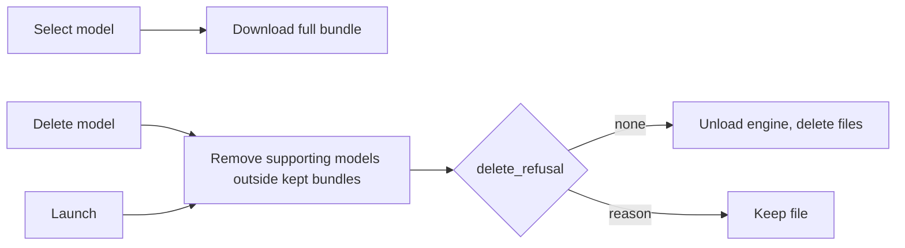

# Settings polish - Plan

## Goal Capsule

- **Objective:** A user can keep Longhand in the macOS Dock after the window closes, or hide it there, can find the Window settings first on the General tab, and manages only transcription models: Longhand downloads and deletes the supporting models without the user.
- **Product authority:** This Product Contract. The user confirmed the scope on 2026-09-28 and changed the model part after a manual test on the same day. The Requirements win on product behaviour; the KTDs win on mechanism.
- **Open blockers:** None.
- **Execution profile:** One branch and one PR, in a worktree made from `origin/main`. Commit per unit. The Dock behaviour and the model downloads need a manual test in a signed build.
- **Stop conditions:** Stop and ask if the cascade delete needs to change the refusal rules of `delete_refusal`, or if a Settings field change needs a schema migration.
- **Product Contract preservation:** changed on 2026-09-28 by the user after the first manual test: the "Delete models…" dialog, the Downloads group, and the Supporting models list are removed (old R6–R11, AE5–AE9). Model bundles replace them (R6–R11, AE5–AE10). The ConfirmDialog second action (old U4) is removed, because nothing uses it.

---

## Product Contract

### Summary

The General tab shows Window first and adds a "Hide from Dock" switch on macOS. The switch is off by default, so Longhand stays in the Dock after the window closes. On the Transcription tab, the user sees only transcription models. Selecting a model downloads everything that any of its choices can use. Deleting a model also deletes the supporting models that no other model needs. The hover highlight on a transcription model row covers the full row.

### Problem Frame

Today, on every platform, the close button hides the main window. On macOS, Longhand then removes its Dock icon and stays only in the menu bar. Users who expect the standard macOS behaviour must find the menu-bar icon to bring the window back. On Windows, the Window footer says "menu bar", but Longhand stays in the system tray. The Transcription tab shows supporting models (speaker models and "NeMo artifact" copies) with their own download and delete controls. A user cannot know what these files are or when they are needed. A change of a processing choice can also start a second download after the user already downloaded the model.

### Key Decisions

- **The switch is "Hide from Dock", and its default is off.** Staying in the Dock is the standard macOS behaviour, so the switch names the change from that behaviour. Existing installs get the same default. Nobody uses Longhand yet, so the change needs no migration. Governs R2, R3. (session-settled: user-directed — chosen over a "Keep in Dock" switch with the default on: the switch must name the change from standard macOS behaviour)
- **The switch is macOS only.** Windows keeps its current behaviour: the close button hides the window to the system tray, and the Minimize button keeps the taskbar button. Governs R2. (session-settled: user-approved — chosen over a "Hide from taskbar" switch on Windows: Minimize already gives Windows users the other choice)
- **When the switch is on, the Dock icon is absent every time no window is visible.** This applies after a close, after a launch at login, and after the Settings window closes. The Settings window is a window, so the icon shows while it is open. Governs R3.
- **A transcription model and its supporting models are one item for the user.** Selecting a model downloads the full model bundle: the files for every valid choice of live or after-recording transcription and live or after-recording speaker labels. The user never downloads or deletes a supporting model directly. Governs R6–R10. (session-settled: user-directed — chosen over a Supporting models section with its own "Delete unused" button: the user must not need to understand supporting models)
- **A supporting model stays while any bundle that the user keeps needs it.** A delete removes each supporting model of the deleted bundle that no other downloaded, selected, or pending transcription model needs. Governs R8, R9. (session-settled: user-directed)
- **No bulk delete.** The user deletes transcription models one at a time from their rows. Governs R8.

### Requirements

**General tab**

- R1. The General tab shows its groups in this order: Window, Recording, Processing, Alerts.
- R2. On macOS, the Window group has a "Hide from Dock" switch, and its default is off. The switch does not show on other platforms.
- R3. When the switch is on, Longhand has no Dock icon while no Longhand window is visible. When the switch is off, the Dock icon stays after the main window closes. The menu-bar icon stays in both modes.
- R4. A change to the switch takes effect as follows. Off: the Dock icon comes back at once. On: the Dock icon goes when the last visible window closes, not while a window is open.
- R5. The Window group footer text describes the close behaviour correctly for the current platform and switch value. It says "menu bar" on macOS and "system tray" on Windows.

**Transcription tab: model bundles**

- R6. Selecting a transcription model downloads its full model bundle. A later change of a processing or speaker choice for that model needs no other download.
- R7. Each transcription model row shows the total size of its bundle. A row shows "Downloaded" only when the full bundle is on disk.
- R8. Each downloaded transcription model has a Delete… button, which is off for the selected model, as today. The delete removes the transcription model and each supporting model of its bundle that no other downloaded, selected, or pending transcription model needs, and that no unfinished note needs.
- R9. At launch, Longhand deletes each supporting model that no bundle of a downloaded, selected, or pending transcription model needs, and that no unfinished note needs.
- R10. When a downloaded or selected transcription model has missing files, its row shows a Download button that downloads the missing files of its bundle. While files of a bundle download, the row of that model shows the progress and a Cancel button.
- R11. The Transcription tab has no Downloads group, no Supporting models list, and no bulk delete.

**Transcription tab: hover highlight**

- R12. In the transcription model list, the hover highlight of a model that is not selected covers the full row, including the Delete… button area and any download status.

### Acceptance Examples

- AE1. **Covers R3.** Given "Hide from Dock" is off, when the user closes the main window, then the Dock icon stays, and a click on it shows the window.
- AE2. **Covers R3, R4.** Given the main window is open and "Hide from Dock" is off, when the user turns the switch on, then the Dock icon stays until the user closes the last window, and then it goes.
- AE3. **Covers R3.** Given "Hide from Dock" is on, when Longhand launches at login with its window hidden, then no Dock icon shows.
- AE4. **Covers R4.** Given "Hide from Dock" is on and no window is visible, when the user opens Settings from the menu bar and turns the switch off, then the Dock icon shows at once and stays after Settings closes.
- AE5. **Covers R6.** Given no model is downloaded, when the user selects Parakeet Unified, then Longhand downloads Parakeet Unified and the speaker models for pyannote, Sortformer, and Nemotron diarization. A later change of the speaker source starts no download.
- AE6. **Covers R6, R7.** Given the user selects Nemotron Speech Streaming, then its bundle includes its NeMo copy, and the row size includes that copy.
- AE7. **Covers R8.** Given Parakeet Unified and Parakeet TDT v3 are downloaded and Parakeet Unified is selected, when the user deletes Parakeet TDT v3, then its files go, and the speaker models stay because the bundle of Parakeet Unified needs them.
- AE8. **Covers R8.** Given Parakeet Unified and Nemotron Speech Streaming are downloaded, Parakeet Unified is selected, and no unfinished note needs the NeMo copy, when the user deletes Nemotron Speech Streaming, then its NeMo copy goes too, and the speaker models stay.
- AE9. **Covers R9.** Given a supporting model is on disk and no bundle needs it, when Longhand launches, then it deletes that file.
- AE10. **Covers R10.** Given the selected model is downloaded but one speaker model of its bundle is missing, then its row shows Download, and a click downloads only the missing file with progress and Cancel on the row.

### Scope Boundaries

- No other General tab content changes, apart from the group order, the new switch, and the Window footer text.
- The close behaviour on Windows and Linux does not change.
- The refusal rules of `delete_refusal` for the transcription model do not change.
- Supporting models still show on the About page for their licences.

### Dependencies / Assumptions

- The delete rules of KTD12 in `docs/plans/2026-09-25-1121-feat-recognition-models-and-live-transcript-plan.md` protect the models that the selected, pending, and unfinished notes need.
- The queue skips a note whose model is missing (KTD13 of the same plan).
- A click on the Dock icon already shows the main window (`RunEvent::Reopen` in `src-tauri/src/lib.rs`).

### Sources / Research

- `src/settings/Status.tsx` — General pane groups and the Window footer text.
- `src-tauri/src/window.rs` — `hide_main_window`, `hide_dock_icon_if_no_window`, and `front`.
- `crates/models/src/recognition.rs` — `resolve` and `resolve_for_runtime`. The NeMo copy is used when a Nemotron streaming model runs live with live Sortformer or Nemotron speaker labels.
- `src-tauri/src/commands/settings.rs` — `set_recognition_defaults` downloads only the artifacts of the selected configuration today.
- `src-tauri/src/managers/models.rs` — `delete_refusal`, `statuses`, `missing_spec`, and `start_artifact_downloads`.
- `src/settings/Models.tsx` and `src/settings/RecognitionModelPicker.tsx` — the model rows and their actions.

---

## Planning Contract

### Key Technical Decisions

- KTD1. **One pure function decides the Dock policy, and every policy site calls it.** It takes the `hide_from_dock` value and whether a window is visible, and returns Regular or Accessory. The sites are the startup call in `src-tauri/src/lib.rs`, `hide_dock_icon_if_no_window`, and `front`. Governs R3.
- KTD2. **The startup policy reads the setting before the event loop, with no settings write.** With the switch off, the app starts as Regular, so a login launch also shows the Dock icon. The read happens before the single-instance lock, so it must not save a migrated value. Governs R3; covers AE3.
- KTD3. **The setter applies the "off" change at once.** `set_hide_from_dock(false)` on macOS sets the policy to Regular. `set_hide_from_dock(true)` changes nothing until the next close. The setter returns an error on other platforms. Governs R4.
- KTD4. **`models::recognition::bundle(asr_model)` gives the bundle as artifacts.** It resolves every combination of speaker source and the two processing modes for the model, with no speaker count and no language, and keeps the union of the artifacts of each valid result, without duplicates, with the transcription model first. The resolve rules stay the only source of truth. Governs R6.
- KTD5. **`set_recognition_defaults` downloads the bundle.** The artifacts of the selected configuration download first, as today, so the pending pick settles on them. The other bundle artifacts download after them. Governs R6.
- KTD6. **`ModelStatus` carries the bundle.** Recognition rows get `bundle` (artifact ids), `bundle_size_bytes`, and `bundle_complete`. Other rows get their own id, size, and state. The frontend does not compute bundles. Governs R7, R10.
- KTD7. **One pure function finds the supporting models to remove.** It takes the present supporting models, the settings, and the present recognition models, and returns each supporting model that is not in the bundle of a present, selected, or pending recognition model (the "kept bundles"). The cascade delete and the launch cleanup both call it. Each candidate then also passes `delete_refusal`, so unfinished notes and the live model keep their files. Governs R8, R9.
- KTD8. **The cascade delete and the launch cleanup hold the capture state lock through the deletes.** `CaptureManager::with_recording_held` keeps a recording from starting between the checks and the last delete. A failed supporting delete is logged and does not fail the delete of the transcription model. Governs R8, R9.
- KTD9. **`download_model_bundle(asr_model)` replaces `download_recognition_artifacts`.** It starts the downloads of the missing bundle artifacts. The row sums the progress of the bundle ids. Governs R10.
- KTD10. **The hover class moves from the radio button to the row wrapper.** Governs R12.

### High-Level Technical Design

The Dock policy decision of KTD1:

| `hide_from_dock` | Another window visible | Policy |
|---|---|---|
| off | any | Regular |
| on | yes | Regular |
| on | no | Accessory |

Supporting model lifetime (KTD7):

### Sequencing

U1 comes before U2. U3 comes before U4. U5 has no dependency.

---

## Implementation Units

### U1. Hide-from-Dock setting and Dock policy

**Goal:** Store the setting and apply it at every point where the app sets the activation policy.

**Requirements:** R2, R3, R4; KTD1, KTD2, KTD3.

**Files:** `src-tauri/src/managers/settings.rs`, `src-tauri/src/commands/settings.rs`, `src-tauri/src/lib.rs`, `src-tauri/src/window.rs`, `src/bindings.ts` (generated), test fixtures.

**Test scenarios:** the policy table of KTD1; startup with the setting on and off; a settings file without `hide_from_dock` reads as `false`.

**Verification:** The Rust tests pass. `src/bindings.ts` has no diff after regeneration.

### U2. General tab order, switch, and footer

**Goal:** Show Window first, add the switch on macOS, and make the footer correct for each platform.

**Requirements:** R1, R2, R5; KTD3.

**Files:** `src/settings/Status.tsx`, `src/settings/SettingsWindow.tsx`, `src/settings/Status.test.tsx`.

**Test scenarios:** the group order; the switch on macOS, its error, and its off state while a change is in progress; no switch and "system tray" in the footer on other platforms; the footer follows the switch.

**Verification:** The component tests pass.

### U3. Model bundles in the backend

**Goal:** Download, report, and delete a transcription model as one bundle.

**Requirements:** R6, R7, R8, R9, R10; KTD4–KTD9.

**Files:** `crates/models/src/recognition.rs`, `src-tauri/src/managers/models.rs`, `src-tauri/src/managers/capture.rs`, `src-tauri/src/commands/models.rs`, `src-tauri/src/commands/settings.rs`, `src-tauri/src/lib.rs`, `src/bindings.ts` (generated).

**Approach:**
1. Add `bundle` (KTD4) with tests.
2. Add the bundle fields to `ModelStatus` (KTD6).
3. Download the bundle in `set_recognition_defaults` (KTD5), and add `download_model_bundle` (KTD9).
4. Add the pure removal function (KTD7). Call it after the transcription model delete in `delete_model` and once at launch, under `with_recording_held` (KTD8).
5. Remove the bulk delete commands and types of the first version.

**Test scenarios:**
- Covers AE5. The bundle of Parakeet Unified contains the model, the pyannote models, Sortformer, and Nemotron diarization, and no NeMo copy.
- Covers AE6. The bundle of Nemotron Speech Streaming contains its NeMo copy.
- A model with integrated speakers includes no model that only another speaker source needs twice (no duplicates).
- Covers AE7. A supporting model that another present bundle needs is not a removal candidate.
- Covers AE8. A supporting model that only the deleted bundle needs is a candidate.
- The bundles of the selected and the pending model keep their supporting models, even when the transcription model is not on disk.
- Covers AE9. A supporting model outside every kept bundle is a candidate.
- `ModelStatus` of a recognition model reports the bundle size and `bundle_complete` false when one bundle file is missing.

**Verification:** The Rust tests pass, and the bindings contain `downloadModelBundle` and no bulk delete commands.

### U4. Transcription tab rows

**Goal:** Show only transcription models, with bundle size, status, repair download, progress, and delete.

**Requirements:** R7, R8, R10, R11; KTD6, KTD9.

**Files:** `src/settings/Models.tsx`, `src/settings/RecognitionModelPicker.tsx`, `src/settings/Models.test.tsx`, `src/lib/ConfirmDialog.tsx` (revert of the second action), `src/lib/ConfirmDialog.test.tsx`.

**Approach:**
1. Remove the Downloads group, the Supporting models group, and the bulk delete dialog.
2. Show `bundle_size_bytes` on each row, and "Downloaded" only when `bundle_complete`.
3. For a downloaded or selected row with missing files and no active download, show Download. While a bundle id downloads, show the summed progress and Cancel on that row.
4. Remove the second action from `ConfirmDialog`.

**Test scenarios:**
- A row shows the bundle size.
- Covers AE10. The selected row with a missing file shows Download, and a click calls `download_model_bundle` with its id.
- Progress for a bundle file shows on the row of its model with Cancel.
- No "Supporting models", "Downloads", or "Delete models…" text shows.
- Delete… on a downloaded model that is not selected still asks, then calls `delete_model`.

**Verification:** The component tests pass.

### U5. Full-row hover highlight

**Goal:** Make the hover highlight cover the whole row of a model that is not selected.

**Requirements:** R12; KTD10.

**Files:** `src/settings/RecognitionModelPicker.tsx`, `src/settings/RecognitionModelPicker.test.tsx`.

**Test scenarios:** a row that is not selected has the hover class on its wrapper; the selected row has none.

---

## Verification Contract

| Check | Command | When |
|---|---|---|
| Types and build | `bun run build` | Every unit |
| Frontend tests | `bun run test` | Every unit |
| Rust format | `cargo fmt --all --check` | U1, U3 |
| Rust lint | `cargo clippy --workspace --all-targets -- -D warnings` | U1, U3 |
| Windows check | `scripts/check-windows.sh` | U1, U3 |
| Rust tests | `cargo test --workspace --features nemo-runtime/test-helper` | U1, U3 |
| Bindings | `git diff --exit-code src/bindings.ts` after regeneration | U1, U3 |
| Provenance | `scripts/check-provenance.sh` | Before push |
| Manual test | Signed build, per [Manual tests](../development-workflow.md#manual-tests) | After U2 and after U4 |

The manual test checks AE1 to AE4, and AE5, AE7, and AE10 in a signed build.

---

## Definition of Done

- R1 to R12 are true, and AE1 to AE10 pass as tests or as manual checks.
- Every check in the Verification Contract passes locally, and CI is green on the PR.
- The user did the manual tests in a signed build.
- The diff has no code left from approaches that did not work.
