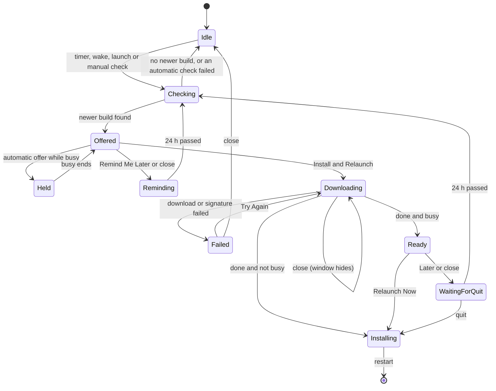
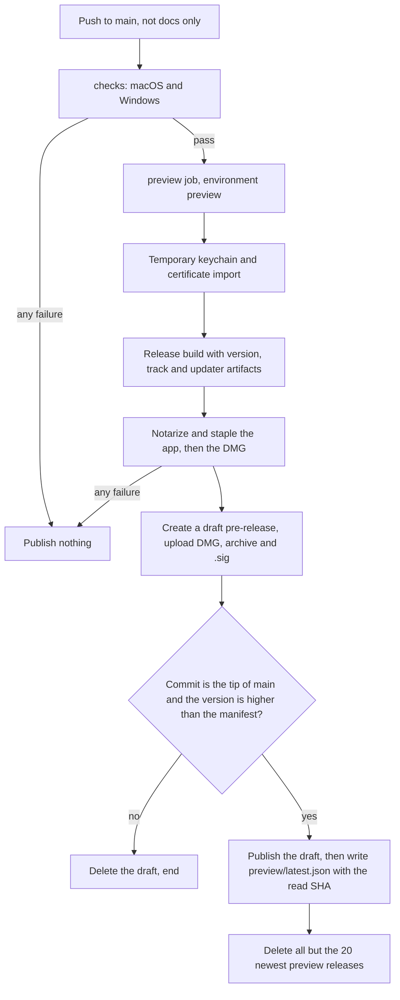

# Preview Builds and In-App Updates - Plan

## Goal Capsule

- **Objective:** A Longhand user on an Apple silicon Mac always runs a build close to main. Each change that gets into main reaches them as an update offer, and they accept it with one click at a time they choose.
- **Means:** CI publishes each preview build to a public repository that holds only builds, with a fixed update manifest (KTD1, KTD3). An update manager in the app reads the manifest and shows its own update window (KTD6, KTD9).
- **Product authority:** This Product Contract. Only the preview track is in scope. The stable track, release tags and a track picker are later work, and this plan must not prevent them (R8).
- **Execution profile:** Code work in a worktree. U1 and U9 are manual tests with signed, notarized builds on two Macs. The user does the one-time setup in U8 before the first CI publish.
- **Stop conditions:** Stop after U1 and report when macOS rejects both the version form and the fallback in KTD5. Stop before U7's first publish when a secret from U8 is missing, and name the missing secret.
- **Open blockers:** None. The version form must pass the version test (KD5, U1) before CI or updater work continues.

---

## Product Contract

### Summary

Each push to main that is not docs-only and passes CI publishes a signed, notarized preview build to a public repository that holds only builds. The app finds newer preview builds and asks whether to install and relaunch, in a standard macOS dialog. It asks only while no note is recording or processing. A setting in General turns automatic checks off.

### Problem Frame

Today a new build gets to a Mac only by hand: a local signed build, notarization, a zip, and an `scp` copy from the build Mac. The user runs Longhand every day, and a few peers may start to use it. Each of them must know when main changed and repeat those steps. Builds fall behind, and a fix on main does not reach the people who found the defect.

`STRATEGY.md` defers distribution machinery "until someone asks". The user and those peers now ask for it.

The reference apps each miss part of the expected macOS behaviour. Handy shows only a small "Update available" text in its footer, which is easy to miss for a long time. Anarlog downloads, installs and relaunches without asking. The expected behaviour is the Sparkle pattern: a dialog that asks, and a "later" choice that asks again.

---

### Key Decisions

- KD1. **Builds go to a public repository that holds only builds.** The updater must download without a login, and a private repository's releases cannot serve that. (session-settled: user-directed — chosen over making the source repository public or a private cloud bucket: the source stays private, and GitHub stays the only host. macOS CI minutes stay billed.) Governs R3, R5.
- KD2. **A preview version is a semver pre-release of the next stable version, with a UTC timestamp.** Semver has no numeric position after patch, so the pre-release tag holds the build time. A later stable release then sorts correctly with no change to the scheme. (session-settled: user-directed — chosen over a plain date-time version, `0.1.<build number>`, and the track name "beta": it fits later semver releases. The user chose the name "preview".) Governs R6.
- KD3. **The track is a setting of one app, not a separate app for each track.** A user can move between tracks with no reinstall. (session-settled: user-directed — chosen over anarlog's separate app for each track: switching then means installing another app.) Governs R8.
- KD4. **The app asks before it downloads.** Nothing downloads without consent, and "Remind Me Later" waits 24 hours. (session-settled: user-directed — chosen over a background download followed by a question, and over a third "Install When I Quit" button. The 24-hour delay was chosen over "until next launch" and 4 hours.) Governs R13, R15, R16.
- KD5. **The first unit proves the version form on real macOS.** Tauri writes the version into both bundle version fields (`tauri-codegen-2.6.3/src/context.rs:324`). A version test must show that notarization, Gatekeeper, TCC and the updater accept a pre-release version before other work continues. A version test is a short manual experiment with throwaway builds. Only its result is kept. Governs R6.
- KD6. **The update flow never interrupts a recording.** The recording surface must not draw attention back to the screen (U7's attention budget in `CLAUDE.md`). (session-settled: user-directed — chosen over a relaunch with no second question after the recording, or an install at the next quit with no second question.) Governs R14, R17.
- KD7. **Automatic checks can be turned off in General, and a manual check always works.** (session-settled: user-directed — chosen over automatic checks with no setting: the user asked for the setting in General.) Governs R10, R11.

---

### Requirements

**Preview builds in CI**

- R1. Each push to main that runs CI and passes all checks makes a preview build of the macOS app. The build is signed with the Developer ID certificate, notarized and stapled. Docs-only pushes already run no CI (`.github/workflows/ci.yml`, `push.paths`).
- R2. A preview build runs on Apple silicon only.
- R3. CI publishes each preview build to the public repository that holds only builds. The publication contains a DMG for the first install, the update archive with its signature, and an update manifest that identifies the newest preview build.
- R4. A failed build, signature or notarization step publishes nothing, and the manifest continues to identify the previous preview build. CI also publishes nothing when the build's commit is no longer the tip of main at publish time, or when its version is not higher than the version the manifest identifies. Thus a late or re-run build of an older commit cannot replace a newer build.
- R5. The source repository stays private. The public repository holds only built files.
- R19. Only the preview build job for pushes to main can read the signing certificate, the notarization key, the updater private key and the publish credential. Pull request runs get none of them.

**Version and track**

- R6. A preview build's version is `<next stable version>-preview.<UTC build time as YYYYMMDDHHMMSS>`, for example `0.2.0-preview.20260928143012`. A later build always has a higher version.
- R7. Settings → About shows the full version and the short commit of the installed build.
- R8. Each build records its track, which is `preview` for all builds in this plan. The updater offers only builds of the track that is set, and the stored track value is a setting of the same app. Thus a later plan can add a stable track and a track picker with no new app identity and no reinstall.

**Update check**

- R9. When automatic checks are on, the app checks for a newer build at launch and at regular intervals while it runs.
- R10. Settings → General has a setting to check for updates automatically. It is on by default. When it is off, the app makes no automatic check.
- R11. "Check for Updates…" in the app menu checks at once. It ignores R10 and any remind delay from R15. It shows its result at once, also while a note is recording or processing, because the user asked for it. If the user then clicks "Install and Relaunch", the download starts, and R17 holds the relaunch until recording and processing end. If no newer build exists, it says the app is up to date. If the check fails, it shows the error.
- R12. An automatic check that fails, for example with no network, shows nothing to the user.

**Update dialog and install**

- R13. When a newer build exists, the app shows a standard macOS dialog: "Longhand <new version> is available. You have <installed version>." It has two buttons: "Install and Relaunch" and "Remind Me Later".
- R14. While a note is recording or processing, the app does not show the dialog, start a download, install or relaunch. A download that started before the recording can finish. If an offer is due during that time, the app shows it when recording and processing both end.
- R15. After "Remind Me Later", no automatic dialog shows for 24 hours, even when newer builds are published. After 24 hours, the next check offers the newest build.
- R16. "Install and Relaunch" downloads the build with visible progress, checks its signature, installs it and relaunches Longhand. The build does not download before this click. A check reads only the update manifest.
- R17. If a recording starts before the download ends, the app does not relaunch. When recording and processing both end, it asks: "Longhand <new version> is ready. [Relaunch Now] [Later]". "Later" installs the build when the user next quits Longhand. Closing the window does not quit Longhand, so if it has not quit 24 hours after "Later", the next check asks the ready question again, or offers a newer build if one exists.
- R18. If a download or signature check fails, the app shows the error with a choice to try again. The installed app does not change.

---

### Key Flows

- F1. Offer and install
  - **Trigger:** An automatic check at launch or at an interval (R9) finds a newer preview build.
  - **Steps:** The app waits until no note is recording or processing (R14). It shows the dialog (R13). The user clicks "Install and Relaunch". The app downloads with progress, checks the signature and relaunches (R16).
  - **Outcome:** The newer build runs.
  - **Covers:** R9, R13, R14, R16
- F2. Remind later
  - **Trigger:** The user clicks "Remind Me Later" in the dialog.
  - **Steps:** Automatic checks continue but show no dialog for 24 hours (R15). After that time, the next check offers the newest build.
  - **Outcome:** The user sees one offer per day at most, unless they ask for a check (R11).
  - **Covers:** R11, R15
- F3. Recording starts during a download
  - **Trigger:** The user clicked "Install and Relaunch", then started a recording before the download ended.
  - **Steps:** The download finishes and the app does not relaunch. When recording and processing end, the app asks "Relaunch Now" or "Later" (R17).
  - **Outcome:** The recording is not interrupted. The update installs at a relaunch the user chose, or at the next quit.
  - **Covers:** R14, R17

---

### Acceptance Examples

- AE1. **Covers R14.** Given the launch check found a newer build, when the user starts a recording before the dialog shows, then no dialog shows until recording and processing end.
- AE2. **Covers R14.** Given the dialog is open, when the user starts a recording with the shortcut, then the dialog closes. The dialog shows again when recording and processing end.
- AE3. **Covers R15.** Given the user clicked "Remind Me Later" at 09:00 and three newer builds are published before 17:00, then no automatic dialog shows until 09:00 the next day. At that time the dialog offers the newest of the three builds.
- AE4. **Covers R11, R15.** Given the remind delay is active, when the user chooses "Check for Updates…", then the dialog shows at once.
- AE8. **Covers R11, R17.** Given a note is recording, when the user chooses "Check for Updates…" and clicks "Install and Relaunch", then the download starts, and the app does not relaunch until recording and processing end.
- AE5. **Covers R10, R11.** Given automatic checks are off, when Longhand starts, then it makes no network request for updates. When the user chooses "Check for Updates…", then the app checks.
- AE6. **Covers R4.** Given the notarization of a new build fails, then the manifest still identifies the previous build, and no user receives an offer for the failed build.
- AE7. **Covers R17.** Given the "ready" question shows after a recording and the user clicks "Later", when the user quits Longhand, then the new build is installed, and the next launch runs it.

---

### Scope Boundaries

- A stable track, release tags, manually set version numbers and a track picker are deferred. R8 keeps the path open for them.
- Windows builds and Windows updates are deferred.
- Intel Macs are out of scope (R2).
- The dialog shows no list of changes and no release notes. After an update, the app shows no "What's New" screen.
- The dialog has no "Skip This Version" choice. On a track that publishes at each push, a newer build supersedes the skipped one soon after.
- The update flow sends no email, push notification or macOS notification.

### Deferred to Follow-Up Work

- A stable release workflow: tags, a stable manifest, the step that increases the config version after a release, and the custom version comparator that a track switch needs. The KTD5 fallback comparator is different: U4 builds it only when U1 needs the fallback.
- A link on a web page to the newest DMG. For now, users take the DMG from the newest release in the builds repository.

---

### Dependencies / Assumptions

- The Developer ID certificate and the App Store Connect API key that local notarized builds use (see `docs/development-workflow.md`) can be stored as CI secrets.
- The user creates the public repository that holds only builds. CI gets a credential that can write only to that repository's contents and releases (a fine-grained token or a GitHub App limited to that repository), stored as a CI secret.
- The updater's signing key pair is new. Its private key is a CI secret and must not be lost. Without it, installed builds cannot accept any later update. If the private key leaks, make a new key pair, publish a build with the new public key as a DMG, and tell each user to reinstall from it by hand. Installed builds cannot move to a new key through an update.
- Builds installed before this work have no updater. Each user installs the first preview build from its DMG by hand.
- Each preview build adds a signed and notarized macOS build to the billed CI minutes on each push to main.
- Anyone who has the public repository's link can download a build. A build contains no user data.

---

### Outstanding Questions

**Deferred to Implementation**

- The exact layout, sizes and text styles of the update window (KTD9). U6 designs them with the `apple-design` skill.
- The download timeout for the update archive. It depends on the archive size, which the first CI build shows.

---

### Sources / Research

- `.github/workflows/ci.yml`: the triggers, the docs-only `paths` filter, the `ci-${{ github.ref }}` concurrency group, and the ad-hoc signed debug build with no signing secrets.
- `src-tauri/tauri.conf.json`: version `0.1.0`, identifier `net.ewal.longhand`, the `dmg` target, `hardenedRuntime`, `minimumSystemVersion` 15.0, the Developer ID `signingIdentity`, and `beforeBuildCommand`, which runs `scripts/prepare-nemo.ts`. That script signs the NeMo helper with the same identity (`scripts/prepare-nemo.ts:8`, `scripts/package-nemo.ts:97`). No updater plugin exists in `src-tauri/Cargo.toml`.
- `src/settings/SettingsWindow.tsx`: the General pane (`id: "status"`) and the About pane.
- `src-tauri/src/managers/capture.rs` (`is_capturing`, `changed`, `RecordingChanged`) and `src-tauri/src/managers/processing.rs` (the runner's `suspended` closure, `ProcessingUpdate`): the recording and processing state that R14 depends on. These are two separate states, not one.
- Handy (`reference-source/Handy`): `tauri-plugin-updater` with a `latest.json` on GitHub Releases, `createUpdaterArtifacts`, and signing and notarization through `tauri-apps/tauri-action` in `.github/workflows/build.yml`. The only sign of an update is a small footer text (`src/components/update-checker/UpdateChecker.tsx`).
- Anarlog (`reference-source/anarlog`): checks at launch and every 30 minutes, holds updates while a meeting records (`plugins/updater2/src/lib.rs`), keeps the verified archive on disk between download and install (`plugins/updater2/src/ext.rs`), and uses the version form `X.Y.Z-nightly.N`. It installs and relaunches without asking, which this plan does not copy.

---

## Planning Contract

### Key Technical Decisions

- KTD1. **The manifest is a fixed file in the builds repository, and each build is a GitHub pre-release.** The app reads `https://raw.githubusercontent.com/twistymaze/longhand-builds/main/preview/latest.json`. Each build is a pre-release tagged `preview-<YYYYMMDDHHMMSS>` that holds the DMG, `Longhand.app.tar.gz` and its `.sig`. GitHub's `/releases/latest` address skips pre-releases, so it cannot identify the newest preview build. A file write through the contents API must send the file's current SHA, so two publishes cannot both write the manifest. The raw file host caches for about five minutes, which is acceptable on this track. Governs R3, R4.
- KTD2. **CI publishes in a fixed order: release, guards, manifest, pruning.** A bun script (`scripts/publish-preview.ts`) makes the release as a draft and uploads its files first. Then it checks that the run's commit is still the tip of main and that the build's version is higher than the manifest's version (`Bun.semver.order`). Only then does it publish the draft and write the manifest, with the SHA it read. Thus a job that stops early leaves only a draft, which no user sees. After the write, it deletes all preview releases except the 20 newest. A failed guard deletes the new release and ends the job without an error, because a newer build superseded it. Governs R4.
- KTD3. **The preview build is a job in `ci.yml`, not a separate workflow.** The job `preview` has `needs: checks`, runs only for a push to main, and runs on `macos-latest` (Apple silicon). It uses the GitHub environment `preview`, which only main can deploy to and which holds every secret for R19. Repository secrets would also reach pull request runs from branches of the same repository. The job has its own concurrency group, `preview`, with `cancel-in-progress: false`, its own `rust-cache` prefix key (`docs/solutions/performance-issues/cargo-feature-unification-ci-rebuilds.md`), and a release build. The job sets `permissions: contents: read`, pins each action by its full commit SHA, and gives each secret only to the step that uses it. The job holds every key that an update needs, so a moved action tag must not get them. Governs R1, R2, R19.
- KTD4. **CI imports the certificate before the Tauri build starts.** `beforeBuildCommand` signs the NeMo helper before Tauri's own certificate import would run. Thus a step makes a temporary keychain and imports the Developer ID `.p12` first. Tauri then signs, notarizes and staples the app with `APPLE_API_KEY`, `APPLE_API_ISSUER` and `APPLE_API_KEY_PATH`. The `.p8` goes from a secret into a file in the runner's temporary folder. A later step notarizes and staples the DMG with `notarytool`. A generated `--config` file sets the version and `bundle.createUpdaterArtifacts`, so local builds need no updater key. Governs R1, R6.
- KTD5. **The version base is the version in `src-tauri/tauri.conf.json`, now `0.1.0`.** No stable release exists, so `0.1.0` is the next stable version. CI computes `<config version>-preview.<UTC time at the start of the job>`. The deferred stable release workflow increases the config version after each release. The default updater comparison (semver `>`) is correct on one track. If U1 shows that macOS rejects a pre-release version in `CFBundleShortVersionString`, use this fallback. The config version stays plain `X.Y.Z`. `bundle.macOS.bundleVersion` gets the timestamp. The build embeds the full R6 version, and a custom `version_comparator` compares against that embedded version. Governs R6.
- KTD6. **A Rust update manager owns the update flow.** A new `src-tauri/src/managers/updates.rs` uses `tauri-plugin-updater`'s `check()`, `download()` and `install()` as separate steps, as anarlog's updater2 does. The manager holds the state machine in the High-Level Technical Design. The update window only shows the state and sends the user's choice. Pure functions decide when to check, when to show, and when a delay has ended, so tests can cover them with no network. Governs R9, R11 to R18.
- KTD7. **"Busy" means that a note records, the live worker drains, or the runner runs a stage or a summary regeneration.** The first two are the checks of the runner's `suspended` closure (`src-tauri/src/managers/processing.rs`). The third is a new `Runner` query that reads only the runner's own state, not the store. Thus it adds no lock-order risk (`docs/solutions/logic-errors/runner-store-lock-before-suspended-check-deadlocks.md`). A note that waits in the queue for a model or a folder is not busy. The capture `changed()` function tells the manager at once when a recording starts, and a 15-second poll releases a held offer when busy ends. Governs R14.
- KTD8. **Automatic checks run 30 seconds after launch, each hour, and at each wake.** The wake signal is `DidWake` from the existing `power::SleepWatch`. The remind and ready delays are UTC times in a store file (`updates.json`, through `tauri-plugin-store`), so sleep and relaunch do not reset them. Only a build with a track checks automatically. A local build has no track, so it makes no automatic check, and the manual check says that local builds get no updates. Governs R9, R10, R12, R15.
- KTD9. **The update dialog is a small app window, not the dialog plugin's alert.** That alert blocks the main thread, code cannot close it, and it cannot show progress (`rfd-0.16.0/src/backend/macos/message_dialog.rs:101`). The window (label `update`, `index.html?window=update`) follows the licences window: `open_or_build`, `front`, a `Destroyed` arm that calls `hide_dock_icon_if_no_window`, and its own capability file. It registers no close listener (`docs/solutions/ui-bugs/tauri-stale-close-listener-blocks-next-window.md`). A close of the window counts as "Remind Me Later" or "Later". A close during a download hides the window, and the download continues. The window shows again at Ready or Failed. Governs R11, R13, R16 to R18.
- KTD10. **The app installs at the click, at quit, or at the next launch.** After "Install and Relaunch", the plugin downloads and verifies the archive, and the manager saves it and its `.sig` in the app cache folder. The plugin's `install()` does not check the signature again, and another process can change a saved file. Thus each install from a saved archive first checks it against its `.sig` with the embedded public key, and a failed check deletes the archive. When not busy, the manager stops processing as `RunEvent::Exit` does, installs, and restarts. After "Later", `RunEvent::Exit` installs with the `Update` value held in memory. Tauri extracts the archive to a temporary folder before it replaces the bundle, so a quit cut short during logout leaves the installed app whole. If no install happened at quit, the next launch checks the manifest, because the plugin makes an `Update` value only from a check. This launch check runs only when automatic checks are on (AE5), and it has a 5-second timeout. When the manifest names that build or a newer one, the app installs the saved archive before the main window opens, then restarts. When the check fails or times out, or automatic checks are off, the main window opens as usual and the archive stays saved for the next quit. Governs R17.
- KTD11. **"Check for Updates…" is in the app menu and also in the tray menu.** With "Hide from Dock" on, the app menu shows only while a Longhand window is active, so the tray is the menu that is always there. Both items are macOS only. Governs R11.
- KTD12. **CI embeds the commit and the track at build time.** CI sets `LONGHAND_BUILD_COMMIT` and `LONGHAND_TRACK`, Rust reads them with `option_env!`, and a `build_info` command returns version, commit and track. The updater's public key is in `tauri.conf.json` (`plugins.updater.pubkey`). The manager sets the manifest address from the track at run time. Governs R7, R8.

### High-Level Technical Design

The update manager's states. "Busy" is KTD7. A manual check (R11) goes from Idle to Offered without the remind check. It can show a result while busy, but it never relaunches while busy.

The CI publish path for one push to main:

### Assumptions

- `RunEvent::Exit` fires for Cmd+Q, for the tray's Quit and at logout. U1 checks this in the signed build. If it does not fire for a path, the next-launch install in KTD10 covers that path.
- TCC grants and Keychain access continue after an update, because the identifier and the Developer ID team stay the same. U1 checks this with a second build installed over the first.
- The Windows build compiles the updater plugin and the update manager, but a Windows build has no track and makes no check.

---

## Implementation Units

### U1. Version test: a pre-release version on real macOS

- **Goal:** Prove that a signed, notarized build with a pre-release version works on macOS before other work depends on it.
- **Requirements:** R6, KD5
- **Dependencies:** None
- **Files:** None kept. Record the result in a new `docs/solutions/integration-issues/` entry.
- **Approach:**
  1. Make a notarized local build with `--config` set to version `0.1.0-preview.<now>`, as the notarized build steps in `docs/development-workflow.md` do.
  2. Read `CFBundleShortVersionString` and `CFBundleVersion` from the bundle's `Info.plist`. Run `codesign --verify --deep --strict`, `stapler validate` and `spctl -a -vv`.
  3. Install it on the second Mac. Grant the microphone, record a short note, and read a stored API key from the Keychain.
  4. Quit with Cmd+Q, then launch and quit from the tray. Find the log line of `RunEvent::Exit` for each quit.
  5. Make a second build with a later timestamp, put it over the first in `/Applications`, and launch it. The microphone and the Keychain must not ask again.
  6. If a step rejects the version, repeat steps 1 to 5 with the fallback in KTD5.
- **Execution note:** This is a manual test with signed builds. Give the user the exact local and remote launch steps, as `docs/development-workflow.md#manual-tests` requires.
- **Test expectation:** none -- manual proof on real macOS. Its evidence is the recorded check output.
- **Verification:** Each check in steps 2 to 5 passes for one version form, and the solution entry records the form and the output.

### U2. Build identity: version, commit and track

- **Goal:** Each build knows its version, commit and track, and Settings → About shows them.
- **Requirements:** R7, R8, KTD12
- **Dependencies:** U1
- **Files:** `src-tauri/src/commands/build_info.rs` (new), `src-tauri/src/commands/mod.rs`, `src-tauri/src/lib.rs`, `src/bindings.ts`, `src/settings/About.tsx`, `src/settings/About.test.tsx`
- **Approach:**
  1. Read `LONGHAND_BUILD_COMMIT` and `LONGHAND_TRACK` with `option_env!`. A missing value means a local build.
  2. Add a `build_info` command that returns the version from the package info, the short commit and the track.
  3. Show "Version <version> (<commit>)" at the top of the About pane, or "Version <version> (local build)".
- **Patterns to follow:** The specta commands in `src-tauri/src/lib.rs` and the regenerated `src/bindings.ts`.
- **Test scenarios:**
  - About shows `Version 0.1.0-preview.20260928143012 (a1b2c3d)` when the mock returns that version, commit and track.
  - About shows `Version 0.1.0 (local build)` when the mock returns no commit and no track.
  - A Rust test: the track parser turns an absent value into no track and `preview` into the preview track.
- **Verification:** The About pane shows the version of the running build, and the bindings check passes.

### U3. Setting: check for updates automatically

- **Goal:** Settings → General has an on-by-default setting for automatic checks.
- **Requirements:** R10, KD7
- **Dependencies:** None
- **Files:** `src-tauri/src/managers/settings.rs`, `src-tauri/src/commands/settings.rs`, `src/bindings.ts`, `src/settings/Status.tsx`, `src/settings/Status.test.tsx`, and every test file with a literal `Settings` object
- **Approach:**
  1. Add `check_updates_automatically: bool`, default `true`, to `Settings`. The struct uses `serde(default)`, and no installed stores need a migration.
  2. Add a setter command, as `set_system_audio_default` does.
  3. Add an "Updates" group to the General pane with a switch: "Check for updates automatically". Hide the group on Windows.
  4. Add the new field to each literal `Settings` fixture (`docs/solutions/workflow-issues/parallel-branches-bump-same-schema-version.md`).
- **Patterns to follow:** `HideFromDock` and `SystemAudioRow` in `src/settings/Status.tsx`.
- **Test scenarios:**
  - A store with no `check_updates_automatically` key reads as `true`.
  - The switch shows the stored value, and a click sends the new value to the setter.
  - A Rust test: the setter writes the value, and a `SettingsChanged` event follows.
- **Verification:** The switch changes the stored setting, and the frontend and Rust tests pass.

### U4. Update manager: checks, hold and delays

- **Goal:** The app checks for newer builds on schedule, holds offers while busy, and keeps the remind and ready delays.
- **Requirements:** R9, R10, R11, R12, R14, R15, R17, KTD6, KTD7, KTD8
- **Dependencies:** U2, U3
- **Files:** `src-tauri/Cargo.toml`, `src-tauri/tauri.conf.json`, `src-tauri/src/managers/updates.rs` (new), `src-tauri/src/managers/mod.rs`, `src-tauri/src/lib.rs`, `src-tauri/src/managers/capture.rs`, `crates/pipeline/src/runner.rs`, `src-tauri/src/commands/updates.rs` (new), `src/bindings.ts`, `deny.toml`, `about.toml`, `licences/generated/`, `PROVENANCE.md`
- **Approach:**
  1. Add `tauri-plugin-updater` and its public key. Update the licence lists and `deny.toml` if the gate asks.
  2. Add a `Runner` query that is true while a stage or a summary regeneration runs (KTD7).
  3. Build the manager in `setup` after processing. Start the schedule (KTD8) and connect `DidWake`.
  4. Call the manager from the capture `changed()` function, so a recording start closes the update window at once (AE2).
  5. Keep the remind time, the ready version and the time of "Later" in `updates.json`.
  6. Add commands for the manual check, the user's choices and the current state, and one event for state changes.
  7. Record the patterns taken from anarlog's updater2 in `PROVENANCE.md`.
- **Technical design:** The decision functions take the state, the busy flag, the setting, the track and the current UTC time, and return an action. Directional sketch: `decide(state, now, busy, auto_on, has_track) -> None | Check | Show | Hold | Close`.
- **Patterns to follow:** `ProcessingManager` in `src-tauri/src/managers/processing.rs` for a manager built in `setup` with a background thread. The `SleepWatch` hook in `src-tauri/src/lib.rs`.
- **Test scenarios:**
  - Covers AE5. With automatic checks off, the launch decision is "no check", and a manual check is still "check".
  - A build with no track makes no automatic check.
  - Covers AE1. A newer build found while busy leads to "hold". When busy ends, the decision is "show".
  - Covers AE3. After "Remind Me Later" at 09:00, checks at 12:00 and 17:00 do not show. A check at 09:00 the next day shows the newest version.
  - Covers AE4. A manual check during the remind delay shows at once.
  - Covers AE2. A recording start while the offer shows leads to "close" and "hold".
  - An automatic check that fails leaves the state at Idle and shows nothing (R12).
  - A remind time in the store survives a restart of the manager, and a time in the past counts as ended.
  - The runner query is true while a stage runs and false while a note waits in the queue.
- **Verification:** The decision tests pass, the manager runs in a debug build with no track and makes no network request, and the bindings check passes.

### U5. Update manager: download, install and relaunch

- **Goal:** After the user's click, the app downloads, verifies, installs and relaunches, or waits for the user's quit or next launch.
- **Requirements:** R11, R14, R16, R17, R18, KTD10
- **Dependencies:** U4
- **Files:** `src-tauri/src/managers/updates.rs`, `src-tauri/src/lib.rs`, `src-tauri/src/commands/updates.rs`, `src/bindings.ts`
- **Approach:**
  1. Download with progress events. Save the verified archive as `updates/<version>.tar.gz` in the app cache folder, with its `.sig` next to it.
  2. When the download ends and the app is not busy, stop processing, install and restart. When busy, go to Ready.
  3. After "Later", install from `RunEvent::Exit` with the `Update` value in memory.
  4. At launch, before the main window opens, install a saved archive whose version is higher than the running version and that the manifest still allows, with the timeout and conditions in KTD10.
  5. Before each install from a saved archive (steps 3 and 4), check it against its saved `.sig`. A failed check deletes the archive and goes to Failed.
  6. Delete saved archives whose version is not higher than the running version.
  7. A download or signature failure goes to Failed with the error text. The installed app does not change.
- **Patterns to follow:** `plugins/updater2/src/ext.rs` in `reference-source/anarlog` for the saved archive and the separate install step.
- **Test scenarios:**
  - Covers AE8. A download that ends while busy leads to Ready, not to an install.
  - Covers F3. A download that started before a recording finishes, and the state is Ready when the recording ends.
  - Ready with "Later" and a quit leads to an install at exit (AE7). Ready with no quit for 24 hours asks again at the next check.
  - A newer build found during WaitingForQuit is offered in place of the ready build.
  - A saved archive with a version equal to the running version is deleted at launch and not installed.
  - A signature failure gives Failed with the error, and "Try Again" starts a new download.
  - A saved archive whose bytes do not match its saved `.sig` is deleted and not installed, at quit and at launch.
  - At launch with a saved archive, a manifest check that fails or passes 5 seconds opens the main window and keeps the archive.
  - At launch with a saved archive and automatic checks off, no network request happens and the archive stays saved.
- **Verification:** The state tests pass. U9 proves the real install and relaunch.

### U6. Update window and menu items

- **Goal:** The user sees each update state in a small window that looks like a standard macOS alert, and can check from the app menu and the tray.
- **Requirements:** R11, R13, R16, R17, R18, KTD9, KTD11
- **Dependencies:** U5
- **Files:** `src-tauri/src/window.rs`, `src-tauri/capabilities/update.json` (new), `src-tauri/src/menu.rs`, `src-tauri/src/tray.rs`, `src/App.tsx`, `src/update/UpdateWindow.tsx` (new), `src/update/UpdateWindow.test.tsx` (new)
- **Approach:**
  1. Invoke `apple-design` before the design, and `emil-design-eng` for polish.
  2. Add `open_update` and `close_update` in `src-tauri/src/window.rs`, with a fixed size, no resize, centred, and brought to the front.
  3. Route `?window=update` in `src/App.tsx`. The page reads the state once, then follows the state event.
  4. The page shows one view for each state: offer, download progress, ready, failed, up to date, check failed, and local build. The default button is the right button.
  5. Add "Check for Updates…" after "About Longhand" in the app menu, and after "Settings…" in the tray menu.
- **Patterns to follow:** `open_licences` in `src-tauri/src/window.rs`, `src-tauri/capabilities/licences.json`, and the button styles in `src/lib/ConfirmDialog.tsx`.
- **Test scenarios:**
  - The offer view shows "Longhand 0.1.0-preview.20260929080000 is available. You have 0.1.0-preview.20260928143012." with "Install and Relaunch" and "Remind Me Later".
  - "Install and Relaunch" sends the install choice, and the view changes to progress when the state event arrives.
  - The progress view shows the downloaded and total size.
  - The ready view shows "Longhand <version> is ready." with "Relaunch Now" and "Later".
  - The failed view shows the error text and "Try Again".
  - The up-to-date view says that Longhand is up to date. The local build view says that local builds get no updates.
  - Return activates the default button (`docs/solutions/ui-bugs/wkwebview-click-does-not-focus-button-breaks-shortcut-capture.md` for focus in WKWebView).
- **Verification:** A Playwright review of the window page with mocked IPC shows each view, and the frontend tests pass.

### U7. CI: preview build and publish

- **Goal:** Each push to main that passes CI publishes a signed, notarized preview build and updates the manifest.
- **Requirements:** R1, R2, R3, R4, R5, R19, KTD1, KTD2, KTD3, KTD4, KTD5
- **Dependencies:** U1, U2
- **Files:** `.github/workflows/ci.yml`, `scripts/publish-preview.ts` (new), `scripts/publish-preview.test.ts` (new), `PROVENANCE.md`
- **Approach:**
  1. Add the `preview` job (KTD3) with the keychain step and the release build (KTD4). Pin its actions by commit SHA and set each secret on its step only.
  2. Compute the version from the config version and the UTC time, and write the `--config` file.
  3. Notarize and staple the DMG, and check both with `stapler validate` and `spctl`.
  4. Run `scripts/publish-preview.ts` with the builds token (KTD2).
  5. Delete the temporary keychain and the `.p8` file in a step that always runs.
  6. Record steps taken from Handy's `build.yml` in `PROVENANCE.md`.
- **Patterns to follow:** The existing steps in `.github/workflows/ci.yml`, and `scripts/windows-redist.test.ts` for a tested bun script.
- **Test scenarios:**
  - The manifest builder makes a `latest.json` with the version, the date and `platforms["darwin-aarch64"]` with the archive address and the signature text.
  - Covers AE6. A version equal to or lower than the manifest's version fails the guard, and no manifest write happens.
  - A commit that is not the tip of main fails the guard, and the new draft release is deleted.
  - The pruning choice keeps the 20 newest `preview-` releases and never selects a release without that prefix.
  - The version function gives `0.1.0-preview.20260928143012` for config version `0.1.0` and that UTC time.
- **Verification:** `bun test scripts/publish-preview.test.ts` passes. The first run on main publishes a release and a manifest (U9).

### U8. Setup and documentation

- **Goal:** The user can do the one-time setup, and the docs describe preview builds.
- **Requirements:** R3, R5, R19
- **Dependencies:** None
- **Files:** `docs/preview-builds.md` (new), `docs/development-workflow.md`, `CONCEPTS.md`
- **Approach:**
  1. Write the setup steps that the user does:
     1. Create `twistymaze/longhand-builds` as a public repository with a README.
     2. Make the updater key pair with `bun tauri signer generate`, and keep the private key in a password manager.
     3. Export the Developer ID certificate as a `.p12`.
     4. Create the `preview` environment, limited to main.
     5. Add the secrets with `gh secret set --env preview`.
     6. Make a fine-grained token for the builds repository only.
  2. Write the recovery steps for a lost or leaked updater key (Dependencies / Assumptions).
  3. In `docs/development-workflow.md`, say that a local build gets no updates, and that the DMG of the newest preview build replaces it.
- **Test expectation:** none -- documentation.
- **Verification:** The setup doc names each secret that `ci.yml` reads, and the user confirms that the setup is done.

### U9. End-to-end test with two CI builds

- **Goal:** Prove the full path on real Macs with CI builds.
- **Requirements:** R1 to R18, F1 to F3, AE1, AE2, AE6, AE7, AE8
- **Dependencies:** U4, U5, U6, U7, U8
- **Files:** None
- **Approach:**
  1. Install the first CI preview build from its DMG.
  2. Push a small change to main, and wait for the second build.
  3. Check that the offer shows, that "Install and Relaunch" shows progress and that the second build runs.
  4. Repeat with a recording that starts during the download, then "Later", then quit (AE7, AE8).
  5. Check the recording hold with a recording that starts before the offer shows (AE1).
- **Execution note:** Manual test. Give the exact steps and the DMG address.
- **Test expectation:** none -- manual end-to-end proof. Its evidence is the recorded result of each step.
- **Verification:** Each step behaves as its Acceptance Example says, and About shows the second build's version and commit.

---

## Verification Contract

| Gate | Command or step | Applies to |
|---|---|---|
| Frontend typecheck and bundle | `bun run build` | U2, U3, U6 |
| Frontend tests | `bun run test` | U2, U3, U6 |
| Publish script tests | `bun test scripts/publish-preview.test.ts` | U7 |
| Rust format | `cargo fmt --all --check` | U2 to U6 |
| Rust lint | `cargo clippy --workspace --all-targets -- -D warnings` | U2 to U6 |
| Windows lint | `scripts/check-windows.sh` | U2 to U6 |
| Rust tests | `cargo test --workspace --features nemo-runtime/test-helper` | U2 to U5 |
| Bindings | `git diff --exit-code src/bindings.ts` after the Rust tests | U2 to U5 |
| Licences | `scripts/check-licences.sh` and `cargo deny check licenses sources bans` | U4 |
| Provenance | `scripts/check-provenance.sh` | U4, U7 |
| UI review | Playwright review of `?window=update` with mocked IPC | U6 |
| Manual, signed builds | The steps in U1 and U9 | U1, U9 |
| CI | The `preview` job passes on main and publishes a release and a manifest | U7, U9 |

---

## Definition of Done

- U1 records a version form that passes every check, and the plan's KTD5 matches that form.
- All gates in the Verification Contract pass for each unit.
- A push to main publishes a preview build, and a Mac with the earlier build offers it and installs it (U9).
- A pull request run gets none of the `preview` environment's secrets.
- The setup doc and `docs/development-workflow.md` describe the preview track.
- The diff contains no code from abandoned attempts, such as the throwaway builds of U1.
