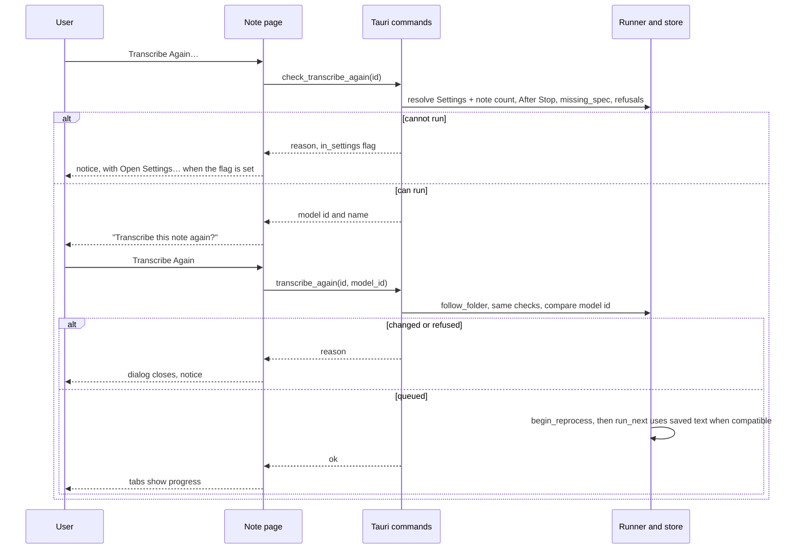

# Transcribe Again from Settings - Plan

## Goal Capsule

- **Objective:** A user can transcribe a saved note again after one plain confirmation. The user does not choose models, read a technical explanation, or tick a checkbox. The run uses the models in Settings.
- **Means:** The backend resolves the run from Settings and the note. A read-only check runs before the dialog opens, and one command queues the run (KTD1, KTD2).
- **Product authority:** This Product Contract. The user confirmed the scope on 2026-09-28. The Requirements win on product behaviour, and the KTDs win on mechanism.
- **Open blockers:** None.
- **Execution profile:** One branch and one PR, in a worktree made from `origin/main`. Commit per unit. The dialog and the notice need a manual test in a signed build (Verification Contract).
- **Stop conditions:** Stop and ask if the run cannot use the note's speaker count without a store schema change, or if removing the preview API breaks a library or sync path that this plan does not name.
- **Product Contract preservation:** changed: R1 (speaker timing is always After Stop for a saved note), R2 ("auto" stays "auto"; there is no fallback to the Settings default), AE2 and AE4 to match. The user confirmed both changes during planning on 2026-09-28. R7 adds the texts for each cause (KTD4). No other scope changed.

---

## Product Contract

### Summary

Transcribe Again becomes one step. The menu action opens a small confirmation dialog that fits the window. After the user confirms, the run uses the models and language in Settings and the speaker count of the note. The model choice step, the preview step, the reuse explanation and the consent checkbox go away.

### Problem Frame

Today the "Transcribe Again…" menu action opens a dialog that shows all the recognition controls, prefilled from Settings. The dialog is too tall for the app window, so part of it is not visible. After "Preview changes", the dialog shows a second page. When the chosen route cannot reuse the saved timed text, the page shows "This change requires transcription again. The note has no compatible verified timed text, or its transcript or audio changed." It also shows a checkbox that the user must tick before the "Reprocess note" button operates. The user saw this page when they tried the Granite model and did not understand the text. The user expects the app settings to decide the models, so the choice step has no function for them. The explanation and the checkbox make a routine action look dangerous.

### Key Decisions

- **Settings decides the models, the speaker source and the language.** Governs R1. (session-settled: user-directed — chosen over a per-run choice dialog: the function of the action is to use the app settings, not to ask the user for choices)
- **A saved note always runs as After Stop.** Nothing is live for a saved note. After Stop lets saved text be used again and prevents refusals that apply only to live processing. Governs R1. (session-settled: user-directed — chosen over the Settings speaker timing, which selects a route that never uses saved text again)
- **The note's own speaker count is used as it is, including "auto".** Every note gets the Settings default when recording starts, so the note's value is always the intent for that meeting. Governs R2. (session-settled: user-directed — chosen over a fallback to the Settings default when the note's count is "auto")
- **One plain confirmation replaces the preview and the checkbox.** Governs R4, R5. (session-settled: user-directed — chosen over the preview step with a required consent checkbox: that flow is too complex and too alarming for a routine action)
- **The tabs show progress during the run, as now.** The dialog text states this, and `CONCEPTS.md` agrees with it. Governs R8. (session-settled: user-directed — chosen over keeping the previous transcript and summary visible during the run)
- **To use a different model for one note, the user changes Settings first.** That change also applies to new notes. Governs R1. (session-settled: user-approved — the user accepted this trade-off at the scope check)

### Requirements

**Configuration of the run**

- R1. Transcribe Again uses the transcription model, speaker source and language that are in Settings when the user confirms. Speaker timing is always After Stop. The flow shows no recognition controls.
- R2. The run uses the speaker count that is saved with the note, including "auto".
- R3. When the saved timed text is compatible with the configuration, the run uses it again, as it does now. The UI does not mention this.

**Confirmation**

- R4. The menu action opens one dialog with the title "Transcribe this note again?". The body says that the transcript and summary are not available until the new ones are ready, and that the current ones come back if the run fails. The body also names the transcription model from Settings. The buttons are "Cancel" and "Transcribe Again".
- R5. The dialog has no checkbox, no preview step and no explanation of timed-text reuse.
- R6. All of the dialog, with both buttons, is visible and not clipped at every window size that the app permits.
- R7. When the Settings configuration cannot run on this note, the menu action shows the reason and what to do, with a way to open Settings when the fix is there. It does not open the confirmation dialog. Two examples: the model is not downloaded, or the model does not support the language. Nothing goes into the queue. The text for each cause is in KTD4.

**The run**

- R8. After confirmation, the run starts as it does now. The Transcript and Summary tabs show progress, and the recording, My Notes and the title stay the same. When the run fails, the note shows the current failure message and the previous transcript and summary.
- R9. The confirmation is the permission to transcribe again. A confirmed run is never refused because it needs transcription.

### Acceptance Examples

- AE1. A new model that cannot reuse text
  - **Covers R4, R5, R9.**
  - **Given:** The note was transcribed with Parakeet, and Settings now selects Granite.
  - **When:** The user selects "Transcribe Again…" and then "Transcribe Again" in the dialog.
  - **Then:** The run starts. The user saw no checkbox and no explanation of timed text.
- AE2. The speaker count of the note
  - **Covers R2.**
  - **Given:** The note has a speaker count of 3, and the Settings default is 2.
  - **When:** The user confirms Transcribe Again.
  - **Then:** The run uses 3. For a note whose count is "auto", the run uses "auto", and the note's count is still "auto" after the save.
- AE3. The model is not downloaded
  - **Covers R7.**
  - **Given:** Settings selects a transcription model that is not downloaded.
  - **When:** The user selects "Transcribe Again…".
  - **Then:** The note shows the reason and a way to open Settings. No dialog opens, and nothing goes into the queue.
- AE4. Only the speaker source changed
  - **Covers R1, R3, R4.**
  - **Given:** Only the speaker source in Settings is different, and the saved timed text is compatible. Settings has "During recording" timing.
  - **When:** The user confirms.
  - **Then:** The run is After Stop and uses the saved timed text again. The dialog had the same text as in AE1.
- AE5. The run fails
  - **Covers R8.**
  - **Given:** A confirmed run fails before it saves.
  - **Then:** The note shows "The new transcript failed. The previous transcript is unchanged." and the previous transcript and summary.

### Scope Boundaries

- There is no per-run model choice. There is also no "advanced" or "other models" path in the dialog.
- The previous transcript and summary are not visible during the run.
- The recognition controls in Settings do not change.
- The dialog does not download a missing model. The user goes to Settings (R7).

#### Deferred to Follow-Up Work

- A note that is already in the queue, whose model is deleted later, waits with no message. The runner skips it until the model is present (`crates/pipeline/src/runner.rs` `run_next`, `ready_exact`). This is existing behaviour, and it also applies to new recordings.
- `openSettings` opens the General pane. It cannot open the Transcription pane directly.

### Dependencies / Assumptions

- A note has no language field of its own, so the language always comes from Settings (R1).
- In the store, "no speaker count" on a note means "auto". A note made before the default was set at recording start can have no count that means "unset". Nobody uses Longhand yet, so no migration is necessary.

### Sources / Research

- `src/session/TranscribeAgain.tsx` — the current three-step flow: the recognition controls, then the preview, then the consent checkbox.
- `src/session/RecognitionDialog.tsx` — a full-window overlay with `items-start` and `py-[8vh]`. The panel has no maximum height. `TranscribeAgain.tsx` is its only user.
- `src/lib/ConfirmDialog.tsx` — the shared confirmation dialog (Delete note, summary prompts). It has a fixed `w-[19rem]` panel with no maximum height.
- `src-tauri/src/commands/capture.rs` `start_recording` — a new note gets the Settings default speaker count. `src/session/RecordingBar.tsx` `SpeakerField` sets "auto" as no count.
- `crates/pipeline/src/save.rs` (the two `speaker_count` assignments) — today the save replaces the note's count with the count in the pending snapshot. The old flow sent the Settings default there, so it overwrote the note's own count.
- `crates/pipeline/src/runner.rs` — `transcribe_again` has the plain refusals and `follow_folder`. `reprocess` has the stale-preview and consent checks. `run_next` skips a queued run whose models are missing.
- `src-tauri/src/managers/models.rs` `missing_spec` — the only check that sees the disk. `models::recognition::resolve` does not.
- `src-tauri/src/managers/settings.rs` `recognition_config` — this changes the timing to After Stop when the model does not stream. The frontend `recognitionDefaults` does not.
- `src-tauri/src/window.rs` — the main window minimum is 640×480. `src-tauri/src/interface_zoom.rs` — the zoom goes to 200%, which makes about 320×240 CSS pixels.
- `src/home/Home.tsx` — the caution notice with an "Open Settings…" button that R7 follows.
- `docs/solutions/ui-bugs/grid-column-grows-to-fit-nowrap-text.md` — `ConfirmDialog.tsx` has a one-column implicit grid that can grow with a long line.
- `docs/solutions/ui-bugs/wkwebview-click-does-not-focus-button-breaks-shortcut-capture.md` — a click does not focus a button in WKWebView.

---

## Planning Contract

### Key Technical Decisions

- KTD1. **The backend resolves the run.** `ProcessingManager` gives the runner `Settings::recognition_config()` with both timings set to After Stop. The runner sets the speaker count from the note's store record under the store lock and after `follow_folder`, and then calls `models::recognition::resolve`. The runner therefore sees a count that another computer changed. `crates/library` tests can reach this path, because `crates/library` depends on `pipeline` and not on `src-tauri`. The frontend sends only the session id and the model id that the dialog showed. This removes the frontend `recognitionDefaults` path and the mismatch between the frontend and backend timing rules. It also stops the save from overwriting the note's count, because the snapshot now carries the note's own count. Governs R1, R2. (session-settled: user-directed — chosen over a configuration that the frontend builds with the Settings timing and the Settings default count: the user chose the Settings models, After Stop, and the note's own count)
- KTD2. **Two commands replace the preview and consent API.** `check_transcribe_again(session_id)` is read-only and does not run `follow_folder`. It returns the model id and its display name, or the R7 reason. The dialog shows the name. `transcribe_again(session_id, model_id)` runs every check again (`follow_folder`, the configuration, `missing_spec`, the refusals) and then queues the run. If the model id resolved at confirmation is not the id that the check returned, the command refuses with the "settings changed" text. `ProcessingManager` gives the runner the readiness check (`missing_spec` and `ModelStatus.state`) as a callback, and the runner calls it before `begin_reprocess`. The commands `preview_reprocess` and `reprocess_session`, the `allow_transcription` argument, and the old `transcribe_again(session_id, model)` command (the frontend does not use it) go away. In `crates/pipeline/src/runner.rs`, `transcribe_again` and `reprocess` become one entry point that takes a resolved `ExecutionSpec`. The existing Rust tests move to it. Governs R7, R9.
- KTD3. **The run decides reuse, and nothing asks for consent.** `crates/pipeline/src/recognition/stages.rs` already checks at run time whether saved timed text can be used again (`reprocess::read_reusable`). The preview, its two explanation texts, the manifest fingerprint and the stale-preview refusal have no function when there is no review step, so they go away. `reprocess::reusable` and `read_reusable` stay for the run. Governs R3, R9.
- KTD4. **One Rust function maps each cause to the UI text.** The check and the confirmation use it, so the user sees the same sentence both times. The texts are these:

  | Cause | Text | Open Settings |
  |---|---|---|
  | Model not downloaded | "<Model> is not downloaded. Download it in Settings." | Yes |
  | Model still downloading | "<Model> is still downloading. Try again when it is ready." | No |
  | Language not supported | "<Model> does not support <language>. Choose another model or language in Settings." | Yes |
  | Speaker limit | "This note has <N> speakers. <Speaker source> supports up to <M>. Choose another speaker source or model in Settings." <Speaker source> is the Settings speaker source name, or the model name when the source is the transcription model's own labels. | Yes |
  | Other configuration errors | "The transcription settings cannot be used for this note. Check them in Settings." | Yes |
  | Settings changed after the dialog opened | "The transcription settings changed. Choose Transcribe Again to use the new settings." | No |
  | Recording, regenerating, missing audio, already queued | The current plain texts in `Runner::transcribe_again`, plus "This note is already being transcribed again." | No |

  The command returns the text and a flag that says whether the fix is in Settings. The frontend shows the "Open Settings…" button only when the flag is set. Governs R7.
- KTD5. **The shared `ConfirmDialog` fits the window, and `RecognitionDialog` goes away.** The panel width is 19rem or the window width less 2rem, whichever is smaller. The height is limited to the window, the body text scrolls, and the buttons stay visible. The grid uses `minmax(0,1fr)`, and long text wraps with `overflow-wrap:anywhere`. Transcribe Again uses `ConfirmDialog` with `destructive={false}`. The fix also applies to Delete note and the summary prompt dialogs. Governs R4, R6.
- KTD6. **A second confirmation does nothing.** The frontend uses a synchronous ref, not only the `busy` state, so a double click sends one command. The backend refuses a note that is already queued for Transcribe Again with the plain "already" text (KTD4), never with the raw state-machine text. Governs R8.
- KTD7. **The dialog closes when the note changes under it.** It closes when the phase is no longer "saved", when the note's folder becomes unavailable, or when summary regeneration starts. Governs R4, R8.

### High-Level Technical Design

### Assumptions

- The note's store record has its current speaker count after `follow_folder`. The library scan copies `SessionDoc.speaker_count` into the record (`crates/library/src/refresh.rs`).
- `missing_spec` reports a model that is downloading as missing. The check can tell the two causes apart from `ModelStatus.state`.

---

## Implementation Units

### U1. One Transcribe Again path in the backend

- **Goal:** The backend resolves, checks and queues a Transcribe Again run from Settings and the note, with no preview and no consent.
- **Requirements:** R1, R2, R3, R7, R9. KTD1, KTD2, KTD3, KTD4, KTD6.
- **Dependencies:** None.
- **Files:**
  - `crates/pipeline/src/runner.rs`
  - `crates/pipeline/src/reprocess.rs`
  - `crates/pipeline/tests/runner.rs`
  - `crates/library/tests/two_computers.rs`
  - `src-tauri/src/managers/processing.rs`
  - `src-tauri/src/commands/processing.rs`
  - `src-tauri/src/lib.rs`
  - `src/bindings.ts` (regenerated)
- **Approach:**
  1. In the runner, merge `transcribe_again` and `reprocess` into one entry point that takes the Settings `RecognitionConfig`, the expected model id and the readiness callback (KTD1, KTD2). After `follow_folder`, it sets the note's count, resolves, compares the model id and calls the callback. Keep the plain refusals and `follow_folder` from `transcribe_again`. Add the "already queued" refusal. Remove `preview_reprocess`, the stale-preview check and the `allow_transcription` check.
  2. In `reprocess.rs`, remove `preview` and `Preview`. Keep `reusable`, `read_reusable` and `speaker_count`.
  3. In `ProcessingManager`, pass `settings::get_settings(&self.app).recognition_config()` with both timings set to After Stop, and a readiness callback built on `ModelsManager::missing_spec` and `ModelStatus.state`. Put the cause-to-text mapping (KTD4) where the runner and the check can both use it.
  4. Add the commands `check_transcribe_again` and `transcribe_again(session_id, model_id)`, and remove `preview_reprocess`, `reprocess_session` and the old `transcribe_again` from `collect_commands!`. The check result carries the model id and display name. The error carries the text and the Settings flag.
  5. Regenerate `src/bindings.ts` with the `export_bindings` test.
- **Patterns to follow:** The plain refusals in `Runner::transcribe_again`. The `missing_spec` use in `src-tauri/src/commands/capture.rs` and `commands/settings.rs`. The conversion between the two `SpeakerCount` types in `reprocess::speaker_count` and `stages.rs`.
- **Test scenarios:**
  - Covers AE2. A note with a count of 3 and a Settings default of 2 gives a queued snapshot with 3.
  - Covers AE2. A note with "auto" gives a snapshot with no count, and after the save the record still has no count.
  - Covers AE4. Settings with "During recording" timing and a streaming model gives a snapshot with After Stop for both timings, and the run uses the compatible saved timed text again.
  - Covers AE1. A note whose saved text is not compatible with the Settings model is queued without a consent argument and runs a full transcription.
  - A legacy note with no recognition artifact is queued and runs a full transcription.
  - Covers AE3. The check with a Settings model that is not downloaded returns the "not downloaded" text with the Settings flag, and nothing is queued.
  - A model that is downloading gives the "still downloading" text without the Settings flag.
  - A Settings language that the model does not support gives the language text with the Settings flag.
  - A note count above the model's speaker limit gives the speaker-limit text with the note's count and the model's limit.
  - The confirmation with a model id that differs from the resolved model gives the "settings changed" text, and nothing is queued.
  - The confirmation after the model is deleted gives the "not downloaded" text, and the note stays Saved.
  - The confirmation during a recording, during summary regeneration, and with a missing segment gives the current plain texts. No result contains "is not legal from".
  - Two confirmations give one queue entry. The second gives the "already" text.
  - `crates/library/tests/two_computers.rs`: another computer changes the note's count above the model limit before the confirmation. The confirmation reads the new count after `follow_folder` and gives the speaker-limit text.
  - Covers AE5. A run whose save is refused because another computer changed `session.md` records `transcribe_again_error` and keeps the previous result.
- **Verification:** The Rust tests pass. `src/bindings.ts` has the two new commands and no `previewReprocess` or `reprocessSession`. No Rust code reads `allow_transcription`.

### U2. The shared confirmation dialog fits the window

- **Goal:** `ConfirmDialog` shows all of its text and both buttons at every window size and zoom that the app permits.
- **Requirements:** R6. KTD5.
- **Dependencies:** None.
- **Files:**
  - `src/lib/ConfirmDialog.tsx`
  - `src/lib/ConfirmDialog.test.tsx` (new)
- **Approach:**
  1. Limit the panel width and height to the window (KTD5). Make the message area scroll, and keep the button row out of the scroll area.
  2. Use `grid-cols-[minmax(0,1fr)]` and `overflow-wrap:anywhere` for the message.
  3. Keep the current focus on Cancel at open and Escape to cancel. Add a Tab loop inside the panel, as `RecognitionDialog` has.
- **Patterns to follow:** The Tab loop in `src/session/RecognitionDialog.tsx`. `docs/solutions/ui-bugs/grid-column-grows-to-fit-nowrap-text.md`.
- **Test scenarios:**
  - Focus is on Cancel when the dialog opens (`document.activeElement`).
  - Escape calls `onCancel`. Tab from the last button goes to the first button, and Shift+Tab from the first button goes to the last button.
  - `destructive={false}` gives the accent button style.
  - A message with a long unbroken word does not make the panel wider than the window.
- **Verification:** A Playwright check of the mockIPC preview at a 320×240 CSS viewport (640×480 at 200% zoom) shows both buttons inside the viewport and no horizontal scroll, for the Delete note and Transcribe Again dialogs. The Delete note dialog keeps its current look at normal size.

### U3. The Transcribe Again flow on the note page

- **Goal:** The menu action runs the check, shows the reason or the confirmation, and queues the run.
- **Requirements:** R4, R5, R7, R8. KTD4, KTD6, KTD7.
- **Dependencies:** U1, U2.
- **Files:**
  - `src/session/TranscribeAgain.tsx`
  - `src/session/SessionPage.tsx`
  - `src/session/TitleField.tsx` (the `Notice` type)
  - `src/session/SessionPage.test.tsx`
  - `src/home/Home.test.tsx`
  - `src/session/RecognitionDialog.tsx` (delete)
  - `src/session/RecognitionChoices.test.tsx` (delete; move its last test, "Home starts immediately with the saved default configuration", to `src/home/Home.test.tsx`)
- **Approach:**
  1. Rewrite `useTranscribeAgain`. `ask` calls `checkTranscribeAgain`. An error goes to `onFailed` with its Settings flag. A result opens `ConfirmDialog` with the R4 text and the model's display name. Confirm calls `transcribeAgain(id, modelId)` behind a synchronous ref (KTD6). An error closes the dialog and goes to `onFailed`.
  2. Remove the unused `noteModel` parameter and every use of `RecognitionOptions`, `recognitionDefaults`, `previewReprocess` and `reprocessSession`.
  3. Give the page notice an optional "Open Settings…" button that calls `commands.openSettings()`, as `src/home/Home.tsx` does. Show it only when the Settings flag is set.
  4. Close the dialog when the phase is no longer "saved", when `unavailable` is true, or when `regenerating` becomes true (KTD7).
- **Patterns to follow:** The `useDeleteSession` hook in `src/session/DeleteSession.tsx`, which has the same `{ ask, dialog }` shape. The caution notice in `src/home/Home.tsx`.
- **Test scenarios:**
  - Covers AE1. The check returns the Granite model id with the name "Granite". The dialog title is "Transcribe this note again?", the body names Granite, and no checkbox is present. Confirm sends `transcribe_again` with the session id and the Granite model id.
  - Covers AE3. The check returns the "not downloaded" text with the Settings flag. The notice shows the text and "Open Settings…", no dialog opens, and `transcribe_again` is not called. The button calls `open_settings`.
  - A reason without the Settings flag shows no "Open Settings…" button.
  - Cancel and Escape close the dialog and send no command.
  - Two clicks on "Transcribe Again" send one `transcribe_again` call.
  - The confirmation returns the "settings changed" text. The dialog closes, and the notice shows the text.
  - The phase changes to "processing" while the dialog is open, and the dialog closes.
  - Summary regeneration starts while the dialog is open, and the dialog closes.
  - Covers AE5. The existing failed-run notice test still passes.
  - The existing tests for `summary_not_updated` and the menu item during processing still pass.
- **Verification:** `bun run build` and `bun run test` pass. No file in `src/` imports `RecognitionDialog` or calls `previewReprocess`.

### U4. The glossary and the manual test

- **Goal:** The glossary agrees with the new behaviour, and a signed build shows the flow working.
- **Requirements:** R1, R2, R4, R6, R7.
- **Dependencies:** U3.
- **Files:**
  - `CONCEPTS.md`
- **Approach:**
  1. Make sure the "Transcribe Again" entry says that speaker timing is After Stop and that "auto" stays "auto". The planning commit already changed this entry. Check it again before the PR.
  2. Make a signed build and run the manual test in the Verification Contract.
- **Test scenarios:** Test expectation: none -- documentation, and a manual check of the behaviour that U1 to U3 test.
- **Verification:** The manual test passes in a signed build.

---

## Verification Contract

| Check | Command | When |
|---|---|---|
| Types and build | `bun run build` | U2, U3 |
| Frontend tests | `bun run test` | U2, U3 |
| Rust format | `cargo fmt --all --check` | U1 |
| Rust lint | `cargo clippy --workspace --all-targets -- -D warnings` | U1 |
| Windows check | `scripts/check-windows.sh` | U1 |
| Rust tests | `cargo test --workspace --features nemo-runtime/test-helper` | U1 |
| Bindings | `git diff --exit-code src/bindings.ts` after regeneration | U1 |
| Provenance | `scripts/check-provenance.sh` | Before push |
| Dialog size | Playwright mockIPC preview at 320×240 CSS pixels | U2 |
| Manual test | Signed build, per [Manual tests](../development-workflow.md#manual-tests) | After U3 |

The manual test checks AE1, AE3 and AE5 in a signed build, not in `tauri dev`. It opens the dialog at the 640×480 minimum with 200% zoom, and it checks focus and Escape with the keyboard. U1 changes result reuse, so run the local recognition checks for the affected route (docs/development-workflow.md, "Local recognition checks") on at least five minutes of real audio, once with compatible saved text and once without.

---

## Definition of Done

- R1 to R9 are true, and AE1 to AE5 pass in tests or in the manual test.
- Every check in the Verification Contract passes.
- No code in `src/` or `crates/` refers to `previewReprocess`, `reprocess_session`, `allow_transcription`, `RecognitionDialog` or the preview explanation texts.
- `CONCEPTS.md` agrees with this Product Contract.
- The diff contains no code from approaches that were tried and then abandoned.
