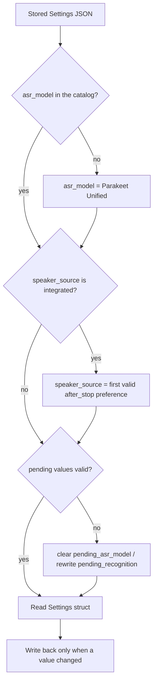

# Simplify Recognition Models - Plan

## Goal Capsule

- **Objective:** A user chooses from a short list of transcription models, and every model on the list has a clear reason to be there. The one recommended model is fast, live and accurate. Speaker labels come from one path for every model.
- **Means:** Remove five catalog entries and the model-provided speaker label route from the catalog to the UI. Rewrite stale Settings values on load (KTD1, KTD2).
- **Product authority:** This Product Contract. The user confirmed the scope on 2026-09-28. The Requirements win on product behaviour, and the KTDs win on mechanism. The Transcribe Again changes are in `docs/plans/2026-09-28-1244-feat-transcribe-again-from-settings-plan.md` and are not active scope here.
- **Open blockers:** None.
- **Execution profile:** One branch and one PR, in a worktree made from `origin/main`. Commit per unit. A local real-audio route check and a manual test in a signed build are necessary (Verification Contract).
- **Stop conditions:** Stop and ask if a kept model or the combined NeMo route depends on a removed catalog entry, or if keeping the fingerprint stable (KTD3) is not possible without a change to stored notes.
- **Product Contract preservation:** changed: R4 and its Key Decision. The user changed Recommended to Parakeet Unified only during planning on 2026-09-28. No other scope changed.

---

## Product Contract

### Summary

The catalog keeps five transcription models: three live models and two models for After Stop only. The five other models go away. Every model uses the separate speaker model, and the model's own speaker labels go away. "Recommended" marks only Parakeet Unified.

### Problem Frame

The catalog has ten transcription models. The six models that cannot run live do not give better transcripts than the live models:

- **Accuracy:** In the Handy assessments in the catalog, the best live model (Parakeet Unified, 90) is equal to Granite (90) and one point below Parakeet TDT 1.1B (91).
- **Speed:** Granite, MOSS and Whisper are about 2.5 to 3 times slower. A one-hour note with Granite and Nemotron 3 took more than 18 minutes after Stop on an M2 Ultra.
- **Context:** After Stop gives these models no more context than live transcription. Transcription after Stop sends windows of at most 30 s. A live model keeps its context for a live part of 4 to 8 minutes.

Granite, MOSS and Multitalker also offer their own speaker labels. These labels restart in each window: a five-minute test gave 30, 38 and 14 labels. The automatic choice therefore never uses them. Multitalker's transcription of overlapping speech into speaker channels needs this label mode too.

Granite is marked Recommended only because it offers its own labels. This sent the user to the slowest model.

### Key Decisions

- **Keep five models and remove five.** Governs R1, R2. (session-settled: user-directed — chosen over the full list of ten: Parakeet TDT v2 and 1.1B give almost nothing over live Parakeet Unified, and MOSS and Granite are slow and give no accuracy advantage)
- **Remove Multitalker.** Governs R2. (session-settled: user-approved — chosen over keeping it for crosstalk: its per-speaker transcription of overlapping speech needs the model-label mode, which this plan removes, and without that mode it is a plain English live model with a lower score than Parakeet Unified)
- **Keep Whisper and Parakeet TDT v3 for languages.** They cover languages that no live model covers, and they are more accurate than Nemotron 3.5 in the languages that they share. Governs R1. (session-settled: user-directed — chosen over a live-only list: no live model covers 73 of Whisper's languages or 5 of Parakeet TDT v3's languages)
- **Remove the model's own speaker labels completely.** They are not hidden under Advanced. Governs R6, R7. (session-settled: user-directed — chosen over keeping "Transcription model labels" for Multitalker: the labels restart in each window, and one speaker path is simpler)
- **Recommend only Parakeet Unified.** Governs R4. (session-settled: user-directed — chosen over one English and one multilingual recommendation, over two English live models, and over Whisper for other languages: one clear default, which is also the default for a new install)
- **Use Parakeet Unified when the Settings model is not in the catalog.** Governs R9. (session-settled: user-approved — chosen over the current "unknown model" failure: New Note and Transcribe Again both start from the Settings model)
- **Leave the files of removed models on disk.** Governs R12. (session-settled: user-directed — chosen over deleting them at launch and over a "No longer supported" list in Models: the change happens once)

### Requirements

**Catalog**

- R1. The catalog offers exactly five transcription models:

  | Model | Live transcription | Languages |
  |---|---|---|
  | Parakeet Unified EN 0.6B | Yes | 1 |
  | Nemotron Speech Streaming EN 0.6B | Yes | 1 |
  | Nemotron 3.5 ASR Streaming 0.6B | Yes | 28 |
  | Parakeet TDT 0.6B v3 | No | 25 |
  | Whisper large-v3-turbo | No | 100 |

- R2. Parakeet TDT 0.6B v2, Parakeet TDT 1.1B, MOSS Transcribe Diarize, Granite Speech 4.1 2B Plus and Multitalker Parakeet Streaming 0.6B are not in the app. They do not appear in Settings, in the model downloads or in the About licences.
- R3. Parakeet Unified EN 0.6B stays the model for a new install.

**Recommended**

- R4. Only Parakeet Unified EN 0.6B shows as Recommended.

**Speaker recognition**

- R5. Every model uses the separate speaker model that the speaker source selects. The automatic choice does not change: Nemotron 3, or pyannote / WeSpeaker when the expected count is more than 8.
- R6. The speaker source "Transcription model labels" is not in Settings or in any other place where a speaker source shows.
- R7. The app has no processing path for speaker labels from the transcription model. The path is removed, not only hidden.

**Saved values**

- R8. A saved note that a removed model transcribed keeps its transcript and summary. They show as before.
- R9. When the transcription model that Settings saved is not in the catalog, the app uses Parakeet Unified EN 0.6B. Settings shows Parakeet Unified as selected, and New Note and Transcribe Again use it.
- R10. When the speaker source that Settings saved is "Transcription model labels", the app uses the automatic speaker choice (R5).
- R11. Settings shows no error, notice or migration text for R9 or R10.
- R12. The downloaded files of removed models stay on disk. The app does not delete them or show them.

### Acceptance Examples

- AE1. The Settings model was removed
  - **Covers R9, R11.**
  - **Given:** Settings saved Granite as the transcription model before the update.
  - **When:** The user opens Settings, or starts a New Note.
  - **Then:** Settings shows Parakeet Unified EN 0.6B as selected, with no error. The note records with Parakeet Unified.
- AE2. The Settings speaker source was removed
  - **Covers R10.**
  - **Given:** Settings saved "Transcription model labels" as the speaker source.
  - **When:** The user opens Settings.
  - **Then:** The speaker source shows the automatic choice. "Transcription model labels" is not in the list.
- AE3. A note from a removed model
  - **Covers R8, R9.**
  - **Given:** A saved note was transcribed with Granite, and Settings saved Granite.
  - **When:** The user opens the note and selects "Transcribe Again…".
  - **Then:** The note shows its Granite transcript and summary unchanged. Transcribe Again uses Parakeet Unified.

### Scope Boundaries

- No new models are added.
- The app does not delete the files of removed models (R12).
- The transcription window length does not change.
- The runner does not get new log lines for the start and end of each stage.
- The Transcribe Again flow does not change here. The Transcribe Again plan owns it.
- `docs/reference/recognition-timings-2026-09-27.md`, `docs/reference/borrowing-notes.md` and the Granite solution doc stay unchanged. They are records of past work.

#### Deferred to Follow-Up Work

- Longer transcription windows for After Stop models.
- Log lines at the start and end of each processing stage.

### Dependencies / Assumptions

- Nobody else uses Longhand yet, so R9 and R10 serve only the user's installs. Saved notes need no migration.
- The Transcribe Again plan (`docs/plans/2026-09-28-1244-feat-transcribe-again-from-settings-plan.md`) interacts with this plan in three places. Neither plan must be implemented first:
  - Its AE1 and its U3 test use Granite as the Settings model. The plan that is implemented second changes these examples to Whisper or Parakeet TDT v3, which also cannot reuse Parakeet live text.
  - Its KTD4 speaker-limit text names the model "when the source is the transcription model's own labels". That case does not occur after R6 and R7.
  - With R9, a Settings model that is not in the catalog does not get to its KTD4 "Other configuration errors" text.
- The NeMo runtime artifacts serve only kept models: the NeMo builds of Nemotron Speech Streaming, Nemotron 3.5 and Parakeet TDT v3. They stay.

### Sources / Research

- `crates/models/catalog.json` — the ten entries. The five to remove are Multitalker, Parakeet TDT v2, Parakeet TDT 1.1B, MOSS and Granite. Only Multitalker, MOSS and Granite have `integrated` in `speaker_preferences`. Recommended is set on Parakeet Unified, Nemotron Speech Streaming and Granite.
- `crates/models/src/recognition.rs` — `SpeakerSource`, `NoIntegratedSpeakers`, the integrated id match, and the Multitalker speaker cap.
- `crates/pipeline/src/recognition.rs`, `crates/pipeline/src/recognition/stages.rs`, `crates/pipeline/src/recognition/durable.rs`, `crates/pipeline/src/reprocess.rs` — `Route::Integrated`, its window loop, the ASR fingerprint and the reuse rule.
- `crates/asr/src/engine.rs`, `crates/asr/src/result.rs`, `crates/asr/src/recovery.rs` — the normalized recognition API, `Attribution`, and the MOSS and Multitalker normalizers. The integrated window loop is the only production caller.
- `src-tauri/src/managers/settings.rs` — `settings_from_value`, `salvage_settings` and `apply_settings_migrations`.
- `src/settings/RecognitionOptions.tsx`, `src/settings/RecognitionModelPicker.tsx` — the "Transcription model labels" source, the recommendation order and the built-in speaker badge.
- `docs/reference/recognition-timings-2026-09-27.md` — the label counts, the automatic order, and the Granite processing time.
- The transcribe.cpp Multitalker documentation (https://github.com/handy-computer/transcribe.cpp/blob/main/docs/models/multitalker-parakeet-streaming-0.6b-v1.md) — without diarize mode, the model runs its `single_speaker_mode` path, and the per-speaker channels need diarize mode.

---

## Planning Contract

### Key Technical Decisions

- KTD1. **Delete the removed option from the types.** `SpeakerSource::Integrated` and `Route::Integrated` go away, with every branch that only they reach. They are not kept as unreachable variants. A note that was recording or waiting in the queue at update time with this speaker source then fails to read its stored snapshot. It shows the ordinary processing failure, and the user uses Transcribe Again. Governs R6, R7. (session-settled: user-approved — chosen over keeping unreachable variants for in-flight notes: that contradicts R7, and all of the user's saved notes are finished)
- KTD2. **Rewrite stale Settings values in the raw JSON on every load.** In `settings_from_value`, the rewrite changes a copy of the stored `Value` before `serde_json::from_value::<Settings>`, so the parse and `salvage_settings` see only valid values. Its changed flag joins the `updated` result. It runs on every load, like `interface_zoom::normalize` and `drop_unusable_prompts`, and it does not raise `CURRENT_SETTINGS_SCHEMA_VERSION`. A rewrite after the parse is not sufficient: after U1 a stored `"integrated"` fails the parse, and the salvage resets the speaker source to its serde default (pyannote), which the UI shows as an override, not as the automatic choice. Governs R9, R10, R11. (session-settled: user-approved — chosen over a new schema version: a parallel branch can raise the same version, per `docs/solutions/workflow-issues/parallel-branches-bump-same-schema-version.md`)
- KTD3. **Keep the ASR fingerprint stable.** `spec_fingerprints` in `crates/pipeline/src/recognition/durable.rs` hashes an `integrated` flag. The hashed value stays a literal `false`. If the flag left the hash, the fingerprint of every existing note would change, and no note could use its saved text or live text again. Governs R8. (session-settled: user-approved — chosen over removing the flag from the hash: it would stop text reuse for every existing note)
- KTD4. **Remove the normalized recognition API with the route.** The integrated window loop is the only production caller of `transcribe_normalized`. `Attribution`, `RecognitionRequest`, `normalize_parts`, the MOSS and Multitalker normalizers, and their tests go away. Parts that other routes use stay: `TimingPrecision`, the shared engine padding and `SCOPED_LABELS_NOTE`. The implementer confirms each deletion with the compiler and clippy dead-code warnings. Governs R7.
- KTD5. **The automatic speaker choice comes from the model's catalog preferences.** R10 takes the first `after_stop` preference that resolves with the saved `default_speaker_count`: Nemotron 3, or pyannote above 8. This is the same selection that `automatic_speaker_choices_are_valid…` in `crates/models/src/catalog.rs` tests. The same rule applies to `pending_recognition.speaker_source`. A `pending_asr_model` that is not in the catalog is cleared, because nothing can download it. Governs R9, R10.
- KTD6. **Tests move to kept models; tests of the removed route go.** Tests that use MOSS, Granite or Multitalker only as a stand-in model move to Whisper (not streaming, segment timestamps) or Parakeet TDT v3. Tests that exist only for the integrated route or the MOSS and Multitalker normalizers are deleted. Governs R1, R7.

### High-Level Technical Design

Settings load after this change:

### Assumptions

- No installed build has a note in progress with the removed speaker source or a removed transcription model. If one has the removed speaker source, KTD1 applies. If one has a removed model, the runner waits for model files that it cannot find through the catalog, and the user uses Transcribe Again.
- Downloaded files of removed models stay where they are. Nothing in the app lists the model directory, so R12 needs no code.

---

## Implementation Units

### U1. Remove model-provided speaker labels

- **Goal:** No type, resolver branch, processing route or Settings choice for model-provided speaker labels remains.
- **Requirements:** R5, R6, R7. KTD1, KTD3, KTD6.
- **Dependencies:** None.
- **Files:**
  - `crates/models/src/recognition.rs`, `crates/models/src/catalog.rs` (test `integrated_models_prefer_separate_speakers_and_keep_explicit_labels`), `crates/models/tests/recognition.rs`
  - `crates/pipeline/src/recognition.rs`, `crates/pipeline/src/recognition/stages.rs`, `crates/pipeline/src/recognition/durable.rs`, `crates/pipeline/src/reprocess.rs`, `crates/pipeline/src/recognition/saved_prefix.rs`
  - `crates/pipeline/tests/recognition_stages.rs`, `crates/pipeline/tests/recognition_routes.rs`, `crates/pipeline/tests/recognition_native.rs`
  - `src/bindings.ts` (regenerated), `src/settings/RecognitionOptions.tsx`, `src/settings/Models.test.tsx`
  - `scripts/validate-recognition/route-matrix.ts`
- **Approach:**
  1. Remove `SpeakerSource::Integrated`, `NoIntegratedSpeakers`, the integrated id match and the Multitalker speaker cap from the resolver.
  2. Remove `Route::Integrated`, the integrated inner branch of the transcription stage (the native-window loop) and the `native-window/` cleanup. `CombinedNemo` keeps its branch.
  3. In `reprocess.rs`, only `CombinedNemo` blocks reuse.
  4. Keep the literal `false` in the fingerprint tuple (KTD3). The speaker-source check in `durable.rs` that becomes always true is simplified.
  5. Remove "Transcription model labels" and its notes from `RecognitionOptions.tsx`, because the regenerated bindings no longer have the value.
  6. Move stand-in tests to kept models and delete integrated-only tests (KTD6).
  7. Remove the integrated cases from the local route matrix script.
- **Patterns to follow:** The existing `Route::Off` and `SeparatePyannote` test fixtures in `crates/pipeline/tests/recognition_stages.rs`.
- **Test scenarios:**
  - Resolving any kept model with each remaining speaker source gives a spec with no model-provided labels.
  - A stored spec JSON with `speaker_source: "integrated"` fails to read with an error, and the runner reports an ordinary processing failure for that note.
  - The ASR fingerprint of a fixed spec is the same value before and after this change (a golden value from the current code).
  - The reuse, portability and resume tests that used MOSS or Granite pass with Whisper or Parakeet TDT v3.
  - Transcribe Again reuse is blocked only for `CombinedNemo`.
- **Verification:** No source file names `Integrated` or `integrated` as a speaker source or route, except the literal in the fingerprint. The bindings diff check passes.

### U2. Remove the normalized recognition API

- **Goal:** The ASR adapter keeps only what the remaining routes call.
- **Requirements:** R7. KTD4.
- **Dependencies:** U1.
- **Files:** `crates/asr/src/engine.rs`, `crates/asr/src/result.rs`, `crates/asr/src/recovery.rs`, `crates/asr/src/lib.rs`, `crates/asr/tests/normalized.rs`, `crates/asr/tests/native_attribution.rs`, `scripts/validate-recognition/asr-matrix.ts`
- **Approach:**
  1. Remove `transcribe_normalized` from the `Recognizer` trait and the engine, with the Granite comment.
  2. Remove `is_moss`, `is_multitalker`, `Attribution`, `RecognitionRequest`, `normalize_parts`, `normalize_moss_transcript` and `normalize_multitalker_transcript`, if nothing else calls them.
  3. Delete `crates/asr/tests/normalized.rs` and the other tests that cover only these items.
  4. Keep `crates/asr/tests/native_attribution.rs` for the local ASR matrix. Remove its `native` mode, and move its `off` mode to the kept `transcribe` / `transcribe_tokens` path. In `asr-matrix.ts`, remove the `native` mode and its model list, so the matrix still runs `off` and `live` for the kept models.
  5. Keep `TimingPrecision`, the shared engine padding, the word-timing kind selection from the Granite timing fix, and `SCOPED_LABELS_NOTE`, because other routes use them.
- **Patterns to follow:** The existing `transcribe` and `transcribe_tokens` paths in `crates/asr/src/engine.rs`.
- **Test scenarios:**
  - The native word-timing tests in `crates/asr/src/engine.rs` still pass.
  - Token and segment transcription for a kept model still produce timed words (the existing `crates/asr` tests).
- **Verification:** `cargo clippy --workspace --all-targets -- -D warnings` reports no dead code in `crates/asr`.

### U3. Trim the catalog and the Recommended mark

- **Goal:** The catalog has the five models of R1, and only Parakeet Unified is Recommended.
- **Requirements:** R1, R2, R3, R4. KTD6.
- **Dependencies:** U1.
- **Files:**
  - `crates/models/catalog.json`, `crates/models/src/catalog.rs`, `crates/models/PROVENANCE.md`
  - `scripts/refresh-catalog.py`, `scripts/tests/test_refresh_catalog.py`
  - `src-tauri/src/managers/models.rs` (test constants)
  - `src/settings/RecognitionModelPicker.tsx`, `src/settings/Models.test.tsx`
- **Approach:**
  1. Remove the five entries from `catalog.json`. Set `recommended` to false on Nemotron Speech Streaming.
  2. Rewrite the catalog tests: the list of five models, and the Recommended set exactly `[parakeet-unified-en-0.6b-q80]`.
  3. Set `recommendationOrder` in the picker to Parakeet Unified only, and remove the built-in speaker badge.
  4. Remove the five models from `refresh-catalog.py` (`MODELS`, the Multitalker `bundle/` rule, the MOSS and Granite publishers, the docstring count). Move its Granite test fixture to a kept model.
  5. Update the model list and counts in `crates/models/PROVENANCE.md`.
  6. Swap the `TDT_1_1B` and `TDT_V2` test constants in `managers/models.rs` for kept models, so the delete tests test a real model.
  7. Move MOSS fixtures in `Models.test.tsx` to Whisper, and delete the Granite recommendation-order test and the integrated-model suite.
- **Patterns to follow:** The existing catalog tests in `crates/models/src/catalog.rs`.
- **Test scenarios:**
  - The catalog has exactly the five ASR ids of R1, with the streaming flags of R1.
  - Exactly one model is Recommended, and it is Parakeet Unified.
  - `DEFAULT_ASR_MODEL` is Parakeet Unified.
  - Every kept model's automatic speaker choice resolves (the existing test).
  - The picker shows one Recommended entry and no built-in speaker badge.
  - The About licence rows list only kept models.
  - `refresh-catalog.py` runs its test suite without a "missing policy" error.
- **Verification:** `scripts/check-provenance.sh` and `scripts/check-licences.sh` pass. `licences/manifest.json` has no entry for a removed model.

### U4. Rewrite stale Settings values on load

- **Goal:** Settings that name a removed model or the removed speaker source read as the defaults, with no notice.
- **Requirements:** R9, R10, R11. KTD2, KTD5.
- **Dependencies:** U1, U3.
- **Files:** `src-tauri/src/managers/settings.rs`
- **Approach:** Add one load-time rewrite of the raw value before the struct parse (KTD2), in the order that the High-Level Technical Design shows. It changes only `asr_model`, `speaker_source`, `pending_asr_model` and `pending_recognition`. It reports a change only when a value changed, so the store is written once and then converges.
- **Execution note:** Write the tests from stored JSON in the old format first. Fresh-state tests do not show this failure, per `docs/solutions/workflow-issues/edited-applied-migration-breaks-older-databases.md`.
- **Patterns to follow:** The `json!` fixture tests at the end of `src-tauri/src/managers/settings.rs`, and `interface_zoom::normalize`.
- **Test scenarios:**
  - Covers AE1. A stored value with `asr_model: "granite-speech-4.1-2b-plus-q5km"` reads as Parakeet Unified, and the result is marked updated.
  - Covers AE2. A stored value with `speaker_source: "integrated"` and no speaker count reads as Nemotron 3.
  - A stored value with `speaker_source: "integrated"` and `default_speaker_count` of 9 reads as pyannote.
  - `pending_recognition` with `speaker_source: "integrated"` gets the same rewrite.
  - A `pending_asr_model` that is not in the catalog is cleared.
  - A stored value with only kept values is not changed and not marked updated.
  - A second load of the rewritten value makes no further change.
  - A stored value with every other field valid keeps those fields after the rewrite.
- **Verification:** The Settings window opens with AE1 and AE2 values and shows no error or override notice.

### U5. Update the glossary

- **Goal:** Shared docs describe the current speaker behaviour.
- **Requirements:** R6, R7.
- **Dependencies:** U1.
- **Files:** `CONCEPTS.md`
- **Approach:** Change the speaker entry that says a transcription model can supply labels itself. The historical docs in Scope Boundaries stay unchanged.
- **Test expectation:** none -- documentation only.
- **Verification:** No current-behaviour doc says that a transcription model supplies speaker labels.

---

## Verification Contract

| Gate | Command or step | Applies to |
|---|---|---|
| Type check and build | `bun run build` | U1, U3 |
| UI tests | `bun run test` | U1, U3 |
| Rust format | `cargo fmt --all --check` | U1–U4 |
| Rust lint | `cargo clippy --workspace --all-targets -- -D warnings` | U1–U4 |
| Rust tests | `cargo test --workspace --features nemo-runtime/test-helper` | U1–U4 |
| Windows check | `scripts/check-windows.sh` | U1–U4 |
| Bindings | Regenerate `src/bindings.ts` through the `export_bindings` test, then `git diff --exit-code src/bindings.ts` after commit | U1 |
| Provenance | `scripts/check-provenance.sh --self-test` and `scripts/check-provenance.sh` | U3 |
| Licences | `scripts/check-licences.sh`, then confirm that `licences/manifest.json` has no removed model | U3 |
| Catalog script | `uv run python -m unittest scripts/tests/test_refresh_catalog.py` (local, not in CI) | U3 |
| Real-audio route check | At least five minutes of real audio for Parakeet Unified live with Nemotron 3, Whisper After Stop with Nemotron 3, and Parakeet TDT v3 After Stop with pyannote, per `docs/development-workflow.md` "Local recognition checks". Record duration, pace, models, runtime, coverage and result. | U1, U2 |
| Manual test | Signed build, per `docs/development-workflow.md` "Manual tests". Check AE1, AE2 and AE3 with Settings that saved Granite and "Transcription model labels" before the update. Check that Settings > Models and About list only the five models. | U3, U4 |

Cargo, uv and Tauri builds need the sandbox bypass on this machine.

---

## Definition of Done

- R1 to R12 are true, and AE1 to AE3 pass in the signed build.
- Every gate in the Verification Contract passes, and the real-audio route result is recorded.
- No source file refers to a removed model id, except the Settings rewrite tests and fixtures that test stale values.
- The ASR fingerprint test shows the same value as before the change.
- No code from abandoned attempts is left in the diff.
