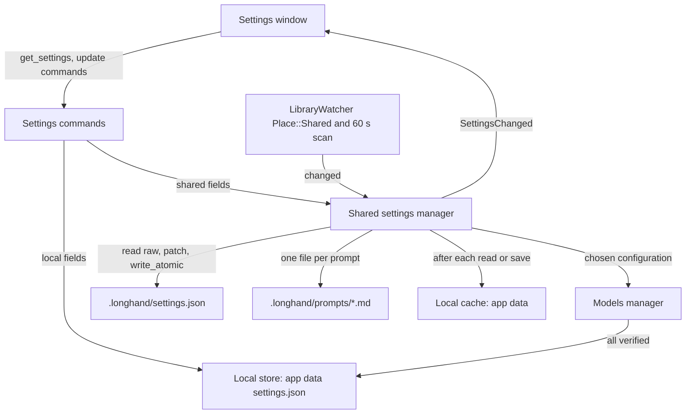
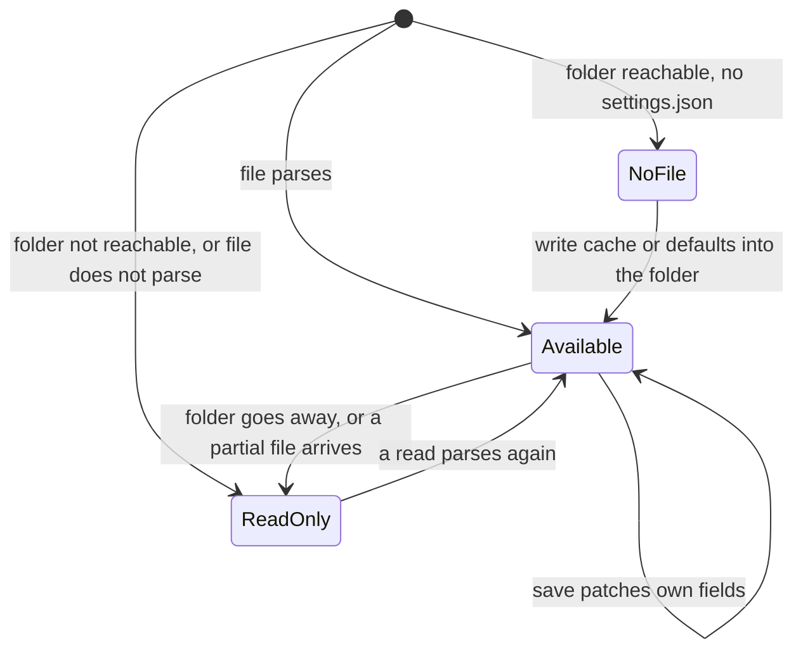
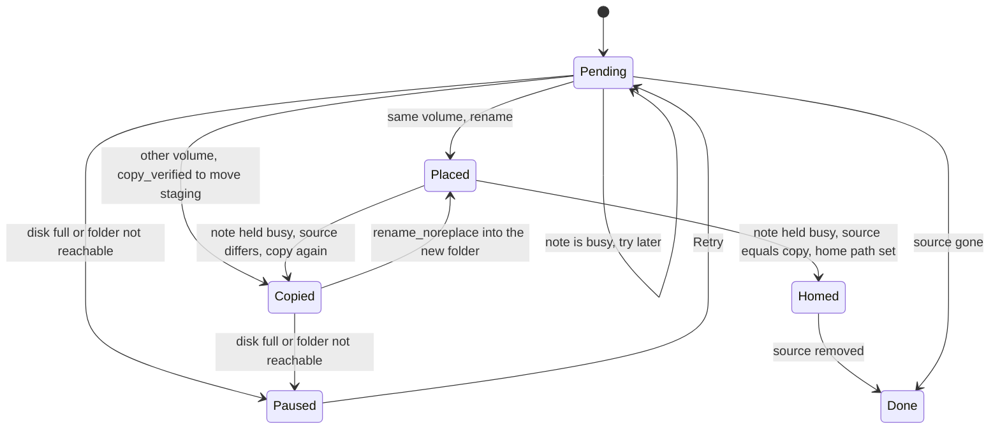
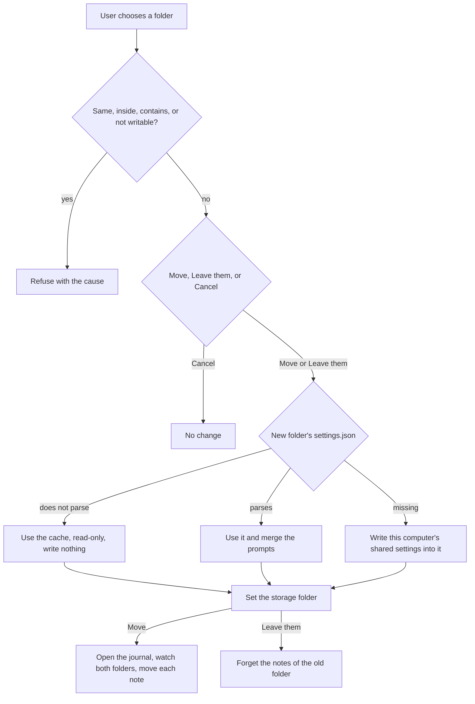

# One Storage Folder and Shared Settings - Plan

## Goal Capsule

- **Objective:** A person who uses Longhand on several computers sets up the summary prompts and the way of working one time. Every computer that uses the same storage folder then uses those settings. The library always has exactly one storage folder, and a new install records with no setup.
- **Means:** A new crate reads and writes the shared settings and the prompt files in the storage folder's `.longhand/` folder, one field at a time (KTD1, KTD2). Move is a resumable per-note state machine that uses the Save copy steps again (KTD9).
- **Product authority:** This Product Contract. The user confirmed the scope on 2026-09-28. It covers two ideas together: [one storage folder](../ideas/done/one-storage-folder.md) and [shared settings in the storage folder](../ideas/done/shared-settings-in-storage.md). The Requirements win on product behaviour, and the KTDs win on mechanism.
- **Open blockers:** None.
- **Execution profile:** One branch and one PR, in a worktree made from `origin/main`. Commit per unit and push in batches. A manual test on two Macs with a notarized build is necessary (Verification Contract).
- **Stop conditions:** Stop and ask if iCloud Drive does not deliver `.longhand/` to a second Mac, or renames it (R11). Stop and ask if a Move cannot keep one complete copy of a note at every step (R5).
- **Product Contract preservation:** changed: R21, AE10, AE12 and one Key Decision. During planning on 2026-09-28, the user removed the "not yet synced" wait, and accepted that a save made before another computer's change arrives can undo that change. The planning answers replace the deferred questions. No other scope changed.

---

## Product Contract

### Summary

Longhand has exactly one storage folder. On a new install it is a folder in the app data folder, which is not synced. When the user changes the folder, the user chooses Move or Leave them. The storage folder holds every setting that does not belong to one computer, and each custom summary prompt is a markdown file there. Each computer that uses the folder uses those settings and follows changes while it runs. The implementation adds a shared settings crate, splits the app settings into local and shared parts, and replaces the list of earlier folders with one folder and a Move.

### Problem Frame

One person with several computers already shares one library through a synced storage folder ([one library across computers](../ideas/done/cross-machine-library.md)). But all settings are kept on each computer, so the person must set up each computer again. Custom summary prompts cause the most trouble: the person cannot remember a long prompt, so each copy must be typed again by hand, and the copies then drift apart.

The library also keeps every storage folder that the user has chosen (R25a of the walking skeleton plan) and lists the notes of all of them. Nobody needs several storage folders at the same time. The rule makes "which folder holds the shared settings?" a question with no good answer. A new install also has no storage folder, so the recording shortcut does nothing until the user chooses one.

### Key Decisions

- **One plan covers both ideas.** With one storage folder, the shared settings have exactly one place. (session-settled: user-approved — chosen over shared settings alone on top of several folders, and over a separate plan for one storage folder first: one folder removes the "which root" rule)
- **A setting is shared unless there is a reason to keep it on one computer.** Governs R11, R12, R13. (session-settled: user-directed — chosen over a small hand-picked shared set such as prompts only: the user wants to review every setting from the side of "share it")
- **The transcription model is shared. The shortcuts, interface zoom, Computer audio default and Hide from Dock stay on each computer.** Governs R12, R13. (session-settled: user-directed — the user chose these from the undecided settings)
- **A shared transcription model that this computer does not have downloads automatically.** Recording is never blocked. Governs R18. (session-settled: user-approved — chosen over asking first, and over notes that wait for the model)
- **The default storage folder is in the app data folder.** Audio files are large and private, and Documents is often synced on macOS and Windows. Governs R2, R3. (session-settled: user-directed — chosen over Documents/Longhand and Home/Longhand)
- **After a change of folder, the folder's shared settings win, and custom prompts merge into them.** A second computer joins a library this way, and no prompt is lost. Governs R21, R22. (session-settled: user-directed — chosen over "folder wins" with no merge, and over a question when both exist)
- **A folder with no readable settings file gets this computer's settings at once.** A change to an empty folder, such as a larger disk, is the usual case. When a sync later delivers another settings file, the sync service shows the conflict. Governs R21. (session-settled: user-directed — chosen over a wait for a settings file when the folder has notes or a library marker: the wait never ends for a folder that has no settings file)
- **Everything works during a Move.** A large library can take minutes to move. Governs R6. (session-settled: user-approved — chosen over read-only notes during the move, and over a blocking progress window)
- **A computer whose notes another computer moved away gets no notice.** Its library empties as the sync removes the files. Governs R9. (session-settled: user-directed — chosen over a marker in the old folder and a notice)
- **Each custom prompt is its own file.** The user can edit a prompt in any editor, and a sync conflict copy of a prompt is kept as a second prompt, so no text is lost. Governs R14. (session-settled: user-approved — chosen over prompts inside the one settings file)
- **Each computer keeps a local copy of the last shared settings.** A missing, moved or unreachable storage folder never resets the prompts to the defaults. Governs R16. (session-settled: user-approved)
- **For the settings file, the last save wins.** A lost change costs one setting, and prompts are safe in their own files. Governs R15. (session-settled: user-approved)
- **The summary endpoint, the summary model, the context limits and the API key stay on each computer as one unit.** A key belongs to one endpoint, and a local endpoint such as `localhost` is a different server on each computer. Governs R12, R13. (session-settled: user-directed — chosen over a shared endpoint with a notice to enter the key for it: the endpoint, the model and the key must not separate)
- **Shared settings are read-only while the storage folder is not reachable.** This happens only when the folder's disk is not connected. A computer that is offline still has its synced folder on disk. Governs R16. (session-settled: user-approved — chosen over edits that are written back when the folder returns)
- **The new folder is the storage folder from the start of a Move.** Notes that have not moved yet stay listed from the old folder until they move. Governs R10. (session-settled: user-approved)
- **A change of folder copies the shared settings and does not remove them from the old folder.** Another computer that still uses the old folder keeps working settings. Governs R21.
- **This plan replaces KD10 of the one-library plan** ("An action uses the settings of the computer that runs it"). A summary still names its prompt, so a summary made before a prompt changed still says which prompt made it.

### Requirements

**One storage folder**

- R1. Longhand uses exactly one storage folder at a time, and the library lists only the notes in it.
- R2. A new install uses a default storage folder in the app data folder, so the recording shortcut and Save work before the user chooses a folder. The default folder stays when the app is removed, including by the Windows uninstaller's option to delete app data. On Windows it is in the local app data folder, not the roaming one.
- R3. Settings > Storage shows the storage folder, a Change action, and an action that opens the folder in Finder (in Explorer on Windows).
- R4. When the user changes the storage folder, Longhand asks what to do with the notes in the old folder: Move or Leave them. The user can also cancel.
- R5. Move puts every saved note in the new folder. At every moment each note has at least one complete copy, and the library lists it one time. Longhand removes a note from the old folder only after its copy in the new folder is verified.
- R6. While a Move runs, Settings > Storage shows its progress. Recording, the shortcut and note edits keep working, new notes save to the new folder, and the library never lists a note twice or loses one.
- R7. Leave them keeps the notes in the old folder and does not delete them. The library forgets them.
- R8. The list of earlier storage folders goes away. The current folder becomes the one storage folder, and the other folders are forgotten. No installs need migration.
- R9. When another computer moves the notes out of a shared storage folder, this computer shows no special notice. Its library empties as the sync removes the files.
- R10. The new folder is the storage folder from the start of a Move. Until a note moves, the library lists it from the old folder. After a crash, the Move continues at the next launch. When the disk is full, the Move pauses, and Settings > Storage shows the cause and a Retry action.

**Shared settings**

- R11. The storage folder holds the shared settings in its hidden Longhand folder. Every computer that uses the storage folder reads and changes them there.
- R12. These settings are shared: the custom summary prompts and the active prompt, the default speaker count, the transcription model, live transcript, the speaker source, the speaker processing mode, the recognition language, and "check for updates automatically".
- R13. These settings stay on each computer: the storage folder path, the microphone, the summary endpoint URL, the summary model, the context limit, the learned context limits, the API key (in the Keychain or the Windows secret store), the recognition configuration in use (R18), the model download state, both shortcuts, the interface zoom, the Computer audio default, and Hide from Dock. A setting added later is shared unless it depends on the hardware, operating system, disk or secrets of one computer.
- R14. Each custom summary prompt is its own markdown file in the hidden Longhand folder. The built-in prompts stay in the app. A prompt file that the user changes outside Longhand shows the new text, and a sync conflict copy of a prompt file shows as one more prompt. When the file of the active prompt is missing, or has a conflict copy, Longhand uses the last copy of that prompt that it read (R16), never a different prompt.
- R15. Each save changes only the settings that the save is for: Longhand reads the current settings file, applies those settings, and writes the result. An automatic save changes only its own value. When two computers change the same setting at nearly the same time, the last save wins. Longhand ignores sync conflict copies of the settings file.
- R16. Each computer keeps a copy of the last shared settings that it read, prompt texts included. When the storage folder is missing or not reachable, the computer uses that copy, not the defaults. Shared settings and prompts are then read-only. Settings > Storage says that the folder is not available, and Save says that it waits for this folder. The silent case in R9 does not change.
- R17. Computers that use the same storage folder can run different Longhand versions. A computer never writes the shared settings only because it read them. When it writes, it keeps the fields and values that it does not know, it does not write a lower schema version than the one in the file, and it does not replace a transcription model or other value that it does not know with a default.
- R18. The shared settings hold the chosen recognition configuration: the transcription model, the speaker source, the speaker processing mode, live transcript, the recognition language and the default speaker count. Each computer keeps the configuration that it uses now as its own state, and never writes that configuration to the shared settings. When a model that the chosen configuration needs is not on this computer, speaker models included, its download starts automatically. The configuration in use changes to the chosen configuration as one unit when every needed model is verified. A failed download shows in Settings, and the configuration in use stays. When this computer has no previous model, recording still works, and the note waits to transcribe until the download is verified.
- R19. While the chosen configuration waits for downloads, Settings shows the chosen model, its download progress, and the model in use. A failed download shows its cause and a Retry action in the same place.
- R20. A change of shared settings from another computer applies on this computer while Longhand runs, with no restart. A recording that is running keeps the settings it started with. The change applies from the next note, and the recording page shows no notice.

**Change of storage folder and shared settings**

- R21. After a change of storage folder, by Move or by Leave them: when the new folder has a readable shared settings file, this computer uses it. When it has none, this computer copies its current shared settings into it. The old folder keeps its copy. The same rule applies at the first launch after this update.
- R22. When the new folder has shared settings, each custom prompt of this computer that the folder does not have is added to the folder. A prompt with the same name and the same text is not added again. A prompt with the same name and different text is added with a free name, as Duplicate makes one.

### Key Flows

- F1. Change the storage folder
  - **Trigger:** The user selects Change in Settings > Storage and chooses a folder.
  - **Steps:** Longhand asks Move or Leave them (R4). It applies the shared settings rule and merges the prompts (R21, R22). Then it moves the notes with progress (R5, R6), or it forgets them (R7).
  - **Outcome:** The library shows the notes of the new folder, and this computer uses the shared settings of the new folder.
- F2. A second computer joins
  - **Trigger:** Computer A uses a synced storage folder. The user installs Longhand on computer B.
  - **Steps:** B records into its default folder (R2). Later the user changes B's storage folder to the synced folder and chooses Move (F1). B adopts A's shared settings, adds its own custom prompts (R22), and downloads the models of A's recognition configuration (R18).
  - **Outcome:** A and B show the same notes and use the same prompts. They use the same models when B's downloads are verified; until then B uses its previous configuration.

### Acceptance Examples

- AE1. **Covers R2.** Given a new install, when the user presses the recording shortcut, recording starts and the note saves with no folder choice.
- AE2. **Covers R20.** Given A and B share a storage folder and both run Longhand, when the user changes the active prompt on A, B shows the new active prompt after the sync, with no restart.
- AE3. **Covers R21, R22.** Given B has a custom prompt "Standup" and the synced folder has A's settings with no "Standup", when B changes to that folder, B uses A's settings, the folder gets "Standup", and A shows "Standup" too.
- AE4. **Covers R22.** Given B and the folder each have a prompt "Recap" with different text, when B changes to the folder, both prompts are kept and B's copy gets a free name.
- AE5. **Covers R18.** Given A selects a transcription model and a speaker source that B does not have the models for, when B receives the change, B starts each download. A note that B records before every download is verified uses B's previous configuration: its model, speaker source, language and live transcript setting together.
- AE6. **Covers R6.** Given a Move runs, when the user records a note and stops, the note saves to the new folder and shows one time in the library.
- AE7. **Covers R16.** Given the storage folder is on a disk that is not connected, when Longhand starts, it uses the last shared settings, and the custom prompts are there.
- AE8. **Covers R14.** Given A and B change the same prompt while offline, when the sync makes a conflict copy, both texts show as two prompts.
- AE9. **Covers R9, R21.** Given A and C share a folder, when A moves the notes to a new folder, C's library empties with no notice, and C keeps the shared settings of the old folder.
- AE10. **Covers R21.** Given a folder has notes but no settings file, when B changes to that folder, B writes its current shared settings into the folder and uses them.
- AE11. **Covers R17.** Given A runs a newer version and selects a model that B's older version does not know, when B reads and then saves a change to another setting, the file still names A's model.
- AE12. **Covers R15.** Given B has received A's change of the active prompt, when the user turns off live transcript on B, A's active prompt stays.
- AE13. **Covers R10.** Given a Move stops because the disk is full, when the user frees space and selects Retry, the Move continues, and no note is listed twice.

### Scope Boundaries

- A notice on a computer whose notes another computer moved away (R9).
- Several storage folders at the same time.
- Shared settings with no shared storage folder, such as through an account or a cloud service.
- A shared summary endpoint, summary model or API key. Each computer keeps its own (R13).
- A merge of settings other than custom prompts. The folder's values win (R21).
- A summary prompt for each note type ([summary prompt by note type](../ideas/someday/summary-prompt-by-note-type.md)).
- The removal of old audio ([remove the audio of old notes](../ideas/done/remove-old-audio.md)).

### Dependencies / Assumptions

- The sync service delivers the hidden Longhand folder with the notes. The library marker `.longhand/library` already depends on this.
- A prompt file changed in an editor is text that the user typed, so it agrees with the "Nothing writes into Longhand" boundary in `STRATEGY.md`.
- When the storage folder is not available (for example, a disconnected disk), Save waits as it does today.

### Sources / Research

- `src-tauri/src/managers/settings.rs`: all settings are one `settings.json` in the app data folder (`tauri-plugin-store`). The API key is in the OS secret store (`src-tauri/src/managers/secrets.rs`).
- `crates/library/src/scan.rs`: `LONGHAND_FOLDER` (`.longhand`) and the library marker. The scan skips hidden names.
- `src-tauri/src/shortcut.rs` and `crates/pipeline/src/save.rs`: with no storage folder, the shortcut does nothing and Save waits (`StageError::NoDestination`, "Waiting for a folder").
- `src-tauri/src/managers/models.rs` (`settle_pending`): a pending model becomes the transcription model when its download is verified, and a pending recognition configuration is applied as one unit when every model it needs is present. R18 adapts this path: the pending configuration is the shared choice, and the configuration in use stays on each computer.
- `src-tauri/src/managers/settings.rs` (`rename_summary_prompt`, `free_prompt_name`): prompt names are unique, and Duplicate makes a free name. R22 uses this rule.
- `src/settings/DestinationPicker.tsx`: Settings > Storage has "Choose Folder…" or "Change…" and a list of earlier folders. No action opens the folder in Finder yet.
- `docs/plans/2026-09-25-1217-feat-one-library-across-computers-plan.md`: KD10, which this plan replaces, and the folder watcher that follows notes from other computers.
- `docs/plans/2026-09-21-2052-feat-longhand-walking-skeleton-plan.md`: R25a, the rule that keeps every chosen folder, which R8 removes.

---

## Planning Contract

### Key Technical Decisions

- KTD1. **A new crate `crates/shared-settings` owns the shared files.** It reads and writes `.longhand/settings.json` and `.longhand/prompts/*.md`, and it keeps the local cache. It has no Tauri dependency, so two-computer and partial-sync tests run on temporary folders, as `crates/library/tests/two_computers.rs` does. `tauri-plugin-store` cannot hold the shared file: it keeps the file in memory and never reads a change from another computer again.
- KTD2. **The shared settings file is a JSON object that Longhand patches one field at a time.** A save reads the file from disk as a raw value, sets only the fields of this save, sets `schema_version` to the larger of the file's version and this build's version, and writes the result with `session_save::home_write::write_atomic`. A read never writes. Each known field parses on its own. A value that this build does not know, such as a newer `speaker_source` or a model that is not in the catalog, becomes an unknown value that the app shows, not a default (R15, R17).
- KTD3. **A shared file that exists but does not parse is not available.** A sync service can deliver a file in parts. Longhand then uses the cache, makes the shared settings read-only, and never writes over that file. The next read that parses makes the settings available again (R16, R17).
- KTD4. **A prompt file carries its identity inside the file.** The file name is the prompt name, made safe for macOS and Windows file names, such as `Standup.md`. A short front matter block at the top of the file holds `id` and `name`, and the body is the prompt text. `name` is the name that Settings shows. A rename in Longhand writes the new name into the existing file, then renames that file, so a crash leaves one file. A rename of the file outside Longhand keeps the id and the name. A markdown file with no front matter is a prompt too: its id comes from its file name, and its name is the file name. (session-settled: user-approved — chosen over file names made from the id: readable names let the user find a prompt in an editor)
- KTD5. **Conflict copies of prompts are found by id, not by file name.** A conflict copy keeps the id of its original. The choice of ids uses only the shared files, never the cache, so every computer gives each file the same id without a write. When several files have one id, the files with the same text show as one prompt. Of the files with different texts, the file whose name is the safe file name of its `name` keeps the id; when none or several qualify, the first file name in byte order keeps it. Each other file gets an id made from the original id and its file name (UUID v5). While the active id has a conflict copy, the active prompt's text comes from the cache (R14). When Longhand writes a prompt file that has a made id, it writes that id into the front matter first. A shown name that another prompt already has gets a free name for display only. Longhand reads only the exact name `settings.json` and ignores every other file name for settings (R15). The prompt scan skips names that start with `.` or `~$`, files that are not `.md`, and files over `PROMPT_TEXT_LIMIT`.
- KTD6. **The local cache is a folder in the app data folder.** It holds a copy of the last shared settings file that parsed, the prompt texts with their ids and names, and the storage folder path that they came from. Longhand writes the cache after a read that differs from it, and after each save. The cache is local, so this write does not break "a read never writes" in the storage folder (R16). When the storage folder does not exist or is not readable, the shared settings come from the cache and are read-only.
- KTD7. **The app settings split into local settings and a shared view.** Local settings stay in `tauri-plugin-store` (R13). The shared settings come from the shared settings manager. The `get_settings` command returns both, plus the state of the shared settings (available, read-only with a cause, or unknown values from a newer version). Each update command writes only its own store, so `learn_limit` and other automatic saves never touch the shared file (R15). The local schema version goes up one step, and the local migration keeps the old shared values only to fill a new cache (R21).
- KTD8. **The storage folder rule for R21 has three cases.** A readable settings file: use it and merge the prompts (R22). A folder that is reachable and has no settings file: write the cache, or the defaults on a new install, into it. A folder that is not reachable, or a settings file that does not parse: use the cache, read-only, and write nothing (KTD3). The merge writes each added prompt as its own file, so a merge that runs again adds nothing.
- KTD9. **Move is a per-note state machine with a journal in the local store.** A new SQL migration adds the Move journal: the old and new folders, the Move state, the pause cause, and one row for each note with its step. The steps are Pending, Copied, Placed, Homed and Done. On one volume a rename puts the note in the new folder in one step. On another volume the copy uses `stage::copy_verified` into a `.longhand-move-<id>` folder in the new folder, and `rename_noreplace` puts it in place. The Move staging prefix is not `.longhand-staging-`, so `sweep_staging` never removes it; the Move removes its own leftovers when it resumes. From the final check to the home change, the Move holds the note busy, so note edits and renames wait. The final check compares the source with the placed copy. When they differ, the Move copies the source again into staging, replaces the placed copy, and checks again. The store's home path changes only when the two are equal. After that, the Move removes the source with no further check. A source that is gone when the Move reaches it was moved by another computer or by the user: the Move drops it from the journal. Each step checks its own effect on disk first, as in `docs/solutions/logic-errors/save-state-machine-crash-window-recovery.md` (R5, R10).
- KTD10. **During a Move the library watches both folders.** The roots are the storage folder and, while the journal is open, the old folder. The reconciler skips a note that has a Move row, as it skips a note with a rename intent, so a note in both folders never changes its home in the middle of a step. A note that is busy (recording, Save, processing) moves after it is free. The Move scans the old folder again before it ends, so a note that a resumed Save put there also moves (R6).
- KTD11. **Change is not available while a Move runs or is paused.** This keeps one journal at a time and prevents a move back to the old folder in the middle of a Move. A new folder that is the same folder, is inside the old folder, or contains it, is refused with a cause. A folder that Longhand cannot write is refused too. (session-settled: user-approved — chosen over a second Change that stops or replaces the running Move)
- KTD12. **The default folder is outside the app's own data folder.** It is `Longhand/Notes` under `local_data_dir()`: `~/Library/Application Support/Longhand/Notes` on macOS and `%LOCALAPPDATA%\Longhand\Notes` on Windows. The NSIS option "Delete the application data" removes only the `net.ewal.longhand` folders, so it keeps the notes. The folder is made at launch when no storage folder is set (R2). (session-settled: user-approved — chosen over a folder inside `app_data_dir()`, which is roaming on Windows and which the uninstaller can remove)
- KTD13. **Shared file changes come from file events and from the full scan.** `should_skip_path` in `src-tauri/src/managers/library.rs` keeps its rule for notes. A new `Place::Shared` sends events under `<root>/.longhand/settings.json` and `<root>/.longhand/prompts/` to the shared settings manager, not to the note reconcile. The 60 s full scan also reads the shared files again. A read that gives the same result as the cache sends no change, so a write by this computer causes no loop. A change emits the existing `SettingsChanged` event, which the Settings window already follows (R20).
- KTD14. **The chosen recognition configuration is shared, and the configuration in use is local.** The local settings keep the configuration in use in the fields that recording reads now. `pending_asr_model` and `pending_recognition` go away: "chosen differs from in use" takes their place. When the chosen configuration changes, from this computer or another, Longhand starts the downloads that it needs, stops a download that no configuration needs any more, and changes the configuration in use when every model is verified. A failed download stays failed for that chosen configuration until the user selects Retry, so file events do not start it again. A chosen value that this build does not know keeps the configuration in use. Model deletion keeps every model that the chosen or the in-use configuration needs (R18, R19).
- KTD15. **A note keeps the settings from when it started.** The recognition snapshot already records the configuration at start. The start also records the active prompt's id, name and text in the note's store row (new SQL migration), and the first automatic summary uses that snapshot. Summarize Again uses the prompt that the user selects, as now (R20). (session-settled: user-approved — chosen over the prompt read when the summary runs)
- KTD16. **Recording starts when no model is on disk.** The start gate in `capture.rs` stops refusing when artifacts are missing. With no previous model, the note records with the chosen configuration and live transcript off, and the runner waits for the models as `ready()` does now (R18, AE1).
- KTD17. **"Show in Finder" is a Rust command.** It opens the storage folder with `tauri-plugin-opener` from Rust, so the Settings window gets no new file-path permission. The command is tested in a signed bundle on macOS and checked for Windows with `scripts/check-windows.sh` (R3).

### High-Level Technical Design

This design is directional. It shows the shape, not the code.

**Where each setting lives**

**Shared settings state**

**Move of one note**

**Change of folder**

### Assumptions

- iCloud Drive delivers `.longhand/` and its files to a second Mac. The library marker depends on this now. The manual test checks it again for the prompt files.
- Dropbox, OneDrive and Google Drive are not tested in this plan. A service that drops dot folders makes shared settings one-computer settings. This is a risk to check before release (Risks).
- The minimum macOS version is 15.0 (`src-tauri/tauri.conf.json`), so iCloud gives files with their normal names and no `.icloud` placeholder names.

### System-Wide Impact

- **Settings shape:** the `Settings` type in `src/bindings.ts` changes. Every test that has a full `baseSettings` literal changes with it, and the Settings window tests need a mock for each new command.
- **Store schema:** two new SQL migrations, for the Move journal and for the prompt snapshot. Use the next free numbers on `main` at merge time (`docs/solutions/workflow-issues/parallel-branches-bump-same-schema-version.md`). Never edit an applied migration.
- **Writers into the storage folder:** the shared settings manager is a new writer. It writes only for a save that this computer made, a change of folder, or the first launch after this update (`docs/solutions/logic-errors/receiving-computer-renamed-synced-folder-back.md`).
- **Parallel work:** the speaker progress plan changes `processing.rs` and `runner.rs`. Rebase before the PR and follow "Before a PR" in `docs/development-workflow.md`.

### Risks

| Risk | Mitigation |
|---|---|
| A sync service drops or renames `.longhand/` (iCloud has renamed `.git` to `git 2`). | Manual two-Mac test on iCloud Drive. Stop condition in the Goal Capsule. |
| A partly synced settings file makes a computer write over the full file. | KTD3: a file that does not parse is read-only. Test for partial-sync order. |
| A save on one computer before another computer's change has synced undoes that change. | Accepted: only a person's edits write the shared file, so this needs edits on two computers within the sync delay. |
| A crash during Move leaves a note in no folder or in two listings. | KTD9 and KTD10. One lost-record test at each step, on one volume and across volumes. |
| A note edit during a Move goes to the old copy after the verify. | KTD9: the note is held busy from the final check to the home change. |
| An older computer resets a newer computer's choice. | KTD2 and a test with a higher schema version and unknown fields. |
| File name rules differ on Windows (reserved names, `:` and trailing dots). | KTD4 makes names safe. `scripts/check-windows.sh` and tests for the name rule. |

---

## Implementation Units

| U-ID | Title | Files touched | Depends on |
|---|---|---|---|
| U1 | Shared settings file | `crates/shared-settings/src/file.rs` | None |
| U2 | Prompt files | `crates/shared-settings/src/prompts.rs` | U1 |
| U3 | Cache and folder join | `crates/shared-settings/src/cache.rs`, `join.rs` | U1, U2 |
| U4 | Local and shared settings in the app | `src-tauri/src/managers/settings.rs`, `shared.rs`, `commands/settings.rs` | U3 |
| U5 | Live changes and the note snapshot | `src-tauri/src/managers/library.rs`, `processing.rs`, `capture.rs` | U4 |
| U6 | Chosen and in-use recognition | `src-tauri/src/managers/models.rs`, `capture.rs` | U4 |
| U7 | One storage folder | `processing.rs`, `commands/readiness.rs`, `shortcut.rs`, `commands/settings.rs` | U4 |
| U8 | Move | `crates/pipeline/src/move_notes.rs`, `crates/library/src/reconcile.rs`, `processing.rs` | U7 |
| U9 | Settings window | `src/settings/DestinationPicker.tsx`, recognition and prompt panes | U5, U6, U8 |
| U10 | Documents and manual test | `CONCEPTS.md`, `docs/solutions/`, ideas | U9 |

### U1. Shared settings file

- **Goal:** Read and patch `.longhand/settings.json` so that versions and computers do not reset each other's values.
- **Requirements:** R11, R12, R15, R17. KTD1, KTD2, KTD3.
- **Dependencies:** None.
- **Files:** new `crates/shared-settings/` (`Cargo.toml`, `src/lib.rs`, `src/file.rs`), workspace `Cargo.toml`, `crates/shared-settings/tests/file.rs`.
- **Approach:** A typed view has one field for each R12 setting except the prompts, plus `active_summary_prompt`. Each field is known, unknown with its raw value, or absent. A patch takes the fields to set and returns the new raw object. Writes use `write_atomic` from `crates/session-save/src/home_write.rs`. Do not use `serde(deny_unknown_fields)` or a closed enum parse for the whole object.
- **Patterns to follow:** `write_atomic` and the marker write in `crates/library/src/scan.rs`.
- **Test scenarios:**
  - A patch of `live_transcript` keeps `active_summary_prompt` and every other field as they are on disk (AE12).
  - A file with `schema_version` 9 and a field `future_field` keeps both after a patch from a build at version 1 (AE11).
  - A file that names a model that is not in the catalog shows it as unknown, and a patch of another field keeps the model name.
  - A newer `speaker_source` value is unknown, not the default.
  - A read of a file writes nothing: the file's modified time and bytes stay the same.
  - A truncated JSON file is not available, and a patch refuses to write.
  - A file named `settings 2.json` in the folder has no effect.
- **Verification:** `cargo test -p shared-settings` passes.

### U2. Prompt files

- **Goal:** Each custom prompt is a markdown file with a stable identity, and conflict copies show as more prompts.
- **Requirements:** R14, R22. KTD4, KTD5.
- **Dependencies:** U1.
- **Files:** `crates/shared-settings/src/prompts.rs`, `crates/shared-settings/tests/prompts.rs`. Add the `v5` feature to `uuid` in the workspace.
- **Approach:** Parse and write the front matter with a small parser in this crate, not a new dependency. A safe file name replaces characters that macOS or Windows refuse, avoids Windows reserved names, and removes trailing dots and spaces. When two prompts get one file name, the second gets a free name as `free_prompt_name` makes. Create, rename, change of text and delete each write or remove one file. Rename follows KTD4.
- **Patterns to follow:** `free_prompt_name` and `same_name` in `src-tauri/src/managers/settings.rs`.
- **Test scenarios:**
  - A prompt named `1:1 notes` gets a file name that is valid on Windows, and Settings shows `1:1 notes`.
  - A file renamed outside Longhand keeps its id, so the active prompt still points at it.
  - A new `.md` file with no front matter shows as a prompt named for its file.
  - Two files with one id and different texts show as two prompts (AE8). Two computers with different caches give each file the same id.
  - While the active id has a conflict copy, the active prompt uses the cached text.
  - Two files with one id and the same text show as one prompt.
  - A crash during a rename in Longhand leaves one file with the id.
  - A rename of a conflict copy in Longhand keeps its made id, so the active prompt still points at it.
  - `~$Recap.md`, `.Recap.md.tmp`, `notes.txt` and a file over the text limit are not prompts.
  - A file with no text is not a prompt and is not deleted.
- **Verification:** `cargo test -p shared-settings` passes.

### U3. Cache and folder join

- **Goal:** Each computer keeps the last shared settings, and a change of folder adopts or fills the folder's settings.
- **Requirements:** R16, R21, R22. KTD6, KTD8.
- **Dependencies:** U1, U2.
- **Files:** `crates/shared-settings/src/cache.rs`, `crates/shared-settings/src/join.rs`, `crates/shared-settings/tests/join.rs`, `crates/shared-settings/tests/two_computers.rs`.
- **Approach:** The cache records its source folder. The join takes the folder and the current cache and returns what to write: nothing, the whole cache, or the added prompts. The merge compares names with `same_name` and texts exactly.
- **Patterns to follow:** the `Computer` helper in `crates/library/tests/two_computers.rs`.
- **Test scenarios:**
  - A folder with A's settings and no "Standup" gets B's "Standup" file, and B then reads A's settings (AE3).
  - "Recap" with different texts is added as "Recap 2"; "Recap" with the same text is not added (AE4).
  - A join that runs two times adds each prompt one time.
  - An empty folder, and a folder with notes and no settings file, both get the cache written in (AE10).
  - A folder that does not exist writes nothing and gives the cache as read-only (AE7).
  - A folder whose `settings.json` does not parse keeps that file unchanged and gives the cache as read-only.
  - Partial-sync order: a settings file that names a prompt that has not arrived uses the cached text for it and writes nothing; a prompt file that arrives before the settings file shows as a prompt and changes nothing else.
  - A cache from folder X is not used to fill folder Y without a change of folder.
- **Verification:** `cargo test -p shared-settings` passes.

### U4. Local and shared settings in the app

- **Goal:** The app reads each setting from its one place and each save writes only that place.
- **Requirements:** R12, R13, R15, R16, R17, R21. KTD7, KTD8.
- **Dependencies:** U3.
- **Files:** `src-tauri/src/managers/settings.rs`, new `src-tauri/src/managers/shared.rs`, `src-tauri/src/commands/settings.rs`, `src-tauri/src/lib.rs`, `src-tauri/Cargo.toml`, generated `src/bindings.ts`.
- **Approach:** Move the shared fields out of the local `Settings` struct and into the shared view. `rewrite_stale_recognition` and `salvage_settings` stay for local fields only. The prompt commands (create, duplicate, rename, set text, delete, activate) call the shared settings manager. Delete of the active prompt also sets the active prompt to Topic summary in the same save. Local migration: raise `CURRENT_SETTINGS_SCHEMA_VERSION` by one, guard on field presence, move the old shared values into a new cache when no cache exists, then drop them. At launch, run the U3 join for the storage folder before the first library scan. Remove the test `unknown_field_loads_and_is_dropped_on_the_next_write` for shared fields, because R17 reverses it.
- **Patterns to follow:** `update_settings` and its `UPDATE_LOCK` for local fields; `docs/solutions/workflow-issues/parallel-branches-bump-same-schema-version.md` for the version.
- **Test scenarios:**
  - `learn_limit` changes the local store and does not touch `.longhand/settings.json`.
  - A change of the active prompt writes only the shared file.
  - Launch with a local store at the old version and a reachable folder with no settings file writes the old prompts and the old recognition choice into the folder (R21, first launch).
  - Launch with the same store and a folder that has A's settings uses A's settings and merges the old prompts.
  - A local store at the old version from each installed build migrates, keyed on `CURRENT_SETTINGS_SCHEMA_VERSION`.
  - `get_settings` with the folder not reachable reports read-only with the cause, and a prompt command returns an error.
- **Verification:** `cargo test --workspace` and `bun run build` pass.

### U5. Live changes and the note snapshot

- **Goal:** Another computer's changes apply while Longhand runs, and a running recording keeps its start settings.
- **Requirements:** R14, R20. KTD13, KTD15.
- **Dependencies:** U4.
- **Files:** `src-tauri/src/managers/library.rs`, `src-tauri/src/managers/shared.rs`, `src-tauri/src/managers/processing.rs`, `src-tauri/src/managers/capture.rs`, `crates/pipeline/src/runner.rs`, `crates/session-core/migrations/` (new prompt snapshot migration), `crates/session-core/src/schema.rs`, `crates/session-core/src/jobs.rs`.
- **Approach:** Add `Place::Shared` in the watcher and a callback into the shared settings manager. Keep marker and settings events out of the note reconcile. The full scan tick also asks for a read. `Engines::summary_prompt()` stays the active prompt, because Summarize Again uses it too. The automatic Summarize stage in `crates/pipeline/src/runner.rs` passes the note's snapshot from its store row as the active prompt to `summarize::run`, and uses `summary_prompt()` only for a note that has no snapshot.
- **Patterns to follow:** `Batch::add_event` and the watcher tests in `src-tauri/src/managers/library.rs`; `docs/solutions/logic-errors/synced-summary-did-not-refresh-open-note.md`.
- **Test scenarios:**
  - An event on `.longhand/settings.json` reads the shared settings and does not start a note scan.
  - An event on `.longhand/prompts/Recap.md` with new text emits `SettingsChanged` (AE2).
  - A write by this computer, followed by its own event, emits no second change.
  - A change of the active prompt during a recording does not change the prompt that the note's first summary uses.
  - A note from before this update, with no snapshot, uses the active prompt.
  - Summarize Again on a note with a snapshot uses the prompt that the user selects.
  - A change that arrives with no file event is read at the next full scan.
- **Verification:** `cargo test --workspace` passes.

### U6. Chosen and in-use recognition

- **Goal:** A shared choice of models downloads and applies on each computer as one unit, and recording never waits for it.
- **Requirements:** R18, R19. KTD14, KTD16.
- **Dependencies:** U4.
- **Files:** `src-tauri/src/managers/models.rs`, `src-tauri/src/managers/capture.rs`, `src-tauri/src/commands/readiness.rs`, `src-tauri/src/commands/settings.rs`, `src-tauri/src/managers/processing.rs`.
- **Approach:** Replace `apply_pick`, `settle_pending` and `settle_pending_pick` with one step that compares the chosen configuration with the one in use. It runs at launch, after each shared change, and after each download. Readiness stops blocking recording on `missing_models`. Transcribe Again uses the configuration in use. `delete_refusal` and `unneeded_supporting_models` keep models of both configurations.
- **Patterns to follow:** `start_artifact_downloads` and its dedupe by `id@sha`.
- **Test scenarios:**
  - A chosen model and speaker source that are not on disk start both downloads; a note recorded before both are verified uses the whole previous configuration (AE5).
  - When the last download is verified, the configuration in use changes and `SettingsChanged` fires.
  - A failed download keeps the configuration in use, and a later file event does not start it again; Retry starts it.
  - A chosen model that is not in the catalog starts no download and keeps the configuration in use.
  - A change of choice while a download runs stops a download that no configuration needs.
  - Deletion of a model that the chosen configuration needs is refused.
  - A new install with no model on disk starts recording, with live transcript off, and the note transcribes after the download (AE1).
- **Verification:** `cargo test --workspace` passes.

### U7. One storage folder

- **Goal:** The library has one storage folder, a new install has a default one, and a change of folder follows R21.
- **Requirements:** R1, R2, R4, R7, R8, R21. KTD8, KTD11, KTD12.
- **Dependencies:** U4.
- **Files:** `src-tauri/src/managers/settings.rs`, `src-tauri/src/managers/processing.rs`, `src-tauri/src/commands/readiness.rs`, `src-tauri/src/shortcut.rs`, `src-tauri/src/commands/settings.rs`, `src-tauri/src/lib.rs`, `src-tauri/src/managers/destination.rs`.
- **Approach:** Replace `destination_roots` and `current_destination` with one `storage_folder`. Remove `set_current_destination` and the retained list. `roots()` returns the storage folder, and `sweep_staging` runs over it. A new `change_storage_folder` command takes the folder and Move or Leave them, checks KTD11, runs the join, sets the folder, and forgets the old notes. Until U8 exists, the command refuses Move. Leave them forgets each row whose home is in the old folder; a busy note is forgotten when it is free. `DestinationStatus::Unset` goes away.
- **Patterns to follow:** `destination_changed` and `roots_changed` in `src-tauri/src/commands/settings.rs`.
- **Test scenarios:**
  - A launch with no storage folder makes `Longhand/Notes` under the local data folder, and the shortcut is armed (AE1).
  - On Windows the default path is under `%LOCALAPPDATA%` and outside `net.ewal.longhand` (unit test on the path rule).
  - A local store with three earlier folders keeps only the current one (R8).
  - A change to the same folder, a folder inside it, or a folder that contains it is refused.
  - Leave them removes the old notes from the library and leaves their files on disk (R7).
  - A change of folder while a recording runs saves that note to the new folder.
- **Verification:** `cargo test --workspace` and `scripts/check-windows.sh` pass.

### U8. Move

- **Goal:** Move puts every note in the new folder, survives a crash and a full disk, and never lists a note twice.
- **Requirements:** R5, R6, R10. KTD9, KTD10.
- **Dependencies:** U7.
- **Files:** new `crates/pipeline/src/move_notes.rs`, `crates/pipeline/src/lib.rs`, `crates/session-core/migrations/` (new Move journal migration), `crates/session-core/src/schema.rs`, `crates/session-core/src/jobs.rs`, `crates/library/src/reconcile.rs`, `src-tauri/src/managers/processing.rs`, `crates/pipeline/tests/move_notes.rs`.
- **Approach:** Record each step before the next one. Reuse `stage::copy_verified`, `rename_noreplace` and the staging marker from `crates/session-save/`, with the Move staging prefix from KTD9. `change_storage_folder` starts the Move, and `roots()` adds the old folder while the journal is open (KTD10). The reconciler adds notes with a Move row to the set that it skips. Note edits and renames treat a note that the Move holds as busy. Progress and pause events go to the Settings window. A disk-full error or a folder that is not reachable pauses the Move with the cause. At launch, an open journal continues.
- **Execution note:** Write the lost-record test for each step before the step.
- **Patterns to follow:** `docs/solutions/logic-errors/save-state-machine-crash-window-recovery.md`; `crates/session-save/src/rename_home.rs`; the helpers in `crates/session-save/tests/save.rs`.
- **Test scenarios:**
  - A crash after each step (copy done, placed, home set, source removed) and a relaunch give one complete copy and one listing, on one volume and across volumes.
  - A copy that fails with no space pauses the Move, removes the partial copy, and keeps the source; Retry finishes it (AE13).
  - A note that is processing when the Move starts moves after processing ends.
  - A note edit after the copy and before the final check is in the new copy, and the note shows one time.
  - A My Notes edit just after the home change is kept.
  - A crash at Copied, then a relaunch, keeps the staged copy and places it; the launch staging sweep does not remove it.
  - A source that another computer moved away is dropped from the journal with no error.
  - A note that a resumed Save puts in the old folder during the Move also moves.
  - A new recording during the Move saves to the new folder and shows one time (AE6).
  - A name that exists in the new folder gives the moved note a free name, and no note is overwritten.
  - After the Move, the old folder is not watched, and its `.longhand/` folder is still there (R21).
- **Verification:** `cargo test --workspace` passes.

### U9. Settings window

- **Goal:** Settings shows the one storage folder, the Move, the shared settings state and the recognition downloads.
- **Requirements:** R3, R4, R6, R10, R16, R19. KTD11, KTD17.
- **Dependencies:** U5, U6, U8.
- **Files:** `src/settings/DestinationPicker.tsx`, the recognition and prompt panes in `src/settings/`, `src/settings/useAppSettings.ts`, their tests, `src-tauri/src/commands/settings.rs` (Show in Finder command).
- **Approach:** Invoke `apple-design` before the design. Settings > Storage shows the folder path, Change and Show in Finder (Show in Explorer on Windows). Change opens the folder picker, then asks Move, Leave them or Cancel. During a Move it shows progress; a paused Move shows the cause and Retry; Change is not available. When the folder is not available, the pane says so, and the prompt editor, the active prompt, the recognition choices, the default speaker count and the update check are read-only. The recognition pane shows the chosen model, its download progress, the model in use, and Retry after a failure. A value from a newer version says that it was chosen in a newer version of Longhand. A refused folder shows its cause as text in the Storage pane. A finished Move shows a one-line result with the number of notes moved. Show in Finder is not available while the folder is not available. While a prompt has unsaved text in the editor, a change to that prompt from another computer does not replace the text: the editor says that the prompt changed on another computer and offers Reload. Remove the "Earlier folders" group. UI text says "note", not "session".
- **Patterns to follow:** `mockTauri` in `src/test/tauri.ts`. In WKWebView a clicked button does not get focus, so a key handler on the Move sheet calls `focus()` itself.
- **Test scenarios:**
  - Change, then Cancel, calls no change command.
  - A refused folder shows its cause in the pane.
  - A change from another computer to a prompt with unsaved text keeps the text and shows Reload.
  - Change, then Move, shows progress; a pause event shows the cause and Retry.
  - A read-only state disables the prompt editor and shows "not available".
  - A chosen model that differs from the model in use shows both and the progress.
  - `settingsChanged` from another computer refreshes the active prompt shown.
- **Verification:** `bun test ./src/` and `bun run build` pass. A Playwright review of the Storage pane and the recognition pane in light and dark.

### U10. Documents and manual test

- **Goal:** The terms and the lessons of this work are in the shared documents.
- **Requirements:** R11, R14 (documented behaviour).
- **Dependencies:** U9.
- **Files:** `CONCEPTS.md`, a new entry in `docs/solutions/` for shared settings in a synced folder, `docs/ideas/done/one-storage-folder.md` and `docs/ideas/done/shared-settings-in-storage.md` (moved with `bun scripts/ideas.ts move` after the merge).
- **Approach:** Add "storage folder", "shared settings", "chosen configuration", "configuration in use" and "Move" to `CONCEPTS.md`. The solution entry records the version-skew and conflict-copy rules.
- **Test expectation:** none -- documents only.
- **Verification:** the manual test in the Verification Contract passes.

---

## Verification Contract

| Check | Command or step | When |
|---|---|---|
| Rust tests | `cargo test --workspace` | Each unit, and after each merge of `main` |
| Frontend types | `bun run build` | U4 and later |
| Frontend tests | `bun test ./src/` | U4 and later |
| Windows lint | `scripts/check-windows.sh` | U2, U7, U9, before the PR |
| Licences | `scripts/check-licences.sh` | When a dependency or feature changes (U1, U2) |
| Provenance | `scripts/check-provenance.sh` | Before the PR |
| CI | PR checks on `twistymaze/longhand` | After the PR opens, until green |
| Manual test | Signed build with `bun tauri build --bundles app`; notarized for the second Mac. Follow [Manual tests](docs/development-workflow.md#manual-tests). | After U9 |

The manual test on two Macs that use one iCloud Drive folder:

1. A new install records with the shortcut and no folder choice (AE1).
2. Change B's folder to the shared folder with Move: B adopts A's prompts, adds its own, and starts A's model downloads (AE3, AE5).
3. Change the active prompt on A; B shows it with no restart (AE2).
4. Edit a prompt file in a text editor on A; B shows the new text.
5. Start a Move of a large library and record a note during it (AE6).
6. Show in Finder opens the storage folder.
7. Disconnect the disk of an external storage folder: the prompts stay and Settings says the folder is not available (AE7).

---

## Definition of Done

- Every R1–R22 has code and a test, or a manual test step above.
- All the checks in the Verification Contract pass, and CI is green on the PR.
- No code path reads `destination_roots`, `current_destination`, `pending_asr_model` or `pending_recognition` (`git grep` finds none in `src/`, `src-tauri/src/` and `crates/`).
- A read of the shared settings never writes into the storage folder (U1 and U5 tests).
- The manual two-Mac test passes, or a failed step has a named follow-up that the user accepts.
- Code from approaches that were not used is removed from the diff.
- U1–U3: the new crate's tests cover every scenario listed.
- U8: a lost-record test exists for each Move step, on one volume and across volumes.
- U9: the Settings panes pass the `apple-design` review.
