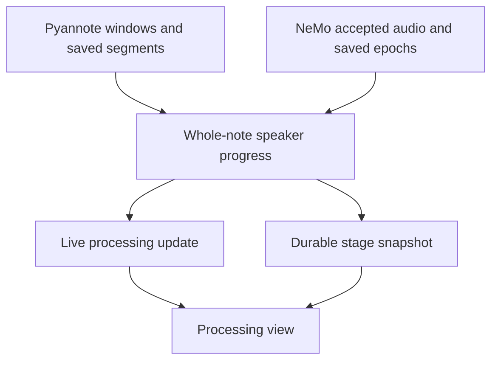
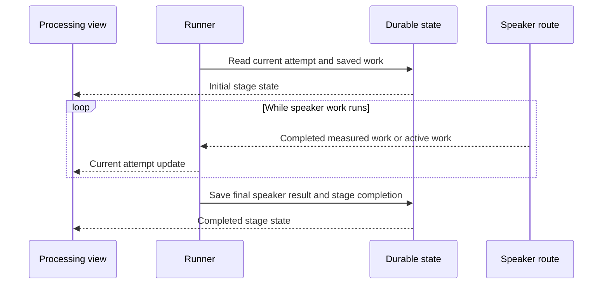
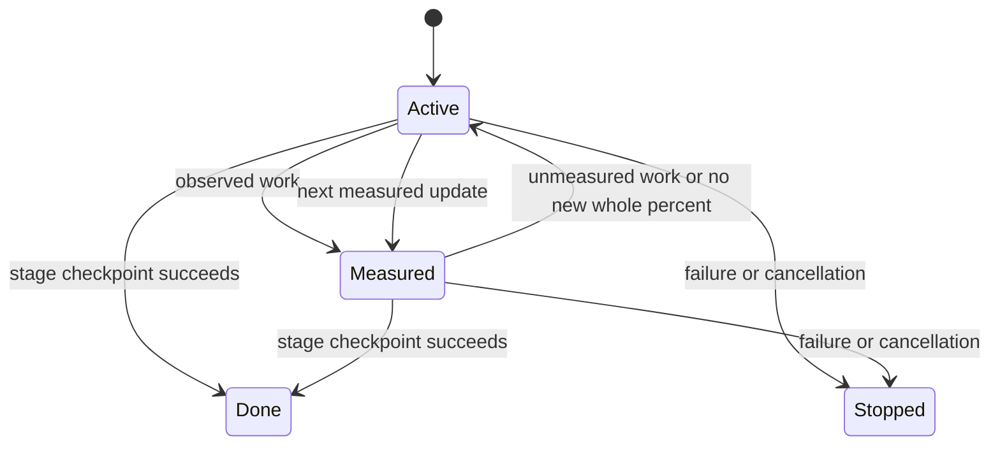

# Speaker progress - Plan

## Goal Capsule

- **Objective:** After Stop, a person can see that speaker recognition is advancing and can tell when it has finished.
- **Means:** Use one speaker-stage progress contract across the runner and processing view (KTD1-KTD3).
- **Product authority:** The user confirmed the whole-note meaning of progress and the scope on 2026-09-28. This contract governs R1-R6 and AE1-AE4.
- **Execution profile:** Implement in a managed worktree from `origin/main`. Keep the Product Contract as the authority for user behavior.
- **Stop conditions:** If a speaker route cannot report measured work during its long analysis, show active unmeasured work under R4 and report the route's limit. Do not present a time-based estimate as measured progress.

## Product Contract

### Summary

The processing view will call its speaker stage "Finding speakers" and show a whole-number progress percentage with a bar. The bar will advance during the stage and finish when speaker work is complete.

### Problem Frame

The speaker stage can take a long time after Stop. Today it shows a dot while Transcribing shows a percentage and a bar. The user has had to wait without knowing whether speaker work was advancing.

### Key Decisions

- **Whole-note progress.** (session-settled: user-directed — chosen over per-segment progress: the user wants one bar that moves as the note advances.) Governs R2-R4.
- **Whole numbers.** (session-settled: user-directed — chosen over decimal precision: decimal-level progress is unnecessary.) Governs R3.
- **Keep the stage order.** The existing speaker stage remains before Transcribing. Governs R6.

### Requirements

- R1. The processing view and note status call the speaker stage "Finding speakers" without suggesting that Longhand identifies named people.
- R2. While the speaker stage runs, its progress covers the full note and does not reset between audio segments.
- R3. The bar and whole-number percentage advance during measurable speaker work, including long parts of the stage, without waiting a minute or two and then jumping to completion.
- R4. When work continues but its fraction cannot be measured or its whole-number percentage has not changed, the view shows activity instead of a frozen or invented percentage.
- R5. The speaker stage shows 100% only when its work has finished.
- R6. The processing stage order stays as it is, with Finding speakers before Transcribing.

### Acceptance Examples

- AE1. **Covers R1, R6.** After Stop, a note that uses separate speaker recognition shows "Finding speakers" before "Transcribing" in the processing list and on the note's status.
- AE2. **Covers R2, R3.** A note with several audio segments shows one percentage that advances as speaker work proceeds across them; the bar does not return to zero at a segment boundary.
- AE3. **Covers R3, R4.** During a long speaker phase, visible progress changes as work is measured. During a part that cannot yield a reliable fraction, the view shows ongoing activity and does not present a stalled or guessed number as progress.
- AE4. **Covers R5.** The speaker stage does not show 100% while final speaker work remains. It shows completion when that work succeeds.

### Scope Boundaries

- This work changes the speaker stage's status display. It does not change speaker recognition models, quality, or processing speed.
- It does not add an estimated finish time or change the order of processing stages.

### Sources / Research

- `docs/ideas/done/processing-status-clarity.md` records the idea and the earlier decision to keep stage order.
- `CONCEPTS.md` defines speaker recognition as anonymous labels, not identification of named people.
- `src/session/ProcessingStatus.tsx` renders a bar when the running stage reports a total; `src/processing/describe.ts` owns the stage label.
- `crates/pipeline/src/runner.rs` reports a percentage for one speaker-analysis segment, while `crates/pipeline/src/diarize.rs` performs final speaker work after segment analysis. Planning must account for both when meeting R2-R5.

---

## Planning Contract

**Product Contract preservation:** Product Contract unchanged.

### Key Technical Decisions

- KTD1. **Use one speaker-stage progress state.** Represent measured whole-note work, active work without a reliable fraction, and stage completion separately. Scope each update to the current processing attempt so an old update cannot replace a retry's state. This implements R2-R5 and extends the existing runner update path.
- KTD2. **Measure work at each speaker route's existing boundary.** Aggregate Pyannote analysis windows across all segments, including work restored from checkpoints or completed during recording. Aggregate NeMo audio accepted by its synchronous native helper across segments and epochs. Keep a run's displayed fraction monotone through replay, and show active unmeasured work while it catches up. This implements R2-R4. The routes use different internal units but share the KTD1 display contract.
- KTD3. **Keep final work visibly active.** Model load, clustering, smoothing, native finish, and result persistence can lack a reliable denominator. Keep the measured value below 100 while these run, show active unmeasured work, and mark completion only after the speaker-stage checkpoint succeeds. This implements R3-R5. No clock-based increments or estimated finish time are added.
- KTD4. **Rebuild the initial view from durable state.** Use the current attempt and its stage checkpoints to recover completed speaker work when a window opens or processing resumes. Use live updates only to refine that state between reads. This follows the existing transcription snapshot pattern and implements R2, R4, and R5.
- KTD5. **Keep the progress display quiet and accessible.** Reuse the processing row and shared bar styling. Give measured and unmeasured states a speaker-stage name for assistive technology; do not announce each percent change. Keep activity visible with reduced motion enabled. This implements R1, R3, and R4 under the existing recording attention budget.

### High-Level Technical Design

The runner owns the speaker-stage state. Each route reports only work it can observe. The same state feeds a live update and the detail read used when the window opens.

| Route | Separate speaker stage | Measured input |
| --- | --- | --- |
| Legacy Pyannote | Yes | Completed analysis windows across segments |
| Prepared Pyannote | Yes | Completed analysis windows across segments |
| Separate NeMo | Yes | Native audio acknowledgements across epochs |
| Combined NeMo with separate speaker work | Yes | Native audio acknowledgements across epochs |
| Off or fully combined recognition | No | No speaker meter |

The view uses a measured state when it has a valid fraction. It uses an active state during work that cannot yield a fraction or while the integer percentage stays the same. A terminal state removes the active meter; only successful stage completion can show 100%.

### Risks and Dependencies

- A native helper can acknowledge audio before its final speaker output is durable. KTD2 measures accepted work only; KTD3 covers finish and persistence without claiming completion.
- A GPU failure can replay an epoch on CPU. KTD2 prevents the visible percentage from moving backward or advancing twice during replay.
- New snapshot reads must preserve the capture-to-store lock order described in `docs/solutions/logic-errors/runner-store-lock-before-suspended-check-deadlocks.md`.
- The route graph already omits the speaker stage for Off and for combined recognition that does not run a separate speaker task. Do not add a meter or alter route selection for those cases.

---

## Implementation Units

### U1. Define speaker progress and restore state

- **Goal:** Give the runner, app bridge, and reopened processing view one attempt-scoped speaker progress state.
- **Requirements:** R2-R5; supports AE2-AE4.
- **Dependencies:** None.
- **Files:** `crates/pipeline/src/runner.rs`, `crates/pipeline/src/progress.rs`, `src-tauri/src/managers/processing.rs`, `src-tauri/src/commands/session.rs`, generated `src/bindings.ts`, `crates/pipeline/tests/runner.rs`, tests in `src-tauri/src/managers/processing.rs` and `src-tauri/src/commands/session.rs`.
- **Approach:** Define the KTD1 state on the existing processing update path. Bind it to one attempt and reconcile live updates with the durable stage snapshot under KTD4. Reuse stage checkpoints where possible and store only the additional state needed for a correct mid-stage view. Keep transcription and summary progress semantics intact.
- **Patterns to follow:** Transcription reconstruction in `crates/pipeline/src/progress.rs` and the stage event conversion in `src-tauri/src/managers/processing.rs`.
- **Test scenarios:**
  - A detail read during a speaker stage returns the completed share of a multi-segment note, then a newer live update advances it.
  - A retry starts a new attempt; a late progress update from the prior attempt cannot replace its value.
  - A failed or cancelled speaker stage has no active meter and never reports successful completion.
  - Existing transcription progress still reads from its window snapshot and reaches the same value as before.
- **Verification:** A cold view, live view, and retry agree on the current speaker-stage state without changing other stages.

### U2. Report Pyannote work across the note

- **Goal:** Provide measured progress for both legacy and current Pyannote speaker routes.
- **Requirements:** R2-R5; covers AE2-AE4.
- **Dependencies:** U1.
- **Files:** `crates/pipeline/src/diarize.rs`, `crates/pipeline/src/live/features.rs`, `crates/pipeline/src/recognition/stages.rs`, `crates/pipeline/src/runner.rs`, `crates/pipeline/tests/runner.rs`, `crates/pipeline/tests/recognition_stages.rs`, `crates/pipeline/tests/live.rs`.
- **Approach:** Convert each segment's analysis callback to a whole-note value using the analyzer's window layout, including short segments. Count saved segments and compatible live features before new analysis begins. Forward the callback that the current prepared route drops. Switch to KTD3's active state for final clustering and writes, then report completion from the stage checkpoint. Keep turn output and stage order unchanged.
- **Patterns to follow:** Per-segment checkpoints in `crates/pipeline/src/diarize.rs` and the native window callback in `crates/pyannote-local/src/pipeline.rs`.
- **Test scenarios:**
  - Covers AE2. Two uneven segments produce a monotone whole-note sequence; the second segment does not restart the percentage.
  - A segment restored from live features or skipped from a valid checkpoint contributes to the initial completed share before the next segment runs.
  - Covers AE4. The last analysis window does not emit 100 while clustering and stage checkpoint writes remain.
  - A cancelled or failed analysis does not emit a successful terminal update; the existing speaker-unavailable behavior stays intact.
- **Verification:** Both legacy and prepared Pyannote routes produce useful progress through long analysis and preserve their transcript and speaker results.

### U3. Report NeMo speaker work across epochs

- **Goal:** Provide measured progress for separate NeMo speaker work, including the conditional separate speaker stage of a combined route.
- **Requirements:** R2-R5; covers AE2-AE4.
- **Dependencies:** U1.
- **Files:** `crates/pipeline/src/recognition/nemo.rs`, `crates/pipeline/src/recognition/stages.rs`, `crates/pipeline/tests/recognition_stages.rs`, `crates/pipeline/tests/recognition_native.rs`.
- **Approach:** Forward the accepted audio position after the helper finishes each native push. Aggregate that position over active segments and epochs with KTD2. Count compatible saved epochs before new input. Show KTD3's active state during helper startup, a delayed push, CPU replay, finish, and persistence. Do not emit speaker-stage progress for routes that have no separate speaker stage.
- **Patterns to follow:** Native acknowledgement validation and epoch checkpoints in `crates/pipeline/src/recognition/nemo.rs`.
- **Test scenarios:**
  - Covers AE2. Accepted audio across two segments and more than one epoch advances one whole-note percentage.
  - A saved epoch contributes to the initial share; a CPU replay holds the last value with activity until accepted work passes it.
  - Covers AE4. The final audio acknowledgement leaves the stage active through native finish and persistence, then the successful checkpoint completes it.
  - Off and fully combined routes do not create a Finding speakers meter; a helper failure does not report 100%.
- **Verification:** Each route that runs a separate speaker stage reports progress without changing its speaker output or fallback behavior.

### U4. Show the speaker meter in the processing view

- **Goal:** Make measured and unmeasured speaker work clear after Stop.
- **Requirements:** R1-R6; covers AE1-AE4.
- **Dependencies:** U1-U3.
- **Files:** `src/processing/describe.ts`, `src/processing/describe.test.ts`, `src/session/ProcessingStatus.tsx`, `src/session/useSessions.ts`, `src/session/SessionPage.test.tsx`, `src/settings/ui.tsx`, `src/index.css`.
- **Approach:** Change the shared speaker-stage label and render the KTD1 state in the existing row. Keep the last valid whole-number value while measured work advances; show quiet activity under KTD3 when a value cannot advance. Name the meter for assistive technology and provide a reduced-motion state under KTD5. Clear stale state on a stage or attempt change.
- **Patterns to follow:** The current Transcribing row, `ProgressBar`, and reduced-motion rule for `.progress-fill`.
- **Test scenarios:**
  - Covers AE1. Home and the processing list show “Finding speakers” in the existing order.
  - Covers AE2. Whole-number values advance across segments without a reset.
  - Covers AE3. A long phase with no new integer value still has visible and accessible activity; reduced motion leaves an equivalent text status.
  - Covers AE4. Final work never displays 100% early; completion removes activity, and failure or retry clears the prior attempt's value.
  - Transcribing and summary bars keep their existing behavior and accessible values.
- **Verification:** The after-Stop view communicates ongoing work and completion on the affected routes without adding attention-seeking motion to recording.

---

## Verification Contract

- Run the focused Rust tests for `pipeline` speaker routes and the app bridge, then the repository's Rust formatting and lint checks.
- Run `bun test ./src/` and `bun run typecheck` for the label, progress bar, reduced-motion, and event-state cases.
- Run `scripts/check-windows.sh`, `scripts/check-licences.sh`, and `scripts/check-provenance.sh` under `docs/development-workflow.md#checks-and-ci`.
- Use at least five minutes of real audio for each affected separate Pyannote and NeMo route. Record source duration, input pace, models, runtime, coverage, and observed progress in a local untracked result. A paced input is required if live feature completion changes. Do not print or commit private audio, model paths, or raw results.
- Run a full-source route check when the change affects recognition boundaries, saved work reuse, or speaker output. A five-minute excerpt alone cannot verify those paths.
- Verify in a signed app bundle that a long after-Stop run shows repeated measured advances and visible activity through a long final phase. Use the manual-test workflow in `docs/development-workflow.md#manual-tests` when that step begins.

---

## Definition of Done

- R1-R6 and AE1-AE4 pass on every route that runs the speaker stage. Off and combined routes without that stage remain unchanged.
- A multi-segment note never resets its current attempt's percentage at a segment or epoch boundary. A failed attempt never displays 100% success.
- A reopened view shows current speaker work from durable state or active unmeasured work until fresh measured evidence arrives. It does not reuse a prior attempt's value.
- Local checks and the required real-audio route checks pass. The plan's test record states the limits of those checks.
- The final diff contains no abandoned progress paths or unrelated recognition changes.
