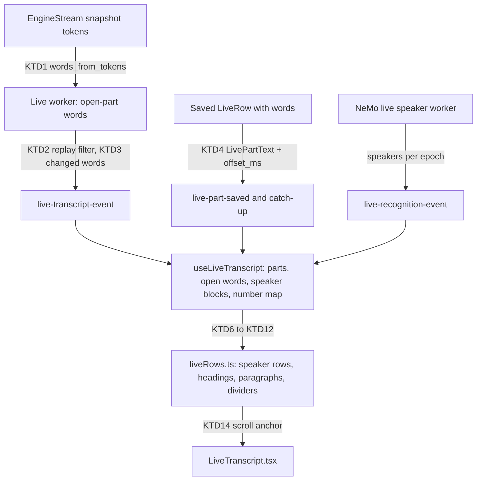

# Live Speaker Rows - Plan

## Goal Capsule

- **Objective:** During recording, a user who opens the Transcript tab can follow the back-and-forth of the conversation, because the live text shows as speaker rows and readable paragraphs, not as one large block.
- **Means:** The live events give the UI the word times that the live recognizer has (KTD1 to KTD4). The UI matches the words to the live speaker turns and groups them with the final transcript's paragraph rule (KTD6).
- **Product authority:** This plan. The live speaker labels are best effort. The final transcript after Stop stays the canonical result.
- **Open blockers:** None.
- **Stop conditions:** Stop and ask when a unit needs a change to recognition, commitment, the speaker analysis windows, or the transcript after Stop. Those are out of scope.
- **Execution profile:** Standard. Work in a worktree from `origin/main`, commit per unit, and push in batches. The manual test in a signed build happens before the PR.
- **Who finishes:** `ce-work` implements and opens the PR. The user runs the manual test.

---

## Product Contract

### Summary

During recording, the Transcript tab shows the live text in the layout of the final transcript: a speaker heading, and that speaker's paragraphs under it.
Long speech from one speaker breaks into paragraphs, with or without speaker analysis.
The processing pipeline, the models, and the result after Stop do not change.

### Problem Frame

With the recommended route (a streaming transcription model and a separate speaker model), the live text shows with no labels as one large block.
The live speaker turns show only in a collapsed "Speaker analysis so far" list, as times, and the user must match them to the text.
A 2-person exchange and a long monologue look the same.
The data to do better is already in the app: the live speaker worker sends provisional speaker turns, and the live recognizer has word times.
The UI does not get the word times.

### Key Decisions

- **Give the UI more of the existing data. Do not change the processing pipeline.** The UI does the join for display only. Governs R1, R2. (session-settled: user-directed — chosen over a join in the backend and over a UI-only estimate of word times: the user wants no change to the pipeline approach but accepts more data sent to the UI.)
- **Give word times for the open part too.** The open part is the newest 4 to 8 minutes of text, and it has no word times today. Without them, the speaker rows would lag 4 to 8 minutes behind the speech. Governs R2, R3, R3a. (session-settled: user-directed — chosen over speaker rows for saved parts only: rows that lag 4 to 8 minutes do not show the back-and-forth.)
- **Numbers restart at each speaker analysis window, with a divider.** The live speaker model restarts its labels at each new window: at the start of each capture segment, and after each 20 minutes of a segment. Nothing links one window to the next. Governs R7, R8. (session-settled: user-directed — chosen over new numbers for each window and over restarting with no marker: fewer numbers, and the divider tells the reader that the numbers restart.)
- **The newest text continues the last speaker.** When its speaker turn arrives and shows a change, the app inserts the new heading at that point. Governs R6. (session-settled: user-directed — chosen over a block with no heading and over a "Speaker not known yet" heading, after a sketch of all three: it reads as a continuous conversation, and a heading appears when the change is known.)
- **A speaker number on the screen does not change in its window.** Governs R7. (session-settled: user-directed — chosen over strict renumbering by order of first speech: a heading that the reader already saw must not change to a different person; numbers can be out of order after a revision.)
- **Use the final transcript's paragraph rule.** One rule for live and final text keeps the two views alike. Governs R4.

### Requirements

**Data for the UI**

- R1. The live events give the UI the word times of each saved part and the start offset of its capture segment, in addition to its text.
- R2. The live events give the UI the word times of the open part as it grows, and the start offset of its capture segment, so the newest text can split by speaker.
- R3. When a streaming model cannot give word times for the open part, the open part shows as paragraphs under the last speaker, and it splits by speaker when the part saves.
- R3a. The UI matches the timed words of the open part to the displayed text by their text, not by their position. Displayed words that do not match a timed word stay under the speaker before them, and they split by speaker when the part saves.

**Rows and paragraphs**

- R4. The live text groups into paragraphs with the final transcript's rule: a new paragraph after a pause longer than 2 seconds, or at the first sentence end after 400 characters (`crates/pipeline/src/join.rs:31-34`, `:236`).
- R5. When live speaker turns are available, each change of speaker starts a new speaker row: a "Speaker N" heading with that speaker's paragraphs under it, in the layout of the final transcript's Transcript tab.
- R6. Text that no speaker turn covers yet continues the row of the last speaker. When a turn arrives that shows a different speaker, the app inserts the new heading at the first word of that turn and moves the words after it under the heading.
- R7. Speaker numbers count from 1 in each speaker analysis window, in order of first speech in that window. Once a speaker has a number in a window, the speaker keeps it: a revision can move or join headings, but it does not change a number already on the screen.
- R8. Where a new speaker analysis window starts (a change of the epoch in the live speaker events), a divider line with the text "Speaker labels restart" shows, in the style of the final transcript's markers.
- R9. When live speaker analysis is off or has no turns, the live text shows as paragraphs with no speaker headings.

**Changes and notices**

- R10. When a speaker turn is revised, the rows and headings change in place with no animation, so that the recording surface does not draw attention (U7). When a change is above the visible area, the row that the reader sees stays at the same place on the screen.
- R11. The one existing notice "Speaker labels may change" stays while any live label is provisional.
- R12. The collapsed "Speaker analysis so far" list does not show when the text shows speaker rows. It stays only when live speaker analysis runs without live text.
- R13. The tentative text of the open part keeps its present secondary style inside the rows.

### Acceptance Examples

- AE1. **Covers R5, R6.** **Given** Speaker 1's row is the last row and new text arrives with no speaker turn yet, **when** the text shows, **then** it continues Speaker 1's row. **When** the turn for that text arrives and names a different speaker, **then** a "Speaker 2" heading shows before the first word of the turn, and the words after it move under it.
- AE2. **Covers R7, R8.** **Given** a note at minute 20, **when** the second speaker analysis window starts, **then** a "Speaker labels restart" divider shows, and the first speaker after it is "Speaker 1", also if that person was "Speaker 2" before the divider. **When** the user changes the microphone at minute 25, **then** a new capture segment starts, a divider shows there, and numbering starts again at "Speaker 1".
- AE3. **Covers R4, R9.** **Given** one person speaks for 5 minutes with no pause longer than 2 seconds, **when** the text passes 400 characters and a sentence ends, **then** a new paragraph starts under the same heading (or with no heading when speaker analysis is off).
- AE4. **Covers R3.** **Given** a streaming model that gives no open-part word times, **when** the open part grows, **then** its text shows as paragraphs under the last speaker, and when the part saves, it splits into speaker rows.
- AE5. **Covers R10.** **Given** a revised speaker turn moves a speaker change 3 words later, **when** the revision arrives, **then** the heading moves with no animation, and the scroll position does not jump while the view follows new text. **When** the reader has scrolled up and the moved heading is above the visible area, **then** the text that the reader sees does not move.

### Scope Boundaries

- No change to the processing pipeline, the models, the speaker analysis windows, or the transcript after Stop.
- No link of speakers across windows. That needs validated evidence (`docs/ideas/done/live-speaker-labels.md`) and is a pipeline change.
- No measurement or improvement of live speaker accuracy.
- No change to when the Transcript tab opens during a recording. It still does not open by default.

### Dependencies / Assumptions

- The 3 streaming models (`parakeet-unified-en-0.6b-q80`, `nemotron-speech-streaming-en-0.6b-q80`, `nemotron-3.5-asr-streaming-0.6b-q80`) have token times for the open part while they stream (`Stream::snapshot()` in transcribe-cpp 0.2.4). R3 is the fallback for a future model that reports no timestamp kind.
- The token times describe the model's current hypothesis. The displayed committed text is append-only, so it can differ from that hypothesis after the model revises a committed word (`transcribe.h`, transcribe-cpp-sys 0.2.4). R3a handles the difference. For the parakeet family, the committed tokens come from an append-only token list, so such revisions are expected to be rare. This is not measured.
- Speaker turns use samples at 16 kHz from the start of the note. Words use milliseconds from the start of their capture segment. With the segment start offset from R1 and R2, the UI converts word times to the note's timeline: note sample = (offset_ms + word_ms) × 16.

### Sources / Research

- `src/session/LiveTranscript.tsx` — the present live view, the collapsed speaker list, and the notices.
- `src/session/TranscriptTab.tsx` — the final transcript layout (speaker heading, paragraphs, `Marker` divider).
- `src/session/liveRecognition.ts` — `recognitionParagraphs`, the present grouping of native timed rows.
- `crates/asr/src/stream.rs:36-59` — `LiveWord`, `LivePart` (saved part with words), `LiveText` (open part, text only).
- `crates/pipeline/src/live.rs:78-88` — `LiveRow` with words.
- `crates/pipeline/src/recognition/nemo.rs:17` — `MAX_EPOCH_SAMPLES`, the 20-minute window.
- `crates/pipeline/src/recognition.rs:284` — the note that labels restart at each window.
- `docs/ideas/done/live-speaker-labels.md` — the idea this plan comes from.

---

## Planning Contract

**Product Contract preservation:** restructured, no scope change. The four questions deferred to planning are answered by KTD1, KTD8, KTD9 and KTD7, and the first assumption now records the verified models.

### Key Technical Decisions

- KTD1. **The live recognizer interface gets one read for the timed words of the open part.** `LiveStream` gets a method that returns the words of the open part, built with `words_from_tokens`, the same rule the saved parts use. `EngineStream` takes the tokens from `Stream::snapshot()`, and returns no words when `returned_timestamp_kind` is not token or word. Recognition and commitment do not change. Implements R2, R3 (Key Decisions: give the UI more of the existing data; word times for the open part too).
- KTD2. **The backend removes the replay words before it sends them.** After a cut at the 8-minute limit, the next stream replays the last 2 seconds. `Parts` already knows the replay floor that `Parts::finish` uses. The open-part words get the same floor filter before the event, so the UI never sees the replay. The filter is display data prep, not a pipeline change.
- KTD3. **The open-part event sends only the words that changed.** `live-transcript-event` carries `word_start` (the index of the first changed word) and the words from that index. The UI replaces its words from that index. The backend keeps the last words that it sent for each part to find the index. A full list of all open-part words on every feed would grow to about 1,000 words per event.
- KTD4. **One part payload for the saved event and the catch-up.** `LivePartText` gets `offset_ms` and `words`, taken from the checkpointed `LiveRow` and the segment offset. A closed segment's offset comes from its segment row. The open segment has no row until capture closes it, so `LiveManager` keeps the `offset_ms` that `start` receives for each segment, and `AppSink` carries it for the events. `live-part-saved` and the `live_transcript` catch-up use it, so the two paths cannot differ. `LiveCurrent` and `LiveTranscriptEvent` also get `offset_ms`, and `LiveCurrent` keeps the full open-part word list for the catch-up.
- KTD6. **One pure module builds the rows.** A new module `src/session/liveRows.ts` takes timed pieces (words, or native rows on the CombinedNemo route), the speaker blocks per epoch, and the shown number map. It returns speaker rows, headings, paragraphs and dividers. `LiveTranscript.tsx` only draws the result. The module runs outside the recognition reducer, so a half-received snapshot batch never shows.
- KTD7. **The UI copies the paragraph rule, and one fixture holds both copies to the same result.** The rule of R4 goes into `liveRows.ts`. A fixture file of word lists with their expected paragraph breaks is read by a Rust test of `join.rs` and by a TS test of `liveRows.ts`. A shared Rust-to-WASM module is too much for two numbers and one end-of-sentence test.
- KTD8. **R3a matches words by normalized text.** The module aligns the timed words to the displayed committed and tentative text with a word-level diff of lowercase text with no punctuation. A displayed word with no match takes the speaker of the word before it. For the 3 current models, the two lists are expected to be equal almost all the time.
- KTD9. **The CombinedNemo route uses the same builder.** Its native rows become timed pieces with a fixed speaker. The builder applies the R4 paragraph rule, the per-epoch numbers and the dividers to them too. `recognitionParagraphs` (2 s, 30 s, 600 characters) goes away.
- KTD10. **Word-to-turn rules.** A word takes the turn with the largest sample overlap in its epoch. On a tie, it takes the earlier turn. A word with no overlapping turn takes the speaker of the word before it (R6). A turn with no words makes no heading.
- KTD11. **The divider shows before the first word of the first turn of a new epoch.** Words after the last turn of the old epoch continue the last row (R6). An epoch with no turns makes no divider, and two dividers never show next to each other.
- KTD12. **Numbers are assigned when a heading first shows, and kept in module state for the session.** The map key is the speaker id (`generation:epoch:input_start:local_id`, unique for each epoch). It lives in the `useLiveTranscript` module for each session, so a tab switch or a reopened note keeps the numbers while the app runs. After an app restart the numbers are computed again and can differ. Implements R7 (Key Decision: a speaker number on the screen does not change in its window).
- KTD13. **After Stop, the live rows use only the speaker blocks of the live pass.** In processing and loading mode, speaker blocks that the post-Stop pass writes (its result epochs) do not change the rows or add dividers. New revisions of an epoch that the live pass already started still apply after Stop, because the live worker saves its last epoch after Stop. The implementer confirms how to tell a post-Stop epoch from a live one; both passes share one generation and one epoch counter. The final transcript replaces the view when processing finishes.
- KTD14. **The scroll anchor is set by hand.** WKWebView has no CSS scroll anchoring. Before each render that changes the rows, the view records the first visible paragraph and its offset. After the render it corrects `scrollTop` so that paragraph stays in place. It skips this while it follows the bottom. Each paragraph key is its segment and first-word time, not its index, so a moved heading does not remount the rows. Implements R10.
- KTD15. **Saved parts are cached, and only the open part is rebuilt on each text event.** The builder keeps the pieces and speaker results of each saved part, keyed by segment, part and the revisions of the epochs that touch it. A text event rebuilds only the open part. A speaker snapshot rebuilds only the parts in its epoch.

### High-Level Technical Design

The data flow from the recognizer to the rows:

The row builder, as directional steps:

1. Convert each word to note samples with its segment offset.
2. Assign an epoch and a speaker to each word (KTD10). Uncovered words take the speaker before them.
3. Align the open-part words to the displayed text (KTD8), so each shown word has a speaker.
4. Walk the words in order. Start a divider at a new epoch's first turn (KTD11), a speaker row at a speaker change, and a paragraph by the R4 rule.
5. Look up or assign each speaker row's number in the map (KTD12).

### Sequencing

U1 → U2 → U3 build the data path in Rust. U5 can start at the same time as U1, because it is a pure module with fixtures. U4 needs U3 (the bindings). U6 needs U4 and U5.

---

## Implementation Units

### U1. Timed words of the open part from the live recognizer

**Goal:** A live stream can give the timed words of its open part at any time.

**Requirements:** R2, R3.

**Dependencies:** None.

**Files:**
- `crates/asr/src/stream.rs`
- `crates/asr/src/engine.rs`
- `crates/asr/tests/stream.rs`
- `crates/pipeline/tests/live.rs` (the `ClickStream` fake)
- `crates/pipeline/tests/runner.rs` (the `FakeStream` fake)

**Approach:** Per KTD1. Add the method to `LiveStream` with a default that returns no words, so the fakes compile, and give `ScriptedStream` and `ClickStream` real timed words for tests. In `EngineStream`, read `snapshot()` tokens, check the returned timestamp kind, and convert with `words_from_tokens` at offset 0.

**Patterns to follow:** `EngineStream::finish` (`crates/asr/src/engine.rs`), `words_from_tokens` (`crates/asr/src/stream.rs`). Read `docs/solutions/logic-errors/granite-word-timing-misclassified-as-absent.md` first: test the returned timing kind, not the claimed one.

**Test scenarios:**
- A scripted stream with 3 fed chunks returns the words of the tokens so far, with their times.
- Tokens with a leading space or `▁` start new words. Tokens with no space join the word before them.
- A stream that reports no timestamp kind returns no words.
- After `reset`, the stream returns no words.

**Verification:** The asr tests pass, and every `LiveStream` implementation in the workspace compiles.

### U2. Open-part words in the live worker

**Goal:** The live worker gives the sink the changed open-part words, with the replay removed.

**Requirements:** R2.

**Dependencies:** U1.

**Files:**
- `crates/pipeline/src/live.rs`
- `crates/asr/src/stream.rs` (reads of the part start and the replay floor of `Parts`)
- `crates/pipeline/tests/live.rs`

**Approach:**
1. In `Work::feed`, when the text changed, read the open-part words from the stream.
2. Shift the words from stream time to segment time with the part start that `Parts` holds, as `Parts::finish` does. Then apply only the replay floor (KTD2). An open part has no limit-cut boundary.
3. Compare them with the last words sent for this part, and give `sink.text` the first changed index and the words from it (KTD3).
4. Reset the last-sent words when a part saves.

**Patterns to follow:** `Parts::finish` (`crates/asr/src/stream.rs`), the `Seen` sink in `crates/pipeline/tests/live.rs`.

**Test scenarios:**
- Feeding 3 chunks gives 3 text calls. Each call carries only the new words, with the correct start index.
- A revised word at index 5 gives a call with start index 5 and the words from 5.
- After a cut at the limit, the words of the next open part do not include the replayed 2 seconds.
- The words of a saved part equal the words that the text calls sent for that part, less the words that the final pass changed.
- A stream with no timed words gives text calls with no words, and the text still shows.

**Verification:** `crates/pipeline/tests/live.rs` passes, and the saved rows are the same as before.

### U3. Event payloads, catch-up and bindings

**Goal:** The UI gets the words and the segment offset through the events and the catch-up.

**Requirements:** R1, R2.

**Dependencies:** U2.

**Files:**
- `src-tauri/src/managers/live.rs`
- `src-tauri/src/commands/session.rs`
- `src/bindings.ts` (generated)

**Approach:**
1. Add `offset_ms` and `words` to `LivePartText`, from the `LiveRow` and the segment row (KTD4). Use it in `live-part-saved` and in the catch-up.
2. Add `offset_ms`, `word_start` and `words` to `LiveTranscriptEvent`. Add `offset_ms` and the full open-part words to `LiveCurrent` in `Now` (KTD3, KTD4).
4. Regenerate the bindings with the `export_bindings` test.

**Patterns to follow:** `AppSink` (`src-tauri/src/managers/live.rs`), `recognition_catchup` in the same file, the tauri-specta setup in `src-tauri/src/lib.rs`.

**Test scenarios:**
- A saved part event carries the words of the checkpointed row and the offset of its segment.
- The catch-up for a note with 2 segments gives each part the offset of its own segment.
- The catch-up `current` carries all open-part words, not only the last change.
- The catch-up for a note in its second epoch still includes the latest complete revision of that epoch (a regression test; the per-revision commit marker already gives this).
- A catch-up during the second, still-open segment gives its parts that segment's offset.
- The generated bindings match the Rust types (the CI diff check).

**Verification:** The `src-tauri` unit tests pass and `src/bindings.ts` has no diff after a fresh export.

### U4. Live state in the UI

**Goal:** `useLiveTranscript` holds the words of every part, the open-part words, the speaker blocks, and the number map.

**Requirements:** R1, R2, R7.

**Dependencies:** U3.

**Files:**
- `src/session/useLiveTranscript.ts`
- `src/session/LiveTranscript.test.tsx`

**Approach:**
1. Keep the words and offset of each saved part.
2. Apply a text event by replacing the open-part words from `word_start` (KTD3).
3. Key the open part by segment and part, and keep the old one until its saved event arrives. This covers a new segment's first text event arriving before the old part saves.
4. Keep the number map in module state for each session (KTD12). Clear it only when the session changes.
5. Remove the event listeners in the effect cleanup.

**Patterns to follow:** the `apply` reducer and the rAF batching in `src/session/useLiveTranscript.ts`. Read `docs/solutions/logic-errors/retry-showed-failed-speaker-attempt-progress.md` (live and saved state of different attempts) and `docs/solutions/ui-bugs/tauri-stale-close-listener-blocks-next-window.md` (listener cleanup).

**Test scenarios:**
- A catch-up then 2 text events gives the full word list of the open part.
- A text event with `word_start` 3 replaces words 3 and later and keeps words 0 to 2.
- A text event for segment 2 before the saved event of segment 1 keeps segment 1's open words until it saves.
- A late text event for a part that is already saved changes nothing.
- A remount of the tab for the same session keeps the number map.
- A different session starts with an empty number map.

**Verification:** The hook tests in `src/session/LiveTranscript.test.tsx` pass.

### U5. Row builder

**Goal:** A pure function builds the speaker rows, headings, paragraphs and dividers from the live state.

**Requirements:** R3, R3a, R4, R5, R6, R7, R8, R9.

**Dependencies:** None to write and test. U4 to use it.

**Files:**
- `src/session/liveRows.ts` (new)
- `src/session/liveRows.test.ts` (new)
- `crates/pipeline/tests/fixtures/paragraph-rule.json` (new)
- `crates/pipeline/tests/join.rs`

**Approach:** Per KTD6 to KTD12 and KTD15, and the steps in the High-Level Technical Design. The module takes the note-time conversion, the per-epoch speaker blocks, the displayed open-part text and the number map, and returns a list of dividers and speaker rows. Each speaker row has a speaker number (or none) and paragraphs. Each paragraph has its words, a stable key, and the tentative words marked (R13).

**Execution note:** Write the fixture and the Rust fixture test first, so both copies of the paragraph rule are held to one result from the start.

**Patterns to follow:** `join::build` and `paragraph_full` (`crates/pipeline/src/join.rs`), `projectSpeaker` and `joinText` (`src/session/liveRecognition.ts`), the pure-function tests in `src/session/liveRecognition.test.ts`.

**Test scenarios:**
- Covers AE1. Words with no turn continue Speaker 1. A turn for Speaker B that arrives later adds a "Speaker 2" speaker row at its first word.
- Covers AE2. A second epoch at minute 20 adds one divider, and its first speaker is Speaker 1. A new segment at minute 25 adds one divider and restarts at Speaker 1.
- Covers AE3. 5 minutes of one speaker with no long pause breaks at the first sentence end after 400 characters.
- Covers AE4. Open-part text with no words shows under the last speaker. The same part saved with words splits into speaker rows.
- A pause longer than 2 seconds starts a new paragraph in the same speaker row.
- A word that overlaps 2 turns takes the one with the larger overlap. On a tie, it takes the earlier one.
- A turn with no words makes no heading. Speaker A, a short B turn with no words, then A again gives one A speaker row.
- An epoch with no turns makes no divider. A segment start and an epoch start at the same point make one divider.
- With no turns at all, the text shows as paragraphs with no headings (R9).
- A number in the map stays the same after a revision puts a different speaker first in the window.
- A displayed open-part text with one word that the timed words do not have puts that word under the speaker before it (R3a).
- Native CombinedNemo rows get the same paragraph rule, numbers and dividers (KTD9).
- Words after the post-Stop pass writes a result epoch are unchanged (KTD13).
- Each fixture case gives the same paragraph breaks in the TS test and in the Rust test (KTD7).

**Verification:** `bun test ./src/` and the pipeline tests pass, and the fixture test runs in both languages.

### U6. Speaker rows on the Transcript tab

**Goal:** The live view draws the rows, keeps the reader's place, and shows the right notices.

**Requirements:** R5, R8, R10, R11, R12, R13.

**Dependencies:** U4, U5.

**Files:**
- `src/session/LiveTranscript.tsx`
- `src/session/liveRecognition.ts` (remove `recognitionParagraphs`)
- `src/session/LiveTranscript.test.tsx`

**Approach:**
1. Draw the builder's result with the layout of `src/session/TranscriptTab.tsx`: a speaker heading in the 4.5rem gutter, paragraphs under it, and the `Marker` style for the "Speaker labels restart" divider. Take `Marker` out to a shared component if both views need it.
2. Remove the view-wide `labels` map (it numbers across all epochs).
3. Show the "Speaker analysis so far" list only when turns exist and no text exists (R12).
4. Show "Speaker labels may change" while any live turn that the rows use is provisional (R11). Hide it in loading mode.
5. Add the scroll anchor (KTD14).
6. Keep the error line and the rows when speaker analysis fails.
7. Keep the screen-reader message "Speaker labels updated.", but play it only when a revision changes what the rows show: a heading moves, or a speaker row splits or joins. A revision with no visible change plays nothing, because the shown numbers do not change (R7).

**Execution note:** Invoke `apple-design` before the layout work, as the project instructions require. No motion: the recording surface must not draw attention.

**Patterns to follow:** `TranscriptTab.tsx` (`parts()`, `Marker`, the section and grid layout), the follow-bottom logic and the `sized()` helper in `LiveTranscript.test.tsx`. Read `docs/solutions/ui-bugs/grid-column-grows-to-fit-nowrap-text.md` for the grid.

**Test scenarios:**
- Covers AE1. A text event and then a speaker snapshot show a "Speaker 2" heading at the right word.
- Covers AE5. While the view follows the bottom, a revised turn leaves it at the bottom.
- Covers AE5. While the reader is scrolled up, a heading added above the visible area leaves the first visible paragraph at the same offset.
- The collapsed speaker list shows with turns and no text, and does not show with rows.
- The notice shows while a used turn is provisional and goes away when all are final.
- In processing mode, a speaker event from the post-Stop pass adds no divider and changes no row.
- A failed speaker phase keeps the rows and shows the error line.
- Tentative words keep the secondary style inside a speaker row.
- A revision that moves a heading plays the screen-reader message once. A revision that changes no row plays nothing.

**Verification:** `bun test ./src/` and `bun run typecheck` pass. The manual test in the Verification Contract passes.

---

## Verification Contract

| Check | Command or step | Applies to |
|---|---|---|
| Rust format | `cargo fmt --all --check` | U1, U2, U3, U5 |
| Rust lint | `cargo clippy --workspace --all-targets -- -D warnings` | U1, U2, U3 |
| Rust tests | `cargo test --workspace --features nemo-runtime/test-helper` | U1, U2, U3, U5 |
| Bindings | `cargo test -p longhand export_bindings`, then no diff in `src/bindings.ts` | U3 |
| Windows lint | `scripts/check-windows.sh` | U1, U2, U3 |
| Frontend tests | `bun test ./src/` | U4, U5, U6 |
| Typecheck | `bun run typecheck` | U4, U5, U6 |
| Manual test | A signed build (`bun tauri build --bundles app`), per `docs/development-workflow.md#manual-tests` | U6 |

The manual test records a note of at least 25 minutes with 2 or more people, with a streaming model and a live speaker model. It checks: speaker rows during the recording, a divider at minute 20, a divider after a microphone change, paragraphs in a long monologue, and that the text the reader sees does not move while they are scrolled up and headings change above it. WKWebView scrolls differently from happy-dom and Chromium (`docs/solutions/ui-bugs/wkwebview-click-does-not-focus-button-breaks-shortcut-capture.md`), so only the signed build proves R10.

---

## Definition of Done

- Every unit's test scenarios pass, and all checks in the Verification Contract pass.
- The manual test passes in a signed build, and the user has confirmed it.
- The live view on every route (separate speaker model, CombinedNemo, speakers off) uses the one row builder.
- `recognitionParagraphs` and the view-wide label map are removed, with no other callers left.
- No code from abandoned attempts is left in the diff.
