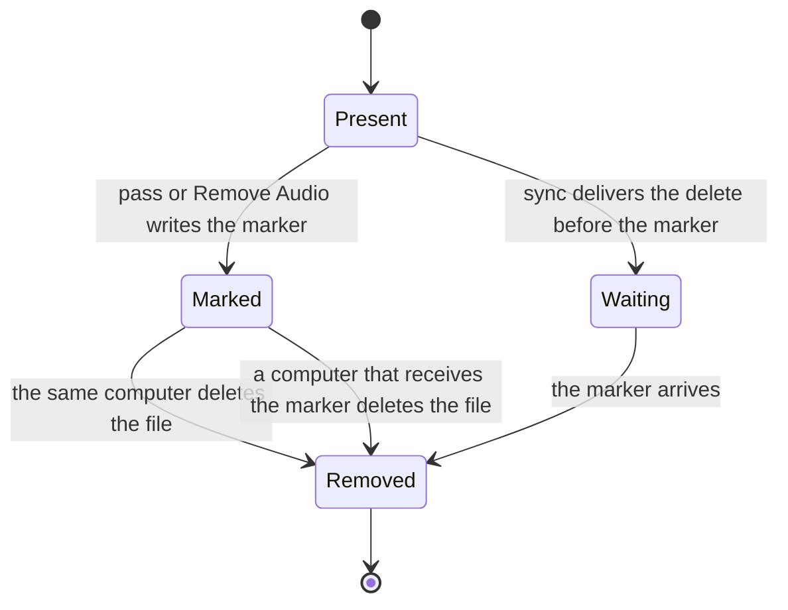
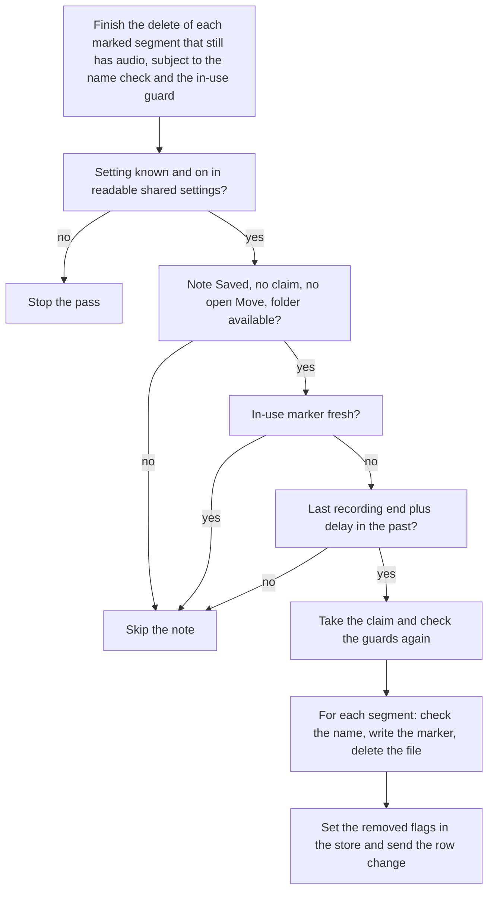

# Remove the Audio of Old Notes - Plan

## Goal Capsule

- **Objective:** The audio of a saved note does not stay on disk longer than the user wants. By default, the audio goes 30 days after the note last recorded. The transcript, summary, notes and title stay.
- **Means:** A removal marker beside each removed audio file, a pass that any computer runs, and an in-use marker that other computers respect (KTD1, KTD5, KTD4).
- **Product authority:** The Product Contract wins on behavior; the KTDs win on mechanism within it. Source idea: `docs/ideas/next/remove-old-audio.md`.
- **Stop conditions:** Stop and ask when a change would delete audio that R8 or R10 protects, would remove audio while the shared settings cannot be read (KTD3), or would make a note with removed audio show as waiting for sync.
- **Execution profile:** Implement with `ce-work` in a worktree from `origin/main`, one commit per unit, then one PR. Test microphone and Resume behavior only in a signed bundle.
- **Open blockers:** None.

---

## Product Contract

### Summary

A shared setting, on by default at 30 days, permanently deletes the audio of each saved note that many days after the note last recorded. The user can set a different number of days or turn the setting off. A Remove Audio action deletes the audio of one note at once. Any computer that uses the storage folder can remove old audio.

### Problem Frame

The audio is the largest part of a note, and the storage folder grows with each note. The audio is also the most private part: it holds each person's voice and every word, including words that the transcript left out or that the summary does not show. After a few weeks the transcript is the system of record, and it is very unlikely that a user runs Transcribe Again on a note that is 30 days old. An app that keeps all audio forever by default is not private by default.

### Key Decisions

- **On by default, 30 days.** The app is private by default; the user can keep audio longer or always. Governs R1, R2, R18. (session-settled: user-directed — chosen over off by default: the default must be the private choice.) The setting is copied and defaulted like every other shared setting; a sync conflict between two computers' settings files is the sync service's to resolve (session-settled: user-directed — chosen over special handling that kept this one value out of a copied file: the app does not try to anticipate the sync service).
- **Permanent delete, not the Trash.** Audio in the Trash is not gone. Governs R6. (session-settled: user-directed — chosen over the Trash and over a user choice: privacy wins over undo.)
- **Any computer removes old audio.** Old audio goes away even when the computer that recorded the note is off or no longer used. This is an exception to the library rule that an automatic step changes a home folder only for work that this computer recorded, so R10 guards it and R16 gives the result when the guard cannot see the other computer. Governs R9, R10, R16. (session-settled: user-directed — chosen over only the recording computer and over a local setting.)
- **The delay starts at the last recording.** Audio lives a known number of days after it was made. Opening a note or running Transcribe Again does not reset it. Governs R4. (session-settled: user-approved — chosen over last opened and last processed.)
- **The setting is a shared setting.** When any computer can remove audio, one value must apply on every computer, or the computer with the shortest delay decides for all. Governs R1.
- **A note does not show that its audio is gone.** Most notes will have no audio after a time, so a mark on each note is noise. The fact shows only where it explains an unavailable action. Governs R14. (session-settled: user-directed — chosen over a visible "audio removed" mark on the note.)

### Requirements

**The setting**

- R1. The audio removal setting is a shared setting. It holds a delay in whole days, or off.
- R2. The default of the setting is on with a delay of 30 days, and the setting follows the same default and copy rules as every other shared setting. While the shared settings cannot be read, no audio is removed automatically.
- R3. The user sets the delay or turns the setting off in Settings > Storage.

**Which audio goes, and when**

- R4. The delay of a note starts when its last recording ended: the first Stop, or the last Stop after a Resume.
- R5. When the delay of a saved note has passed, Longhand removes all of the note's audio. The transcript, summary, notes and title stay.
- R6. Removal deletes the audio permanently. It does not move the audio to the Trash or the Recycle Bin.
- R7. Removal deletes only the note's own segment audio files inside its home folder. Longhand skips an audio name in `session.md` that points outside the home folder, and deletes nothing for it.
- R8. Longhand removes audio only from a saved note. A note that records, waits for processing, processes, failed processing, or waits for a storage folder keeps its audio.
- R9. Any computer that uses the storage folder removes old audio, including the audio of notes that another computer recorded.
- R10. A computer does not remove the audio of a note when it can see that another computer is recording into (Resume) or processing the note. This guard is best effort: a computer that is offline or slow to sync can be invisible to the others (R16 gives the result).
- R11. Longhand checks for old audio at launch and at intervals while it runs, so a computer that runs for many days still removes audio on time.
- R12. Removing audio does not download an online-only audio file from the sync service.

**Remove Audio on one note**

- R13. A saved note that has audio has a Remove Audio action. It asks for one confirmation, then removes the note's audio at once (R5, R6). It is available whether the setting is on or off.

**A note with no audio**

- R14. A note whose audio was removed shows no mark or badge for that. Only where Transcribe Again or Resume is unavailable does the note say that its audio was removed.
- R15. On every computer, a note whose audio was removed is complete. It does not show as waiting for the sync to deliver its audio.
- R16. A note that lost its old audio while another computer recorded into it keeps its new audio, and counts as a note whose audio was removed (R14, R15). Its new audio goes when its own delay (R4) has passed.

**Changes that remove audio now**

- R17. When a change of the setting would remove audio at once, a confirmation comes first. The changes are a shorter delay and turning the setting on again. The confirmation says that the removal is permanent and that those notes cannot use Transcribe Again or Resume.
- R18. The default (R2) removes audio with no confirmation.

### Acceptance Examples

- AE1. **Covers R4, R5.** Given a note that stopped on 1 September with the default delay, when Longhand runs on 1 October, the note's audio is gone and its transcript, summary, notes and title are unchanged.
- AE2. **Covers R4.** Given a note that stopped on 1 September and was resumed and stopped again on 20 September, with a 30-day delay, then on 1 October its audio is still there, and on 20 October it is gone.
- AE3. **Covers R9.** Given computers A and B share a storage folder, and A recorded a note 40 days ago and has been off since, when B runs, B removes the note's audio.
- AE4. **Covers R10.** Given the note of AE3 is old, and A resumes it and records into it, then B does not remove its audio while B can see that A records or processes it.
- AE9. **Covers R16.** Given A resumes the note of AE3 while offline, and B removes its old audio before A's files sync, when A saves and the sync completes, the note keeps only the audio that A recorded in the Resume. Transcribe Again and Resume are unavailable, and the note is complete on both computers.
- AE5. **Covers R15.** Given B removed the audio of a note that A recorded, when A scans the library, A shows the note as complete, not as waiting for its audio.
- AE6. **Covers R14.** Given a note whose audio was removed, the note page and Home look the same as for a note with audio. When the user opens the note's menu, Transcribe Again is unavailable and says that the note's audio was removed.
- AE7. **Covers R17.** Given a delay of 90 days and notes that are 40 days old, when the user sets the delay to 30 days, a confirmation appears before any audio goes. If the user cancels, the delay stays at 90 days.
- AE8. **Covers R13.** Given the setting is off, when the user chooses Remove Audio on a note and confirms, the note's audio is gone at once.
- AE10. **Covers R2.** Given the `settings.json` of the storage folder exists but does not parse (a half-synced file), Longhand removes no audio until it reads the file.

### Scope Boundaries

- No "keep audio" exemption for one note.
- No display of the disk space that the setting would free, and no display of the disk use of notes.
- Copies that the sync service keeps, such as its recycle bin or version history, are out of Longhand's control.
- Delete Note does not change: it still moves the whole home folder to the Trash.
- A note with no audio cannot be resumed: a Resume that starts after the audio was removed is not in scope. R16 covers a removal during a Resume.

### Dependencies / Assumptions

- After a complete save, Longhand's own storage keeps no copy of a note's audio: the save removes the working copy (`crates/pipeline/src/save.rs:524-529`). So removal from the home folder is enough. An interrupted or unsaved session keeps its working copy, and R8 keeps its audio.
- A partial sync can show a note on another computer with its audio gone before that computer learns that the removal was intentional. A short time in which the note shows as waiting is acceptable; R15 must hold when the sync is complete.
- A Move to a new storage folder copies notes with no audio correctly: it copies the file tree as it is and never reads the segment list (`crates/session-save/src/stage.rs`). Adopt builds a row from `session.md` only.
- Audio that a user restores from the sync service's version history is removed again at the next check, because its removal marker stays. This is accepted.

### Outstanding Questions

**Deferred to Implementation**

- The control for the delay in Settings > Storage (R3): a number field, a list of choices, or both. Use the `apple-design` skill.
- The UI text of the confirmations (R13, R17) and of the explanation on Transcribe Again, Resume and Retry (R14).

### Sources / Research

- `crates/pipeline/src/save.rs:110-119` — `home_intact`: Transcribe Again and Resume need every segment's audio.
- `crates/pipeline/src/reprocess.rs:317-318` — Transcribe Again refuses with "The note's folder does not have all of its audio".
- `src-tauri/src/managers/capture.rs:1356` — Resume checks `audio_intact`.
- `crates/library/src/scan.rs:462-467` — the scan adds `Waiting::Audio` for each missing segment audio file; it checks only that the file exists.
- `crates/session-core/src/folder.rs:104-150` — `session.md` records each segment's audio file and channels; it has no computer ID.
- `crates/shared-settings/src/file.rs` — the shared settings file and one `KEY_*` for each field.
- `src-tauri/src/commands/session.rs:666-731` — Delete Note: Trash, then a permanent delete.
- `src/settings/DestinationPicker.tsx` — Settings > Storage.
- `CONCEPTS.md` — Library (the rule for automatic steps), Shared settings, Transcribe Again.

**Product Contract preservation:** changed: R2 — the setting follows the same default and copy rules as every other shared setting, and no audio is removed while the shared settings cannot be read (user decision after plan review; the sync race is an accepted risk). AE10 added. Other requirements unchanged.

---

## Planning Contract

### Key Technical Decisions

- KTD1. **A removal marker file beside each removed audio file records the removal.** The marker for `audio/segment-01.opus` is a file with a fixed name derived from it (for example `audio/segment-01.opus.removed`) and fixed content. A field in `session.md` does not work: a save on another computer rewrites `session.md` from its own store and keeps only named fields (`crates/pipeline/src/folder_rename.rs` `write_document`, `crates/pipeline/src/save.rs` `session_doc`). A marker is only ever created, never rewritten, so two computers that write it at once make the same file. The marker name has no leading dot, because the folder watcher skips dot names (`src-tauri/src/managers/library.rs` `should_skip_path`). Governs R15, R16.
- KTD2. **A marker makes the segment's audio removed, whether the file is present or not.** Removal writes the marker first, then deletes the file. A crash between the two leaves a marker and a file: the next pass deletes the file, and Resume, Transcribe Again and Retry already refuse. Each pass finishes the delete of every marked segment whether the setting is on or off; the setting controls only the writing of new markers. When a partial sync delivers the marker before the delete, the receiving computer also deletes the file. This follows the step-then-record rule in `docs/solutions/logic-errors/save-state-machine-crash-window-recovery.md`, with the record first because the marker is what makes the state recognizable from disk alone. Governs R5, R13, R15.
- KTD3. **The setting is an ordinary shared field, and automatic removal needs readable shared settings.** The new field joins `crates/shared-settings/src/file.rs` like the other fields (`KEY_*`, `Field<T>`, `SharedValue`), with 30 days in `default_settings()`. The join (`crates/shared-settings/src/join.rs`) needs no change: it copies this computer's settings, or the defaults, into a missing `settings.json` as it does for every field. Its encoding distinguishes off and a number of days (1 to 3650), and an unknown value is `Unknown`. The pass runs only when the shared view is `Available`, and it removes nothing for an `Unknown` value, because a value this build cannot read is not a delay (rule 4 of `docs/solutions/integration-issues/shared-settings-in-a-synced-folder-rules.md`). An absent key in a readable file means the default, as for every other field. Conflicts between two computers' files are the sync service's to resolve (rule 8 of the same doc). Governs R1, R2.
- KTD4. **An in-use marker in the home folder guards other computers.** While this computer resumes a saved note, or queues or processes it (Transcribe Again, Retry, processing after Resume), it keeps its own hidden file in the home folder, named for its run ID (for example `.longhand-in-use-<run ID>`). The file holds the run ID and the time of its last refresh. It is refreshed every 2 minutes, and the run removes only its own file at Saved or Discard. Removal waits while any in-use file of the note is fresh. Another computer treats a marker as fresh when the time inside the file is less than 30 minutes old, with a margin for a clock difference. A dot name keeps the watcher from refreshing on each heartbeat. The write never creates a missing folder, so a renamed note is not recreated. This is this computer's own work in the home folder, so it keeps to the library rule for automatic steps. Governs R10.
- KTD5. **One removal pass, which any computer runs, re-checks every guard for each note immediately before it deletes.** The guards: the note is Saved and has no claim, no Move is open, the storage folder is available, the in-use marker is not fresh, the setting is still known and on, and the last recording end plus the delay is in the past. The pass takes the same kind of claim as Delete Note (`session_core::jobs::delete_session`). It checks the guards per note, not once per pass (`docs/solutions/logic-errors/move-dropped-notes-when-old-folder-went-away.md`). It reads capture state before it takes the store lock (`docs/solutions/logic-errors/runner-store-lock-before-suspended-check-deadlocks.md`). Governs R5, R8, R9, R10, R11.
- KTD6. **The pass runs at launch, on a timer, and after a settings change.** At launch it runs after the library scan and only in the single running instance (`src-tauri/src/managers/processing.rs` launch order). The timer follows the updates timer pattern (`src-tauri/src/managers/updates.rs`, `interval_at` plus work on `spawn_blocking`) with a 15-minute period, so a wake from sleep gets a pass within one period. The pass also runs at once after a confirmed change that shortens the delay or turns the setting on (R17), and after the shared settings change on disk. A change from another computer needs no confirmation. Governs R11, R17.
- KTD7. **The last recording end is the latest segment `wall_end`.** No Stop time is stored on its own. The latest `wall_end` in the store's segments (the same data as `session.md` `segments`) is the Stop of the last recording. A note with no segments is never eligible. `wall_end` comes from the recording computer's clock. Governs R4.
- KTD8. **Resume of a saved note copies the old audio into the working folder while recording runs.** Recording starts at once, and the copy runs beside it and uses the existing wait for an online-only file. Assemble, speaker processing and the saved-prefix check then read the old segments from the working copy, not from the home folder (`crates/pipeline/src/assemble.rs`, `crates/pipeline/src/diarize.rs`, `crates/pipeline/src/recognition/saved_prefix.rs`). A missing or marked home file makes the saved-prefix check find no reusable prefix, not an error. At save, `add_audio` (`crates/pipeline/src/save.rs`) copies only the segments that this Resume recorded, never a segment that existed when the Resume started, so the recording computer never puts old audio back in any sync order. When the copy finds a marker or a missing file, those old segments take the R16 result and their partial copy is deleted. Resume refuses with the "audio removed" reason only when a marker is present when the Resume starts. Every end path deletes the working copy: Saved, Discard, a Resume with no new audio, and launch recovery of a session that is Saved or gone. A resumed note in ProcessingFailed also deletes the copy of each old segment whose home segment has a marker, because Retry is then unavailable. An active or interrupted session keeps its copy until it ends (R8). Governs R16. (Inherits the settled result of the Resume race: user-directed — chosen over the recording computer putting the old audio back.)
- KTD9. **A note's audio state has three values: present, removed, or waiting.** `home_intact` (`crates/pipeline/src/save.rs`) becomes an audio state that the scan, `session_detail`, Transcribe Again, Resume and Retry share. Removed wins over waiting: a segment with a marker cannot come back. The scan (`crates/library/src/scan.rs` `read_folder`) adds no `Waiting::Audio` for a segment with a marker. The store gets a per-segment removed flag in a new migration, so the watcher's row diff refreshes an open note page (`docs/solutions/logic-errors/synced-summary-did-not-refresh-open-note.md`). Governs R14, R15.
- KTD10. **Removal deletes only a plain relative name inside the home folder.** The pass refuses a segment audio name that is absolute, contains `..`, or resolves outside the home folder, and writes no marker for it. The same check applies to Remove Audio. Governs R7.
- KTD11. **The pass never opens audio.** Eligibility uses the store and file metadata only, and a delete of an online-only file removes the cloud item without a download. The count for the R17 confirmation uses the same per-note eligibility check as the pass (KTD5), with metadata only, and the check runs again after the confirmation. Governs R12, R17.

### High-Level Technical Design

The audio of one segment, as each computer sees it:

Present offers Transcribe Again and Resume (if every segment is present). Marked and Removed both count as removed (KTD2). Waiting shows the existing "waiting for sync" state until the marker arrives. A Waiting state without a marker is a normal partial sync, as today.

One pass, for each candidate note:

### Assumptions

- Segment indexes only increase after a Resume, so a new segment never reuses the name of a removed one. U5 verifies this against `crates/pipeline/src/save.rs` and the capture code.
- A sync service's recycle bin and version history keep copies that Longhand cannot reach (Scope Boundaries).

### Risks

- **A local clock far ahead deletes early.** A computer whose clock is wrong by weeks removes audio early. No guard is planned; the delay counts from the recording computer's `wall_end`, and a wrong clock on either side moves the removal.
- **A settings file from another computer can win the sync (accepted).** A computer that joins a synced storage folder before its `settings.json` arrives copies its own settings, or the defaults, into the folder. If that file wins over another computer's file, its audio removal value applies to every computer, and old audio that the user chose to keep can be removed. The user accepted this risk: the last change wins, and sync conflicts are the sync service's responsibility (rule 8 of `docs/solutions/integration-issues/shared-settings-in-a-synced-folder-rules.md`).
- **An offline Resume is invisible.** R16 and KTD8 make the result well defined, but the old audio of that note is removed.
- **A long open Move blocks removal.** The pass waits until the Move ends. This is acceptable because a Move can pause for days only when a folder is unavailable.

### Sequencing

U1 and U2 come first. U3 needs U2. U4 needs U2 and U3. U5 needs U2, U3 and U4. U6 needs U1 and U3. U7 needs U2 and U3. U8 needs U1 and U6. U9 is last.

---

## Implementation Units

### U1. Shared audio removal setting

- **Goal:** The setting exists as a shared field that is written only for a new storage folder and read with its availability.
- **Requirements:** R1, R2, R3, AE10. KTD3.
- **Dependencies:** None.
- **Files:**
  - `crates/shared-settings/src/file.rs`
  - `crates/shared-settings/tests/file.rs`
  - `crates/shared-settings/tests/join.rs`
  - `crates/shared-settings/tests/two_computers.rs`
  - `src-tauri/src/managers/settings.rs`
  - `src-tauri/src/managers/shared.rs`
  - `src-tauri/src/commands/settings.rs`
  - `src-tauri/src/lib.rs`
  - `src/bindings.ts` (regenerated)
- **Approach:**
  1. Add the field with its `KEY_*`, `Field<T>`, `SharedValue` and `unknown_values` entries.
  2. Add 30 days to `default_settings()`. The join needs no change.
  3. Expose the field in `Settings` like `check_updates_automatically`, and add a setter command like `set_check_updates_automatically`.
  4. Give the pass one accessor that returns a delay only when the view is `Available` and the value is not `Unknown`.
- **Patterns to follow:** `check_updates_automatically` in `src-tauri/src/managers/settings.rs` and `src-tauri/src/commands/settings.rs`. The Prevention section of `docs/solutions/integration-issues/shared-settings-in-a-synced-folder-rules.md`.
- **Test scenarios:**
  - A join with no cache writes `settings.json` with the 30-day value.
  - A change of folder with a cache that holds off writes off into the new folder.
  - Covers AE10. A `settings.json` that does not parse gives no delay from the accessor, and a read writes nothing.
  - A readable file with the key absent gives the 30-day delay.
  - A file with `Unknown` content for the key gives no delay.
  - A save of another shared field keeps the audio removal value, and a save of this field keeps unknown fields.
  - Values 1 and 3650 parse, and 0, negative and 3651 are `Unknown`.
- **Verification:** The field behaves like every other shared field, and the accessor returns no delay while the shared settings cannot be read or the value is unknown.

### U2. Removal markers and the audio state

- **Goal:** Every computer recognizes removed audio from the folder alone, and a note with removed audio is complete, not waiting.
- **Requirements:** R14, R15, R16, AE5. KTD1, KTD2, KTD9.
- **Dependencies:** None.
- **Files:**
  - `crates/session-core/src/folder.rs` (marker name and reader)
  - `crates/session-core/migrations/0014_segment_audio_removed.sql`
  - `crates/session-core/src/jobs.rs` and the store's segment access
  - `crates/library/src/scan.rs`
  - `crates/library/src/refresh.rs`
  - `crates/pipeline/src/save.rs` (`home_intact` becomes the audio state)
  - `src-tauri/src/managers/library.rs` (`should_skip_path` and refresh events)
  - `crates/library/tests/scan.rs`
  - `crates/library/tests/two_computers.rs`
  - `crates/session-core/tests/folder.rs`
- **Approach:**
  1. Define the marker name for a segment audio file and a reader that uses metadata only.
  2. In `read_folder`, skip `Waiting::Audio` for a segment with a marker, and report the removed segments.
  3. Add the per-segment removed flag to the store, and set it from the scan, the refresh and the adopt paths.
  4. Replace `home_intact` with an audio state (present, removed, waiting) for its callers.
  5. Let the watcher report changes to marker files.
- **Patterns to follow:** `Waiting` in `crates/library/src/scan.rs`. `Computer` with `save_note` and `sync` in `crates/library/tests/two_computers.rs`. The migration rules in `docs/solutions/workflow-issues/edited-applied-migration-breaks-older-databases.md` and `docs/solutions/workflow-issues/parallel-branches-bump-same-schema-version.md`.
- **Test scenarios:**
  - A folder with a marker and no audio scans as complete with the segment removed and no waiting part.
  - A folder with a marker and the audio still present scans as removed.
  - A folder with a missing audio file and no marker still scans as waiting.
  - A note with one marked segment and one missing unmarked segment has the state removed.
  - Covers AE5. Computer B removes audio. Deliver the delete before the marker to computer A. A shows waiting, then complete after the marker arrives, and the watcher reports the change.
  - Deliver the marker before the delete. A shows removed at once.
  - The migration applies to a store at the previous version, and existing segments get the flag unset.
- **Verification:** The scan, the store and the audio state agree in every sync order, and an open note page gets a row change when a marker arrives.

### U3. The removal step

- **Goal:** One step removes the audio of one note safely, and both the pass and Remove Audio use it.
- **Requirements:** R5, R6, R7, R12, R13. KTD2, KTD10, KTD11.
- **Dependencies:** U2.
- **Files:**
  - `crates/pipeline/src/remove_audio.rs` (new)
  - `crates/pipeline/src/lib.rs`
  - `crates/pipeline/tests/remove_audio.rs` (new)
- **Approach:**
  1. Take the note's segments from the store and refresh from the folder first, as other writers do.
  2. For each segment, check the name (KTD10), write the marker if it is missing, then delete the file if it is present.
  3. Set the removed flags in the store.
  4. Return a per-segment result, and make a repeated run a no-op.
  5. Offer an eligibility check (KTD5, KTD7) that the pass and the R17 count share, using the store and metadata only.
- **Execution note:** Implement test-first, including a re-run after each partial effect.
- **Patterns to follow:** `session_save::home_write` for atomic writes. `session_core::jobs::delete_session` for claim and state checks.
- **Test scenarios:**
  - Covers AE1. A saved note with three segments loses all three audio files and gets three markers. `transcript.md`, `summary.md`, `notes.md` and `session.md` are unchanged.
  - A run after a crash between the marker and the delete deletes the remaining file.
  - A second run on a removed note changes nothing.
  - A segment name that is absolute, contains `..`, or points outside the home folder gets no marker and nothing is deleted outside the home folder.
  - A delete that fails (permission) leaves the marker, reports the failure, and the next run finishes.
  - Covers AE2. The eligibility check uses the latest segment end: a note resumed on 20 September is not eligible on 1 October with a 30-day delay.
  - A note with no segments is never eligible.
- **Verification:** After the step, every segment with a safe name inside the home folder has a marker and no audio file, from any partial start state, and a segment with an unsafe name is unchanged.

### U4. In-use marker

- **Goal:** Another computer can see that this computer is resuming or processing a saved note, and skips it.
- **Requirements:** R8, R10, AE4. KTD4.
- **Dependencies:** U2, U3.
- **Files:**
  - `crates/pipeline/src/in_use.rs` (new)
  - `src-tauri/src/managers/capture.rs` (Resume)
  - `src-tauri/src/managers/processing.rs` (queue and runner)
  - `crates/pipeline/tests/in_use.rs` (new)
- **Approach:**
  1. Write this run's own marker when a saved note starts a Resume or enters the queue, refresh it every 2 minutes while the work is open, and remove only this run's marker at Saved or Discard.
  2. Read freshness from the time inside the file, with a 30-minute limit and a clock margin.
  3. Never create a missing home folder when the marker is written.
- **Patterns to follow:** The heartbeat in `crates/session-core/src/jobs.rs` (`claim_owner`, 10-second heartbeat) for the refresh loop.
- **Test scenarios:**
  - Covers AE4. With a fresh marker from another run ID, the eligibility check skips the note.
  - A marker older than 30 minutes does not block.
  - A marker whose time is in the future within the margin counts as fresh.
  - A marker that does not parse counts as fresh until its file time is older than 30 minutes.
  - The marker is removed after the save, and after a Discard.
  - Two computers work on one note at once. When the first finishes and removes its marker, the second one's fresh marker still makes the eligibility check skip the note.
  - A home folder that a rename moved is not recreated by a refresh.
- **Verification:** A saved note that this computer resumes or processes always has a fresh marker until the work ends.

### U5. Resume keeps processing complete when old audio goes

- **Goal:** A Resume race ends with a complete note that has only its new audio (R16), not a failed save.
- **Requirements:** R16, AE9. KTD8.
- **Dependencies:** U2, U3, U4.
- **Files:**
  - `src-tauri/src/managers/capture.rs` (Resume copy and refusal)
  - `crates/pipeline/src/assemble.rs`
  - `crates/pipeline/src/diarize.rs`
  - `crates/pipeline/src/recognition/saved_prefix.rs`
  - `crates/pipeline/src/save.rs` (`add_audio`)
  - `crates/pipeline/src/recover.rs` (cleanup of an abandoned copy)
  - `crates/pipeline/tests/runner.rs`
  - `crates/pipeline/tests/assemble.rs`
  - `crates/pipeline/tests/recover.rs`
- **Approach:**
  1. At Resume of a saved note, refuse with the removed reason when a marker is present. Otherwise start recording at once, and copy each old segment's audio into the working folder on a background task. A marker or a missing file during the copy gives those segments the R16 result and deletes their partial copy.
  2. Let assemble, speaker processing and the saved-prefix check read old segments from the working copy.
  3. In `add_audio`, copy only the segments that this Resume recorded.
  4. Delete the working copy on every end path, at launch for a session that is Saved or gone, and for the marked old segments of a resumed note in ProcessingFailed (KTD8).
  5. Verify that segment indexes only increase after a Resume (Assumptions).
- **Patterns to follow:** The working folder handling in `crates/pipeline/src/save.rs` (removal after Saved) and `crates/pipeline/src/recover.rs`.
- **Test scenarios:**
  - Covers AE9. Resume a saved note that has a recognition artifact. Mark and delete its old audio in the home folder during recording. Processing and save complete. The note has only the new audio, its old segments are removed, and the state is removed.
  - Delete the old home audio during a resumed recording and deliver the marker only after the save. The save does not recreate the old file.
  - A Resume whose old audio blocks on read (online-only) starts recording at once.
  - A Resume whose old audio already has a marker is refused with the removed reason and leaves no working copy.
  - A Discard of a resumed note deletes the old audio copy.
  - A crash during a resumed recording, then launch recovery, leaves no old audio copy after the note is saved or discarded.
  - A normal Resume with no removal saves all old and new audio as today.
  - A resumed note that fails processing after its old home segments get markers deletes its copy of those segments, and keeps the copy of unmarked ones.
  - An interrupted resumed session keeps its copy until it is saved or discarded.
- **Verification:** When a session ends (Saved, Discard, or ProcessingFailed with marked segments), no copy of removed audio stays in Longhand's own storage, and no Resume race ends in failed processing.

### U6. Automatic pass

- **Goal:** Each computer removes old audio at launch, on a timer, and after a settings change.
- **Requirements:** R5, R8, R9, R10, R11, R17, R18, AE1, AE3. KTD5, KTD6.
- **Dependencies:** U1, U3, U4.
- **Files:**
  - `src-tauri/src/managers/audio_removal.rs` (new)
  - `src-tauri/src/managers/mod.rs`
  - `src-tauri/src/managers/processing.rs` (launch step)
  - `src-tauri/src/lib.rs`
- **Approach:**
  1. Run a pass after the library scan at launch, only as the single running instance.
  2. Run it every 15 minutes, after a settings change that shortens the delay or turns the setting on, and after the shared settings change on disk.
  3. For each note, check every KTD5 guard again, take the claim, and call U3.
  4. Before the setting check, finish the delete of each marked segment that still has audio (KTD2). Then stop writing new markers when the setting stops being known and on.
  5. Send the row change for each note so an open page updates.
- **Patterns to follow:** `src-tauri/src/managers/updates.rs` for the timer, and the Move and rename steps in `src-tauri/src/managers/processing.rs` for the launch order and `OnlyInstance`.
- **Test scenarios:**
  - Covers AE1. With the default delay, a note that stopped 31 days ago loses its audio at launch.
  - Covers AE3. On computer B, a note that computer A recorded 40 days ago loses its audio.
  - A note in Queued, Processing, ProcessingFailed or AwaitingDestination state keeps its audio.
  - A note with a claim (a Delete or a Transcribe Again) keeps its audio.
  - With the setting off, a note with a marker and its audio still present loses the audio at the next pass.
  - An open Move keeps all audio until the Move ends.
  - A setting that changes to off during a pass stops the next delete.
  - An unavailable storage folder stops the pass with no deletes.
- **Verification:** A computer that runs for days removes audio within one timer period after it becomes due, and never removes audio from a protected note.

### U7. Remove Audio and the unavailable reasons

- **Goal:** The user can remove the audio of one note, and the note explains why Transcribe Again, Resume and Retry are unavailable.
- **Requirements:** R13, R14, AE6, AE8. KTD9.
- **Dependencies:** U2, U3.
- **Files:**
  - `src-tauri/src/commands/session.rs` (`remove_audio` command, `SessionDetail` audio state)
  - `crates/pipeline/src/reprocess.rs` (removed cause)
  - `src/session/SessionPage.tsx`
  - `src/session/SessionMenu.tsx`
  - `src/session/RemoveAudio.tsx` (new)
  - `src/session/SessionPage.test.tsx`
  - `src/bindings.ts` (regenerated)
- **Approach:**
  1. Add a `remove_audio` command that follows `delete_session`: claim, refuse with a reason for a busy note, a fresh in-use marker, an open Move or an unavailable folder, then call U3.
  2. Add the audio state to `SessionDetail`. Disable Transcribe Again, Resume and Retry with the removed reason when the state is removed.
  3. Add Remove Audio to the note menu, enabled when the note is saved and its state is present or waiting, with one destructive confirmation.
  4. Give `Cause::MissingAudio` a removed variant with its own text.
- **Execution note:** Invoke `apple-design` before the menu and dialog work.
- **Patterns to follow:** `src/session/DeleteSession.tsx` with `ConfirmDialog`, `src/session/TranscribeAgain.tsx`, and the `heldForAudio` reason in `src/session/SessionPage.tsx`.
- **Test scenarios:**
  - Covers AE8. With the setting off, Remove Audio and a confirmation remove the audio, and the menu then shows Transcribe Again unavailable.
  - Covers AE6. A note with removed audio shows no badge on the page or on Home, and the menu shows Transcribe Again and Resume unavailable with the removed reason.
  - A cancelled confirmation removes nothing.
  - Remove Audio on a note with a fresh in-use marker from another computer is refused with a reason.
  - A note whose audio is waiting for sync keeps the existing "Wait until the note finishes syncing" reason.
  - Retry of a failed note whose audio another computer removed shows the removed reason.
- **Verification:** Every unavailable action on a note with removed audio gives the removed reason, and Remove Audio works whether the setting is on or off.

### U8. Settings > Storage control and the confirmation

- **Goal:** The user sets the delay or turns the setting off, and a change that removes audio at once asks first.
- **Requirements:** R3, R17, R18, AE7. KTD6, KTD11.
- **Dependencies:** U1, U6.
- **Files:**
  - `src/settings/DestinationPicker.tsx` (or a new `src/settings/AudioRemoval.tsx` in the same pane)
  - `src/settings/DestinationPicker.test.tsx`
  - `src-tauri/src/commands/settings.rs` (count of notes that a change would remove now)
  - `src/bindings.ts` (regenerated)
- **Approach:**
  1. Add a group in the Storage pane with the setting on or off and the delay in days, disabled when the shared settings are read-only.
  2. Before a change that shortens the delay or turns the setting on, ask the command how many notes it would remove now, using the shared eligibility check (KTD11). Show the confirmation only when the count is not zero.
  3. On confirm, save and trigger the pass (U6). On cancel, keep the old value.
- **Execution note:** Invoke `apple-design` before the UI work.
- **Patterns to follow:** `Row`, `Switch` and `CommitField` in `src/settings/ui.tsx`, `useConfirm` in `src/settings/ui.tsx`, and `readOnlyReason` in `src/settings/shared.ts`.
- **Test scenarios:**
  - Covers AE7. A change from 90 to 30 days with notes 40 days old shows the confirmation, and a cancel keeps 90 days.
  - A change from 30 to 90 days saves with no confirmation.
  - Turning the setting on with no eligible notes saves with no confirmation.
  - Read-only shared settings disable the control and show the existing reason.
  - An absent value in a readable file shows the default, on at 30 days.
- **Verification:** No change that removes audio at once saves without a confirmation.

### U9. Glossary and idea

- **Goal:** The shared docs describe the built behavior.
- **Requirements:** None directly; keeps `CONCEPTS.md` in step.
- **Dependencies:** U1 to U8.
- **Files:**
  - `CONCEPTS.md`
  - `docs/ideas/next/remove-old-audio.md`
- **Approach:** Update the Audio removal entry with the marker, the in-use marker and the rule that no audio is removed while the shared settings cannot be read, and add the in-use marker to the Library entry. The idea moves to `done/` after the merge with `bun scripts/ideas.ts move`.
- **Test expectation:** none -- docs only.
- **Verification:** `bun scripts/ideas.ts check` passes.

---

## Verification Contract

| Gate | Command or step | Applies to |
|---|---|---|
| Format | `cargo fmt --all --check` | All Rust units |
| Lint | `cargo clippy --workspace --all-targets -- -D warnings` | All Rust units |
| Rust tests | `cargo test --workspace --features nemo-runtime/test-helper` | U1 to U7 |
| Windows lint | `scripts/check-windows.sh` | All Rust units |
| Types | `bun run typecheck` | U1, U7, U8 |
| Frontend tests | `bun test ./src/` | U7, U8 |
| Bindings | `src/bindings.ts` regenerated and committed; CI checks `git diff --exit-code src/bindings.ts` | U1, U7, U8 |
| Ideas | `bun scripts/ideas.ts check` | U9 |
| Manual test | Signed bundle, per `docs/development-workflow.md#manual-tests`: two computers on one synced storage folder. Remove Audio on one note; a short delay on a test library; Resume of an old note on one computer while the other runs. | U4 to U8 |

Tests that write marker and in-use files use temporary folders only. No test reads `fixtures/` or real audio.

---

## Definition of Done

- Every unit's Verification holds, and every gate in the Verification Contract passes locally and in CI.
- Every Acceptance Example (AE1 to AE10) has a passing test that names it.
- Partial-sync tests cover both delivery orders for the removal marker and the audio delete.
- When a session ends, no copy of removed audio stays in Longhand's own storage (U5 Verification).
- The manual two-computer test in a signed bundle is done and its result is in the PR.
- Code from abandoned attempts is removed from the diff.
- `CONCEPTS.md` matches the built behavior.
