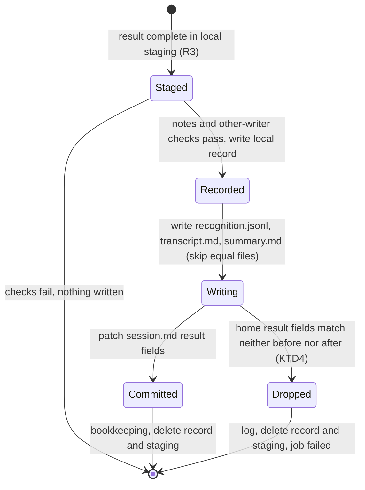
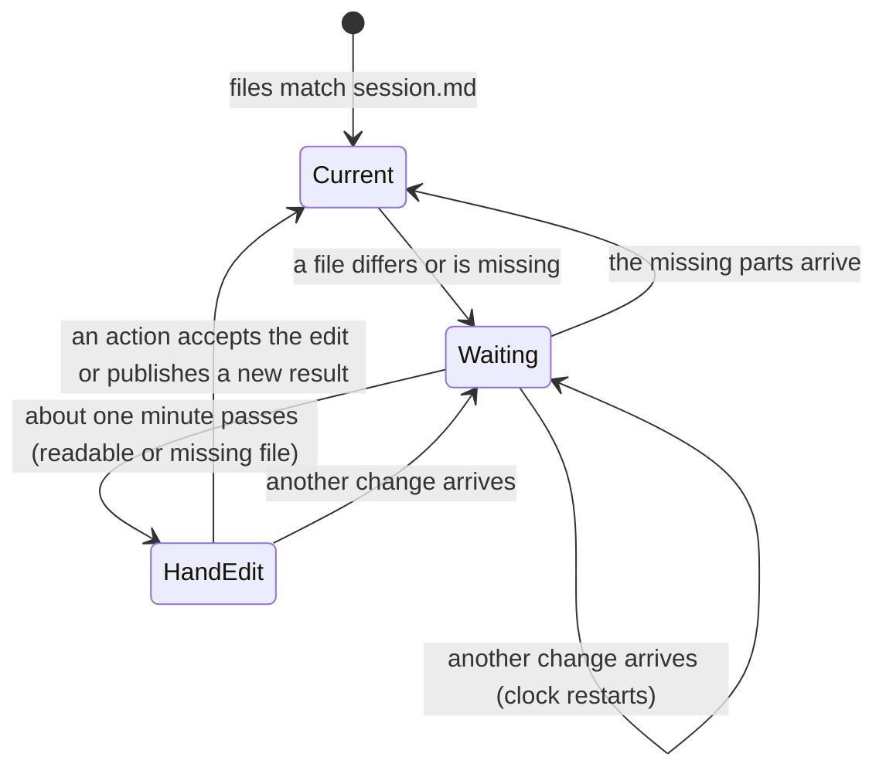

# Remove Result Copies From Note Folders - Plan

## Goal Capsule

- **Objective:** A note folder holds only the current transcript, summary, notes, session file and (while it exists) audio: no hidden copies of earlier results, and no copy of the transcript text after the audio is removed. Receiving computers stay correct with a few seconds of possible mismatch during a sync.
- **Means:** Remove result generations. Publish results by direct writes with `session.md` last, and use the fingerprints in `session.md` to recognize a sync in progress (KTD1–KTD7). Remove `recognition.jsonl` with the audio (KTD8).
- **Product authority:** The user, in the brainstorm of 2026-09-30 and the plan scoping confirmation of the same day. The Product Contract wins on product behavior; the KTDs win on mechanism.
- **Stop conditions:** Stop and ask when a change would write into a note folder from a computer that did not start the work, other than audio removal and the cleanup of R13; or when a test shows that a receiving computer can lose a complete result.
- **Execution profile:** One PR from a worktree off `origin/main`, units in the order of the Implementation Units section. The implementer (`ce-work`) finishes, reviews and ships the work.
- **Open blockers:** None.

---

## Product Contract

### Summary

Note folders stop keeping copies of results. Longhand writes `recognition.jsonl`, `transcript.md` and `summary.md` directly and `session.md` last, and a crash finishes the write from this computer's local staging. The fingerprints in `session.md` let a receiving computer recognize a sync in progress. Audio removal also deletes `recognition.jsonl`, and a cleanup deletes the existing copies.

### Problem Frame

Each time Longhand saves or replaces a result (Save, Transcribe Again, Regenerate Summary, Resume), it writes a complete copy of the transcript, summary and `recognition.jsonl` to `.longhand-results/<generation>/` in the note folder, and it never deletes the earlier copies. The folders grow with every replacement, sync to every computer, and keep old versions of the transcript. The user found them in the storage folder and asked what they are.

The copies exist so that a computer that receives a half-synced update keeps showing the last complete result. That protects against a mismatch that lasts a few seconds. The user's rule is that the app does not over-engineer sync edge cases: the last change wins, and conflicts belong to the sync service (rule 8 in `docs/solutions/integration-issues/shared-settings-in-a-synced-folder-rules.md`).

`recognition.jsonl` holds the timed words and speaker labels of a note. Longhand reuses it only for Transcribe Again and speaker-only reprocessing, and for the saved prefix of a Resume. All of these also need the audio. After audio removal (PR #28) the file has no use, but it stays in the folder with a second copy of the transcript text.

### Key Decisions

- **Remove the result copies instead of adding cleanup for them.** A few seconds of mismatch on a receiving computer is acceptable. Governs R1, R2, R3, R4. (session-settled: user-approved — chosen over keeping generations and deleting all but the newest: the app does not over-engineer sync edge cases.)
- **During a sync, show the files as they are and hold actions.** Governs R6, R7. (session-settled: user-directed — chosen over keeping the last complete result on screen until the files match, and over no detection at all.)
- **A mismatch that lasts over about a minute is a hand edit.** The note shows the edited file, and actions run and replace it. Governs R8, R9. (session-settled: user-directed — chosen over saving a conflict copy before a replacement, and over blocking actions until the user undoes the edit.)
- **Remove `recognition.jsonl` with the audio.** Governs R11, R12. (session-settled: user-directed — chosen over keeping it: it has no use without the audio and keeps a copy of the transcript text.)
- **Any computer does the cleanup.** The new code no longer reads the copies, and nobody else has installs to migrate. Governs R13.

Product Contract preservation: changed: R2, R7, R8, R9, R11, R13 — clarifications from planning research, confirmed by the user in the plan scoping synthesis of 2026-09-30 (write order and write set per action; a missing or unreadable file under the one-minute rule; only a `transcript.md` edit makes the timed text unusable; the removal deletes the file only; the cleanup repeats on each pass). The deferred planning questions are resolved in KTD1, KTD4, KTD7 and KTD8.

### Requirements

**Result publication**

- R1. A note folder has no `.longhand-results/` folder and no `.longhand-result-transition.json` file after this work, on every computer that runs the new build.
- R2. A save, Transcribe Again or Resume writes `recognition.jsonl` (when the result has one), `transcript.md` and `summary.md` in the note folder, in that order, and then writes `session.md` last, with the fingerprints of the new files. Regenerate Summary writes only `summary.md` and `session.md`. A Transcribe Again whose summary failed keeps the note's present `summary.md` (R19 of `docs/plans/2026-09-27-1526-feat-flexible-speaker-recognition-plan.md`).
- R3. The new result is complete in this computer's local staging before the first write to the note folder. A failed run changes no file in the note folder, so the previous result stays (R6 and R25 of `docs/plans/2026-09-27-1526-feat-flexible-speaker-recognition-plan.md` still hold).
- R4. A crash during the writes of R2 is repaired at the next launch by finishing the writes from local staging. Only the computer that started the publication writes in its recovery.
- R5. `notes.md` keeps its present rules. The publication does not overwrite a changed `notes.md`.

**Receiving computers and syncs in progress**

- R6. When `transcript.md` or `summary.md` does not match its fingerprint in `session.md`, the note shows the files as they are on disk. The note shows no error.
- R7. While such a mismatch lasts, actions that read or replace the result (Transcribe Again, Regenerate Summary, Resume, and speaker-only reprocessing) do not start, and the note says it is waiting for the note to sync. The library scan and adoption do not refuse the note for a mismatch.
- R8. A mismatch of a readable file that lasts over about one minute counts as a hand edit. The actions of R7 then run. Regenerate Summary reads the edited `transcript.md`, and Transcribe Again replaces it. A missing `transcript.md` or `summary.md` also counts after the minute, so an action can make it again; Regenerate Summary with no `transcript.md` refuses with "The transcript is missing." A file that exists but cannot be read never counts as a hand edit.
- R9. A hand edit of `transcript.md` makes the saved timed text of the note unusable. Transcribe Again then runs in full, and a save or Regenerate Summary does not fail because the saved timed text no longer matches the transcript.
- R10. The folder watcher refreshes an open note when its files arrive, as it does today for other note files.

**recognition.jsonl and audio removal**

- R11. When audio removal removes the last audio of a note, it also deletes `recognition.jsonl` from the note folder. It does not rewrite `session.md`; a later save ignores a reference in `session.md` to a missing `recognition.jsonl`.
- R12. Summary regeneration, title and rename writes, and notes saves keep working for a note without `recognition.jsonl`.

**Cleanup of existing copies**

- R13. Longhand deletes existing `.longhand-results/` folders and `.longhand-result-transition.json` files in the note folders of the storage folder, and deletes `recognition.jsonl` from notes whose audio is already removed. It does this without a prompt, and again on each later pass so that copies that arrive later by sync are also deleted. It does not touch a note that another computer uses (the in-use marker rules of the audio removal plan) or a note that waits for a sync.
- R14. The cleanup never deletes `transcript.md`, `summary.md`, `notes.md`, `session.md` or audio. If a note has a result only in its copies (no current `transcript.md` or `summary.md`), the cleanup leaves that note's copies in place and logs it.

### Acceptance Examples

- AE1. **Covers R6, R7.** Given computer A saved a new transcript and summary, when computer B has the new `session.md` and the old `summary.md`, then B shows the new transcript with the old summary, and Regenerate Summary on B says it is waiting for the note to sync. When the new `summary.md` arrives, B shows it and the action runs.
- AE2. **Covers R8, R9.** Given the user edits `transcript.md` in a text editor, when more than a minute passes, then the note shows the edited transcript, Regenerate Summary makes a summary from it, and Transcribe Again runs in full and replaces it.
- AE3. **Covers R3, R4.** Given this computer crashes after it wrote `transcript.md` and before it wrote `summary.md`, when Longhand launches again, then it writes `summary.md` and `session.md` from local staging, and the note shows the new result.
- AE4. **Covers R11, R12.** Given a note whose last audio is removed, then its folder has no `recognition.jsonl`, and a later Regenerate Summary or rename works.
- AE5. **Covers R13, R14.** Given a storage folder with `.longhand-results/` in most note folders, when the new build launches, then after the first audio removal pass those folders and transition files are gone, and every note shows the same transcript and summary as before.

### Scope Boundaries

- A note does not keep its last complete result on screen during a sync (the rejected option of the second Key Decision).
- No conflict copy of a hand-edited `transcript.md` or `summary.md`.
- No change to the rules for `notes.md` conflicts, audio, removal markers or in-use markers.
- The cleanup does not try to detect an older build that is in the middle of a publication, and it does not remove `result_generation` from `session.md`. The new build drops the key at its next write of the note.

#### Deferred to Follow-Up Work

- The Resume gap recorded in the audio removal plan (a removal before the old audio copy finishes): `docs/ideas/someday/resume-survives-early-audio-removal.md`.
- Deletion of leftover `.<name>.<hex>.tmp` files that a crash inside an atomic write can leave in a note folder.

### Dependencies / Assumptions

- Syncs of one note usually finish in a few seconds. About one minute separates a sync in progress from a hand edit.
- Every computer of the user runs the new build soon after it ships. Until the preview build on another computer updates, it can show a note as waiting to sync after the cleanup deleted the copies that it still expects, and it can make new copies at each of its publications; the cleanup deletes those on a later pass.
- The cleanup reaches only notes that have a Saved row on this computer. A note folder with no row (not adopted yet) is cleaned after its adoption.

### Sources / Research

- Result generations: `crates/session-core/src/generation.rs`, `crates/session-save/src/result.rs`; call sites in `crates/pipeline/src/save.rs`, `summarize.rs`, `reprocess.rs`, `folder_rename.rs`, `runner.rs`, `recognition/saved_prefix.rs`, `recognition/stages.rs`, `crates/library/src/scan.rs`, `refresh.rs`, `reconcile.rs`, `src-tauri/src/commands/session.rs`, `src-tauri/src/managers/library.rs`.
- The first save also makes a generation: `render` in `crates/pipeline/src/save.rs` stages one in the working folder, and the save moves it into the new note folder.
- `crates/pipeline/src/save.rs` `session_doc()` reads the header of `recognition.jsonl` on every save and fails when its transcript digest does not match. `reprocess.rs` `read_reusable` fails when a referenced `recognition.jsonl` is missing or its checksum does not match.
- `folder_rename::refresh_document` recomputes fingerprints from the files on disk and rewrites `session.md`. It runs after a save, after a regeneration, on a rename that keeps the folder name, and in a Move.
- The scan already marks a fingerprint mismatch as `Waiting::Transcript` or `Waiting::Summary` (`crates/library/src/scan.rs` `document_state`), and `src/session/SessionPage.tsx` already holds the actions while a document waits. The mismatch never expires today.
- Regenerate Summary keeps the row Saved and writes no in-use marker, so audio removal on another computer can run during it.
- Superseded decisions: KTD8, KTD13 and KTD14 of `docs/plans/2026-09-27-1526-feat-flexible-speaker-recognition-plan.md` (generations, rollback copies, readers that reject incomplete generations, external-edit conflicts).
- Learnings: `docs/solutions/logic-errors/save-state-machine-crash-window-recovery.md` (evidence outlives its record; a rerun returns the same next state), `docs/solutions/logic-errors/receiving-computer-renamed-synced-folder-back.md` (a receiving computer writes nothing), `docs/solutions/logic-errors/synced-summary-did-not-refresh-open-note.md` (deliver a whole change as one batch in tests), `docs/solutions/integration-issues/shared-settings-in-a-synced-folder-rules.md` (patch only the fields a write changes; unreadable is not missing), `docs/solutions/security-issues/audio-removal-trusted-synced-file-names-before-delete.md` (fixed names, `symlink_metadata`, no folders through links), `docs/solutions/logic-errors/move-dropped-notes-when-old-folder-went-away.md` (check reachability at each delete).

---

## Planning Contract

### Key Technical Decisions

- KTD1. **A small local record of each publication stays in this computer's working folder.** It holds the session id, the result fields of the home `session.md` before the first write, the result fields of the staged `session.md`, and the `notes.md` fingerprint. Its presence means "unfinished publication". It holds no generation hashes and never syncs. Resume and Transcribe Again keep it in `working_root/<id>/`; Regenerate Summary keeps it in its `.longhand-summary-*` folder, found through the `summary-publication` row of `result_state`, as today. Governs R3, R4. (session-settled: user-approved — chosen over no local record: nothing in the note folder tells a crashed publication from a hand edit.)
- KTD2. **Compare and write only the result fields of `session.md`.** The result fields are `session_id`, `transcript_fingerprint`, `summary_fingerprint`, `recognition_artifact`, `recognition_audio`, `speaker_count` and `recognition_snapshot`. The publication writes `session.md` as a patch: it reads the home file, replaces the result fields, and keeps every other field (rule 2 of the shared-settings rules). "Committed" means the home result fields equal the staged ones. A title write, a rename or an owed rename between two steps therefore neither blocks the publication nor looks like a conflict. The record is keyed by session id, and each step finds the home path from the row, so a folder rename between steps is followed.
- KTD3. **With a record present, a rerun only rolls forward.** It skips `render`, the notes check and the `replacement-base` check, and writes the staged files that differ from the home files, then `session.md`. The notes check and the other-writer check run once, before the first write (R5). After the first write, `transcript.md` and `summary.md` are overwritten whatever they hold (last change wins). One test per boundary proves this (learning: save-state-machine-crash-window-recovery).
- KTD4. **At recovery, a conflict drops this computer's unfinished result.** A conflict is home result fields that equal neither the "before" set nor the "after" set. The owner logs it, deletes its record and staging, ends the job as failed with "This note changed on another computer. Longhand kept that version.", and writes nothing. Governs R4. (session-settled: user-approved — chosen over overwriting the other version: the last change wins.) An action on a note that has a record first finishes or drops that record, so two publications of one note never overlap on one computer.
- KTD5. **Write order and write set per action.** Resume, Save and Transcribe Again write `recognition.jsonl` → `transcript.md` → `summary.md` → `session.md`; most sync clients upload in write order, so `recognition.jsonl` does not arrive after `session.md`. Regenerate Summary writes `summary.md` → `session.md`, and its patch takes `recognition_artifact` and `recognition_audio` from the home `session.md` at write time, dropping them when the home file is missing. It never writes `recognition.jsonl` back. Governs R2, R11.
- KTD6. **Only two writers set the result fingerprints:** the publication (`session_doc` on the staging) and the accept of a hand edit in `summarize_again`. `folder_rename::refresh_document` keeps the recorded fingerprints, as `write_document` does. A rename or Move on a receiving computer then cannot write the fingerprints of half-synced files. Governs R6, R7.
- KTD7. **The one-minute clock lives in memory in the library reconciler.** The key is the session id plus the recorded fingerprints and the fingerprints on disk; a new change resets the clock. It uses `std::time::Instant`, so a sleep does not count. The deadline joins `Reconciler::next_due`, so the status changes at about one minute. `LibraryStatus` reports a note as waiting until the deadline, and then as a hand edit (no longer waiting). A `Read::Failed` document never expires; a `Read::Missing` document expires (R8). Nothing is persisted: after a launch, a hand-edited note waits one more minute, until an action accepts the edit and rewrites the fingerprints. Governs R7, R8. (session-settled: user-approved — chosen over a persisted first-seen time in `result_state`: simpler, and file times are not usable because sync clients keep the source time.)
- KTD8. **Longhand tolerates a missing or stale `recognition.jsonl`.** `session_doc` drops a reference to a file that is missing or whose transcript digest does not match, instead of failing. `read_reusable` returns "not reusable" for a missing file or a checksum mismatch, so Transcribe Again and speaker-only reprocessing run in full. Audio removal deletes the file only (regular file, `symlink_metadata`), in `run_step` once the removal is complete. It skips a note that waits for a sync and tries again on the next pass. After a crash between the last audio delete and this delete, the cleanup of KTD9 finishes it, because part 1 of the pass calls `finish_removal` only while marked audio is still present. Governs R9, R11, R12. (session-settled: user-approved — chosen over a `session.md` rewrite by the removing computer: no second writer of `session.md`, and no conflict with a Regenerate Summary on another computer.)
- KTD9. **The cleanup is a step of the audio removal pass.** It runs on each pass (at launch and every 15 minutes), for Saved rows with a home path, with the pass guards (storage reachable, no Move open, note available, not in use, not claimed, not waiting). It deletes only fixed names: a real `.longhand-results` folder (not a link) whose child folders have names of `[A-Za-z0-9-]` characters and hold only `transcript.md`, `summary.md`, `recognition.jsonl`, `.DS_Store` and write leftovers of the shape `.<one of those three names>.<16 hex>.tmp` (an empty child folder also qualifies; `.longhand-results` itself may also hold a `.DS_Store`); a regular `.longhand-result-transition.json` file; and `recognition.jsonl` when all audio is removed. Anything else stays and is logged. It checks with metadata only that `transcript.md` and `summary.md` exist before it deletes copies (R14), and it checks that the note folder is reachable at each delete. Governs R13, R14. (session-settled: user-approved — chosen over detecting an older build in the middle of a publication: rule 8, and the old builds update soon.)
- KTD10. **A refresh promotes the result snapshot only when both fingerprints match.** While a note waits, or after a hand edit of `transcript.md`, the row keeps its present snapshot, so the speaker data of a new `session.md` is not joined to an old transcript. Governs R6, R9.
- KTD11. **The backend holds the actions of R7, not only the UI.** The Transcribe Again (which also runs speaker-only reprocessing), Resume and Regenerate Summary commands in `src-tauri` refuse while `LibraryStatus` reports that a transcript or summary waits, with the UI's text "Wait until the note finishes syncing." The TRANSITION-based `refuse_pending_transcript` in `save.rs` goes. Governs R7.
- KTD12. **Remove the generation code, keep the shared parts.** `generation.rs` and `result.rs` go. `generation::manifest` (parse `session.md`) moves to `session_core::folder`. The `result_generation` field leaves `SessionDoc`; old files still parse and the next write drops the key. The `result_state` table stays (other keys use it); only the `verified-manifest` key stops being read and written, with no migration. The watcher's exception for `.longhand-results` goes. Names with "generation" in recognition code (`recognition-generation-v1`, `ArtifactHeader.generation`) are a different concept and stay.

### High-Level Technical Design

Publication on the owner (KTD1–KTD5):

A crash in `Recorded` or `Writing` resumes at `Writing` from the record (KTD3). A crash in `Committed` before the record is gone resumes at the bookkeeping.

Receiving computer (KTD7, KTD11):

In `Waiting` the note shows the files and the actions of R7 are held. In `HandEdit` the actions run. A file that cannot be read stays in `Waiting`.

### Assumptions

- The kept summary of a failed Transcribe Again summary (R2, last sentence) is the home `summary.md` at write time, not a copy from the run start. The implementer confirms where `update_home` handles `summary_error` today and keeps that behavior.
- The new build does not read the old-format local journal. A publication that an older build left unfinished before the upgrade is not finished: the note shows the partial files, they count as a hand edit after a minute, and the cleanup then deletes the old copies. This needs an unrecovered crash of an older build and is accepted under rule 8.

---

## Implementation Units

### U1. Tolerate a missing or stale recognition.jsonl

- **Goal:** Saves, regenerations and reuse checks keep working when `recognition.jsonl` is missing or no longer matches the transcript.
- **Requirements:** R9, R11, R12; KTD8.
- **Dependencies:** None.
- **Files:** `crates/pipeline/src/save.rs` (`session_doc`), `crates/pipeline/src/reprocess.rs` (`read_reusable`), `crates/pipeline/tests/recognition_stages.rs`, `crates/pipeline/tests/runner.rs`.
- **Approach:**
  1. In `session_doc`, a referenced file that is missing, or whose header digest does not match the transcript, gives no `recognition_artifact` and no `recognition_audio`.
  2. In `read_reusable`, a missing file or a checksum mismatch returns `Ok(None)`.
- **Patterns to follow:** `audio_changes_and_external_transcript_edits_block_stale_reuse` in `crates/pipeline/tests/recognition_stages.rs`.
- **Test scenarios:**
  - A save after a hand edit of `transcript.md` succeeds and writes `session.md` with no `recognition_artifact`.
  - Regenerate Summary on a note whose `recognition.jsonl` was deleted succeeds.
  - Transcribe Again with a referenced but missing `recognition.jsonl` runs in full, not with an error.
  - Transcribe Again with a `recognition.jsonl` whose checksum does not match runs in full.
  - A rename of a note with no `recognition.jsonl` writes `session.md` (R12).
- **Verification:** No save path fails for a missing or stale `recognition.jsonl`.

### U2. Readers use the note files only

- **Goal:** Every reader reads `transcript.md`, `summary.md` and `recognition.jsonl` from the note folder, with no generation lookup and no refusal for a mismatch.
- **Requirements:** R6, R7 (scan and adoption), R10; KTD10, KTD12.
- **Dependencies:** U1.
- **Files:** `crates/session-core/src/folder.rs` (the `manifest` helper moves here), `crates/library/src/scan.rs`, `crates/library/src/refresh.rs`, `crates/library/src/reconcile.rs`, `crates/pipeline/src/summarize.rs`, `crates/pipeline/src/reprocess.rs`, `crates/pipeline/src/recognition/saved_prefix.rs`, `crates/pipeline/src/recognition/stages.rs`, `src-tauri/src/commands/session.rs` (`session_document`), `src-tauri/src/managers/library.rs` (`should_skip_path`), `crates/library/tests/scan.rs`, `crates/library/tests/two_computers.rs`, `crates/pipeline/tests/recognition_stages.rs`.
- **Approach:**
  1. Move `generation::manifest` to `session_core::folder` and point every caller at it.
  2. `read_folder`, `FolderContents::read`, `read_transcript`, `read_reusable`, `candidate` and `session_document` read the note folder with plain timed reads.
  3. `reconcile` stops skipping adoption for an incomplete generation and stops writing `verified-manifest`.
  4. `apply_scoped` calls `promote_result_snapshot` only when both fingerprints match (KTD10).
  5. `should_skip_path` skips every dot name; delete the `.longhand-results` exception and its test.
- **Patterns to follow:** The legacy (no generation) branches that these functions already have.
- **Test scenarios:**
  - Covers AE1. On B, a new `session.md` with the old `summary.md` gives `Waiting::Summary`, and the note document shows the new transcript and the old summary with no error. A second batch that delivers the new `summary.md` clears the wait.
  - A new `transcript.md` with the old `session.md` gives `Waiting::Transcript` and adoption still makes the row.
  - A refresh while the note waits keeps the row's snapshot; a refresh with matching files promotes it.
  - A `.longhand-results` folder change raises no watcher event.
- **Verification:** No reader in the workspace names `.longhand-results`; the scan and the note page work on notes with and without old copies.

### U3. Publish results with no copies

- **Goal:** Save, Transcribe Again, Resume and Regenerate Summary publish by direct writes with `session.md` last, and a crash finishes the writes at the next launch.
- **Requirements:** R1, R2, R3, R4, R5; KTD1, KTD2, KTD3, KTD4, KTD5, KTD12.
- **Dependencies:** U1, U2.
- **Files:** `crates/session-save/src/result.rs` (replaced by the publication step), `crates/session-save/src/lib.rs`, `crates/session-core/src/generation.rs` (delete), `crates/session-core/src/lib.rs`, `crates/session-core/src/folder.rs` (`result_generation` goes), `crates/pipeline/src/save.rs` (`render`, `session_doc`, `update_home`, `record_transcript_fingerprint`, `recover_summary_publications`, `summarize_again`), `crates/pipeline/src/folder_rename.rs` (`write_document`), `crates/pipeline/src/runner.rs` (kept-files check), `crates/session-save/tests/result.rs`, `crates/pipeline/tests/runner.rs`.
- **Approach:**
  1. Replace `result.rs` with a publication step that reads the local record (KTD1), writes the files of KTD5 that differ, and patches `session.md` (KTD2). It is idempotent.
  2. `render` stops staging a generation; `session_doc` and `write_document` stop copying `result_generation`.
  3. `update_home`: the checks run before the record; with a record, the rerun only rolls forward (KTD3).
  4. `recover_summary_publications` rolls forward instead of back, and drops the staging on a conflict (KTD4). Keep the `Liveness::OnlyInstance` gate.
  5. `summarize_again` keeps the accept of an edited transcript (fingerprint, cleared recognition references), stops staging a generation and copying `recognition.jsonl`, and writes only `summary.md` and `session.md`.
  6. Remove the `verified-manifest` writes and the kept-files check on `result-publication.json` in `runner.rs` (use the new record name).
- **Execution note:** Write the per-boundary crash tests first; they define the rerun behavior.
- **Patterns to follow:** The `HOME_CHANGED` checkpoint and `SaveState` handling in `update_home`; `docs/solutions/logic-errors/save-state-machine-crash-window-recovery.md` Prevention list.
- **Test scenarios:**
  - A first save makes a note folder with no `.longhand-results` and no transition file (R1); update the folder-listing assertions in `crates/pipeline/tests/runner.rs` that allow `.longhand-results`.
  - Transcribe Again writes `recognition.jsonl`, `transcript.md`, `summary.md` and then `session.md`, observed through a write hook.
  - Regenerate Summary writes only `summary.md` and `session.md`.
  - Covers AE3. A crash after `transcript.md`: the rerun writes `summary.md` and `session.md` from staging, and the note shows the new result.
  - A crash after each boundary (record, `recognition.jsonl`, `transcript.md`, `summary.md`, `session.md`, before the record delete): the rerun reaches the same end state.
  - A crash after `transcript.md`, then a `notes.md` edit, then the rerun: the rerun still finishes (KTD3), and `notes.md` keeps the edit.
  - A crash after `transcript.md`, then a title change in `session.md`, then the rerun: the rerun finishes and keeps the new title (KTD2).
  - A crash after `transcript.md`, then another computer's `session.md` with other result fields: the rerun writes nothing, deletes its record and staging, and the job fails with the KTD4 message.
  - A `notes.md` change before the first write keeps the previous result and deletes the staging (R5).
  - A failed run before the record leaves the note folder unchanged (R3).
  - Regenerate Summary recovery after a crash rolls forward, not back.
  - A recovery with `Liveness` other than `OnlyInstance` writes nothing (keep `publication_recovery_does_not_rollback_a_possible_live_instance`, adjusted).
- **Verification:** No code in the workspace writes `.longhand-results`, `.longhand-result-transition.json` or `result_generation`; every crash-boundary test passes.

### U4. Keep the recorded fingerprints on rename and Move

- **Goal:** A rename, title write or Move never writes fingerprints that it read from the files on disk.
- **Requirements:** R6, R7; KTD6.
- **Dependencies:** U3.
- **Files:** `crates/pipeline/src/folder_rename.rs` (`refresh_document`), `crates/library/tests/two_computers.rs`, `crates/pipeline/tests/runner.rs`.
- **Approach:** `refresh_document` copies the result fields from the present `session.md`, as `write_document` does, and changes only its own fields.
- **Test scenarios:**
  - On B, a new `transcript.md` arrives with the old `session.md`, then B renames the note: `session.md` keeps the old fingerprints and the note still waits.
  - A Move of a note whose files match keeps `session.md` fingerprints equal to the files.
- **Verification:** Only the publication and `summarize_again` change `transcript_fingerprint` or `summary_fingerprint`.

### U5. Hold actions during a sync and expire the wait after a minute

- **Goal:** A note waits while its files differ from `session.md`, holds the actions of R7 in the backend and the UI, and counts as a hand edit after about one minute.
- **Requirements:** R6, R7, R8, R9; KTD7, KTD11.
- **Dependencies:** U2, U3.
- **Files:** `crates/library/src/reconcile.rs` (mismatch clock, `next_due`), `crates/library/src/status.rs`, `crates/library/src/scan.rs` (`document_state` and `NoteFolder` report each result document as matches, differs, missing or cannot be read, so the reconciler can tell them apart), `src-tauri/src/commands/processing.rs` (`transcribe_again`, `regenerate_summary`), `src-tauri/src/commands/capture.rs` (`resume_recording`), `src-tauri/src/managers/processing.rs`, `crates/pipeline/src/save.rs` (`refuse_pending_transcript` goes; a missing transcript refuses), `src/session/SessionPage.tsx` (only if the text or held set changes), `crates/library/tests/scan.rs`, `crates/library/tests/two_computers.rs`, `src-tauri/src/managers/processing.rs` tests.
- **Approach:**
  1. The reconciler keeps a map of session id to (mismatch key, first seen `Instant`) and clears an entry when the files match (KTD7).
  2. `LibraryStatus` drops `Waiting::Transcript` and `Waiting::Summary` for an expired readable or missing document; `Read::Failed` stays waiting.
  3. `next_due` includes the earliest mismatch deadline, so the worker rescans at the deadline.
  4. The three commands of KTD11 check `LibraryStatus` before they queue work.
  5. `summarize_again` refuses with "The transcript is missing." when `transcript.md` is missing (R8).
- **Patterns to follow:** `pending` and `DELETE_WAIT` in `crates/library/src/reconcile.rs`; `Runner::guards` for the refusal shape.
- **Test scenarios:**
  - A mismatch shows waiting, and Regenerate Summary, Transcribe Again and Resume refuse with "Wait until the note finishes syncing."
  - Covers AE2. A hand edit of `transcript.md` waits; after the deadline (test clock) the note no longer waits, Regenerate Summary makes a summary from the edited text, and Transcribe Again runs in full.
  - A second change during the wait restarts the clock.
  - A document that cannot be read never expires.
  - A missing `summary.md` expires, and Regenerate Summary then makes it.
  - A missing `transcript.md` expires, and Regenerate Summary refuses with "The transcript is missing."
  - `next_due` returns the mismatch deadline, so the status changes without waiting for the full scan.
- **Execution note:** Use an injectable clock or `Instant` offset for the expiry tests; do not sleep.
- **Verification:** AE1 and AE2 pass as two-computer tests; the UI holds and releases actions with no UI code change beyond text, if any.

### U6. Audio removal deletes recognition.jsonl

- **Goal:** When the last audio of a note is removed, `recognition.jsonl` goes too.
- **Requirements:** R11, R12; KTD8.
- **Dependencies:** U1.
- **Files:** `crates/pipeline/src/remove_audio.rs` (`run_step`), `crates/pipeline/tests/remove_audio.rs`.
- **Approach:** After the segment results, when the removal is complete, delete `home/recognition.jsonl` if `symlink_metadata` shows a regular file. Skip the delete while the note waits for a sync and leave it for the next pass. The caller passes that fact to `run_step` as a separate argument that controls only this delete; the folder guard stays unchanged, so the audio removal of a waiting note works as today. Do not write `session.md`.
- **Patterns to follow:** `remove_segment` and the `Guard` split in `crates/pipeline/src/remove_audio.rs`; `docs/solutions/security-issues/audio-removal-trusted-synced-file-names-before-delete.md`.
- **Test scenarios:**
  - Covers AE4. `ae1_a_saved_note_loses_all_audio_and_keeps_its_documents` also asserts that `recognition.jsonl` is gone and that Regenerate Summary and a rename then work.
  - A crash after the audio deletes and before the `recognition.jsonl` delete: the next pass (U7 cleanup) deletes it.
  - A note that waits for a sync still loses its audio; only the `recognition.jsonl` delete waits.
  - A `recognition.jsonl` that is a folder or a link is not deleted.
  - A note that waits for a sync keeps `recognition.jsonl` until a later pass.
  - A removal during a Regenerate Summary on another computer: the regeneration's `session.md` has no recognition reference and no `recognition.jsonl` comes back (KTD5).
- **Verification:** No note with all audio removed keeps `recognition.jsonl` after a pass.

### U7. Clean up the existing copies

- **Goal:** Each audio removal pass deletes old result copies and the transition file, and `recognition.jsonl` of notes whose audio is already removed.
- **Requirements:** R13, R14; KTD9.
- **Dependencies:** U3, U6.
- **Files:** `src-tauri/src/managers/audio_removal.rs` (`run_pass`), `crates/pipeline/src/remove_audio.rs` or a new `crates/pipeline/src/remove_copies.rs` for the delete step, `crates/pipeline/tests/remove_audio.rs` or `crates/pipeline/tests/remove_copies.rs`, `src-tauri/src/managers/audio_removal.rs` tests.
- **Approach:**
  1. Add the cleanup step to part 1 of the pass, which runs whether the audio removal setting is on or off.
  2. Reuse `stop_reason`, `note_available`, `pass_folder_guard`, `claims.busy` and the delete claim; add the waiting check.
  3. Delete only the fixed names of KTD9; log and keep anything that does not match.
- **Patterns to follow:** `finish_removal` in part 1 of `run_pass`.
- **Test scenarios:**
  - Covers AE5. Notes with `.longhand-results/` and a transition file lose both after a pass, and their transcript and summary stay byte-equal.
  - A note with no `transcript.md` keeps its copies and logs it (R14).
  - A note with an in-use marker from another computer keeps its copies.
  - A note that waits for a sync keeps its copies until a later pass.
  - A `.longhand-results` link to another folder is not followed and not deleted.
  - A child folder with an unexpected file keeps that folder and logs it.
  - A child folder that holds a `.DS_Store` and a leftover `.summary.md.<hex>.tmp`, and an empty child folder, are deleted.
  - A note whose audio was removed by an older build loses `recognition.jsonl`.
  - A second pass with nothing to clean changes nothing.
  - The storage folder becomes unreachable during the pass: the pass stops and deletes nothing more.
- **Verification:** After one pass on a copy of a real storage folder, no note folder holds `.longhand-results/` except notes that R14 or a guard keeps.

### U8. Update the shared docs

- **Goal:** The glossary and the superseded plan describe the new behavior.
- **Requirements:** R1–R14 (documentation only).
- **Dependencies:** U3, U5, U6, U7.
- **Files:** `CONCEPTS.md`, `docs/plans/2026-09-27-1526-feat-flexible-speaker-recognition-plan.md` (a one-line superseded note on KTD8, KTD13, KTD14).
- **Approach:** Add or refine entries for "sync in progress" and "hand edit" if they qualify as domain terms; extend the Audio removal entry with `recognition.jsonl`.
- **Test expectation:** none -- documentation only.
- **Verification:** `CONCEPTS.md` has no mention of result generations as current behavior.

---

## Verification Contract

| Gate | Command or check | When |
|---|---|---|
| Format and lint | `cargo fmt --all --check`, `cargo clippy --workspace --all-targets` | Each unit |
| Rust tests | `cargo test --workspace --features nemo-runtime/test-helper` (run time tests also with `TZ=UTC`) | Each unit |
| Frontend | `bun run typecheck`, `bun test ./src/` | U5, and before the PR |
| Repo checks | `scripts/check-windows.sh`, `scripts/check-licences.sh`, `scripts/check-provenance.sh` | Before the PR |
| Manual test | Signed bundle on two computers with one synced storage folder (see `docs/development-workflow.md#manual-tests`): AE1, AE2, AE5, and a Remove Audio for AE4 | After U7 |

---

## Definition of Done

- Every unit's verification holds and all gates in the Verification Contract pass.
- No workspace code reads or writes `.longhand-results`, `.longhand-result-transition.json`, `result_generation` or the `verified-manifest` key.
- AE1–AE5 each have an automated test, and the manual two-computer test passed.
- Code from abandoned approaches is removed from the diff.
