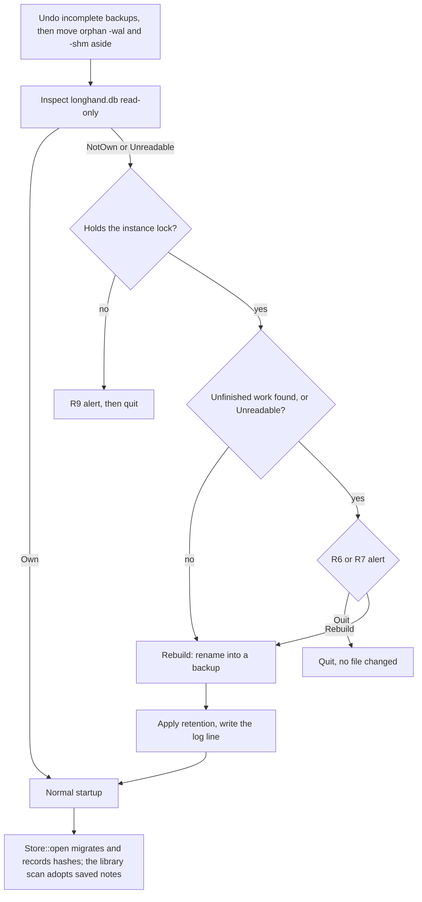

# Older Build Startup - Plan

## Goal Capsule

- **Objective:** An older Longhand build starts after a newer build has used the same data. It never crashes at launch. When it cannot start, it tells the user why and what to do.
- **Means:** A read-only check of the notes database at launch, a rebuild from the storage folder, and an alert for every startup failure (KTD1, KTD4, KTD6).
- **Product authority:** The Product Contract below. The storage folder stays the authority for saved notes (`CONCEPTS.md`, Library). On product behavior the R-IDs win; on mechanism the KTDs win.
- **Stop conditions:** Stop and ask when the check or the rebuild would need to change a file in the storage folder, or when a state that R3 does not list can hold the only copy of user work.
- **Execution profile:** Implement in a worktree from `origin/main`, one commit per unit. The manual test runs in a signed bundle.
- **Open blockers:** None.

---

## Product Contract

Product Contract preservation: changed R3 (research found more kinds of unfinished work), R7 (limited to a build that holds the instance lock) and AE2 (limited to databases that record their migrations); added R11 (backup retention) and AE6 (storage folder offline); Problem Frame corrected (the panic site); Outstanding Questions resolved into the Planning Contract.

### Summary

When the notes database is not this build's own, the older build rebuilds the database from the storage folder and starts. If the database holds unfinished work, the user first chooses between Quit and Rebuild. Every other startup failure shows an alert with the reason and a next step, then quits.

### Problem Frame

A plan build from a worktree adds a migration to `crates/session-core/migrations/`. When that build runs, the database version in `longhand.db` goes up. After that, main's build cannot open the database. `rusqlite_migration` refuses a database whose version is above its last migration (`DatabaseTooFarAhead`), and it refuses even when the new migration only adds a column. The error goes from `CaptureManager::new` (`src-tauri/src/managers/capture.rs`) to the Tauri `setup` closure. Tauri 2.11 runs `setup` inside `app.run` and panics with "Failed to setup app" when `setup` returns an error. The app closes with no message and no log line.

A second shape of the same problem: two plan branches can each add a different migration 0015, and the branch that merges second is renumbered (`docs/solutions/workflow-issues/parallel-branches-bump-same-schema-version.md`). A database from the first branch then has main's version number but a different schema.

The local settings are not the cause. `LocalSettings` ignores unknown keys, and a parse failure salvages the valid fields (`src-tauri/src/managers/settings.rs`, `settings_from_value`).

The problem occurs each time the user tests a plan build and then goes back to main's build. The workaround is to delete the database by hand.

### Key Decisions

- **Rebuild from the storage folder instead of a compatibility rule for each migration.** Saved notes can be rebuilt: the library scan adopts every home folder that has no row, including this computer's own notes (`crates/library/src/reconcile.rs`, `adopt`). Governs R1, R2, R4, R5. (session-settled: user-approved — chosen over a per-migration compatibility floor: a rebuild covers the same case, and no migration needs a compatibility decision)
- **The user decides when a rebuild would lose unfinished work.** Governs R6, R7, R8. (session-settled: user-directed — chosen over "alert and quit" and "rebuild without asking": the user wants the choice, with a clear warning of the loss)
- **No startup failure crashes the app.** Governs R9.
- **Keep every backup that holds unfinished work, and only the newest automatic backups.** Frequent switching between builds would otherwise fill the disk with working audio. Governs R11. (session-settled: user-approved — chosen over keeping only the most recent backup: that could delete a backup that holds unfinished work)

### Requirements

**Database that is not this build's own**

- R1. The database is not this build's own when its version is above the build's last migration, or when the migrations that it records differ from the build's migrations.
- R2. When the database is not this build's own, holds no unfinished work, and this build holds the instance lock, the build rebuilds the database and starts with no alert.
- R3. Unfinished work is any of these: a note in any state other than Saved or Discarded, a queued or running job (including Transcribe Again or Regenerate Summary on a saved note), an open Move, a folder rename in progress, or a publication that has not finished.
- R4. A rebuild moves the database (with its `-wal` and `-shm` files) and the working folder (`sessions/` in the app data folder) aside as one backup. It then makes an empty database at the build's own version and an empty working folder. The library scan at launch adopts every saved note in the storage folder.
- R5. After a rebuild, each saved note has the same title, notes, transcript, summary and audio as before. State that only this computer held for a saved note is lost, as for a note that another computer recorded.
- R6. When the database holds unfinished work, the build shows an alert before it starts. The alert names the kinds of work that it found (notes, a Move, a publication), says that a rebuild removes this work, and says that the backup is the way to recover it. It gives two choices: Quit and Rebuild.
- R7. When the build holds the instance lock but cannot read the database to check for unfinished work, it shows the R6 alert, but the alert says that the check failed instead of naming work.
- R8. Quit closes the app and changes no file. Rebuild does what R4 describes.

**Other startup failures**

- R9. Any error that stops the app from starting shows an alert with a short plain description, a next step, and the error text, then quits. The error is also written to the log. The app does not panic. This includes a database that is not this build's own, or that cannot be read, while this build does not hold the instance lock.

**Records**

- R10. Each rebuild writes a log line with the old and new database versions and the path of the backup.
- R11. The build keeps every backup made after the user chose Rebuild over unfinished work. Of the backups made with no alert, it keeps the newest 3.

### Acceptance Examples

- AE1. **Covers R1, R2, R4, R5.** Given main's build after a plan build ran migration 0015, and all notes are Saved. When main's build starts, then it starts normally, every saved note is in the list with its title, notes, transcript, summary and audio, and the old database and working folder are kept as a backup.
- AE2. **Covers R1, R2.** Given a database at version 15 from a build that records its migrations, from a branch whose migration 0015 differs from main's migration 0015, and all notes are Saved. When main's build starts, then it rebuilds as in AE1.
- AE3. **Covers R6, R8.** Given a plan build quit while a note was queued for processing. When main's build starts, then the alert shows and names an unfinished note. Quit closes the app and leaves `longhand.db` unchanged. Rebuild starts the app, and the queued note is not in the list.
- AE4. **Covers R4.** Given AE1 is complete. When the plan build starts again, then it migrates the rebuilt database up as usual and lists every saved note.
- AE5. **Covers R9.** Given the app data folder cannot be written. When the app starts, then an alert shows the reason and a next step, the error is in the log, and the app quits. No crash report is made.
- AE6. **Covers R2, R4.** Given AE1, but the storage folder is offline at launch. When main's build starts, then it rebuilds and starts with an empty list. The saved notes appear at the first library scan after the storage folder is available again.

### Scope Boundaries

- A database that is not this build's own is never opened for writing or changed in place by the build. The rebuild does not copy rows from it.
- The newer build does not read the backup. Recovery of unfinished work from the backup is manual: put back both the database and the working folder, then open the newer build.
- Out of scope: the older build drops new settings keys when it writes the settings file. Loading is not affected, and the newer build gives those keys their defaults again.
- Out of scope: separate data folders for test builds.
- Out of scope: panics after startup completes. R9 covers only the startup path.

### Sources / Research

- `crates/session-core/src/schema.rs` and `crates/session-core/src/jobs.rs` (`Store::init`): migrations and `to_latest`.
- `docs/solutions/workflow-issues/edited-applied-migration-breaks-older-databases.md`: migration rules; comment edits in applied migrations are allowed.
- `docs/solutions/logic-errors/save-state-machine-crash-window-recovery.md`: branch on the recorded state, not on side records.
- `docs/solutions/logic-errors/publication-checked-for-another-result-only-at-start-and-end.md`: `publication.json` in local staging means an unfinished publication.
- `crates/pipeline/src/old_audio.rs` (`sweep`): the launch sweep deletes the old-audio copy of each working folder that has no row.
- `crates/session-save/src/rename_home.rs`: a case-only rename can leave the folder at a hidden `.longhand-rename-<id>` name, which the library scan skips.
- `crates/pipeline/src/save.rs`: a summary publication stages in `sessions/.longhand-summary-*`, and only `result_state` (key `summary-publication`) points to it, while the note stays Saved.
- `tauri-2.11.6/src/app.rs`: `setup` runs inside `app.run`; an error panics.
- `rfd 0.16.0` (already in `Cargo.lock` through `tauri-plugin-dialog`): `MessageDialog::show` runs `NSAlert` on the main thread, also with no running app.

---

## Planning Contract

### Key Technical Decisions

- KTD1. **The check is a read-only inspection in `session-core`.** A new module takes the app data folder and returns one of Own, NotOwn (with the unfinished work it found) or Unreadable. It opens `longhand.db` with `SQLITE_OPEN_READ_ONLY`, not `immutable=1`, because `immutable` ignores the WAL. A missing or zero-byte `longhand.db` is Own and opens nothing. It never calls `Store::open`, which writes pragmas and migrates. It closes its connection before it returns. Governs R1, R3, R7.
- KTD2. **Each database records the hash of each migration that it applied.** A table `applied_migrations(version, sha256)` holds one row per applied migration. `Store::init` inserts the missing rows for `1..=user_version` after `to_latest`, with this build's hashes. The hash is SHA-256 of the migration SQL with comments and whitespace removed, so a comment edit does not count as a divergence. A missing row is trusted; only a row whose hash differs is a divergence. So a crash between a migration and its row is safe, and no migration hook is needed. The SQL of each migration comes from one list in `schema.rs` that both `migrations()` and the hash function read. The table needs no migration file, so the database version does not change, and builds from before the fix ignore the table. Governs R1.
- KTD3. **Unfinished work is read from columns and files that every schema version has.** The inspection counts:
  1. sessions where `json_extract(state, '$.state')` is not `saved` or `discarded` (an unknown future state counts as unfinished);
  2. rows in `jobs`, and sessions with a non-null `transcribe_again_model`;
  3. rows in `move_journal` or `move_notes`, `rename_intents`, and `result_state` rows with key `summary-publication`;
  4. files `sessions/*/publication.json` and folders `sessions/.longhand-summary-*`.

  A table or column that does not exist counts as zero, after a check of `sqlite_master` or `pragma table_info`. Any SQLite error other than a missing table makes the result Unreadable. Governs R3, R6, R7.
- KTD4. **The rebuild renames; it never copies.** The backup folder is `database-backups/<UTC time>/` in the app data folder, so every rename stays on one volume and needs no free space. The order is `sessions/`, then `longhand.db-shm`, then `longhand.db-wal`, then `longhand.db` last. The backup folder gets an "incomplete" flag before the first rename, and the flag is removed after the last rename. A rename that fails moves the entries that already moved back into the app data folder, in reverse order. At launch, before anything else, each backup folder that still has the flag (a crash during a move) has its entries moved back the same way, and the folder is removed. So the inspection always sees the database with its WAL and working folder, and one backup never splits across two folders. Before the inspection, a `-wal` or `-shm` file with no `longhand.db` moves into a new backup folder, so SQLite never applies a stale WAL to a new database. A failed rename retries for about 2 s (Windows sharing violations), then the move is undone and startup fails (R9). A marker file in the backup folder records whether the user chose Rebuild over unfinished work; retention (R11) reads it. Governs R4, R10, R11.
- KTD5. **The check runs in `setup`, after `take_instance_lock` and `updates::install_at_launch`, before `CaptureManager::new`.** An update that installs at launch restarts into a newer build before any alert shows. No earlier startup step opens the database. The rebuild runs only with `Liveness::OnlyInstance`; NotOwn or Unreadable with any other liveness is a startup failure (R9). Governs R2, R7, R9.
- KTD6. **Alerts use `rfd::MessageDialog` on the main thread.** `setup` runs on the main thread, where `rfd` shows `NSAlert` (and a message box on Windows). `src-tauri/Cargo.toml` adds `rfd` at the version that `Cargo.lock` already has, so no new crate enters the build. `tauri-plugin-dialog` is not usable here: its blocking API must not run on the main thread, and after a `setup` error there is no app. Quit is the default button and the Escape action. Governs R6, R7, R9.
- KTD7. **`setup` never returns an error.** The body of the `setup` closure moves into a function that returns a `Result`. On an error, the closure logs it, flushes the logger, shows the R9 alert and exits with code 1. The `.build(...).expect(...)` in `run` gets the same treatment. The next step in the alert is "Open Longhand again. If the problem continues, send the log file:" followed by the log file path. Governs R9.

### High-Level Technical Design

The launch decision after `install_at_launch`:

### Assumptions

- The library scan runs again when an unavailable storage folder becomes available (`crates/library/src/status.rs` tracks root availability between scans). U4 confirms this for AE6.
- `rfd` can set Quit as the default button and the Escape action on macOS and Windows. If it cannot, U4 uses the order that makes Quit the default, and records the result.

---

## Implementation Units

### U1. Record the hash of each applied migration

**Goal:** Every database opened by this build records the identity of each migration that it applied.

**Requirements:** R1; KTD2.

**Dependencies:** None.

**Files:**
- `crates/session-core/src/schema.rs`
- `crates/session-core/src/jobs.rs`
- `crates/session-core/tests/migrations.rs`

**Approach:**
1. Put the SQL of each migration in one list that `migrations()` builds from, keeping the 0002 hook.
2. Add a function that returns the normalized hash of each migration, in order.
3. In `Store::init`, after `to_latest`, create `applied_migrations` if it is missing and insert the missing rows for `1..=user_version`.

**Patterns to follow:** `crates/session-core/tests/migrations.rs` (build an old schema with `to_version`, add rows, then `Store::open`); `folder::fingerprint` for SHA-256.

**Test scenarios:**
- A new database has one row for each migration, and each hash equals the build's hash.
- A database at version 14 with no table gets rows 1 to 14 at `Store::open`, and its data is unchanged.
- Two opens in sequence give the same rows (no duplicates).
- A comment-only or whitespace-only change to a migration's SQL gives the same hash.
- A change to one SQL statement gives a different hash.
- `migrations_are_valid` still passes.
- Covers AE4. A database made by `Store::open` opens with a migration list that has one extra migration. It migrates to the new version, keeps its rows, and records a hash row for the new version.

**Verification:** Every database that this build opens has a complete, correct `applied_migrations` table.

### U2. Inspect the database without changing it

**Goal:** A function tells whether `longhand.db` is this build's own, and which unfinished work it holds.

**Requirements:** R1, R3, R7; KTD1, KTD3.

**Dependencies:** U1.

**Files:**
- `crates/session-core/src/inspect.rs` (new)
- `crates/session-core/src/lib.rs`
- `crates/session-core/tests/inspect.rs` (new)

**Approach:**
1. Return Own for a missing or zero-byte file.
2. Open read-only. Read `user_version` and compare it with the build's migration count.
3. Compare each recorded hash with the build's hash for the same version.
4. For NotOwn, count the kinds of unfinished work (KTD3) into a small summary that the alert can name.
5. Map any other SQLite error to Unreadable with its text.

**Execution note:** Write the tests first; each one builds a database file with raw SQL.

**Patterns to follow:** `crates/session-core/tests/jobs.rs` and `tests/migrations.rs` (tempfile, raw SQL); the not-Saved predicate in `jobs.rs`.

**Test scenarios:**
- Covers AE1. A database at `user_version` above the count with only Saved sessions is NotOwn with no unfinished work.
- Covers AE2. A database at the build's count whose row for the last version has a different hash is NotOwn.
- A database at version 14 with no `applied_migrations` table is Own.
- A missing file and a zero-byte file are Own, and no file is created.
- Covers AE3. A NotOwn database with one `queued` session reports one unfinished note.
- Each other unfinished kind is found on its own: `interrupted`, `processing_failed`, `awaiting_destination`, a `jobs` row, a non-null `transcribe_again_model`, a `move_journal` row, a `rename_intents` row, a `summary-publication` row, a `publication.json` file, a `.longhand-summary-*` folder.
- An unknown future state value counts as unfinished.
- A database whose schema has no `move_journal` table is inspected without an error.
- A file that is not a SQLite database is Unreadable.
- The inspection changes no file: `longhand.db` and `-wal` have the same bytes after it (a `-shm` file may appear).
- A database in WAL mode with committed rows only in `-wal` reports those rows.

**Verification:** The inspection gives the right result for every case above and never changes the database.

### U3. Move the database and working folder aside

**Goal:** A rebuild makes a backup that recovery can use, and leaves a clean app data folder.

**Requirements:** R4, R8, R10, R11; KTD4.

**Dependencies:** U2.

**Files:**
- `crates/session-core/src/backup.rs` (new)
- `crates/session-core/src/lib.rs`
- `crates/session-core/tests/backup.rs` (new)

**Approach:**
1. A function undoes each backup folder that still has the "incomplete" flag (KTD4).
2. A function moves an orphan `-wal` or `-shm` (no `longhand.db`) into a new backup folder.
3. A function makes `database-backups/<UTC time>/`, writes the marker (unfinished work kept or not) and the "incomplete" flag, renames in the KTD4 order, then removes the flag. It returns the backup path.
4. Retry a failed rename for about 2 s, then undo the renames that succeeded and return the error.
4. A retention function deletes automatic backups beyond the newest 3 and never touches a marked one.

**Patterns to follow:** The crash-safe step order in `crates/session-save` (each step is recognizable from disk alone).

**Test scenarios:**
- Covers AE1. After a move, the app data folder has no `longhand.db`, `-wal`, `-shm` or `sessions/`, and the backup folder has all four with the same bytes.
- A move with no `sessions/` folder or no `-wal` succeeds.
- A failure at the `longhand.db` rename, after the other renames succeeded, puts `sessions/`, `-shm` and `-wal` back in the app data folder and removes the backup folder.
- A backup folder with the "incomplete" flag and half of the entries (a simulated crash) is undone at the next launch: all entries are back in the app data folder, and the inspection then sees rows that are only in `-wal`.
- An orphan `-wal` with no `longhand.db` moves into a backup, and a new database opened after it has no rows from that WAL.
- Retention with 5 automatic backups and 2 marked backups keeps the newest 3 automatic backups and both marked backups.
- Two moves in the same second get two different folders.
- A failed rename (read-only parent folder) returns an error and leaves the files in place.

**Verification:** Every file that the rebuild removes is in the backup, and the next `Store::open` starts from an empty database.

### U4. Run the check at launch and show the alerts

**Goal:** The app uses U2 and U3 at launch, asks the user when work would be lost, and never panics on a startup error.

**Requirements:** R2, R5, R6, R7, R8, R9, R10; KTD5, KTD6, KTD7.

**Dependencies:** U2, U3.

**Files:**
- `src-tauri/src/startup.rs` (new)
- `src-tauri/src/lib.rs`
- `src-tauri/Cargo.toml`

**Approach:**
1. A pure function maps (inspection result, liveness) to an action: continue, rebuild, ask, or fail. Unit tests cover it.
2. In `setup`, after `install_at_launch`, run the orphan move, the inspection and the action (KTD5). After a rebuild, apply retention and write the R10 log line.
3. Show the R6/R7 alert and the R9 alert with `rfd` (KTD6). Invoke `apple-design` for the alert text and button roles. UI text says "note", not "session".
4. Move the `setup` body into a function that returns a `Result`, and handle its error and the `build` error as KTD7 says.

**Patterns to follow:** `take_instance_lock` in `src-tauri/src/lib.rs`; `#[cfg(test)]` helper tests such as those in `src-tauri/src/window.rs`.

**Test scenarios:**
- Own with any liveness gives continue.
- NotOwn with no unfinished work and OnlyInstance gives rebuild.
- NotOwn with unfinished work and OnlyInstance gives ask, and the alert text names each kind of work.
- Unreadable with OnlyInstance gives ask, with the "check failed" text.
- NotOwn or Unreadable with Unknown liveness gives fail.
- The R9 alert text has the description, the next step, the log path and the error text.

**Verification:** A `setup` error and a `build` error end with an alert and exit code 1, not a panic; the manual test below passes.

---

## Verification Contract

| Check | Proves |
|---|---|
| `cargo test -p session-core` | U1, U2, U3; AE2 and AE4 |
| `cargo test -p longhand` (unit tests in `src-tauri`) | U4 decision function and alert text |
| `cargo clippy --workspace --all-targets -- -D warnings` | Lint gate |
| `scripts/check-windows.sh` | The `rfd` and rename code builds for Windows |
| `scripts/check-licences.sh` | The direct `rfd` dependency adds no new licence |
| Manual test in a signed bundle (below) | AE1, AE3, AE5 on a real app data folder |

Run the scoped crate tests per unit, and one full workspace test run and clippy at the end.

**Manual test** (per `docs/development-workflow.md#manual-tests`). Quit the preview build, then copy `~/Library/Application Support/net.ewal.longhand` aside before each step:
1. Set `PRAGMA user_version` of `longhand.db` to 99 with all notes saved. Start the signed build. Expect no alert, every saved note in the list, and a backup in `database-backups/`.
2. Set it to 99 again, with one note queued. Expect the alert naming one note. Quit leaves the files unchanged; Rebuild starts with the note gone from the list.
3. Make the app data folder read-only. Expect the R9 alert and no crash report.
4. Restore the copied app data folder.

## Definition of Done

- Every unit's tests pass, and the Verification Contract checks pass.
- AE1, AE3 and AE5 pass in the manual test. AE2 and AE4 pass in the session-core tests. AE6 is confirmed by U4's check of the Assumption.
- An older build with this fix never panics at launch on a database from a newer build.
- No code from abandoned approaches is left in the diff.

## Risks & Dependencies

- A database from a branch cut before this fix, with a different migration at the same version, has no hash rows, so it is trusted (AE2 does not apply to it). A later schema error then shows the R9 alert instead of a crash. The gap closes when both builds carry the fix.
- If a plan build also changes the note folder format, the older build's library scan skips those notes with only a log warning, and they disappear from the list with no message.
- A rebuild removes this computer's owed folder renames. A folder name can then stay out of step with its title until the next rename (R5 accepts this).
