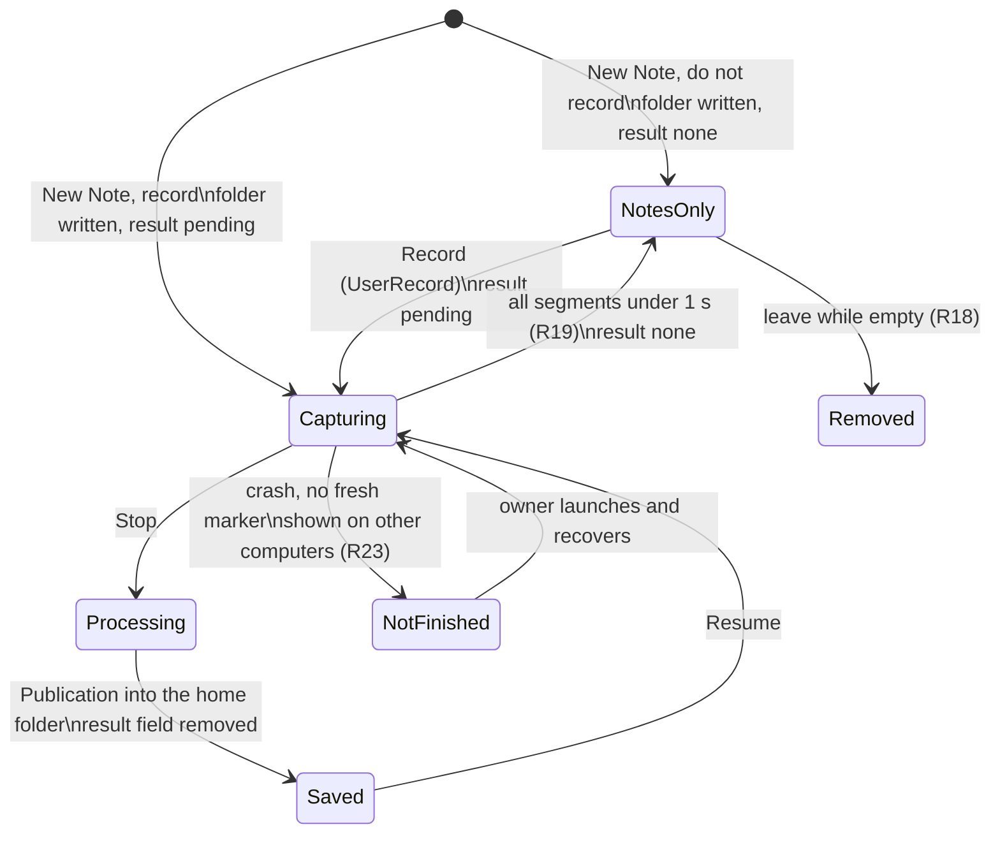
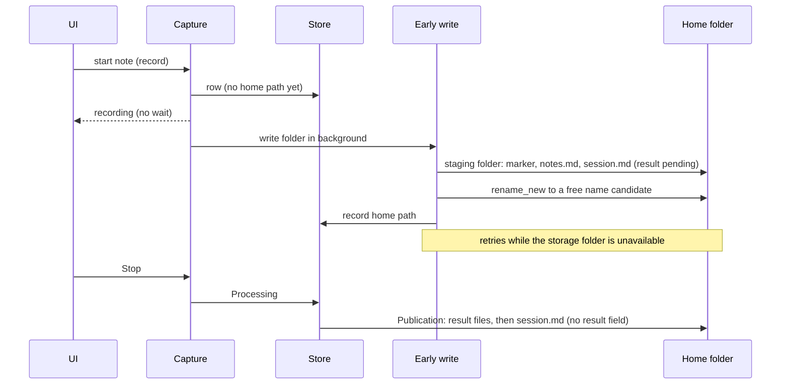
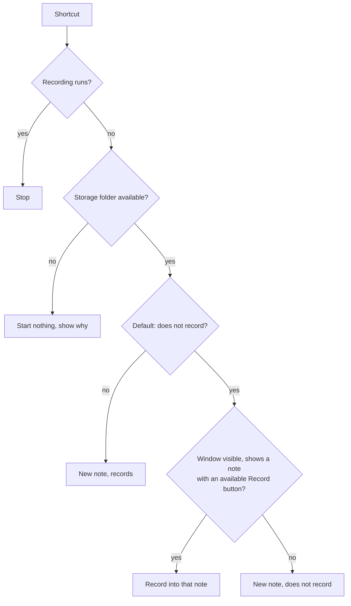

# Start a New Note Without Recording - Plan

## Goal Capsule

- **Objective:** A user can choose to take a note without a recording: notes only, or notes first with the recording started later. Recording at once stays available, and stays the default.
- **Means:** A local New Note default with a split button, a Record/Resume button on the note page, and a home folder for every note from its start, so a note can exist and sync before it has audio (KTD1, KTD3).
- **Product authority:** The Product Contract wins on behavior; the KTDs win on mechanism within it. Source idea: `docs/ideas/next/new-note-without-recording.md`.
- **Stop conditions:** Stop and ask when a change would make the start of a recording wait for the storage folder, could make a second home folder for one note (R4), or would delete a note or notes text that another computer wrote (R18, R24).
- **Execution profile:** Implement with `ce-work` in a worktree from `origin/main`, one commit per unit, then one PR. Test microphone and two-computer behavior only in a signed bundle.
- **Open blockers:** None.

---

## Product Contract

Product Contract preservation: changed R6, R9, R10, R16, R18, R19, R21; added R23, R24; Goal, Summary and Problem Frame reframed around the user's choice. The user confirmed these at the plan scoping review: the two flag values, the open time as the note's time, the stricter removal checks, the state for a note that a crashed computer did not finish, and the rule for an edit to a removed note.

### Summary

New Note can open a note that does not record. A Recording setting sets what New Note does by default, the New Note split button gives the other choice, and the recording shortcut follows the setting. A button on the note page records into any note that can record: it says "Record" on a note with no audio and "Resume" on a note that has audio. A note that never records keeps only its notes. To make this work, every new note gets its home folder in the storage folder at once, so a note exists and syncs before it has audio.

### Problem Frame

Today New Note always starts to record at once. A user cannot open a note early to type an agenda and then record at the right moment. A user cannot keep notes about a sensitive topic without a recording. Also, nothing of a note is in the storage folder until processing ends and Save moves the complete note there, so a note cannot exist without a recording, and its notes are on one computer only for the full length of the meeting and its processing.

### Key Decisions

- **Every new note gets its home folder at once, not only a note that does not record.** One save point for all notes, and the notes of a recording note sync early. Governs R1, R2, R3. (session-settled: user-directed — chosen over early folders only for notes that do not record: the user wanted one rule for all notes.)
- **An early folder, with the audio kept local until the result is saved.** Recording keeps today's start speed and crash safety. The result goes into the existing folder with the Publication rules. Governs R1, R3, R4. (session-settled: user-approved — chosen over "every new note is an empty saved note and every recording is a Resume": that path made the start of each recording depend on the storage folder. R7 later made New Note need the folder, but the early folder still keeps the folder write off the start of the recording.)
- **New Note needs an available storage folder.** Governs R7. (session-settled: user-directed — chosen over recording without a storage folder and writing the folder later: simpler.)
- **A note that never records gets no summary.** It stays a notes-only note. Governs R14. (session-settled: user-directed — chosen over a summary from the typed notes and over a summary on request.)
- **One button records into any note that can record.** It replaces the "Resume Recording" menu item, so there is one way to record more. Its label says what it does. Governs R11, R12. (session-settled: user-directed — chosen over a button only on notes with no audio; the user added the Record/Resume label.)
- **The recording shortcut follows the setting.** The shortcut and a click on New Note give the same result. Governs R10. (session-settled: user-directed — chosen over a shortcut that always records.)
- **Other computers can view and edit the notes of a note that records elsewhere.** Governs R20, R21, R23. (session-settled: user-approved — chosen over view only and over hidden until done.)
- **An empty note that never recorded is removed.** A mis-click leaves nothing in the storage folder or on Home. Governs R18, R19. (session-settled: user-approved — chosen over keeping it.)
- **An explicit flag marks a note that has no result yet, with two values.** Missing files mean "waiting for a sync" today, so the state must not be inferred from them; the second value tells other computers that a recording exists elsewhere. Governs R6, R12, R23. (session-settled: user-directed — chosen over inferring the state from missing files: no ambiguity. The two values are user-approved at plan scoping, chosen over one value that cannot tell "never recorded" from "recording not saved".)
- **The note's time is the time it opened.** A note opened at 09:00 and recorded at 10:00 keeps 09:00. Governs R16. (session-settled: user-approved — chosen over the time of the first recording: the title and folder name do not change when the note records.)
- **A note that another computer did not finish is cleaned up only by a person.** A deliberate Delete wins: the recording computer does not bring the note back. Governs R23. (session-settled: user-directed — chosen over automatic cleanup and over saving the recovered recording as a new note: a person's Delete is authoritative, and a delete during a crash is a rare edge case.)
- **The Recording setting is local to each computer.** It sits with the other new-note defaults (microphone, Computer audio), which are local. Governs R8.

### Requirements

**Home folder from the start**

- R1. When a note starts, recording or not, Longhand writes its home folder in the storage folder with `session.md` and `notes.md`. The start of the recording never waits for this write.
- R2. While a note records and processes, each notes save on this computer writes `notes.md` in the home folder, as a saved note does today.
- R3. The audio and the processing files stay in the working location until the result is complete. The result then goes into the note's existing home folder with the Publication rules (`session.md` last). The note keeps this one home folder for life, also when processing later proposes a title and the folder is renamed.
- R4. After a crash at any point, the note has at most one home folder, and its recording recovers as it does today.
- R5. When the storage folder becomes unavailable during a recording, the recording continues. The notes writes and the result wait until the folder is available, as Save waits today. This includes the first write of the home folder (R1): it tries again when the folder is back, and Save waits for that one folder and never makes a second one.
- R6. `session.md` of a note that has no result yet carries an explicit flag with one of two values, from the first write of the home folder until the first result is saved: "no recording" (the note has never recorded) or "recording not saved" (a recording exists that is not saved yet). Every computer reads the flag and does not infer the state from missing files. A note with this flag is not waiting for a sync: a missing transcript, summary or audio does not hold its notes editor or its Record button.

**Starting a note**

- R7. While the storage folder is unavailable, New Note (both choices) and the recording shortcut do not start a note. New Note shows why.
- R8. Settings > Recording has a setting for what New Note does: start to record (the default for a new install, as today) or open a note that does not record.
- R9. New Note is a split button. A click does the default of R8, and the label of its main part shows which default that is. Its menu gives the other choice.
- R10. The recording shortcut stops a recording when one runs. Otherwise, when the default is "does not record" and the main window is open, not minimized, and shows a note whose button says "Record" and is available (R11, R12), it records into that note, also when another app has the focus. Otherwise it does the default of R8.

**Record and Resume on the note page**

- R11. The note page shows one button when the note does not record and can record: "Record" on a note with no audio, "Resume" on a note that has audio. It replaces the "Resume Recording" menu item.
- R12. The button is unavailable, with the reason, in each case where Resume is unavailable today (audio removed, waiting for a sync of a part the note has, storage folder unavailable), while another computer records into or processes the note, and on another computer while the flag says "recording not saved".
- R13. The button and the start of a recording follow the U7 attention budget of the recording surface: no motion and no ornament that pulls the eye.

**A note with no audio**

- R14. A note that has never recorded has no transcript and no summary. The note page shows its notes and the Record button, and no Transcript or Summary tab.
- R15. Home lists a note that has never recorded and does not record or process now like other notes, with its title or its start time, and shows no length and no processing status for it.
- R16. A note's start time is the time it opened, and recording later does not change it. A note with no audio keeps its start time as its title until the user renames it. Processing proposes a title only after the note records, and never replaces a title that the user set.
- R17. The first recording into a note with no audio makes a transcript and summary through the usual processing, with the notes that the user typed before and during the recording.

**Empty notes and discarded recordings**

- R18. A note with no audio, no text in its notes and no title from the user is removed, with its home folder, when the user leaves it: the main window shows another view or closes, or the user starts a new note. The computer that started the note removes it; when the app quit first, it removes it at the next launch. It removes the note only when the storage folder is available, `session.md` and `notes.md` in the home folder are still the files that this computer last wrote, no other computer's in-use marker in the folder is fresh, and the folder holds no other files. Otherwise it keeps the note, because another computer can have used it.
- R19. When a recording is discarded automatically because every segment is shorter than one second, the note stays as a note with no audio if its notes have text, from this computer or another one. Otherwise R18 removes it. A discard never removes a note that existed before the discarded recording started.

**Other computers**

- R20. Another computer lists a note that records or processes elsewhere, shows that it records or processes on another computer, shows its notes, and lets the user edit them. Notes edits follow the current rules: the last change wins, and a conflict copy keeps an edit that would be lost.
- R21. On that computer, Record, Resume, Transcribe Again, Regenerate Summary, Remove Audio and Delete wait until the other computer is done with the note, except as R23 allows.
- R22. On the recording computer, notes edits that arrive from another computer show in My Notes while the note records.
- R23. When the flag says "recording not saved" and no computer's in-use marker in the folder is fresh, other computers show the note as "Not finished on another computer". They allow notes edits, and Delete after a confirmation that names the recording that is not saved. Record and the processing actions stay unavailable. Nothing removes such a note automatically: only a person deletes it. When the recording computer later recovers the note and finds its home folder deleted, it treats the note as deleted and discards the recording.
- R24. When a computer saves notes for a note whose home folder another computer removed (R18), it saves the text as a new note with no audio and tells the user. The text is never lost.

### Key Flows

- F1. Open the note early, then record
  - **Trigger:** The user sets the default to "does not record" and clicks New Note, or picks the other choice from the New Note menu.
  - **Steps:** The note opens with no recording and its home folder is written. The user types an agenda. At the start of the meeting, the user clicks Record or presses the recording shortcut. The note records, the user stops it, and processing saves the transcript and summary into the same home folder.
  - **Covered by:** R1, R9, R10, R11, R17
- F2. Notes only
  - **Trigger:** The user opens a note that does not record for a sensitive topic.
  - **Steps:** The user types notes and goes back to Home. The note stays in the list with its start time as its title, and has no transcript or summary.
  - **Covered by:** R14, R15, R16
- F3. Notes from another computer during a recording
  - **Trigger:** Computer A records a note.
  - **Steps:** Computer B lists the note as recording on another computer. The user types into its notes on B. The edit shows on A. Actions that need the audio wait on B. When A saves the result, B shows the transcript and summary.
  - **Covered by:** R20, R21, R22

### Acceptance Examples

- AE1. **Covers R10.** Given the default is "does not record" and the main window shows a note with no audio, when the user presses the recording shortcut, the note records. When the user presses it again, the recording stops.
- AE2. **Covers R10.** Given the default is "starts to record" and the main window shows a note with no audio, when the user presses the recording shortcut, a new note starts to record.
- AE3. **Covers R11, R12.** Given a saved note whose audio was removed, the note page shows "Resume", unavailable, with the reason that the audio was removed.
- AE4. **Covers R18.** Given the user clicks New Note with "does not record" and goes back to Home without typing, the note is not on Home and its home folder is gone.
- AE5. **Covers R18.** Given the user types only in the title of a note with no audio, when the user leaves it, the note stays.
- AE6. **Covers R19.** Given a recording note with typed notes whose every segment is shorter than one second, when the user stops it, the note stays as a note with no audio and keeps its notes.
- AE7. **Covers R5.** Given a recording and a storage folder on a network volume that disconnects, the recording continues, and the notes and the result are written when the volume is back.
- AE8. **Covers R7.** Given the storage folder is unavailable, New Note and its menu are unavailable with the reason, and the recording shortcut starts nothing.
- AE9. **Covers R10.** Given the default is "does not record", the main window shows a note with no audio, and another app has the focus, when the user presses the recording shortcut, that note records.
- AE10. **Covers R10, R12.** Given the default is "does not record" and the main window shows a note with no audio that another computer records into, when the user presses the recording shortcut, no recording starts into that note, and the shortcut does the default of R8.
- AE11. **Covers R18.** Given computer A opened a note with no audio, computer B typed into it, and B's edit has synced to A, when A launches, A keeps the note.
- AE12. **Covers R16.** Given a note opened at 09:00 with no audio, when it records at 10:00 and processing saves the result, its start time stays 09:00 and its folder name keeps 09:00.
- AE13. **Covers R23.** Given computer A crashed while it recorded a note and has not launched for an hour, computer B shows the note as "Not finished on another computer", lets the user edit its notes, and keeps Record unavailable.
- AE14. **Covers R19.** Given a note with no audio and no notes text that the user opened yesterday and titled, when a recording into it is discarded automatically, the note stays.
- AE15. **Covers R18.** Given an empty note with no audio on the page, when the user clicks New Note, the empty note is removed and the new note opens.

### Scope Boundaries

- A summary made from typed notes only.
- Recording into a note whose audio was removed. The button is unavailable there (AE3). See `docs/ideas/someday/resume-survives-early-audio-removal.md` for the related Resume gap.
- A change to how Delete works on this computer: it stays unavailable while a note records or processes.

#### Deferred to Follow-Up Work

- Removal of the Staging path of the first Save. After this change, a new note always has a home folder, so the first Save always publishes into it (KTD3). The Staging code stays for rows that started before the update; its removal is a separate cleanup.

### Dependencies / Assumptions

- The Publication rules (`CONCEPTS.md`, Publication) already write a new result into an existing home folder for Resume and Transcribe Again; R3 uses the same rules (KTD3).
- The in-use marker of audio removal (`CONCEPTS.md`, Audio removal) is already written for each note with a home folder that records or processes; R20, R21 and R23 read it (KTD5).
- Nobody uses an older build, so no migration of existing notes is needed. An older build that rewrites `session.md` drops the flag; KTD1's fallback covers that case.

### Sources / Research

- `src/home/Home.tsx:176-224` — New Note calls `startRecording(null)`; readiness gates it.
- `src-tauri/src/managers/capture.rs:1072-1206` — a new note gets no home folder today; `:1240-1257` discards a recording with no segments.
- `crates/pipeline/src/save.rs:184-322` — the first Save uses Staging only while the note has no home path; with a home path, it publishes into it (`update_home`, `:385-468`).
- `crates/session-core/src/folder.rs:108-210` — `SessionDoc` takes `started` and `segments` from the segments and cannot represent a note with no audio.
- `crates/library/src/scan.rs:531-551` and `crates/library/src/status.rs:43-56` — a missing transcript or summary is a sync wait today.
- `crates/session-core/src/jobs.rs:681-711` and `:1919-1921` — adopt inserts Saved rows; busy rows are not refreshed from their folder.
- `crates/pipeline/src/in_use.rs` — the in-use marker, written for every non-final row with a home path.
- `src-tauri/src/commands/readiness.rs:107-125` and `src-tauri/src/shortcut.rs:344-381` — readiness and the shortcut ignore the storage folder today.
- `src/App.tsx:21-51` — only the frontend knows which note the main window shows.
- Learnings: `docs/solutions/logic-errors/save-state-machine-crash-window-recovery.md`, `docs/solutions/logic-errors/publication-checked-for-another-result-only-at-start-and-end.md`, `docs/solutions/logic-errors/receiving-computer-renamed-synced-folder-back.md`, `docs/solutions/logic-errors/synced-summary-did-not-refresh-open-note.md`, `docs/solutions/integration-issues/shared-settings-in-a-synced-folder-rules.md`, `docs/solutions/ui-bugs/wkwebview-click-does-not-focus-button-breaks-shortcut-capture.md`, `docs/solutions/workflow-issues/edited-applied-migration-breaks-older-databases.md`, `docs/solutions/workflow-issues/parallel-branches-bump-same-schema-version.md`.

---

## Planning Contract

### Key Technical Decisions

- KTD1. **`session.md` gets a `result` field with the values `none` and `pending`, absent once a result exists.** `none` = no recording; `pending` = recording not saved (R6). A note with no audio writes `started` (the open time, R16) and `segments: []`. A reader treats zero segments with no transcript or summary fingerprint as `none` when the field is missing, so a rewrite by an older build does not make the note wait for a sync. `pending` is written when a recording starts into the note, in the first write or as an update, and capture never waits for that write.
- KTD2. **A notes-only note is a Saved row with zero segments and `result: none`.** Move, Delete, adopt and the Home list then work as for any saved note. Record into it is a new event, `UserRecord`, from Saved with zero segments to Capturing. It is not `UserResume`, whose `audio_intact` guard and `audio_state` (Waiting for zero segments) refuse a note with no audio.
- KTD3. **The store records the home path after the early write places the folder, and the first Save publishes into that folder.** Today `save::run` already calls `update_home` when a row has a home path, so the first result follows the Publication rules (R3) and clears the flag in the same `session.md` write. Recovery and the library scan find a folder by the `session_id` in `session.md` (in the staging folder or at a name candidate) before they adopt, stage or write again, so a crash at any step of KTD4 cannot make a second folder or a second row (R4).
- KTD4. **The early write follows the Save staging pattern, as a background step with its own checkpoint.** It writes this run's in-use marker, `notes.md` and `session.md` into a hidden staging folder in the storage folder (`naming::staging_name`), moves it to the first free `naming::candidate` with `rename_new`, then records the actual home path in the store. Every file in the folder is then identifiable by `session_id`. It retries while the storage folder is unavailable (R5) and shows the same storage status as Save. A note that does not record shows "Not saved yet" until the write succeeds; its notes stay in the local store until then. Record into a notes-only note writes this run's marker before it writes `pending`. One job per note runs the early write and every later flag update in order; it checks the row state before each write, and removal (U6) and the first Save cancel it or wait for it. Until its checkpoint is done, the library never forgets the row because its folder is missing.
- KTD5. **Other computers derive the remote state from the in-use markers first, then the flag.** The library scan lists the `.longhand-in-use-*` names of each folder and checks their freshness. A fresh marker from another run means the note records or processes elsewhere, whatever the flag says (R12, R20, R21). "Not finished on another computer" (R23) needs all of: `pending`, no fresh marker, and a `session.md` file time older than `FRESH_FOR`; a newer `pending` note with no marker yet shows as recording elsewhere. The session entry carries this state for the UI. The marker name and freshness functions move from `crates/pipeline/src/in_use.rs` to `crates/session-save`, because `library` cannot depend on `pipeline` (pipeline already depends on library); `pipeline::in_use` keeps the keeper and re-exports them.
- KTD6. **A busy row with a home path refreshes only `notes.md` from its folder.** This closes R22: today `busy()` blocks every refresh of a row that records or processes. The notes conflict rules stay unchanged.
- KTD7. **The frontend reports the shown note to the backend.** A new command records the note id on each navigation and clears it on Home, hide and close. The shortcut uses it only while the main window is visible and not minimized (R10); a stale id falls back to the R8 default.
- KTD8. **The store keeps the fingerprints of the `session.md` and `notes.md` that this computer last wrote for a note, and whether this computer started the note.** R18's removal check compares them with the files on disk. A launch pass removes the empty notes that this computer started and did not remove before it quit.
- KTD9. **Folder names use the note's `started` time, not the first segment.** A rename of a note that is `pending` on another computer changes only the title in `session.md`; the computer that owns the run renames the folder after its Save, through the existing owed-rename path.
- KTD10. **New Note becomes a split button component that reuses the existing menu.** It builds on `Menu` in `src/session/SessionMenu.tsx`. Its menu part calls `focus()` explicitly, because WKWebView does not focus a clicked button.

### High-Level Technical Design

The life of a note and its `result` flag (KTD1, KTD2):

The first write and the first Save of a recording note (KTD3, KTD4):

The recording shortcut (R10, KTD7):

### Assumptions

- Two computers rarely open a note in the same minute with no title. If they do, the second gets the next name candidate on its own disk, and the sync service can show a conflict copy of the folder; no new handling.
- The audio removal pass finds nothing to remove in a note with zero segments and writes no removal markers there. U4 adds a test to prove it.

---

## Implementation Units

### U1. `session.md` for a note with no audio and the `result` flag

**Goal:** `session.md` can describe a note with no audio and carries the R6 flag.

**Requirements:** R6, R16; KTD1, KTD9.

**Dependencies:** None.

**Files:**
- `crates/session-core/src/folder.rs`
- `crates/session-save/src/naming.rs`
- `crates/pipeline/src/save.rs` (`session_doc`)
- `crates/pipeline/src/folder_rename.rs`
- `crates/session-core/tests/folder.rs`
- `crates/pipeline/tests/runner.rs`

**Approach:**
1. Add the `result` field to `SessionDoc` with `serde(default, skip_serializing_if)`, and give `segments` a serde default.
2. Add a constructor for a note with no audio that takes the open time.
3. Make `session_doc` and the folder rename use the row's start time, not the first segment.
4. Add the fallback reading of KTD1 as one helper that the scan (U4) uses.

**Patterns to follow:** The existing optional fields of `SessionDoc`.

**Test scenarios:**
- A note with no audio renders and parses back with `started`, `segments: []` and `result: none`.
- A note with a result renders with no `result` field, and an older document without the field parses.
- Fallback: zero segments, no fingerprints and no field read as `none`; a note with segments and no field reads as having a result.
- Covers AE12. A note opened at 09:00 whose first segment starts at 10:00 renders `started` 09:00, and its folder name uses 09:00.
- A folder rename of a note with zero segments and a user title gives a new name (today it returns Unchanged).

**Verification:** `session.md` round-trips for all three states, and the folder name follows `started`.

### U2. Store: start time, ownership, last-written fingerprints, and `UserRecord`

**Goal:** The store can hold a notes-only note and record into it.

**Requirements:** R11, R16, R18; KTD2, KTD8.

**Dependencies:** None.

**Files:**
- `crates/session-core/migrations/0015-*.sql` (new)
- `crates/session-core/src/schema.rs`
- `crates/session-core/src/state.rs`
- `crates/session-core/src/jobs.rs`
- `crates/session-core/tests/state_machine.rs`
- `crates/session-core/tests/jobs.rs`
- `crates/session-core/tests/migrations.rs`

**Approach:**
1. One migration adds: the note's start time for rows with no segments, a flag for "this computer started the note", and the fingerprints of the last written `session.md` and `notes.md`.
2. Add `UserRecord`: Saved with zero segments to Capturing. Leave `UserResume` unchanged.
3. Add a store call that makes a Saved row with zero segments and a home path in one step, for a note that does not record.

**Execution note:** Never edit an applied migration; if another branch also adds 0015, renumber at merge (see the two migration learnings).

**Patterns to follow:** Earlier migrations in `crates/session-core/migrations/`; the transition table in `state.rs`.

**Test scenarios:**
- `UserRecord` on a Saved row with zero segments moves it to Capturing.
- `UserRecord` on a Saved row with segments is refused; `UserResume` on a Saved row with zero segments is still refused.
- The migration applies to a database at the previous version and keeps existing rows unchanged.
- A notes-only row lists with its start time, and `busy()` is false for it.
- The last-written fingerprints update on each write and read back.

**Verification:** The state machine and migration tests pass for the new event and columns.

### U3. A home folder for every new note

**Goal:** Every new note writes its home folder at its start, and the first result publishes into it.

**Requirements:** R1, R2, R3, R4, R5, R6, R17; KTD1, KTD3, KTD4.

**Dependencies:** U1, U2.

**Files:**
- `crates/pipeline/src/early_home.rs` (new)
- `crates/pipeline/src/lib.rs`
- `crates/pipeline/src/save.rs`
- `crates/pipeline/src/recover.rs`
- `crates/library/src/reconcile.rs`
- `src-tauri/src/managers/capture.rs`
- `src-tauri/src/managers/processing.rs`
- `crates/pipeline/tests/early_home.rs` (new)
- `crates/pipeline/tests/recover.rs`
- `crates/pipeline/tests/runner.rs`
- `crates/library/tests/scan.rs`

**Approach:**
1. At note start, run the early write in the background (KTD4); the store records the home path when the folder is placed.
2. The early write writes `result: pending` for a recording note and `result: none` for a notes-only note. Record into a notes-only note writes the marker, then updates the flag to `pending`, in the background.
3. The first Save waits for the early write checkpoint, then goes through `update_home`. Its `session.md` write removes the `result` field. Keep the Staging path of Save for rows that started before this change.
4. Recovery and the scan find a folder by `session_id`, in the early staging folder or at a name candidate, before they adopt, stage or write again (KTD3).
5. `save_notes` already writes into an existing home folder; check that it writes for a recording row once the folder exists, and keeps the text in the store before that.

**Execution note:** Start with failing crash-window tests for the early write, modelled on the Save crash cases. Read `docs/solutions/logic-errors/save-state-machine-crash-window-recovery.md` and the Publication conflict learning first.

**Patterns to follow:** `crates/session-save/tests/save.rs` crash cases; `update_home` and `stage_publication` in `save.rs`; the checkpoint use in `crates/pipeline/src/checkpoint.rs`.

**Test scenarios:**
- A recording note gets a home folder with `notes.md` and `session.md` (`result: pending`) while capture runs, and the start of capture does not wait for it.
- A notes-only note gets a home folder with `result: none`.
- Crash while the staging folder is partly written: at launch, the early write finds its staging folder by name and completes it; no second folder exists.
- Crash after the rename and before the store records the home path: at launch, recovery finds the folder at a name candidate by `session_id` and records it; no second folder exists.
- Crash after the store records the home path: at launch, the note uses that folder.
- Crash before any write: at launch, the early write runs again and makes one folder.
- Covers R23. Crash during a recording, then another computer deletes the home folder: at launch, recovery treats the note as deleted, discards the recording, and makes no new folder.
- The early folder holds this run's in-use marker before its `session.md` exists at the final name.
- The storage folder is unavailable at the first write: the write retries and succeeds when the folder is back; Save waits for it.
- The first Save publishes the transcript and summary into the early folder and removes the `result` field from `session.md`.
- Covers F1. A notes-only note with typed notes records, stops and processes; the result uses the notes and goes into the same folder.
- This computer's scan does not adopt its own early folder as a second row.
- Notes saved during the recording appear in the home folder's `notes.md`.
- A `pending` update that is still queued when the first Save starts runs before the Save or is cancelled; `session.md` after the Save has no `result` field.
- An empty note removed while its early write retries: the job stops and no folder appears later.

**Verification:** A note has exactly one home folder after each crash point, and the first result publishes into it.

### U4. Library: the flag, the remote state, and notes refresh during a recording

**Goal:** Every computer reads the flag and shows a note that records elsewhere correctly.

**Requirements:** R6, R12, R20, R21, R22, R23; KTD1, KTD5, KTD6.

**Dependencies:** U1, U3.

**Files:**
- `crates/library/src/scan.rs`
- `crates/library/src/status.rs`
- `crates/library/src/reconcile.rs`
- `crates/session-core/src/jobs.rs`
- `crates/pipeline/src/in_use.rs`
- `crates/session-save/src/in_use_marker.rs` (new)
- `crates/session-save/src/lib.rs`
- `src-tauri/src/commands/session.rs`
- `crates/library/tests/scan.rs`
- `crates/library/tests/two_computers.rs`
- `crates/pipeline/tests/in_use.rs`

**Approach:**
1. In `read_folder`, a note whose flag (or fallback) is `none` or `pending` has no transcript, summary or audio waits.
2. Move the marker name and freshness functions to `crates/session-save/src/in_use_marker.rs` and re-export them from `pipeline::in_use` (KTD5).
3. The scan reads the in-use marker names and their freshness per folder, and the session entry gets a remote state: recording or processing elsewhere, or not finished elsewhere (KTD5).
4. A busy row with a home path refreshes `notes.md` only (KTD6).
5. A rename on a computer that does not own a `pending` note writes only the title (KTD9).

**Execution note:** Read `docs/solutions/logic-errors/synced-summary-did-not-refresh-open-note.md`; the result that replaces the flag must reach an open note page on another computer.

**Patterns to follow:** `two_computers.rs` scenarios; `HAND_EDIT_WAIT` handling in `status.rs`.

**Test scenarios:**
- A folder with `result: none` and no transcript or summary is not waiting for a sync.
- A folder with no field, zero segments and no fingerprints is not waiting (fallback).
- Two computers: B sees A's `pending` note with a fresh marker as recording elsewhere.
- Covers AE13. B sees a `pending` note with a marker older than 30 minutes and an older `session.md` as not finished elsewhere.
- B receives a new `pending` note before its marker syncs: B shows it as recording elsewhere, not as not finished, and offers no Delete.
- B sees a fresh marker from A on a note whose flag still says `none`: Record and Delete are unavailable on B.
- B edits the notes of A's recording note; A's row gets the new `notes.md` while it records.
- A's Publication removes the flag; B's open note reports the change and shows the result.
- B renames A's `pending` note: only the title in `session.md` changes; the folder name stays until A's Save.
- The audio removal pass skips a note with zero segments and writes no removal marker.
- A Move moves a notes-only note like any saved note.
- A notes-only row whose early write is not done, with an available storage folder and no folder yet, stays after the delete wait.

**Verification:** The two-computer tests show the right state on B at each step of A's recording.

### U5. Capture and session commands

**Goal:** The backend can start a note with or without recording, record into a notes-only note, and keep notes text safe.

**Requirements:** R7, R10, R11, R12, R19, R24; KTD2, KTD3.

**Dependencies:** U2, U3, U4.

**Files:**
- `src-tauri/src/managers/capture.rs`
- `src-tauri/src/commands/capture.rs`
- `src-tauri/src/commands/session.rs`
- `src-tauri/src/commands/readiness.rs`
- `crates/pipeline/src/save.rs` (`save_notes`)
- `src-tauri/src/lib.rs` (command registration)
- `src/bindings.ts` (regenerated)

**Approach:**
1. `start_recording` takes a choice to record or not; a note that does not record is made through the U2 store call.
2. A new `record_note` command sends `UserRecord`, with the same checks as the R12 button.
3. Readiness gets a flag for "a note can start", which is false while the storage folder is unavailable, with the reason (R7). `armed` stays as it is.
4. On Stop with no kept segment: if the note existed before this recording or has notes text, it returns to a notes-only note with `result: none`; otherwise Stop returns an "empty note" outcome, and U6 owns its removal (R19).
5. `SessionDetail` gets whether the button is Record or Resume, its availability and its reason, and the remote state.
6. `save_notes`: when the home folder is gone and the row is a notes-only note, save the text as a new notes-only note and return a result that the UI reports (R24).

**Patterns to follow:** `resume_session` and `resume_recording`; `delete_refusal` for reasons.

**Test scenarios:**
- Start without recording makes a Saved row with zero segments and a home folder, and no capture runs.
- Start with the storage folder unavailable is refused with the reason, for both choices.
- `record_note` on a notes-only note starts capture into it; on a note that another computer records into, it is refused.
- Covers AE6. Stop with every segment under one second and notes text keeps the note with no audio.
- Covers AE14. Stop with every segment under one second on a note that existed before the recording keeps the note.
- The detail of a note with audio reports "Resume"; of a note with no audio, "Record"; of a note with removed audio, "Resume", unavailable, with the removed reason (AE3).
- A notes save after the home folder was removed makes a new note with the text and reports it.

**Verification:** The command tests cover each start, record and stop path, and `src/bindings.ts` matches the commands.

### U6. Removal of empty notes

**Goal:** An empty note that never recorded leaves nothing behind, and work from another computer is never deleted.

**Requirements:** R18, R19; KTD8.

**Dependencies:** U2, U3, U5.

**Files:**
- `crates/pipeline/src/empty_note.rs` (new)
- `crates/pipeline/src/lib.rs`
- `src-tauri/src/commands/session.rs`
- `src-tauri/src/managers/capture.rs` (launch pass)
- `crates/pipeline/tests/empty_note.rs` (new)

**Approach:**
1. One check function owns the R18 conditions and returns remove or keep. It also handles the "empty note" outcome of Stop (U5).
2. A `leave_note` command runs it when the shown note changes or the window closes; New Note and the shortcut run it for the shown note first.
3. At launch, run it for each empty notes-only note that this computer started.
4. Removal deletes the home folder and forgets the row; it never touches a folder that fails a check.

**Patterns to follow:** The audio removal checks before delete (`docs/solutions/security-issues/audio-removal-trusted-synced-file-names-before-delete.md`).

**Test scenarios:**
- Covers AE4. An empty notes-only note that this computer started is removed when the user leaves it.
- Covers AE5. A note with only a user title stays.
- Covers AE11. `notes.md` changed by another computer: the note stays.
- A fresh in-use marker of another run in the folder: the note stays.
- An extra file (for example a conflict copy) in the folder: the note stays.
- The storage folder is unavailable: nothing is removed, and the launch pass tries again later.
- A note that another computer started is never removed by this computer.
- Covers AE15. New Note while an empty note is shown removes it.
- A recording discarded under R19 with no notes text and no earlier note is removed when the user leaves it.

**Verification:** Each keep condition has a test, and only the one remove path deletes a folder.

### U7. The Recording setting, the shown note, and the shortcut

**Goal:** The user can set what New Note does, and the shortcut follows it.

**Requirements:** R7, R8, R10; KTD7.

**Dependencies:** U5, U6.

**Files:**
- `src-tauri/src/managers/settings.rs`
- `src-tauri/src/commands/settings.rs`
- `src-tauri/src/shortcut.rs`
- `src-tauri/src/commands/session.rs` (shown note)
- `src/settings/Recording.tsx`
- `src/settings/Recording.test.tsx`
- `src/App.tsx`
- the test fixtures under `src/` that build a `Settings` value

**Approach:**
1. Add a local setting, on by default, for "New Note starts recording", with its command and its row in Settings > Recording.
2. Add the shown-note command; `App.tsx` calls it on each view change, and on hide and close.
3. The shortcut follows the R10 decision in the High-Level Technical Design.

**Patterns to follow:** `system_audio_default` end to end; the settings tests for a missing value.

**Test scenarios:**
- A missing setting reads as "starts recording".
- The Recording pane shows the setting and saves a change.
- Covers AE1, AE9. Default "does not record", a shown note with an available Record button, window visible, focus in another app: the shortcut records into that note; a second press stops it.
- Covers AE2. Default "starts recording": the shortcut starts a new recording note.
- Covers AE10. The shown note records on another computer: the shortcut opens a new note that does not record.
- The window is minimized or hidden: the shortcut does the default.
- Covers AE8. The storage folder is unavailable: the shortcut starts nothing.

**Verification:** Every branch of the shortcut decision has a test.

### U8. New Note split button, the note page, and Home

**Goal:** The user sees and uses the new choices.

**Requirements:** R9, R11, R12, R13, R14, R15, R20, R21, R23, R24; KTD10.

**Dependencies:** U5, U6, U7.

**Files:**
- `src/home/NewNoteButton.tsx` (new)
- `src/home/Home.tsx`
- `src/home/SessionRow.tsx`
- `src/session/SessionPage.tsx`
- `src/session/SessionMenu.tsx`
- `src/home/Home.test.tsx`
- `src/session/SessionPage.test.tsx`
- `src/home/NewNoteButton.test.tsx` (new)

**Approach:**
1. Invoke `apple-design` (and `emil-design-eng` for polish) before the design, and read the anarlog Record button in `reference-source/anarlog/`.
2. The split button: the main part does the default; the menu part offers the other choice; both are unavailable with the reason while a note cannot start.
3. The note page shows the Record/Resume button from `SessionDetail`, removes the "Resume Recording" menu item, and hides the Transcript and Summary tabs for a note that never recorded.
4. Home rows of a note with no audio show no length; rows of a note elsewhere show "Recording on another computer" or "Not finished on another computer".
5. The page shows "Not saved yet" until the early write succeeds (KTD4), and reports an R24 new note.
6. Delete on a not-finished note asks for confirmation (R23).

**Execution note:** Review the result with the Playwright mockIPC flow in project memory; no motion on the recording surface (R13).

**Patterns to follow:** `Menu` and `SessionMenu` in `src/session/SessionMenu.tsx`; `Button` in `src/settings/ui.tsx`; the WKWebView focus learning.

**Test scenarios:**
- The split button's main part calls start with the default choice; the menu item calls it with the other choice.
- The main part's label follows the default, and changes when the setting changes.
- With the storage folder unavailable, both parts are unavailable and the reason shows.
- The note page shows "Record" for a note with no audio and "Resume" for a note with audio; the menu has no "Resume Recording".
- Covers AE3. A note with removed audio shows "Resume", unavailable, with the reason.
- A note that never recorded shows only My Notes, with no Transcript or Summary tab.
- A Home row of a note with no audio shows its title or start time and no length.
- A note that records on another computer shows the remote status, and its notes stay editable (F3).
- Delete on a not-finished note asks for confirmation.
- The menu part receives focus on click (WKWebView).

**Verification:** The frontend tests pass, `bun run typecheck` is clean, and a visual review shows the button and page states.

### U9. Shared docs

**Goal:** The shared vocabulary matches the new behavior.

**Requirements:** All; Dependencies / Assumptions.

**Dependencies:** U1–U8.

**Files:**
- `CONCEPTS.md`
- `docs/ideas/next/new-note-without-recording.md` (moved after the merge with `bun scripts/ideas.ts move`)

**Approach:**
1. Update Session (a session can have no recording), Save (the first result publishes into the existing home folder), Home folder (written at the start), Staging (only for older rows), and Title (the start time is the open time).
2. Add a term for a note with no audio, and for "Not finished on another computer".

**Test expectation:** none -- documentation only.

**Verification:** `CONCEPTS.md` uses the terms of this plan, with no contradiction of the code.

---

## Verification Contract

| Check | When | Command or step |
|---|---|---|
| Unit tests of each changed crate | Each unit | `cargo test -p session-core`, `-p session-save`, `-p library`, `-p pipeline`, `-p longhand` as the unit touches them |
| Bindings | U5, U7 | `cargo test -p longhand export_bindings`, then commit `src/bindings.ts` |
| Frontend | U7, U8 | `bun test ./src/` and `bun run typecheck` |
| Full workspace and lints | Before the PR | `cargo test --workspace`, `cargo clippy --workspace --all-targets`, `scripts/check-windows.sh` |
| Licences | Before the PR, only if dependencies changed | `scripts/check-licences.sh` |
| Manual, signed bundle | After U8 | Notes-only note, F1 with Record and with the shortcut, empty-note removal, and F3 on two computers that share a storage folder; see `docs/development-workflow.md#manual-tests` |

Real-audio recognition checks are not needed: recognition and processing do not change.

---

## Definition of Done

- Every R and AE in the Product Contract has a passing test or a recorded manual result.
- A crash at each point of the early write leaves exactly one home folder (U3 tests).
- No path deletes a folder that fails an R18 check (U6 tests).
- The checks in the Verification Contract pass, and the manual two-computer test is recorded in the PR.
- `CONCEPTS.md` is updated (U9).
- Code from abandoned attempts is removed from the diff.
