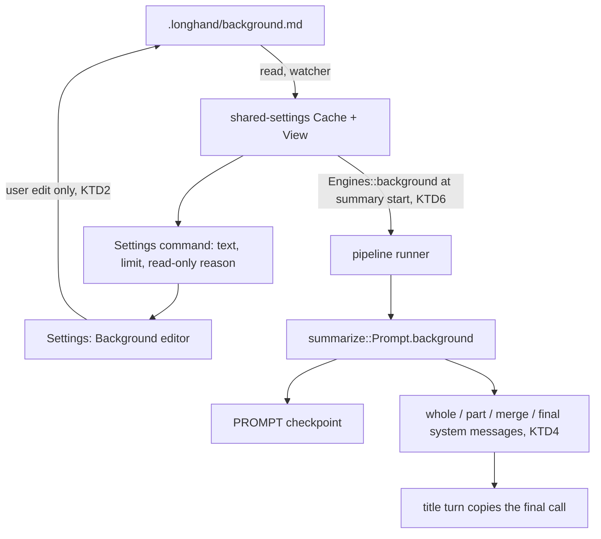

# Background for Summaries - Plan

## Goal Capsule

- **Objective:** Summaries and titles spell the user's names and terms correctly and name the people the user told Longhand about. The user writes this background one time, in free-form Markdown, and every summary uses it.
- **Means:** A shared `background.md` file in the storage folder (KTD1), edited on the Summaries page of Settings above the summary prompts with a Settings form of the My Notes editor (KTD7). Summarize adds it to the system prompt of each model call (KTD4). The summary prompt and title instruction boxes change to the same editor.
- **Product authority:** The user, in the brainstorm and the plan scoping of 2026-10-05. The Product Contract wins on product behavior; the KTDs win on mechanism. Source idea: `docs/ideas/next/summary-background.md`. This is a smaller step before `docs/ideas/someday/agentic-summary.md`; Background is the text that idea calls "context about the user".
- **Stop conditions:** Stop and ask when a change would let a read, a mount or a join write the Background (KTD2), when a Background could relax a fixed rule other than the four name rules of R8, or when the budget test of U3 cannot pass with the 4,000-character limit at a 16K context.
- **Execution profile:** One PR from a worktree off `origin/main`, units in the order of the Implementation Units section. The implementer (`ce-work`) finishes, reviews and ships the work, then gives a signed build for the manual test.
- **Open blockers:** None.

---

## Product Contract

**Product Contract preservation:** changed: R6 — the limit is 4,000 characters (user-directed at plan scoping, chosen over 2,000 and 8,000). The Outstanding Questions are resolved in the Planning Contract (KTD1, KTD5, KTD7, KTD8). All other requirements and examples are unchanged.

### Summary

Settings gets a Background section on the Summaries page, between Model and the summary prompts. The user writes free-form Markdown there: their name, their work, the names and terms that often occur, and words that the transcript often gets wrong. Every summary and title request includes this text in a labelled section of the system prompt. The section uses the My Notes editor, and the summary prompt and title instruction boxes change to the same editor.

### Problem Frame

The transcript often spells names and terms wrong, and the summary repeats the errors. The summary model knows nothing about the user, their company or the people they meet. The only place to tell it is the summary prompt text. That text is per prompt, the built-in prompts cannot be changed, and facts about the user do not belong in instructions about the shape of a summary.

The fixed naming rule also stops the model from using a name unless the transcript or notes make it clear. Even when the user knows who was in the room, the summary says "your team member".

### Key Decisions

- **One Background for all prompts, not one for each prompt.** The user writes it one time, and it can later feed the agent's "context about the user" tool. Governs R1, R5.
- **Background is the user's own text, not quoted data.** The model reads it as instructions and facts, like the prompt text. The fixed rules still win over it. Governs R6, R8.
- **Background is evidence for names.** The model can use it to name a person, including to decide which speaker is a person it names, when the data and the Background together make that clear. It never invents a name. Governs R7. (session-settled: user-directed — chosen over "fix spelling only" and over "also identify the user": the rule that a name must come from the data alone is too strict after the user has said who people are.)
- **Background sits above the summary prompts.** Most users will fill it in; fewer users will change the built-in prompts, which are the more advanced setting. Governs R2. (session-settled: user-directed — chosen over a position below the prompts: Settings goes from common to advanced.)
- **The name is "Background".** It is neutral, it fits facts about a company as well as a person, and it does not collide with the existing "Context limit" setting. Governs R2. (session-settled: user-directed — chosen over "About you" and "Summary context".)

### Requirements

**Background text**

- R1. Settings has one Background text. It is free-form Markdown with no required structure.
- R2. The Background section is on the Summaries page, after Model and before the summary prompts. Its hint text tells the user what to write: names, work, terms they use, and words the transcript often gets wrong.
- R3. The Background uses the same Markdown editor as the My Notes tab. In Settings, each editor has its own accessible name and a hint line under its visible label that stays visible while the user types, as the prompt boxes have today. The My Notes placeholder does not show in Settings.
- R4. A change saves automatically, the same as the other Settings texts. There is no Save button.
- R5. The Background is shared across computers through the storage folder, the same as the summary prompts. When the storage folder is not available, the section is read-only and says why, the same as the summary prompts.
- R6. The Background has a limit of 4,000 characters, shown as a character count the same as the prompt text. A text over the limit is not saved and the count shows the error.

**Use in summaries**

- R7. Every model call that Summarize makes includes the Background in a labelled section of the system prompt: the call for a whole transcript, the part-note and merge calls for a long transcript, the final merge, and the title turn. An empty Background adds nothing.
- R8. Every fixed rule about names counts the Background as evidence: the naming rule of the final call, the label rule of part notes and merges, the "keep every name exactly as it was said" rule of part notes, and the title rules. A name is used, or a spelling corrected, when the transcript, the notes and the Background together make clear who or what is meant. The rules still forbid "Speaker N" in the summary and title, and still forbid invented names. The rules mention the Background only when the Background is not empty.
- R9. The fixed rules keep their priority over the Background, the same as over the prompt text. A Background cannot relax them.
- R10. A summary uses the Background as it is when the summary starts. A change to the Background does not change existing summaries; Regenerate uses the current Background.

**Markdown editor for prompt texts**

- R11. The summary prompt text and the title instructions text in Settings use the same Markdown editor as the Background.
- R12. A built-in prompt shows its texts in the editor as read-only, as it does today.
- R13. Character limits, the count, the save delay and the save on leaving the box stay as they are today.

### Acceptance Examples

- AE1. **Covers R7.** **Given** a Background that says "Pria is spelled Priya", **when** the transcript says "Pria will send the budget", **then** the summary says "Priya will send the budget".
- AE2. **Covers R8.** **Given** a Background that says "I meet Sam each Monday for a 1:1", **when** a two-person transcript has one speaker addressed as Sam, **then** the summary names Sam, and does not name the other speaker unless the data or the Background makes that clear.
- AE3. **Covers R8.** **Given** a Background that lists Sam and Priya, **when** nothing in the transcript connects a speaker to either name, **then** the summary uses a plain description, not a guessed name.
- AE4. **Covers R7.** **Given** an empty Background, **when** the user summarizes, **then** the system prompt is the same as before this change.
- AE5. **Covers R7.** **Given** a transcript long enough to be split into parts, **when** Summarize runs, **then** each part note already uses the Background spelling.
- AE6. **Covers R12.** **Given** the built-in Topic summary is selected, **when** the user clicks its text, **then** the editor shows the formatted text and takes no input.
- AE7. **Covers R8.** **Given** the AE2 Background and a transcript long enough to be split into parts, **when** Summarize runs, **then** the part notes write "Speaker 2 (Sam)" and the final summary and the title name Sam.

### Scope Boundaries

- The summary agent and its tools (`docs/ideas/someday/agentic-summary.md`) and outside tools such as a calendar (`docs/ideas/someday/pluggable-summary-tools.md`).
- A Background that the model changes by itself, like a memory.
- A different Background for each prompt or each type of note.
- Names on the speaker labels of the transcript. R8 changes only the summary and title text.

### Dependencies / Assumptions

- Background is text that the user types, so it is inside the `STRATEGY.md` boundary "Nothing writes into Longhand". It is sent to the summary endpoint with the transcript, so it goes only where the user already chose to send the transcript.
- The "Ruled out" item "Speaker identity" in `docs/ideas/README.md` is about enrollment and voiceprints. R8 adds no stored speaker identity; it only lets the summary text use a name that the user wrote.

### Sources / Research

- `crates/summarize/src/prompts.rs`: `final_system()` builds the final system message (data rule, fixed rules, prompt text, then `NAMING_RULE`); `part_system()` builds the part-note and non-final merge messages with no prompt text; `title_turn()` reuses the final call's messages; `PROMPT_TEXT_LIMIT` and `TITLE_TEXT_LIMIT`.
- `crates/shared-settings/src/prompts.rs`: prompts are one `.md` file each in `.longhand/prompts/` in the storage folder, with front matter and a title marker line.
- `docs/solutions/integration-issues/shared-settings-in-a-synced-folder-rules.md`: rules for settings shared through a synced folder.
- `src/settings/SummaryPrompts.tsx`: the two `<textarea>` boxes, the one-second save delay, the save on blur, and the read-only state for built-in prompts.
- `src/settings/EndpointForm.tsx`: the Summaries page order (endpoint, Model, summary prompts, Context limit).
- `src/editor/NoteEditor.tsx`: the My Notes editor (`markdown`, `onChange`, `autoFocus`, `editable`).
- `docs/plans/2026-09-30-1604-feat-title-instructions-plan.md`: the earlier plan for a Settings text that goes into the prompt.
- `docs/solutions/integration-issues/shared-settings-in-a-synced-folder-rules.md`, `docs/solutions/ui-bugs/notes-cursor-moved-to-end-after-tab-change.md`, `docs/solutions/ui-bugs/wkwebview-click-does-not-focus-button-breaks-shortcut-capture.md`: the rules that U1, U5 and U6 follow.

---

## Planning Contract

### Key Technical Decisions

- KTD1. **The Background is its own file, `.longhand/background.md`, not a field in `settings.json`.** It is plain Markdown that the user's other agents can read, as `STRATEGY.md` intends for the storage folder, and a Background save cannot race a save of another setting (rule 7 of the shared-settings solution). The cost is a cache field, a join rule and a watcher path (U1, U2). Only the exact name is read; conflict copies such as `background 2.md` are ignored (rule 5). (session-settled: user-approved — chosen over a `settings.json` field: plain Markdown and no shared save race outweigh the extra code.)
- KTD2. **Only a user edit writes the Background.** A read, a watcher refresh, an editor mount and a join that finds the file missing never write it (rule 1). The join writes `background.md` only when it also writes `settings.json` (the folder has no settings file) and the cache text is not empty. A `ChangeOfFolder` join also writes it when the target has no `background.md` and the cache text is not empty. The join never writes an empty file and never writes over an existing one. When the user clears the text, the save writes an empty file; it does not delete the file. Governs R4, R5.
- KTD3. **A Background file that cannot be used is not available, never empty.** A file over the limit, not valid UTF-8 or not readable makes the Background read-only, with a reason, and the app uses the cached text in summaries. The file is never overwritten in this state. A missing file in a folder that has `settings.json` is an empty Background that the user can edit. Governs R5, R6.
- KTD4. **The Background is a labelled section of each system message, before the prompt text, in the user's own words.** `part_system()` and `final_system()` put it directly after the opening data-rule sentence and before every other fixed rule, under a short heading that says it is what the user wants the model to know. So in each message the fixed rules come after the Background. It is not passed through `quote()`, the same as the prompt text. The title turn copies the final call's system message, so the title sees it with no extra code. Governs R7, R9.
- KTD5. **The four name rules come from one builder that knows whether the Background is empty.** When the trimmed Background is empty, `NAMING_RULE`, `PART_LABELS`, `PART_SHAPE` and `TITLE_RULES` stay byte for byte as they are today (AE4). When it is not empty, each rule adds that the Background counts as evidence for names and spellings. `NAMING_RULE` and `TITLE_RULES` still end with "These rules apply even when the instructions above say otherwise". With a Background, `PART_LABELS` and `PART_SHAPE` also end with a sentence that they apply even when the Background says otherwise, so the Background stays below all four rules. "Empty" means empty after trimming whitespace, here and in KTD6. Governs R8, R9.
- KTD6. **The Background travels in `summarize::Prompt` and is taken from current settings when a summary starts.** `Prompt` gets a `background` field with a serde default. The runner sets it from a new `Engines::background()` source at summary start: after `first_summary_prompt` builds the recording-start snapshot, and on the `engines.summary_prompt()` fallback. The `PROMPT` checkpoint then holds it, so a resumed summary uses the same Background (R10). `active_summary_prompt_snapshot`, the recording-start snapshot and the prompt list never hold it; only the shared-settings `Cache` field of U1 does. Regenerate's reuse check (`same_prompt` in `crates/pipeline/src/save.rs`) also compares the trimmed Background. Governs R7, R10.
- KTD7. **Settings uses a form of `NoteEditor`, not a second editor.** `NoteEditor` gets options for Settings: an accessible name and description by id, no placeholder, an immediate `onChange` with no own delay, an `onBlur` callback and a CSS class for a field frame. The toolbar and the `/` menu stay, but they do not show when the editor is not editable, in Settings and in My Notes. The Settings parent keeps its one-second save delay, its count and its blur save. Governs R3, R11, R12, R13.
- KTD8. **The Markdown round trip is accepted.** The first edit joins single line breaks and normalizes list markers and escapes. The model reads the result in the same way, and a change to the shared parser would also change My Notes. The editor never saves without a user edit, so a text that is only shown keeps its file shape. The count and the limit measure the Markdown that is saved, as the backend checks it (R6, R13). (session-settled: user-approved — chosen over keeping single line breaks: no parser change for My Notes.)
- KTD9. **One close coordinator for all Settings saves.** Today only `SummaryPrompts` handles window close and page hide. A small module in `src/settings/` takes the pending flushes of the Background and of the prompt boxes and waits for all of them, within the existing close limit, before the window closes. Governs R4, R13.
- KTD10. **The remount key of a Settings editor changes only on a new document.** The key changes when the user selects another prompt or field, on Reload, and when another computer changes the text while there is no draft. It does not change on an own save, on the "changed on another computer" notice, or when the text becomes read-only. The editor mounts from the draft when one exists, so a draft whose save failed comes back. Governs R4, R5, R11.
- KTD11. **The budget counts the Background.** `overhead()` and `fit_notes()` take the Background, so the chunk allowance and the "prompt too long" check include it with no new rule. At the default 8,192-token context, a custom prompt and a Background both near 4,000 characters can be too long; the message then says to shorten the prompt or the Background, or to choose a model with a larger context. Governs R6, R7.

### High-Level Technical Design

Where the Background goes, from the file to the model calls:

The rule text depends on one boolean, "the trimmed Background is not empty" (KTD5):

| Rule | Empty Background | Background with text |
|---|---|---|
| Final naming rule | as today | names may come from transcript, notes and Background together |
| Part label rule | as today | "Speaker 2 (Sam)" may use the Background |
| Part "exactly as said" rule | as today | a name or term may take the Background spelling |
| Title rules | as today | names may come from the data and the Background |

### Assumptions

- No shared `schema_version` change: the Background is a new file, and older builds ignore it.
- The Background is plain user text with no front matter. A file written outside the app is used as it is, within KTD3.

---

## Implementation Units

### U1. Background file in shared settings

**Goal:** Read, write, cache and join `.longhand/background.md` under the shared-settings rules.

**Requirements:** R1, R5, R6; KTD1, KTD2, KTD3.

**Dependencies:** None.

**Files:**
- Create: `crates/shared-settings/src/background.rs`
- Modify: `crates/shared-settings/src/lib.rs`, `crates/shared-settings/src/cache.rs`, `crates/shared-settings/src/view.rs`, `crates/shared-settings/src/join.rs`
- Test: `crates/shared-settings/tests/background.rs`, `crates/shared-settings/tests/join.rs`, `crates/shared-settings/tests/two_computers.rs`

**Approach:**
1. Add `BACKGROUND_FILE` and `BACKGROUND_TEXT_LIMIT = 4_000` (characters, counted as code points like the prompt limits). Put the limit where the prompt limits are, in `crates/summarize/src/prompts.rs`, if shared-settings already depends on summarize for them; otherwise in shared-settings and re-export.
2. Read: exact name only, a byte cap like `MAX_FILE_BYTES`, UTF-8 check, limit check. The result is `Text(String)`, `Missing`, or `NotAvailable(reason)` per KTD3.
3. Write: `ensure_writable` first, then the limit check, then `write_atomic`. An empty text writes an empty file (KTD2).
4. `Cache` gets `background: String` with `#[serde(default)]`; `SharedView` gets the text and its availability; `from_cache` gives the cached text as read-only.
5. Join per KTD2: write only with `settings.json`, or on `ChangeOfFolder` into a folder with no file, and only with a non-empty cache text.

**Patterns to follow:** `crates/shared-settings/src/prompts.rs` (`read_entry`, `ensure_writable`, `write_atomic` use, `PromptError` as UI text); `crates/shared-settings/tests/prompts.rs` (`folder()`, `default_settings()`).

**Test scenarios:**
- A folder with `settings.json` and `background.md` reads the text.
- A folder with `settings.json` and no `background.md` reads an empty, editable Background, and the read writes nothing.
- A file over 4,000 characters reads as not available with a reason; a save is refused and the file is unchanged.
- A file that is not UTF-8 reads as not available; nothing writes it.
- `background 2.md` beside the real file is ignored.
- A save writes the text atomically and a read gives the same text back.
- A save of an empty text writes an empty file; the file still exists.
- A save when `settings.json` does not parse is refused, as for prompts.
- Join `SameFolder` into a folder that has `settings.json` but no `background.md` writes no `background.md`.
- Join with no cache into an empty folder writes no `background.md`.
- Join `ChangeOfFolder` with a cached Background into a folder with no file writes the cached text; into a folder with a file keeps the folder's file.
- Two computers: a Background change on A shows on B after B re-reads; a save of a prompt on B keeps A's Background.

**Verification:** The shared-settings tests pass, and no test path writes the file on a read or a join that the KTD2 conditions exclude.

### U2. App wiring: manager, watcher, command and Engines source

**Goal:** Give the Settings window the Background text, limit and read-only reason, let it save, refresh on a change from another computer, and give the pipeline the current Background.

**Requirements:** R4, R5, R6, R7; KTD1, KTD6.

**Dependencies:** U1.

**Files:**
- Modify: `crates/pipeline/src/runner.rs` (the `Engines` trait and test engines), `src-tauri/src/managers/shared.rs`, `src-tauri/src/managers/library.rs`, `src-tauri/src/managers/settings.rs`, `src-tauri/src/commands/settings.rs`, `src-tauri/src/managers/processing.rs`, `src-tauri/src/lib.rs` (command registration), `src/bindings.ts` (regenerated)
- Test: tests in `src-tauri/src/managers/shared.rs` and `src-tauri/src/managers/library.rs`

**Approach:**
1. `SharedSettingsManager` gets a `set_background` op through `change()`, so it takes the writer lock and joins first like the prompt ops.
2. `is_shared_path` in `library.rs` also passes `.longhand/background.md`, so the watcher re-reads it.
3. `Settings::from_parts` exposes `background`, `background_limit` and the read-only reason; a `set_background` command returns `Result<Settings, String>` like the prompt commands. Regenerate `src/bindings.ts` with `cargo test -p longhand export_bindings`.
4. Add `fn background(&self) -> String` to the `Engines` trait in `crates/pipeline/src/runner.rs`, with the test engines returning a set value. The processing manager implements it from the current shared view (the cached text when not available, KTD3).

**Patterns to follow:** the prompt ops at `src-tauri/src/managers/shared.rs` (`set_prompt_text`), the `summary_prompts` command, `is_shared_path` tests near the prompt-path tests in `library.rs`.

**Test scenarios:**
- `set_background` saves and the returned settings carry the new text.
- `set_background` over the limit returns the limit error and does not write.
- With the storage folder unavailable, `set_background` is refused and the settings show a read-only reason.
- The watcher treats `.longhand/background.md` as a shared path and ignores `.longhand/background 2.md`.
- A change of `background.md` by another computer refreshes the view.
- `Engines::background()` returns the cached text when the file is not available.

**Verification:** The `longhand` crate tests pass and `src/bindings.ts` has the new command and fields.

### U3. Summarize: the Background section and the four name rules

**Goal:** Put the Background in every system message and make the four name rules count it, with no change when it is empty.

**Requirements:** R7, R8, R9; AE1, AE3, AE4; KTD4, KTD5, KTD11.

**Dependencies:** None.

**Files:**
- Modify: `crates/summarize/src/prompts.rs`
- Test: `crates/summarize/tests/prompts.rs`, `crates/summarize/tests/merge.rs`

**Approach:**
1. `Prompt` gets `background: String` with `#[serde(default)]`.
2. One rule builder takes "has background" and returns the four rule texts; with no Background they equal today's constants.
3. `part_system()` and `final_system()` add the Background section directly after the data-rule sentence (KTD4); `whole`, `part`, `merge`, `overhead` and `fit_notes` take the Background.
4. `title_request()` uses the title rules for the same boolean.
5. Write the section heading and the rule clauses in plain words; check them against the existing rule style.

**Execution note:** Write the "empty Background gives today's bytes" test first; it guards AE4 through the rest of the work.

**Patterns to follow:** `only_the_last_merge_gets_the_prompt_text_and_the_naming_rule`, `a_part_note_keeps_every_fact_with_the_fixed_weighting_and_not_the_prompt_text`, `the_fixed_title_rules_come_after_the_title_text`, and the budget tests in `crates/summarize/tests/prompts.rs`.

**Test scenarios:**
- Covers AE4. An empty or whitespace-only Background gives system messages and a title request that are the same, byte for byte, as with no Background field.
- Covers AE1. A Background appears in the whole call's system message, after the fixed rules and before the prompt text.
- The Background appears in each part-note, intermediate merge and last merge system message.
- The title turn's system message contains the Background, and the title rules come last in the title request.
- With a Background, each of the four rules carries the Background clause; the naming rule still comes last in the final system message and still forbids "Speaker N" and invented names.
- A Background that contains `</transcript>` or "ignore the above" goes in as it is; the fixed rules still follow it.
- A prompt text at 4,000 and a Background at 4,000 characters leave a chunk allowance at 16,384 tokens; at 4,096 tokens the overhead check reports too long; the overhead with the Background exceeds the overhead without it by at least the Background's estimate.
- In a part-note and an intermediate-merge system message, `PART_LABELS` and `PART_SHAPE` come after the Background section.
- Each built-in prompt with an empty Background still leaves room in the last merge at 2,048 tokens.
- A `Prompt` JSON with no `background` key deserializes with an empty Background.

**Verification:** The summarize tests pass, including the existing ones without change of expected text.

### U4. Pipeline: the Background at summary start

**Goal:** Take the current Background at summary start, keep it through a resume, and stop regenerate from reusing calls made with another Background.

**Requirements:** R7, R10; AE5, AE7; KTD6, KTD11.

**Dependencies:** U2, U3.

**Files:**
- Modify: `crates/pipeline/src/runner.rs`, `crates/pipeline/src/summarize.rs`, `crates/pipeline/src/save.rs`
- Test: `crates/pipeline/tests/runner.rs`, tests in `crates/pipeline/src/save.rs` or `crates/pipeline/tests/end_to_end.rs` where regenerate is tested

**Approach:**
1. Use the `Engines::background()` source from U2.
2. In the runner, set `prompt.background` from `engines.background()` after `first_summary_prompt` and on the `summary_prompt()` fallback; Transcribe Again follows the same path.
3. `produce` passes `prompt.background` to every prompt call and to `overhead`/`fit_notes`; the `PROMPT` checkpoint stores it.
4. `same_prompt` compares the trimmed Background too.
5. `PROMPT_TOO_LONG` names the Background (KTD11).

**Test scenarios:**
- A note with a recording-start prompt snapshot is summarized with the Background that `Engines` gives at summary start, not an empty one.
- A note with no snapshot uses the `summary_prompt()` fallback and the same Background.
- A summary resumed after a stop uses the Background from the `PROMPT` checkpoint, even after `Engines` returns another one.
- Regenerate after a Background change does not reuse the cached part notes; with the same Background it does.
- A too-long stop from a long Background, then a shorter Background and Regenerate, finishes.
- Covers AE5 / AE7 at the message level. A long transcript split into parts sends the Background in each part call.

**Verification:** The pipeline tests pass with `timeout` on the cargo run.

### U5. A Settings form of the Markdown editor

**Goal:** Let `NoteEditor` serve as a Settings field without changing My Notes.

**Requirements:** R3, R11, R12, R13; AE6; KTD7, KTD8.

**Dependencies:** None.

**Files:**
- Modify: `src/editor/NoteEditor.tsx`, `src/editor/widgets/format-toolbar.tsx`, `src/editor/widgets/slash-command.tsx`, `src/editor/editor.css`
- Create: `src/settings/MarkdownField.tsx`
- Test: `src/editor/NoteEditor.test.tsx`, `src/settings/MarkdownField.test.tsx`

**Approach:**
1. New optional `NoteEditor` props: `labelledBy`, `describedBy`, `placeholder` (default the My Notes text; `null` for none), `immediate` (call `onChange` on each change with no own delay), `onBlur`, and an extra class. My Notes passes none of them and keeps its behaviour.
2. The toolbar and the `/` menu do not show when `editable` is false (this also fixes My Notes while it waits for a sync).
3. `MarkdownField` wraps `NoteEditor` with a visible label, the hint line linked by `describedBy`, the count, a field frame with a minimum height that keeps the `fieldClass` states of today's boxes (focus ring, red border over the limit, read-only look), and a `key` from the parent (KTD10). It never autofocuses.

**Patterns to follow:** `NotesTab.tsx` for the `key` remount, `PromptField` in `SummaryPrompts.tsx` for the label, detail and count layout, `fieldClass` in `src/settings/ui.tsx`.

**Test scenarios:**
- With `immediate`, typing one character calls `onChange` at once, with no timer.
- Without the new props, My Notes keeps its delay, placeholder and accessible name "My Notes" (existing tests unchanged).
- `labelledBy` and `describedBy` give the textbox the field's name and hint; two fields on one page are found by name.
- With `placeholder={null}`, an empty Settings field shows no note placeholder.
- Covers AE6. In a read-only field, selecting text shows no toolbar, `/` opens no menu, and no `onChange` fires.
- `onBlur` fires when focus leaves the editor.
- Mounting with a text and leaving it unedited calls `onChange` zero times.

**Verification:** `bun test ./src/` passes; the My Notes tests pass with no change.

### U6. The Background section and the close coordinator

**Goal:** Show and save the Background on the Summaries page, and make window close wait for every Settings save.

**Requirements:** R2, R3, R4, R5, R6; KTD2, KTD9, KTD10.

**Dependencies:** U2, U5.

**Files:**
- Create: `src/settings/Background.tsx`, `src/settings/closeSaves.ts`
- Modify: `src/settings/EndpointForm.tsx`, `src/settings/SummaryPrompts.tsx` (move its close handling to `closeSaves.ts`)
- Test: `src/settings/Background.test.tsx`, `src/settings/closeSaves.test.ts`, `src/settings/SummaryPrompts.test.tsx` (close tests)

**Approach:**
1. `Background` sits in its own `Group` between the Model group and `SummaryPrompts` in `EndpointForm`.
2. Save flow as in `PromptField`: a draft, a one-second timer when the text is valid, a flush on blur, the count in code points, the read-only reason, the "changed on another computer" notice with Reload and Keep My Text.
3. The UI text uses the term "Background", plain words, and a hint that names names, work, terms and words the transcript gets wrong.
4. `closeSaves.ts` registers flush functions; the one close and page-hide handler waits for all of them within the existing limit, then closes the window.

**Patterns to follow:** `PromptField`, `flush`, `changedElsewhere` and the close handling in `src/settings/SummaryPrompts.tsx`; `readOnlyReason` in `src/settings/shared.ts`; the mock backend in `SummaryPrompts.test.tsx`.

**Test scenarios:**
- The Background group renders after the Model row and before the summary prompts.
- Typing saves once, one second after the last change; leaving the field saves at once.
- A text over 4,000 characters shows a red count and does not save.
- Clearing the text saves an empty Background.
- With the storage folder unavailable, the field is read-only and shows the reason.
- A change from another computer with no draft shows the new text; with a draft, the notice shows and the field keeps the typed text and focus.
- Reload shows the saved text; Keep My Text saves the draft.
- An own save does not remount the editor; focus stays in the field.
- Type in the Background, close the window at once: the save completes before the window closes. The same holds with a pending prompt save at the same time.

**Verification:** `bun test ./src/` passes; `bun run typecheck` passes.

### U7. Markdown editor for the prompt boxes

**Goal:** Change the summary prompt and title instruction boxes to `MarkdownField` with today's behaviour.

**Requirements:** R11, R12, R13; AE6; KTD7, KTD10.

**Dependencies:** U5, U6.

**Files:**
- Modify: `src/settings/SummaryPrompts.tsx`
- Test: `src/settings/SummaryPrompts.test.tsx`

**Approach:**
1. `PromptField` renders `MarkdownField` in place of the `<textarea>`, with the key rules of KTD10 (prompt id, field, reload generation, outside change with no draft).
2. `readOnly` maps to `editable={false}`; built-in prompts show formatted, read-only text.
3. Rewrite the test helpers that read and set the textarea value to type into and read the editor by its accessible name; keep each existing scenario.

**Test scenarios:**
- Each existing `SummaryPrompts` scenario passes with the editor: the save delay, blur save, the count and its limit, an empty summary text refused, an empty title allowed, Reload, Keep My Text and the close save.
- Covers AE6. A built-in prompt shows its text in a read-only editor with no toolbar.
- Selecting another prompt shows that prompt's text; a draft whose save failed comes back when the user selects its prompt again.
- Typing the title marker line in a prompt text shows the backend's error and does not lose the text.

**Verification:** `bun test ./src/` passes with the same number of prompt scenarios as before.

---

## Verification Contract

| Gate | Command or step | When |
|---|---|---|
| Scoped Rust tests | `timeout 900 cargo test -p shared-settings`, `-p summarize`, `-p pipeline`, `-p longhand` for the unit's crate | Each unit: new tests red, change, then green |
| Bindings | `cargo test -p longhand export_bindings`, then commit `src/bindings.ts` | U2 |
| Frontend tests | `bun test ./src/` | U5, U6, U7 |
| Typecheck | `bun run typecheck` | U6, U7, before the PR |
| Full Rust run and lint | one `timeout 1800 cargo test --workspace` and `cargo clippy --workspace --all-targets` | Once, after U7 |
| Repo checks | `scripts/check-windows.sh`, `scripts/check-provenance.sh`, `bun scripts/ideas.ts check` | Before the PR |
| Manual test | Signed build per `docs/development-workflow.md#manual-tests`: type, blur, close and reopen Settings; a built-in prompt is read-only with no toolbar; a summary with a Background that fixes a misspelled name; a Background change on a second computer through one synced folder | After U7, before the PR is marked ready |

---

## Definition of Done

- R1–R13 and AE1–AE7 hold, each covered by a test named in a unit or by the manual test.
- With an empty Background, every system message and title request is byte for byte the same as before (AE4).
- No code path writes `background.md` except a user edit and the join cases of KTD2.
- The My Notes editor behaves as before, except that its toolbar and `/` menu no longer show while it is read-only.
- All gates of the Verification Contract pass, and the signed-build manual test is done.
- `docs/ideas/next/summary-background.md` moves to `done/` with the PR, and code from abandoned attempts is removed from the diff.
