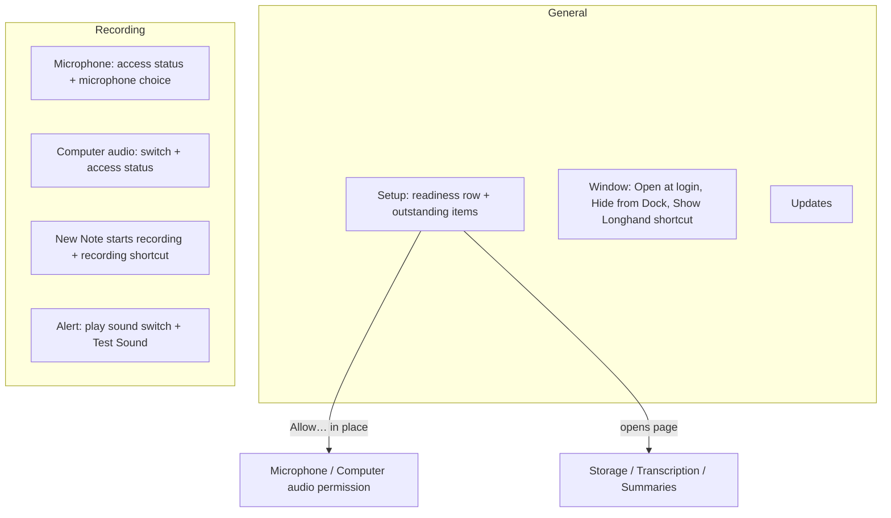
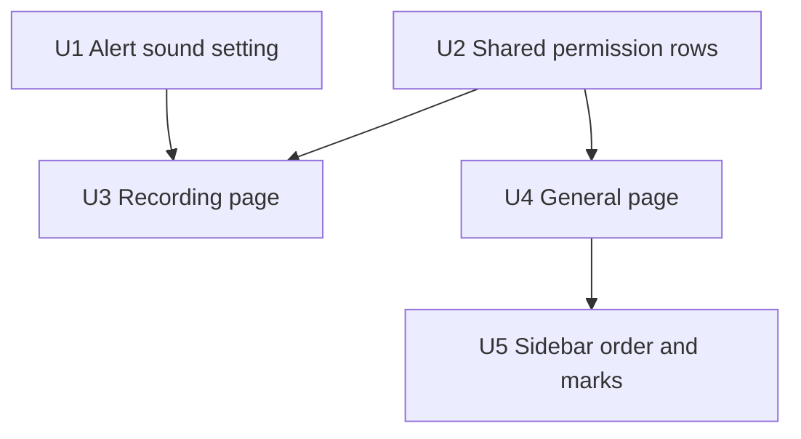

# General Settings Cleanup - Plan

## Goal Capsule

- **Objective:** A user who opens Settings sees at once what still stops a recording or delays processing, and finds each setting on the page for its topic.
- **Means:** General keeps only app-wide settings and a short list of outstanding setup items. Topic settings move to their own pages. The sidebar order changes.
- **Product authority:** This Product Contract. The user confirmed the scope in the brainstorm on 2026-10-06.
- **Authority order:** Product Contract (R-IDs win on behaviour), then Planning Contract (KTDs win on mechanism), then Implementation Units.
- **Open blockers:** None.
- **Stop conditions:** Stop and ask when a change would alter what makes a recording possible (`armed`), or when a requirement cannot be met without a new shared setting.
- **Execution profile:** Frontend reorganization in `src/settings/` plus one local setting in `src-tauri`. Work in a worktree from `origin/main`. Invoke `apple-design` before UI work. A signed build is needed for the manual test, because the microphone permission and the alert sound need a real bundle.

Product Contract preservation: changed R4 — on Windows the microphone item shows status only, with no button, as now; changed R3 — a storage folder low on space is an outstanding item, as on the current General pane. The user confirmed both during planning. Otherwise unchanged.

---

## Product Contract

### Summary

General keeps only app-wide settings: Open at login, Hide from Dock, the Show Longhand shortcut, and Updates. A setup group at the top always shows one readiness row and lists only the items that are still outstanding. Each other setting moves to the page for its topic, the alert sound becomes optional with a Test Sound button, and the sidebar order becomes General, Storage, Recording, Transcription, Summaries, About.

### Problem Frame

The General pane now holds five groups: Window, Recording, Processing, Updates, and Alerts. Most of its rows belong to other pages: the recording shortcut, the microphone and Computer audio permissions, the storage status, the model downloads, and the summary endpoint. The Recording group and the Processing group show every item, also the items that are ready. A user who wants to know what is still missing must read the full list. A user who wants the recording shortcut must know that it is on General and not on Recording.

### Key Decisions

- **One list for all outstanding items, not two lists.** The readiness row above the list tells the user if a recording can start. (session-settled: user-directed — chosen over a list split into "Before you can record" and "Before notes are processed", and over a list of recording blockers only: one short list is easier to read.) Governs R2, R3.
- **The readiness row always shows, also when items are outstanding.** (session-settled: user-directed — chosen over a "Ready" row that shows only when the list is empty: a missing model or summary endpoint does not stop a recording, and the row must say so.) Governs R2.
- **When nothing is outstanding, the group shows only the readiness row.** (session-settled: user-directed — chosen over a group that hides: the row confirms the state.) Governs R2.
- **The alert sound becomes optional, on by default, with a Test Sound button.** When it is off, a recording that stops shows only on screen. (session-settled: user-directed — chosen over a rename with no switch, and over a switch that plays the sound when turned on.) Governs R9.
- **A permission item works in place on General. Each other item opens its page.** (session-settled: user-approved — proposed in the scope summary and confirmed.) Governs R4.
- **Updates stays on General.** It applies to the whole app, like Open at login. (session-settled: user-approved — proposed in the scope summary and confirmed.) Governs R1.
- **The Computer audio permission is an outstanding item only when it is needed.** It is needed when the "Computer audio on for new notes" setting is on. The microphone alone is enough to record, so a user who does not use Computer audio has nothing to fix. Governs R3.

### Requirements

**General page**

- R1. General shows these settings and no others: Open at login, Hide from Dock (macOS), the Show Longhand shortcut, and Check for updates automatically (macOS).
- R2. A setup group at the top of General always shows one readiness row: "Ready to record" with a positive status when a recording can start, and "Not ready to record" with a caution status when it cannot.
- R3. Below the readiness row, the setup group lists each outstanding item and no item that is ready. The outstanding items are: microphone access not allowed, a recording shortcut that did not register, the storage folder not available, low on space, or read-only, models still to download, no summary endpoint, and Computer audio access not allowed while new notes start with Computer audio on.
- R4. Each outstanding item has one button. A permission item (microphone, Computer audio) asks for the permission in place. Each other item opens the page where the user fixes it. On Windows, the microphone item shows status only, because Longhand cannot show that prompt there.
- R5. The General status in the sidebar shows a caution mark when a recording cannot start, and a neutral mark when only items that do not stop a recording are outstanding.

**Moved settings**

- R6. The Recording page holds the microphone access status and its Allow button with the microphone choice.
- R7. The Recording page holds the Computer audio access status with the "Computer audio on for new notes" switch.
- R8. The Recording page holds the recording shortcut with the "New Note starts recording" switch.
- R9. The Recording page holds an alert group with a switch "Play a sound if recording stops", on by default, and a "Test Sound" button. When the switch is off, Longhand plays no sound when a recording stops and cannot restart.
- R10. The Recording status in the sidebar shows a caution mark when microphone access is not allowed or the recording shortcut did not register.
- R11. The Storage, Transcription, and Summaries pages get no new rows. Their existing status stays where it is.

**Sidebar**

- R12. The sidebar lists the pages in this order: General, Storage, Recording, Transcription, Summaries, then About in its own section.

### Page layout

### Acceptance Examples

- AE1. **Covers R2, R3.** Given microphone access is allowed, the shortcut is registered, the storage folder is ready, all models are downloaded, and a summary endpoint is set, when the user opens General, the setup group shows only "Ready to record".
- AE2. **Covers R2, R3, R5.** Given two models are still to download and no summary endpoint is set, and nothing else is outstanding, when the user opens General, the group shows "Ready to record" and two items below it, and the General sidebar mark is neutral.
- AE3. **Covers R2, R4, R5.** Given microphone access is not allowed, when the user opens General, the group shows "Not ready to record" and a microphone item with an Allow button, and the General sidebar mark is caution. When the user allows access, the item goes away.
- AE4. **Covers R3.** Given Computer audio access is not allowed and "Computer audio on for new notes" is off, the setup group shows no Computer audio item. When the user turns the switch on, the item shows.
- AE5. **Covers R9.** Given "Play a sound if recording stops" is off, when a recording stops and cannot restart, Longhand plays no sound and shows the failure on screen. "Test Sound" still plays the sound.

### Scope Boundaries

- No change to what makes a recording possible. The readiness rules stay as they are now.
- No change to the content of the Storage, Transcription, or Summaries pages, other than their position in the sidebar.
- No other sound or alert settings, such as a choice of sound or volume.
- No change to the wording or behaviour of the on-screen alert when a recording stops.

### Sources / Research

- `src/settings/Status.tsx` — the current General pane, with the groups that move.
- `src/settings/SettingsWindow.tsx` — the sidebar order and the sidebar status marks (`paneTone`).
- `src/settings/Recording.tsx` — the Recording page groups that receive the moved rows.
- `src-tauri/src/commands/readiness.rs` — `armed` needs microphone access and a registered or cleared shortcut. A storage folder that is not available does not stop a recording. The Computer audio permission does not change `armed`.
- `src-tauri/src/commands/alerts.rs` — the alert sound command that Test Sound uses.

---

## Planning Contract

### Key Technical Decisions

- KTD1. **The alert-sound setting is local to each computer.** It goes in the local settings next to `new_note_records` and `microphone`, not in the shared settings file in the storage folder. Sound output is a property of each Mac. (session-settled: user-approved — chosen over a shared setting that every computer with the storage folder gets: sound output differs per computer.) Governs R9.
- KTD2. **The alert checks the setting when it is raised.** `AlertsManager::raise` already has a `cue` flag that turns the sound off after a relaunch. The raise path combines that flag with the setting. The tray alert and the system notification still show. A change to the switch applies from the next alert; an alert that already plays continues. (session-settled: user-approved — chosen over a check before each of the three cues: simpler, and the user accepted the delay.) Governs R9.
- KTD3. **One pure function computes the outstanding items.** It takes `Readiness`, `Settings`, and the platform, and returns the ordered items with their kind (stops a recording or not). The General list (R3), the readiness row (R2), and the General sidebar mark (R5) all read it, so they cannot disagree. The order is recording blockers first (microphone, recording shortcut), then storage, Computer audio, models, summary endpoint. Governs R2, R3, R5.
- KTD4. **No backend readiness change.** "Ready to record" is `readiness.armed`, as now. The shortcut item shows when a chord is set and not registered. The Computer audio item is computed in the frontend: `features.systemAudio` is on, `settings.system_audio_default` is on, and the permission is not `allowed`. Governs R2, R3, R10.
- KTD5. **The permission rows become shared parts.** The microphone request (with its 500 ms poll, because the plugin resolves before the user answers) and the Computer audio row move out of `src/settings/Status.tsx` into one module. The General list and the Recording page both use them, so there is one implementation of each request. Governs R4, R6, R7.
- KTD6. **The Recording page gets `readiness` and a refresh callback.** It needs them for the permission rows and for the recording shortcut, which refreshes readiness after a change (R13 of the shortcut work). The Show Longhand shortcut stays on General and keeps its own `shortcutStatus` read. Governs R6, R7, R8.

### Sequencing

### Assumptions

- The system notification uses the user's macOS notification sound settings. Longhand does not control that sound, and R9 does not cover it.
- No migration is needed. An older local settings file has no alert-sound key and reads as on, by the existing `#[serde(default)]` rule.

### Deferred to Follow-Up Work

- A choice of alert sound or volume (Scope Boundaries).
- An "Open System Settings" button for a denied microphone permission. Today the Allow button gets no prompt after a denial, and `readiness` cannot tell a denial from "not asked yet". U2 keeps the current behaviour.

---

## Implementation Units

### U1. Alert sound setting

**Goal:** Add a local, on-by-default setting that stops the failed-recording cue.

**Requirements:** R9; KTD1, KTD2.

**Dependencies:** None.

**Files:**
- `src-tauri/src/managers/settings.rs` (field on `LocalSettings` and `Settings`, default, `local()` and merge)
- `src-tauri/src/commands/settings.rs` (setter command)
- `src-tauri/src/lib.rs` (register the command)
- `src-tauri/src/managers/alerts.rs` or its caller in `src-tauri/src/managers/capture.rs` (combine the setting with `cue`)
- `src/bindings.ts` (regenerated)

**Approach:**
1. Add the field next to `new_note_records`, with a doc comment that names R9.
2. Add a setter that follows `set_new_note_records` (`settings::update_settings`).
3. At the raise, read the setting with `get_settings` and pass `cue && alert_sound`. Keep the relaunch path (`cue: false`) as it is.
4. Regenerate `src/bindings.ts` with `cargo test -p longhand export_bindings`.

**Patterns to follow:** `new_note_records` in `src-tauri/src/managers/settings.rs` and its test `a_store_without_the_new_note_key_reads_as_new_note_records`.

**Test scenarios:**
- A store without the alert-sound key reads as on, and `Settings::default()` is on.
- A save with the setting off writes `false`, and a read gives off.
- Covers AE5. With the setting off, a raised alert plays no cue and still sets the tray alert. Choose the test seam during implementation (for example, a function that decides the cue list from `cue` and the setting).
- With the setting on, the cue list is the existing three cues (`CUE_AT`).

**Verification:** The new tests and the existing settings and alerts tests in `longhand` pass.

### U2. Shared permission rows

**Goal:** Move the microphone request and the Computer audio row into one module that General and Recording both use.

**Requirements:** R4, R6, R7; KTD5.

**Dependencies:** None.

**Files:**
- `src/settings/Permissions.tsx` (new)
- `src/settings/Permissions.test.tsx` (new; tests move from `src/settings/Status.test.tsx`)
- `src/settings/Status.tsx` (remove the moved code)

**Approach:**
1. Move `askForMicrophone` (with its poll) and `SystemAudioRow` without behaviour change.
2. Expose a microphone row and a microphone action button, so the General list can show only the button in an item.
3. Keep the macOS check: the microphone Allow button shows on macOS only (R4).

**Patterns to follow:** The existing code in `src/settings/Status.tsx`. Read `docs/solutions/integration-issues/tcc-preflight-stale-after-tap-prompt-grant.md` before changing the Computer audio request.

**Test scenarios:**
- The microphone Allow button asks for permission, shows "Waiting…" while it polls, and refreshes readiness when access is granted.
- On a non-macOS user agent, the microphone row shows no button.
- The Computer audio row shows Allow for `not_asked`, "Open System Settings" for `denied`, and "Allowed" for `allowed`.

**Verification:** The moved tests pass in their new file, and `src/settings/Status.test.tsx` has no test for the moved code.

### U3. Recording page

**Goal:** The Recording page holds the microphone access, the Computer audio access, the recording shortcut, and the alert group.

**Requirements:** R6, R7, R8, R9; KTD6.

**Dependencies:** U1, U2.

**Files:**
- `src/settings/Recording.tsx`
- `src/settings/Recording.test.tsx`
- `src/settings/SettingsWindow.tsx` (pass `readiness` and the refresh callback)

**Approach:**
1. Keep the group order: New Note, Microphone, Computer audio, then a new Alert group last.
2. New Note group: add the recording `ShortcutField` (moved from General, with its detail text and reset to `DEFAULT_SHORTCUT`).
3. Microphone group: add the microphone access row from U2 above the choices.
4. Computer audio group: add the access row from U2 below the switch. It shows only when `features.systemAudio` is on, as the group does now.
5. Alert group: a switch "Play a sound if recording stops" and a "Test Sound" button that calls `playAlertSound`. A failed play shows its error, as now.

**Execution note:** Invoke `apple-design` before the layout change.

**Patterns to follow:** `NewNote` and `SystemAudio` in `src/settings/Recording.tsx` for a switch with an error; `docs/solutions/ui-bugs/wkwebview-click-does-not-focus-button-breaks-shortcut-capture.md` for the shortcut field.

**Test scenarios:**
- The Recording page shows the recording shortcut, and a change refreshes readiness.
- With microphone access not allowed on macOS, the Microphone group shows the Allow button.
- With `features.systemAudio` on, the Computer audio group shows the access row.
- Covers AE5. The alert switch shows on by default, a click calls the setter with `false`, and a failed setter keeps the old value and shows the error.
- "Test Sound" calls `playAlertSound` when the switch is off.

**Verification:** `src/settings/Recording.test.tsx` passes, and the moved rows no longer show on General.

### U4. General page

**Goal:** General shows the setup group, the Window group, and Updates, and nothing else.

**Requirements:** R1, R2, R3, R4; KTD3, KTD4.

**Dependencies:** U2.

**Files:**
- `src/settings/Status.tsx` (pane and the outstanding-items function; the function may go in its own file)
- `src/settings/Status.test.tsx`

**Approach:**
1. Add the outstanding-items function (KTD3). Each item has a label, a detail, its kind, and its action: a permission button from U2, or a page to open.
2. Setup group: the readiness row (`armed`), then one row per item. The page buttons keep the current labels ("Fix…", "Download…", "Set Up…").
3. Remove the Recording, Processing, and Alerts groups.
4. Keep the Window group and the Updates group as they are.

**Execution note:** Implement the outstanding-items function test-first; it is pure.

**Patterns to follow:** `GoTo` and the readiness rows in the current `src/settings/Status.tsx`; `describeDestination` for the storage text; `readOnlyReason` for a read-only storage folder.

**Test scenarios:**
- Covers AE1. All ready: the function returns no items, and the group shows only "Ready to record".
- Covers AE2. Two models to download and no endpoint: two items, both of the kind that does not stop a recording, and the row says "Ready to record".
- Covers AE3. Microphone not allowed: the row says "Not ready to record", and the microphone item comes first, with Allow.
- A chord set and not registered gives a shortcut item. A cleared chord gives no item.
- Storage not available, storage low on space, and storage read-only each give one storage item that opens Storage. The rule matches the current check: any destination kind other than `ready`, or a read-only reason.
- Covers AE4. Computer audio not allowed: no item when `system_audio_default` is off, one item when it is on, and no item when `features.systemAudio` is off.
- The order is microphone, shortcut, storage, Computer audio, models, endpoint, when all are outstanding.
- General shows no recording shortcut, microphone choice, model, endpoint, or alert row.

**Verification:** `src/settings/Status.test.tsx` passes.

### U5. Sidebar order and marks

**Goal:** The sidebar uses the new order, and the General and Recording marks follow R5 and R10.

**Requirements:** R5, R10, R12; KTD3, KTD4.

**Dependencies:** U4.

**Files:**
- `src/settings/SettingsWindow.tsx`
- `src/settings/SettingsWindow.test.tsx` (new)

**Approach:**
1. Order the panes General, Storage, Recording, Transcription, Summaries, then About. Update the comment that explains the order. The up and down arrows follow the new order, because they read the same list.
2. Export `paneTone` (or move it beside the outstanding-items function) so that it can be tested.
3. General: caution when `armed` is false, neutral when only items of the other kind are outstanding, none otherwise.
4. Recording: caution when `armed` is false.
5. Keep the Storage, Transcription, and Summaries marks as they are.

**Test scenarios:**
- Covers AE3. Microphone not allowed: General and Recording are caution.
- Covers AE2. Only models outstanding: General is neutral, Recording has no mark, Transcription is neutral.
- All ready: no pane has a mark.
- The pane list order is General, Storage, Recording, Transcription, Summaries, About.

**Verification:** `src/settings/SettingsWindow.test.tsx` passes.

---

## Verification Contract

| Check | Command | When |
| --- | --- | --- |
| Frontend types | `bun run typecheck` | Each frontend unit |
| Frontend tests | `bun test ./src/settings/` per unit, then `bun test ./src/` once at the end | U2–U5 |
| Backend tests | `cargo test -p longhand` for settings and alerts, with a `timeout` | U1 |
| Bindings | `cargo test -p longhand export_bindings`, then confirm `src/bindings.ts` changed only by the new setter and field | U1 |
| Lint | `cargo clippy --workspace --all-targets` once at the end; `scripts/check-windows.sh` | End |
| Manual test | Signed build, per `docs/development-workflow.md#manual-tests`: reset the microphone permission for the test bundle (`tccutil reset Microphone <bundle id>`), see General list it and the Recording mark, and allow it in place (a denied permission gets no macOS prompt, so do not test the in-place Allow by denying); turn the alert switch off and use Test Sound | End |

## Definition of Done

- Each R-ID is met, and AE1–AE5 have tests.
- General shows no topic setting (R1), and the moved rows show only on their new pages.
- The local checks in the table pass. CI passes on the PR.
- The signed-build manual test passes.
- No code from abandoned attempts is left in the diff.
