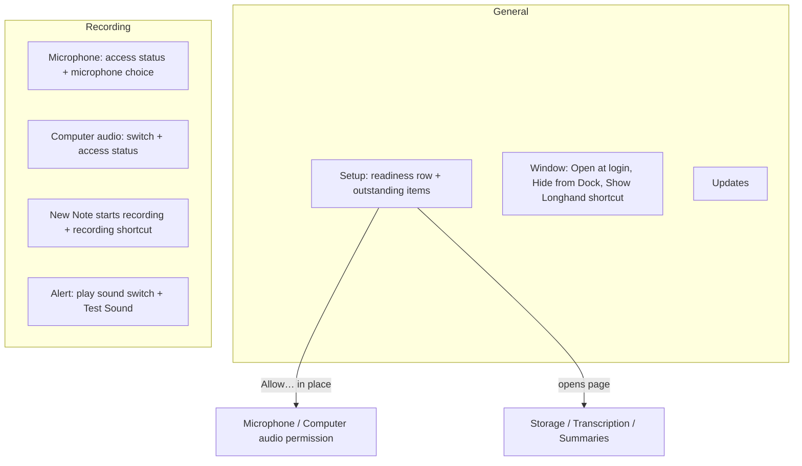

# General Settings Cleanup - Plan

## Goal Capsule

- **Objective:** A user who opens Settings sees at once what still stops a recording or delays processing, and finds each setting on the page for its topic.
- **Means:** General keeps only app-wide settings and a short list of outstanding setup items. Topic settings move to their own pages. The sidebar order changes.
- **Product authority:** This Product Contract. The user confirmed the scope in the brainstorm on 2026-10-06.
- **Open blockers:** None.

---

## Product Contract

### Summary

General keeps only app-wide settings: Open at login, Hide from Dock, the Show Longhand shortcut, and Updates. A setup group at the top always shows one readiness row and lists only the items that are still outstanding. Each other setting moves to the page for its topic, the alert sound becomes optional with a Test Sound button, and the sidebar order becomes General, Storage, Recording, Transcription, Summaries, About.

### Problem Frame

The General pane now holds five groups: Window, Recording, Processing, Updates, and Alerts. Most of its rows belong to other pages: the recording shortcut, the microphone and Computer audio permissions, the storage status, the model downloads, and the summary endpoint. The Recording group and the Processing group show every item, also the items that are ready. A user who wants to know what is still missing must read the full list. A user who wants the recording shortcut must know that it is on General and not on Recording.

### Key Decisions

- **One list for all outstanding items, not two lists.** The readiness row above the list tells the user if a recording can start. (session-settled: user-directed — chosen over a list split into "Before you can record" and "Before notes are processed", and over a list of recording blockers only: one short list is easier to read.) Governs R2, R3.
- **The readiness row always shows, also when items are outstanding.** (session-settled: user-directed — chosen over a "Ready" row that shows only when the list is empty: a missing model or summary endpoint does not stop a recording, and the row must say so.) Governs R2.
- **When nothing is outstanding, the group shows only the readiness row.** (session-settled: user-directed — chosen over a group that hides: the row confirms the state.) Governs R2.
- **The alert sound becomes optional, on by default, with a Test Sound button.** When it is off, a recording that stops shows only on screen. (session-settled: user-directed — chosen over a rename with no switch, and over a switch that plays the sound when turned on.) Governs R9.
- **A permission item works in place on General. Each other item opens its page.** (session-settled: user-approved — proposed in the scope summary and confirmed.) Governs R4.
- **Updates stays on General.** It applies to the whole app, like Open at login. (session-settled: user-approved — proposed in the scope summary and confirmed.) Governs R1.
- **The Computer audio permission is an outstanding item only when it is needed.** It is needed when the "Computer audio on for new notes" setting is on. The microphone alone is enough to record, so a user who does not use Computer audio has nothing to fix. Governs R3.

### Requirements

**General page**

- R1. General shows these settings and no others: Open at login, Hide from Dock (macOS), the Show Longhand shortcut, and Check for updates automatically (macOS).
- R2. A setup group at the top of General always shows one readiness row: "Ready to record" with a positive status when a recording can start, and "Not ready to record" with a caution status when it cannot.
- R3. Below the readiness row, the setup group lists each outstanding item and no item that is ready. The outstanding items are: microphone access not allowed, a recording shortcut that did not register, the storage folder not available or read-only, models still to download, no summary endpoint, and Computer audio access not allowed while new notes start with Computer audio on.
- R4. Each outstanding item has one button. A permission item (microphone, Computer audio) asks for the permission in place. Each other item opens the page where the user fixes it.
- R5. The General status in the sidebar shows a caution mark when a recording cannot start, and a neutral mark when only items that do not stop a recording are outstanding.

**Moved settings**

- R6. The Recording page holds the microphone access status and its Allow button with the microphone choice.
- R7. The Recording page holds the Computer audio access status with the "Computer audio on for new notes" switch.
- R8. The Recording page holds the recording shortcut with the "New Note starts recording" switch.
- R9. The Recording page holds an alert group with a switch "Play a sound if recording stops", on by default, and a "Test Sound" button. When the switch is off, Longhand plays no sound when a recording stops and cannot restart.
- R10. The Recording status in the sidebar shows a caution mark when microphone access is not allowed or the recording shortcut did not register.
- R11. The Storage, Transcription, and Summaries pages get no new rows. Their existing status stays where it is.

**Sidebar**

- R12. The sidebar lists the pages in this order: General, Storage, Recording, Transcription, Summaries, then About in its own section.

### Page layout

### Acceptance Examples

- AE1. **Covers R2, R3.** Given microphone access is allowed, the shortcut is registered, the storage folder is ready, all models are downloaded, and a summary endpoint is set, when the user opens General, the setup group shows only "Ready to record".
- AE2. **Covers R2, R3, R5.** Given two models are still to download and no summary endpoint is set, and nothing else is outstanding, when the user opens General, the group shows "Ready to record" and two items below it, and the General sidebar mark is neutral.
- AE3. **Covers R2, R4, R5.** Given microphone access is not allowed, when the user opens General, the group shows "Not ready to record" and a microphone item with an Allow button, and the General sidebar mark is caution. When the user allows access, the item goes away.
- AE4. **Covers R3.** Given Computer audio access is not allowed and "Computer audio on for new notes" is off, the setup group shows no Computer audio item. When the user turns the switch on, the item shows.
- AE5. **Covers R9.** Given "Play a sound if recording stops" is off, when a recording stops and cannot restart, Longhand plays no sound and shows the failure on screen. "Test Sound" still plays the sound.

### Scope Boundaries

- No change to what makes a recording possible. The readiness rules stay as they are now.
- No change to the content of the Storage, Transcription, or Summaries pages, other than their position in the sidebar.
- No other sound or alert settings, such as a choice of sound or volume.
- No change to the wording or behaviour of the on-screen alert when a recording stops.

### Sources / Research

- `src/settings/Status.tsx` — the current General pane, with the groups that move.
- `src/settings/SettingsWindow.tsx` — the sidebar order and the sidebar status marks (`paneTone`).
- `src/settings/Recording.tsx` — the Recording page groups that receive the moved rows.
- `src-tauri/src/commands/readiness.rs` — `armed` needs microphone access and a registered or cleared shortcut. A storage folder that is not available does not stop a recording. The Computer audio permission does not change `armed`.
- `src-tauri/src/commands/alerts.rs` — the alert sound command that Test Sound uses.
