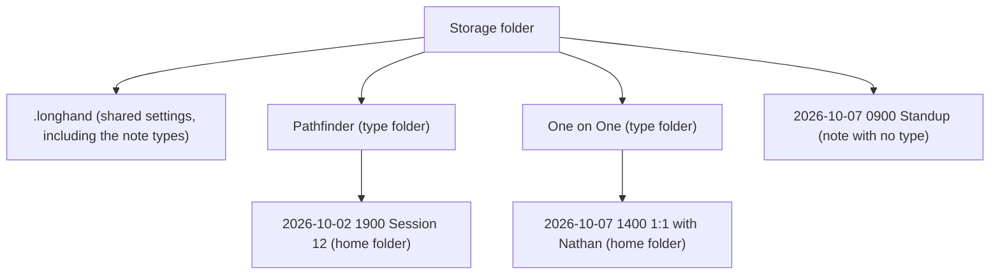

# Note Types and Tags - Plan

## Goal Capsule

- **Objective:** The user can find a group of notes in Longhand and on disk. On Home, a filter by note type and tags shows only the notes of that group, and a note that is recording. In Finder or Obsidian, the notes of each note type are in their own folder.
- **Product authority:** This Product Contract. The user confirmed the scope in the brainstorm on 2026-10-07. Suggested tags and a summary prompt chosen by the note type are not active scope (see How This Work Fits Together).
- **Open blockers:** None. The Outstanding Questions are for planning.

---

## Product Contract

### Summary

Each note gets zero or one note type and any number of tags. The note type is also a folder in the storage folder. Tags are text in the note's files. Home filters by type and tags. The note page shows and edits them in a row under the title. The New Note menu lists the note types, so one click starts a note of a chosen type.

### Problem Frame

After one or two weeks of use, every note is in one list on Home and directly in the storage folder. The user records different types of sessions: Pathfinder game nights, one-on-ones, internal meetings and customer calls. To find a group, the user must read the titles. The idea [Folders for notes](../ideas/next/note-folders.md) proposed one flat folder for each note, shown on Home like a tag. In use, the user also wants general labels across folders, for example a person, a customer or a topic, in the style of GitLab scoped labels (`Person::Nathan`, `Customer::Mayo Clinic`, `Topic::Security`).

`STRATEGY.md` allows folders and rules out a tag system ("Folders, and that's it ... no tag system — Obsidian already exists"). The reason is that Longhand must not become the place where the user's knowledge lives. This work changes that boundary, but only as far as R25 says.

### Key Decisions

- **A bounded tag UI: apply, create, show, rename, delete and filter. No links between notes, no graph and no tag pages.** (session-settled: user-directed — chosen over no limit on tags: Longhand must not become a knowledge base. An agent search over tags belongs to the agentic summary idea.) Governs R25.
- **The note type is the folder.** (session-settled: user-directed — chosen over a note type in metadata only and over a folder option for each type: the user wants the grouping on disk.) Governs R4, R5, R6, R26, R27, R28.
- **A type change or a type rename puts home folders in other folders. Outside links to those notes can break, and a sync service sees a large change.** (session-settled: user-directed — chosen over a confirmation on type rename and over fixed folders: links to notes are rare.) Governs R5, R6.
- **Tags are saved as exact text in a Longhand field of the note's files, not as Obsidian `#tags`.** (session-settled: user-approved — chosen over a second, converted Obsidian copy and over tag names restricted to Obsidian rules: names keep spaces and `::`. Obsidian shows them as a property.) Governs R11.
- **The part before `::` changes only the look of a tag.** (session-settled: user-approved — chosen over a scope filter and over the GitLab one-tag-per-scope rule: one note can have two people.) Governs R14, R15.
- **The tag list comes from the notes. Settings can rename or delete a tag everywhere.** (session-settled: user-directed — chosen over no tag manager and over a managed tag list.) Governs R12, R13.
- **The note types are a list in Settings, and the user can also create a type where a type is chosen.** (session-settled: user-approved — chosen over types from Settings only and over subfolders as the list.) Governs R2, R3.
- **The New Note button and the shortcut use a default note type from Settings. The New Note menu lists the types.** (session-settled: user-directed — chosen over no type, over the last type used, over a type picker at the top of the menu and over submenus.) Governs R7, R23, R24.
- **The Home filter is a bar under the "Notes" heading: one type and all chosen tags.** (session-settled: user-directed — chosen over a menu in the heading, a filter field with tokens and a filter column; for the logic, chosen over one choice at a time and over any of the chosen tags.) Governs R19, R20.
- **The type and tags show in a row under the note title.** (session-settled: user-directed — chosen over a toolbar button with a popover.) Governs R16.
- **Edits to the type and tags work on any computer at any time, and Longhand never loses one.** (session-settled: user-directed — chosen over read-only type and tags while another computer records or processes the note.) Governs R5, R13, R18.
- **The default note type is one shared setting for all computers.** (session-settled: user-directed — chosen over a default on each computer.) Governs R7.
- **At rest, the folder decides the type.** (session-settled: user-approved — chosen over the saved type as authority, which would move a folder back after a drag in Finder.) Governs R29.
- **A rename onto an existing name merges.** (session-settled: user-approved — chosen over refusing the name.) Governs R6, R13.
- **Tag matching ignores case and spaces at the ends and around `::`.** (session-settled: user-approved — chosen over exact text and over trimming spaces only.) Governs R30.
- **A folder with notes that is not in the type list becomes a type.** (session-settled: user-approved — chosen over showing its notes with no type.) Governs R34.
- **The type items in the New Note menu follow the main button's recording choice.** This keeps the menu one level deep. Governs R24.

### Requirements

**Note types**

- R1. A note has zero or one note type.
- R2. The note types are a list in the shared settings, so every computer that uses the storage folder has the same list.
- R3. Settings lists the note types and can add, rename and delete a type. The type menu on the note page and the New Note menu also accept a new type name, which adds the type to the list.
- R4. A note with a type has its home folder in a type folder: a folder in the storage folder with the type's name. A note with no type has its home folder directly in the storage folder, as today.
- R5. A type change puts the note's home folder in the folder of the new type. The app shows the new type at once. When any computer records or processes the note, the computer where the user changed the type does the move later, when no computer works on the note. That computer keeps the task through a failed processing, a quit and a restart.
- R6. A type rename renames the type folder. A rename to the name of an existing type merges the two types: the notes go into the existing type folder. A type delete puts the notes of that type directly in the storage folder, and they have no type after that. For a busy note, the move waits as R5 says.
- R7. Settings has a default note type, which can be "No type". The default is a shared setting, so every computer uses the same default. When the default type is deleted, the default changes to "No type".
- R8. Home lists the notes in type folders and the notes directly in the storage folder, on every computer.
- R26. A note whose home folder goes to another folder keeps its identity on every computer, also when the sync service delivers the move late or in parts. Other computers never forget the note and add it again as a new note.
- R27. When the target folder already has a home folder with the same name, the move uses the free-name rule of the storage-folder Move. It never replaces a folder.
- R28. The app refuses a type name that cannot be a folder name on macOS or on Windows, or that is reserved (`.longhand`, "No type"), with a message that says why.
- R29. At rest, the folder decides the type: a home folder that a person puts in another type folder outside Longhand gets that type. A type change made in Longhand that waits for its move (R5) has priority over the folder until the move is done.
- R31. A delete of a type or a tag in Settings asks for one confirmation that says how many notes change. A rename does not ask.
- R34. A folder in the storage folder that holds home folders and is not in the type list is added to the type list, and its notes get that type.

**Tags**

- R9. A note has zero or more tags. A tag is free text. When the text contains `::`, the part before it is the scope and the part after it is the value.
- R10. The user can apply a tag to a note during a recording, during processing and after.
- R11. A note's tags are saved as their exact text in the note's files, where Obsidian and agents can read them.
- R12. The tag list is every tag that is on at least one note in the library. A tag that is on no note is not in the list.
- R13. Settings lists the tags and can rename or delete a tag. The change applies to every note that has the tag, including a note that another computer records or processes at that time. A rename to an existing tag merges the two tags, and a note that has both keeps one.
- R30. Two tags are the same tag when their texts match without regard to case and to spaces at the ends and around `::`. The tag list shows the first spelling used.

**How labels look**

- R14. A scoped tag shows as a label in two parts: the scope and the value. Each scope has its own colour, which Longhand chooses, and a scope has the same colour on every screen. A tag with no scope shows as a label in one part. A note type shows as a label of a different kind than the tags.
- R15. A note can have more than one tag with the same scope.

**Note page**

- R16. A row under the note's title and subtitle shows the type as a menu and each tag with a control to remove it, followed by "+ Tag". "+ Tag" suggests the tags from the tag list and accepts a new tag.
- R17. During a recording, the row follows the attention budget of the recording page (walking skeleton U7): it does not move, flash or change for anything except a change the user made.
- R18. A change to the type or tags on one computer is kept when another computer saves a result of the same note. This includes a rename or delete of a tag or a type in Settings.

**Home**

- R19. A filter bar under the "Notes" heading shows "All", "No type" and one entry for each note type as a segmented control. When the types do not fit, one menu replaces the segmented control. A Tags menu adds tags to the filter. Each chosen tag shows as a label with a control to remove it.
- R20. With a filter, Home shows the notes that have the chosen type (no type, when "No type" is chosen, or any type when "All" is chosen) and every chosen tag.
- R21. A note that is recording stays on Home whatever the filter.
- R22. Each row on Home shows the note's type and tags, as R14 says.
- R32. When no note matches the filter, Home says so and shows a Clear Filter button.
- R33. The filter stays when the user opens a note and returns to Home. It resets when the app quits.

**New Note**

- R23. The New Note button and the New Note shortcut start a note of the default type (R7).
- R24. The New Note menu lists every note type and "No type". Choosing one starts a note of that type in the same way as the main button. The other choice of the menu (for example "New Note Without Recording") stays one item and uses the default type. The last item, "New Type…", asks for a name, adds the type and starts a note of that type.

**Strategy**

- R25. `STRATEGY.md` and the "Ruled out" list in `docs/ideas/README.md` change to allow note types and tags with this bounded UI: apply, create, show, rename, delete and filter. Links between notes, a graph and tag pages stay ruled out.

### Layout on disk

### Key Flows

- F1. Start a note of a type
  - **Trigger:** The user opens the New Note menu and chooses "Pathfinder".
  - **Steps:** The note starts as the main button would start it. Its home folder is made in the "Pathfinder" type folder. The note page shows "Pathfinder" in the row under the title.
  - **Covered by:** R4, R23, R24
- F2. Change the type of a busy note
  - **Trigger:** During a recording, the user changes the type from "Internal Meeting" to "One on One".
  - **Steps:** The row and Home show "One on One" at once. The recording and processing continue in the current home folder. When both finish, the app puts the home folder in the "One on One" type folder. Other computers then list the note there.
  - **Covered by:** R5, R8, R18
- F3. Filter Home
  - **Trigger:** The user chooses "One on One" in the filter bar, then adds `Person::Nathan` from the Tags menu.
  - **Steps:** Home shows only the one-on-ones that have `Person::Nathan`. The user removes the tag label, and Home shows every one-on-one.
  - **Covered by:** R19, R20

### Acceptance Examples

- AE1. **Covers R5, R18.** **Given** computer A processes a note, **when** the user adds `Topic::Security` and changes the type on computer B, **then** every computer shows the new tag and the new type at once, A's saved result does not remove them, and B puts the home folder in the new type folder when A finishes.
- AE2. **Covers R6, R7.** **Given** "Pathfinder" is the default type and has 30 notes, **when** the user deletes the type in Settings, **then** the 30 home folders are directly in the storage folder with no type, and the default type is "No type".
- AE3. **Covers R13.** **Given** 12 notes have `Customer::Mayo`, one of which records on another computer, **when** the user renames the tag to `Customer::Mayo Clinic`, **then** every one of the 12 notes, including the one that records, has `Customer::Mayo Clinic` and none has `Customer::Mayo`.
- AE4. **Covers R15, R14.** **Given** a note has `Person::Nathan`, **when** the user adds `Person::Sarah`, **then** the note has both tags, and both labels have the colour of the scope "Person".
- AE5. **Covers R21.** **Given** the filter shows "Pathfinder", **when** the user starts a note of type "Internal Meeting", **then** Home still shows the recording.
- AE6. **Covers R12.** **Given** only one note has `follow-up`, **when** the user removes `follow-up` from that note, **then** `follow-up` is not suggested by "+ Tag" or listed in the Tags menu.

### Scope Boundaries

- Suggested tags or a suggested note type from the summary.
- A summary prompt chosen by the note type.
- Search of the library.
- Links between notes, a graph, tag pages and any view across notes except the Home filter (R25).
- Type folders inside type folders. Type folders are one level deep.
- Colours that the user chooses for a scope.
- Obsidian `#tags`. Tags stay a Longhand field (R11).

<!-- ce-section: work-relationships -->
### How This Work Fits Together

This plan covers note types with type folders, and tags with the Home filter. The list below is the current understanding of the related work. It is not a committed roadmap.

- Suggested tags ([suggested-tags](../ideas/someday/suggested-tags.md))
  - Depends on this plan: the summary needs the tag list and the note type list to suggest from.
- A summary prompt for each type of note ([summary-prompt-by-note-type](../ideas/someday/summary-prompt-by-note-type.md))
  - Depends on this plan: the note type of R1 is the "type" that idea needs.
- Search the library ([library-and-browsing](../ideas/someday/library-and-browsing.md))
  - Shares the Home list and the filter bar. Still to decide: whether search uses the filter bar.
- Agentic summary ([agentic-summary](../ideas/someday/agentic-summary.md))
  - Can use the tags and note types in the note files to find a group of notes. Can proceed independently of this plan.

### Dependencies / Assumptions

- Assumption: few people have more than a handful of note types, but some do. R19 covers both.

### Outstanding Questions

**Resolve Before Planning**

- None.

**Deferred to Planning**

- The exact list of characters and names that R28 refuses (for example `/` or `:` in "1:1s").
- How R18 and R13 keep a change when another computer's save rewrites `session.md`.
- How a Home row shows many tags in a narrow window.

### Sources / Research

- `docs/ideas/next/note-folders.md` — the earlier idea: one flat folder for each note, with a tag-like UI.
- `STRATEGY.md` — the Boundaries line "No note-organization scheme" that R25 changes.
- `CONCEPTS.md` — Home folder (one folder for the life of a note, renamed in place), Publication (`session.md` is written last and changes only result fields), Shared settings, and Move (a different step: the copy to a new storage folder).
- `crates/library/src/scan.rs` — the library scan reads only the direct children of the storage folder. R8 changes this.
- `src-tauri/src/managers/library.rs` — the folder watcher is recursive and maps each event to its top-level folder.
- `crates/pipeline/src/move_notes.rs` and `crates/session-save/src/rename_home.rs` — the existing steps that put a home folder in another folder and rename it with no replace.
- `src/home/NewNoteButton.tsx` — the split button with one other choice in its menu today.
- `crates/shared-settings/src/` — the shared settings in `.longhand/`.
