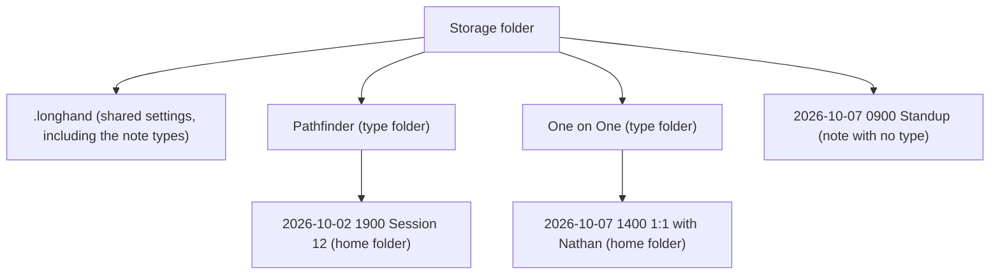
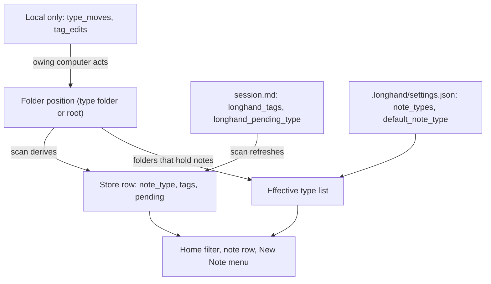
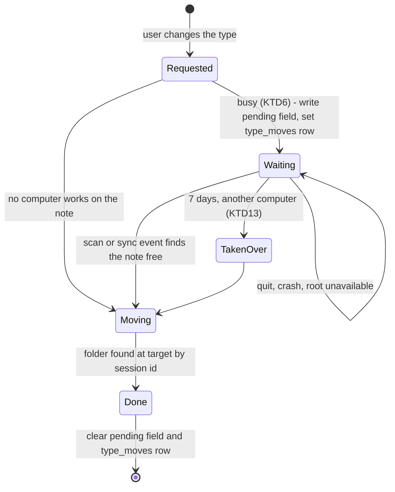

# Note Types and Tags - Plan

## Goal Capsule

- **Objective:** The user can find a group of notes in Longhand and on disk. On Home, a filter by note type and tags shows only the notes of that group, and a note that is recording. In Finder or Obsidian, the notes of each note type are in their own folder.
- **Means:** The note type is the position of the home folder (one level of type folders), and tags are a list in `session.md`. A depth-aware library and the existing owed-rename mechanism carry both across computers (KTD1, KTD4, KTD5).
- **Product authority:** This Product Contract. The user confirmed the scope in the brainstorm on 2026-10-07 and the plan-time choices on the same day. Suggested tags and a summary prompt chosen by the note type are not active scope (see How This Work Fits Together).
- **Authority order:** Product Contract (R-IDs win on behaviour), then Planning Contract (KTDs win on mechanism), then Implementation Units.
- **Open blockers:** None.
- **Stop conditions:** Stop and ask when a change would let a computer that only receives a sync move, rename or write into a home folder (except the takeover of a move that has waited 7 days, R35), when a step could forget a note that still exists in the storage folder, or when a requirement cannot be met without a change to the publication conflict rule.
- **Execution profile:** Rust workspace (`crates/`, `src-tauri/`) and React frontend (`src/`). Work in a worktree from `origin/main`. Invoke `apple-design` before UI work (U8 to U11). A signed build is needed for the manual test, because the folder watcher, sync and WebKit focus need the real bundle.

Product Contract preservation: changed: R35 added — any computer can do a move that is owed for 7 days, so a lost computer does not leave a note in the wrong folder. The user approved it at planning on 2026-10-07. Otherwise unchanged.

---

## Product Contract

### Summary

Each note gets zero or one note type and any number of tags. The note type is also a folder in the storage folder. Tags are text in the note's files. Home filters by type and tags. The note page shows and edits them in a row under the title. The New Note menu lists the note types, so one click starts a note of a chosen type.

### Problem Frame

After one or two weeks of use, every note is in one list on Home and directly in the storage folder. The user records different types of sessions: Pathfinder game nights, one-on-ones, internal meetings and customer calls. To find a group, the user must read the titles. The idea [Folders for notes](../ideas/next/note-folders.md) proposed one flat folder for each note, shown on Home like a tag. In use, the user also wants general labels across folders, for example a person, a customer or a topic, in the style of GitLab scoped labels (`Person::Nathan`, `Customer::Mayo Clinic`, `Topic::Security`).

`STRATEGY.md` allows folders and rules out a tag system ("Folders, and that's it ... no tag system — Obsidian already exists"). The reason is that Longhand must not become the place where the user's knowledge lives. This work changes that boundary, but only as far as R25 says.

### Key Decisions

- **A bounded tag UI: apply, create, show, rename, delete and filter. No links between notes, no graph and no tag pages.** (session-settled: user-directed — chosen over no limit on tags: Longhand must not become a knowledge base. An agent search over tags belongs to the agentic summary idea.) Governs R25.
- **The note type is the folder.** (session-settled: user-directed — chosen over a note type in metadata only and over a folder option for each type: the user wants the grouping on disk.) Governs R4, R5, R6, R26, R27, R28.
- **A type change or a type rename puts home folders in other folders. Outside links to those notes can break, and a sync service sees a large change.** (session-settled: user-directed — chosen over a confirmation on type rename and over fixed folders: links to notes are rare.) Governs R5, R6.
- **Tags are saved as exact text in a Longhand field of the note's files, not as Obsidian `#tags`.** (session-settled: user-approved — chosen over a second, converted Obsidian copy and over tag names restricted to Obsidian rules: names keep spaces and `::`. Obsidian shows them as a property.) Governs R11.
- **The part before `::` changes only the look of a tag.** (session-settled: user-approved — chosen over a scope filter and over the GitLab one-tag-per-scope rule: one note can have two people.) Governs R14, R15.
- **The tag list comes from the notes. Settings can rename or delete a tag everywhere.** (session-settled: user-directed — chosen over no tag manager and over a managed tag list.) Governs R12, R13.
- **The note types are a list in Settings, and the user can also create a type where a type is chosen.** (session-settled: user-approved — chosen over types from Settings only and over subfolders as the list.) Governs R2, R3.
- **The New Note button and the shortcut use a default note type from Settings. The New Note menu lists the types.** (session-settled: user-directed — chosen over no type, over the last type used, over a type picker at the top of the menu and over submenus.) Governs R7, R23, R24.
- **The Home filter is a bar under the "Notes" heading: one type and all chosen tags.** (session-settled: user-directed — chosen over a menu in the heading, a filter field with tokens and a filter column; for the logic, chosen over one choice at a time and over any of the chosen tags.) Governs R19, R20.
- **The type and tags show in a row under the note title.** (session-settled: user-directed — chosen over a toolbar button with a popover.) Governs R16.
- **Edits to the type and tags work on any computer at any time, and Longhand never loses one.** (session-settled: user-directed — chosen over read-only type and tags while another computer records or processes the note.) Governs R5, R13, R18.
- **The default note type is one shared setting for all computers.** (session-settled: user-directed — chosen over a default on each computer.) Governs R7.
- **At rest, the folder decides the type.** (session-settled: user-approved — chosen over the saved type as authority, which would move a folder back after a drag in Finder.) Governs R29.
- **A rename onto an existing name merges.** (session-settled: user-approved — chosen over refusing the name.) Governs R6, R13.
- **Tag matching ignores case and spaces at the ends and around `::`.** (session-settled: user-approved — chosen over exact text and over trimming spaces only.) Governs R30.
- **A folder with notes that is not in the type list becomes a type.** (session-settled: user-approved — chosen over showing its notes with no type.) Governs R34.
- **The type items in the New Note menu follow the main button's recording choice.** This keeps the menu one level deep. Governs R24.

### Requirements

**Note types**

- R1. A note has zero or one note type.
- R2. The note types are a list in the shared settings, so every computer that uses the storage folder has the same list.
- R3. Settings lists the note types and can add, rename and delete a type. The type menu on the note page and the New Note menu also accept a new type name, which adds the type to the list.
- R4. A note with a type has its home folder in a type folder: a folder in the storage folder with the type's name. A note with no type has its home folder directly in the storage folder, as today.
- R5. A type change puts the note's home folder in the folder of the new type. The app shows the new type at once. When any computer records or processes the note, the computer where the user changed the type does the move later, when no computer works on the note. That computer keeps the task through a failed processing, a quit and a restart.
- R6. A type rename renames the type folder. A rename to the name of an existing type merges the two types: the notes go into the existing type folder. A type delete puts the notes of that type directly in the storage folder, and they have no type after that. For a busy note, the move waits as R5 says.
- R7. Settings has a default note type, which can be "No type". The default is a shared setting, so every computer uses the same default. When the default type is deleted, the default changes to "No type".
- R8. Home lists the notes in type folders and the notes directly in the storage folder, on every computer.
- R26. A note whose home folder goes to another folder keeps its identity on every computer, also when the sync service delivers the move late or in parts. Other computers never forget the note and add it again as a new note.
- R27. When the target folder already has a home folder with the same name, the move uses the free-name rule of the storage-folder Move. It never replaces a folder.
- R28. The app refuses a type name that cannot be a folder name on macOS or on Windows, or that is reserved (`.longhand`, "No type"), with a message that says why.
- R29. At rest, the folder decides the type: a home folder that a person puts in another type folder outside Longhand gets that type. A type change made in Longhand that waits for its move (R5) has priority over the folder until the move is done.
- R31. A delete of a type or a tag in Settings asks for one confirmation that says how many notes change. A rename does not ask.
- R34. A folder in the storage folder that holds home folders and is not in the type list is added to the type list, and its notes get that type.
- R35. When a type change has waited for its move for 7 days, any computer that uses the storage folder can do the move.

**Tags**

- R9. A note has zero or more tags. A tag is free text. When the text contains `::`, the part before it is the scope and the part after it is the value.
- R10. The user can apply a tag to a note during a recording, during processing and after.
- R11. A note's tags are saved as their exact text in the note's files, where Obsidian and agents can read them.
- R12. The tag list is every tag that is on at least one note in the library. A tag that is on no note is not in the list.
- R13. Settings lists the tags and can rename or delete a tag. The change applies to every note that has the tag, including a note that another computer records or processes at that time. A rename to an existing tag merges the two tags, and a note that has both keeps one.
- R30. Two tags are the same tag when their texts match without regard to case and to spaces at the ends and around `::`. The tag list shows the first spelling used.

**How labels look**

- R14. A scoped tag shows as a label in two parts: the scope and the value. Each scope has its own colour, which Longhand chooses, and a scope has the same colour on every screen. A tag with no scope shows as a label in one part. A note type shows as a label of a different kind than the tags.
- R15. A note can have more than one tag with the same scope.

**Note page**

- R16. A row under the note's title and subtitle shows the type as a menu and each tag with a control to remove it, followed by "+ Tag". "+ Tag" suggests the tags from the tag list and accepts a new tag.
- R17. During a recording, the row follows the attention budget of the recording page (walking skeleton U7): it does not move, flash or change for anything except a change the user made.
- R18. A change to the type or tags on one computer is kept when another computer saves a result of the same note. This includes a rename or delete of a tag or a type in Settings.

**Home**

- R19. A filter bar under the "Notes" heading shows "All", "No type" and one entry for each note type as a segmented control. When the types do not fit, one menu replaces the segmented control. A Tags menu adds tags to the filter. Each chosen tag shows as a label with a control to remove it.
- R20. With a filter, Home shows the notes that have the chosen type (no type, when "No type" is chosen, or any type when "All" is chosen) and every chosen tag.
- R21. A note that is recording stays on Home whatever the filter.
- R22. Each row on Home shows the note's type and tags, as R14 says.
- R32. When no note matches the filter, Home says so and shows a Clear Filter button.
- R33. The filter stays when the user opens a note and returns to Home. It resets when the app quits.

**New Note**

- R23. The New Note button and the New Note shortcut start a note of the default type (R7).
- R24. The New Note menu lists every note type and "No type". Choosing one starts a note of that type in the same way as the main button. The other choice of the menu (for example "New Note Without Recording") stays one item and uses the default type. The last item, "New Type…", asks for a name, adds the type and starts a note of that type.

**Strategy**

- R25. `STRATEGY.md` and the "Ruled out" list in `docs/ideas/README.md` change to allow note types and tags with this bounded UI: apply, create, show, rename, delete and filter. Links between notes, a graph and tag pages stay ruled out.

### Layout on disk

### Key Flows

- F1. Start a note of a type
  - **Trigger:** The user opens the New Note menu and chooses "Pathfinder".
  - **Steps:** The note starts as the main button would start it. Its home folder is made in the "Pathfinder" type folder. The note page shows "Pathfinder" in the row under the title.
  - **Covered by:** R4, R23, R24
- F2. Change the type of a busy note
  - **Trigger:** During a recording, the user changes the type from "Internal Meeting" to "One on One".
  - **Steps:** The row and Home show "One on One" at once. The recording and processing continue in the current home folder. When both finish, the app puts the home folder in the "One on One" type folder. Other computers then list the note there.
  - **Covered by:** R5, R8, R18
- F3. Filter Home
  - **Trigger:** The user chooses "One on One" in the filter bar, then adds `Person::Nathan` from the Tags menu.
  - **Steps:** Home shows only the one-on-ones that have `Person::Nathan`. The user removes the tag label, and Home shows every one-on-one.
  - **Covered by:** R19, R20

### Acceptance Examples

- AE1. **Covers R5, R18.** **Given** computer A processes a note, **when** the user adds `Topic::Security` and changes the type on computer B, **then** every computer shows the new tag and the new type at once, A's saved result does not remove them, and B puts the home folder in the new type folder when A finishes.
- AE2. **Covers R6, R7.** **Given** "Pathfinder" is the default type and has 30 notes, **when** the user deletes the type in Settings, **then** the 30 home folders are directly in the storage folder with no type, and the default type is "No type".
- AE3. **Covers R13.** **Given** 12 notes have `Customer::Mayo`, one of which records on another computer, **when** the user renames the tag to `Customer::Mayo Clinic`, **then** every one of the 12 notes, including the one that records, has `Customer::Mayo Clinic` and none has `Customer::Mayo`.
- AE4. **Covers R15, R14.** **Given** a note has `Person::Nathan`, **when** the user adds `Person::Sarah`, **then** the note has both tags, and both labels have the colour of the scope "Person".
- AE5. **Covers R21.** **Given** the filter shows "Pathfinder", **when** the user starts a note of type "Internal Meeting", **then** Home still shows the recording.
- AE6. **Covers R12.** **Given** only one note has `follow-up`, **when** the user removes `follow-up` from that note, **then** `follow-up` is not suggested by "+ Tag" or listed in the Tags menu.

### Scope Boundaries

- Suggested tags or a suggested note type from the summary.
- A summary prompt chosen by the note type.
- Search of the library.
- Links between notes, a graph, tag pages and any view across notes except the Home filter (R25).
- Type folders inside type folders. Type folders are one level deep.
- Colours that the user chooses for a scope.
- Obsidian `#tags`. Tags stay a Longhand field (R11).

<!-- ce-section: work-relationships -->
### How This Work Fits Together

This plan covers note types with type folders, and tags with the Home filter. The list below is the current understanding of the related work. It is not a committed roadmap.

- Suggested tags ([suggested-tags](../ideas/someday/suggested-tags.md))
  - Depends on this plan: the summary needs the tag list and the note type list to suggest from.
- A summary prompt for each type of note ([summary-prompt-by-note-type](../ideas/someday/summary-prompt-by-note-type.md))
  - Depends on this plan: the note type of R1 is the "type" that idea needs.
- Search the library ([library-and-browsing](../ideas/someday/library-and-browsing.md))
  - Shares the Home list and the filter bar. Still to decide: whether search uses the filter bar.
- Agentic summary ([agentic-summary](../ideas/someday/agentic-summary.md))
  - Can use the tags and note types in the note files to find a group of notes. Can proceed independently of this plan.

### Dependencies / Assumptions

- Assumption: few people have more than a handful of note types, but some do. R19 covers both.

### Outstanding Questions

**Resolve Before Planning**

- None.

**Resolved in planning**

- The names that R28 refuses: KTD8. How R13 and R18 survive another computer's save: KTD2. Many tags in a narrow Home row: U9.

### Sources / Research

- `docs/ideas/next/note-folders.md` — the earlier idea: one flat folder for each note, with a tag-like UI.
- `STRATEGY.md` — the Boundaries line "No note-organization scheme" that R25 changes.
- `CONCEPTS.md` — Home folder (one folder for the life of a note, renamed in place), Publication (`session.md` is written last and changes only result fields), Shared settings, and Move (a different step: the copy to a new storage folder).
- `crates/library/src/scan.rs` — the library scan reads only the direct children of the storage folder. R8 changes this.
- `src-tauri/src/managers/library.rs` — the folder watcher is recursive and maps each event to its top-level folder.
- `crates/pipeline/src/move_notes.rs` and `crates/session-save/src/rename_home.rs` — the existing steps that put a home folder in another folder and rename it with no replace.
- `src/home/NewNoteButton.tsx` — the split button with one other choice in its menu today.
- `crates/shared-settings/src/` — the shared settings in `.longhand/`.

---

## Planning Contract

### Key Technical Decisions

- KTD1. **The home folder's position is the note type at rest. `session.md` stores no type, except a pending one.** A home folder directly in the storage folder has no type. A home folder in a type folder has that type. The store row keeps a derived `note_type` column that each scan refreshes from the path. This applies R4 and R29. It also means that a Finder drag or a Finder rename of a type folder needs no file write. (session-settled: user-approved — chosen over the saved type as the authority: governs R29.)
- KTD2. **Two user fields in the `session.md` frontmatter: `longhand_tags` (a list of exact texts) and `longhand_pending_type` (present only while a move waits).** `longhand_pending_type` holds the target type, the source type, the computer and the time of the change. Every writer of `session.md` copies both fields from the current file at the moment of its write. These writers are publication `patch()`, `folder_rename::document()`, Save, the early write and Regenerate. This is the same read-modify-write that keeps `title` today. Neither field is in `ResultFields`, so a tag edit never causes a publication conflict. The three checks that compare a fingerprint of the whole `session.md` (the Transcribe Again replacement base, the Regenerate Summary expected file and the Resume saved-prefix manifest) compare it with both fields removed, so a tag or type edit never fails a run. This applies R11 and R18. The key names are distinct from Obsidian's `tags`, so Obsidian shows a property and not tags. (session-settled: user-approved — chosen over Obsidian `#tags`: governs R11.)
- KTD3. **The pending type has priority only while the folder still matches its source type.** A computer shows `longhand_pending_type.to` when the home folder is still in `from`. When the folder is somewhere else (the move is done, or a person moved it), the folder wins, and the computer that owes the move clears the field. This applies R29 and gives a clear result for a Finder drag while a move waits.
- KTD4. **One depth-aware rule finds the storage root of a home folder.** The library scans depth 0 and depth 1 only:
  - A top-level folder with `session.md` is a home folder.
  - A top-level folder without one is a type folder when it holds at least one home folder.
  - Hidden folders are skipped.
  - Anything deeper is ignored.

  A single helper gives the storage root and the type of a home path. It replaces every `home.parent()`-is-the-root assumption: scan, `scan_folders`, `Known::add`, reconcile `Coverage` and pending delete, `forget_outside`, watcher `place`, `early_home::locate`, `empty_note`, `remove_copies::reachable`, audio removal `note_available`, the Save staging root and `move_notes`. This applies R8.
- KTD5. **A type move reuses the owed-rename recipe: a local `type_moves` table, keyed by session id, written before the move.**
  - **The record:** a new migration (`0018`) adds the table. It holds the target type, the source type and the time. It never holds a path: the move finds the current folder by id at move time.
  - **Set and clear:** the record is set when a move is deferred or fails, and before a quit. It is cleared when the folder is at the target, found there by session id and not by a retry. That rule follows `docs/solutions/logic-errors/receiving-computer-renamed-synced-folder-back.md`.
  - **Who moves:** only the computer with the row moves the folder. A receiving computer reads the pending field and never moves, except after the 7-day takeover in KTD13. This applies R5.
- KTD6. **"No computer works on the note" means all of these:**
  - no fresh in-use marker from another computer's run (`in_use_except(own_runs)`)
  - no `result: pending` on another computer
  - this computer is not busy with the note (recording, processing, Resume, Remove Audio or a storage-folder Move)

  The owing computer tries again on each library scan and on each sync event for the note. A missing storage root pauses the move. It does not drop the move. This applies R5.
- KTD7. **A type rename, merge or delete is a set of per-note moves. It is never a rename of the type folder.**
  - **Order:** the shared list changes first. Then each note gets `longhand_pending_type` and a `type_moves` row.
  - **The old folder:** it stays until its last note has left. The folder is then removed only when it holds nothing except system files (`.DS_Store`, `Thumbs.db`). While old-name moves are open, the old folder does not come back as a type through R34.
  - **Case-only rename:** when the names differ only in case, the folder is renamed through a temporary name, because macOS treats the two names as one folder.

  This applies R6. A folder rename would break the paths of a note that another computer writes into. (session-settled: user-approved — chosen over a rename of the type folder, at plan confirmation: busy notes wait safely.)
- KTD8. **One shared function checks type names (R28).** It reuses `naming::FORBIDDEN`, `RESERVED` and `is_reserved`, and it refuses these names:
  - a name that starts with a dot, or that is empty after trimming
  - `.longhand`, or "No type" in any case
  - a name longer than the title limit
  - a name that matches an existing home folder

  Type names compare without regard to case. The same function checks a name at every use: Settings, the note page, the New Note menu, and the move target. A hostile-name table test covers it, following `docs/solutions/security-issues/audio-removal-trusted-synced-file-names-before-delete.md`. Tags never become paths.
- KTD9. **The effective type list is the shared list plus every type folder that holds a note. A read never writes the shared list.** This applies R34 without breaking shared-settings rule 1 (`docs/solutions/integration-issues/shared-settings-in-a-synced-folder-rules.md`). A folder-only type goes into the shared list the first time the user edits the list, with two exceptions:
  - A folder whose every home folder has a `longhand_pending_type` with that folder as `from` is a type that is leaving. It is not in the effective list and never goes into the shared list. Every computer can apply this rule, because the pending field syncs with the note.
  - A folder whose name fails the KTD8 check is listed and can be filtered, and its notes keep that type. It never goes into the shared list and is not offered for a new note or a type change. Settings offers only a rename to a valid name, or a delete. The type list and the default type are two new shared fields, `note_types` and `default_note_type`, with the usual `Field`, `KEY_` and `SharedValue` items. The list is one key, and the last change wins (rule 8). This applies R2 and R7.
- KTD10. **A tag key is a normalized form of the text.** The key is the trimmed text, with spaces around `::` removed and case folded. Matching, the filter, merge and rename use the key. The display text is the spelling on the oldest note that has the tag. The tag list and the counts come from the store, where a new `tags` column is refreshed from `session.md` like `title`. This applies R12 and R30.
- KTD11. **A Settings rename or delete of a tag is a read-modify-write of `longhand_tags` in each note's `session.md`.** It is not a folder move, so it never waits for a busy note (KTD2 keeps it). Notes that cannot be written (storage folder unavailable) go into a local `tag_edits` record that the next launch retries. This applies R13 and R18.
- KTD12. **A deleted-looking note is forgotten only after a full depth-1 scan cannot find its session id.** The existing 30-second wait stays as the minimum. A late or partial sync therefore follows a moved note by id (`reconcile::follow`) and does not forget it and adopt it again. This applies R26. The cost is that a real delete on another computer leaves Home a little later.
- KTD13. **Any computer takes over an owed move after 7 days.** A computer that finds a `longhand_pending_type` older than 7 days, and finds that no computer works on the note (all of KTD6, including no `result: pending`), sets its own `type_moves` row and does the move. This applies R35.
- KTD14. **The storage-folder Move keeps the type folder.** A note moves to `new root / type / name` with the existing free-name rule. A note in a type folder is no longer left out of the Move. The Move also copies `note_types` and `default_note_type` when the new folder has no shared settings yet. This applies R8 and R27.
- KTD15. **The UI reuses existing parts:** `Tabs` from `SessionPage` as a shared segmented control, `Menu` from `SessionMenu` (with new separators and a height limit), `ModelPicker`'s combobox for "+ Tag", `Tag` and `useConfirm` from `src/settings/ui.tsx`, and `SummaryPrompts` as the model for the Settings pane. A scope colour comes from a stable hash of the scope key into a fixed set of system colours, with light and dark values.

### High-Level Technical Design

Where each fact lives:

The life of one type change, on the computer where the user made it:

### Assumptions

- Older Longhand builds drop `longhand_tags` and `longhand_pending_type` when they rewrite `session.md`, because `SessionDoc` has no field for unknown keys. Nobody uses Longhand yet, so this is accepted.
- Two computers that add a type at the same moment can lose one add (shared-settings rule 8). A type with notes comes back through KTD9.

### Sequencing

U1 and U4 first. U2 and U3 follow. U5 and U6 build on them. U7 needs U3 and U4. The UI units U8 to U11 follow the backend. U12 can go at any time.

---

## Implementation Units

| U-ID | Title | Key files | Depends on |
| --- | --- | --- | --- |
| U1 | Type name and tag text rules | `crates/session-save/src/naming.rs`, new `crates/session-core/src/tags.rs` | none |
| U2 | User fields in `session.md` and the store | `crates/session-core/src/folder.rs`, `jobs.rs`, migration `0018`, `crates/session-save/src/publication.rs`, `crates/pipeline/src/folder_rename.rs` | U1 |
| U3 | Depth-aware library | `crates/library/src/scan.rs`, `reconcile.rs`, `src-tauri/src/managers/library.rs`, `crates/pipeline/src/*` | U2 |
| U4 | Shared type list and default type | `crates/shared-settings/src/file.rs`, `src-tauri/src/managers/shared.rs` | U1 |
| U5 | Type move engine | `crates/pipeline/src/folder_rename.rs`, `crates/session-save/src/rename_home.rs`, `runner.rs` | U2, U3, U4 |
| U6 | Tag edits and the tag list | `crates/pipeline/`, `src-tauri/src/commands/session.rs` | U2, U3 |
| U7 | New note with a type | `src-tauri/src/commands/capture.rs`, `src-tauri/src/managers/capture.rs`, `shortcut.rs`, `crates/pipeline/src/early_home.rs` | U3, U4 |
| U8 | Shared UI parts | `src/session/SessionMenu.tsx`, `src/settings/ui.tsx`, new `src/lib/` parts | none |
| U9 | Home filter, rows and New Note menu | `src/home/Home.tsx`, `SessionRow.tsx`, `NewNoteButton.tsx` | U6, U7, U8 |
| U10 | Note page row | `src/session/SessionPage.tsx` | U5, U6, U8 |
| U11 | Settings pane for types and tags | `src/settings/` | U4, U5, U6, U8 |
| U12 | Strategy and docs | `STRATEGY.md`, `docs/ideas/README.md`, `CONCEPTS.md` | none |

### U1. Type name and tag text rules

**Goal:** One function checks a type name, and one function makes a tag key.

**Requirements:** R9, R28, R30; KTD8, KTD10.

**Dependencies:** None.

**Files:** `crates/session-save/src/naming.rs`, `crates/session-save/tests/naming.rs`, new `crates/session-core/src/tags.rs` with unit tests.

**Approach:**
1. Add a type-name check beside `sanitize_title` that returns a reason the UI can show. It covers the refusals in KTD8. A home-folder name clash is checked by the caller, which knows the root.
2. Add a type-name comparison that ignores case.
3. Add the tag key (KTD10) and a scope and value split on the first `::`.

**Patterns to follow:** `naming::FORBIDDEN`, `is_reserved`; the table tests in `crates/session-save/tests/naming.rs`.

**Test scenarios:**
- "Pathfinder", "One on One" and "Customer calls" pass.
- "1:1s", "a/b", ".hidden", "", "   ", "con", ".longhand", "No type" and "no TYPE" are refused, each with a reason.
- A name longer than the limit is refused.
- Comparison: "pathfinder" equals "Pathfinder".
- Covers R30: `Person::Nathan`, `person::nathan` and ` Person :: Nathan ` give one key.
- `Topic::Security::Old` splits into the scope `Topic` and the value `Security::Old`.
- `::x` and `Person::` give an empty scope or value. They are kept as one-part tags.
- `follow-up` has no scope.

**Verification:** Both functions exist with table tests, and no other code makes a tag key or checks a type name in its own way.

### U2. User fields in `session.md` and the store

**Goal:** `longhand_tags` and `longhand_pending_type` survive every writer, and the store row carries them.

**Requirements:** R11, R18; KTD1, KTD2, KTD3.

**Dependencies:** U1.

**Files:** `crates/session-core/src/folder.rs`, `crates/session-core/src/jobs.rs`, `crates/session-core/migrations/0018_note_types_and_tags.sql`, `crates/session-core/src/schema.rs`, `crates/session-save/src/publication.rs`, `crates/pipeline/src/folder_rename.rs`, `crates/pipeline/src/save.rs`, `crates/pipeline/src/early_home.rs`, `crates/library/src/refresh.rs`, `crates/library/src/reconcile.rs`, `crates/pipeline/src/follow.rs`, `crates/pipeline/src/reprocess.rs`, `crates/pipeline/src/recognition/saved_prefix.rs`; tests in `crates/session-save/tests/publication.rs`, `crates/library/tests/two_computers.rs`, `crates/pipeline/tests/`.

**Approach:**
1. Add the two optional fields to `SessionDoc`, including `at`. Serialize them only when set.
2. Make each writer copy both fields from the current file at its final write: `publication::patch`, `folder_rename::document`, `save::session_doc`, Regenerate and the early write.
3. Add the store columns `note_type`, `tags` and `pending_type` in migration `0018`. Never edit an earlier migration.
4. Fill the columns in `Adoption::from_doc`, `refresh::updates` and `write`. Add `tags` and `pending_type` to both busy row scopes, `Scope::Notes` (used by the reconcile) and `Scope::TitleAndNotes` (used by `follow_folder`).
5. Make the three whole-file fingerprint checks (KTD2) ignore the two fields.

**Patterns to follow:** The `title` read-modify-write in `publication::patch`; `write_title_in` in `folder_rename.rs`; `docs/solutions/logic-errors/publication-checked-for-another-result-only-at-start-and-end.md`.

**Test scenarios:**
- Covers AE1: computer B writes `longhand_tags` between A's result writes and A's final `session.md` write. After the publication, the tags are present and no conflict is reported.
- The same holds for `longhand_pending_type`.
- `folder_rename::document` keeps both fields when it rewrites a note after a title rename.
- A busy note's row takes in a tag edit from another computer through the reconcile.
- A tag edit and a pending-type write during Transcribe Again, during Resume and during Regenerate Summary: each run keeps its new result.
- An adopted note gets `tags` and `pending_type` from `session.md`.
- A note with neither field renders a `session.md` with no new keys.

**Verification:** No writer can drop the user fields, and an old database migrates to `0018` without loss.

### U3. Depth-aware library

**Goal:** Notes in type folders are listed, followed and kept on every computer, and the type comes from the folder.

**Requirements:** R8, R26, R29, R34; KTD1, KTD4, KTD12.

**Dependencies:** U2.

**Files:** `crates/library/src/scan.rs`, `crates/library/src/reconcile.rs`, `src-tauri/src/managers/library.rs`, `crates/pipeline/src/early_home.rs`, `crates/pipeline/src/empty_note.rs`, `crates/pipeline/src/remove_copies.rs`, `src-tauri/src/managers/audio_removal.rs`, `crates/session-save/src/lib.rs`, `crates/pipeline/src/move_notes.rs`; tests in `crates/library/tests/scan.rs`, `crates/library/tests/two_computers.rs`, `crates/pipeline/tests/move_notes.rs`, and the watcher tests in `src-tauri/src/managers/library.rs`.

**Approach:**
1. Add the storage-root helper (KTD4), and replace each `home.parent()` root assumption with it.
2. Scan type folders at depth 1. Derive `note_type` from the path.
3. The watcher maps an event at depth 2 to its home folder. An event at depth 1 maps to the type folder, and a rename of a type folder starts a targeted scan of its notes.
4. Pending delete: forget only after a full scan misses the id (KTD12). Check the library marker before any forget or type change.
5. `move_notes` keeps the type folder (KTD14).

**Execution note:** Before you change each `home.parent()` site, add a failing test for a note in a type folder at that site.

**Patterns to follow:** `reconcile::follow`; `docs/solutions/logic-errors/move-dropped-notes-when-old-folder-went-away.md` (`check_old`); the `Computer` harness in `crates/library/tests/two_computers.rs`.

**Test scenarios:**
- A storage folder with `Pathfinder/2026-10-02 1900 Session 12/` and a note at the root lists both, with the types "Pathfinder" and none.
- A folder that holds only `.DS_Store` is not a type.
- A home folder two levels deep is ignored.
- Covers R29: a person moves a home folder from `Pathfinder/` to `One on One/`, and the next scan gives the type "One on One". No file is written.
- A person renames the type folder `Pathfinder` to `D&D` in Finder, and every note in it gets the type "D&D".
- Covers R26: the sync delivers the old folder's removal, and the new folder appears 90 seconds later. The row keeps its id and local state and is never forgotten.
- A partial sync delivers the folder at its new place without the new `session.md`. Nothing is written, and the note keeps its id.
- The storage root's marker is missing (sign-out of the sync service). No typed note is forgotten.
- `forget_outside` keeps typed notes after a launch.
- Old audio is removed from a typed note.
- `remove_copies`, `empty_note` and `early_home::locate` work for a typed note.
- A storage-folder Move of a typed note puts it at `new / Pathfinder / name` and uses the free name on a clash.
- Watcher: an event in `Type/Home/notes.md` marks `Type/Home`.

**Verification:** Every library step treats a note at depth 1 the same as a note at depth 0, and no automatic step writes because of a type folder.

### U4. Shared type list and default type

**Goal:** The note types and the default type are shared settings, and the app shows the effective type list.

**Requirements:** R2, R3, R7, R34; KTD8, KTD9.

**Dependencies:** U1.

**Files:** `crates/shared-settings/src/file.rs`, `crates/shared-settings/tests/file.rs`, `crates/shared-settings/tests/two_computers.rs`, `src-tauri/src/managers/shared.rs`, `src-tauri/src/managers/settings.rs`, `src-tauri/src/commands/settings.rs`, `src-tauri/src/lib.rs`, `src/bindings.ts` (generated).

**Approach:**
1. Add the `note_types` and `default_note_type` fields (KTD9).
2. Add the commands to list the effective types, add a type and set the default. Rename and delete come in U5. Every name goes through the U1 check.
3. When the default type is deleted, the default becomes "No type" (R7). The delete in U5 makes this change.
4. Regenerate the bindings.

**Patterns to follow:** The prompt commands in `src-tauri/src/managers/shared.rs` and `src-tauri/src/commands/settings.rs`; the shared-settings rules entry.

**Test scenarios:**
- Saving another shared field keeps `note_types` and `default_note_type`.
- A file that does not parse, a newer `schema_version` and `settings 2.json`: each read writes nothing.
- The effective list holds a shared type with no folder, and a folder type that is not in the shared list.
- Reading the effective list does not write `settings.json`.
- A type deleted on B while one of its notes is busy on A does not come back after a list edit on a third computer.
- A folder named `con` that holds notes is listed and filterable, is not offered for a new note, and never goes into the shared list.
- Adding "1:1s" is refused with the U1 reason.
- Adding "pathfinder" when "Pathfinder" exists is refused as a duplicate.
- Covers R7: the default type is the same on two computers after a sync.

**Verification:** Both computers in the two-computer test show the same types and the same default, and reads never write.

### U5. Type move engine

**Goal:** A type change, rename, merge or delete puts each home folder in the right type folder, on the computer that owes it, without loss.

**Requirements:** R5, R6, R27, R29, R31, R35; F2; AE1, AE2; KTD3, KTD5, KTD6, KTD7, KTD13.

**Dependencies:** U2, U3, U4.

**Files:** `crates/session-core/migrations/0018_note_types_and_tags.sql` (the `type_moves` table), `crates/session-core/src/jobs.rs`, `crates/session-save/src/rename_home.rs`, `crates/pipeline/src/folder_rename.rs`, `crates/pipeline/src/runner.rs`, `src-tauri/src/managers/processing.rs`, `src-tauri/src/commands/session.rs`, `src-tauri/src/commands/settings.rs`; tests in `crates/session-save/tests/rename_home.rs`, `crates/pipeline/tests/` (a new `type_move.rs`), `crates/library/tests/two_computers.rs`.

**Approach:**
1. Add a cross-parent variant of `rename_home::rename` with the same intent, no-replace and free-name rules (R27).
2. Extend the folder-rename reconcile so that the target parent comes from the row's pending type. Also check KTD6.
3. Change a note's type with `set_note_type`. If the note is free, it moves at once. Otherwise the change writes `longhand_pending_type` and a `type_moves` row (KTD5).
4. A type rename, merge or delete changes the shared list first, then makes the per-note moves (KTD7). It returns a count for the R31 confirmation.
5. On a launch and on each scan, run the owed moves. Do the takeover after 7 days (KTD13), and clear a stale pending field (KTD3).
6. Remove an empty old type folder (KTD7).

**Execution note:** Copy the two crash-window tests of the owed-rename entry before you write the move.

**Patterns to follow:** `owed_renames` (`0008_owed_renames.sql`, `set_rename_owed`, `reconcile_saved`); `rename_home::rename` with `TEMP_PREFIX`; `in_use_marker::in_use_except`.

**Test scenarios:**
- Covers F2: an idle note changes from no type to "One on One". Its folder is in `One on One/` at once.
- Covers AE1: A has a fresh in-use marker. B changes the type, so B writes the pending field and a row. B does not move while the marker is fresh. B moves after the marker is gone and clears the field.
- B quits while the move waits. After the next launch, B moves the folder.
- A crash after the move and before the row is cleared: the next launch finds the folder at the target by id and creates no `-2` folder.
- The target type folder already has the same folder name. The note gets the free name (R27).
- The storage root is unavailable. The move pauses and the row stays.
- A person moves the folder in Finder while the move waits (KTD3). The folder wins, and the field and row are cleared.
- Covers AE2: deleting "Pathfinder" (30 notes, the default type) moves all 30 to the root. The default becomes "No type", and the empty folder is removed.
- Merging "1 on 1" into "One on One" moves the notes into the existing folder. "1 on 1" leaves the list.
- A case-only rename "pathfinder" to "Pathfinder" renames through a temporary name.
- A busy note in a renamed type stays in the old folder and shows the new type, and the old folder does not come back as a type.
- Covers R35: a pending field 8 days old with no row on this computer and no fresh marker. This computer does the move.
- A pending field 8 days old on a note with `result: pending` and no fresh marker is not taken over.
- A receiving computer that sees a pending field younger than 7 days never moves a folder.
- The source folder is gone (deleted note). The row is dropped and logged.

**Verification:** In the two-computer tests, every type change ends with the folder in the target type folder and one row for the note on each computer.

### U6. Tag edits and the tag list

**Goal:** The user can add and remove tags on a note, and rename or delete a tag everywhere. The app knows the tag list.

**Requirements:** R9, R10, R12, R13, R15, R18, R30, R31; AE3, AE4, AE6; KTD10, KTD11.

**Dependencies:** U2, U3.

**Files:** `crates/pipeline/src/` (a new `tags.rs`), `crates/session-core/src/jobs.rs`, `crates/session-core/migrations/0018_note_types_and_tags.sql` (the `tag_edits` table), `src-tauri/src/commands/session.rs`, `src-tauri/src/commands/settings.rs`, `src-tauri/src/lib.rs`; tests in `crates/pipeline/tests/tags.rs`, `crates/library/tests/two_computers.rs`.

**Approach:**
1. `set_note_tags` writes `longhand_tags` with a read-modify-write and updates the row. It works during a recording and during processing (R10).
2. `list_tags` returns the display spelling, the key and the count from the store (KTD10).
3. `rename_tag` and `delete_tag` rewrite each note that has the key (KTD11). A rename to an existing key merges, and a note keeps one copy. Each returns the count for R31.
4. Failed notes go into `tag_edits`, which the next launch retries.
5. `LibraryChanged` lists each note that a tag edit touched.

**Patterns to follow:** `write_title_in` in `crates/pipeline/src/folder_rename.rs`; `docs/solutions/logic-errors/synced-summary-did-not-refresh-open-note.md`.

**Test scenarios:**
- Adding `Topic::Security` to a recording note writes `session.md`, and the recording continues.
- Covers AE4: a note with `Person::Nathan` gets `Person::Sarah`. Both are kept.
- Adding `person::nathan` to a note that has `Person::Nathan` changes nothing.
- Covers AE6: removing the last `follow-up` removes it from `list_tags`.
- The display spelling is the spelling on the oldest note.
- Covers AE3: renaming `Customer::Mayo` to `Customer::Mayo Clinic` on 12 notes changes all 12, including one that another computer processes.
- Renaming `Customer::Mayo` to an existing `Customer::Mayo Clinic` merges. A note with both keeps one.
- Deleting a tag returns the count and removes the tag from every note.
- The storage folder is unavailable during a rename. The failed notes are retried at the next launch.

**Verification:** Tag edits from one computer show on the other after a sync, and no note ever has two tags with the same key.

### U7. New note with a type

**Goal:** A new note starts in its type folder. The button and the shortcut use the default type, and "New Type…" adds a type.

**Requirements:** R3, R4, R7, R23, R24; F1; KTD8, KTD9.

**Dependencies:** U3, U4.

**Files:** `src-tauri/src/commands/capture.rs`, `src-tauri/src/managers/capture.rs`, `src-tauri/src/shortcut.rs`, `crates/pipeline/src/early_home.rs`, `crates/pipeline/src/empty_note.rs`; tests in `crates/pipeline/tests/early_home.rs` and `src-tauri` command tests.

**Approach:**
1. `start_recording` takes an optional type choice: the default type, no type, or a named type. No choice means the default type. The shortcut uses the default type.
2. The chosen type goes into the store row's `note_type` when the note starts (`start_session_with_config`, `open_note`, `start_session`). The early write reads the type from the row at its first step, makes the home folder in the type folder (and the type folder when it is missing), and records the type folder in its recovery state, so crash recovery searches there. No move is needed.
3. A type change before the early write is done changes only the row. It writes no pending field and no `type_moves` row.
4. "New Type…" calls the add-type command, then starts the note.
5. A default type that another computer deleted falls back to no type.

**Test scenarios:**
- Covers F1: starting with "Pathfinder" makes `Pathfinder/<name>/` with `session.md`.
- No choice uses the default type, which is a shared setting.
- The shortcut uses the default type.
- A missing type folder is made.
- A crash after the early write's first step: recovery finds the home folder in the type folder.
- A type change while the storage folder is unavailable (early write waiting) puts the home folder in the new type folder when the write completes.
- A default type that is no longer in the effective list starts the note with no type.
- An empty note with no audio in a type folder is still removed when the user leaves it.

**Verification:** Every way to start a note puts its home folder in the right place from the first write.

### U8. Shared UI parts

**Goal:** The parts that U9 to U11 need exist once.

**Requirements:** R14, R16, R19; KTD15.

**Dependencies:** None.

**Files:** `src/session/SessionMenu.tsx`, `src/session/SessionPage.tsx` (`Tabs` moves out), new `src/lib/SegmentedControl.tsx`, new `src/lib/Labels.tsx` (type label, one-part and two-part tag labels, scope colour), new `src/lib/TagPicker.tsx` (based on `src/settings/ModelPicker.tsx`); tests beside each.

**Approach:**
1. Invoke `apple-design` and `emil-design-eng` first.
2. Move `Tabs` out of `SessionPage` into the shared segmented control, with no change in behaviour.
3. Add separators and a height limit with scrolling to `Menu`.
4. Labels: a scope colour from a stable hash (KTD15) that meets contrast in light and dark, and a readable name for VoiceOver (for example "Person: Nathan").
5. TagPicker: suggestions from `list_tags`, and a row for a new tag. Every opener calls `focus()` (`docs/solutions/ui-bugs/wkwebview-click-does-not-focus-button-breaks-shortcut-capture.md`).

**Test scenarios:**
- The segmented control's arrow keys move the selection as `Tabs` did.
- Menu: separators are not focusable, and a long list scrolls.
- The same scope gives the same colour in two renders.
- A label's accessible name has the scope and the value.
- TagPicker suggests matches from any part of the text. Enter on a typed new tag adds it. Escape closes the picker and returns focus to the opener.
- After a click on the opener, `document.activeElement` is the input.

**Verification:** Each part has tests, and `SessionPage` still passes its tests with the moved `Tabs`.

### U9. Home filter, rows and New Note menu

**Goal:** The user filters Home by type and tags, sees the labels on each row, and starts a note of any type.

**Requirements:** R19, R20, R21, R22, R24, R32, R33; F3; AE5.

**Dependencies:** U6, U7, U8.

**Files:** `src/home/Home.tsx`, `src/home/SessionRow.tsx`, `src/home/NewNoteButton.tsx`, `src-tauri/src/commands/session.rs` (`SessionEntry` gets `note_type`, `tags`, `pending_type`), `src/bindings.ts` (generated); tests in `src/home/Home.test.tsx`, `src/home/NewNoteButton.test.tsx`.

**Approach:**
1. Put the filter bar after the "Notes" heading. Its state lives in `Home`, which stays mounted, so R33 needs no store. A chosen type or tag that leaves the effective list or the tag list drops out of the filter, and a renamed tag keeps its place under the new name.
2. Filter `listed` before `groupByDay`, and always keep open entries (R21).
3. Rows show the type and tag labels after the details. The labels truncate with `min-w-0`, and a "+N" shows the hidden count in a narrow window.
4. The New Note menu lists the types, "No type", a separator, the other recording choice, a separator and "New Type…".

**Test scenarios:**
- Covers F3: "One on One" plus `Person::Nathan` shows only matching notes. Removing the tag label shows every one-on-one.
- "No type" shows only notes with no type.
- Covers AE5: a recording note of another type stays visible.
- No match shows the message, and Clear Filter shows all notes again.
- The filter stays after the user opens a note and comes back.
- Deleting the filtered type in Settings and returning to Home drops that type from the filter.
- With many types, the segmented control changes to one menu.
- A row shows a pending type as the type.
- The New Note menu lists the types in order, and choosing "Pathfinder" calls `start_recording` with that type.
- "New Type…" with a refused name shows the reason and starts no note.

**Verification:** All Home behaviours in R19 to R24 and R32 to R33 have tests, and the Home tests still pass.

### U10. Note page row

**Goal:** The note page shows and changes the type and tags in a row under the title, without drawing attention during a recording.

**Requirements:** R16, R17, R10; KTD3.

**Dependencies:** U5, U6, U8.

**Files:** `src/session/SessionPage.tsx`, new `src/session/TypeAndTags.tsx`; tests in `src/session/TypeAndTags.test.tsx` and `src/session/SessionPage.test.tsx`.

**Approach:**
1. Put the row after the subtitle. The type menu lists the effective types and "No type" and accepts a new name.
2. Each tag label has a remove control, followed by "+ Tag" (the TagPicker).
3. A type change shows the result as a notice, like `TitleField` does. When the move waits, the notice says that the folder moves when the note is free.
4. Before the picker takes focus, remove the editor's selection (`docs/solutions/ui-bugs/typed-text-went-to-hidden-notes-after-tab-click.md`).
5. During a recording, the row keeps a fixed height. It changes only after an action by the user. A tag or type change from another computer waits and shows when the recording stops (R17).

**Test scenarios:**
- Changing the type calls `set_note_type` and shows the new type.
- A busy note shows the "moves later" notice.
- Adding and removing a tag calls `set_note_tags`.
- Text typed in "+ Tag" never reaches the My Notes editor. Test this in WebKit.
- During a recording, a capture tick does not change the row.
- A tag edit from another computer appears after `LibraryChanged` when no recording runs, and a tag that the user is typing is kept.
- During a recording, a tag edit from another computer does not change the row until the recording stops.

**Verification:** The row works on a recording, a processing and a finished note, and the WebKit focus check passes.

### U11. Settings pane for types and tags

**Goal:** Settings lists the types and tags, with add, rename, delete and the default type.

**Requirements:** R3, R6, R7, R13, R28, R31.

**Dependencies:** U4, U5, U6, U8.

**Files:** new `src/settings/TypesAndTags.tsx`, `src/settings/SettingsWindow.tsx`, `src/settings/Status.tsx` (`PaneId`); tests in `src/settings/TypesAndTags.test.tsx`.

**Approach:**
1. Make a "Types and Tags" pane modelled on `SummaryPrompts`. It has the types with a default radio group and the tags with their counts.
2. Rename uses `CommitField`, and a refused name shows the U1 reason.
3. Delete uses `useConfirm` with the count, for example "Delete Pathfinder? 30 notes move out of the Pathfinder folder." A rename asks nothing (R31).

**Test scenarios:**
- Adding, renaming and deleting a type calls the commands and refreshes the list.
- Renaming a type to an existing name shows that the types merge, and the list then holds one type.
- Deleting a type with 30 notes shows the count and calls delete only after the user confirms.
- Setting the default type checks it in the radio group.
- Renaming a tag and deleting a tag with a count work the same way.
- A refused name shows its reason and changes nothing.

**Verification:** Every Settings action in R3, R6, R7, R13, R28 and R31 has a test.

### U12. Strategy and docs

**Goal:** The project documents allow the bounded tag UI and describe the new terms.

**Requirements:** R25.

**Dependencies:** None.

**Files:** `STRATEGY.md`, `docs/ideas/README.md`, `CONCEPTS.md`.

**Approach:**
1. In `STRATEGY.md`, change the Boundaries line, the approach sentence about complexity outside the app, and the Library and handoff "why" line. Note types and tags with the bounded UI are the one organization in the app. Links, a graph and tag pages stay out.
2. Change the "Ruled out" line in `docs/ideas/README.md` the same way.
3. Update the Note type and Tag entries in `CONCEPTS.md`: the pending type, the effective type list and the owed type move.

**Test expectation:** none — docs only.

**Verification:** `bun scripts/ideas.ts check` passes, and no document still says that tags are ruled out.

---

## Verification Contract

| Check | Command | When |
| --- | --- | --- |
| Rust unit and integration tests | `cargo test -p <crate>` for the crates that each unit changes, with a `timeout` | Each backend unit |
| Bindings | `cargo test -p longhand export_bindings`, then confirm that `src/bindings.ts` changed only by the new commands and fields | U4, U5, U6, U7, U9 |
| Frontend types | `bun run typecheck` | Each frontend unit |
| Frontend tests | `bun test ./src/<area>/` per unit, then `bun test ./src/` once at the end | U8 to U11 |
| WebKit focus | Playwright WebKit with a `mockIPC` preview page: "+ Tag", the type menu and the New Note menu | U8, U10 |
| Whole workspace | `cargo test --workspace` and `cargo clippy --workspace --all-targets` once at the end; `scripts/check-windows.sh` | End |
| Ideas | `bun scripts/ideas.ts check` | U12 |
| Manual test | Signed build per `docs/development-workflow.md#manual-tests`: make types and tags, filter Home, drag a home folder in Finder to another type folder, rename a type folder in Finder, change the type of a recording note and see the folder move after processing | End |

## Definition of Done

- Each R-ID is met, and AE1 to AE6 and F1 to F3 have tests.
- No step on a computer that only receives a sync moves, renames or writes a home folder, except the R35 takeover. A test covers each automatic path.
- A typed note is never forgotten while its id is in the storage folder.
- The local checks in the table pass, and CI passes on the PR.
- The signed-build manual test passes.
- `STRATEGY.md`, `docs/ideas/README.md` and `CONCEPTS.md` match the new behaviour.
- No code from abandoned attempts is left in the diff.
