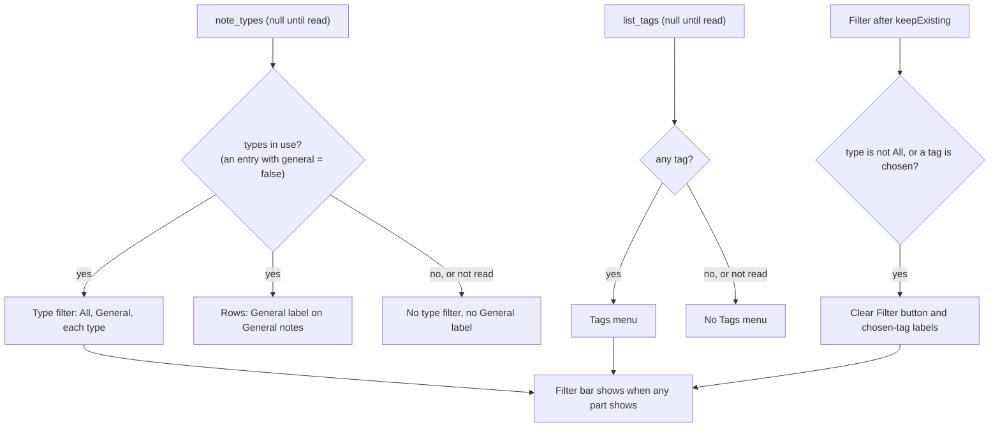
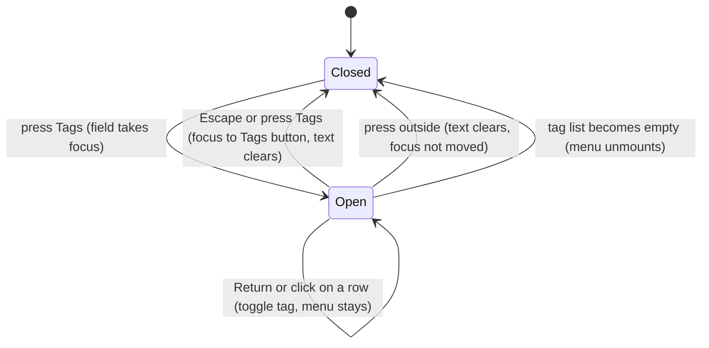

# Type and Tag Filter Refinements - Plan

## Goal Capsule

- **Objective:** On Home, each type and tag control shows only when it gives information. A user with many tags can find and choose a tag quickly. A user who uses note types can see which notes are in General.
- **Product authority:** This Product Contract. The user confirmed the scope in the brainstorm on 2026-10-08. It refines [Note Types and Tags](2026-10-07-1940-feat-note-types-and-tags-plan.md) (R19, R22) and does not change its other decisions.
- **Means:** Rules derived from the type list and the tag list on the client, and a new filterable Tags menu built on the "+ Tag" picker pattern (KTD1, KTD3).
- **Execution profile:** One worktree from `origin/main`, one PR. Commit per unit. The units are frontend only: no Rust, store or settings change.
- **Stop conditions:** Stop and ask when a requirement cannot hold without a change to `note_types`, `list_tags` or the shared settings, or when a settled Key Decision proves unworkable.
- **Who finishes:** `ce-work` implements and opens the PR. The user tests a signed build before merge.
- **Open blockers:** None.

---

## Product Contract

### Summary

Home treats note types as in use when the type list has a type other than General. Only then does Home show the type filter and a General label on General notes. Home shows the Tags menu only when a note has a tag. The Tags menu gets a field that filters the list, groups the tags by scope, and shows each tag as its coloured label. While a filter is set, the filter bar shows a "Clear Filter" button.

### Problem Frame

Note types and tags arrived in PR #45. With daily use, three problems are clear.

A user who keeps every note in General sees "All Types | General" on Home. Both choices show the same notes. A user with no tags sees a Tags menu that holds only "No tags".

A user with many scoped tags gets a menu of plain text such as `Person::Andrew Wein…`. The `::` and the repeated scope make the list hard to scan, and the 240 px menu cuts off long names. The list will grow as the user tags more people.

A user with note types who sometimes uses General sees no type label on General notes. The row looks as if the type is missing, not as if the note is in General.

### Key Decisions

- **Note types are in use when the type list has a type other than General.** A type that the user made in Settings and that has no notes counts. A user who makes a type intends to use more than one type. (session-settled: user-directed — chosen over a rule that hides the filter when the choices give the same notes: the user wants the filter as soon as they make a type.) Governs R1, R2, R4.
- **The Tags menu is a grouped list with a filter field and the real tag labels.** (session-settled: user-directed — chosen over a grouped list with scope headings and over one submenu for each scope, after a sketch of all three.) Governs R6, R7, R8, R9, R11.
- **The General label looks like the other type labels.** One look for all types is easier to read than a special case, although General has no type folder. Governs R4.
- **Tag colours do not change.** A tag with no scope is a neutral label, and each scope has its own colour. This already works for users with no scoped tags, only scoped tags, or a mix.

### Requirements

**Type filter**

- R1. Home shows the type filter only when note types are in use: the type list has at least one type other than General.
- R2. When the type filter shows, it lists "All", General and every other type in the type list, with or without notes. Today, General is a choice only when a listed note is in General. That condition is removed.
- R3. When a filter control is hidden, Home drops the choice that it held, so Home shows all notes for that control.

**General on Home rows**

- R4. When note types are in use (R1), each Home row of a General note shows a General type label. When they are not in use, Home rows show no type label for General notes, as today.

**Tags menu**

- R5. Home shows the Tags menu only when at least one note has a tag.
- R6. The Tags menu starts with a text field. Typing in the field shows only the tags whose text contains the typed text, without regard to case and to spaces around `::`, as the "+ Tag" picker matches.
- R7. The menu lists the tags with no scope first, then the scoped tags. Scopes sort A–Z, and the values in each scope sort A–Z. Tags with no scope sort A–Z.
- R8. Each menu item shows the tag as the same label that Home rows show, with the scope colour, and a check mark when the tag is chosen.
- R9. The menu stays open after the user chooses or clears a tag, so the user can choose several tags in turn.
- R10. The menu works from the keyboard: the field has the focus when the menu opens, the arrow keys move through the shown tags, Return chooses or clears the tag that has the focus, and Escape closes the menu.
- R11. The Tags menu is wide enough for typical labels, up to a maximum width. A label longer than that is cut off, and its full text shows on hover and to VoiceOver.

**Clear Filter**

- R12. While Home has a filter (a type other than "All", or at least one chosen tag), the filter bar shows a "Clear Filter" button. It sets the type to "All" and removes every chosen tag, as the "Clear Filter" button of the empty result does today.

### Acceptance Examples

- AE1. **Covers R1, R5.** **Given** every note is in General and no note has a tag, **when** the user opens Home, **then** Home shows no type filter and no Tags menu.
- AE2. **Covers R1, R2.** **Given** every note is in General, **when** the user adds the type "Pathfinder" in Settings, **then** Home shows the type filter with "All", "General" and "Pathfinder".
- AE3. **Covers R4.** **Given** the type list has "One-on-One" and a note is in General, **when** the user looks at Home, **then** that note's row shows a General type label.
- AE4. **Covers R3.** **Given** `follow-up` is the only tag in the library and the filter shows it, **when** the user removes `follow-up` from the only note that has it, **then** the Tags menu and the chosen-tag label go away, and Home shows every note for the chosen type.
- AE5. **Covers R6, R7.** **Given** the tags `daily`, `Person::Dana Ortiz` and `Topic::Roadmap`, **when** the user types "da" in the field, **then** the menu shows `daily` and then `Person::Dana Ortiz`.
- AE6. **Covers R9.** **Given** the Tags menu is open, **when** the user chooses two tags in turn, **then** the menu stays open, both show a check mark, and Home shows only the notes that have both tags.
- AE7. **Covers R12.** **Given** the filter shows "One-on-One" and the tag `Person::Dana Ortiz`, and some notes match, **when** the user presses "Clear Filter" in the filter bar, **then** the type is "All", no tag is chosen, Home shows every note, and the button goes away.

### Scope Boundaries

- The note page's type menu and "+ Tag" picker do not change.
- No change to the filter logic (one type and all chosen tags) or to the segmented control and its overflow menu.
- No new tag colours, and no colours that the user chooses for a scope.
- No submenus and no scope-only filter.

- Considered and not built: an active row that follows its tag when a sync changes the tag list during an open menu. A reset of the active row is enough: a wrong toggle shows at once and one click undoes it.
- Considered and not built: a single "Clear Filter" button when no notes match. The bar button and the empty-result button both show, so the bar does not change while the user filters (user-approved at plan confirmation).

### Sources / Research

- `src/home/FilterBar.tsx` — the filter bar, the type segments and the Tags menu.
- `src/home/filter.ts` — `hasGeneralNote` and `keepExisting` (R3 already drops a choice that no longer exists).
- `src/home/NoteLabels.tsx` — Home row labels. It shows no label for a `null` type.
- `src/lib/Labels.tsx` — `TagLabel`, `TypeLabel` and the scope colours.
- `src/session/SessionMenu.tsx` — `Menu`. A menu with no submenu scrolls.
- `src/lib/TagPicker.tsx` — the "+ Tag" combobox, the model for the filter field.

Product Contract preservation: changed — R12 and AE7 added at the user's request during planning; the two questions deferred to planning are resolved in KTD4 and KTD5; R11 moved after R10 with no change in meaning.

---

## Planning Contract

### Key Technical Decisions

- KTD1. **Home derives "types in use" from the type list, and keeps the current choice while a list is not read yet.** `note_types` already returns every type in the shared list, with `notes: 0` for an unused type, plus General with `general: true`. So types are in use when the list has an entry with `general: false`. Home passes `general = types === null || typesInUse` to `keepExisting`, which already drops a General or named choice that is no longer valid. A `null` list keeps its choices, so a chosen General does not drop at app start. Each control shows only after its list is read. Governs R1, R2, R3, R5.
- KTD2. **The General label goes through the normal type path of `NoteLabels`.** A row passes `noteType ?? GENERAL` when types are in use, and `noteType` otherwise. The `onAccent` surface, the `+N` count and the hidden-label text then work with no special case. Governs R4.
- KTD3. **The Tags menu is a new component modelled on `TagPicker` and `ModelPicker`, not an extension of `Menu`.** `Menu` and `PopUpMenu` close after each choice, focus the first button, take only text labels, and use `role="menu"`. The new menu keeps the focus in a field with `role="combobox"` and `aria-activedescendant`. Its list has `role="listbox"` with `aria-multiselectable="true"`, where `aria-selected` means "chosen". The active row has a `bg-fill` fill, not the accent fill, so the coloured labels stay readable. The menu renders in a portal and uses floating-ui (`fixed`, `flip`, `shift`), as `TagPicker` does, because Home's pane has `overflow-hidden` and would cut off a wider menu. (session-settled: user-directed — the menu shape was chosen over a grouped list with scope headings and over one submenu for each scope; governs R6, R7, R8, R9, R11.)
- KTD4. **The field text stays while the menu is open and clears when it closes. With no match, the menu shows the field and a "No matching tags" status line.** A kept text lets the user choose several tags from one filtered list (R9). Governs R6, R9.
- KTD5. **The Tags menu is at least as wide as today's menu (240 px) and at most 360 px.** The width fits the widest label between those limits. Each option has a `title` with the full tag text. Scoped labels already give VoiceOver the full name. A scope part never shrinks, so a very long scope cuts off its value first. This is acceptable for real data. Governs R11.
- KTD6. **The menu order and the "types in use" rule are pure functions in `src/home/filter.ts`.** `list_tags` sorts by lower-case text, which is not the R7 order. The client groups by `tagKey(scope)`, so "Person" and "person" are one scope. It sorts with `localeCompare`, as the other client sorts do. Governs R7.
- KTD7. **The bar "Clear Filter" button reuses Home's `clearFilter`, and the bar decides from the filter after `keepExisting`.** The focus goes to the selected note, as with the existing button. Home renders no bar when no control, no chosen tag and no button would show. Governs R12, R3.

### High-Level Technical Design

The bar's content comes from two read lists and the reconciled filter:

Tags menu states, as directional guidance:

### Assumptions

- The tag list stays small enough (tens to low hundreds) that the menu needs no virtual scrolling.
- A sync can change the tag list while the menu is open. The menu derives its rows from the current props, and a change to the tag list resets the active row, as typing does.

### Sequencing

U1 first, because U2 to U4 use its helpers. U2 and U3 are independent. U4 replaces the Tags control that U2 shows or hides. U5 runs last.

---

## Implementation Units

### U1. Filter rules and the menu order

- **Goal:** Pure helpers for "types in use" and the Tags menu order. The rule that General needs a General note is removed.
- **Requirements:** R1, R2, R7 (KTD1, KTD6).
- **Dependencies:** None.
- **Files:**
  - `src/home/filter.ts`
  - `src/home/filter.test.ts` (new)
- **Approach:**
  1. Add a helper that is true when a type list has an entry that is not General. Add a helper that gives the `general` argument of `keepExisting`: true when the type list is `null` or types are in use (KTD1).
  2. Add a helper that orders tag entries for the menu: no scope first, then by scope key, then by value, each A–Z without regard to case.
  3. Delete `hasGeneralNote` and its comment. Keep `keepExisting` as it is: its `general` argument now means "General is a choice".
- **Patterns to follow:** `tagParts` and `tagKey` in `src/lib/Labels.tsx`. The `localeCompare` sorts in `src/home/group.ts`.
- **Test scenarios:**
  - A list with only General gives "not in use". A list with General and one type with `notes: 0` gives "in use".
  - Covers AE5. The order of `Topic::Roadmap`, `daily`, `Person::Dana Ortiz` and `person::alex` is `daily`, `person::alex`, `Person::Dana Ortiz`, `Topic::Roadmap`, and the two Person tags are in one group.
  - The `general` helper gives true for a `null` list, so `keepExisting` keeps a chosen General. It gives false for a list with only General, so `keepExisting` drops a chosen General.
- **Verification:** The new tests pass, and no code uses `hasGeneralNote`.

### U2. Show the type filter, the Tags menu and Clear Filter only when useful

- **Goal:** Home and the filter bar apply R1, R2, R3, R5 and R12.
- **Requirements:** R1, R2, R3, R5, R12, AE1, AE2, AE4, AE7 (KTD1, KTD7).
- **Dependencies:** U1.
- **Files:**
  - `src/home/Home.tsx`
  - `src/home/FilterBar.tsx`
  - `src/home/Home.test.tsx`
- **Approach:**
  1. In Home, compute "types in use" from `lists.types`, and pass the U1 `general` helper's result to `keepExisting`.
  2. Give `FilterBar` the flags it needs to show the type control, the Tags control and the "Clear Filter" button. The type control always lists General when it shows. Update the comments in the headers of `FilterBar.tsx` and Home.
  3. The bar's "Clear Filter" button calls Home's `clearFilter`. It is the last item in the bar, at the trailing edge. While the type control shows, the overflow measurement always reserves the button's width, measured from a hidden copy as the segments are, whether or not a filter is set. So the type control does not change between segments and menu when the button appears. The measurement also runs again when the Tags control shows or hides.
  4. Home renders the bar only when a part of it shows (KTD7).
- **Patterns to follow:** The existing `showFilter` and `clearFilter` in `src/home/Home.tsx`. `Button` in `src/settings/ui.tsx`, or the `PopUpMenu` button classes for a matching size.
- **Test scenarios:**
  - Covers AE1. With only General and no tags, Home shows no "Note Type" control, no "Tags" button and no "Clear Filter" button.
  - Covers AE2. With only General, a `settings-changed` event with a new type "Pathfinder" makes the control show "All", "General" and "Pathfinder".
  - With "Pathfinder" defined and no note in General, General is a choice. This replaces the test "with no note in General, General is not a choice".
  - With General chosen, when the last other type is deleted, the type filter goes and Home shows every note. This replaces the test "a chosen General drops out…".
  - Covers AE4. With `follow-up` chosen as the only tag, when the tag list becomes empty, the Tags button and the chosen-tag label go.
  - Covers AE7. With a type and a tag chosen, a press on the bar's "Clear Filter" sets "All", removes the tag, shows every note and removes the button.
  - With no match, both "Clear Filter" buttons show. Queries scope to the bar or to the empty result.
  - When "Clear Filter" appears, the type control stays the same kind (segments or menu).
  - Before the type list is read, a chosen General stays.
- **Verification:** The Home filter tests pass. The tests that this unit replaces are rewritten, not deleted.

### U3. General label on Home rows

- **Goal:** Rows of General notes show a General type label when types are in use.
- **Requirements:** R4, AE3 (KTD2).
- **Dependencies:** U1.
- **Files:**
  - `src/home/Home.tsx`
  - `src/home/SessionRow.tsx`
  - `src/home/RecordingRow.tsx`
  - `src/home/Home.test.tsx`
- **Approach:**
  1. Home passes "types in use" to the session rows and the recording row.
  2. Each row gives `NoteLabels` the type `GENERAL` for a General note when types are in use. `NoteLabels` does not change.
- **Patterns to follow:** `GENERAL` and `TypeLabel` in `src/lib/Labels.tsx`. The current `noteType` props of both rows.
- **Test scenarios:**
  - Covers AE3. With "One-on-One" defined, a General row shows a type label "General" after the type list is read (use `findBy`).
  - With only General defined, a General row shows no type label. This splits the test "a row of General shows no type label".
  - A recording of a General note shows a General label when types are in use.
  - A selected General row keeps the label on the accent surface.
- **Verification:** The row tests pass. A General row with no tags keeps its height.

### U4. Filterable Tags menu

- **Goal:** Replace the Tags `PopUpMenu` with the menu that R6 to R11 describe.
- **Requirements:** R6, R7, R8, R9, R10, R11, AE5, AE6 (KTD3, KTD4, KTD5).
- **Dependencies:** U1, U2.
- **Files:**
  - `src/home/TagFilterMenu.tsx` (new)
  - `src/home/TagFilterMenu.test.tsx` (new)
  - `src/home/FilterBar.tsx`
  - `src/home/Home.test.tsx`
- **Approach:**
  1. The Tags button keeps the `PopUpMenu` button look, `aria-haspopup="listbox"`, `aria-expanded`, the WKWebView `focus()` call and the `wasOpen` guard.
  2. The popup is a portal with a field and a list, placed with floating-ui. The field has the focus when the popup opens. Rows come from the U1 order, filtered with `tagKey(t).includes(tagKey(text))`.
  3. Each row shows a check column and a `TagLabel`, with a `title` of the full text. A click or Return toggles the tag, and the menu stays open. The popup keeps the focus in the field during a click.
  4. ArrowUp and ArrowDown move the active row, which scrolls into view. Return with no active row does nothing. Escape closes, and the focus goes back to the Tags button. A press outside closes without moving the focus.
  5. Update the `addTag` helper in `Home.test.tsx` to the new option role.
- **Patterns to follow:** `src/lib/TagPicker.tsx` (combobox, portal, floating-ui, `onMouseDown` that keeps the focus, optional `scrollIntoView`). `src/settings/ModelPicker.tsx` for a check mark in a listbox. The popup look of `Menu` in `src/session/SessionMenu.tsx`. `docs/solutions/ui-bugs/wkwebview-click-does-not-focus-button-breaks-shortcut-capture.md`.
- **Test scenarios:**
  - On open, the field has the focus and the options are in the R7 order.
  - Covers AE5. Typing "da" shows `daily` and then `Person::Dana Ortiz`.
  - Typing "person::dana" also shows `Person::Dana Ortiz`.
  - With text that matches nothing, the field stays and a "No matching tags" status shows.
  - Covers AE6. Two clicks on two tags leave the menu open. Both options have `aria-selected="true"`, and Home shows only the notes with both tags.
  - ArrowDown twice and Return toggles the second shown tag. Return with no active row changes nothing.
  - Escape closes the menu, clears the text, and gives the focus to the Tags button.
  - A press on the Tags button of an open menu closes it and does not reopen it.
  - When a sync changes the tag list while the menu is open, the menu shows the new list and no row is active.
  - Each option has a `title` with the full tag text.
- **Verification:** The menu tests and the Home filter tests pass. `bun run typecheck` passes.

### U5. Design and focus review

- **Goal:** Confirm the look and the focus in WebKit before the PR.
- **Requirements:** R8, R10, R11, R12.
- **Dependencies:** U2, U3, U4.
- **Files:** None committed. A preview page and screenshots stay in the gitignored `.context/` folder.
- **Approach:**
  1. Invoke `apple-design` and `emil-design-eng` for the bar, the "Clear Filter" button and the Tags menu.
  2. Render Home with a mock tag list of 30 tags (unscoped, three scopes, long names) in light and dark, at the narrowest window width.
  3. In WebKit, check that the field has the focus on open, that Escape returns the focus to the Tags button, and that the menu is not cut off at the right edge.
- **Test expectation:** none -- visual and WebKit focus review. The behaviour tests are in U2 to U4.
- **Verification:** Screenshots show no clipping, readable labels on the active row, and a bar that does not move when "Clear Filter" appears.

---

## Verification Contract

| Check | Command or step | Proves |
|---|---|---|
| Frontend tests | `bun test ./src/` | U1 to U4 behaviour, including every AE |
| Types | `bun run typecheck` | No type errors after the `FilterBar` and row prop changes |
| WebKit review | U5 preview with Playwright WebKit | Focus and clipping, which happy-dom cannot prove |
| Manual test | Signed build, as `docs/development-workflow.md#manual-tests` says | The real WKWebView: focus, menu width, the Home bar with real tags |

No Rust code changes, so the Rust checks, `scripts/check-windows.sh` and `scripts/check-licences.sh` do not apply unless a unit touches `src-tauri/` or `crates/`.

---

## Definition of Done

- R1 to R12 hold, and each AE has a passing test.
- `hasGeneralNote` and the Tags `PopUpMenu` use are gone, and no code refers to them.
- The comments in `FilterBar.tsx` and Home describe the new rules in ASD-STE100.
- The tests that U2 and U3 replace are rewritten, not deleted.
- The U5 review and a signed-build manual test are done.
- No preview page, screenshot or experimental code is in the diff.
- When the PR merges, the idea file moves to `done/` (now `docs/ideas/done/type-and-tag-filter-refinements.md`) with the PR number.
