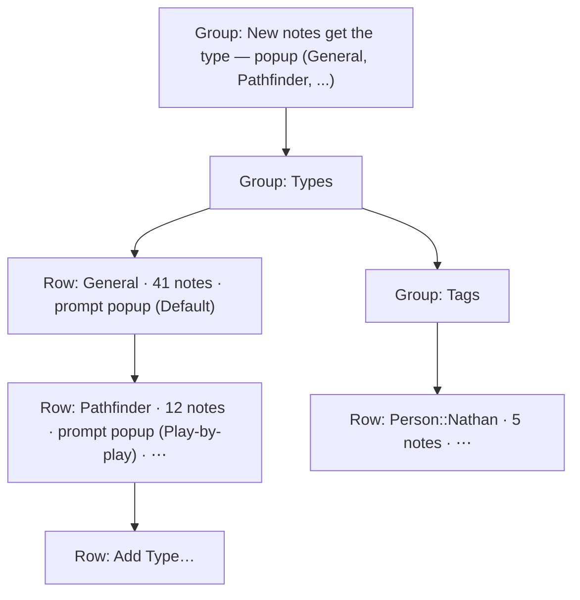

# Summary Prompt by Note Type - Plan

## Goal Capsule

- **Objective:** Each kind of note gets the summary shape that fits it with no need to change the app-wide prompt in Settings, and the user cannot rename or delete a type or tag by accident.
- **Product authority:** This Product Contract. The user confirmed the scope in the brainstorm on 2026-10-09. It extends [Saved summary prompts](../ideas/done/summary-prompts.md) and [Note Types and Tags](2026-10-07-1940-feat-note-types-and-tags-plan.md), and it replaces their rule that one app-wide prompt and the prompt copied at recording start choose a summary prompt.
- **Open blockers:** None.

---

## Product Contract

### Summary

Each note type has a summary prompt choice: "Default" or one saved summary prompt. When the app summarizes a note, the type of the note at that time chooses the prompt. A type set to "Default" uses the default prompt: the app-wide prompt that Settings marks "In use" today. The Types and Tags pane shows names as plain text, with a live summary prompt popup on each type row and a ⋯ menu for Rename and Delete. After the user changes the type of a note that has a summary, and the prompt of the new type differs from the prompt that made the summary, the note offers to regenerate the summary.

### Problem Frame

Longhand has one active summary prompt for the whole app. A Pathfinder session needs a recap, and a work one-on-one needs decisions and follow-ups. To get the other shape, the user must change the app-wide prompt in Settings, regenerate the summary, and change the prompt back. Note types shipped in PR #45, and the type of a note already says which shape it needs.

The Types and Tags pane shows each type name and each tag as an editable text field with a Delete button beside it. A click and a keystroke in the wrong place renames a type, which moves its folder and its notes. The pane also looks less finished than the other Settings panes.

### Key Decisions

- **The type of a note at summary time chooses the prompt.** A type change before the summary starts therefore affects the first summary with no offer. (session-settled: user-approved — chosen over the type at recording start: that rule makes a type change during recording give a summary with the wrong shape.) Governs R3, R4.
- **A type change after a summary offers a regeneration; it never starts one.** (session-settled: user-directed — chosen over keeping the summary with no offer, and over an automatic regeneration that loses edits to the old summary.) Governs R9, R10.
- **Only a type change on the note page gives the offer.** (session-settled: user-approved — chosen over an offer on every note whose summary prompt differs from the prompt of its type, whatever the cause.) Governs R11.
- **Names are read-only text; Rename and Delete are in a ⋯ menu on each row.** Both actions are rare, so one more click is acceptable. (session-settled: user-directed — chosen over an Edit toggle for the group, an edit sheet for each type, and a pencil button on each row.) Governs R13, R15.
- **The summary prompt popup applies its choice at once, with no Save step.** A popup choice is hard to make by accident, and it is the control the user changes most often in this pane. Governs R14.
- **Tags follow the same row pattern as types.** (session-settled: user-directed — the user asked for consistency.) Governs R17.

### Requirements

**Prompt choice for each type**

- R1. Each note type, General included, has a summary prompt choice. The choices are "Default" and each saved summary prompt. A new type starts with "Default".
- R2. The prompt choice of each type is shared settings, so every computer with the same storage folder uses it.
- R3. A summary uses the prompt of the note's type at the time the summary runs. A type with "Default" uses the default prompt. This applies to the first summary, Regenerate Summary and Transcribe Again.
- R4. The first summary of a note no longer uses the prompt that was active when recording started. If the user edits a prompt during a recording, the first summary of that note uses the edited text.
- R5. When the user deletes a summary prompt that one or more types use, those types change to "Default". The delete confirmation says how many types use the prompt.
- R6. A type rename keeps the prompt choice of the type. When a rename merges two types, the merged type keeps the prompt choice of the type that it merges into. A type delete removes the prompt choice of that type.
- R7. When the file of a prompt that a type uses is missing or has a conflict copy, a summary uses the last copy of that prompt that this computer read, as the shared settings rule does for the active prompt. Only a choice that names a prompt that this computer has never read works as "Default", and Settings shows that type as "Default".
- R8. The Summary prompts pane calls the app-wide prompt the default prompt and says that it applies to each type set to "Default". Existing summaries do not change when a prompt choice or the default prompt changes.

**Offer to regenerate after a type change**

- R9. After the user changes the type of a note on the note page, the note shows an offer to regenerate the summary when all of these are true: the note has a complete summary, the note is not in processing, and the prompt of the new type differs from the prompt that made the summary. A type change during processing is checked again when processing ends, because the summary step reads its prompt once, when it starts.
- R10. The offer has one action that regenerates the summary with the prompt of the new type, and one action that dismisses the offer. The offer shows on every tab of the note. Each later type change on the note checks the R9 conditions again, and the offer goes away when they are no longer true. The offer does not survive when the user leaves the note.- R11. A change to a type's prompt choice in Settings, a change to the default prompt, or a type change from another computer gives no offer on existing notes.

**Types and Tags pane**

- R12. A popup above the type list chooses the default type for new notes. It replaces the radio buttons.
- R13. Each type row shows the name as plain text, the count of notes, the summary prompt popup and a ⋯ menu. General has no ⋯ menu, because it cannot be renamed or deleted.
- R14. The summary prompt popup on a type row applies the choice at once, with no Save step.
- R15. The ⋯ menu has Rename… and Delete…. Rename turns the name into a field for that one row: Return applies the name, and Escape or a click elsewhere cancels. Delete asks for one confirmation that says how many notes change, as it does now. The merge notice after a rename stays.
- R16. An "Add Type…" row at the end of the list adds a type. It shows a name field for the new type, with the same Return and Escape rules as Rename.
- R17. Each tag row shows the tag as plain text, the count of notes and a ⋯ menu with Rename… and Delete…, with the same rules as R15.
- R18. A type with an invalid name keeps its warning and its ⋯ menu, so the user can rename or delete it.
- R19. While the shared settings are read-only, the popups and the ⋯ menus are disabled, and the pane says why, as it does now.
- R20. The pane follows macOS System Settings list conventions: plain-text rows, aligned columns, and controls that look like controls only where they act.

### Acceptance Examples

- AE1. **Covers R3, R4.** Given the type of a note is General with "Default" and the default prompt is Topic summary, when the user changes the type to Pathfinder (Play-by-play summary) during the recording, then the first summary uses Play-by-play summary, and the note shows no offer.
- AE2. **Covers R9, R10.** Given a note of type One on One has a complete summary made with Topic summary, when the user changes the type to Pathfinder (Play-by-play summary) on the note page, then the note shows the offer. When the user selects the regenerate action, the summary is made again with Play-by-play summary.
- AE3. **Covers R9.** Given General and Pathfinder both use "Default", when the user changes a note with a summary from General to Pathfinder, then the note shows no offer.
- AE4. **Covers R9.** Given the summary step of a One on One note (Topic summary) has started, when the user changes the type to Pathfinder (Play-by-play summary), then the first summary uses Topic summary, and the note shows the offer when processing ends.
- AE5. **Covers R5, R7.** Given Pathfinder uses the prompt "Recap", when the user deletes "Recap", then the confirmation says that one type uses it, and after the delete Pathfinder shows "Default".
- AE6. **Covers R6.** Given Work uses "Decisions" and Meetings uses "Default", when the user renames Work to Meetings, then the types merge, and Meetings keeps "Default".
- AE7. **Covers R11.** Given 12 Pathfinder notes have summaries made with Topic summary, when the user sets Pathfinder to Play-by-play summary in Settings, then no note shows an offer, and Regenerate Summary on any of those notes uses Play-by-play summary.
- AE8. **Covers R15.** Given the user selects Rename… for Pathfinder and types "Pathfind", when the user presses Escape, then the name stays "Pathfinder", and nothing moves.

### Success Criteria

- The user approves a screenshot of the redesigned pane in light and dark mode, after an `apple-design` review of the pane passes.
- In daily use, the user changes the type of a note to get a different summary shape, and never opens the Summary prompts pane for that purpose.

### Scope Boundaries

- A "Regenerate With" submenu that uses a prompt other than the type's prompt ([regenerate-with-another-prompt](../ideas/someday/regenerate-with-another-prompt.md)).
- A list in the Summary prompts pane of the types that use each prompt ([prompt-usage-in-summary-prompts](../ideas/someday/prompt-usage-in-summary-prompts.md)).
- An offer to regenerate many notes at once after a Settings change.
- Changes to the tag scope colours ([tag-scope-colours-in-settings](../ideas/someday/tag-scope-colours-in-settings.md)).
- A type or tag suggested by the summary model ([suggested-tags](../ideas/someday/suggested-tags.md)).

### Outstanding Questions

**Deferred to Planning**

- How the offer compares prompts: the summary records only the prompt name, not its id. Planning chooses between a comparison by name, a record of the id, or a comparison of the old and new type's prompts.
- How a type's prompt choice refers to a prompt (id or name) so that a prompt rename keeps the choice.
- What happens to the recording-start prompt copy, and to the summary resume rule that compares prompt ids, now that R4 removes the copy's use.
- Which existing menu component the ⋯ menu and the popups reuse.

### Sources / Research

- Active prompt and its resolution: `crates/shared-settings/src/file.rs:168`, `src-tauri/src/managers/settings.rs:871-912`.
- Prompt copy at recording start and its use: `crates/session-core/src/jobs.rs:103-112`, `crates/pipeline/src/runner.rs:1419-1420`, `crates/pipeline/src/runner.rs:1512-1515`; Regenerate at `crates/pipeline/src/runner.rs:466-470`.
- Resume rule that compares prompt ids: `crates/pipeline/src/save.rs:1239-1250`.
- Recorded prompt name of a summary: `crates/session-core/src/folder.rs:654-658`, set at `crates/pipeline/src/summarize.rs:627`.
- Prompt delete resets the active prompt: `src-tauri/src/managers/shared.rs:474-487`.
- Note types in shared settings and rename, merge and delete: `crates/shared-settings/src/file.rs:183-190`, `crates/shared-settings/src/note_types.rs:179-244`.
- Type change on a note runs no summary: `src-tauri/src/commands/session.rs:866-901`.
- Current pane: `src/settings/TypesAndTags.tsx`; shared parts: `src/settings/ui.tsx`; menu: `src/session/SessionMenu.tsx:79`.
- Shared settings rules: [shared-settings-in-a-synced-folder-rules](../solutions/integration-issues/shared-settings-in-a-synced-folder-rules.md).
- Focus in a popup menu field: [combobox-field-in-portal-popup-lost-tab-order-and-caret](../solutions/ui-bugs/combobox-field-in-portal-popup-lost-tab-order-and-caret.md).
