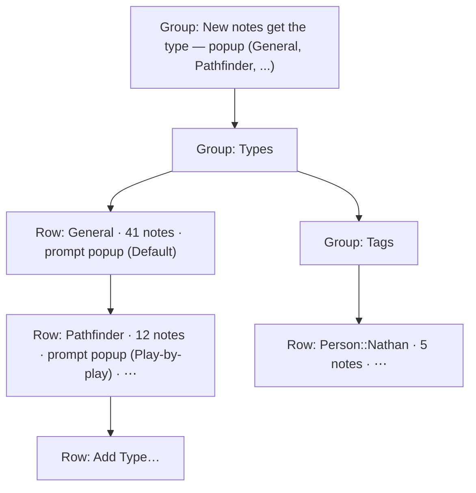
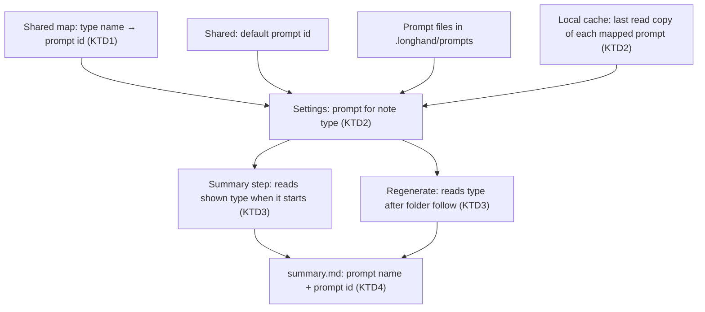
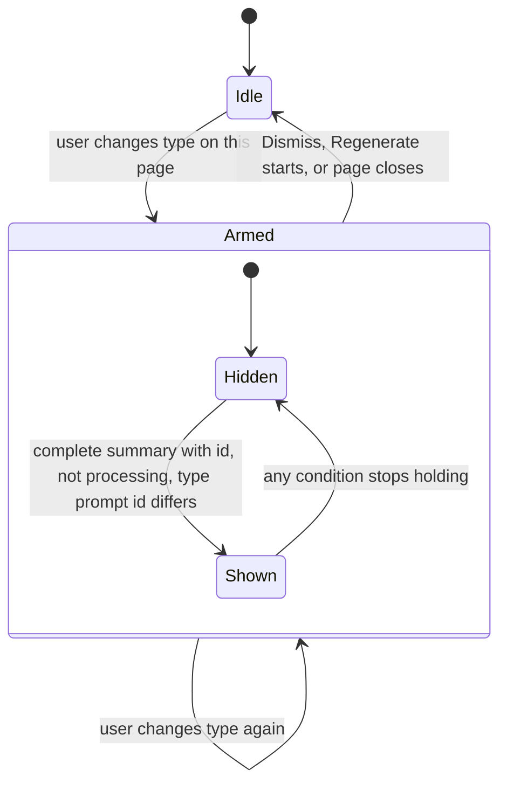

# Summary Prompt by Note Type - Plan

## Goal Capsule

- **Objective:** Each kind of note gets the summary shape that fits it with no need to change the app-wide prompt in Settings, and the user cannot rename or delete a type or tag by accident.
- **Means:** A shared map from note type to prompt id, resolved when a summary runs (KTD1, KTD3), and a redesigned Types and Tags pane built from native popups and a ⋯ menu (KTD7).
- **Product authority:** This Product Contract. The user confirmed the scope in the brainstorm on 2026-10-09 and the planning scope on the same day. It extends [Saved summary prompts](../ideas/done/summary-prompts.md) and [Note Types and Tags](2026-10-07-1940-feat-note-types-and-tags-plan.md), and it replaces their rule that one app-wide prompt and the prompt copied at recording start choose a summary prompt. Product Contract preservation: unchanged, except that the Outstanding Questions are resolved in the Planning Contract (KTD1, KTD3, KTD4, KTD7) and removed.
- **Execution profile:** One worktree from `origin/main`, one PR. Commit per unit. Rust and frontend changes. No database migration.
- **Stop conditions:** Stop and ask when a requirement cannot hold without a change to the shared settings rules, when the summary resume rule must change to keep R3, or when a settled Key Decision proves unworkable.
- **Who finishes:** `ce-work` implements and opens the PR. The user tests a signed build before merge.
- **Open blockers:** None.

---

## Product Contract

### Summary

Each note type has a summary prompt choice: "Default" or one saved summary prompt. When the app summarizes a note, the type of the note at that time chooses the prompt. A type set to "Default" uses the default prompt: the app-wide prompt that Settings marks "In use" today. The Types and Tags pane shows names as plain text, with a live summary prompt popup on each type row and a ⋯ menu for Rename and Delete. After the user changes the type of a note that has a summary, and the prompt of the new type differs from the prompt that made the summary, the note offers to regenerate the summary.

### Problem Frame

Longhand has one active summary prompt for the whole app. A Pathfinder session needs a recap, and a work one-on-one needs decisions and follow-ups. To get the other shape, the user must change the app-wide prompt in Settings, regenerate the summary, and change the prompt back. Note types shipped in PR #45, and the type of a note already says which shape it needs.

The Types and Tags pane shows each type name and each tag as an editable text field with a Delete button beside it. A click and a keystroke in the wrong place renames a type, which moves its folder and its notes. The pane also looks less finished than the other Settings panes.

### Key Decisions

- **The type of a note at summary time chooses the prompt.** A type change before the summary starts therefore affects the first summary with no offer. (session-settled: user-approved — chosen over the type at recording start: that rule makes a type change during recording give a summary with the wrong shape.) Governs R3, R4.
- **A type change after a summary offers a regeneration; it never starts one.** (session-settled: user-directed — chosen over keeping the summary with no offer, and over an automatic regeneration that loses edits to the old summary.) Governs R9, R10.
- **Only a type change on the note page gives the offer.** (session-settled: user-approved — chosen over an offer on every note whose summary prompt differs from the prompt of its type, whatever the cause.) Governs R11.
- **Names are read-only text; Rename and Delete are in a ⋯ menu on each row.** Both actions are rare, so one more click is acceptable. (session-settled: user-directed — chosen over an Edit toggle for the group, an edit sheet for each type, and a pencil button on each row.) Governs R13, R15.
- **The summary prompt popup applies its choice at once, with no Save step.** A popup choice is hard to make by accident, and it is the control the user changes most often in this pane. Governs R14.
- **Tags follow the same row pattern as types.** (session-settled: user-directed — the user asked for consistency.) Governs R17.

### Requirements

**Prompt choice for each type**

- R1. Each note type, General included, has a summary prompt choice. The choices are "Default" and each saved summary prompt. A new type starts with "Default".
- R2. The prompt choice of each type is shared settings, so every computer with the same storage folder uses it.
- R3. A summary uses the prompt of the note's type at the time the summary runs. A type with "Default" uses the default prompt. This applies to the first summary, Regenerate Summary and Transcribe Again.
- R4. The first summary of a note no longer uses the prompt that was active when recording started. If the user edits a prompt during a recording, the first summary of that note uses the edited text.
- R5. When the user deletes a summary prompt that one or more types use, those types change to "Default". The delete confirmation says how many types use the prompt.
- R6. A type rename keeps the prompt choice of the type. When a rename merges two types, the merged type keeps the prompt choice of the type that it merges into. A type delete removes the prompt choice of that type.
- R7. When the file of a prompt that a type uses is missing or has a conflict copy, a summary uses the last copy of that prompt that this computer read, as the shared settings rule does for the active prompt. Only a choice that names a prompt that this computer has never read works as "Default", and Settings shows that type as "Default".
- R8. The Summary prompts pane calls the app-wide prompt the default prompt and says that it applies to each type set to "Default". Existing summaries do not change when a prompt choice or the default prompt changes.

**Offer to regenerate after a type change**

- R9. After the user changes the type of a note on the note page, the note shows an offer to regenerate the summary when all of these are true: the note has a complete summary, the note is not in processing, and the prompt of the new type differs from the prompt that made the summary. A type change during processing is checked again when processing ends, because the summary step reads its prompt once, when it starts.
- R10. The offer has one action that regenerates the summary with the prompt of the new type, and one action that dismisses the offer. The offer shows on every tab of the note. Each later type change on the note checks the R9 conditions again, and the offer goes away when they are no longer true. The offer does not survive when the user leaves the note.
- R11. A change to a type's prompt choice in Settings, a change to the default prompt, or a type change from another computer gives no offer on existing notes.

**Types and Tags pane**

- R12. A popup above the type list chooses the default type for new notes. It replaces the radio buttons.
- R13. Each type row shows the name as plain text, the count of notes, the summary prompt popup (except a type with an invalid name, R18) and a ⋯ menu. General has no ⋯ menu, because it cannot be renamed or deleted.
- R14. The summary prompt popup on a type row applies the choice at once, with no Save step.
- R15. The ⋯ menu has Rename… and Delete…. Rename turns the name into a field for that one row: Return applies the name, and Escape or a click elsewhere cancels. Delete asks for one confirmation that says how many notes change, as it does now. The merge notice after a rename stays.
- R16. An "Add Type…" row at the end of the list adds a type. It shows a name field for the new type, with the same Return and Escape rules as Rename.
- R17. Each tag row shows the tag as plain text, the count of notes and a ⋯ menu with Rename… and Delete…, with the same rules as R15.
- R18. A type with an invalid name keeps its warning and its ⋯ menu, so the user can rename or delete it. It shows no summary prompt popup and uses the default prompt.
- R19. While the shared settings are read-only, the popups and the ⋯ menus are disabled, and the pane says why, as it does now.
- R20. The pane follows macOS System Settings list conventions: plain-text rows, aligned columns, and controls that look like controls only where they act.

### Acceptance Examples

- AE1. **Covers R3, R4.** Given the type of a note is General with "Default" and the default prompt is Topic summary, when the user changes the type to Pathfinder (Play-by-play summary) during the recording, then the first summary uses Play-by-play summary, and the note shows no offer.
- AE2. **Covers R9, R10.** Given a note of type One on One has a complete summary made with Topic summary, when the user changes the type to Pathfinder (Play-by-play summary) on the note page, then the note shows the offer. When the user selects the regenerate action, the summary is made again with Play-by-play summary.
- AE3. **Covers R9.** Given General and Pathfinder both use "Default", when the user changes a note with a summary from General to Pathfinder, then the note shows no offer.
- AE4. **Covers R9.** Given the summary step of a One on One note (Topic summary) has started, when the user changes the type to Pathfinder (Play-by-play summary), then the first summary uses Topic summary, and the note shows the offer when processing ends.
- AE5. **Covers R5, R7.** Given Pathfinder uses the prompt "Recap", when the user deletes "Recap", then the confirmation says that one type uses it, and after the delete Pathfinder shows "Default".
- AE6. **Covers R6.** Given Work uses "Decisions" and Meetings uses "Default", when the user renames Work to Meetings, then the types merge, and Meetings keeps "Default".
- AE7. **Covers R11.** Given 12 Pathfinder notes have summaries made with Topic summary, when the user sets Pathfinder to Play-by-play summary in Settings, then no note shows an offer, and Regenerate Summary on any of those notes uses Play-by-play summary.
- AE8. **Covers R15.** Given the user selects Rename… for Pathfinder and types "Pathfind", when the user presses Escape, then the name stays "Pathfinder", and nothing moves.

### Success Criteria

- The user approves a screenshot of the redesigned pane in light and dark mode, after an `apple-design` review of the pane passes.
- In daily use, the user changes the type of a note to get a different summary shape, and never opens the Summary prompts pane for that purpose.

### Scope Boundaries

- A "Regenerate With" submenu that uses a prompt other than the type's prompt ([regenerate-with-another-prompt](../ideas/someday/regenerate-with-another-prompt.md)).
- A list in the Summary prompts pane of the types that use each prompt ([prompt-usage-in-summary-prompts](../ideas/someday/prompt-usage-in-summary-prompts.md)).
- An offer to regenerate many notes at once after a Settings change.
- Changes to the tag scope colours ([tag-scope-colours-in-settings](../ideas/someday/tag-scope-colours-in-settings.md)).
- A type or tag suggested by the summary model ([suggested-tags](../ideas/someday/suggested-tags.md)).

**Considered and not built**

- An offer for a summary that records no prompt id (made before this change, or from an empty transcript). The page cannot tell which prompt made it, and Regenerate Summary stays available. Evidence that would change this: the user keeps regenerating old notes by hand after type changes.
- A rename of the stored key `active_summary_prompt` to match the new term "default prompt". Only the UI and `CONCEPTS.md` change; a key rename would need a second key in the shared file for no user gain.
- A database migration to drop the recording-start prompt columns. Nothing reads them after U3, and nobody has an install to clean up.

### Sources / Research

- Active prompt and its resolution: `crates/shared-settings/src/file.rs:168`, `crates/shared-settings/src/view.rs:257-313`, `src-tauri/src/managers/settings.rs:871-920`.
- Cache that keeps the last read copy of the active prompt only: `crates/shared-settings/src/cache.rs:31-35`, `crates/shared-settings/src/view.rs:156-165`, `src-tauri/src/managers/settings.rs:535-539`, `:752-758`.
- Prompt copy at recording start and its use: `crates/session-core/src/jobs.rs:103-112`, `src-tauri/src/managers/capture.rs:1418-1430`, `crates/pipeline/src/runner.rs:1414-1441`, `:1508-1533`. Regenerate at `crates/pipeline/src/runner.rs:461-470`; it follows the folder after it reads the prompt (`crates/pipeline/src/save.rs:1211-1219`).
- Resume rule that compares prompt ids: `crates/pipeline/src/save.rs:1239-1265`. The summary step stores its prompt once as the `PROMPT` checkpoint: `crates/pipeline/src/summarize.rs:481-491`.
- Recorded prompt name of a summary: `crates/session-core/src/folder.rs:648-659`, set at `crates/pipeline/src/summarize.rs:623-628`, shown through `SummaryView` in `src-tauri/src/commands/session.rs:424-435`.
- Prompt delete: `src-tauri/src/managers/shared.rs:474-487`.
- Note types and their edits: `crates/shared-settings/src/file.rs:183-190`, `crates/shared-settings/src/note_types.rs:185-307`, `src-tauri/src/managers/shared.rs:618-647`, `:747-910`.
- Note page type change and notices: `src/session/TypeAndTags.tsx:122-130`, `src/session/SessionPage.tsx:191`, `:242-252`, `:358-381`, `:693-756`.
- Menu and popups: `src/session/SessionMenu.tsx:79-269` (not a portal), `src/settings/ui.tsx:38` (`Group` clips), `:318-361` (`CommitField` commits on blur), portal pattern in `src/home/TagFilterMenu.tsx` and `src/settings/ModelPicker.tsx`, native popups in `src/settings/RecognitionOptions.tsx`.
- Learnings: [shared-settings-in-a-synced-folder-rules](../solutions/integration-issues/shared-settings-in-a-synced-folder-rules.md), [publication-checked-for-another-result-only-at-start-and-end](../solutions/logic-errors/publication-checked-for-another-result-only-at-start-and-end.md), [synced-summary-did-not-refresh-open-note](../solutions/logic-errors/synced-summary-did-not-refresh-open-note.md), [summary-regeneration-failed-with-no-working-folder](../solutions/logic-errors/summary-regeneration-failed-with-no-working-folder.md), [wkwebview-click-does-not-focus-button-breaks-shortcut-capture](../solutions/ui-bugs/wkwebview-click-does-not-focus-button-breaks-shortcut-capture.md), [combobox-field-in-portal-popup-lost-tab-order-and-caret](../solutions/ui-bugs/combobox-field-in-portal-popup-lost-tab-order-and-caret.md), [grid-column-grows-to-fit-nowrap-text](../solutions/ui-bugs/grid-column-grows-to-fit-nowrap-text.md).

---

## Planning Contract

### Key Technical Decisions

- KTD1. **The prompt choices are one shared map from type name to prompt id.** A new shared field holds a JSON object. Its key is the type name, with "General" for General, and its value is the prompt id. A type with no key uses the default prompt. The map is one value, so the last change wins for the whole map, as for `note_types`. Lookups compare type names without case and ignore keys that name no type in the effective type list. The value is the prompt id, not the name, because a prompt rename keeps its id. A value that is not an object of strings stays in the file as an unknown value. "General" cannot collide with a named type, because the type name check refuses it. Governs R1, R2, R6.
- KTD2. **Each type's prompt resolves in the same order as the active prompt, with its own cached copy.** The order is: built-in prompt, folder copy with no conflict, the last copy this computer read, conflicted folder copy, then the default prompt. The cache today keeps only the active prompt's copy, so it gets the last read copy of each prompt that the map names. `Settings` gets one function that returns the resolved prompt for a note type. Governs R3, R7.
- KTD3. **The summary paths ask for the prompt of the note's type when they run, and the prompt copy at recording start goes.** The engines call that returns the summary prompt takes the note type. The summary step reads the type from the store record (the shown type, which includes a pending type move), when the step starts. Regenerate resolves the prompt after it follows the folder, so a type change from another computer that the follow brings in counts. Recording start no longer copies the prompt, and the runner no longer reads that copy. The stored columns stay. The resume rule of Regenerate stays unchanged: a stub made with another prompt starts over. A retried summary step whose inputs changed (for example, the type) already makes every model call again, so it also replaces its stored prompt with the prompt of the current type. Governs R3, R4.
- KTD4. **A summary records the id of its prompt beside the name.** The id goes into the summary front matter in the same publication as the summary, and the note page receives it with the summary. The offer compares the resolved prompt id of the note's current type with this id. A summary with no recorded id gives no offer. Governs R9.
- KTD5. **The offer is a page-local trigger plus conditions read again on each render.** A type change made on the note page sets the trigger. Dismiss, the start of a regeneration and leaving the page clear it. The offer shows while the trigger is set and the R9 conditions hold now. The conditions are: a complete summary with a recorded prompt id, no processing or regeneration in progress, and a resolved prompt id of the current type that differs from the summary's id. A synced type change sets no trigger, which keeps R11. The conditions are read again when processing or a regeneration ends, which covers AE4. Governs R9, R10, R11.
- KTD6. **Type edits and prompt deletes update the map in the same save as their other values.** One pure function, next to `default_after`, gives the map after a rename, merge or delete. A rename moves the entry, a merge keeps the target's entry, and a delete removes the entry. The launch replay of an interrupted type edit applies the same function. It detects a merge because the target key already exists in the list. A prompt delete removes each entry that names the prompt, in the same save that resets the active prompt. Adding a type removes an old entry with the same name. Choosing a prompt for a type that has a folder but is not in the shared list adds the type to the list, as choosing it as the default does. Governs R5, R6.
- KTD7. **The pane uses native popups, the existing menu in a floating layer, and a rename field that cancels on blur.** The prompt popup and the default type popup are native `<select>` elements styled like the other Settings popups. They look like macOS popup buttons, and a Settings group cannot clip them. The ⋯ menu reuses `Menu` from the note page, with a new option that places it in a floating layer above the Settings group, in the same way as the tag filter menu. Rename and Add Type use a new field that applies on Return and cancels on Escape or blur, because `CommitField` saves on blur. The field takes the focus when it opens, and the focus goes back to the row's ⋯ button when it closes. Each ⋯ button has an accessible name with the row's name. A type with an invalid name shows no prompt popup and uses the default prompt. Governs R12-R20.
- KTD8. **The glossary calls the app-wide prompt the default prompt; code keeps its names.** `CONCEPTS.md` changes "Summary prompt" to describe the default prompt and the prompt choice of each type, and adds the map to the shared settings list. Code identifiers and the stored key keep `active_summary_prompt`. Governs R8.

### High-Level Technical Design

Prompt resolution, from the shared files to each summary path:

Offer state on the note page (KTD5):

### Assumptions

- The note page can read the resolved prompt id of each type from the type list that the Types and Tags commands already return. The page reloads that list when settings change, as the pane does. The offer compares the resolved id; the pane popup and the delete count use the choice.

### Sequencing

U1 → U2 → U3. U4 and U5 need U2. U6 needs U2 and U3. U7 is last.

---

## Implementation Units

### U1. Shared map field and pure type-prompt logic

**Goal:** The shared settings crate stores, reads and edits the type-to-prompt map, and resolves any prompt id with a cached copy.

**Requirements:** R1, R2, R6, R7; KTD1, KTD2, KTD6.

**Dependencies:** None.

**Files:**
- `crates/shared-settings/src/file.rs`
- `crates/shared-settings/src/note_types.rs`
- `crates/shared-settings/src/view.rs`
- `crates/shared-settings/src/cache.rs`
- `crates/shared-settings/tests/file.rs`
- `crates/shared-settings/tests/note_types.rs`
- `crates/shared-settings/tests/two_computers.rs`

**Approach:**
1. Add the map field with its key, parse check, unknown-value entry and `SharedValue` variant, following `note_types`.
2. Add a lookup helper that compares type names without case and ignores keys outside the effective type list.
3. Add the pure map-after-edit function next to `default_after` (rename, merge, delete), and a helper that removes the entries of one prompt id.
4. Generalize the active-prompt resolution in `view.rs` to any prompt id, and keep the last read copy of each mapped prompt in the cache.

**Patterns to follow:** `note_types` / `default_note_type` fields; `default_after` and `default_to_save` in `note_types.rs`; `active_from_folder` and `active_from_cache` in `view.rs`.

**Test scenarios:**
- A save of another field keeps the map unchanged in the file.
- A map value that is not an object of strings stays in the file as an unknown value, and reads as no choices.
- An absent map reads as "Default" for every type.
- Lookup of "pathfinder" finds the entry saved for "Pathfinder".
- A key that names no type in the list is ignored by the lookup.
- Rename of Work to Projects moves the entry. Covers AE6 in part: rename of Work to Meetings when Meetings exists keeps the Meetings entry and drops the Work entry.
- Delete of a type removes its entry and keeps the others.
- Removal of one prompt id drops each entry that names it and keeps the others.
- A mapped prompt whose file is gone resolves to the cached copy that this computer read before.
- A mapped prompt id that this computer never read resolves to no prompt, so the caller uses the default.
- Two computers: a map change on one computer reaches the other, and a change of another field on the second computer does not undo it.

**Verification:** The crate tests pass, and the map survives each save of other fields.

### U2. App settings, commands and the type list

**Goal:** The app reads and changes the map, keeps it correct through type edits and prompt deletes, and returns each type's resolved prompt.

**Requirements:** R1, R2, R5, R6, R7; KTD1, KTD2, KTD6.

**Dependencies:** U1.

**Files:**
- `src-tauri/src/managers/shared.rs`
- `src-tauri/src/managers/settings.rs`
- `src-tauri/src/commands/settings.rs`
- `src-tauri/src/lib.rs`
- `src/bindings.ts`

**Approach:**
1. Add a command that sets one type's prompt choice (a prompt id, or none for "Default"), following `set_default_note_type`. It returns the type list.
2. Give each `NoteTypeEntry` two values: the prompt choice (a prompt id, or none for "Default"; a never-read prompt shows as "Default", per R7), and the resolved prompt id that a summary of that type uses (the default prompt's id for "Default").
3. Add the map patch to the rename and delete saves, to the launch replay of an interrupted type edit, and to adding a type.
4. Remove the deleted prompt's entries in the prompt delete save.
5. Add the function on `Settings` that returns the resolved prompt for a note type, with the cached copies.
6. Register the command and regenerate the bindings.

**Patterns to follow:** `set_default_note_type`, `edit_patch`, `finish_type_edit` and `delete_prompt` in `shared.rs`; `active_summary_prompt_snapshot` and `cached_active_prompt` in `settings.rs`.

**Test scenarios:**
- Setting Pathfinder to a custom prompt returns a type list in which Pathfinder shows that prompt.
- Setting a prompt for a type that has a folder but is not in the shared list adds the type to the list.
- Covers AE5. Deleting the prompt "Recap" that Pathfinder uses resets Pathfinder to "Default", in the same save that resets the active prompt when "Recap" was also active.
- Covers AE6. Renaming Work (Decisions) to Meetings (Default) gives Meetings with "Default" and no Work entry.
- An interrupted rename that the launch replay completes moves the map entry too.
- Adding a type whose name has an old map entry gives the new type "Default".
- The prompt for a note type with no entry is the default prompt.
- The prompt for General follows the "General" entry.
- While the shared settings are read-only, the set command fails with the read-only reason and changes nothing.

**Verification:** The app crate tests pass, and the regenerated bindings contain the new command and field.

### U3. Prompt choice at summary time and the recorded prompt id

**Goal:** The first summary, Transcribe Again and Regenerate Summary use the prompt of the note's type when they run, and each summary records its prompt id.

**Requirements:** R3, R4, R9; KTD3, KTD4.

**Dependencies:** U2.

**Files:**
- `crates/pipeline/src/runner.rs`
- `crates/pipeline/src/summarize.rs`
- `crates/pipeline/src/save.rs`
- `crates/session-core/src/folder.rs`
- `src-tauri/src/managers/processing.rs`
- `src-tauri/src/managers/capture.rs`
- `src-tauri/src/commands/session.rs`
- `crates/pipeline/tests/runner.rs`
- `crates/pipeline/tests/end_to_end.rs`
- `crates/pipeline/tests/recognition_native.rs`
- `crates/pipeline/tests/recognition_stages.rs`
- `crates/session-core/tests/folder.rs`
- `crates/session-core/tests/jobs.rs`

**Approach:**
1. Change the engines call that returns the summary prompt to take the note type, and update its eight implementations.
2. In the summary step, read the shown type from the store record and ask for its prompt. Remove `first_summary_prompt`.
3. In Regenerate, resolve the prompt after the folder follow, so it uses the type that the follow brings in.
4. Stop the prompt copy at recording start. Keep the columns and their read code only where tests of old data need them.
5. When a summary step finds changed inputs and clears its stored calls, also replace its stored prompt with the prompt it was given.
6. Add the prompt id to the complete summary metadata and to `SummaryView`, with the same serde rules as the name.

**Execution note:** Start with a failing runner test for AE1, because it proves that the recording-start copy no longer decides the prompt.

**Patterns to follow:** `note_details` in `summarize.rs` reads the shown type the same way; `prompt_name` handling in `folder.rs` and `summarize.rs`.

**Test scenarios:**
- Covers AE1. A note whose type changes from General (Default, Topic summary) to Pathfinder (Play-by-play) before the summary step gets a Play-by-play summary.
- A prompt edited during recording gives the first summary the edited text (R4).
- Transcribe Again on a Pathfinder note uses the Pathfinder prompt.
- Covers AE7. Regenerate Summary on a Pathfinder note uses the prompt that Pathfinder has now, not the one that made the summary.
- Regenerate after the folder follow brings in a type change from another computer uses the new type's prompt.
- A summary step that resumes a stub made with another prompt starts over; a stub made with the same prompt resumes.
- A first summary fails, the type changes from One on One to Pathfinder, and the retry uses the Pathfinder prompt.
- The summary front matter records both the prompt name and the prompt id, and an older summary without an id still reads.
- Regenerate with no Working location folder still succeeds with the type's prompt.

**Verification:** The pipeline, session-core and app tests pass, and no production code reads the recording-start prompt copy.

### U4. Types and Tags pane redesign

**Goal:** The pane shows plain-text rows with a prompt popup, a ⋯ menu, a default-type popup and Add Type, for types and tags.

**Requirements:** R12-R20; KTD7.

**Dependencies:** U2.

**Files:**
- `src/settings/TypesAndTags.tsx`
- `src/settings/ui.tsx`
- `src/session/SessionMenu.tsx`
- `src/settings/TypesAndTags.test.tsx`
- `src/session/SessionMenu.test.tsx`

**Approach:**
1. Add the floating-layer option to `Menu`, and keep its current behavior as the default.
2. Add the rename field to `ui.tsx` (Return applies, Escape and blur cancel, focus on open). When the command refuses the name, the field stays open with the typed text and the focus, and the refusal shows in the pane's error text.
3. Replace the radio group with the default-type popup above the list.
4. Build the type row: name, count, prompt popup (no popup for an invalid name), and ⋯ menu (none for General).
5. Build the tag row with the same parts, without a popup.
6. Replace the add row with an "Add Type…" row that opens the rename field.
7. Keep the existing merge notice, delete confirmations, read-only footer and invalid-name warning.
8. Run an `apple-design` review of the pane and adjust spacing and alignment before the screenshot.

**Execution note:** In WKWebView a click does not focus a button. Call `focus()` on the field and on the ⋯ button, and test the focus with `document.activeElement`.

**Patterns to follow:** `SessionMenu` for the ⋯ button; `TagFilterMenu` for the floating layer; `RecognitionOptions` for native popups; the stateful `backend()` fake in `TypesAndTags.test.tsx`.

**Test scenarios:**
- The pane shows each type name as text, not as a field.
- Choosing "Play-by-play summary" in the Pathfinder popup calls the set command once and shows the new choice.
- Choosing a type in the default-type popup sets the default type.
- General has a prompt popup and no ⋯ menu.
- Covers AE8. Rename… then Escape leaves the name unchanged and calls no command.
- Rename… then a click elsewhere leaves the name unchanged and calls no command.
- Rename… then Return calls the rename command, and a merge shows the merge notice.
- Rename… to "General" then Return keeps the field open with the typed text and the focus, and shows the refusal in the pane's error text.
- Delete… asks one confirmation that says how many notes move to General.
- Add Type… then Return adds the type; Escape adds nothing.
- An invalid-name type shows its warning and a ⋯ menu, and no prompt popup.
- In read-only mode, the popups and ⋯ menus are disabled and the footer says why.
- A tag row has a ⋯ menu with Rename… and Delete…, and no popup.
- The ⋯ menu on the last row opens outside the group's clip area.
- `Menu` without the new option keeps its current position.

**Verification:** The frontend tests pass, and the user approves a light and dark screenshot of the pane in a signed build.

### U5. Summary prompts pane: default prompt and delete count

**Goal:** The Summary prompts pane uses the term "default prompt" and the delete confirmation says how many types use the prompt.

**Requirements:** R5, R8.

**Dependencies:** U2.

**Files:**
- `src/settings/SummaryPrompts.tsx`
- `src/settings/SummaryPrompts.test.tsx`

**Approach:**
1. Change the "In use" marker, its button and the footer to the default-prompt wording. The footer says that the default prompt applies to each type set to "Default".
2. Count the types whose prompt choice (not the resolved id) is the prompt, from the type list, and put the count in the delete confirmation.

**Test scenarios:**
- Covers AE5. Delete of a prompt that one type uses shows a confirmation that says one type uses it.
- Delete of a prompt that no type uses shows no type count.
- The list marks the default prompt with the new wording.

**Verification:** The frontend tests pass.

### U6. Regenerate offer on the note page

**Goal:** The note page shows the offer after a type change when the new type's prompt differs from the prompt that made the summary.

**Requirements:** R9, R10, R11; KTD4, KTD5.

**Dependencies:** U2, U3.

**Files:**
- `src/session/SessionPage.tsx`
- `src/session/TypeAndTags.tsx`
- `src/session/SessionPage.test.tsx`
- `src/session/TypeAndTags.test.tsx`

**Approach:**
1. Add a callback from the note page type picker that reports a type change the user made.
2. Keep the trigger in page state, and read the type list for the resolved prompt ids.
3. Show the offer in the header area, so it shows on every tab, with "Regenerate Summary" and "Dismiss".
4. Disable the offer's Regenerate action whenever the menu's Regenerate Summary is disabled.

**Patterns to follow:** The "Another computer removed this note" line with its button in `SessionPage.tsx`; the processing-to-saved effect for the end of processing; `regenerate()` for the action.

**Test scenarios:**
- Covers AE2. A type change from One on One (Topic summary) to Pathfinder (Play-by-play) on a note with a summary shows the offer, and its action calls Regenerate.
- Covers AE3. A type change between two types that both use "Default" shows no offer.
- Covers AE4. A type change during processing shows no offer until processing ends, then shows it.
- A change back to the original type removes the offer.
- Dismiss removes the offer, and it does not come back without a new type change.
- A type change from another computer, delivered by a library change, shows no offer.
- A summary with no recorded prompt id shows no offer.
- The offer shows on the Transcript tab and the My Notes tab.
- The offer's Regenerate action is disabled while another computer works on the note.
- Leaving the note and opening it again shows no offer.

**Verification:** The frontend tests pass, and a manual test in a signed build shows the offer after a type change.

### U7. Glossary and idea

**Goal:** The glossary and the idea file describe the shipped behavior.

**Requirements:** R8; KTD8.

**Dependencies:** U1-U6.

**Files:**
- `CONCEPTS.md`
- `docs/ideas/next/summary-prompt-by-note-type.md`

**Approach:**
1. Change "Summary prompt" to describe the default prompt and the prompt choice of each type.
2. Add the type-to-prompt map to the "Shared settings" list.

**Test expectation:** none -- documentation only.

**Verification:** `bun scripts/ideas.ts check` passes.

---

## Verification Contract

| Check | Command | Applies to |
|---|---|---|
| Shared settings tests | `cargo test -p shared-settings` | U1 |
| App tests | `cargo test -p longhand` | U2, U3 |
| Pipeline and session tests | `cargo test -p pipeline -p session-core` | U3 |
| Bindings current | `cargo test -p longhand export_bindings`, then commit `src/bindings.ts` | U2, U3 |
| Full Rust run and lint | `cargo test --workspace`, `cargo clippy --workspace --all-targets` | End |
| Windows lint | `scripts/check-windows.sh` | End |
| Frontend types | `bun run typecheck` | U4-U6 |
| Frontend tests | `bun test ./src/` | U4-U6 |
| Ideas | `bun scripts/ideas.ts check` | U7 |
| Manual | Signed build: pane screenshot in light and dark mode, and the offer after a type change ([Manual tests](../development-workflow.md#manual-tests)) | U4, U6 |

Run each unit's new tests red first, then the related crate tests. Run the full workspace and clippy once at the end.

## Definition of Done

- Every requirement R1-R20 holds, and each AE has a passing test.
- The checks above pass, and `src/bindings.ts` is regenerated and committed.
- No production code reads the recording-start prompt copy. Tests of old data may read the retained columns.
- The user approved the pane screenshot and tested the offer in a signed build.
- `CONCEPTS.md` and the idea file are current.
- No code from abandoned attempts stays in the diff.
