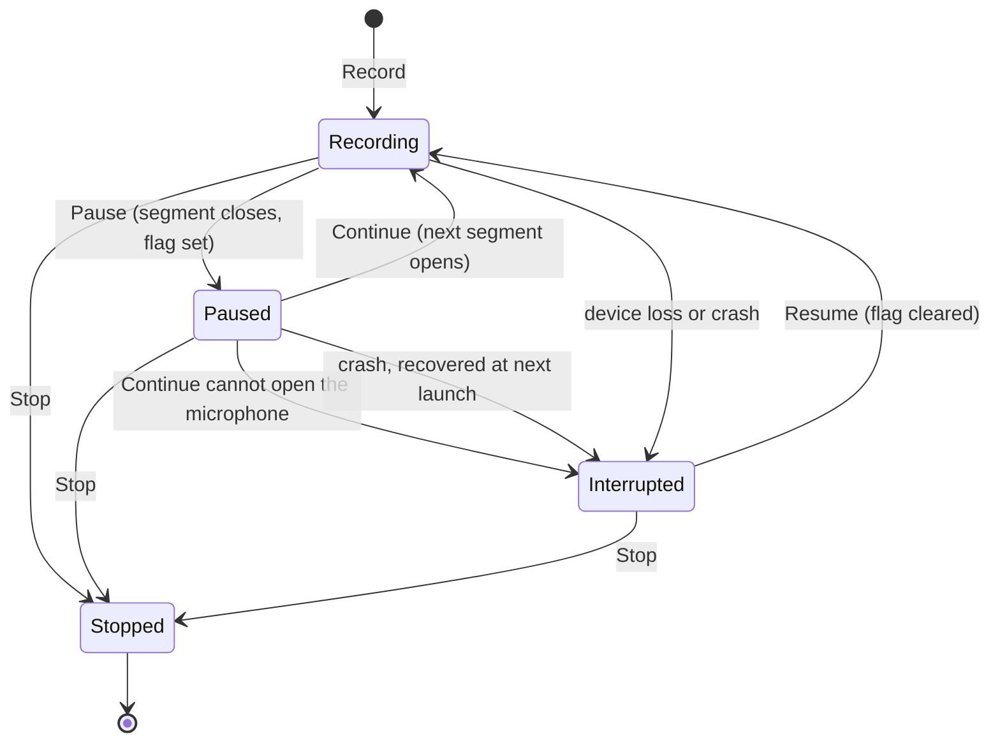
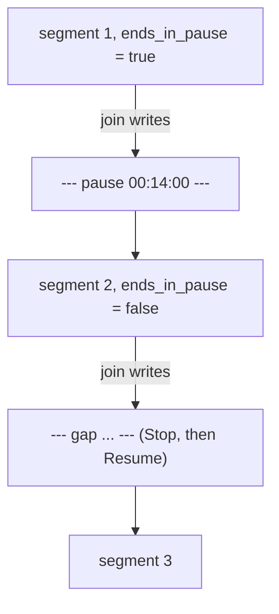

# Pause Recording - Plan

## Goal Capsule

- **Objective:** A user can leave a part of a meeting out of a note (a break, or a sensitive discussion) without stopping the note. The note continues after that part, and processing starts only at Stop.
- **Product authority:** This Product Contract. The always-visible recording widget is a separate idea (`docs/ideas/next/recording-state-widget.md`) and is not active scope.
- **Means:** Pause closes the open segment through the path that sleep already uses, keeps the capture clock in memory, and Continue opens the next segment (KTD1, KTD2).
- **Authority:** Product Contract R-IDs win on behaviour; KTDs win on mechanism; a unit overrides neither.
- **Stop conditions:** Stop and ask if a required change needs a new stored note state, or if a capture guard cannot read the paused state without taking the store lock first.
- **Execution profile:** Standard depth. One worktree from `origin/main` named `pause-recording`. Commit per unit, push in batches, one PR. Manual test in a signed build before the PR is ready.
- **Open blockers:** None.

---

## Product Contract

### Summary

A Pause action, separate from Stop. Pause closes the microphone and Computer audio, so Longhand captures and saves nothing until the user continues the note. The paused note stays an open note on the recording bar, on Home and in the tray, which all say "Paused". The finished transcript and the summary input mark each pause and its duration.

### Problem Frame

Long meetings often have a part that should not be in the note: a break with casual talk, or a discussion that is too sensitive to record. Today the only way to leave it out is Stop and then Resume. That works, but it is the wrong action for the user's intent. Stop means "I'm done", and a Resume after it feels like a correction of a mistake. Stop also starts processing in the middle of the meeting, and the Resume then makes the result again.

### Key Decisions

- **Pause is its own action, separate from Stop.** Governs R1, R4. (session-settled: user-directed — chosen over Stop then Resume: Stop means the meeting is over, and a pause is not that.)
- **A pause captures nothing.** The microphone and Computer audio close, so the macOS microphone indicator turns off and no paused audio exists on disk. This is necessary for the sensitive-discussion case. Governs R2, R6.
- **No reminder for a forgotten pause in this plan.** The always-visible widget idea covers a forgotten pause and a recording left running after a meeting. Governs nothing here. (session-settled: user-directed — chosen over a reminder that listens for speech while paused: the user prefers one widget that solves both problems.)
- **The pause marker goes to the summary model.** The model then treats the parts before and after a pause as separate parts of the meeting. Governs R13. (session-settled: user-approved — chosen over no trace, and over a marker in the transcript only: without it, the summary can join two unrelated discussions.)
- **The Pause shortcut has no default chord.** Governs R16. (session-settled: user-directed — chosen over a default chord: the user sets it, as for Show Longhand.)
- **A crash while paused recovers as an interrupted capture.** Governs R6. (session-settled: user-approved — chosen over stop and process at once: a crash in the middle of a meeting should not start processing, and the recovery of today already works this way.)
- **The un-pause action is not called "Resume".** In Longhand, Resume means recording into a stopped or saved note. The un-pause label is "Continue". Governs R8.

### Requirements

**Pause and continue**

- R1. While a note records, the user can pause it with a Pause control next to Stop in the page toolbar, and continue it from the same control.
- R2. While paused, the microphone and Computer audio are closed, and Longhand writes no audio to disk, including the crash-recovery data.
- R3. Continue records into the same note. The microphone choice and the Computer audio switch keep their values, and the user can change them while paused; a change takes effect at Continue.
- R4. Stop works while paused. Processing then runs over the audio recorded before the pause, as after a usual Stop.
- R5. Pause is available only while the note records. It is not available while a capture is interrupted, or for a stopped or saved note. If Continue cannot open the microphone, the note becomes interrupted, with the alert and the Resume and Stop choices of an interrupted capture.
- R6. If Longhand stops unexpectedly while paused, recovery treats the note as a capture that stopped unexpectedly at the start of the pause, as for a crash during recording: the note is interrupted, with the alert and the Resume and Stop choices.
- R7. A pause has no maximum length.
- R7a. While a note is paused, Longhand is busy as during recording: an update offer stays held, and an update restart waits until Stop.

**Paused state on screen**

- R8. While paused, the recording bar says "Paused", the elapsed time stops, and the bar shows no level meter. The Pause control becomes "Continue". Nothing on the bar moves or flashes (the attention budget of the recording rail).
- R9. While paused, Home keeps the note as the open-note row. The row says "Paused", its time stops, and its icon is neutral grey. Recording stays red and interrupted stays the caution colour.
- R10. While paused, the tray title says "Paused" in place of the recording time.
- R11. A paused note is an open note. New Note stays unavailable until Stop, as during recording.
- R12. While paused, the live transcript shows that the note is paused. It does not show the message for a live transcript that fell behind ("The missing part is transcribed after you stop").

**Transcript and summary**

- R13. The finished transcript shows a marker at each pause that the note continued after, with the pause duration, for example "Paused · 14 min". The summary model receives the same marker at the same position.
- R14. The pause marker is different from the marker for time between a Stop and a Resume ("Resumed <date>, <time>" in the app, a gap line in `transcript.md`).
- R15. Processing does not treat a pause as missing audio. Gap fill does not try to transcribe it.

**Shortcuts**

- R16. Settings has a Pause shortcut with no default chord. It pauses a recording note and continues a paused note. At other times it does nothing.
- R17. The Recording shortcut stops a paused note, as it stops a recording note.

### Acceptance Examples

- AE1. **Covers R1, R2, R13.** Given a note that records for 50 min, when the user pauses for 15 min and then continues for 40 min, then the saved audio is 90 min long, and the transcript has one "Paused · 15 min" marker between the two parts.
- AE2. **Covers R4, R13.** Given a paused note, when the user selects Stop, then processing starts at once over the recorded audio, and the transcript ends with no pause marker.
- AE3. **Covers R6.** Given a paused note, when Longhand quits unexpectedly and the user opens it again, then the note is interrupted with the audio recorded before the pause and nothing after it, and the user can Resume or Stop it.
- AE4. **Covers R3.** Given a note that records with Computer audio on, when the user pauses and continues, then Computer audio is on again.
- AE5. **Covers R16, R17.** Given a paused note with Longhand in the background, when the user presses the Pause shortcut, then the note continues. When the user presses the Recording shortcut, then the note stops.
- AE6. **Covers R14.** Given a saved note with one pause, when the user stops it, resumes it later and stops it again, then the transcript shows a pause marker and a "Resumed …" marker, and the two read differently.

### Scope Boundaries

- The always-visible recording widget, for a forgotten pause or a forgotten Stop (`docs/ideas/next/recording-state-widget.md`).
- Any reminder while paused, by time or by speech.
- Automatic pause on silence.
- Removing a part of a recording after the fact, for when the user did not pause before a sensitive part.
- A default chord for the Pause shortcut.
- A Pause item in the app menu or the tray menu. Considered and not built: the toolbar control and the shortcut cover R1 and R16. Add it if users look for Pause in the tray.
- A Quit while paused that stops the note. Considered and not built: Quit while recording leaves an interrupted note today, and a paused note follows the same rule (R6).
- A `transcript.md` parser in older builds that skips unknown markers. Considered and not built: no installs run an older build. Revisit before the first public release.
- A live-region announcement of the Paused state. Considered and not built: the focused control's name changes from Pause to Continue, and no requirement asks for more. Add it if a screen-reader user reports a gap.
- Keeping a segment shorter than 1 s when the user pauses in its first second. Considered and not built: R35 drops such segments today, and KTD4 keeps the pause mark on the last kept segment.

### Outstanding Questions

**Deferred to Implementation**

- The exact wording of the live transcript line while paused (R12), within the UI text rules in `CLAUDE.md`.

### Sources / Research

- Segments and gaps: a segment boundary at each input change is in `src-tauri/src/managers/capture.rs` (lines 20-22). The gap between segments comes from segment offsets in `crates/pipeline/src/join.rs` (lines 76-80).
- Elapsed time excludes the time between segments: `recorded_ms` in `src-tauri/src/managers/capture.rs` (lines 2893-3000).
- The transcript gap line and its view: `crates/session-core/src/folder.rs` (line 506) and `src/session/TranscriptTab.tsx` (lines 49-53).
- The summary input keeps only turns and drops gap lines today: `crates/pipeline/src/summarize.rs` (lines 270-292).
- Recovery chunks are written continuously: `crates/recorder/src/chunks.rs`.
- The microphone stream closes at each segment end: `src-tauri/src/managers/capture.rs` (lines 2847-2885).
- The open-note row on Home: `src/home/RecordingRow.tsx`. The tray title: `src-tauri/src/tray.rs`.
- The Recording shortcut action: `press_action` in `src-tauri/src/shortcut.rs` (lines 373-391).
- Resume of a stopped or saved note: `resume_session` in `src-tauri/src/managers/capture.rs` (lines 1593-1691).

---

## Planning Contract

**Product Contract preservation:** changed: R6 and AE3. A crash while paused now recovers as an interrupted capture (user-approved at plan time). R7a was added by the document review. All other IDs and meanings are unchanged.

### Key Technical Decisions

- KTD1. **The pause lives in the capture manager's memory; the stored note state stays `Capturing`.** The manager has no open segment, keeps its clock, and sets a paused flag. No new `SessionState` or `InterruptReason` is needed, so the state machine, the alerts and older builds that read state JSON do not change. Recovery sweeps `capturing` rows, so a crash while paused gives `Interrupted(Crash)` at the end of the last kept segment with no new code (R6). The alternative, a stored `Paused` state, touches every `"capturing" | "interrupted"` match and the recovery sweep.
- KTD2. **Pause reuses the close half of the sleep path; Continue reuses `open_next_segment` with a new `Reopen::Continue`.** `will_sleep` already closes a segment with no alert. `open_next_segment` already puts the elapsed time into the timeline gap (`resume_offset`) and interrupts at once when the microphone cannot open, with no restart budget (R5). Pause must not call `changed(app, None)`, because that clears the tray title (R10).
- KTD3. **One "open" predicate counts a paused note.** Every reader of `active || recovering` that means "a note is open" reads one predicate that also counts the paused flag: `is_capturing`, `claim_restart`, `with_recording_held`, `status().recording`, `stop_session`, and the guards in `start_session`, `resume_session` and `record_session`. Without this, Resume or Record on another note while paused takes the clock and leaves two `Capturing` rows. The predicate reads only capture `inner`, so the lock order in `docs/solutions/logic-errors/runner-store-lock-before-suspended-check-deadlocks.md` holds (capture before store, never the reverse).
- KTD4. **The pause mark is a stored flag on the note's last kept segment, set at Pause and cleared when the store applies `UserResume`.** The segment record gets `ends_in_pause` (migration `0020`, default false). `session.md` skips it when false, as for `channels` in migration `0006`. Pause sets it on the last kept segment after the close, so a segment dropped under 1 s (R35) does not lose the mark. Only a Resume puts a segment after a stopped or interrupted note's last segment, so a clear at `UserResume` covers every way a note stops (Stop, a new note that stops an interrupted one, recovery) and a later Resume shows the Stop/Resume marker (AE6). A flag on the segment that Continue opens was rejected: that segment has no store row until it closes, and recovery rebuilds it from chunk names, so a crash loses the mark.
- KTD5. **`transcript.md` gets a `--- pause hh:mm:ss ---` line, and `join` writes it in place of the gap line after a flagged segment.** The IPC `DocLine` gets a `Pause` variant that keeps the order-based pairing with `segments.windows(2)` in `doc_lines`. Older builds reject the new marker (scope boundary).
- KTD6. **The summary input gets a pause line kind.** `turns_of` keeps pause lines, and `crates/summarize/src/chunk.rs` renders them as one short line with the duration, between turns. The input fingerprint hashes the transcript text, so it changes without new code.
- KTD7. **The live worker's existing `Paused` state is renamed `Behind`.** It means "the live transcript fell behind". CONCEPTS.md now gives "pause" one meaning. The UI text for that state does not change.
- KTD8. **Pause and Continue are target-state commands.** `pause_recording` does nothing when the note is already paused, and `continue_recording` does nothing when it records. The Pause shortcut reads the state and sends one of them. So a shortcut press that races a button click cannot invert the state.
- KTD9. **Background reopens refuse while paused.** The device watch, the restart thread and the move back to a returning chosen microphone check the paused flag before they open. Pause cancels them (`supersede`). This keeps the microphone closed during a sensitive pause (R2).
- KTD10. **The Pause shortcut is a third `ShortcutKind`.** The conflict check moves from one `other()` kind to a list of the other kinds. The setting `pause_shortcut` follows `show_window_shortcut` and has no default (R16).

### High-Level Technical Design

The capture states that a user sees. `Paused` exists only in the capture manager's memory (KTD1).

How the transcript reads the segments (KTD4, KTD5):

### Assumptions

- No install runs a build older than this change, so a new `transcript.md` marker and a new segment column need no compatibility path (project memory: no installs to migrate).

### Sequencing

U1 first (stored flag). U2 and U4 depend on U1. U3, U6 and U8 depend on U2. U5 depends on U4. U7 depends on U2 and U3. Units with met dependencies can go in any order.

---

## Implementation Units

### U1. Stored pause flag on segments

**Goal:** A segment record can say that the note paused after it, and every Stop can clear that mark.

**Requirements:** R13, R14 (KTD4).

**Dependencies:** None.

**Files:**
- `crates/session-core/migrations/0020_segment_ends_in_pause.sql` (new)
- `crates/session-core/src/schema.rs`
- `crates/session-core/src/timeline.rs`
- `crates/session-core/src/jobs.rs`
- `crates/session-core/src/folder.rs`
- `crates/pipeline/tests/common/mod.rs` and the other `Segment {` literals
- Tests: `crates/session-core/tests/migrations.rs`, `crates/session-core/tests/jobs.rs`, `crates/session-core/tests/folder.rs`

**Approach:**
1. Add the column with default false, listed in `MIGRATION_SQL`, following migration `0006` (`channels`).
2. Add the field to `Segment`, with the store insert and read.
3. Add `SegmentRecord.ends_in_pause` with `serde(default, skip_serializing_if)` so that `session.md` files with no pause stay byte-identical.
4. Add a store operation that sets the flag on the note's last kept segment, and clear every flag of the note when the store applies `UserResume`.

**Patterns to follow:** migration `0006` and `SegmentRecord.channels` in `crates/session-core/src/folder.rs`.

**Test scenarios:**
- A new database has the column, and an existing database migrates with every row false.
- Setting the flag on a note with two segments marks only the last one.
- Applying `UserResume` to an interrupted note whose last segment is flagged leaves every segment false.
- A flagged note that is stopped, then resumed, has no flagged segment.
- A `session.md` with no flagged segment renders with no `ends_in_pause` key, byte-identical to before.
- A `session.md` with a flagged segment round-trips through render and parse.

**Verification:** The store and `session.md` keep the flag across a reopen of the database, and older `session.md` files read as false.

### U2. Pause and Continue in the capture manager

**Goal:** A recording note can pause and continue, and every capture guard treats a paused note as open.

**Requirements:** R1, R2, R3, R4, R5, R6, R7, R11, R13 (KTD1, KTD2, KTD3, KTD8, KTD9).

**Dependencies:** U1.

**Files:**
- `src-tauri/src/managers/capture.rs`
- `src-tauri/src/commands/capture.rs`
- `src-tauri/src/lib.rs` (command registration)
- `src/bindings.ts` (regenerated)
- Tests: `src-tauri/src/managers/capture.rs` (`mod tests`)

**Approach:**
1. Add the paused flag to `Inner` and one predicate for "a note is open" (KTD3). Move every guard and status reader listed in KTD3 to it.
2. Pause: close the active segment as `will_sleep` does, set the stored flag on the last kept segment (U1), keep the clock, cancel the background reopens (KTD9), and emit `RecordingChanged` with the session id so the tray and UI update.
3. Continue: clear the paused flag and call `open_next_segment` with a new `Reopen::Continue` that fails like `Reopen::Resume` (interrupt at once, R5).
4. Stop while paused: `stop_session` accepts the paused note and applies `UserStop` from `Capturing`. The stored flag stays until a later Resume clears it (KTD4).
5. `RecordingStatus` gets `paused` and `recorded_ms`, so the UI shows the frozen time after a window reload.
6. The background reopen paths (device watch, restart, move back to a chosen microphone) refuse while paused.
7. Add `pause_recording` and `continue_recording` commands as target-state commands (KTD8), and regenerate the bindings.

**Execution note:** The capture manager has no mock audio provider. Put each decision (may pause, may continue, may a background reopen run, which Stop event applies) in a pure function, and test those functions first.

**Patterns to follow:** `will_sleep` and `did_wake`, `open_next_segment` with `Reopen::Resume`, the pure helpers `stop_note` and `resume_offset` and their tests.

**Test scenarios:**
- A pause decision on a recording note returns "close and keep the clock"; on a paused, interrupted or stopped note it returns "nothing".
- A continue decision on a paused note returns "open the next segment"; on a recording note it returns "nothing".
- The open predicate is true for a recording note, a paused note, and a note under recovery, and false with no note.
- Resume or Record of another note while a note is paused is refused with the same error as during recording.
- A Stop decision for a paused note applies `UserStop`.
- A background reopen decision while paused returns "refuse".
- `resume_offset` after a pause of 15 min puts the next segment 15 min after the end of the last one (AE1 timeline).
- `RecordingStatus` for a paused note has `paused: true`, `recording: true` and the recorded time of the kept segments.

**Verification:** Unit tests for the pure decisions pass, and the manual test in a signed build shows the microphone indicator off while paused (R2).

### U3. Busy readers count a paused note

**Goal:** Updates and other processing wait while a note is paused, as during recording.

**Requirements:** R7a, R11 (KTD3).

**Dependencies:** U2.

**Files:**
- `src-tauri/src/lib.rs` (update busy check)
- `src-tauri/src/managers/updates.rs` (restart claim)
- `src-tauri/src/managers/processing.rs` (`suspended`)
- `src-tauri/src/shortcut.rs` (`decide`)
- Tests: `src-tauri/src/managers/updates.rs` tests, `src-tauri/src/managers/processing.rs` tests

**Approach:** Each reader calls the open predicate from U2. Check each call site against the lock order in `docs/solutions/logic-errors/runner-store-lock-before-suspended-check-deadlocks.md`: none may hold the store lock when it reads capture state.

**Test scenarios:**
- With a paused note, the update flow keeps a held offer held and does not restart after a download.
- With a paused note, the processing engine reports suspended, and a queued note for another session does not start.
- After Stop of a paused note, the update flow and the processing engine continue.

**Verification:** No reader of capture state takes the store lock first (review each call site), and the tests above pass.

### U4. Pause marker in the transcript

**Goal:** The finished transcript shows a pause marker with its duration, distinct from the Stop/Resume marker.

**Requirements:** R13, R14, R15 (KTD5).

**Dependencies:** U1.

**Files:**
- `crates/session-core/src/folder.rs` (`TranscriptLine`, render, parse)
- `crates/pipeline/src/join.rs`
- `src-tauri/src/commands/session.rs` (`DocLine`, `doc_lines`)
- `src/session/TranscriptTab.tsx`, `src/session/Marker.tsx`
- `src/bindings.ts` (regenerated)
- Tests: `crates/session-core/tests/folder.rs`, `crates/pipeline/tests/join.rs`, `crates/pipeline/src/transcribe.rs` tests (gap fill), `src-tauri/src/commands/session.rs` tests, `src/session/TranscriptTab.test.tsx`

**Approach:**
1. Add `TranscriptLine::Pause { duration_ms }` with render and parse of `--- pause hh:mm:ss ---`.
2. In `join`, write a pause line in place of the gap line when the previous segment has `ends_in_pause`.
3. Add `DocLine::Pause` and keep the order-based pairing with the segment windows in `doc_lines`.
4. Show "Paused · 14 min" in `TranscriptTab` with a style that differs from the "Resumed …" marker. Invoke `apple-design` before the marker style work.

**Patterns to follow:** the gap line in `folder.rs` and `join.rs`; `resumedLabel` and `Marker` in the transcript tab.

**Test scenarios:**
- Covers AE1. Two segments with the first flagged join into turns, one pause line of 15 min, and turns.
- Covers AE2. A flagged last segment with no next segment writes no pause line.
- Covers AE6. Segments flagged, not flagged, then a Stop/Resume boundary give one pause line and one gap line, in that order.
- A pause line round-trips through render and parse.
- `doc_lines` pairs a pause line and a later gap line with the right segment windows, so the gap still gets its `wall_start`.
- The transcript tab shows "Paused · 15 min" for a pause line and "Resumed …" for a gap line.
- Gap fill on a note with a pause plans no window in the time between the two segments (R15).

**Verification:** A recorded note with a pause shows the pause marker in `transcript.md` and in the app.

### U5. Pause marker in the summary input

**Goal:** The summary model sees each pause at its position.

**Requirements:** R13 (Key Decision: the pause marker goes to the summary model).

**Dependencies:** U4.

**Files:**
- `crates/pipeline/src/summarize.rs` (`turns_of`)
- `crates/summarize/src/chunk.rs`
- `crates/summarize/src/prompts.rs`
- Tests: `crates/pipeline/src/summarize.rs` tests, `crates/summarize/tests/chunk.rs`, `crates/summarize/tests/background.rs`

**Approach:**
1. Add a pause item to the chunk input next to `Turn`, rendered as one short line with the duration. Chunking keeps a pause line with the turn after it, so a part never ends with only a pause line.
2. `whole()` and `part()` in `prompts.rs` render pause items. Only when the input holds a pause, the transcript block gets one line that says a pause line marks time that was not recorded and that the parts before and after it are separate parts of the meeting.

**Test scenarios:**
- A transcript with a pause line gives a summary input with the pause line between the turns before and after it.
- A transcript with a gap line and no pause gives the same input as before this change.
- Chunking a long transcript never puts a pause line alone at the end of a part.
- A prompt for input with no pause is byte-identical to `golden/no_background.txt`.
- A prompt for input with a pause holds the pause instruction line once.

**Verification:** The summary input for a note with a pause holds one pause line.

### U6. Live transcript while paused

**Goal:** The live transcript says the note is paused, and "paused" has one meaning in code.

**Requirements:** R12 (KTD7).

**Dependencies:** U2.

**Files:**
- `src-tauri/src/managers/live.rs`, `crates/pipeline/src/live.rs` (rename `Paused` to `Behind`)
- `src/bindings.ts` (regenerated)
- `src/session/LiveTranscript.tsx`, `src/session/SessionPage.tsx` (live mode)
- Tests: `crates/pipeline/tests/live.rs`, `src/session/LiveTranscript.test.tsx`

**Approach:**
1. Rename the live state; keep its UI line.
2. Add a live mode for a paused note, chosen from `RecordingStatus.paused`, and check it before the live state.

**Test scenarios:**
- A paused note shows the paused line and not the "Live transcript paused. The missing part…" line.
- A live worker that falls behind still shows its existing line.
- After Continue, the live transcript shows new text below the text from before the pause.

**Verification:** The live transcript never shows the fell-behind line for a pause.

### U7. Paused state on screen

**Goal:** The toolbar, the recording bar, the Home row and the tray show the paused state.

**Requirements:** R1, R8, R9, R10, R11.

**Dependencies:** U2, U3.

**Files:**
- `src/session/SessionPage.tsx` (Pause/Continue next to Stop)
- `src/session/RecordingBar.tsx`
- `src/home/RecordingRow.tsx`, `src/App.tsx`
- `src/recording/useCapture.ts`, `src/recording/inputStatus.ts`
- `src-tauri/src/tray.rs` (`TrayTitle`)
- Tests: `src/session/SessionPage.test.tsx`, `src/home/Home.test.tsx`, `src/App.test.tsx`, `src/recording/useCapture.test.ts`, `src-tauri/src/tray.rs` tests

**Approach:**
1. Invoke `apple-design` before the UI work. The two-tier rail and attention budget from the walking-skeleton plan take precedence over motion.
2. Add a Pause control next to Stop in the toolbar. It becomes Continue while paused, and it is not shown for an interrupted, stopped or saved note. While the microphone opens after Continue, the control stays in place with no spinner or motion (KTD8 makes a second click harmless). Call `focus()` on click (WKWebView, `docs/solutions/ui-bugs/` WebKit focus lesson).
3. The recording bar says "Paused", shows the frozen time, hides the level meter, and keeps the microphone and Computer audio controls editable (R3).
4. `App.tsx` stops deriving `interrupted` from `!status.recording`; the Home row gets a paused variant with a neutral grey icon and "Paused".
5. `TrayTitle` gets a paused field that shows "Paused" in place of the time.

**Test scenarios:**
- On a recording note, the toolbar shows Pause next to Stop; on a paused note it shows Continue and Stop; on an interrupted note it shows no Pause control.
- A paused note's recording bar shows "Paused", the frozen time, and no level meter.
- Home shows the paused note as the open-note row with "Paused", and New Note stays unavailable.
- An interrupted note still shows "Recording interrupted" with the caution colour.
- The tray title text for a paused note is "Paused"; for a recording note it is the time.
- After a window reload while paused, the bar shows the recorded time from `RecordingStatus`, not 0:00.
- A click on Pause leaves focus on the Continue control.

**Verification:** Every surface in R8 to R11 shows the paused state, and nothing moves or flashes while paused.

### U8. Pause shortcut

**Goal:** A Pause shortcut with no default pauses and continues the open note, and the Recording shortcut stops a paused note.

**Requirements:** R16, R17 (KTD8, KTD10).

**Dependencies:** U2.

**Files:**
- `src-tauri/src/shortcut.rs`
- `src-tauri/src/managers/settings.rs`
- `src/settings/Recording.tsx`, `src/settings/ShortcutField.tsx`
- `src/test/tauri.ts` (shortcut status mock)
- `src/bindings.ts` (regenerated)
- Tests: `src-tauri/src/shortcut.rs` tests, `src/settings/Recording.test.tsx`

**Approach:**
1. Add `ShortcutKind::Pause` with its slot, status, dispatch, save and the register and suspend loops. Replace `other()` with a list of other kinds for the conflict check.
2. Add `pause_shortcut` to the local settings with no default, following `show_window_shortcut`.
3. The Pause press reads the state and sends `pause_recording` or `continue_recording`; with no open note it does nothing.
4. `press_action` returns Stop for an open note, paused or recording (R17).
5. Add the Pause shortcut field to the Recording settings pane, under the Recording shortcut.

**Patterns to follow:** `show_window_shortcut` in `settings.rs` and its field in `src/settings/Status.tsx`.

**Test scenarios:**
- Covers AE5. A Pause press on a paused note sends Continue; a Recording press on a paused note sends Stop.
- A Pause press on a recording note sends Pause; with no open note it does nothing.
- A Pause chord that the Recording or Show Longhand shortcut already uses is refused with the "taken" text.
- A new install has no Pause chord, and the field shows it as not set.
- Suspending shortcuts while a chord is edited suspends all three.

**Verification:** All three shortcuts register, conflict-check and suspend together.

---

## Verification Contract

| Gate | Command or check | Applies to |
|---|---|---|
| Rust tests per unit | `cargo test -p <crate>` for the touched crates, with a timeout on each run | U1 to U8 |
| Bindings | `cargo test -p longhand export_bindings`, then no diff in `src/bindings.ts` after commit | U2, U4, U6, U8 |
| Front-end tests | `bun test ./src/` | U4, U6, U7, U8 |
| Typecheck | `bunx tsc --noEmit` | U4, U6, U7, U8 |
| Full Rust run and lint | one full workspace `cargo test` and `cargo clippy` at the end | all |
| Local checks | `scripts/check-windows.sh`, `scripts/check-licences.sh` | before push |
| Manual test | signed build, per `docs/development-workflow.md#manual-tests` | before the PR is ready |

Manual test steps: record 1 min, pause, check the macOS microphone indicator is off, speak for 30 s, continue, record 1 min, stop. The transcript has one pause marker and no words from the paused time. Then repeat with a pause, quit Longhand from Activity Monitor, and launch: the note is interrupted and can be resumed.

---

## Definition of Done

- Every R-ID in the Product Contract is met, and each AE has a passing test or a manual test step.
- Each unit's test scenarios exist and pass.
- `src/bindings.ts` matches the Rust commands.
- The manual test in a signed build passes.
- No code from abandoned approaches is left in the diff.
- `docs/ideas/next/pause-recording.md` moves to `done/` after the merge.
