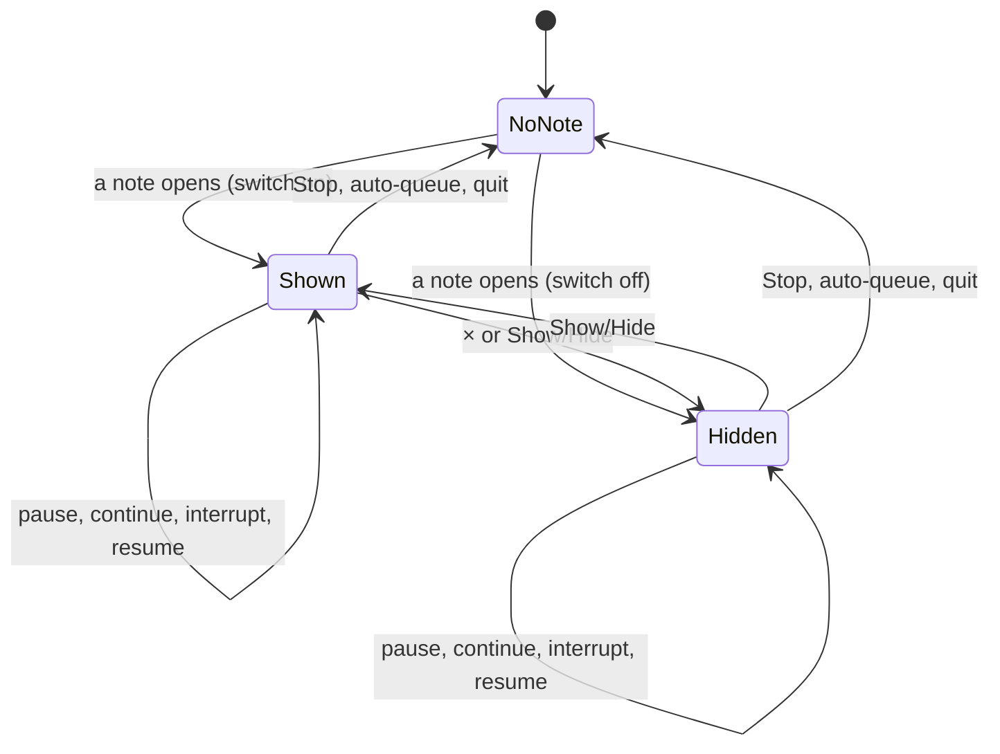
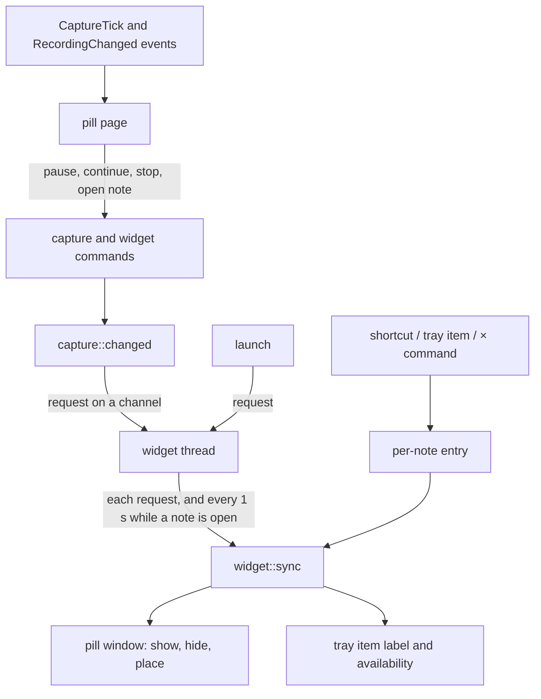

# Recording Widget - Plan

## Goal Capsule

- **Objective:** While a note is open (recording, paused or interrupted), the user always sees that state on screen, even when Longhand is not in front, unless the user chose to hide it (R11–R16). The user can pause, continue or stop the note, or open it, without a switch to Longhand first.
- **Means:** A pill window that is built once and is hidden and shown. On macOS it is a non-activating panel and on Windows a topmost window that takes no focus (KTD3, KTD4). Rust decides when it shows (KTD1, KTD2).
- **Authority:** Product Contract R-IDs win on behaviour. KTDs win on mechanism inside their cited Rs. A unit overrides neither.
- **Product authority:** This Product Contract. The idea file is `docs/ideas/next/recording-state-widget.md`.
- **Stop conditions:** Stop and ask in these cases:
  - `tauri-nspanel` from crates.io does not build with tauri 2.11.6, or it fails `cargo deny`.
  - The macOS panel cannot get pointer enter and exit events by either method in KTD6, so the hover × (R12) cannot work.
  - A change needs a new stored note state or a change to the capture state machine.
- **Execution profile:** Standard depth. One worktree from `origin/main` named `recording-widget`. Commit per unit, push in batches, one PR. A manual test in a signed macOS build (U6) and a Windows installer test come before the PR is ready.
- **Open blockers:** None. Pause-recording merged in PR #51.

---

## Product Contract

Product Contract preservation: changed R2 (Windows: the current virtual desktop only) and R14 (new-note and relaunch rules moved to R16). R15 and R16 are new and come from plan-time decisions that the user confirmed. Pause-recording is merged, so its dependency is gone.

### Summary

A small pill near the bottom centre of the screen, above all other windows, on macOS and Windows. It shows while a note is Recording, Paused or Interrupted. It shows the state and the elapsed time. What else it shows depends on the state: a level meter with Pause and Stop while recording, Continue and Stop while paused, and only Stop while interrupted. A click on the pill opens the note. A Settings switch (on by default) sets whether the pill shows. A hover ×, a tray item and a shortcut change that for the current note only.

### Problem Frame

The user records a meeting, then switches to other apps. When Longhand is not in front, nothing on screen says that a note is still open. Two failures follow:

- The meeting ends and the note records for a long time after it. The user has done this several times.
- The user pauses the note for a break, the meeting starts again, and nobody continues the note. The audio after the break is lost.

The main window, the tray and the macOS microphone indicator do not prevent either failure. The microphone indicator turns off during a pause, so a paused note shows nothing at all. The user is in a meeting, so a reminder must be visible without being loud: U7's attention budget applies (`docs/plans/2026-09-21-2052-feat-longhand-walking-skeleton-plan.md`, U7).

### Key Decisions

- **One widget for both failures, not a speech-detecting reminder.** Governs R1. (session-settled: user-directed — chosen over a reminder that listens for speech while paused: the user prefers one widget that solves both problems.)
- **Handy's overlay is the model for the window and the look.** A non-activating panel above full-screen apps and all Spaces, with a dot, a level meter and a timer. Handy's live text is left out because it distracts. Governs R2, R3, R6. (session-settled: user-directed — chosen over a top-centre pill, a small corner pill with controls on hover, and a draggable pill: shown as a rough sketch. After the U6 manual test the user asked for drag to move, so the pill is now draggable: see R3.)
- **The pill shows also when Longhand is in front.** Governs R1. (session-settled: user-directed — chosen over hiding while the recording note is visible and hiding while Longhand is active: always visible is simpler and predictable.)
- **Hidden from screen sharing and screenshots where the OS allows; the × is the macOS fallback.** Participants in a call do not see it, which keeps to U7. Governs R4. (session-settled: user-approved — chosen over showing in captures; and, if macOS does not honour the flag, chosen over hiding while a share is detected.)
- **Pause, Continue and Stop on the pill; Stop has no confirmation.** Resume can continue a stopped note, so a Stop by mistake is recoverable. Governs R8, R9. (session-settled: user-directed — chosen over Pause/Continue only and no controls.)
- **Interrupted shows on the pill.** It is an abnormal state that the user must act on. Governs R7. (session-settled: user-approved — chosen over hiding the pill for Interrupted.)
- **Display: Handy's rule, plus recovery when a display goes away.** Governs R5. (session-settled: user-directed — chosen over following the active display, main display only, and all displays.)
- **A per-note override in both directions, until the note stops.** When the setting is on, the user can hide the pill for one note; when it is off, the user can show it for one note. Governs R11–R16. (session-settled: user-directed — chosen over "hidden until the state changes" and over a shortcut that flips the setting.)
- **A hover × to hide, so the user does not need to remember a shortcut.** Governs R12. (session-settled: user-directed — added after the shortcut, as a way to hide that needs no shortcut.)
- **Windows: the current virtual desktop only.** Windows has no public API that puts a window on every virtual desktop. Governs R2. (session-settled: user-approved — chosen over an undocumented API.)
- **A per-note choice is in memory only.** Resume of a stopped note is a new start, and a relaunch forgets the choice. Governs R16. (session-settled: user-approved — chosen over keeping the choice through Stop and Resume, and over storing it.)

### Requirements

**When it shows**

- R1. The pill shows while a note is Recording, Paused or Interrupted, also when Longhand is in front, unless the user hid it for this note or the switch is off (R11–R16). It hides at Stop, and it does not show Processing, Saved or other states after Stop.
- R2. The pill stays above other windows, including full-screen apps, on every Space (macOS) and on the current virtual desktop (Windows). A click on a control does not take focus from the app in front or activate Longhand. R10 governs a click on the rest of the pill.
- R3. The pill sits near the bottom centre of its display, above the Dock or taskbar. The user can drag it to another place; a click with no movement still shows the note (R10). The pill stays where the user put it while the note continues. Later notes use that place while its display is there, until Longhand quits. (Changed after the U6 manual test, at the user's request: the first version could not be moved.)
- R4. The pill does not appear in screen sharing, screen recordings or screenshots, on macOS and Windows. Where macOS does not allow this, the × (R12) is the fallback (see Dependencies / Assumptions).
- R5. The pill opens on the display of the place that the user dragged it to (R3), else on the display under the pointer, when it first shows for a note, and stays on that display. If that display goes away (a laptop lid closes, a monitor is unplugged) or the screen arrangement changes, the pill moves to the same position on a remaining display.

**What it shows**

- R6. Recording: a red dot, a level meter for the microphone, the elapsed time, Pause and Stop. The elapsed time is the note's recorded time, the same value as the recording surface shows.
- R7. Paused: the word "Paused" with a distinct colour (amber), the elapsed time without change, Continue and Stop. No level meter. Interrupted: the word "Interrupted", the elapsed time without change, and Stop.
- R8. UI text uses the terms in `CONCEPTS.md`: "Continue", not "Resume", for the end of a pause.

**What it does**

- R9. Pause, Continue and Stop on the pill do the same as the same actions in the main window. Stop has no confirmation.
- R10. A click on the pill, outside its controls, shows the main window with the open note in front. This works when the main window is closed or hidden.

**Turning it off and on**

- R11. A Settings switch, "Show recording widget", sets whether the pill shows for each new note. It is on by default and is local to this computer.
- R12. While the pill shows, a × appears at its corner when the pointer is over it. A click on the × hides the pill until the note stops. The note does not change.
- R13. A "Show/Hide recording widget" action shows a hidden pill or hides a shown pill, for the open note until it stops. The action is in the tray menu and has a shortcut in Settings. The shortcut has no default chord.
- R14. A change to the switch during a note takes effect at the next note and does not undo a Show/Hide for the open note.
- R15. When no note is open, the Show/Hide shortcut does nothing, the tray item is unavailable, and nothing is kept for the next note.
- R16. Each new note starts from the Settings switch. Resume of a stopped note is a new start. A pause, a continue, an interruption and a resume from Interrupted keep the per-note choice. A relaunch of Longhand forgets it.

### Acceptance Examples

- AE1. **Covers R1, R7.** Given a note that records with Longhand behind a video call, when the user pauses it with the Pause shortcut, then the pill changes to "Paused" with Continue and Stop, and stays on screen.
- AE2. **Covers R2, R9.** Given the pill shows over a full-screen video call, when the user clicks Pause on the pill, then the note pauses and the video call stays in front with keyboard focus.
- AE3. **Covers R5.** Given a laptop with an external display, the pill on the laptop display and a recording note, when the user closes the lid, then the pill moves to the external display.
- AE4. **Covers R12, R16.** Given the switch is on and the user hides the pill with the ×, when the user pauses and continues the note, then the pill stays hidden. When the user stops it and starts a new note, the pill shows.
- AE5. **Covers R13, R16.** Given the switch is off and a note records, when the user chooses "Show/Hide recording widget" in the tray, then the pill shows until that note stops. The next note shows no pill.
- AE6. **Covers R4.** Given the pill shows and the user shares the screen in a call, then the shared image does not contain the pill.
- AE7. **Covers R1, R7.** Given a note whose capture fails and cannot restart, then the pill shows "Interrupted" and Stop. A click on the pill opens the note, where the problem is described.
- AE8. **Covers R15.** Given no note is open, when the user presses the Show/Hide shortcut and then starts a note with the switch on, then the pill shows.
- AE9. **Covers R16.** Given the user hid the pill and the note is interrupted, when the note resumes, then the pill stays hidden.

### Scope Boundaries

- No live transcript on the pill.
- No position setting, no dragging, and no Top/Bottom choice as Handy has.
- No pill for Processing, Saved, a failed processing or any state after Stop.
- No change to the pill as a pause gets longer (no growing colour, sound or motion).
- No Continue on the Interrupted pill. The user opens the note to see the cause.
- No hide that ends when the state changes. A hidden pill stays hidden for the whole note.
- No pill on other Windows virtual desktops.
- No faster level feed for the pill. The meter uses the existing 4 ticks per second (KTD8).
- No detection of an active screen share. Considered for the macOS capture gap and not built: the user chose the × as the fallback.
- Linux. Longhand ships for macOS and Windows only.

### Dependencies / Assumptions

- Paused is a flag on the capture manager (`RecordingStatus.paused`), with `pause_recording` and `continue_recording` commands. It is not a `SessionState` variant.
- Tauri 2.11 has `content_protected`: tao sets the window sharing type to none on macOS and `WDA_EXCLUDEFROMCAPTURE` on Windows. On macOS 15 and later, ScreenCaptureKit capture (Zoom, Teams, Meet in a browser, the screenshot tool) is reported to ignore that flag (Apple forum thread 808016, FB21115847). Verify R4 with those apps in a signed build. If macOS still shows the pill, accept that: R4 then holds on Windows only, and on macOS the user hides the pill with the × (R12) before a screen share.

### Sources / Research

- Handy overlay window: `reference-source/Handy/src-tauri/src/overlay.rs` (panel level, style mask, `can_join_all_spaces`, `full_screen_auxiliary`, monitor under the cursor, Windows topmost). Handy has no screen-capture exclusion and no handling for a display change while the overlay shows.
- Handy overlay UI: `reference-source/Handy/src/overlay/RecordingOverlay.tsx` and `RecordingOverlay.css`.
- Earlier learnings: `docs/solutions/ui-bugs/tauri-stale-close-listener-blocks-next-window.md` (build the window once), `docs/solutions/ui-bugs/wkwebview-click-does-not-focus-button-breaks-shortcut-capture.md` (key capture in Settings).

---

## Planning Contract

### Key Technical Decisions

- KTD1. **Rust owns the pill's visibility.** One `sync` function reads `capture.status()` and the per-note entry, then shows or hides the window, places it and sets the tray label. `capture::changed()` only requests a sync: it wakes the widget thread through a channel and reads no capture state itself, because several callers (`start_session`, `open_next_segment`) call `changed()` while they hold the capture lock, and that `std::sync::Mutex` is not reentrant. The widget thread runs `sync` once for each request, once at launch, and once a second while a note is open, as the alerts watch thread does (`src-tauri/src/managers/alerts.rs`). The `RecordingChanged` payload cannot tell Stop from Interrupted. A note can also leave Interrupted with no event (the 30-minute auto-queue, a new note start). A hidden webview cannot poll reliably. Governs R1, R5, R13–R16.
- KTD2. **The per-note choice is one in-memory entry keyed by session id.** The entry holds the session id, whether the pill shows, and the remembered display. It is created with the Settings switch value when an open session id first appears in `sync`, which includes a launch with a crash-interrupted note. It is cleared only when no session is open. Pause, Continue, Interrupted and resume from Interrupted keep it. Stop clears it, so a later Resume is a new start. Nothing is stored. Implements the Key Decision "A per-note choice is in memory only". Governs R14–R16.
- KTD3. **macOS panel through `tauri-nspanel` 2.1 from crates.io.** `deny.toml` refuses git dependencies, so Handy's git pin cannot be copied. The 2.1 release is on crates.io (MIT OR Apache-2.0, needs tauri 2.8.5 or later). Use Handy's panel settings: status level, borderless non-activating style, no key window, `can_join_all_spaces` and `full_screen_auxiliary`. A transparent pill with rounded corners needs `macOSPrivateApi: true` in `src-tauri/tauri.conf.json` and the tauri feature `macos-private-api`. Longhand ships with Developer ID, so the private API is allowed. Governs R2.
- KTD4. **Windows window through Tauri builder options.** Use `focusable(false)`, `always_on_top`, `skip_taskbar`, `transparent`, no decorations and `accept_first_mouse`, as Handy's non-panel path does. Re-assert topmost with `SetWindowPos(HWND_TOPMOST, SWP_NOACTIVATE)` at each show, as Handy does. This adds the `windows` crate with the needed features as a Windows-only dependency. Governs R2.
- KTD5. **`content_protected(true)` at build time on both platforms.** Governs R4. The macOS gap is accepted (Dependencies / Assumptions).
- KTD6. **Hover on macOS comes from a native tracking area.** WebKit sends no hover events to a window that is not key. `tauri-nspanel` can add a tracking area that is always active and reports enter and exit. The panel sends a `WidgetPointer { inside }` event, and the page sets a class that shows the ×. If that does not work in the signed build, the fallback is a cursor-position check against the pill frame, about 30 times a second and only while the pill shows. On Windows, CSS hover works. Governs R12.
- KTD7. **Placement uses the work area of a remembered display.** At the first show for an entry, the display is the one under the pointer (`AppHandle::cursor_position` and `monitor_from_point`), or the primary display. The entry remembers it by position and size. Each `sync` places the pill at the bottom centre of that display's work area, with Handy's bottom offset. If the remembered display is gone, `sync` moves the pill to the display under the pointer, or the primary display. On macOS, placement is in logical points of the remembered display (its position, size and work area divided by its scale), as Handy's `calculate_overlay_position` does, because tao converts a physical position with the scale of the display the window is on now. On Windows, placement is in physical pixels with `SetWindowPos(SWP_NOACTIVATE)`, as Handy's `place_windows_overlay` does. Tauri has no display-change event, so the 1-second loop (KTD1) is the check. Governs R3, R5.
- KTD8. **The meter uses the existing `CaptureTick` (4 per second) with a short CSS transition.** No new level event. Governs R6. (session-settled: user-approved — chosen over a faster level feed for the pill: the existing rate with smoothing is enough for a liveness meter.)
- KTD9. **One window, built hidden at startup, never destroyed.** The label is `widget`, and it uses the existing single Vite entry with `?window=widget`. Destroying and rebuilding a window with the same label leaves stale listener records (`docs/solutions/ui-bugs/tauri-stale-close-listener-blocks-next-window.md`). The window never goes through `front()`. It is left out of the Hide-from-Dock window count and out of interface zoom. Governs R1, R2.
- KTD10. **The pill page reads its mode from `recording_status`.** It refetches when the window shows (a `WidgetShown` event from `sync`), after each button command, and on `recording-changed` and `capture-ended`, because a hidden page can hold an old state, and because Continue emits `changed` only when the next segment opens. Ticks give the level and the time while recording. A button that races a Stop refetches and shows no error. Governs R6, R7, R9.
- KTD11. **The ×, Show/Hide and a body click are backend commands.** `widget_hide`, `widget_toggle` and `widget_open_note` change the entry or open the note, then call `sync`. A body click reuses the tray's `open_longhand` path. Window work runs in async commands or on the main thread without waiting, because the tick thread must not wait for the main thread (`src-tauri/src/tray.rs`). Governs R10, R12, R13.

### High-Level Technical Design

The per-note entry and the pill's visibility:

The parts and who drives the window:

### Assumptions

- `tauri-nspanel` 2.1 builds with tauri 2.11.6 and passes `cargo deny` and `scripts/check-licences.sh`. Not checked yet, because cargo could not run during planning.
- A crash-interrupted note at launch is open, so the pill shows at launch when the switch is on (R1, R16).

---

## Implementation Units

### U1. Setting and per-note visibility rules

**Goal:** The Settings switch exists, and pure Rust functions decide the per-note entry and whether the pill shows.

**Requirements:** R1, R11, R14–R16. KTD2.

**Dependencies:** None.

**Files:**
- `src-tauri/src/managers/settings.rs` (the `show_recording_widget` field in `LocalSettings` and `Settings`, the default, `from_parts`, `local()`)
- `src-tauri/src/commands/settings.rs` (`set_show_recording_widget`)
- `src-tauri/src/widget.rs` (new: the entry type and the pure decision functions)
- `src-tauri/src/lib.rs` (module, command registration)
- `src/bindings.ts` (regenerated)
- TS test fixtures that spell out a full `Settings`: `src/settings/Recording.test.tsx`, `src/settings/Status.test.tsx`, `src/settings/EndpointForm.test.tsx`, `src/settings/Background.test.tsx`, `src/settings/SummaryPrompts.test.tsx`, `src/test/smoke.test.tsx`

**Approach:**
1. Add the field with default `true`, following `alert_sound`. `#[serde(default)]` on `LocalSettings` means a missing key reads as on.
2. In `widget.rs`, define the entry (session id, shown, remembered display). Add a pure step: given the open session id or none, the current entry and the switch value, return the next entry.
3. Add a pure `widget_press_action(open, shown)` for the shortcut and the tray item: none, show or hide.

**Patterns to follow:** `TrayTitle` and its tests in `src-tauri/src/tray.rs`; `pause_press_action` in `src-tauri/src/shortcut.rs`; the `alert_sound` tests in `src-tauri/src/managers/settings.rs`.

**Test scenarios:**
- A store without the key reads the switch as on.
- The switch is local: it is in `LocalSettings` and not in the shared settings file.
- A new open id with the switch on gives a shown entry; with the switch off, a hidden entry.
- The same id with the switch changed keeps the entry's shown value (R14).
- Covers AE9. The same id after an interruption and a resume keeps a hidden entry.
- No open session clears the entry. The same id opening again afterwards (Resume of a stopped note) gives a new entry from the switch (R16).
- A second id while one entry exists replaces the entry and reads the switch.
- Covers AE8. `widget_press_action` with no open note is none, and the next new id still reads the switch.
- `widget_press_action` with an open note toggles shown.

**Verification:** The decision functions have no Tauri dependency, and their tests pass. Bindings are regenerated, and the TS fixtures compile.

### U2. Pill window: build, panel, placement and window exclusions

**Goal:** A hidden pill window exists from startup with the right window behaviour on each platform, and it can be placed on a display.

**Requirements:** R2, R3, R4, R5. KTD3, KTD4, KTD5, KTD7, KTD9.

**Dependencies:** U1.

**Files:**
- `src-tauri/Cargo.toml` (`tauri-nspanel` for macOS, the `macos-private-api` tauri feature, the Windows-only `windows` crate)
- `src-tauri/tauri.conf.json` (`macOSPrivateApi: true`)
- `src-tauri/src/widget.rs` (build, show, hide, place)
- `src-tauri/src/window.rs` (`WIDGET_WINDOW` label; leave it out of `hide_dock_icon_if_no_window`)
- `src-tauri/src/interface_zoom.rs` (leave the label out of `has_zoom`)
- `src-tauri/src/lib.rs` (build the window in `setup_app` after the main window)
- `src-tauri/capabilities/widget.json` (new: `core:default` for the `widget` window)
- `src-tauri/PROVENANCE.md` (a record for `src/widget.rs`, citing Handy at the revision read, `29bd2c0d6b4b705df5fd6d2f387e5db5ecc27480`)
- `licences/` generated list and `src/settings/acknowledgements.ts` if `scripts/check-licences.sh` needs them for the new crates

**Approach:**
1. Build the window hidden with `WebviewUrl::App("index.html?window=widget")`, no zoom, a fixed size and `content_protected(true)`. On macOS, convert it to a panel with Handy's settings (KTD3). On Windows, use the builder options in KTD4.
2. Add the placement function (KTD7). It takes the remembered display or picks one, and computes the bottom centre of the work area: logical points on macOS, physical pixels on Windows.
3. Show re-asserts topmost on Windows and never calls `front()`.
4. Keep macOS-only code behind `cfg(target_os = "macos")` and Windows code behind `cfg(windows)`.

**Execution note:** Do this unit first as a small spike in a signed macOS build: panel over a full-screen app, a click on a control without focus, and the tracking area from KTD6. The rest of the plan depends on these.

**Patterns to follow:** The update window builder in `src-tauri/src/window.rs` (no zoom); Handy `create_recording_overlay`, `calculate_overlay_position` and `place_windows_overlay` in `reference-source/Handy/src-tauri/src/overlay.rs`; the `dock_policy` tests in `src-tauri/src/window.rs`.

**Test scenarios:**
- The Dock policy calculation leaves out the widget label: with "Hide from Dock" on, the main window closed and the pill visible, the policy is Accessory.
- `has_zoom` is false for the widget label.
- Placement on a display with a known work area gives the bottom centre with the offset: logical points on macOS and physical pixels on Windows, each at scale 1 and at scale 2.
- A move from a scale-2 display to a scale-1 display gives the bottom centre of the scale-1 display.
- With the remembered display in the list, placement uses it. With it gone, placement uses the display under the pointer. With no display under the pointer, placement uses the primary display.
- Displays match by position and size, not by index.

**Verification:** Unit tests pass. `scripts/check-windows.sh`, `cargo deny` and `scripts/check-licences.sh` pass. In a signed build, the hidden window exists at launch and does not show the Dock icon.

### U3. Sync, reconcile loop and widget commands

**Goal:** The pill shows and hides with the note, follows display changes, and the ×, Show/Hide and body click work.

**Requirements:** R1, R5, R10, R12, R13, R15, R16. KTD1, KTD2, KTD6, KTD7, KTD11.

**Dependencies:** U1, U2.

**Files:**
- `src-tauri/src/widget.rs` (`sync`, the reconcile loop, the macOS tracking area and the `WidgetPointer` event)
- `src-tauri/src/managers/capture.rs` (call `widget::sync` from `changed()`)
- `src-tauri/src/commands/widget.rs` (new: `widget_hide`, `widget_toggle`, `widget_open_note`)
- `src-tauri/src/commands/mod.rs`, `src-tauri/src/lib.rs` (registration of commands and events)
- `src-tauri/src/tray.rs` (expose the `open_longhand` path for reuse)
- `src/bindings.ts` (regenerated)

**Approach:**
1. `changed()` sends a request on a channel to the widget thread and returns (KTD1). It reads no capture state.
2. On the widget thread, `sync` reads `capture.status()` and the switch, applies the U1 step, then shows, hides and places the window and updates the tray item (U5 adds the item; U3 leaves a hook). Window calls run on the main thread without waiting. After a show, `sync` emits `WidgetShown`.
3. `setup_app` requests one sync after the widget window, the tray and `alerts.restore` exist, so a crash-interrupted note shows the pill at launch.
4. While an entry exists, the widget thread also runs `sync` once a second. With no entry, it waits only for requests.
5. The commands change the entry, then request a sync. `widget_open_note` calls the tray's open path, which shows the main window and emits `ShowSession`.
6. On macOS, add the always-active tracking area and emit `WidgetPointer { inside }` on enter and exit (KTD6).

**Patterns to follow:** `tray::recording_changed` and the main-thread rule in `src-tauri/src/tray.rs`; the watch thread in `src-tauri/src/managers/alerts.rs`; the async window commands in `src-tauri/src/commands/window.rs`.

**Test scenarios:**
- Integration over a fake status source: a capturing session with the switch on makes `sync` request show; after Stop, hide.
- An interrupted session stays shown; after the auto-queue moves it out of Interrupted with no event, the next loop pass requests hide.
- A paused session stays shown, and its entry is unchanged.
- Covers AE4. After `widget_hide`, a pause and a continue keep the pill hidden; Stop then a new note shows it.
- Covers AE5. With the switch off, `widget_toggle` shows the pill; after Stop, the next note does not show it.
- `widget_toggle` with no open note changes nothing (R15).
- The once-a-second pass runs while an entry exists and stops when the entry clears.
- A sync requested while the caller holds the capture lock completes after the lock is released, with no deadlock.
- An Interrupted open session at launch with the switch on makes the first sync create a shown entry.

**Verification:** The tests pass. In a signed build, the pill shows at the start of a note and hides at Stop, and the main window and tray are unchanged.

### U4. Pill page

**Goal:** The pill shows the state, meter, time and controls, and its × and body click call the widget commands.

**Requirements:** R6–R10, R12. KTD6, KTD8, KTD10.

**Dependencies:** U3.

**Files:**
- `src/widget/RecordingWidget.tsx` (new)
- `src/widget/RecordingWidget.css` or Tailwind classes in the component (new)
- `src/widget/RecordingWidget.test.tsx` (new)
- `src/widget/PROVENANCE.md` (new: the page and CSS adapted from Handy's `RecordingOverlay.tsx` and `.css`)
- `scripts/check-provenance.sh` (add `src/widget` to `BORROWED_DIRS`)
- `src/App.tsx` (route `?window=widget`; update the window list comment; no interface zoom for this window)
- `src/main.tsx` (no title-strip CSS for the widget window, if the `.mac` class affects it)

**Approach:**
1. Read the mode from `recording_status` (KTD10). Use `useCapture` for ticks if it fits a window that is hidden most of the time; otherwise subscribe to the events directly.
2. Recording: red dot, meter from tick peaks with a short transition, time from `recorded_ms`, Pause and Stop. Paused: amber "Paused", time, Continue and Stop. Interrupted: "Interrupted", time, Stop.
3. Buttons call `pause_recording`, `continue_recording` and `stop_recording`, then refetch status.
4. The × shows on the `WidgetPointer` class on macOS and on `:hover` on Windows, and calls `widget_hide`. A click outside the controls calls `widget_open_note`.
5. Respect reduced motion: no meter animation, and a plain fade or none.

**Patterns to follow:** `src/session/LevelBars.tsx` and `src/session/RecordingBar.tsx`; Handy's `RecordingOverlay.tsx`; `mockTauri` in `src/test/tauri.ts`; `src/recording/useCapture.test.ts`. Invoke `apple-design` before the UI work.

**Test scenarios:**
- A capturing status renders the dot, meter, time, Pause and Stop, and no Continue.
- Covers AE1. A paused status renders "Paused", Continue and Stop, and no meter.
- Covers AE7. An interrupted status renders "Interrupted" and Stop only.
- A tick updates the time and the meter while recording.
- A page that holds an old paused status renders the new recording status after a `WidgetShown` event, with no tick.
- A Pause click calls `pause_recording`, then refetches status.
- A Continue click calls `continue_recording`, and the page shows the recording mode after the refetch, before any `recording-changed` event.
- A Stop that the backend refuses because the note already stopped shows no error.
- A `WidgetPointer { inside: true }` event shows the ×; a click on it calls `widget_hide`.
- A click on the pill body calls `widget_open_note`; a click on a control does not.
- The text uses "Continue", never "Resume" (R8).

**Verification:** `bun test ./src/` passes, and `scripts/check-provenance.sh` passes.

### U5. Tray item, shortcut and Settings

**Goal:** The user can show or hide the pill for the open note from the tray or a shortcut, and can set the switch and the shortcut in Settings.

**Requirements:** R11, R13, R15. KTD1, KTD11.

**Dependencies:** U3.

**Files:**
- `src-tauri/src/tray.rs` (a "Hide Recording Widget" / "Show Recording Widget" item kept as managed state; unavailable with no open note)
- `src-tauri/src/shortcut.rs` (a fourth `ShortcutKind`, with `ALL`, `saved()`, `slot()`, `statuses()`, `ShortcutStatuses`, `register_chord` and `set_shortcut`)
- `src-tauri/src/managers/settings.rs` (`widget_shortcut: Option<String>` in `LocalSettings` and `Settings`, default `None`)
- `src-tauri/src/widget.rs` (`sync` sets the tray item label and availability)
- `src/settings/Recording.tsx` (the switch and the shortcut row)
- `src/settings/Recording.test.tsx`
- `src/test/tauri.ts` (`shortcutStatuses` with the fourth kind)
- `src/bindings.ts` (regenerated)

**Approach:**
1. Add the tray item next to the other items, following the `OpenItem` pattern. `sync` sets its text from the entry and disables it when no note is open.
2. Add the shortcut kind. The press uses `widget_press_action` (U1) and calls the same code as `widget_toggle`.
3. In the Recording pane, add the switch with a detail line that says it applies to the next note, and a shortcut row that follows `PauseShortcut`.

**Patterns to follow:** `OpenItem` in `src-tauri/src/tray.rs`; the Pause shortcut in `src-tauri/src/shortcut.rs` and `src/settings/Recording.tsx`; `SettingSwitch` in `src/settings/Status.tsx`; `docs/solutions/ui-bugs/wkwebview-click-does-not-focus-button-breaks-shortcut-capture.md`.

**Test scenarios:**
- The existing shortcut tests cover four kinds: each kind's saved chord is its setting, the other kinds are all kinds but this one, and suspend unregisters every registered chord.
- A chord that another kind uses is refused for the widget kind.
- A widget press with no open note does nothing; with an open note it toggles.
- The tray item text is "Hide Recording Widget" when the entry is shown and "Show Recording Widget" when hidden; it is unavailable with no open note.
- The Settings switch renders on by default and calls `set_show_recording_widget` on change.
- The shortcut row shows "Off" with no chord, and a set chord saves through `set_shortcut` with the widget kind.

**Verification:** Rust and frontend tests pass. Bindings are regenerated and committed.

### U6. Manual test in signed builds

**Goal:** The behaviour that only a real window manager shows is checked before the PR is ready.

**Requirements:** R2–R5, R10, R12. AE2, AE3, AE6.

**Dependencies:** U2–U5.

**Files:** None in the repo. Notes go in the gitignored `manual-tests/`.

**Approach:** Build a signed bundle (`docs/development-workflow.md#manual-tests`) and run a Windows installer from CI. Check each item:
1. The pill shows over a full-screen app and on another Space (macOS).
2. Covers AE2. Pause on the pill keeps the call app in front with keyboard focus.
3. The hover × appears and hides the pill (KTD6 tracking area, or its fallback).
4. Covers AE6. Zoom, Teams, Meet in a browser and the screenshot tool. Record whether macOS hides the pill. Windows must hide it.
5. Covers AE3. Close the laptop lid with an external display, and unplug a display. The pill moves.
6. A body click with the main window closed and "Hide from Dock" on opens the note.
7. On Windows: no focus taken, topmost over a full-screen app, the current desktop only.
8. Check the bottom offset against the controls bar of a full-screen Zoom call.

**Test expectation:** none -- manual verification of OS window behaviour that unit tests cannot show.

**Verification:** Each item passes, or its result is reported in the PR (for example, the macOS screen-share result for R4).

---

## Verification Contract

| Gate | Command or check | When |
|---|---|---|
| Rust unit tests | `cargo test -p longhand` for the changed modules, then the whole workspace once at the end | Each unit; end |
| Frontend tests | `bun test ./src/` | U1, U4, U5 |
| Bindings | `cargo test -p longhand export_bindings`, then commit `src/bindings.ts` with no diff left | U1, U3, U5 |
| Lint and format | `cargo clippy` and `cargo fmt --all --check` before each push | Each push |
| Windows lint | `scripts/check-windows.sh` | U2 onwards |
| Dependencies | `cargo deny check` and `scripts/check-licences.sh` | U2 |
| Provenance | `scripts/check-provenance.sh` | U2, U4 |
| Ideas | `bun scripts/ideas.ts check` | Before the PR |
| Manual | U6 in a signed macOS build and a Windows installer | Before the PR is ready |

---

## Definition of Done

- Every R-ID is met, or its gap is reported in the PR (the macOS screen-capture result for R4).
- U1–U5 tests pass, and CI passes on macOS and Windows.
- U6 results are in the PR description.
- `src/bindings.ts`, `PROVENANCE.md` records and the licence list are current.
- Spike or fallback code that was not used (for example, the cursor-position fallback if the tracking area works) is removed.
- No message shows for normal behaviour. The pill itself is the only new surface.
