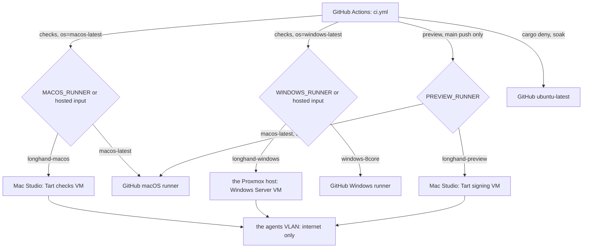
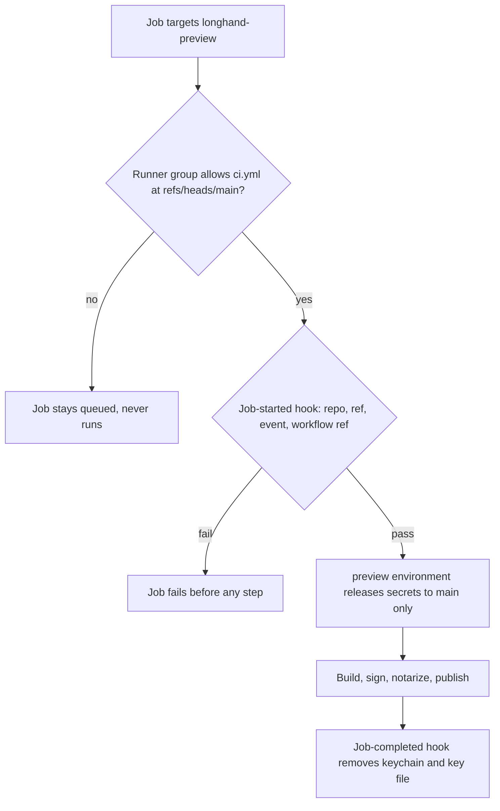

# Self-Hosted CI Runners - Plan

## Goal Capsule

- **Objective:** The CI checks for a change finish much faster, mostly on Windows, and the macOS and Windows checks stop using billed runner minutes. Then a Windows preview build on `main` becomes practical.
- **Means:** GitHub Actions runners in VMs on the agents VLAN, which has internet access only, plus workflow and test changes that help on any runner.
- **Authority:** Product Contract R-IDs win on behaviour. KTDs win on mechanism inside their cited Rs. A unit overrides neither. The idea file is `docs/ideas/done/self-hosted-ci-runners.md`.
- **Stop conditions:** Stop and ask in these cases:
  - A step changes the Proxmox host, the Mac Studio's network or login settings, GitHub organization or repository settings, or a runner registration, and the user has not approved that step.
  - The runner group "Selected workflows" option is not available on the Team plan, so R3 has only the job-started hook (KTD7).
  - The agents VLAN bridge does not work for the macOS VMs (KTD3).
  - A home run of the checks fails where the same commit passes on GitHub's runners, and the cause is not in the VM image.
- **Execution profile:** Deep. Four phases: workflow changes (U1–U3) in one worktree from `origin/main` named `self-hosted-ci-runners`, then the Windows runner (U4–U5), then the macOS runners (U6–U8), then settings and docs (U9). Host setup runs over SSH or on this Mac, one approved step at a time. The workflow PR merges only after both home check runners pass a run of it.
- **Open blockers:** None.

## Scope change (2026-10-10, during ce-work)

The user removed the signing VM from this plan. The preview build stays on GitHub's `macos-latest` runner, and the work goes to the PR checks first. These parts are deferred to `docs/ideas/someday/home-signing-runner.md` and are not part of this plan's Definition of Done: R3, R11 (the preview build keeps today's behaviour on `macos-latest`), R14, KTD7, KTD8, U8, the `PREVIEW_RUNNER` steps of U2, the `longhand-preview` group in U9, and the signing rows of the Verification Contract. The text below keeps them for the future work. (session-settled: user-directed)

The checks VM is now the only macOS VM, so it can use both Apple VM slots later (a second checks VM).

## Scope change (2026-10-11): private setup repository

The setup scripts and the runner guide contain details of the home network, so they are in a private repository, not in this repository. `docs/ci-runners.md` and `scripts/ci-runners/` in the units below refer to that repository. This repository keeps the workflow changes and a short note in `docs/development-workflow.md`. (session-settled: user-directed)

## Results so far

- **U3:** `opt-level = 3` for `pipeline`, `earshot`, `sha2`, `vad` and `recorder` in the dev profile. `runner.rs` takes 46 s in parallel on the Mac Studio (71 s before) and 89 s with three threads (429 s before). The macOS check on `macos-latest` fell from about 14 to 9.5 minutes.
- **U4:** the Windows VM on the Proxmox host runs the runner `longhand-windows`. Changes from KTD4, KTD6 and KTD11:
  - 32 vCPUs, not 16. the Proxmox host is mostly idle and Proxmox shares the cores between VMs. (session-settled: user-directed)
  - LLVM is installed, because `bindgen` needs libclang. GitHub's image has it.
  - Developer Mode is on, so the standard user `runner` can make symlinks (`oven-sh/setup-bun` needs them).
  - The Dev Drive is `W:`, because the install ISOs used `D:` to `F:`.
- **U5:** the Windows check takes 13.4 minutes cold and 4.9 to 5.0 minutes warm, against about 20 minutes on `windows-8core`. 32 vCPUs gave the same times as 16: the warm job is mostly linking and a few long test binaries. A second runner, `longhand-windows-2`, on the same VM lets two Windows jobs run at the same time. (session-settled: user-directed) Each runner has its own cache, so its first job is cold.
- **U7:** the macOS check on `longhand-macos` takes 7.7 minutes cold and 6.5 minutes warm, against about 9.5 minutes on `macos-latest` after U3. The Rust tests are 3.6 minutes of the warm job. The runner is a LaunchDaemon under the user `runner`, not a LaunchAgent with automatic login: the image user `admin` keeps the automatic login for `tart exec`, and no keychain work needs a login session now that the signing VM is deferred. The Cirrus image lacks Ninja, and links `/Users/runner` to `/Users/admin`; `provision.sh` handles both.
- **U6:** the agents VLAN bridge works. Tart offers the VLAN interface (IPv4 and IPv6 off). A test VM got an address on the agents VLAN, reached `github.com` and `crates.io`, and could not reach the Mac Studio. Tart is installed from its notarized GitHub release, because the `cirruslabs/cli` Homebrew tap fails on current Homebrew (cirruslabs/homebrew-cli#21).
- **Code review (2026-10-11):** fixed the review findings: the macOS reset clones before it deletes and always restarts its LaunchAgent; every downloaded Windows installer, MSIs included, must match a published SHA-256 digest or carry a valid signature; a second run of the setup skips a configured runner and always deletes its secret inputs; `create-vm.sh` deletes the answer ISO after the install; the checks job has `timeout-minutes: 60`; the rust-cache key is `v3-rust` for the new profile. Jobs run as the user that owns the runner registration files, so a job can copy them: "stays inside the VM" covers the build output, not the registration. The private setup guide gives the revoke procedure ("Suspected compromise") and the R13 steps for the day the repository becomes public; GitHub refuses the fork approval setting while the repository is private, so R13 waits for that day.
- **Isolation:** the first test found that VMs on the agents VLAN could open TCP ports on the router. The user changed the router rules. From the Windows VM, those ports are now closed and `github.com` still works. The agents VLAN DHCP server gives public DNS servers, so the CI VMs do not need the router.

---

## Product Contract

Product Contract preservation: no scope change. Dependencies / Assumptions gained the Mac Studio network and the Proxmox end-of-life facts. Deferred to Planning now points to the KTDs that answer it.

### Summary

The macOS checks run in a macOS VM on the Mac Studio. The Windows checks run in a Windows VM on the Proxmox host. A second macOS VM on the Mac Studio builds and signs the preview build, and it runs only jobs from `main`. All runner VMs are on the agents VLAN, which has access to the internet only. The VMs keep their build cache between jobs, and they are reset from a clean image on a schedule. When a self-hosted runner is offline, jobs wait. A manual option runs the same checks on GitHub's runners.

### Problem Frame

A change goes through three CI stages: the PR checks, the checks on `main` after the merge, and the macOS preview build. In October 2026, the PR checks took about 20 minutes, the `main` checks about 22 minutes, and the preview build about 10 minutes. The Windows job is the slowest job, so it sets the time of each run.

The time does not go to compilation. The Rust cache works, and the workspace compiles in 1 to 2 minutes. Test execution takes most of the time. On the 3-core macOS runner, one test binary, `crates/pipeline/tests/runner.rs` (213 tests), takes 5.4 minutes of the 9-minute test step. On the Mac Studio, the same binary takes 79 seconds. On Windows, the NeMo helper build takes about 4 minutes, the installer build 3 minutes, and the cache save on `main` 3 minutes more.

The cost is also high. The repository is private, so all runner minutes are billed. Net Actions cost was about $75 in September 2026 and $88 in the first 10 days of October 2026, which is about $250 a month. About half is macOS. The other half is the Windows 8-core larger runner, which gets no free minutes.

The Windows preview build idea (`docs/ideas/someday/windows-preview-builds-and-updates.md`) needs a Windows release build on `main`. A release build compiles all dependencies again with LTO. With the current Windows runner, that would make the time from a merge to a published build much longer.

The repository will become public in about one month, with pull requests limited to collaborators. On a public repository, GitHub's standard runners are free, but the Windows larger runner is not. After that change, speed is the main reason for self-hosted runners.

### Key Decisions

- **Self-hosted runners in VMs, not on GitHub's runners only.** The user wants both speed and lower cost, and the home hardware is much faster. (session-settled: user-directed — chosen over workflow fixes only: workflow fixes alone do not give the speed the Windows preview build needs.) Governs R1.
- **Each runner is a VM on the agents VLAN.** A job is code that runs on the runner, so the runner must not reach the user's account, Keychain or home network. (session-settled: user-directed — chosen over a runner on the host as a dedicated user: that user could still reach the home network.) Governs R2.
- **The Windows VM runs on the Proxmox host, not on the Windows desktop PC.** the Windows desktop PC runs Windows 11 Home, which has no Hyper-V. the Proxmox host is a Proxmox node with a workstation CPU and enough free memory and disk. (session-settled: user-directed — chosen over a Windows Pro upgrade with Hyper-V, VMware on Home, or no VM on the Windows desktop PC: the user did not want any of these.) Governs R1, R15.
- **The macOS VMs run on the Mac Studio, not on the Mac mini.** The Mac mini is not set up yet. (session-settled: user-directed — chosen over a dedicated Mac mini on the agents VLAN: the user wants to start on this machine.) Governs R1, R3.
- **Preview builds are signed at home, in a separate VM.** A GitHub-hosted preview build would keep the time from merge to published build long, and a Windows preview build there would be slower still. (session-settled: user-directed — chosen over GitHub-hosted signing and over signing in the checks VM: a separate VM keeps PR code away from the signing keys.) Governs R3, R11.
- **Runner VMs keep their state between jobs for now.** A warm build cache makes the builds fastest. With PRs limited to collaborators, the remaining risk is a bad dependency, and it stays inside the VM and the agents VLAN. (session-settled: user-directed — chosen over a new VM for each job: start fast, move to new VMs later.) Governs R4.
- **When a self-hosted runner is offline, jobs wait.** (session-settled: user-directed — chosen over an automatic move to GitHub's runners and over GitHub runners for `main`: waiting is simple, and the manual option covers travel.) Governs R7, R8.
- **The Windows VM starts on an evaluation licence.** The first goal is to see how well the setup works. (session-settled: user-approved — the agent noted that the licence expires and the user accepted this for the short term.) Governs R15, R16.
- **`main` still runs all the checks after a merge.** At home this costs no money and little time. It also keeps a check of the merged code. (session-settled: user-approved — the agent proposed to keep the checks on `main` and the user confirmed the scope.) Governs R9.

### Requirements

**Runners and isolation**

- R1. The macOS checks run in a macOS VM on the Mac Studio, and the Windows checks run in a Windows VM on the Proxmox host.
- R2. Each runner VM is on the agents VLAN and can reach only the internet. It cannot reach the host's user account, the host's Keychain or the home network. On the Proxmox host, the VM's network adapter has the tag of the agents VLAN, as for an existing agent VM.
- R3. A separate macOS VM builds and signs the preview build. It accepts only jobs from `main` in the `preview` environment, so PR code never runs on it. A setting on the runner side enforces this, so a branch that edits the workflow cannot send a job to the signing VM. The signing VM accepts no inbound connections from other hosts on the agents VLAN, except administration from one named host.
- R4. Each runner VM keeps its state between jobs. It can be reset to a clean image or snapshot on a schedule and when the user asks.
- R5. The Mac Studio VMs have limits on CPU and memory, so the Mac Studio stays usable while CI runs.
- R6. The macOS VM images and the runner setup can move to a new Mac, such as the coming M5 Ultra Mac Studio, with documented steps.

**Workflow behaviour**

- R7. When a self-hosted runner is offline or busy, its jobs wait in the queue. Jobs do not move to GitHub's runners automatically.
- R8. A manual workflow run can run the same checks on GitHub-hosted runners.
- R9. The checks cover the same things as today, on macOS and Windows, for each PR and each push to `main`. The required check names in the `main` ruleset still pass.
- R10. On a runner that keeps its state, the build outputs and tool caches (the Cargo target folder, the Cargo and Rust toolchain folders, and the NeMo helper cache) stay on the VM between jobs, and no job step deletes them. Such a runner does not upload or download the Rust cache; runs on GitHub-hosted runners keep it.
- R11. The preview build on `main` runs on the signing VM, after the checks pass. It keeps the current version, signing, notarization and publish behaviour.
- R12. The slow tests in `crates/pipeline/tests/runner.rs` run faster, with the same test coverage.

**Security settings**

- R13. Before self-hosted runners serve the public repository, the repository and organization have these settings: PRs only from collaborators, approval for workflows from all external contributors, runner groups limited to this repository and set to allow public repositories (the default allows only private ones), and no `pull_request_target` workflow that checks out PR code.
- R14. The signing secrets go only to jobs on the signing VM.

**Setup and records**

- R15. The Windows VM is created and set up remotely over SSH to the Proxmox host, one step at a time with the user's approval. It starts on an evaluation licence.
- R16. A setup guide records each step for each runner VM, so that each VM can be built again from nothing, including the signing VM's inbound firewall rule. The guide includes the date when the evaluation licence expires and what to do before then.
- R17. A Windows release installer build on the self-hosted runner is timed, to show whether a Windows preview build fits the time budget in the Success Criteria.

### Success Criteria

- The Windows check job is much faster than the 19 to 22 minutes it takes today.
- The time from merge to published preview build, including the checks on `main`, is about 20 minutes or less. This is a target, not a hard limit.
- In normal CI, the macOS and Windows jobs use no billed runner minutes. The Linux jobs stay on GitHub's runners (Scope Boundaries), and manual runs on GitHub's runners (R8) also use minutes.
- The timed release build (R17) shows whether a Windows preview build on `main` would stay within about 20 minutes.

### Scope Boundaries

- The Windows preview build itself (code signing, updates, publishing) is not in scope. It stays in `docs/ideas/someday/windows-preview-builds-and-updates.md`.
- A new VM for each job is deferred: `docs/ideas/someday/ephemeral-ci-runner-vms.md`.
- Moving the signing runner to the Mac mini is deferred: `docs/ideas/someday/signing-runner-on-mac-mini.md`.
- The audit before the repository goes public (history scan for secrets, private files, logs, docs) is not in scope: `docs/ideas/done/pre-public-repo-audit.md`.
- Making the repository public is not in scope.
- A Windows licence purchase is not in scope.
- Linux jobs (`cargo deny`, the recorder soak) stay on GitHub's runners. They cost very little.

### Dependencies / Assumptions

- the agents VLAN already exists, isolates agents, and has access to the internet only. The switch port of the Proxmox host already carries the agents VLAN.
- the Proxmox host has enough free memory and enough free disk on local storage, which is enough for one Windows VM.
- Apple's licence allows at most 2 macOS VMs at the same time on one Mac. The checks VM and the signing VM use both slots, so macOS check jobs run one at a time.
- `SSH to the Proxmox host` and SSH to the Windows desktop PC work from the Mac Studio with key authentication.
- The Mac Studio uses only its Ethernet port. Its switch port can carry the agents VLAN tagged beside the untagged home traffic. The user will not connect a second Ethernet link.
- The repository becomes public in about one month.
- the Proxmox host runs an older Proxmox VE release, which reached end of life in August 2026. This plan does not upgrade it.

### Outstanding Questions

**Resolve Before Planning**

None.

**Deferred to Planning**

The Planning Contract answers these questions: the macOS VM network (KTD3), the VM tool (KTD2), the Windows edition (KTD9), resets (KTD10), warm build outputs (KTD5), the R3 controls (KTD7), runner selection (KTD1), signing VM state (KTD8), VM sizes (KTD11) and the R17 timing (U5). Planning found that GitHub's charge for self-hosted minutes is still postponed. The questions left for implementation are in Open Questions under the Planning Contract.

### Sources / Research

- `.github/workflows/ci.yml`: the current jobs, the Dev Drive and cache steps on Windows, and the `preview` job with its signing secrets.
- CI runs 38070420175 (PR) and 38071795770 (`main`) on 2026-10-10 gave the job and step times above.
- The Actions usage report for the `twistymaze` organization gave the September and October 2026 costs.
- `docs/preview-builds.md` and `docs/ideas/someday/windows-preview-builds-and-updates.md`: the current preview build and the planned Windows one.
- GitHub's pull request access setting: https://github.blog/changelog/2026-02-13-new-repository-settings-for-configuring-pull-request-access/
- On the Proxmox host, an existing agent VM shows the VLAN pattern: a VLAN tag on the VM's network device.

---

## Planning Contract

### Key Technical Decisions

- KTD1. **Repository variables choose the runner for each job, and the check names do not change.** The `checks` matrix keeps `os` (`macos-latest`, `windows-latest`) for the job name and takes `runner` from an expression. A `hosted` input on a manual run selects GitHub's runners. Otherwise the variables `MACOS_RUNNER` and `WINDOWS_RUNNER` select the runner: a home label (`longhand-macos`, `longhand-windows`) or a GitHub label (`macos-latest`, `windows-8core`). The `preview` job uses `PREVIEW_RUNNER`, but it has a GitHub label only until the signing VM exists (U2, R14). A variable set to a GitHub label is the switch back to GitHub's runners for travel or an outage, because GitHub cancels a self-hosted job after it waits 24 hours. This also gives a staged rollout: each variable changes only after its runner passes a run. Twin jobs (one hosted, one home) are rejected, because a job skipped by `if:` reports success to the ruleset. Governs R7, R8, R9.
- KTD2. **The macOS VMs use Tart.** Tart runs Apple Virtualization VMs, it can be scripted, it has a guest agent (`tart exec`), and it moves images through an OCI registry (R6). Its licence is free for an organization with up to 100 CPU cores, and the Mac Studio has 32. The VMs start from the `ghcr.io/cirruslabs/macos-tahoe-xcode` image, which has Xcode for `notarytool`, `stapler` and `codesign`. The setup guide pins the image by its digest, and an image update changes the digest only after a review. Governs R1, R6.
- KTD3. **The macOS VMs bridge to an agents VLAN interface on its Ethernet port.** U6 proves this before any runner is installed. Apple documents bridging only for physical interfaces, so the bridge may refuse the VLAN interface. If it does, U6 stops and the user decides the next step: softnet isolation would give "internet only" but not the agents VLAN, so it does not meet R2 without the user's choice. (The user chose this stop over a softnet fallback in the plan review.) (session-settled: user-directed — chosen over a second Ethernet adapter on the Mac Studio: the user will not connect a second link, and expects the switch port to carry the agents VLAN.) Governs R2.
- KTD4. **The Windows VM runs Windows Server 2025 Datacenter evaluation on the Proxmox host, with the toolchain of GitHub's `windows-latest` image.** That is Visual Studio 2026 Build Tools with the C++ workload and the VC redist folders, Vulkan SDK 1.4.309.0, vcpkg with `VCPKG_INSTALLATION_ROOT`, Git for Windows, PowerShell 7, 7-Zip, rustup and bun. The same OS and tools keep the home result close to the GitHub-hosted result (R8). The VM is q35 with OVMF, CPU type `host`, VirtIO SCSI single with an IO thread, VirtIO network with the VLAN tag, the QEMU guest agent, and ballooning off. Governs R1, R2, R15.
- KTD5. **Self-hosted runners keep build outputs in place, and GitHub's runners keep today's caches.** Steps that run on GitHub's runners and steps that run on a self-hosted runner differ by `runner.environment`:
  1. On a self-hosted runner, `actions/checkout` runs with `clean: false`, so `target/`, `node_modules/` and `src-tauri/nemo-runtime/` stay.
  2. `Swatinem/rust-cache`, `setup-dev-drive`, the Vulkan SDK install and the long-paths step run only on GitHub's runners. The VM image provides a permanent Dev Drive, the SDK and the long-paths setting.
  3. `LONGHAND_NEMO_CACHE` comes from the runner's environment file on a self-hosted runner (a fixed folder outside the work folder), and from `runner.temp` on GitHub's runners.
  4. `CARGO_INCREMENTAL=0` is set on every runner, as rust-cache sets it today. This keeps `target/` smaller and the build the same on both.
  5. Each `tauri build` step deletes its bundle output folder first, so a step never selects an installer or DMG from an earlier build.

  Governs R10.
- KTD6. **Each runner runs as a service under its own non-person user, with one job at a time.** On the macOS VMs, the runner is a LaunchAgent of an auto-login user `runner`, because the preview job changes that user's keychain search list. On Windows, the runner is a service under a standard local `runner` account. Provisioning does the admin work once: it creates the Dev Drive and a startup task that mounts it, sets long paths, and gives `runner` write access to the vcpkg folder. Jobs then never run as admin. Runners update themselves. Governs R1, R3.
- KTD7. **Two runner-side controls keep jobs that are not from `main` off the signing VM.** The signing runner is in its own runner group, `longhand-preview`, with the "Selected workflows" access set to `twistymaze/longhand/.github/workflows/ci.yml@refs/heads/main`. A job-started hook on the signing VM fails any job unless the repository is `twistymaze/longhand`, the ref is `refs/heads/main`, the event is `push`, and the workflow ref starts with `twistymaze/longhand/.github/workflows/ci.yml@`. The `preview` job must stay in `ci.yml` and must not move into a reusable workflow, or the group restriction stops matching it. The check runners are in a group `longhand-checks` with no workflow restriction. Both groups allow only this repository and allow public repositories (R13). Governs R3, R13, R14.
- KTD8. **The signing VM's state follows a measured rule.** U8 times a cold `main` preview build in a fresh clone of the clean signing image. If it is 10 minutes or less, each preview build runs in a fresh clone: a host script clones the image, registers a one-job runner with a just-in-time configuration, and deletes the clone after the job. In this mode:
  - The clone source is an unregistered copy of the signing image.
  - A launchd job keeps one waiting clone, and makes the next clone when the last one exits.
  - The script gets the just-in-time configuration with a fine-grained token for the `twistymaze` organization that has only "Self-hosted runners: read and write" and an expiry date. The token is in the Mac Studio user's login Keychain, the script reads it from there, and it is never in a file or a LaunchAgent environment. Its expiry goes in the Expiry dates table (U9).

  If it is more than 10 minutes, the VM stays persistent, and the job-started and job-completed hooks remove any temporary keychain from the search list and delete leftover key files. The scheduled reset (KTD10) then limits how long anything a job leaves can stay. (session-settled: user-approved — the agent proposed this rule in the plan summary and the user confirmed it.) Governs R3, R4, R14.
- KTD9. **The Windows VM starts on the 180-day Windows Server 2025 evaluation.** It matches GitHub's image, and it lasts twice as long as the Windows 11 Enterprise evaluation. `slmgr /dlv` shows the end date, and the setup guide records it (R16). Governs R15, R16.
- KTD10. **Each VM resets from a clean snapshot or image every week, and on request.** Windows: `qm rollback` to a `clean` snapshot taken after the runner was registered. macOS: stop the VM, delete it, and clone it again from its clean image with `tart clone`. A launchd job on the Mac Studio and a cron job on the Proxmox host run the reset early on Sunday. A job that runs at that moment fails, and the user runs it again. The clean images hold the runner registration, so only one copy of each VM may run at a time. Automatic OS update installs and restarts are off inside each VM. Once a month, and when a home run differs from a GitHub-hosted run, a refresh boots the clean copy, updates the OS, the toolchain and the runner to match GitHub's current image, and takes a new clean copy. The refresh date goes in the Expiry dates table (U9). Governs R4.
- KTD11. **VM sizes leave the hosts usable.** Windows: 16 vCPUs, 32 GB, a 300 GB disk on local storage, with the Dev Drive as a VHDX on C:. macOS checks VM: 16 CPUs, 64 GB, a 300 GB disk. Signing VM: 8 CPUs, 32 GB, a 200 GB disk. That leaves 8 of the Mac Studio's 32 cores for the user, and the two VMs are never both busy for long. Governs R5.
- KTD12. **The `runner.rs` speed fix compiles the heavy audio dependencies with optimization in the test and dev profiles.** U3 measures the slow tests first. The likely change is `opt-level = 3` for the FFT and echo-removal crates under `[profile.dev.package]`, plus a cached decode of the shared test audio. One profile change covers every cargo step, so the feature-unification rule in `docs/solutions/performance-issues/cargo-feature-unification-ci-rebuilds.md` still holds. Local debug builds compile those crates more slowly once, and their tests run faster. Governs R12.

### High-Level Technical Design

Where each job runs after the change:

Controls on the signing VM, in the order a job meets them (KTD7):

### Assumptions

- The Mac Studio's switch port can carry the agents VLAN tagged. If KTD3's bridge works but the port does not carry the tag, the VMs get no network, and U6 shows this at once.
- The runner group "Selected workflows" option is available on the Team plan. The REST API documents it without a plan note. U8 confirms it in the organization settings.
- The NeMo helper and the Rust tests do not need a real GPU in CI: the smoke tests use CPU inference. U7 confirms that the `metal` build and tests pass in the VM's paravirtual GPU.

### Risks

| Risk | Mitigation |
|---|---|
| The VLAN interface is not offered for bridging | U6 finds this before any runner is installed, and stops for the user's decision (KTD3) |
| A home run passes where GitHub's runner fails, or the reverse | KTD4 matches GitHub's image; R8 lets any run repeat on GitHub's runners |
| `target/` grows without a limit on a persistent VM | KTD10 weekly reset; the setup guide gives a disk check |
| A job waits longer than 24 hours and GitHub cancels it | KTD1 variables switch to GitHub's runners before travel |
| the Proxmox host runs an unsupported Proxmox release | Recorded; the VM is on the agents VLAN, and an upgrade is separate work |
| The evaluation licence ends during use | R16 records the date; `slmgr /rearm` extends it, or the VM is rebuilt from the guide |
| Two copies of a registered VM run at the same time | KTD10 allows one copy; the guide says to stop a VM before a clone or rollback |

### Open Questions

**Deferred to implementation**

- The exact list of slow tests in `runner.rs` and the crates whose optimization level changes (U3).
- Whether Windows accepts a Dev Drive VHDX on C: in the VM, or needs a second virtual disk (U4).
- The cold preview build time that decides KTD8 (U8).

---

## Implementation Units

### U1. Runner selection and persistent-runner steps in ci.yml

**Goal:** Each job can run on a self-hosted runner or a GitHub runner, keeps its required check name, and keeps warm build outputs on a self-hosted runner.

**Requirements:** R7, R8, R9, R10, R13; KTD1, KTD5.

**Dependencies:** None.

**Files:** `.github/workflows/ci.yml`

**Approach:**
1. Add a `hosted` boolean input to `workflow_dispatch`. Set the matrix `runner` for each `os` from the input and the `MACOS_RUNNER` / `WINDOWS_RUNNER` variables (KTD1). With no variable set, the value is today's GitHub label, so the change does nothing until a variable changes.
2. Gate rust-cache, setup-dev-drive, the Vulkan SDK install and the long-paths step on `runner.environment == 'github-hosted'`. Set `clean` on both checkouts from the same test (KTD5).
3. Set `LONGHAND_NEMO_CACHE` from the runner's environment when it is present, and fall back to `runner.temp`. Do this in a step, not in job-level `env`, because `runner.*` is not available there (`docs/solutions/workflow-issues/actions-context-not-available-fails-before-jobs.md`).
4. Set `CARGO_INCREMENTAL=0` for the checks job.
5. Delete `target/debug/bundle` before each debug `tauri build`, and `target/recognition-installer` before the Windows installer check.
6. Add top-level `permissions: contents: read`.
7. Update the header comments that say minutes are billed and name the 8-core runner, and link `docs/ci-runners.md`.

**Patterns to follow:** The current `os`/`runner` matrix split; the step-level `GITHUB_ENV` pattern in the preview job; `shell: pwsh` for Rust steps on Windows (`docs/solutions/build-errors/windows-rust-selects-git-linker-after-msvc-setup.md`).

**Test scenarios:**
- With no variables set, a PR run uses `macos-latest` and `windows-8core` and passes with the same three required checks.
- A manual run with `hosted: true` runs both checks on GitHub's runners while a variable names a home label.
- With `WINDOWS_RUNNER=longhand-windows`, the Windows check runs on the home VM, skips rust-cache and setup-dev-drive, and keeps `target/` from the previous run.
- A second home run of the same commit compiles no dependency crates again.
- After a version change, the Windows installer check reads only the new installer.

**Verification:** `actionlint` passes. Runs on both GitHub's and self-hosted runners report the names `Checks (macos-latest)` and `Checks (windows-latest)`.

### U2. Preview job on the signing runner

**Goal:** The preview job runs on the signing VM and leaves no keys or keychain behind, including after a failed or cancelled job.

**Requirements:** R3, R11, R14; KTD1, KTD7, KTD8.

**Dependencies:** U1.

**Files:** `.github/workflows/ci.yml`, `docs/preview-builds.md`

**Approach:**
1. Set `runs-on` from `PREVIEW_RUNNER`, with `macos-latest` as the default only until U8 registers the signing VM. After that, set the variable to `longhand-preview` and remove the default, so the preview job waits for the signing VM and never runs on GitHub's runners (R14). The `hosted` input does not apply to the preview job.
2. Run rust-cache only on GitHub's runners. Take `LONGHAND_NEMO_CACHE` from the runner's environment as in U1.
3. At the start of the job, remove search-list entries that point to missing files or to an earlier temporary keychain. At the end, restore the search list that the job found, then delete the keychain and the key file.
4. Delete `target/release/bundle` before the build, so the DMG step finds one DMG.
5. Keep secrets on single steps and actions pinned by SHA.
6. In `docs/preview-builds.md`, replace "CI runs on a new Mac with an empty keychain" with the signing VM's rules, and link `docs/ci-runners.md`.

**Patterns to follow:** The current preview job (secret per step, SHA pins, `if: always()` cleanup).

**Test scenarios:**
- A `main` push with `PREVIEW_RUNNER` unset publishes on `macos-latest` as today.
- A `main` push with `PREVIEW_RUNNER=longhand-preview` publishes a signed, notarized build from the signing VM.
- After a job is cancelled during the build, the next preview job starts with no earlier temporary keychain in the search list.
- After two preview builds in a row on a persistent VM, the DMG step finds exactly one DMG.

**Verification:** A home preview build publishes to `twistymaze/longhand-builds`, and `security list-keychains` on the VM shows only the login keychain afterwards.

### U3. Faster runner.rs tests

**Goal:** The slow `runner.rs` tests run much faster, with the same tests and assertions.

**Requirements:** R12; KTD12.

**Dependencies:** None. Measure again in the macOS VM after U7.

**Files:** `Cargo.toml`, `crates/pipeline/tests/runner.rs`, `crates/pipeline/tests/common/mod.rs` (or the module that holds `speech()`).

**Approach:**
1. Time each test in `runner.rs` with one thread and timestamps, on this Mac. Name the tests that take most of the time. The research names the stereo echo-removal tests first, then `long_conversation`, the long summary tests and the polling tests.
2. Add `opt-level` overrides under `[profile.dev.package]` for the crates the slow tests spend time in.
3. If decoding the shared fixture audio is significant, decode it once per test binary with a `OnceLock`.
4. Measure again, and record the before and after times in the PR.

**Execution note:** Measure before you change anything. Keep a change only when the measurement shows it helps.

**Patterns to follow:** The feature-unification checklist in `docs/solutions/performance-issues/cargo-feature-unification-ci-rebuilds.md`. One profile change covers all cargo steps.

**Test scenarios:**
- All 213 tests in `runner.rs` pass with the same count before and after.
- The workspace tests, clippy and `scripts/check-windows.sh` pass after the profile change.
- The `runner.rs` binary takes clearly less time than its 79-second baseline on this Mac.

**Verification:** The PR records the per-test times before and after, and CI on both platforms passes.

### U4. Windows runner VM on the Proxmox host

**Goal:** A Windows Server 2025 VM on the Proxmox host, on the agents VLAN, runs the Windows checks as the runner `longhand-windows`.

**Requirements:** R1, R2, R4, R10, R15, R16; KTD4, KTD5, KTD6, KTD9, KTD10, KTD11.

**Dependencies:** U1 (to test with a variable). The VM can be built before U1 merges.

**Files:** `docs/ci-runners.md` (Windows section), `scripts/ci-runners/` (the autounattend file, setup scripts, the reset script).

**Approach:**
1. On the Proxmox host, download the Server 2025 evaluation ISO and the virtio-win ISO, and make a small ISO with `autounattend.xml`.
2. Create the VM per KTD4 and KTD11, with `net0` on the host bridge and the VLAN tag.
3. Install Windows unattended, with the VirtIO drivers and the QEMU guest agent.
4. Manage the guest through `qm guest exec` from the Proxmox host, so the VM needs no inbound access from the home network.
5. Install the KTD4 toolchain. Set long paths and `core.longpaths` once. Create the permanent Dev Drive and mount it at boot. Put the runner work folder, `CARGO_HOME`, `RUSTUP_HOME` and the NeMo cache on it.
6. With the user's approval, create the runner group `longhand-checks`, limited to this repository. Register the runner as a service (KTD6) in that group with label `longhand-windows`. The registration token comes from `gh api` at the moment of use and is not stored.
7. Take the `clean` snapshot, and add the weekly reset (KTD10).
8. Ask the user before each step that changes the Proxmox host or GitHub settings.

**Execution note:** This is environment setup. Prove it with real runs, not unit tests.

**Patterns to follow:** an existing agent VM for the VLAN tag and SCSI settings.

**Test scenarios:**
- From inside the VM, `github.com` and `crates.io` respond, and an address on the home network (for example the router) does not.
- A manual run on the self-hosted runner passes the Windows check.
- A second run of the same commit takes much less time than the first, and the job log shows no rust-cache restore or Dev Drive creation.
- After `qm rollback` to `clean`, the runner comes back online and the next run passes.

**Verification:** The runner is online in group `longhand-checks`, and a PR run with `WINDOWS_RUNNER=longhand-windows` passes the required `Checks (windows-latest)` check.

### U5. Windows timing measurements

**Goal:** Measured Windows times on the self-hosted runner show the speed-up and whether a Windows preview build fits about 20 minutes.

**Requirements:** R17, Success Criteria.

**Dependencies:** U4.

**Files:** `docs/reference/ci-runner-timings-2026-10.md`, `docs/development-workflow.md` (the Windows job time).

**Approach:**
1. Record the warm and cold check-job times on the self-hosted runner. A cold run follows a reset or a `Cargo.lock` change.
2. Run the release installer build once warm and once cold with `windows_installer=true`. This is the one approved use of that input in this plan.
3. Compare the times with the GitHub baselines in the Problem Frame.

**Test expectation:** none -- this unit measures and records.

**Verification:** The timings doc gives warm and cold numbers for the check job and the release build, and says whether a Windows preview build fits.

### U6. Mac Studio network proof and Tart install

**Goal:** Prove how the macOS VMs get internet-only network access before any runner is set up.

**Requirements:** R2; KTD2, KTD3.

**Dependencies:** None.

**Files:** `docs/ci-runners.md` (macOS network section).

**Approach:**
1. Install Tart with Homebrew.
2. With the user's approval, add an agents VLAN interface on its Ethernet port. Turn off IPv4 and IPv6 on its network service and keep it below its Ethernet port in the service order, so the host has no address or route on the agents VLAN and the interface is only a bridge member. Check that `tart run --net-bridged=list` offers it.
3. If it is offered, boot a test VM bridged to it. Check that the VM gets an address on the agents VLAN, reaches the internet, and cannot reach the home network or the Mac Studio.
4. If it is not offered, or has no network, remove the VLAN interface and stop. Report the result to the user, who decides the next step (KTD3). Softnet is one option to offer: it needs static public DNS in the guest and a block on the host gateway.
5. Record the working setup in the setup guide.

**Test scenarios:**
- The test VM resolves and reaches `github.com`.
- The test VM cannot open a connection to the Mac Studio's address or the router.
- The Mac Studio keeps its normal network on its Ethernet port during and after the test.
- With the bridge, the host has no address on the agents VLAN interface, and the test VM cannot connect to any address of the Mac Studio.
**Verification:** The setup guide names one working network mode with the three checks above.

### U7. macOS checks VM

**Goal:** A macOS VM on the Mac Studio runs the macOS checks as the runner `longhand-macos`.

**Requirements:** R1, R2, R4, R5, R6, R10, R16; KTD2, KTD5, KTD6, KTD10, KTD11.

**Dependencies:** U6, U1.

**Files:** `docs/ci-runners.md` (macOS checks section), `scripts/ci-runners/` (the host LaunchAgent, the VM start script, the reset script).

**Approach:**
1. Clone the `macos-tahoe-xcode` image by its pinned digest (KTD2). Set the KTD11 CPU, memory and disk. Change the default password. Turn off clipboard, audio and directory sharing.
2. In the guest, create the `runner` user with auto-login. Install rustup 1.94.0 with the Windows target and bun. Give the NeMo cache a fixed folder.
3. Register the runner as a LaunchAgent in group `longhand-checks` with label `longhand-macos`.
4. Stop the VM and keep a clean copy for resets (KTD10). Record how to `tart push` the image before registration to a private registry, for a move to a new Mac (R6).
5. A LaunchAgent of the Mac Studio user starts the VM headless at login with the U6 network mode.

**Test scenarios:**
- A manual run on the self-hosted runner passes the macOS check, including the Metal build and the installed helper inference.
- A second run of the same commit takes much less time than the first.
- The `runner.rs` binary time in the VM is recorded next to the 79-second host baseline.
- After a reset from the clean copy, the runner comes back online and the next run passes.

**Verification:** A PR run with `MACOS_RUNNER=longhand-macos` passes the required `Checks (macos-latest)` check, and the Mac Studio stays usable during the run.

### U8. Signing VM and its controls

**Goal:** A separate macOS VM builds, signs, notarizes and publishes the preview build, and only `main` jobs can reach it.

**Requirements:** R3, R4, R11, R14; KTD7, KTD8, KTD10, KTD11.

**Dependencies:** U2, U6, U7.

**Files:** `docs/ci-runners.md` (signing section), `scripts/ci-runners/` (the job-started and job-completed hooks; the clone script if KTD8 chooses fresh clones).

**Approach:**
1. Build the VM as in U7, at the KTD11 size. Turn on the macOS firewall with "block all incoming connections", and manage the VM only through `tart exec` from the host.
2. Create the runner group `longhand-preview` with the KTD7 workflow restriction, and confirm that the Team plan offers it.
3. Install the job-started and job-completed hooks.
4. Register the runner with label `longhand-preview`.
5. Time a cold preview build in a fresh clone of the clean image, and apply KTD8.

**Test scenarios:**
- A `main` push with `PREVIEW_RUNNER=longhand-preview` publishes a build that passes the existing signature and notarization checks.
- A branch run whose workflow targets `longhand-preview` does not run on the signing VM: it stays queued, or the hook fails it before any step.
- `workflow_dispatch` on `main` that reaches the signing VM fails at the hook, because the event is not `push`.
- From the checks VM, no connection to the signing VM's address succeeds.

**Verification:** The preview build publishes from the signing VM, and the two control tests above fail as intended.

### U9. Organization settings, runner docs and status

**Goal:** The security settings are in place, and the setup guide lets the user rebuild, reset and check each runner.

**Requirements:** R13, R16; KTD7, KTD9, KTD10.

**Dependencies:** U4, U7, U8.

**Files:** `docs/ci-runners.md`, `docs/development-workflow.md`, `docs/solutions/performance-issues/cargo-feature-unification-ci-rebuilds.md` (out-of-date line references and the runner name), `docs/ideas/done/self-hosted-ci-runners.md`.

**Approach:**
1. With the user's approval, set: PRs only from collaborators, approval for workflows from all external contributors, public repositories allowed on both runner groups (U4 and U8 created them, limited to this repository), and the `MACOS_RUNNER`, `WINDOWS_RUNNER` and `PREVIEW_RUNNER` variables.
2. Write `docs/ci-runners.md` in the style of `docs/preview-builds.md`, with these sections:
   - One-time setup for each VM.
   - The network checks.
   - Reset and rebuild.
   - How to see whether a runner is online.
   - How to switch a job to GitHub's runners.
   - An Expiry dates table with the evaluation licence date.
   - A Problems section.
3. Update "Checks and CI" in `docs/development-workflow.md`: self-hosted runners, no cache from `main`, the switch to GitHub's runners, and how to see an offline runner.

**Test expectation:** none -- settings and documentation.

**Verification:** The organization and repository show the settings, and a reader can rebuild the Windows VM from the guide alone.

---

## Verification Contract

| Gate | Command or check | Applies to |
|---|---|---|
| Workflow syntax | `actionlint .github/workflows/ci.yml` | U1, U2 |
| Rust format | `cargo fmt --all --check` | U3 |
| Lint | `cargo clippy --workspace --all-targets -- -D warnings` and `scripts/check-windows.sh` | U3 |
| Scoped tests | `cargo test -p pipeline --test runner` with timing, then `cargo test --workspace --features nemo-runtime/test-helper` once | U3 |
| Frontend | `bun test ./src/` and `bun run build` (no frontend change expected) | U1 |
| Ideas | `bun scripts/ideas.ts check` | U9 |
| Home Windows check | A run with `WINDOWS_RUNNER=longhand-windows` passes `Checks (windows-latest)`, warm and after a reset | U4 |
| Home macOS check | A run with `MACOS_RUNNER=longhand-macos` passes `Checks (macos-latest)`, warm and after a reset | U7 |
| Hosted fallback | A manual run with `hosted: true` passes both checks on GitHub's runners | U1 |
| Signing controls | A `main` push publishes from `longhand-preview`; a branch job cannot run there | U2, U8 |
| Isolation | Each VM reaches `github.com` and cannot reach the router or the Mac Studio | U4, U6, U7, U8 |

Read [Checks and CI](../development-workflow.md#checks-and-ci) before each push, and run `cargo fmt --all --check` before each push.

---

## Definition of Done

- Every required check runs on the self-hosted runners for PRs and `main`, with the same names, and a manual run can still use GitHub's runners (R7–R9).
- The preview build publishes from the signing VM, and the U8 control tests pass (R3, R11, R14).
- The Windows check job and the time from merge to published preview build meet the Success Criteria, or the timings doc says by how much they miss.
- `docs/ci-runners.md` lets the user rebuild and reset each VM, and records the evaluation licence date (R16).
- The billing report shows no new macOS or Windows minutes from normal CI after the switch.
- No experimental workflow steps, test VMs or temporary network interfaces from abandoned attempts remain.
- The idea file moves to `done/` after the workflow PR merges and the runners are live.
