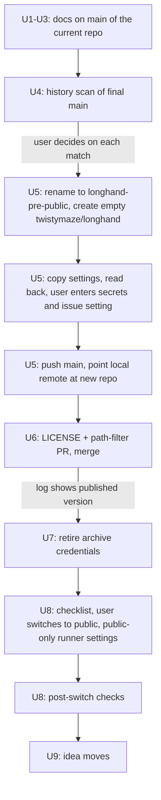

# Public Repository - Plan

## Goal Capsule

- **Objective:** Visitors can follow Longhand on GitHub at `twistymaze/longhand`. They understand what it is and its licence, and they know that the project does not accept outside contributions. The public repository shows no secrets, no private files, no home infrastructure details and no exposure that the user did not accept.
- **Product authority:** This Product Contract. The audit items in `docs/ideas/someday/pre-public-repo-audit.md` are input. The About-pane part of `docs/ideas/someday/about-longhand-and-readme.md` is not active scope.
- **Open blockers:** None.

---

## Product Contract

### Summary

Add a README, an MIT licence and a contributing document, and make the docs general and correct for a public repository. Rename the current repository to a private archive. Create a fresh repository with the same name from the current `main` history, set it up by script, and make it public when it works.

### Problem Frame

The repository is private, and the user wants other people to follow its development. A public repository cannot usefully be made private again, because anyone can clone it while it is public. So everything that becomes visible must be correct before the switch.

Today a visitor would see a list of files with no README, no licence and no statement about contributions. `STRATEGY.md` names the user's employer and says "Not a public project". `docs/preview-builds.md` says "The source repository stays private".

On 2026-10-11, the history of `main` was written again to remove home infrastructure details: the Proxmox and NAS host names, the VLAN number, router rules, storage names and hardware. The current repository still keeps the old commits. Its PR refs, its Actions logs and the force-push entry in the timeline of archived PR 54 point to them, and no cleanup inside that repository can remove them. The host names of the self-hosted runners are generic and are not sensitive.

### Key Decisions

- **Publish a fresh repository, and keep the current one as a private archive.** The old commits stay only in a repository that never becomes public. All 7 `preview` secrets can be recovered on this machine or from Apple, so the setup costs no irreplaceable credential. Governs R18, R19, R20, R21, R22, R24. (session-settled: user-directed — chosen over keeping the repository with a light cleanup that accepts the old commits as exposure, after the user confirmed that each secret is recoverable)
- **The archive is named `twistymaze/longhand-pre-public`.** The name tells what period it holds. Governs R18. (session-settled: user-directed — chosen over `longhand-archive`, which the user found unclear, and over `longhand-private-history`, `longhand-old-private` and `longhand-2026-private`)
- **PR references in tracked files become plain text.** The fresh repository numbers its PRs from 1, so "PR #53" would point at an unrelated PR, and links to the private archive show a 404 to visitors. Governs R17. (session-settled: user-directed — chosen over links to the archive and over no change)
- **Issues stay on, with creation limited to collaborators.** The user wants to use Renovate's dependency dashboard issue later. Governs R15, R21. (session-settled: user-directed — chosen over turning issues off: Renovate's dashboard needs issues)
- **Make the docs general, and accept the employer name in history.** The aim is general docs, not to hide the employer: the user's GitHub profile already names it. Governs R7, R8. (session-settled: user-directed — chosen over a history rewrite that removes the employer name from every commit)
- **The README says that official releases are coming soon, and gives build-from-source steps.** Preview builds are public in `twistymaze/longhand-builds`, but they are not official releases, so the README does not link them. Governs R2. (session-settled: user-directed — chosen over "no downloads yet", which is false, and over a link to the preview builds)
- **MIT licence, copyright holder Erv Walter.** All borrowed code is MIT or Apache-2.0, and the dependency gate allows only permissive licences. The MPL-2.0 exceptions are file-level and come through Tauri. Governs R5. (session-settled: user-directed — chosen over "twistymaze" or "Erv Walter and Longhand contributors" as the holder)

### Requirements

**Front door**

- R1. A `README.md` at the repository root introduces Longhand to a visitor. It describes the concept from `STRATEGY.md`: a lazy notes scratchpad, a local transcript as the system of record, and data that stays on the user's machine. It uses the terms in `CONCEPTS.md`.
- R2. The README says that official releases are coming soon. It then gives short build-from-source steps for people who want to try Longhand.
- R3. The README links to the licence and to the contributing document. It includes no screenshot.
- R4. The README is not complete until the user approves it. The implementation presents the draft README to the user for manual review and applies the user's changes before the work is called complete.
- R5. A `LICENSE` file at the repository root holds the MIT licence text with the line "Copyright (c) 2026 Erv Walter".
- R6. A `CONTRIBUTING.md` says warmly that Longhand is a young project and is not looking for outside contributions yet. It thanks the visitor for their interest and invites them to follow along. It does not sound like a refusal.

**General docs**

- R7. `STRATEGY.md` describes its users without naming an employer. Its "Not a public project" line changes to say that the repository is public to follow but closed to contributions.
- R8. No tracked file names the user's employer. A search of all tracked files finds every match, including `docs/plans/2026-09-24-1956-feat-ux-redesign-plan.md`.
- R9. `docs/preview-builds.md` no longer says that the source repository stays private.
- R17. Each reference to a PR or an Actions run of the current repository in a tracked file becomes plain text that names it as archived, such as "archived PR 53". This covers the text form "PR #53" and links to `github.com/twistymaze/longhand/pull/…`, `github.com/twistymaze/longhand/actions/runs/…` and `github.com/ervwalter/longhand/…`. The quotes in this plan that name a reference form, such as the merge-commit text in Scope Boundaries, stay as they are.

**History check**

- R10. Before the push to the new repository, a scan of the `main` history looks for secrets, committed private paths from the `CLAUDE.md` list, and home infrastructure details. The scan for infrastructure details uses the pattern in `docs/solutions/workflow-issues/keep-home-network-details-out-of-the-repository.md` and the known infrastructure host names. The host names are never written into a tracked file. Each match in the history that will be pushed is shown to the user, who decides before the push, also when the same match is in the current files. A real credential that matches is also revoked or rotated, and a match in the current files is also removed.

**Fresh repository**

- R18. The current repository is renamed to `twistymaze/longhand-pre-public`. It stays private and keeps its PRs, its Actions history and its old commits.
- R24. After R22 passes, the archive can no longer sign or publish builds: Actions is off, its `preview` secrets are deleted, and it has no access to the `longhand-checks` runner group. If R21 used a new `BUILDS_TOKEN`, the user revokes the old one.
- R19. A new private repository `twistymaze/longhand` is created empty. It receives the `main` history only after R20 and R21 are complete. No other branch moves.
- R20. A script copies the settings of the archive to the new repository, then reads both back and shows that they match: the repository variables, the ruleset, the merge and feature settings, the PR creation policy, the `preview` environment without its secret values, and access to the `longhand-checks` runner group.
- R21. The user enters the 7 `preview` secret values and the issue creation setting. The implementation gives one command for each secret, which reads the value from a file or the password manager. The implementation never reads or prints a secret value.
- R22. Before the switch, one CI run passes on the new repository, and its preview job publishes a new build. The job log shows "published <version>", and a new preview release is in `twistymaze/longhand-builds`. A run that ends with "nothing to publish" does not count.
- R23. The local checkout uses the new repository as its remote.

**The switch**

- R12. A checklist lists the steps before and after the switch in order. The user changes the visibility in the GitHub settings. An agent does not.
- R13. Before the switch, the self-hosted runner settings for a public repository, from the README of the private repository `twistymaze/homelab-ci`, are applied. CI selects these runners through `vars.MACOS_RUNNER` and `vars.WINDOWS_RUNNER` in `.github/workflows/ci.yml`. Code from people outside the repository must not run on the home runners. A setting that GitHub allows only on a public repository is set immediately after the switch.
- R14. After the switch, a check confirms that pull request creation is still limited to collaborators.
- R15. After the switch, a check confirms that issue creation is still limited to collaborators. Wiki, Discussions and Projects stay off.
- R16. The idea `pre-public-repo-audit` moves to `docs/ideas/done/`. The idea `about-longhand-and-readme` stays in `someday`, with only its About-pane part.

### Scope Boundaries

- The About section in Settings and the macOS About panel are out of scope. They stay in the `about-longhand-and-readme` idea.
- PRs, issues, Actions history and stars do not move to the new repository. They stay in the archive.
- Merge commit messages in the pushed history keep text such as "Merge pull request #54". GitHub links them to the new PR with that number. Changing them needs a history rewrite.
- The employer name stays in the pushed history.
- Renovate setup is deferred. When Renovate is set up, confirm that the collaborators-only issue setting does not stop its app from opening the dashboard issue.
- A README screenshot is deferred. It must use a note with no real names.
- No `SECURITY.md`, issue templates or PR templates. Outside users cannot file issues or PRs.
- Forking cannot be turned off for a public repository. MIT allows forks.

### Dependencies / Assumptions

- The REST API does not show the issue creation setting (`gh api repos/twistymaze/longhand` returns only `pull_request_creation_policy`). Checks for R15 use the settings page.
- The `homelab-ci` README covers the approval setting for workflows from outside contributors. If it does not, R13 adds that setting.
- The 7 `preview` secrets are recoverable: the updater key at `~/.tauri/longhand-updater.key` matches the public key in `src-tauri/tauri.conf.json`, the Developer ID identity is in the keychain, the `.p8` file is in `~/.appstoreconnect/private_keys/`, the API key ID and issuer ID show in App Store Connect, and a new `BUILDS_TOKEN` takes a minute to make.
- The update manifest URL is in `twistymaze/longhand-builds`, so installed preview builds do not depend on the source repository.

### Outstanding Questions

**Deferred to Planning**

- Which tool scans the history (R10).
- Which build steps the README gives (toolchain versions, macOS signing note), taken from `docs/development-workflow.md`.
- How the CI path filter in `.github/workflows/ci.yml` stops a `LICENSE` change from starting CI and a preview publish. The filter now excludes only Markdown and the docs folders.
- Whether the repository description and topics on GitHub get set at the switch.
- Whether the checklist turns on GitHub secret scanning and push protection after the switch.

### Sources / Research

- `docs/ideas/someday/pre-public-repo-audit.md`: the audit items and the old-commit context.
- `docs/ideas/someday/about-longhand-and-readme.md`: the README idea and its About-pane part.
- `docs/solutions/workflow-issues/keep-home-network-details-out-of-the-repository.md`: what the history rewrite removed, and the search pattern.
- `docs/preview-builds.md`: the public preview builds, the `preview` environment and the source of each secret.
- `deny.toml`, `about.toml`, `licences/`, and each `PROVENANCE.md`: licence policy and borrowed-code records (anarlog MIT, none from its `enterprise/` folder; Handy MIT; DTLN-aec MIT; NeMo Apache-2.0).
- `STRATEGY.md` and `CONCEPTS.md`: the description and terms for the README.

---

## Planning Contract

**Product Contract preservation:** Product Contract unchanged.

### Key Technical Decisions

- KTD1. **The docs change first, in the current repository.** README, CONTRIBUTING, the general-docs edits (R7, R8, R9) and the reference rewrite (R17) are Markdown only. They go to `main` directly, as `docs/development-workflow.md` allows for docs-only changes, so they are in the history that R19 pushes. The history scan (R10) then runs on that final `main`.
- KTD2. **`LICENSE` and the CI path-filter change are the first PR in the new repository.** The path filter in `.github/workflows/ci.yml` excludes only Markdown and the docs folders, so a root `LICENSE` would start CI and a preview publish. The PR adds `LICENSE` and excludes it from the filter. Its checks run on the home runners, and its merge publishes a build from a commit that the archive never built, which is the proof that R22 needs.
- KTD3. **A one-off setup script, outside the repository.** The script that copies settings and reads them back (R20) runs from a scratch folder and is not committed. It compares the archive and the new repository as JSON and shows the difference in chat.
- KTD4. **The history scan uses `gitleaks` for credentials and `git grep` for the rest.** `gitleaks` is installed through Homebrew only after the user approves the download, and it always runs with `--redact` so that its report holds no secret value. `git grep` over all commits of `main` covers the `CLAUDE.md` private paths, any `.context/` path, the employer name for information, and the pattern in `docs/solutions/workflow-issues/keep-home-network-details-out-of-the-repository.md`. The user supplies the infrastructure host names at run time, and they stay in the shell session (R10).
- KTD5. **The agent runs the reversible GitHub steps, and the user runs the rest.** The agent runs the rename, the repository creation, the pushes, the settings script and the read-only checks, with approval for each step that changes something on GitHub. The user enters the secret values and the issue creation setting (R21), revokes a token (R24) and changes the visibility (R12).
- KTD6. **The README build steps come from the repository, not from memory.** The prerequisites are Rust 1.94.0 (`rust-toolchain.toml`), bun, cmake, Ninja, git and macOS 15 or later. `scripts/build-nemo.sh` clones NeMo-Speech.cpp and sentencepiece at pinned commits, so the first build is long. `src-tauri/tauri.conf.json` names the owner's Developer ID identity, so an outside builder sets `APPLE_SIGNING_IDENTITY="-"` for an ad-hoc signature, then runs `bun tauri build --bundles app`. Windows gets one line that names MSVC, Git Bash and the Vulkan SDK.

### High-Level Technical Design

The work is a gated sequence across two repositories. Each gate must pass before the next step starts.

### Assumptions

- GitHub accepts the first push of `main` to the new repository under the copied ruleset, because the ruleset lets the repository admin role bypass it, as it does on the current repository.
- An ad-hoc signature (`APPLE_SIGNING_IDENTITY="-"`) is enough for an outside builder to run Longhand locally. U1 confirms the variable name against the Tauri build before the README states it.

---

## Implementation Units

### U1. README and CONTRIBUTING

**Goal:** A visitor understands Longhand, how to build it, and that the project does not take contributions yet.

**Requirements:** R1, R2, R3, R4, R6

**Dependencies:** None

**Files:**
- Create: `README.md`
- Create: `CONTRIBUTING.md`

**Approach:**
1. Write the README from `STRATEGY.md` (Purpose, Positioning, Boundaries) with the terms in `CONCEPTS.md`. Use the UI word "note" where the README describes what the user sees.
2. Add the "official releases are coming soon" statement and the build steps (KTD6). Link `LICENSE` and `CONTRIBUTING.md`. `LICENSE` arrives in U6, so the link is dead until then, which is acceptable while the repository is private.
3. Write CONTRIBUTING in a warm tone: young project, not looking for outside contributions yet, thanks, follow along.
4. Present the README draft to the user, apply the changes, and get approval before the commit (R4).

**Patterns to follow:** UI text rules in `CLAUDE.md` (plain language, no metaphors). The subfolder READMEs in `licences/README.md` and `docs/ideas/README.md` for tone in repository docs.

**Test expectation:** none -- docs only. The user's approval of the README is the check.

**Verification:** The user approved the README text. Both files are on `main`.

### U2. General docs

**Goal:** The current docs are correct for a public repository and do not name the employer.

**Requirements:** R7, R8, R9

**Dependencies:** None

**Files:**
- Modify: `STRATEGY.md`
- Modify: `docs/plans/2026-09-24-1956-feat-ux-redesign-plan.md`
- Modify: `docs/preview-builds.md`

**Approach:**
1. In `STRATEGY.md`, replace the employer references in Users and Key metrics with general wording, and change "Not a public project" to say that the repository is public to follow but closed to contributions.
2. Replace the employer reference in the UX-redesign plan.
3. In `docs/preview-builds.md`, remove "The source repository stays private". Leave the billing sentences in `docs/development-workflow.md` and `.github/workflows/ci.yml` as they are: they stay true as conditionals.
4. Search all tracked files for the employer name as a whole word, case-insensitive, and fix any other match.

**Test expectation:** none -- docs only.

**Verification:** A whole-word, case-insensitive search for the employer name in tracked files returns no match.

### U3. Archived references

**Goal:** No tracked file points a visitor at a wrong PR or a 404.

**Requirements:** R17

**Dependencies:** None

**Files:**
- Modify: the 77 tracked Markdown files that hold a PR reference, an Actions run link or an `ervwalter/longhand` link. Only Markdown files hold them.

**Approach:**
1. List the matches for the three forms in R17 and review the list before the edit.
2. Rewrite each match as plain text, such as "archived PR 53" or "archived CI run". A link becomes its text without the URL.
3. Leave the quotes in this plan that R17 exempts.
4. Review the diff as a whole before the commit, because a scripted edit can break a sentence.

**Test expectation:** none -- docs only.

**Verification:** A search for the three forms in tracked files finds only the exempt quotes in this plan.

### U4. History scan

**Goal:** Nothing in the history that goes public surprises the user.

**Requirements:** R10

**Dependencies:** U1, U2, U3

**Files:** None in the repository. The scan output stays in chat and in a scratch folder.

**Approach:**
1. Ask the user to stop pushes to `main` from other sessions until U5 step 7. Fetch the final `main` and record its commit ID: this is the scanned commit. Ask the user to approve the `gitleaks` install, then run it with `--redact` over the full history of the scanned commit (KTD4). Read only the redacted report.
2. Run the `git grep` searches over all commits of `main`: the private paths, any `.context/` path, and the infrastructure pattern with the host names that the user supplies.
3. Show each match to the user with its commit and file. The user decides on each match before U5 starts.
4. If the user decides that a credential is real, the user revokes or rotates it.

**Execution note:** Do not print a credential value in chat. Show the rule name, commit and path only.

**Test expectation:** none -- an audit step with no code.

**Verification:** The user decided on every match, or the scans found none.

### U5. Fresh repository

**Goal:** A private `twistymaze/longhand` holds the `main` history and the same settings as the archive.

**Requirements:** R18, R19, R20, R21, R23, R13

**Dependencies:** U4

**Files:** None in the repository. The setup script lives in a scratch folder (KTD3).

**Approach:**
1. Export the settings of the current repository to JSON: repository settings, Actions settings, variables, the ruleset, the `preview` environment and its branch policy, and the runner group access.
2. Rename the repository to `twistymaze/longhand-pre-public` (R18).
3. Create the empty private `twistymaze/longhand`. Apply the exported settings, and add the new repository to the `longhand-checks` runner group.
4. Read both repositories back and show the difference. Only the expected differences may remain: the name, the IDs and the secret values.
5. Give the user one command for each of the 7 secrets, reading from a file or the password manager, and the settings-page step for issue creation (R21).
6. Read the `homelab-ci` README and apply its settings for a public repository that GitHub allows on a private one (R13). Record the settings that need a public repository for U8.
7. Check that `origin/main` still points to the scanned commit from U4. If it moved, scan the new commits under R10 first. Push exactly the scanned commit as `main` of the new repository, with no other refs or tags. Then point the local `origin` at the new repository (R19, R23).

**Patterns to follow:** The secret commands in the table in `docs/preview-builds.md`.

**Test expectation:** none -- repository setup with no code.

**Verification:** The readback shows no unexpected difference. The `preview` environment lists 7 secrets. `git remote -v` names `twistymaze/longhand`.

### U6. Licence and CI path filter

**Goal:** The repository carries the MIT licence, and the new repository proves that its CI and preview publish work.

**Requirements:** R5, R22

**Dependencies:** U5

**Files:**
- Create: `LICENSE`
- Modify: `.github/workflows/ci.yml`
- Modify: `docs/development-workflow.md`

**Approach:**
1. Add `LICENSE` with the standard MIT text and the line from R5.
2. Add `!LICENSE` to the push path filter in `ci.yml`, and update the comment above the filter.
3. Add `LICENSE` to the definition of docs in the "Checks and CI" section of `docs/development-workflow.md`.
4. Open the PR on the new repository with `-R twistymaze/longhand`, wait for the checks on the home runners, and merge.
5. Check the preview job of the merge run (KTD2).

**Test scenarios:**
- Happy path: the PR's checks run on `longhand-macos` and a Windows home runner and pass.
- Happy path: the preview job of the merge run logs "published <version>", and `twistymaze/longhand-builds` has a new preview release.
- Edge case: a later push that changes only `LICENSE` starts no CI run.

**Verification:** Both happy-path scenarios hold. GitHub shows "MIT" as the licence of the repository.

### U7. Retire the archive

**Goal:** Only the new repository can sign and publish builds.

**Requirements:** R24

**Dependencies:** U6

**Files:** None in the repository.

**Approach:**
1. Turn off Actions in `twistymaze/longhand-pre-public`.
2. Delete the 7 secrets of its `preview` environment.
3. Remove it from the `longhand-checks` runner group.
4. If U5 used a new `BUILDS_TOKEN`, the user revokes the old one.

**Test expectation:** none -- settings only.

**Verification:** The archive reports Actions off, no `preview` secrets and no runner group access. Its PRs and Actions history are still there.

### U8. The switch

**Goal:** The repository is public and locked down.

**Requirements:** R12, R13, R14, R15

**Dependencies:** U7

**Files:** None in the repository. The checklist is in chat.

**Approach:**
1. Give the user the ordered checklist, with the owner of each step. Before the switch, confirm that the `longhand-checks` runner group allows public repositories, as the `homelab-ci` README requires.
2. The user changes the visibility of `twistymaze/longhand` to public.
3. Immediately after that, apply the settings from U5 that need a public repository, including approval for workflows from outside contributors.
4. Check that pull request creation is limited to collaborators. Ask the user to confirm the issue setting on the settings page. Check that Wiki, Discussions and Projects are off.
5. Start one `workflow_dispatch` CI run on `main` and confirm that its checks run on the home runners and pass.

**Test expectation:** none -- settings only.

**Verification:** Each check in step 4 passes, the outside-contributor approval setting reads back as set, and the dispatched run passes on the home runners.

### U9. Idea moves

**Goal:** The ideas folder shows the audit as done and keeps the About-pane idea.

**Requirements:** R16

**Dependencies:** U8

**Files:**
- Move: `docs/ideas/someday/pre-public-repo-audit.md` to `docs/ideas/done/`
- Modify: `docs/ideas/someday/about-longhand-and-readme.md`

**Approach:**
1. Move the audit idea with `bun scripts/ideas.ts move`, as `docs/ideas/README.md` requires.
2. Remove the README part from the About-pane idea and note that the README exists.

**Test expectation:** none -- docs only.

**Verification:** `bun scripts/ideas.ts` lists the audit idea under done and the About-pane idea under someday.

---

## Verification Contract

| Check | Applies to | Done when |
|---|---|---|
| User approval of the README | U1 | The user approves the text |
| Whole-word search for the employer name in tracked files | U2 | No match |
| Search for the three reference forms in tracked files | U3 | Only the exempt quotes in this plan |
| `gitleaks` and the `git grep` searches over `main` | U4 | The user decided on each match |
| Settings readback, archive against new repository | U5 | Only the name, IDs and secret values differ |
| PR checks and the preview job of the merge run | U6 | Checks pass, and the log shows "published <version>" |
| Archive settings readback | U7 | Actions off, no secrets, no runner group access |
| Post-switch settings checks | U8 | All pass |
| Dispatched CI run after the switch | U8 | Checks run on the home runners and pass |
| `bun scripts/ideas.ts` | U9 | The ideas are in their folders |

Run `bun` as `/Users/<user>/.bun/bin/bun` or with `~/.bun/bin` on `PATH`. Run `gh` outside the sandbox and with `-R` for each repository.

## Definition of Done

- Each unit's verification holds.
- `twistymaze/longhand` is public, and `twistymaze/longhand-pre-public` is private.
- The setup script and the scan output are deleted from the scratch folder.
- No temporary branch remains in either repository.
