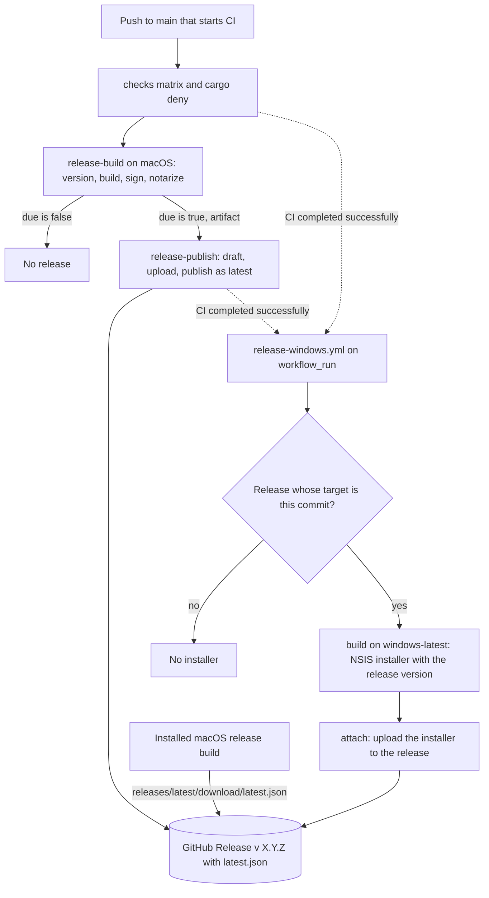
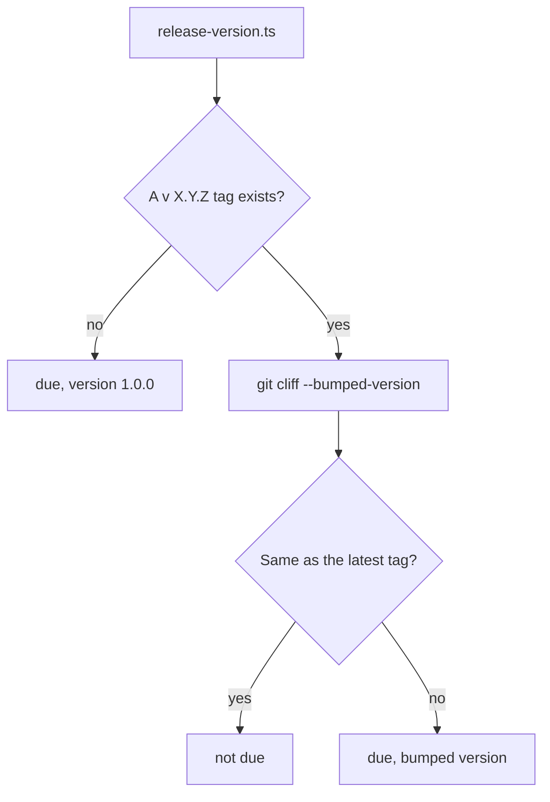

# Releases in the Source Repository - Plan

## Goal Capsule

- **Objective:** Each change to main that changes the shipped app goes out in a numbered Longhand release on the public repository's Releases page, with a macOS app that updates itself and a Windows installer. No person chooses when a minor or patch release happens. A major release happens only when the user asks for one (R11). No second repository is needed.
- **Means:** GitHub Releases in `twistymaze/longhand`, with versions computed from Conventional Commits PR titles. The CI run that tests a push to main also builds and publishes its release.
- **Product authority:** This Product Contract. It replaces the build-hosting parts of `docs/plans/2026-09-28-1240-feat-preview-builds-and-updates-plan.md` (KD1, KD2, R5, KTD1) and the README release decision in `docs/plans/2026-10-11-0917-docs-public-repository-plan.md`. Windows code signing and Windows in-app updates stay in `docs/ideas/*/windows-preview-builds-and-updates.md` and are not active scope.
- **Open blockers:** None.

---

## Product Contract

### Summary

Publish each release-worthy push to main as a GitHub Release in `twistymaze/longhand`, starting at 1.0.0. CI computes the version from the squash-merged PR titles, builds the macOS app, and creates the tag and the release only when that build succeeds. The Windows installer is built afterward and attached to the same release. "Preview", the track concept and `twistymaze/longhand-builds` go away.

### Problem Frame

Builds go to a separate public repository, `twistymaze/longhand-builds`, for one reason: the source repository was private, and a private repository's releases need a login to download (KD1 of the preview builds plan). The source repository is now public, so that reason is gone. The separate repository still costs a fine-grained token with an expiry date, a manifest file that CI commits through the contents API, and a builds page that the README cannot usefully link.

The "preview" name and the version `0.1.0-preview.<timestamp>` describe a pre-release stream before a stable track. The user now considers Longhand good enough for 1.0, and builds from main are the only releases. No separate stable track is planned.

A Windows installer comes only from a manual CI run with the `windows_installer` input. Its artifact expires after 7 days, so a Windows test always needs a new manual run.

All work on Longhand goes through AI agents, so the release rules must be ones that an agent can follow from written guidance with no manual step. Main already mostly uses Conventional Commits (487 of 776 subjects on 2026-10-11).

### Key Decisions

- **GitHub Releases in the source repository replace the builds repository.** The only reason for the builds repository was a private source. Governs R1, R15, R17, R18, R25. (session-settled: user-directed — chosen over keeping `twistymaze/longhand-builds`: it exists only because the source was private)
- **Every release-worthy push to main is a release; "preview" and the track concept go away.** No person chooses the timing of minor and patch releases. Governs R1, R21. (session-settled: user-directed — chosen over keeping the "preview" name and version with new hosting, and over GitHub pre-releases that leave room for a later stable track)
- **Versions start at 1.0.0 and follow standard Conventional Commits rules.** Best practice takes precedence over invented schemes. Governs R8, R9. (session-settled: user-directed — chosen over `0.1.<commit count>`, `1.0.<commit count>` and a patch-only scheme with minors marked by the agent. The MSI cap of 255 on the minor number does not apply, because the Windows installer is NSIS)
- **`refactor` and `build` make a release.** Longhand is an app with automatic updates, not a library. Holding back a change to the shipped code does not lower its risk; it only delays the change and ships it inside an unrelated release. Governs R9. (session-settled: user-approved — chosen over the library-oriented default that releases only for `feat`, `fix`, `perf` and `revert`)
- **Agents never make a major release on their own; an agent rule enforces it.** A major is the user's choice. The standard `!` marker in the PR title makes the major, and agents write it only at the user's request. Governs R11. (session-settled: user-directed — chosen over letting agents use `!` freely, and over tool workarounds that strip breaking markers or a PR-title pattern that rejects them)
- **Build first, then create the tag and the release.** One CI run computes the version, builds, and publishes. A failed build leaves no tag, and nothing is built twice. Governs R3, R4, R5. (session-settled: user-approved — chosen over a tag-triggered build workflow, which needs a token other than `GITHUB_TOKEN` and leaves a tag with no release when a build fails, and over release-please, whose release PR adds a commit and a second CI run for each release)
- **git-cliff computes the version and writes the release notes.** It is a single Rust binary, the version is a function of the tags and the commits only, and it does not need the branch head to stay unchanged during the 20-minute build. Governs R9, R10. (session-settled: user-approved — chosen over semantic-release, which computes the version again after the build and stops when main moved, and which is a Node tool)
- **Release notes go on the GitHub Release only; no committed `CHANGELOG.md`.** A committed changelog needs a commit back to main for each release, with a token that passes the branch protection. `git cliff` can generate the full file from the tags at any time. Governs R2, R5. (session-settled: user-approved — chosen over a `CHANGELOG.md` that CI commits)
- **Installed preview builds move to the new address through one bridge build.** Governs R18. (session-settled: user-directed — chosen over replacing each installed build by hand)
- **All releases are kept.** Governs R7. (session-settled: user-directed — chosen over keeping the 20 newest)
- **The Windows installer becomes part of each release, built with today's steps.** Only its trigger changes. Governs R19, R3. (session-settled: user-directed — chosen over also adding Windows in-app updates now, which stay in the Windows idea)
- **The release installer builds on a standard GitHub-hosted Windows runner.** A published file must not depend on the home runner, which keeps `target/` between jobs, pull-request jobs included. Standard runners are free for a public repository. Governs R19. (session-settled: user-directed — chosen over the billed `windows-8core` larger runner, which builds about twice as fast, and over the home runner)
- **The macOS build alone gates a release; the Windows installer is attached later.** The slow Windows build must not delay the macOS release and its update. Governs R2, R3, R4, R26. (session-settled: user-directed — chosen over a release that waits for both builds, about 45 minutes or more after each merge)

### Requirements

**Release publication**

- R1. Each release-type commit (R9) on main goes out in exactly one GitHub Release in `twistymaze/longhand`. That is the release of its own push or, when CI replaces or fails that push's run, the release of the next run that includes the commit. One CI run publishes at most one release, and it computes its version only after the releases of earlier runs on main are published or have failed.
- R2. A release holds the macOS DMG, the macOS updater archive and its signature, `latest.json`, and release notes generated from the commits since the previous release. The Windows NSIS installer is added to it per R26.
- R3. A release publishes only when the macOS build (signed, notarized and stapled) succeeds. When it fails, no tag and no visible release exist for that version.
- R4. The tag `v<version>` is created on the built commit only after the macOS build succeeds.
- R5. Each push to main that starts CI runs CI once. A release needs no release PR, no second CI run and no commit back to main.
- R6. A release is never published with a version that is not higher than the latest release. This covers re-runs and an older run that finishes after a newer one.
- R7. CI keeps all releases and their tags.

**Versions**

- R8. The first release is 1.0.0.
- R9. The version comes from the latest release tag and the squash-merged commits since that tag:

  | Commit type | Effect |
  |---|---|
  | `feat` | minor |
  | `fix`, `perf`, `refactor`, `revert`, `build` | patch |
  | `docs`, `ci`, `test`, `chore`, `style` | no release; the change goes out in the next release |

- R10. The app is built with the computed version. CI does not commit the version to the repository.
- R11. A major release happens only when the user tells an agent in chat to make one. The agent then writes the PR title with `!` (for example `feat!: …`), and the version computation makes a major by the standard rules. Agents never write `!` or `BREAKING CHANGE` in a PR title otherwise (R14).

**Commit rules**

- R12. The repository allows only squash merges. The squash commit title is the PR title, and the squash commit body is empty.
- R13. A required check validates each PR title as a Conventional Commit with one of the types in R9.
- R14. `CLAUDE.md` and `AGENTS.md` state the release rules for agents:
  - Choose the type by the effect on users, not by the kind of work.
  - Use `feat` only for a meaningful new feature. A small change that is not a bug fix (wording, spacing, polish) is a `fix`.
  - A dependency update is `build(deps)`. Use `fix(deps)` only when the update fixes a fault that users see.
  - `style` is formatting only. A CSS or visual change is a `feat` or a `fix`.
  - A change to build tools that does not change the shipped app is a `chore` or a `ci`.
  - Never write `!` or `BREAKING CHANGE` in a PR title unless the user asks for a major release.
  - A commit pushed directly to main (docs-only work) uses only `docs`, `chore` or `ci`.

**Updates**

- R15. The macOS updater reads `latest.json` from the latest release of `twistymaze/longhand`.
- R16. A local build still gets no updates.
- R17. Publishing uses the workflow's own `GITHUB_TOKEN`. The `BUILDS_TOKEN` secret is removed.
- R18. Before `twistymaze/longhand-builds` is archived, its manifest points to the first 1.0.x release, so that installed preview builds update to it once. After that update, no installed build reads `twistymaze/longhand-builds`.

**Windows installer**

- R19. The existing Windows NSIS installer build runs for each release, with the same build steps, on a standard GitHub-hosted Windows runner. The installer stays unsigned, and Windows stays out of `latest.json`.
- R20. The manual `windows_installer` input is removed from `ci.yml`.
- R26. When the Windows installer build for a release succeeds, the installer is attached to that release. A failed Windows build makes its workflow run fail and leaves that release without an installer.

**Credentials**

- R25. Only the publish jobs (the one that creates the tag and the release, and the one that attaches the Windows installer) can write to the repository contents. They run no build code. They get the built files from the build jobs, which can only read the repository.

**Names and docs**

- R21. "Preview" (as a build stream) and the track concept are removed from the code, the docs and `CONCEPTS.md`. The terms "release" and "update manifest" replace them.
- R22. The README links to the latest release in place of "official releases are coming soon".
- R23. `docs/preview-builds.md` is replaced by a release document. It covers the release flow, the one-time setup that still applies, the credential expiry dates and the failure cases.
- R24. The Windows idea in `docs/ideas/` describes its remaining scope (code signing and in-app updates) against releases in the source repository.

### Acceptance Examples

- AE1. **Covers R1, R9.** Given the latest release is `v1.0.3`, when a PR titled `fix: keep the recording timer visible` merges, then release `v1.0.4` is published.
- AE2. **Covers R1, R9.** Given the latest release is `v1.0.4`, when a PR titled `feat: add note templates` merges, then release `v1.1.0` is published.
- AE3. **Covers R1, R9.** When a PR titled `test: cover the folder watcher` merges, no release is published. When a `fix:` PR merges later, its release notes list only the `fix`, and its build contains both changes.
- AE4. **Covers R3, R4.** Given notarization fails for the commit that would be `v1.0.5`, then no `v1.0.5` tag and no visible `v1.0.5` release exist. The next release-worthy push computes `v1.0.5` again.
- AE5. **Covers R3, R26.** Given the macOS build succeeds and the Windows installer build fails, then the release is published with the macOS files only, and the Windows release run shows the failure. The next release has an installer again if its Windows build succeeds.
- AE6. **Covers R6.** When a successful release run is re-run, it publishes nothing and ends without an error.
- AE7. **Covers R11.** Given the latest release is `v1.4.2` and the user told the agent to make a major release, when the PR titled `feat!: change the storage format` merges, then release `v2.0.0` is published.
- AE8. **Covers R18.** Given an installed build `0.1.0-preview.20261010…`, when `v1.0.0` is published and the bridge manifest names it, the app offers the update. After the install, the app reads `latest.json` from `twistymaze/longhand`.
- AE9. **Covers R11, R12.** Given a PR branch has a commit whose body has a `BREAKING CHANGE` footer, when the PR merges with the title `feat: add note templates`, then the release is a minor, not a major.
- AE10. **Covers R1.** Given a release run for a `fix:` push is building, when two more `fix:` PRs merge, then CI replaces the waiting run of the first of them. The run of the last one publishes one release that contains both fixes.

### Success Criteria

- The first release `v1.0.0` is on the Releases page of `twistymaze/longhand` with all the files in R2 and the Windows installer, and an installed preview build updates to it.
- A docs-only push and a `test:`-only merge produce no release.
- `twistymaze/longhand-builds` is archived, and the `BUILDS_TOKEN` secret no longer exists.

### Scope Boundaries

- Windows code signing, Windows in-app updates, and Windows entries in `latest.json`.
- A separate stable or beta track, or GitHub pre-releases.
- A committed `CHANGELOG.md`.
- Immutable releases: GitHub locks the files of a published release, so the installer could not be attached later (R26).
- Minor and patch releases whose timing a person chooses.
- Changes to how the macOS app or the Windows installer is built, other than the version input, the trigger and the Windows runner.

### Dependencies / Assumptions

- Changing the merge settings (R12) and adding the required check (R13) are repository settings changes. The user approves them when planning names the exact changes. The required check must not block the direct docs-only pushes to main that `docs/development-workflow.md` allows.
- Docs-only pushes do not start CI today (`paths` in `ci.yml`). This stays, and R9 also applies when a docs commit and a code commit arrive together.
- A GitHub environment named `release`, limited to main, holds the signing secrets. It replaces the `preview` environment (KTD9).
- Standard GitHub-hosted runners are free for the public repository, so the release builds cost nothing. A cold Windows installer build on a standard runner probably takes 45 minutes or more.
- The stored agent rule "never start a Windows installer build unless asked" ends with R19. Local memory is updated after this work.

### Sources / Research

- `docs/preview-builds.md` and `docs/plans/2026-09-28-1240-feat-preview-builds-and-updates-plan.md`: the current flow, KD1 (the reason for the builds repository) and KTD1 to KTD4.
- `src-tauri/src/managers/updates.rs` (`manifest_url`) and `src-tauri/src/commands/build_info.rs` (`Track`).
- `.github/workflows/ci.yml`: the `preview` job, the `windows_installer` input and the docs `paths` filter.
- git-cliff version bumps: https://git-cliff.org/docs/configuration/bump
- semantic-release FAQ (against committing a changelog, and the branch-head check): https://semantic-release.gitbook.io/semantic-release/support/faq
- release-please (release PR model): https://github.com/googleapis/release-please
- PR-title check: https://github.com/amannn/action-semantic-pull-request
- Tauri's GitHub pipeline creates the tag at publish time: https://v2.tauri.app/distribute/pipelines/github/
- anarlog computes the version in a first job and writes it into `tauri.conf.json` before the build: `reference-source/anarlog/.github/workflows/desktop_cd.yaml`

**Product Contract preservation:** restructured, no scope change. The Summary, R26 and AE5 now say that the Windows installer comes from its own workflow run (KTD2). The Outstanding Questions are resolved in the Planning Contract (KTD1 to KTD11).

---

## Planning Contract

### Key Technical Decisions

- KTD1. **git-cliff computes the version from a committed `cliff.toml`, and a bun script wraps it.** `scripts/release-version.ts` runs `git cliff --bumped-version` and reports whether a release is due. A release is due when no release tag exists, or when the bumped version differs from the latest release tag. Release notes come from `git cliff --unreleased --tag v<version> --strip all`. The configuration:
  - `commit_parsers` group `feat`, `fix`, `perf`, `refactor`, `revert` and `build` (R9), and skip `docs`, `ci`, `test`, `chore` and `style`, so those neither bump nor appear in the notes.
  - Unconventional commits are filtered out.
  - `tag_pattern` matches only `v<major>.<minor>.<patch>`.
  - `[bump]` keeps the standard rules (`feat` gives a minor, `!` gives a major) and sets `initial_tag = "v1.0.0"`.
  CI installs a pinned git-cliff with `taiki-e/install-action`, which `ci.yml` already uses for cargo-about. Implements the git-cliff Key Decision (governs R9, R10).
- KTD2. **The macOS release stays in `ci.yml`, and the Windows installer gets its own workflow, `release-windows.yml`.** The workflow-level concurrency group `ci-${{ github.ref }}` already serializes runs on main, so version computation, build and publication in one run cannot race another run (R1, R6). Job-level concurrency cannot span several jobs, and R25 needs separate build and publish jobs. `release-windows.yml` starts on `workflow_run` when CI completes successfully for a push to main. It has its own concurrency group (`release-windows`, `cancel-in-progress: false`), so the 45-minute build never holds the `ci-main` group. When GitHub replaces a waiting Windows run with a newer one, the earlier release gets no installer. (session-settled: user-approved — chosen over a Windows job inside `ci.yml`, which would hold back the next macOS release by about 45 minutes)
- KTD3. **The build and publish jobs are separate (R25).**
  - `release-build` runs on `macos-latest` in the `release` environment, with `contents: read`. It computes the version and builds, signs, notarizes and checks the app. It uploads the DMG, the updater archive, its signature and the notes file as an artifact. Its outputs are `due` and `version`.
  - `release-publish` runs on `ubuntu-latest` with `contents: write`, no environment and no secrets. It checks out the repository, sets up bun and runs `scripts/publish-release.ts`. It runs no `bun install` and no cargo, because the script uses only Bun built-ins. It runs only when `due` is true.
  - In `release-windows.yml`, `build` (on `windows-latest`, `contents: read`) and `attach` (on `ubuntu-latest`, `contents: write`) follow the same split.
  Every action in these jobs is pinned by its full commit SHA, as in today's `preview` job.
- KTD4. **`scripts/publish-release.ts` replaces `scripts/publish-preview.ts` and keeps its injectable API and its in-memory fake.** The `publish` order:
  1. Read the latest release. A 404 means there is none.
  2. Stop with "skipped" when the version is not newer (R6).
  3. Delete a stale draft with the same tag.
  4. Create a draft: tag `v<version>`, `target_commitish` set to the built SHA (R4), name `Longhand <version>`, the notes as its body, not a pre-release.
  5. Upload the DMG, `Longhand.app.tar.gz`, its `.sig` and `latest.json`.
  6. Publish the draft as latest. The `ci-main` concurrency group (KTD2) already keeps a newer release from being published during the upload, so no second read is needed.
  `latest.json` keeps today's static Tauri format. Its archive URL points at the release's own asset. An `attach` command finds the release by tag, deletes an existing asset with the same name, and uploads the installer, so a re-run works. Pruning and the contents-API manifest write are removed (R7, R15).
- KTD5. **A compile-time release-build flag replaces the track.** CI sets `LONGHAND_RELEASE=1` for the macOS release build only. `build_info` exposes it as a boolean, and `BuildInfo.release: bool` replaces `track`. `manifest_url` becomes the constant `https://github.com/twistymaze/longhand/releases/latest/download/latest.json` (R15). The Windows release build sets `LONGHAND_BUILD_COMMIT` but not `LONGHAND_RELEASE`, so it shows its version and commit and gets no updates (R16, R19). The update flow's `has_track` becomes `is_release_build`, and `UpdateState::LocalBuild` stays.
- KTD6. **The version reaches the app through today's `--config` overlay in `$RUNNER_TEMP`.** For macOS the overlay holds `version` and `bundle.createUpdaterArtifacts: true`. For Windows it holds `version` only. Nothing is committed (R10). A plain `X.Y.Z` version also removes the pre-release concern in `docs/solutions/integration-issues/semver-prerelease-version-in-macos-bundle.md`.
- KTD7. **A composite action, `.github/actions/windows-build-setup`, holds the Windows build setup that the checks and the release installer share.** That is the Dev Drive, the Vulkan SDK, SPIRV-Headers, the Rust toolchain, rust-cache (with a `prefix-key` input), MSVC, bun with `bun install`, and the VC++ runtime lookup. Steps that must run before checkout (long paths) stay in each caller. This keeps "the same build steps" (R19) true over time. (session-settled: user-approved — chosen over a copy of the steps in the new workflow, which would drift)
- KTD8. **A separate workflow, `pr-title.yml`, checks PR titles with `amannn/action-semantic-pull-request` (pinned by SHA) on `pull_request`** (`opened`, `edited`, `synchronize`, `reopened`). The allowed types are those of R9, and scopes are optional. It uses `pull_request`, not `pull_request_target`: it needs no secrets and no write permission (`pull-requests: read`). Its job name, `PR title`, becomes a required check in ruleset 24884251. The admin bypass stays, so direct docs pushes still work (R13).
- KTD9. **The GitHub environment `release` replaces `preview`.** Its deployment branch is `main`. It holds 6 secrets: `APPLE_CERTIFICATE`, `APPLE_CERTIFICATE_PASSWORD`, `APPLE_API_KEY`, `APPLE_API_ISSUER`, `APPLE_API_PRIVATE_KEY` and `TAURI_SIGNING_PRIVATE_KEY`. The updater key has no password, so `TAURI_SIGNING_PRIVATE_KEY_PASSWORD` is not set. Secret values cannot be read back, so the user enters each one (U9). (session-settled: user-directed — chosen over keeping the name `preview`)
- KTD10. **The first release is v1.0.0 through `initial_tag`.** With no release tag, `--bumped-version` returns `initial_tag` whatever the older history holds. So the first CI run on main after the merge publishes v1.0.0, whatever the type of this PR's own title (R8).
- KTD11. **The bridge is a one-time contents write to `twistymaze/longhand-builds`, made after v1.0.0 is published.** It writes v1.0.0's `latest.json` to `preview/latest.json`. That file names the archive in `twistymaze/longhand`, and 1.0.0 is a higher semver than every `0.1.0-preview.*` build (R18). The user approves the write. Then the repository is archived.

### High-Level Technical Design

### Assumptions

- `git cliff --bumped-version` returns `initial_tag` when no tag matches `tag_pattern`, and returns the latest tag unchanged when only skipped commits follow it. The tests in U1 prove both against real repositories.
- A composite action's nested `uses:` steps keep their post steps in reverse order, so rust-cache saves before the Dev Drive dismounts. U4 checks this on a hosted run.
- `workflow_run` starts even when the triggering run used only `GITHUB_TOKEN`.

---

## Implementation Units

### U1. Release version and notes

- **Goal:** Compute whether a release is due, its version, and its notes, from the tags and the commits.
- **Requirements:** R8, R9, R10, R11, KTD1, KTD10.
- **Dependencies:** None.
- **Files:**
  - `cliff.toml` (new)
  - `scripts/release-version.ts` (new)
  - `scripts/release-version.test.ts` (new)
- **Approach:**
  1. Write `cliff.toml` per KTD1.
  2. Export pure functions that decide "due" and the version from the latest tag and git-cliff's output, so a fake git-cliff runner can test them.
  3. The CLI prints the facts as `key=value` lines for `$GITHUB_OUTPUT` (`due`, `version`) and writes the notes to a file path given as an argument.
- **Patterns to follow:** `scripts/publish-preview.ts` (pure functions plus a thin CLI under `import.meta.main`) and the test style in `scripts/publish-preview.test.ts` (plain-sentence `test(...)` names).
- **Execution note:** Write the real-repository tests first; they prove the KTD1 assumptions before the CI wiring depends on them.
- **Test scenarios:**
  - Covers AE1. A repository tagged `v1.0.3`, then one `fix:` commit, gives due with version 1.0.4.
  - Covers AE2. A repository tagged `v1.0.4`, then `feat:` and `fix:` commits, gives due with version 1.1.0.
  - Covers AE3. A repository tagged `v1.0.4`, then only `test:`, `docs:` and `ci:` commits, gives not due.
  - Covers AE3. With a `test:` commit and a later `fix:` commit after the tag, the notes list only the `fix`.
  - Covers AE7. A repository tagged `v1.4.2`, then a `feat!:` commit, gives due with version 2.0.0.
  - Covers AE9. A `feat:` commit with an empty body gives a minor. (The squash body is empty per R12, so no footer reaches main.)
  - A repository with mixed, unconventional history and no tag gives due with version 1.0.0.
  - A `build(deps):` commit and a `refactor:` commit each give a patch.
  - A tag such as `v0.1.0-preview.1` does not count as a release tag.
  - Missing git-cliff makes the CLI fail with a clear message, not a "not due" result.
- **Verification:** The script tests pass with the real git-cliff, and running the CLI on the current main prints due with version 1.0.0.

### U2. Publish and attach script

- **Goal:** Publish a release from the built files, and attach the Windows installer later.
- **Requirements:** R2, R3, R4, R6, R7, R15, R17, R26, KTD4.
- **Dependencies:** None.
- **Files:**
  - `scripts/publish-release.ts` (new)
  - `scripts/publish-release.test.ts` (new)
  - `scripts/publish-preview.ts` (delete)
  - `scripts/publish-preview.test.ts` (delete)
- **Approach:**
  1. Carry over `buildManifest`, `isNewer` and the GitHub binding style. Drop `previewVersion`, `checkCommitTime`, pruning and the contents-API manifest code.
  2. The API interface covers: latest release, release by tag, create draft, upload asset, delete asset, publish, delete release.
  3. The CLI reads `GITHUB_REPOSITORY`, `GITHUB_TOKEN` and the built SHA from the environment.
- **Patterns to follow:** `scripts/publish-preview.ts` (`BuildsApi`, `fakeRepo` in its test, `fetch` stubs for the binding tests).
- **Test scenarios:**
  - With no release yet, `publish` creates `v1.0.0` with the 4 assets, the target set to the built SHA, not a pre-release, and published as latest.
  - `latest.json` names the version, the trimmed signature and the URL `https://github.com/twistymaze/longhand/releases/download/v1.0.4/Longhand.app.tar.gz`.
  - Covers AE6. When the latest release already has the same version, `publish` returns "skipped" and creates nothing.
  - A stale draft with the same tag is deleted before the new draft is created.
  - A failed upload leaves only a draft, and the error reaches the CLI as a non-zero exit.
  - `attach` uploads the installer to the release with the matching tag.
  - `attach` replaces an existing asset of the same name (a re-run).
  - `attach` fails clearly when no release has the tag.
  - The GitHub binding treats a 404 from the latest-release endpoint as no release, and sends the API version header.
- **Verification:** The script tests pass, and no file references `publish-preview` any more.

### U3. Release build flag and update address in the app

- **Goal:** Installed macOS release builds read `latest.json` from the source repository's latest release, and other builds get no updates.
- **Requirements:** R15, R16, R21, KTD5.
- **Dependencies:** None.
- **Files:**
  - `src-tauri/src/commands/build_info.rs`
  - `src-tauri/src/managers/updates.rs`
  - `src-tauri/src/managers/updates/flow.rs`
  - `src-tauri/src/managers/updates/archive.rs` (test fixture versions)
  - `src-tauri/src/managers/settings.rs` (doc comment)
  - `src/bindings.ts` (regenerated)
  - `src/update/UpdateWindow.tsx`
  - `src/update/UpdateWindow.test.tsx`
  - `src/settings/About.test.tsx`
- **Approach:**
  1. Replace `Track` and `parse_track` with a parser for `LONGHAND_RELEASE` that is true only for `1`.
  2. Point `manifest_url` at the constant in KTD5, and remove the track parameter from `check` and its callers.
  3. Rename `has_track` and update the doc comments that say "track" or "preview".
  4. Change the `local_build` text in `UpdateWindow.tsx` to name the release, for example "Local builds do not update. To get updates, install the latest release."
  5. Regenerate the bindings through the existing `export_bindings` test.
- **Patterns to follow:** The existing tests in `build_info.rs` and `flow.rs`.
- **Test scenarios:**
  - `LONGHAND_RELEASE` unset, empty or `0` gives a build that is not a release build. `1` gives a release build.
  - The manifest URL is the source repository's `releases/latest/download/latest.json`.
  - A build that is not a release build makes no automatic check and says so at a manual check (the renamed `flow.rs` test).
  - The update window's local-build text names the latest release and no longer says "preview".
  - About shows `Version 1.0.4 (abc1234)` when a commit is set, and "local build" when it is not.
- **Verification:** The Rust tests for the touched crate and `bun run test` pass, `src/bindings.ts` has no `Track` type, and a grep for "preview" in `src-tauri/src` and `src/update` finds no build-stream use.

### U4. Shared Windows build setup

- **Goal:** One definition of the Windows build setup serves the checks and the release installer, and the manual installer input is gone.
- **Requirements:** R19, R20, KTD7.
- **Dependencies:** None.
- **Files:**
  - `.github/actions/windows-build-setup/action.yml` (new)
  - `.github/workflows/ci.yml`
- **Approach:**
  1. Move the Windows-only setup steps of the `checks` job (Dev Drive to the VC++ runtime lookup) into the composite action. Keep their `runner.environment` conditions, so the self-hosted runner still skips the hosted-only steps.
  2. The checks job calls the action in its Windows leg, and keeps its macOS steps and its order of tests.
  3. Remove the `windows_installer` input and the two release-installer steps.
  4. Keep the required check names `Checks (macos-latest)`, `Checks (windows-latest)` and `cargo deny` unchanged.
- **Execution note:** This is CI configuration. Prove it with a PR run on the self-hosted runners and one `hosted=true` dispatch on the branch, not with unit tests.
- **Patterns to follow:** The existing step comments in `ci.yml`. Keep the explanations with the steps they explain.
- **Test expectation:** none -- CI configuration. The PR's own checks and the hosted dispatch are the proof.
- **Verification:** `actionlint` passes. The PR's Windows check passes on the self-hosted runner. A `hosted=true` run on the branch passes on `windows-8core`, and its rust-cache post step saves the cache.

### U5. Release jobs in `ci.yml`

- **Goal:** A push to main that is due builds the signed macOS app and publishes the release.
- **Requirements:** R1, R3, R4, R5, R6, R10, R17, R25, KTD2, KTD3, KTD6, KTD9.
- **Dependencies:** U1, U2, U3.
- **Files:**
  - `.github/workflows/ci.yml`
  - `.github/workflows/PROVENANCE.md`
- **Approach:**
  1. Replace the `preview` job with `release-build` (KTD3): checkout with `fetch-depth: 0`, install git-cliff, run `release-version.ts`, and skip the build steps when it is not due.
  2. Keep today's certificate import, notarization key, Tauri build, DMG notarization, signature checks and cleanup steps. Give the build `LONGHAND_RELEASE: "1"` in place of `LONGHAND_TRACK: preview`, and the overlay from KTD6. Use the rust-cache prefix key `v1-release`.
  3. Upload the DMG, the archive, the signature and the notes file as one artifact.
  4. Add `release-publish` (KTD3). It downloads the artifact and runs `publish-release.ts publish`.
  5. In the `checks` macOS leg, install git-cliff and run `scripts/release-version.test.ts` and `scripts/publish-release.test.ts` in place of the publish-preview tests.
  6. Update the header comment ("billed while the repository is private") and the `PROVENANCE.md` line that names the `preview` job.
- **Patterns to follow:** Today's `preview` job (SHA pins, one secret per step, `$RUNNER_TEMP` paths written in a step, never in job-level `env`; see `docs/solutions/workflow-issues/actions-context-not-available-fails-before-jobs.md`).
- **Test expectation:** none -- CI configuration. The scripts it calls are tested in U1 and U2, and the first run on main is the proof (Verification Contract).
- **Verification:** `actionlint` passes. No job other than `release-publish` has `contents: write`, and no job reads `BUILDS_TOKEN` or the `preview` environment.

### U6. Windows release workflow

- **Goal:** Each release gets the unsigned Windows installer from a clean hosted runner, without delaying the next macOS release.
- **Requirements:** R19, R25, R26, KTD2, KTD3, KTD6, KTD7.
- **Dependencies:** U2, U4, U5.
- **Files:**
  - `.github/workflows/release-windows.yml` (new)
- **Approach:**
  1. Trigger on `workflow_run` of CI with `types: [completed]` and `branches: [main]`. Run only when the run's event is `push` and its conclusion is `success`. Also trigger on `workflow_dispatch` with a required `tag` input, so that a release's installer can be built again after a fix to this workflow.
  2. A first step finds the release: by `tag` for a dispatch, otherwise the release whose `target_commitish` is the run's `head_sha`. Its `target_commitish` is the commit to build. With no release, the workflow ends without an error.
  3. `build` checks out that commit and calls the composite action with the rust-cache prefix key `v1-release-windows`. It builds `bun tauri build --bundles nsis` with the version overlay, and sets `LONGHAND_BUILD_COMMIT` to that same commit, never to `github.sha` (in a `workflow_run` run, `github.sha` is the newest commit on main). It uploads the installer as an artifact.
  4. `attach` downloads the artifact and runs `publish-release.ts attach`.
  5. Concurrency group `release-windows`, with `cancel-in-progress: false`. All actions are pinned by SHA.
- **Patterns to follow:** The checks job's Windows steps (through U4) and the publish split in U5.
- **Test expectation:** none -- CI configuration. The `attach` logic is tested in U2, and the first release run is the proof.
- **Verification:** `actionlint` passes. After the first release, the workflow attaches `Longhand_1.0.0_x64-setup.exe` (or the name Tauri gives it), and the installed app's About shows 1.0.0 with the commit.

### U7. PR-title check and agent rules

- **Goal:** Every PR title is a valid release instruction, and agents know the rules.
- **Requirements:** R11, R12, R13, R14, KTD8.
- **Dependencies:** None.
- **Files:**
  - `.github/workflows/pr-title.yml` (new)
  - `CLAUDE.md` (`AGENTS.md` is a symlink to it)
- **Approach:**
  1. Add the workflow per KTD8, with the R9 types.
  2. Add a "Commits and releases" bullet group to `CLAUDE.md` with the R14 rules. Point to `docs/releases.md` for the version table.
- **Test expectation:** none -- CI configuration and agent guidance. This PR's own title run proves the check.
- **Verification:** The check passes on this PR's title and fails on a test title such as `update stuff` (an edit made and reverted on the PR).

### U8. Docs and terms

- **Goal:** The docs describe releases, not preview builds, and give the user exact setup steps.
- **Requirements:** R21, R22, R23, R24.
- **Dependencies:** U5, U6, U7.
- **Files:**
  - `docs/releases.md` (new)
  - `docs/preview-builds.md` (delete)
  - `docs/development-workflow.md`
  - `CONCEPTS.md`
  - `README.md`
  - `docs/ideas/someday/windows-preview-builds-and-updates.md`
  - `docs/ideas/someday/home-signing-runner.md`
  - `docs/ideas/someday/signing-runner-on-mac-mini.md`
- **Approach:**
  1. `docs/releases.md` covers:
     - the release flow and the version table (R9);
     - the environment and secrets setup, step by step (U9 step 1);
     - the credential expiry table, without `BUILDS_TOKEN`;
     - installing the first build from the release DMG;
     - the failure cases: no release due, a failed build and how a fix PR publishes it, "skipped" on a re-run, and a missing Windows installer (`gh workflow run release-windows.yml -f tag=v<version> -R twistymaze/longhand`);
     - the lost or leaked updater key steps.
  2. In `docs/development-workflow.md`:
     - The Windows manual test downloads the installer from the latest release, or from a release run, in place of `-f windows_installer=true`.
     - The local-build text says "release", not "track".
     - Remove the billing remark.
  3. In `CONCEPTS.md`, replace "Track" and "Preview build" with "Release", and revise "Update manifest".
  4. Change the README's "coming soon" line to a link to the latest release, and keep build-from-source.
  5. Update the ideas that name the preview job or the builds repository. Rename an idea's slug only through `bun scripts/ideas.ts`.
- **Test expectation:** none -- documentation. `bun scripts/ideas.ts check` and `scripts/check-provenance.sh` still pass.
- **Verification:** A grep for `longhand-builds`, `BUILDS_TOKEN`, `windows_installer` and `preview build` finds only historical plans, solutions, done ideas and dated references.

### U9. Rollout

- **Goal:** The first release goes out, installed preview builds move to it, and the old setup is removed.
- **Requirements:** R12, R13, R17, R18, KTD9, KTD11.
- **Dependencies:** U1 to U8.
- **Files:** None. These are repository settings and one-time actions. Each needs the user's approval or the user's own hands.
- **Approach:**
  1. **Before the merge, the agent creates the `release` environment** (deployment branch `main`) after the user approves. **Then the user enters the 6 secrets.** Each `gh secret set` command asks for the value, or reads it from a file, so no value goes into the shell history or the chat:
     1. Check the App Store Connect values in your shell. Run `test -n "$APPLE_API_KEY" && test -n "$APPLE_API_ISSUER" && test -f "$APPLE_API_KEY_PATH" && echo ok`. If it does not print `ok`, find the values first: the key ID is the part after `AuthKey_` in the `.p8` file name in `~/.appstoreconnect/private_keys`, the Issuer ID is at the top of App Store Connect → Users and Access → Integrations → Team Keys, and in steps 4 to 6 you paste them at the prompt or use the file path in place of the variable.
     2. Developer ID certificate. In Keychain Access, open the login keychain and the My Certificates tab. Right-click "Developer ID Application: Ervin Walter (7GLQLN8HXK)", choose Export, select "Personal Information Exchange (.p12)", save it as `~/Desktop/DeveloperID.p12`, and set a new password. Then run `base64 -i ~/Desktop/DeveloperID.p12 | gh secret set APPLE_CERTIFICATE --env release -R twistymaze/longhand`.
     3. Certificate password. Run `gh secret set APPLE_CERTIFICATE_PASSWORD --env release -R twistymaze/longhand` and paste the password from step 1.
     4. API key ID. Run `printf %s "$APPLE_API_KEY" | gh secret set APPLE_API_KEY --env release -R twistymaze/longhand`.
     5. Issuer ID. Run `printf %s "$APPLE_API_ISSUER" | gh secret set APPLE_API_ISSUER --env release -R twistymaze/longhand`.
     6. API private key. Run `gh secret set APPLE_API_PRIVATE_KEY --env release -R twistymaze/longhand < "$APPLE_API_KEY_PATH"`.
     7. Updater key. Run `gh secret set TAURI_SIGNING_PRIVATE_KEY --env release -R twistymaze/longhand < ~/.tauri/longhand-updater.key`. If the file is gone, run the command without `< …` and paste the key from the password manager.
     8. Delete `~/Desktop/DeveloperID.p12`. Run `gh secret list --env release -R twistymaze/longhand` and check that it lists the 6 names.
  2. **Before the merge, the agent changes the repository settings** after the user approves:
     - Squash merge only, with the PR title as the commit title and an empty body (R12).
     - Add `PR title` to the required checks of ruleset 24884251 (R13).
  3. Merge the PR with a `feat:` title. The first CI run on main publishes v1.0.0 (KTD10), and `release-windows.yml` attaches the installer.
  4. Check that v1.0.0 has every file in R2, and that `release-windows.yml` attached the installer.
  5. **The agent writes the bridge manifest** (KTD11) after the user approves. Each installed preview build then offers v1.0.0. The user installs it, and its About shows 1.0.0.
  6. After the user's installs show 1.0.0, **the agent archives `twistymaze/longhand-builds`**, and deletes the `preview` environment (with `BUILDS_TOKEN`) after the user approves.
  7. Update local agent memory: remove the "no Windows installer unless asked" rule, and note the release flow.
- **Test expectation:** none -- operational steps. The Verification Contract's post-merge checks are the proof.
- **Verification:** All Success Criteria hold.

---

## Verification Contract

| When | Check | Proves |
|---|---|---|
| U1, U2 | `bun test scripts/release-version.test.ts scripts/publish-release.test.ts` (git-cliff installed with `brew install git-cliff`) | Version, notes, publish and attach logic |
| U3 | The touched crate's Rust tests (they regenerate `src/bindings.ts`); commit the regenerated file, then run the tests again and check that `git diff --exit-code src/bindings.ts` is clean | Release flag, update address, bindings |
| U3 | `bun run test` (runs `bun test ./src`; never bare `bun test`) | Update window and About text |
| U4 to U7 | `actionlint .github/workflows/*.yml` | Workflow syntax and context use |
| Before each push | `cargo fmt --all --check` | CI rustfmt passes |
| End of work | One full workspace `cargo test`, `cargo clippy`, `bun scripts/ideas.ts check`, `scripts/check-provenance.sh` | Nothing else broke |
| PR | The PR's checks on the self-hosted runners and one `gh workflow run ci.yml --ref <branch> -f hosted=true` | U4's shared setup works on both runner kinds |
| After the merge | The CI run on main logs a publish of 1.0.0; the release has the DMG, the archive, the signature and `latest.json`; `release-windows.yml` attaches the installer | R1 to R4, R26, Success Criteria |
| After the merge | A following `test:`-only merge makes no release, and a re-run of the release run logs "skipped" | AE3, AE6 |
| After the bridge | An installed preview build offers 1.0.0, installs it, and then reads `latest.json` from `twistymaze/longhand` | AE8, R18 |

---

## Definition of Done

- U1 to U8 are merged in one PR whose checks pass, including `PR title`.
- U9 is complete: v1.0.0 has every file in R2 and the Windows installer, an installed build updated to it, `twistymaze/longhand-builds` is archived, and the `preview` environment and `BUILDS_TOKEN` no longer exist.
- No code, workflow or current doc refers to the track, the builds repository, `BUILDS_TOKEN` or `windows_installer`, except historical plans, solutions, done ideas and dated references.
- Code from abandoned attempts is removed from the diff.

---

## Risks

- **The release workflow runs for real only on main.** A fault in `release-build`, `release-publish` or `release-windows.yml` shows only after the merge. Mitigation: the scripts are tested with fakes and real git-cliff, `actionlint` runs, and a failed run publishes nothing (R3). A fix is a normal `ci:` or `fix:` PR. Its run on main computes the version from all commits since the latest release tag, so it publishes the stranded release. A re-run of the failed run helps only for a fault that needs no code change (for example a notarization outage), because a re-run uses the original commit's workflow and scripts. For a missing Windows installer, run `release-windows.yml` by hand with the release's tag (U6).
- **The composite action changes the required Windows check.** Mitigation: U4 runs on both runner kinds before the merge.
- **A replaced Windows run leaves a release without an installer** (KTD2). This is accepted, and the next release has one.
- **Secret entry errors.** A wrong secret makes `release-build` fail at the certificate import or notarization, and nothing publishes. Mitigation: the `gh secret list` check in U9, and the failure cases in `docs/releases.md`.

---

## Scope Boundaries (planning)

### Considered and not built

- A check that `CFBundleShortVersionString` equals the computed version, as anarlog does. The `--config` overlay sets both fields, and the notarized build's About shows the version, so a fault is visible at once.
- A manual workflow input that forces a release. The next CI run on main publishes a stranded release-type commit, and a re-run covers a fault that needs no code change.
- Code-owner approval for the release workflows and scripts. Nobody reviews Longhand PRs, and anyone who can merge to main already controls the signing keys today. The user accepted this.
- A check that rejects a `v<major>.<minor>.<patch>` tag with no published release. Only the publish step creates release tags, and a draft creates no tag. Add the check if a stray tag ever appears.
- A queue for more than one pending run on main. When GitHub replaces a waiting run, its commits go out in the next release (R1).

### Deferred to Follow-Up Work

- Windows code signing and Windows in-app updates (`docs/ideas/someday/windows-preview-builds-and-updates.md`).
