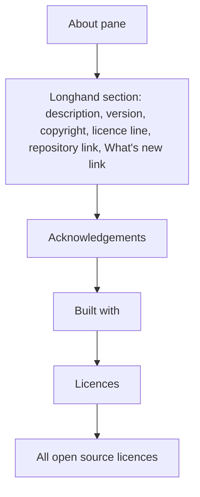

# About Longhand - Plan

## Goal Capsule

- **Objective:** A person who opens Settings → About can see what Longhand is, who made it, its licence, and where its source is. A person who opens the app menu's "About Longhand" panel can see what Longhand is, who made it, and where its source is.
- **Product authority:** This Product Contract. The idea file is `docs/ideas/next/about-longhand-and-readme.md`.
- **Open blockers:** None.

---

## Product Contract

### Summary

Settings → About gets a new first section about Longhand: a description, the version, the copyright, the licence, and links to the repository and the release notes. The app menu's "About Longhand" item stays the standard macOS About panel, and it gets a short form of the same data.

### Problem Frame

The About pane tells only about the projects that Longhand uses: acknowledgements, engines, and licences. It shows the version, but it does not say what Longhand is, who made it, or where its source is. The macOS About panel shows only the icon, the name, and the version. The repository is now public, with a README and an MIT LICENSE, but the app does not point to them.

### Requirements

**Settings → About: the Longhand section**

- R1. The Longhand section is the first section of the About pane, above the acknowledgements, "Built with", and licences, which do not change.
- R2. The section shows the two opening paragraphs of `README.md`: what Longhand does, and the privacy statement. The text is the same as the README text.
- R3. The section shows the version and commit in the current format (`versionText`: "Version 0.x.y (abc1234)", or "local build").
- R4. The section shows the copyright line "Copyright © 2026 Erv Walter", the same text as `LICENSE`.
- R5. The section says that Longhand is open source under the MIT licence. The licence name is a link that opens `LICENSE` in the repository.
- R6. The section has a link to the repository, `https://github.com/twistymaze/longhand`.
- R7. The section has a "What's new" link to the repository's releases page.
- R8. Each link opens in the default browser, the same as the other links in the pane.

**App menu: the macOS About panel**

- R9. The menu item "About Longhand" stays the standard macOS About panel. It does not open Settings and it is not a custom window.
- R10. The panel shows the version and commit, in the same format as R3.
- R11. The panel shows a one-line description of Longhand, from the first README paragraph.
- R12. The panel shows the copyright line from R4.
- R13. The panel shows the repository address as plain text.

### Key Decisions

- **The menu item keeps the standard macOS panel.** It looks like the About window of other Mac apps and needs no new window. Governs R9–R13. (session-settled: user-directed — chosen over a small custom window and over opening Settings → About: the user wanted more than today but not the full pane, without a new window to maintain.)
- **The author is a copyright line.** It agrees with `LICENSE`, and the macOS panel has a slot for it. Governs R4, R12. (session-settled: user-directed — chosen over a name only and over a name with a personal site.)
- **The pane uses the README's two opening paragraphs.** The privacy statement is what makes Longhand different. Governs R2. (session-settled: user-directed — chosen over the first paragraph only and over one line.)
- **The panel's repository address is plain text.** The menu library puts extra panel text in the credits area as plain text, and its website field works only on Windows and Linux. The clickable link is in the pane. Governs R13. (session-settled: user-directed — chosen over no address and over direct macOS code for a clickable link.)
- **Longhand's own licence line and a release notes link go in the pane.** The pane showed every component's licence but not Longhand's. Governs R5, R7. (session-settled: user-directed — chosen from a list that also offered a copy-version button and a link to the README's privacy section, which the user did not choose.)
- **There is no "report a problem" link.** GitHub issues are limited to collaborators, so most people could not use it. (session-settled: user-directed — chosen over an issues link and an email link.)
- **The panel gets neither the licence line nor the release notes link.** Its extra text cannot hold links, and it stays short.
- **The copyright year stays 2026.** It agrees with `LICENSE` and does not change each year.

### Layout

The section uses the pane's current grouped-row design. The exact design gets an `apple-design` pass during the work.

### Scope Boundaries

- Windows has no app menu, so Windows shows only the Settings pane (R1–R8).
- The pane's description is a copy of the README text, without automatic sync. A README change needs a manual update of the pane (R2) and the panel (R11).
- No "Check for updates" control in About. It stays in the Status pane.
- No copy-version button and no link to the README's privacy section.
- No change to the acknowledgements, "Built with", the licence rows, or the full licence window.

### Outstanding Questions

**Deferred to Planning**

- The exact wording of the one-line panel description (R11), from the first README paragraph.
- The exact releases page address for R7 (`https://github.com/twistymaze/longhand/releases` is expected).
- How the panel version (R10) gets the commit: the panel's version slots, or the same build information that the pane uses.

### Sources / Research

- `src/settings/About.tsx`: `BuildVersion`, `versionText`, and the link pattern with `openUrl`.
- `src-tauri/src/menu.rs`: `PredefinedMenuItem::about(app, …, None)` sets no metadata today.
- muda `AboutMetadata` (in `Cargo.lock`, muda 0.19.3): on macOS the panel uses the version, short version, copyright, and credits. The credits text is plain text.
- `src-tauri/capabilities/settings.json` already allows `https://*` links.
- `README.md`, `LICENSE`, `STRATEGY.md`.
