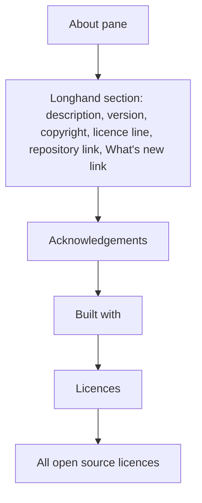

# About Longhand - Plan

## Goal Capsule

- **Objective:** A person who opens Settings → About can see what Longhand is, who made it, its licence, and where its source is. A person who opens the app menu's "About Longhand" panel can see what Longhand is, who made it, and where its source is.
- **Product authority:** This Product Contract. The idea file is `docs/ideas/next/about-longhand-and-readme.md`.
- **Open blockers:** None.

---

## Product Contract

### Summary

Settings → About gets a new first section about Longhand: a description, the version, the copyright, the licence, and links to the repository and the release notes. The app menu's "About Longhand" item stays the standard macOS About panel, and it gets a short form of the same data.

### Problem Frame

The About pane tells only about the projects that Longhand uses: acknowledgements, engines, and licences. It shows the version, but it does not say what Longhand is, who made it, or where its source is. The macOS About panel shows only the icon, the name, and the version. The repository is now public, with a README and an MIT LICENSE, but the app does not point to them.

### Requirements

**Settings → About: the Longhand section**

- R1. The Longhand section is the first section of the About pane, above the acknowledgements, "Built with", and licences, which do not change.
- R2. The section shows the two opening paragraphs of `README.md`: what Longhand does, and the privacy statement. The text is the same as the README text.
- R3. The section shows the version and commit in the current format (`versionText`: "Version 0.x.y (abc1234)", or "local build").
- R4. The section shows the copyright line "Copyright © 2026 Erv Walter", the same text as `LICENSE`.
- R5. The section says that Longhand is open source under the MIT licence. The licence name is a link that opens `LICENSE` in the repository.
- R6. The section has a link to the repository, `https://github.com/twistymaze/longhand`.
- R7. The section has a "What's new" link to the repository's releases page.
- R8. Each link opens in the default browser, the same as the other links in the pane.

**App menu: the macOS About panel**

- R9. The menu item "About Longhand" stays the standard macOS About panel. It does not open Settings and it is not a custom window.
- R10. The panel shows the version and commit, in the same format as R3.
- R11. The panel shows a one-line description of Longhand, from the first README paragraph.
- R12. The panel shows the copyright line from R4.
- R13. The panel shows the repository address as plain text.

### Key Decisions

- **The menu item keeps the standard macOS panel.** It looks like the About window of other Mac apps and needs no new window. Governs R9–R13. (session-settled: user-directed — chosen over a small custom window and over opening Settings → About: the user wanted more than today but not the full pane, without a new window to maintain.)
- **The author is a copyright line.** It agrees with `LICENSE`, and the macOS panel has a slot for it. Governs R4, R12. (session-settled: user-directed — chosen over a name only and over a name with a personal site.)
- **The pane uses the README's two opening paragraphs.** The privacy statement is what makes Longhand different. Governs R2. (session-settled: user-directed — chosen over the first paragraph only and over one line.)
- **The panel's repository address is plain text.** The menu library puts extra panel text in the credits area as plain text, and its website field works only on Windows and Linux. The clickable link is in the pane. Governs R13. (session-settled: user-directed — chosen over no address and over direct macOS code for a clickable link.)
- **Longhand's own licence line and a release notes link go in the pane.** The pane showed every component's licence but not Longhand's. Governs R5, R7. (session-settled: user-directed — chosen from a list that also offered a copy-version button and a link to the README's privacy section, which the user did not choose.)
- **There is no "report a problem" link.** GitHub issues are limited to collaborators, so most people could not use it. (session-settled: user-directed — chosen over an issues link and an email link.)
- **The panel gets neither the licence line nor the release notes link.** Its extra text cannot hold links, and it stays short.
- **The copyright year stays 2026.** It agrees with `LICENSE` and does not change each year.

### Layout

The section uses the pane's current grouped-row design. The exact design gets an `apple-design` pass during the work.

### Scope Boundaries

- Windows has no app menu, so Windows shows only the Settings pane (R1–R8).
- The pane's description is a copy of the README text, without automatic sync. A README change needs a manual update of the pane (R2) and the panel (R11).
- No "Check for updates" control in About. It stays in the Status pane.
- No copy-version button and no link to the README's privacy section.
- No change to the acknowledgements, "Built with", the licence rows, or the full licence window.

### Sources / Research

- `src/settings/About.tsx`: `BuildVersion`, `versionText`, and the link pattern with `openUrl`.
- `src-tauri/src/menu.rs`: `PredefinedMenuItem::about(app, …, None)` sets no metadata today.
- muda `AboutMetadata` (in `Cargo.lock`, muda 0.19.3): on macOS the panel uses the version, short version, copyright, and credits. The credits text is plain text.
- `src-tauri/capabilities/settings.json` already allows `https://*` links.
- `README.md`, `LICENSE`, `STRATEGY.md`.

---

## Planning Contract

Product Contract preservation: Product Contract unchanged. Planning answered its three deferred questions in KTD2, KTD3 and KTD4, and the Outstanding Questions section is removed.

### Key Technical Decisions

- KTD1. **The pane keeps its texts and addresses as constants in the pane code.** The README paragraphs, the copyright line and the three addresses (repository, `LICENSE`, releases) are constants next to `About`. The macOS panel keeps its own short texts in `src-tauri/src/menu.rs`. A shared Rust command for two short texts adds an IPC call and a type for no user value. Governs R2, R4–R7, R11–R13.
- KTD2. **The panel's version slots carry the version and the commit.** AppKit shows "Version {application version} ({version})". Set `version` to the app version and `short_version` to the short commit, or to "local build" when there is no commit. Then the panel reads like the pane's `versionText`. Read the commit with the same logic as `build_info` (`src-tauri/src/commands/build_info.rs`), not a second copy of it. Governs R10.
- KTD3. **The panel's credits text is the one-line description, an empty line, and the repository address.** The description is "Longhand is a note-taking app for meetings and conversations.", the first sentence of the README. The address is `github.com/twistymaze/longhand`. Governs R11, R13.
- KTD4. **"What's new" opens `https://github.com/twistymaze/longhand/releases`.** Releases are published in the source repository (`docs/releases.md`). Governs R7.
- KTD5. **The new links use the pane's current link pattern.** Each one is a button that calls `openUrl` and has the same "(opens in your browser)" text for screen readers as `ProjectLink`. Governs R8.

### Risks

- The panel's credits text has no text colour (the menu library makes it from a plain string). In dark mode, AppKit may draw it dark on a dark panel. U2's manual test checks this. If the text cannot be read, stop and take the decision back to the user, because a fix needs the direct macOS code that the user rejected (R13 Key Decision).

---

## Implementation Units

### U1. Longhand section in Settings → About

**Goal:** The About pane starts with a section about Longhand.

**Requirements:** R1–R8; KTD1, KTD4, KTD5.

**Dependencies:** None.

**Files:**
- Modify: `src/settings/About.tsx`
- Test: `src/settings/About.test.tsx`

**Approach:**
1. Extend the first group, which `BuildVersion` makes now, into the Longhand section. Put the README paragraphs, then the version row, then the copyright and licence line, then the two links. Do the exact layout in the `apple-design` pass that `CLAUDE.md` requires.
2. Keep the version row and `versionText` as they are (R3).
3. Add the licence line with "MIT licence" as a link (R5), the repository link (R6) and the "What's new" link (R7). Each one follows KTD5.
4. Keep every later group unchanged (R1).

**Patterns to follow:** `ProjectLink` and `AcknowledgementRow` in `src/settings/About.tsx`; `Group` and `Row` in `src/settings/ui.tsx`; the plain-language UI text rules in `CLAUDE.md`.

**Test scenarios:**
- The pane shows both README paragraphs, word for word, above the Acknowledgements group.
- The pane shows "Copyright © 2026 Erv Walter".
- The pane says that Longhand is open source under the MIT licence. A click on the licence link opens `https://github.com/twistymaze/longhand/blob/main/LICENSE` through the opener.
- A click on the repository link opens `https://github.com/twistymaze/longhand`.
- A click on "What's new" opens `https://github.com/twistymaze/longhand/releases`.
- Each new link has the "(opens in your browser)" text for screen readers.
- The existing version-row tests still pass: "Version 1.0.4 (abc1234)", "local build", and the row before the Acknowledgements.
- The existing test that every address the pane can open is https gets the three new addresses. Export their constants from `About.tsx` and add them to the test's `expected` set, so that the test fails if one of them is not https.

**Verification:** The pane shows the Longhand section first and every link opens the correct page. The tests in `src/settings/About.test.tsx` pass.

### U2. Metadata for the macOS About panel

**Goal:** "About Longhand" in the app menu shows the version and commit, a one-line description, the copyright and the repository address.

**Requirements:** R9–R13; KTD2, KTD3.

**Dependencies:** None.

**Files:**
- Modify: `src-tauri/src/menu.rs`
- Modify: `src-tauri/src/commands/build_info.rs` (only to make the short-commit logic available to the menu)

**Approach:**
1. Make a small function in `menu.rs` that builds the panel metadata from the app version and the optional commit. It gives `version`, `short_version` (KTD2), `copyright` (R12) and `credits` (KTD3). Pass that metadata to `PredefinedMenuItem::about` in place of `None`.
2. Get the commit through the `build_info` logic (KTD2). Make the existing `short_commit` `pub(crate)` and add no wrapper. `build_info` calls `short_commit` on all platforms, so the Windows build has no unused item.
3. Keep the menu item text "About Longhand" and the standard panel (R9).

**Patterns to follow:** The unit tests in `src-tauri/src/commands/build_info.rs`.

**Test scenarios:**
- With version `1.0.4` and commit `abc1234`, the metadata has version `1.0.4` and short version `abc1234`.
- With no commit, the short version is "local build".
- The copyright is "Copyright © 2026 Erv Walter".
- The credits text is the one-line description, an empty line, and `github.com/twistymaze/longhand`.

**Verification:** The unit tests pass on macOS. In a signed build, the panel shows "Version x.y.z (commit)", the description, the address and the copyright, and you can read the credits text in light and in dark mode (see Risks).

---

## Verification Contract

| Check | Command | Applies to |
|---|---|---|
| Frontend tests | `bun test ./src/` | U1 |
| Type check | `bun run typecheck` | U1 |
| Rust tests | `cargo test -p longhand` | U2 |
| Rust format | `cargo fmt --all --check` | U2 |
| Clippy | `cargo clippy --workspace --all-targets -- -D warnings` | U2 |
| Windows build | Windows CI test job | U2. `menu.rs` is macOS only, and `scripts/check-windows.sh` excludes the `longhand` crate, so only the Windows CI job compiles the U2 change for Windows. |
| Manual test | Signed build (`bun tauri build --bundles app`), see [Manual tests](../development-workflow.md#manual-tests) | U1, U2 |

Manual test steps in the signed build:
1. Open Settings → About. The Longhand section is first. Each link opens the correct page in the browser.
2. In the app menu, select "About Longhand". The panel shows the version and commit, the description, the address and the copyright.
3. Switch macOS to dark mode and open the panel again. The credits text is readable.

---

## Definition of Done

- R1–R13 are true in a signed build.
- The tests in U1 and U2 pass, and every check in the Verification Contract passes.
- The manual test passes, including dark mode. If the credits text is not readable in dark mode, the work stops and the user decides (see Risks).
- The diff has no code from abandoned attempts.
- The idea file `docs/ideas/next/about-longhand-and-readme.md` moves to `done/` after the PR merges.
