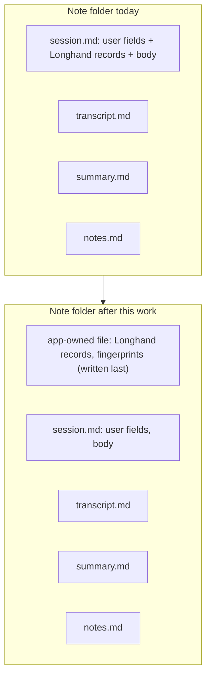

# Safe Agent Edits - Plan

## Goal Capsule

- **Objective:** A user who works with an AI agent can ask it to read and change their Longhand notes and shared settings. Each permitted edit is safe on every computer that shares the storage folder, and the agent gets Longhand's rules with one install step.
- **Product authority:** This Product Contract and the Key Decisions in it. The idea file is `docs/ideas/next/agent-safe-note-edits.md`.
- **Open blockers:** None.

---

## Product Contract

### Summary

Longhand's own records for each note move into one app-owned file. All `.md` files in the storage folder then belong to the user, and an agent can edit them without breaking a run. The shared settings keep their current files and gain every setting that does not belong to one computer. Longhand accepts and repairs outside edits to them. The agent skill becomes a plugin marketplace in the Longhand repository. Longhand can also write a short managed block into `AGENTS.md` and `CLAUDE.md` in the storage folder.

### Problem Frame

The storage folder is plain files so that agents can do complex work outside the app (`STRATEGY.md`). Reads are safe today. Some edits that look safe cause problems:

- **A title fix or a different YAML style stops a run.** Transcribe Again, Regenerate Summary and Resume compare a fingerprint of the whole `session.md`, body included, with only the tags and the pending type removed. Then the run refuses to save.
- **A bad edit hides a note.** A note whose `session.md` does not parse drops out of the note list, and Longhand shows no message.
- **Prompt edits lose identity.** A copied prompt file keeps the id of its original and becomes a conflict copy. A file with no id gets an id from its file name, so a rename breaks the settings that point to it.
- **The skill is hard to install and keep current.** The user's hand-made skill in the storage folder uses a `.claude/skills -> ../.agents/skills` symlink. Resilio, OneDrive and Dropbox on Windows do not sync symlinks. Peers have no way to install the skill.

The user tested the hand-made skill from 2026-10-09: mostly reads, plus a prompt change and tags on old notes.

### Key Decisions

- **All three parts are one piece of work: the note layout, the shared settings edits, and the skill distribution.** The skill can promise only what the app makes safe. (session-settled: user-directed — chosen over a separate brainstorm for each part: the user wanted one design.)
- **Longhand's own records move into a separate app-owned file in each note folder.** Every `.md` file is then the user's, and an agent needs one simple rule. Governs R1, R2, R3, R4. (session-settled: user-directed — chosen over field ownership inside `session.md`, which was the recommendation: a separate file gives agents a boundary that is clear and safe.)
- **Existing notes change to the new layout in a one-time conversion that the user starts.** One layout in the code is simpler, and nobody else has notes yet. A conversion that the user starts lets the user update every computer first. Governs R10, R11, R12, R13. (session-settled: user-directed — chosen over a conversion at each note's next write: one layout soon, at the cost of one bulk write.)
- **No permanent conversion control.** The control shows only for a storage folder that has notes in the old layout, because most users never have old notes. Governs R11. (session-settled: user-directed — chosen over a visible conversion step for all users.)
- **The shared settings keep their current files.** The gaps are in how Longhand reacts to outside edits, not in the layout. Governs R16. (session-settled: user-directed — chosen over files for each item and over a full redesign with a format that permits comments.)
- **Every setting that does not belong to one computer is shared, including Show recording widget.** Governs R15. (session-settled: user-directed.)
- **The skill permits every edit that is reasonably possible.** Governs R7, R14, R32. (session-settled: user-directed — chosen over the smaller set of the hand-made skill.)
- **The skill is a plugin marketplace in the Longhand repository. When the user asks, Longhand also writes a managed block into `AGENTS.md` and `CLAUDE.md`.** This follows the Next.js `agentRules` pattern. The storage folder never holds a copy of the skill that can go out of date. Governs R24, R29, R30. (session-settled: user-directed — chosen over a marketplace only, an app-managed copy of the skill in the storage folder, and instructions only.)
- **Claude Code and Codex install from the marketplace. OpenCode and the `npx skills add` installer get install steps.** Other agents rely on `AGENTS.md` and `CLAUDE.md`. Niche agents get no special support. Governs R25. (session-settled: user-directed — chosen over the wide agent coverage of the Compound Engineering plugin.)
- **The skill's tools are Python scripts that use only the standard library. There is no command-line tool in the app, and the skill never looks for the app.** Python is usually available where agents run. A skill that must find the installed app is fragile. Governs R27, R28. (session-settled: user-directed — chosen over commands in the app binary, which was the recommendation: the user did not want the skill to find the app.)

### Requirements

**Note layout**

- R1. Longhand's records for a note are in one app-owned file in the note folder. These are the session id, the start time, the segments, the recognition data, the speakers found, the transcript and summary fingerprints, the result state, and the bookkeeping of a type move that waits. The `.md` files hold only user data and text that the user may edit.
- R2. A save writes the app-owned file last, and that file records the fingerprints of `transcript.md` and `summary.md`. A computer that has received only part of a sync still shows "Waiting for a sync".
- R3. Transcribe Again, Regenerate Summary and Resume check for a change made during the run only in Longhand's records, compared as parsed values. An edit to a `.md` file never makes a run refuse.
- R4. When Longhand writes a `.md` file that the user can edit, it changes only the values that it must change. It keeps the rest of the file, including body text and frontmatter fields that it does not know.
- R5. A title that is edited outside the app counts as set by the user. Processing does not replace it.
- R6. A frontmatter that does not parse does not hide the note. This applies to `session.md` and to the app-owned file. If the file still does not parse after about one minute, the note shows a notice that names the file and the line. A shorter failure is part of a sync and shows nothing.
- R7. Edits to `transcript.md` and `summary.md` are permitted. The current rule for hand edits applies: after about one minute, Longhand accepts the edit. Transcribe Again and Regenerate Summary replace the edited file, as they do today.
- R8. Two tags with one tag key, from an outside edit, count as one tag everywhere, as they do after an edit in the app.

**Conversion of existing notes**

- R9. Before the conversion, every note in the old layout stays visible and readable.
- R10. The conversion moves each note in the old layout to the new layout. It loses no data.
- R11. Longhand shows a notice with a Convert action only when the storage folder holds at least one note in the old layout. With no old notes, no conversion control shows.
- R12. The conversion runs only when the user starts it. A read, a scan or a launch never converts a note.
- R13. The conversion can run again. It changes only notes that are still in the old layout, for example a note that an older build wrote after the first conversion.

**Shared settings**

- R14. Edits in the shared files have the same effect on every computer as the same edit in the app. These are edits to the note types, the default type, the prompt of each type, the active prompt, the Background and the other shared settings.
- R15. Every setting that does not depend on the hardware, the operating system, the disk or the secrets of one computer is a shared setting. Show recording widget becomes shared. Planning checks every other local setting against this rule.
- R16. The shared settings keep their current files: `settings.json`, `background.md`, and one Markdown file for each prompt.
- R17. A prompt file that has the id of another prompt and a different `name` is a new prompt. Longhand writes a new id into it at its next write to the shared settings.
- R18. Longhand writes an id into a prompt file that has none, at its next write to the shared settings. A later rename of the file keeps the prompt.
- R19. An edit of `name` in a prompt file renames the prompt. Longhand renames the file to match at its next write, and keeps the id.
- R20. When a prompt file is deleted outside the app, each setting that names that prompt uses the default prompt at once. Longhand clears those references at its next write to the shared settings, with the same rules as a delete in the app. No message shows.
- R21. A prompt text over 4,000 characters, or title instructions over 1,000 characters, from an outside edit shows as over the limit in Settings. Longhand does not cut the text without telling the user.
- R22. A shared file that still does not parse after about one minute shows a notice that names the file and the line. Longhand does not overwrite the file.
- R23. A read, a scan or the folder watcher never writes a shared file (rule 1 of `docs/solutions/integration-issues/shared-settings-in-a-synced-folder-rules.md`). The repairs in R17 to R20 happen only at a write that a user change on this computer causes.

**Skill and distribution**

- R24. The skill is in the Longhand repository, as a plugin marketplace that Claude Code and Codex can each add with one command.
- R25. The repository gives install steps for Claude Code, Codex, OpenCode and the `npx skills add` installer.
- R26. The skill describes each file in the storage folder, the files that the user and agents may edit, and the steps for each permitted edit. It tells the agent never to edit the app-owned file or derived data.
- R27. The skill keeps its scripts to list notes, check the folder, and prove what an edit changed. The scripts use only the Python standard library. Without Python, the skill tells the user that it continues without checks and that the user must check the result with care.
- R28. The skill never looks for or runs the Longhand app.
- R29. When the user asks, Longhand writes a managed block into `AGENTS.md` and `CLAUDE.md` in the storage folder, as real files with no symlink. The block tells an agent that this is a Longhand storage folder, gives the install steps for the skill, and gives the main rules. Longhand changes only the text between its markers and keeps the rest of each file.
- R30. Computers with different Longhand versions never rewrite the managed block in turns.
- R31. The repository checks run the skill's scripts against the same test notes as the app's tests. A change to Longhand's rules that breaks the scripts fails the checks.
- R32. The skill permits these edits: tags, the type (a move of the note folder), the title, `notes.md`, `transcript.md`, `summary.md`, prompt files (new, text, rename, delete), the shared settings in `settings.json`, and `background.md`. It skips a note that a computer records or processes at that time.

### Key Flows

- F1. Install the skill
  - **Trigger:** A user who uses Claude Code or Codex wants an agent to work with their notes.
  - **Steps:** The user adds the Longhand marketplace and installs the plugin, with the steps from the repository. If they want, they also ask Longhand for the managed block, so that an agent started in the storage folder knows about the skill. The user starts the agent at the root of the storage folder.
  - **Covered by:** R24, R25, R29
- F2. An agent makes an edit
  - **Trigger:** The user asks the agent to tag old notes, change a prompt, or change a setting.
  - **Steps:** The agent reads the skill. It takes a snapshot with the check script, makes the edit in the `.md` or settings files, and runs the check against the snapshot. Longhand reads the change, and every computer gets it through the sync.
  - **Covered by:** R3, R14, R26, R27, R32
- F3. Convert old notes
  - **Trigger:** The user updates Longhand on every computer that has a storage folder with notes in the old layout.
  - **Steps:** The notice with the Convert action shows. The user starts the conversion on one computer. The notice goes away when no old notes remain. It shows again if an older build writes an old note later.
  - **Covered by:** R9, R10, R11, R12, R13

### Acceptance Examples

- AE1. **Covers R3, R5.** **Given** an agent changed a note's title and wrote its YAML in a different style, **when** the user runs Regenerate Summary, **then** the run saves and the new title stays.
- AE2. **Covers R2.** **Given** computer A saved a new transcript, and the sync has delivered `transcript.md` but not yet the app-owned file to computer B, **when** B shows the note, **then** the note shows "Waiting for a sync" and its actions wait.
- AE3. **Covers R6.** **Given** an agent left `session.md` with YAML that does not parse, **when** one minute passes, **then** the note stays in the list and a notice names the file and the line. During the first minute, no notice shows.
- AE4. **Covers R11, R13.** **Given** a new user with no old notes, **then** no conversion notice or control shows. **Given** a user who converted, and an older build on another computer then wrote one note in the old layout, **when** the new build scans, **then** the notice shows again, and Convert changes only that note.
- AE5. **Covers R17, R19.** **Given** an agent copied a prompt file to a new file name and changed `name`, **then** Settings lists a new prompt and the original prompt does not change. **When** the agent later edits `name` again, **then** the prompt has the new name, and the note types that use it still use it.
- AE6. **Covers R20.** **Given** the One-on-One type uses a custom prompt, **when** an agent deletes that prompt file, **then** One-on-One summaries use the default prompt, and no message shows.
- AE7. **Covers R27.** **Given** a computer with no Python, **when** the agent starts an edit, **then** the skill tells the user that it continues without checks and that the user must check the result.

### Success Criteria

- On two computers that share one storage folder through Resilio, the user's own agent tasks from the hand-made skill work through the plugin: tags on old notes, a change to a prompt, and a change to a setting. No note becomes a problem folder, no run refuses to save, and no edit is lost on the other computer.
- The check script reports no error after each permitted edit in F2.

### Scope Boundaries

- A test of a draft prompt with the user's real endpoint and model. It needs the app. It stays with the "Regenerate With" idea (`docs/ideas/someday/regenerate-with-another-prompt.md`).
- A command-line tool in the Longhand app.
- Files for each settings item, or a settings format that permits comments.
- Agent edits that delete a note, rename a note folder, or touch audio.
- Automatic updates of the plugin. Each agent's own update setting controls them.
- Support for agents other than those in R25, except through `AGENTS.md` and `CLAUDE.md`.
- A managed block that Longhand writes without a request from the user.
- The removal of the user's hand-made skill copy and its symlink. The user removes them by hand after installing the plugin.

### Dependencies / Assumptions

- The user updates Longhand on every computer before starting the conversion. An older build cannot read converted notes. It keeps showing them from its own database, and a scan does not delete them. An edit in the older build writes the old layout again (R13).
- Python 3.9 or later is usually available where agents run. Claude Code and Cowork can install it.
- The user starts the agent at the root of the storage folder. Codex outside a git repository reads only the current folder's `AGENTS.md` and `.agents/skills`.
- Claude Code reads nothing under `.agents/`, so a skill there does not reach Claude Code without the plugin.

### Outstanding Questions

**Deferred to Planning**

- The name and format of the app-owned file, and whether Obsidian shows it.
- Whether actions that write to a note in the old layout work before the conversion, or wait for it (R9).
- Whether a title edited outside the app renames the note folder, and which computer does the rename, under rule 1 of the shared settings rules (R5).
- How an agent changes the type of a note whose type move waits, now that the move's bookkeeping is in the app-owned file (R1, R32).
- Which other local settings become shared under R15. The plan for the general settings cleanup chose Alert sound as local, because sound output differs per computer (`docs/plans/2026-10-06-1155-feat-general-settings-cleanup-plan.md`, KTD1).
- Where Settings offers the managed block, and how Longhand updates the block text to satisfy R30.
- The plugin version strategy. A pinned `version` that is not changed stops users from getting updates.
- The marketplace layout, and whether the skill lives in this repository's root or in a folder of its own.

### Sources / Research

- The idea and its earlier analysis: `docs/ideas/next/agent-safe-note-edits.md`.
- Fingerprints and the checks that use them: `crates/session-core/src/folder.rs` (`fingerprint`, `session_fingerprint`), `crates/pipeline/src/reprocess.rs`, `crates/pipeline/src/save.rs`, `crates/pipeline/src/recognition/saved_prefix.rs`. The reasons for fingerprints are KTD2 and KTD12 of `docs/plans/2026-09-25-1217-feat-one-library-across-computers-plan.md`.
- A `session.md` that does not parse becomes an invalid problem folder with no message: `crates/library/src/scan.rs`, `crates/library/src/status.rs`. A folder that exists but gives no note is not a delete: `crates/library/src/reconcile.rs`.
- The rules for shared settings in a synced folder: `docs/solutions/integration-issues/shared-settings-in-a-synced-folder-rules.md`. The prompt ids: `crates/shared-settings/src/prompts.rs`. The local and shared split: R13 of `docs/plans/2026-09-28-2343-feat-one-storage-folder-and-shared-settings-plan.md`.
- Next.js `agentRules`, a managed block in `AGENTS.md` that points to docs in the installed version: https://nextjs.org/docs/app/guides/ai-agents
- Beads `bd setup claude`, a small managed section with the current rules from the installed app: https://beads.gascity.com/integrations/claude-code.md
- Claude Code plugin marketplaces and auto-update (off for marketplaces that Anthropic does not publish): https://code.claude.com/docs/en/plugin-marketplaces and https://code.claude.com/docs/en/plugins/loading#when-auto-update-runs
- Codex plugins also accept `.claude-plugin/marketplace.json`; skill folders: https://developers.openai.com/plugins/build/plugins.md and https://learn.chatgpt.com/docs/build-skills
- `npx skills add`: https://github.com/vercel-labs/skills
- Sync services and symlinks: https://docs.resilio.com/content/reference-information/agent_and_symbolic_links_hard_links_directory_junctions/ and https://help.dropbox.com/sync/symlinks
- The Compound Engineering plugin repository, an example of install steps for many agents from one repository: https://github.com/EveryInc/compound-engineering-plugin
