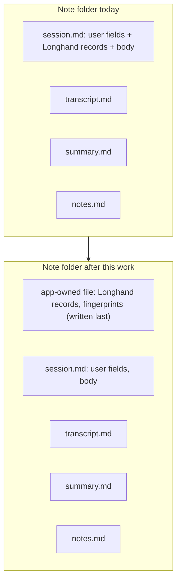
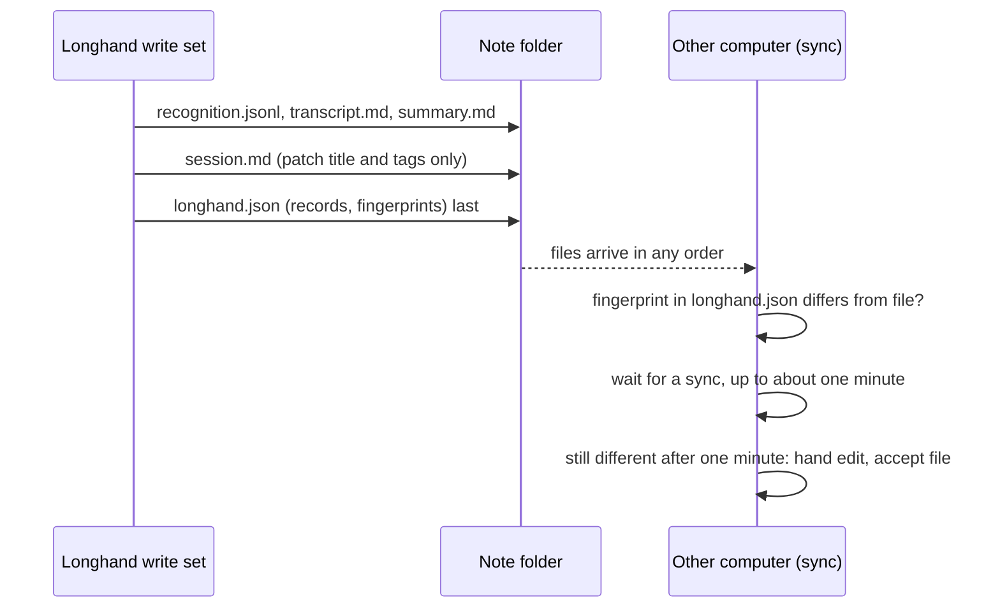
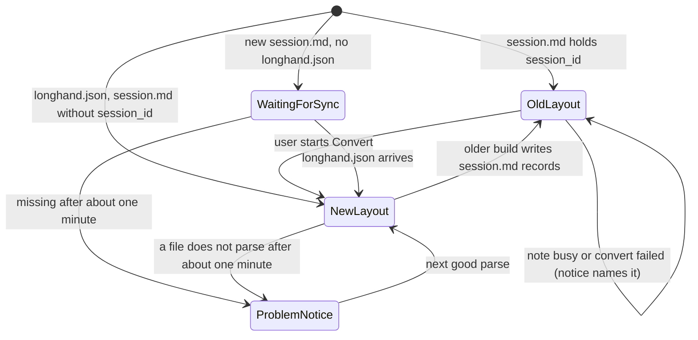
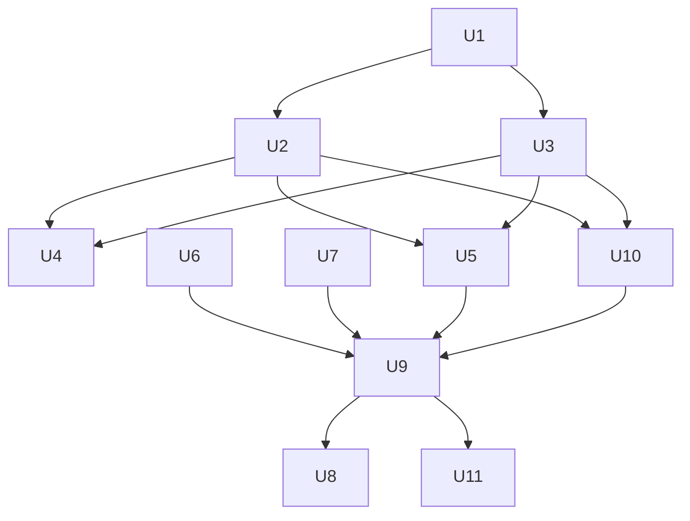

# Safe Agent Edits - Plan

## Goal Capsule

- **Objective:** A user who works with an AI agent can ask it to read and change their Longhand notes and shared settings. Each permitted edit is safe on every computer that shares the storage folder, and the agent gets Longhand's rules with one install step.
- **Product authority:** This Product Contract and the Key Decisions in it. The idea file is `docs/ideas/next/agent-safe-note-edits.md`.
- **Means:** Longhand's records move into `longhand.json` in each note folder, and the skill ships as a plugin in this repository (KTD1, KTD9).
- **Open blockers:** None.
- **Stop conditions:** Stop and ask when a change would alter a Requirement or a session-settled Key Decision, or when the conversion could lose data that R10 protects.
- **Execution profile:** Rust workspace, React frontend, and new Python scripts. Implement in a worktree from `origin/main`, in three PRs (see Phased Delivery). Test microphone-free behaviour with crate tests; test the conversion and the two-computer cases on a signed build.
- **Who finishes:** `ce-work` implements and opens each PR; `ce-babysit-pr` watches each PR until it is ready to merge.

---

## Product Contract

### Summary

Longhand's own records for each note move into one app-owned file. All `.md` files in the storage folder then belong to the user, and an agent can edit them without breaking a run. The shared settings keep their current files and gain every setting that does not belong to one computer. Longhand accepts and repairs outside edits to them. The agent skill becomes a plugin marketplace in the Longhand repository. Longhand can also write a short managed block into `AGENTS.md` and `CLAUDE.md` in the storage folder.

### Problem Frame

The storage folder is plain files so that agents can do complex work outside the app (`STRATEGY.md`). Reads are safe today. Some edits that look safe cause problems:

- **A title fix or a different YAML style stops a run.** Transcribe Again, Regenerate Summary and Resume compare a fingerprint of the whole `session.md`, body included, with only the tags and the pending type removed. Then the run refuses to save.
- **A bad edit hides a note.** A note whose `session.md` does not parse drops out of the note list, and Longhand shows no message.
- **Prompt edits lose identity.** A copied prompt file keeps the id of its original and becomes a conflict copy. A file with no id gets an id from its file name, so a rename breaks the settings that point to it.
- **The skill is hard to install and keep current.** The user's hand-made skill in the storage folder uses a `.claude/skills -> ../.agents/skills` symlink. Resilio, OneDrive and Dropbox on Windows do not sync symlinks. Peers have no way to install the skill.

The user tested the hand-made skill from 2026-10-09: mostly reads, plus a prompt change and tags on old notes.

### Key Decisions

- **All three parts are one piece of work: the note layout, the shared settings edits, and the skill distribution.** The skill can promise only what the app makes safe. (session-settled: user-directed — chosen over a separate brainstorm for each part: the user wanted one design.)
- **Longhand's own records move into a separate app-owned file in each note folder.** Every `.md` file is then the user's, and an agent needs one simple rule. Governs R1, R2, R3, R4. (session-settled: user-directed — chosen over field ownership inside `session.md`, which was the recommendation: a separate file gives agents a boundary that is clear and safe.)
- **Existing notes change to the new layout in a one-time conversion that the user starts.** One layout in the code is simpler, and nobody else has notes yet. A conversion that the user starts lets the user update every computer first. Governs R10, R11, R12, R13. (session-settled: user-directed — chosen over a conversion at each note's next write: one layout soon, at the cost of one bulk write.)
- **No permanent conversion control.** The control shows only for a storage folder that has notes in the old layout, because most users never have old notes. Governs R11. (session-settled: user-directed — chosen over a visible conversion step for all users.)
- **The shared settings keep their current files.** The gaps are in how Longhand reacts to outside edits, not in the layout. Governs R16. (session-settled: user-directed — chosen over files for each item and over a full redesign with a format that permits comments.)
- **Every setting that does not belong to one computer is shared, including Show recording widget.** Governs R15. (session-settled: user-directed.)
- **The skill permits every edit that is reasonably possible.** Governs R7, R14, R32. (session-settled: user-directed — chosen over the smaller set of the hand-made skill.)
- **The skill is a plugin marketplace in the Longhand repository. When the user asks, Longhand also writes a managed block into `AGENTS.md` and `CLAUDE.md`.** This follows the Next.js `agentRules` pattern. The storage folder never holds a copy of the skill that can go out of date. Governs R24, R29, R30. (session-settled: user-directed — chosen over a marketplace only, an app-managed copy of the skill in the storage folder, and instructions only.)
- **Claude Code and Codex install from the marketplace. OpenCode and the `npx skills add` installer get install steps.** Other agents rely on `AGENTS.md` and `CLAUDE.md`. Niche agents get no special support. Governs R25. (session-settled: user-directed — chosen over the wide agent coverage of the Compound Engineering plugin.)
- **A title change through the skill also renames the note folder, as a title change in the app does.** A type change is already a folder move that the skill permits. Governs R32. (session-settled: user-directed — chosen over a title edit that leaves the folder name as it is.)
- **Longhand updates an existing managed block automatically when its block text is newer.** The first block still needs a request. Governs R30. (session-settled: user-directed — chosen over an update only when the user asks again.)
- **A change to the skill alone makes no app release.** The plugin updates from `main`, not from releases. Such a PR uses a type that makes no release. (session-settled: user-approved — chosen over a `feat` or `fix` app release with no app change.)
- **The skill's tools are Python scripts that use only the standard library. There is no command-line tool in the app, and the skill never looks for the app.** Python is usually available where agents run. A skill that must find the installed app is fragile. Governs R27, R28. (session-settled: user-directed — chosen over commands in the app binary, which was the recommendation: the user did not want the skill to find the app.)

### Requirements

**Note layout**

- R1. Longhand's records for a note are in one app-owned file in the note folder. These are the session id, the start time, the segments, the recognition data, the speakers found, the transcript and summary fingerprints, the result state, the bookkeeping of a type move that waits, the title that Longhand last wrote with its source, and the data of the summary (its status, endpoint host, model and prompt). The `.md` files hold only user data and text that the user may edit.
- R2. A save writes the app-owned file last, and that file records the fingerprints of `transcript.md` and `summary.md`. A computer that has received only part of a sync still shows "Waiting for a sync", until the hand-edit rule in R7 applies.
- R3. Transcribe Again, Regenerate Summary and Resume check for a change made during the run only in Longhand's records, compared as parsed values. An edit to a `.md` file never makes a run refuse.
- R4. When Longhand writes a `.md` file that the user can edit, it changes only the values that it must change. It keeps the rest of the file, including body text and frontmatter fields that it does not know.
- R5. A title in `session.md` that differs from the title that Longhand last wrote (R1) counts as set by the user. Processing does not replace it.
- R6. A frontmatter that does not parse does not hide the note. This applies to `session.md` and to the app-owned file. If the file still does not parse after about one minute, the note shows a notice that names the file and the line. A shorter failure is part of a sync and shows nothing. While the file does not parse, the note shows its last known title and type, and actions that write to the note wait. The notice goes away at the next good parse.
- R7. Edits to `transcript.md` and `summary.md` are permitted. The current rule for hand edits applies: after about one minute, Longhand accepts the edit. Transcribe Again and Regenerate Summary replace the edited file, as they do today.
- R8. Two tags with one tag key, from an outside edit, count as one tag everywhere, as they do after an edit in the app.

**Conversion of existing notes**

- R9. Before the conversion, every note in the old layout stays visible and readable.
- R10. The conversion moves each note in the old layout to the new layout. It loses no data. A note that does not convert stays in the old layout, a notice names it, and Convert stays available.
- R11. Longhand shows a notice with a Convert action only when the storage folder holds at least one note in the old layout. With no old notes, no conversion control shows.
- R12. The conversion runs only when the user starts it. A read, a scan or a launch never converts a note.
- R13. The conversion can run again. It changes only notes that are still in the old layout, for example a note that an older build wrote after the first conversion.

**Shared settings**

- R14. Edits in the shared files have the same effect on every computer as the same edit in the app. These are edits to the note types, the default type, the prompt of each type, the active prompt, the Background and the other shared settings.
- R15. Every setting that does not depend on the hardware, the operating system, the disk or the secrets of one computer is a shared setting. Show recording widget and New Note records become shared. The shortcuts, the interface zoom, the Computer audio default, Hide from Dock, the alert sound and the summary endpoint stay on each computer, by earlier decisions.
- R16. The shared settings keep their current files: `settings.json`, `background.md`, and one Markdown file for each prompt.
- R17. Two prompt files with one id stay a conflict that the user resolves, as today (rule 6 of the shared settings rules). The skill writes a new id into each prompt that it creates, so an agent's copy never has the id of its original.
- R18. Longhand writes an id into a prompt file that has none, at its next write to the shared settings. A later rename of the file keeps the prompt.
- R19. An edit of `name` in a prompt file renames the prompt. Longhand renames the file to match at its next write, and keeps the id.
- R20. When a prompt file is deleted outside the app, each setting that names that prompt uses the default prompt at once. When the prompt has been missing for about one minute, Longhand clears those references at its next write to the shared settings, with the same rules as a delete in the app. The wait keeps references during a rename that a sync service delivers as a delete and then a create. No message shows.
- R21. A prompt text over 4,000 characters, or title instructions over 1,000 characters, from an outside edit shows as over the limit in Settings. Longhand does not cut the text without telling the user.
- R22. A shared file that still does not parse after about one minute shows a notice that names the file and the line. Longhand does not overwrite the file. The settings in that file stay read-only with their last known values, as today (rule 4 of the shared settings rules), and changes to settings in other files still save.
- R23. A read, a scan or the folder watcher never writes a shared file (rule 1 of `docs/solutions/integration-issues/shared-settings-in-a-synced-folder-rules.md`). The repairs in R17 to R20 happen only at a write that a user change on this computer causes.

**Skill and distribution**

- R24. The skill is in the Longhand repository, as a plugin marketplace that Claude Code and Codex can each add with one command.
- R25. The repository gives install steps for Claude Code, Codex, OpenCode and the `npx skills add` installer.
- R26. The skill describes each file in the storage folder, the files that the user and agents may edit, and the steps for each permitted edit. It names the files that the agent must never edit: the app-owned file, the audio, `recognition.jsonl` and the library marker.
- R27. The skill keeps its scripts to list notes, check the folder, and prove what an edit changed. The scripts use only the Python standard library. They read Longhand's records without a YAML parser. For a frontmatter that they cannot read, they report the file as not checked and never report a pass for it. Without Python, the skill tells the user that it continues without checks and that the user must check the result with care.
- R28. The skill never looks for or runs the Longhand app.
- R29. When the user asks, Longhand writes a managed block into `AGENTS.md` and `CLAUDE.md` in the storage folder, as real files with no symlink. The block tells an agent that this is a Longhand storage folder, gives the install steps for the skill, and gives the main rules. Longhand changes only the text between its markers and keeps the rest of each file.
- R30. After the user asked once, a newer Longhand replaces an existing managed block that an older version wrote. Longhand never replaces a block that a newer version wrote, so computers with different versions never rewrite the block in turns.
- R31. The repository checks run the skill's scripts against the same test notes as the app's tests. A change to Longhand's rules that breaks the scripts fails the checks.
- R32. The skill permits these edits: tags, the type (a move of the note folder), the title (with a rename of the note folder by Longhand's naming rules), `notes.md`, `transcript.md`, `summary.md`, prompt files (new, text, rename, delete), the shared settings in `settings.json`, and `background.md`. It skips a note that a computer records or processes at that time.

### Key Flows

- F1. Install the skill
  - **Trigger:** A user who uses Claude Code or Codex wants an agent to work with their notes.
  - **Steps:** The user adds the Longhand marketplace and installs the plugin, with the steps from the repository. If they want, they also ask Longhand for the managed block, so that an agent started in the storage folder knows about the skill. The user starts the agent at the root of the storage folder.
  - **Covered by:** R24, R25, R29
- F2. An agent makes an edit
  - **Trigger:** The user asks the agent to tag old notes, change a prompt, or change a setting.
  - **Steps:** The agent reads the skill. It takes a snapshot with the check script, makes the edit in the `.md` or settings files, and runs the check against the snapshot. Longhand reads the change, and every computer gets it through the sync.
  - **Covered by:** R3, R14, R26, R27, R32
- F3. Convert old notes
  - **Trigger:** The user updates Longhand on every computer that has a storage folder with notes in the old layout.
  - **Steps:** The notice with the Convert action shows. The user starts the conversion on one computer. The notice goes away when no old notes remain. It shows again if an older build writes an old note later.
  - **Covered by:** R9, R10, R11, R12, R13

### Acceptance Examples

- AE1. **Covers R3, R5.** **Given** an agent changed a note's title and wrote its YAML in a different style, **when** the user runs Regenerate Summary, **then** the run saves and the new title stays.
- AE2. **Covers R2.** **Given** computer A saved a new transcript, and the sync has delivered `transcript.md` but not yet the app-owned file to computer B, **when** B shows the note, **then** the note shows "Waiting for a sync" and its actions wait.
- AE3. **Covers R6.** **Given** an agent left `session.md` with YAML that does not parse, **when** one minute passes, **then** the note stays in the list and a notice names the file and the line. During the first minute, no notice shows.
- AE4. **Covers R11, R13.** **Given** a new user with no old notes, **then** no conversion notice or control shows. **Given** a user who converted, and an older build on another computer then wrote one note in the old layout, **when** the new build scans, **then** the notice shows again, and Convert changes only that note.
- AE5. **Covers R17, R19.** **Given** an agent copied a prompt file to a new file name, wrote a new id and changed `name`, **then** Settings lists a new prompt and the original prompt does not change. **When** the agent later edits `name` again, **then** the prompt has the new name, and the note types that use it still use it.
- AE6. **Covers R20.** **Given** the One-on-One type uses a custom prompt, **when** an agent deletes that prompt file, **then** One-on-One summaries use the default prompt, and no message shows.
- AE7. **Covers R27.** **Given** a computer with no Python, **when** the agent starts an edit, **then** the skill tells the user that it continues without checks and that the user must check the result.

### Success Criteria

- On two computers that share one storage folder through Resilio, the user's own agent tasks from the hand-made skill work through the plugin: tags on old notes, a change to a prompt, and a change to a setting. No note becomes a problem folder, no run refuses to save, and no edit is lost on the other computer.
- The check script reports no error after each permitted edit in F2.

### Scope Boundaries

- A test of a draft prompt with the user's real endpoint and model. It needs the app. It stays with the "Regenerate With" idea (`docs/ideas/someday/regenerate-with-another-prompt.md`).
- A command-line tool in the Longhand app.
- Files for each settings item, or a settings format that permits comments.
- Agent edits that delete a note or touch audio, and folder renames other than the type move and the title rename in R32.
- An automatic folder rename by Longhand after a title edited outside the app. The folder keeps its name until a title change in the app or through the skill.
- Automatic updates of the plugin. Each agent's own update setting controls them.
- Support for agents other than those in R25, except through `AGENTS.md` and `CLAUDE.md`.
- A first managed block that Longhand writes without a request from the user.
- The removal of the user's hand-made skill copy and its symlink. The user removes them by hand after installing the plugin.

### Dependencies / Assumptions

- Every note is in the new layout before anyone uses the skill. The skill describes only the new layout and has no rules for notes in the old layout.
- An edit to `transcript.md` or `summary.md` while another computer processes the note can be lost, because that run replaces the file. The skill skips notes that it sees as busy, but the in-use markers arrive through the sync and can be late. This risk is accepted.
- The user updates Longhand on every computer before starting the conversion. An older build cannot read converted notes. It keeps showing them from its own database, and a scan does not delete them. An edit in the older build writes the old layout again (R13).
- Python 3.9 or later is usually available where agents run. Claude Code and Cowork can install it.
- The user starts the agent at the root of the storage folder. Codex outside a git repository reads only the current folder's `AGENTS.md` and `.agents/skills`.
- Claude Code reads nothing under `.agents/`, so a skill there does not reach Claude Code without the plugin.

### Outstanding Questions

**Deferred to Implementation**

- Whether Codex installs the plugin from `.claude-plugin/plugin.json` alone, or also needs `.codex-plugin/plugin.json`. Check with `codex plugin marketplace add` against the branch before U9 is done (KTD10).
- The exact line handling of the text-preserving frontmatter patcher for YAML forms that agents write, such as flow lists and quoted keys (KTD3).

### Sources / Research

- The idea and its earlier analysis: `docs/ideas/next/agent-safe-note-edits.md`.
- Fingerprints and the checks that use them: `crates/session-core/src/folder.rs` (`fingerprint`, `session_fingerprint`), `crates/pipeline/src/reprocess.rs`, `crates/pipeline/src/save.rs`, `crates/pipeline/src/recognition/saved_prefix.rs`. The reasons for fingerprints are KTD2 and KTD12 of `docs/plans/2026-09-25-1217-feat-one-library-across-computers-plan.md`.
- A `session.md` that does not parse becomes an invalid problem folder with no message: `crates/library/src/scan.rs`, `crates/library/src/status.rs`. A folder that exists but gives no note is not a delete: `crates/library/src/reconcile.rs`.
- The rules for shared settings in a synced folder: `docs/solutions/integration-issues/shared-settings-in-a-synced-folder-rules.md`. The prompt ids: `crates/shared-settings/src/prompts.rs`. The local and shared split: R13 of `docs/plans/2026-09-28-2343-feat-one-storage-folder-and-shared-settings-plan.md`.
- Next.js `agentRules`, a managed block in `AGENTS.md` that points to docs in the installed version: https://nextjs.org/docs/app/guides/ai-agents
- Beads `bd setup claude`, a small managed section with the current rules from the installed app: https://beads.gascity.com/integrations/claude-code.md
- Claude Code plugin marketplaces and auto-update (off for marketplaces that Anthropic does not publish): https://code.claude.com/docs/en/plugin-marketplaces and https://code.claude.com/docs/en/plugins/loading#when-auto-update-runs
- Codex plugins also accept `.claude-plugin/marketplace.json`; skill folders: https://developers.openai.com/plugins/build/plugins.md and https://learn.chatgpt.com/docs/build-skills
- `npx skills add`: https://github.com/vercel-labs/skills
- Sync services and symlinks: https://docs.resilio.com/content/reference-information/agent_and_symbolic_links_hard_links_directory_junctions/ and https://help.dropbox.com/sync/symlinks
- The Compound Engineering plugin repository, an example of install steps for many agents from one repository: https://github.com/EveryInc/compound-engineering-plugin

---

## Planning Contract

**Product Contract preservation:** changed: R1 (the summary data is a Longhand record), R15 (New Note records is shared, and the list of local settings), R30 (an automatic update of an existing block), R32 (a title change through the skill renames the folder), Scope Boundaries and Outstanding Questions. The user chose each change while this plan was written. The other R, F and AE IDs and their meaning are unchanged.

### Key Technical Decisions

- KTD1. **The app-owned file is `longhand.json` in each note folder, a JSON object with a `layout` number.** JSON lets the stdlib scripts read it with no YAML parser (R27). The name has no leading dot, because the folder watcher and the scan skip dot names (`src-tauri/src/managers/library.rs`, `crates/library/src/scan.rs`). Obsidian does not list `.json` files by default. It holds every record in R1, including the summary data (today `SummaryMeta` in `crates/session-core/src/folder.rs`) and the note's `session_id`, which becomes the folder identity for the scan, the early home write and note moves. Output is deterministic: sorted keys, LF, no write time. Two computers that write the same records then write the same bytes.
- KTD2. **`longhand.json` replaces `session.md` as the last file of each write set.** The publication order becomes `recognition.jsonl`, `transcript.md`, `summary.md`, `session.md`, `longhand.json` (`crates/session-save/src/publication.rs`). The early home write ends with `longhand.json`. The "Waiting for a sync" and hand-edit rules (`crates/library/src/reconcile.rs`, `HAND_EDIT_WAIT`) read the fingerprints from `longhand.json`. Governs R2.
- KTD3. **`session.md` holds only `title` and `longhand_tags`, and Longhand writes it with a text-preserving frontmatter patcher.** The patcher replaces only the lines of the keys it changes. It keeps other keys, comments, order and the body. A new note's `session.md` gets frontmatter and no body. Longhand never writes a body. `SessionDoc::render` stays only for the conversion's input parse. Governs R4.
- KTD4. **The "changed during run" check compares the parsed `ResultFields` plus segments and recognition data from `longhand.json`.** It replaces `session_fingerprint` in Transcribe Again (`crates/pipeline/src/reprocess.rs`, compared in `crates/pipeline/src/save.rs`), Regenerate Summary (`save.rs`) and Resume (`crates/pipeline/src/recognition/saved_prefix.rs`). The title, the title source, the pending type and `layout` are outside the compare set, so a title proposal or a type move during a run does not refuse the run. Governs R3.
- KTD5. **A `session.md` title is a user title when it has differed from the last-written title in `longhand.json` for about one minute.** The wait uses the `HAND_EDIT_WAIT` and `Mismatch{since}` pattern in `crates/library/src/reconcile.rs`. A title proposal changes `session.md` and `longhand.json`, and a sync can deliver them in either order. Until the minute passes, the computer keeps the stored title source and writes nothing for that note. Governs R5.
- KTD6. **Old layout means a `session.md` that holds `session_id`.** That is true whether or not `longhand.json` exists. Its records are the current ones, and the conversion moves them into `longhand.json`. Before the conversion, readers take an old note's records from `session.md` and its summary data from the `summary.md` frontmatter. Title and tag edits to an old note continue through the patcher. Actions that change records wait on an old note and point to the Convert notice: Transcribe Again, Regenerate Summary, Resume and a type move. A folder with a new-layout `session.md` and no `longhand.json` waits for a sync: no adopt, no write, and after about one minute the R6 notice names `longhand.json`. Governs R9, R10, R13.
- KTD7. **Reads of `transcript.md` and `summary.md` are lenient.** A transcript line that does not parse shows as plain text with no time, and Resume uses only the lines that parse. A frontmatter that an agent adds to `summary.md` is not shown and not used. Governs R7.
- KTD8. **A deleted prompt falls back to the default at once, and references clear only at a user-caused write after about one minute.** The cache copy no longer stands in for a missing prompt file (`crates/shared-settings/src/view.rs`; the test `two_computers.rs` that asserts the old behaviour changes). The cache copy still stands in for a file that exists but does not parse. An id written into an id-less prompt is its `file_name_id`, written before any file rename in the same save, so references in `settings.json` keep working. An over-limit prompt is listed with an over-limit flag and runs use its full text (`read_entry` in `crates/shared-settings/src/prompts.rs` stops dropping it). Governs R18, R20, R21.
- KTD9. **The repository is the marketplace.** `.claude-plugin/marketplace.json` is at the repository root, and the plugin is `plugins/longhand/` with `skills/longhand-notes/`. `plugin.json` has no `version`, so Claude Code follows the commit. The skill keeps the shape of the user's hand-made skill: a short `SKILL.md` with the boundary rule and the snapshot, edit and compare loop, plus reference files (`layout.md`, `files.md`, `answering.md`, `editing.md`, `tags.md`, `types.md`, `prompts.md`, `settings.md`). Governs R24, R26.
- KTD10. **Codex gets its own manifest when it needs one.** The Compound Engineering plugin ships `.codex-plugin/plugin.json` next to `.claude-plugin/plugin.json`. Add it if the check in Outstanding Questions shows that Codex needs it. Governs R24.
- KTD11. **The scripts are tools, not edit workflows.** `list_notes.py` lists notes with a busy flag. `check.py` has `snapshot` and `compare`. `new-id` gives a prompt id in the app's format. `folder-name` gives a note folder name by Longhand's naming rules (`crates/session-save/src/naming.rs`). The agent edits files with its own tools. A note is busy when it has a fresh in-use marker, `result: pending`, or a type move that waits. `compare` matches notes by `session_id`, so a moved folder reads as moved. Exit 0 is a pass, 1 is a problem, 2 is something not checked, and 2 is never a pass. The scripts confirm the library marker before any work and write nothing into the storage folder. Governs R27, R28, R32.
- KTD12. **The managed block has a block version between its markers.** Longhand writes the first block on a request from Settings > Storage. Later it replaces a block only when the block's version is older than its own (R30). The replacement happens at the next storage-folder write that a user change on this computer causes, never at launch or at a read, after a fresh read of both files (rule 1 of the shared settings rules). It writes nothing when the markers are damaged (a begin marker with no end marker, or two blocks), and it shows a notice that names the file, because the user must fix it. When `CLAUDE.md` is a symlink to `AGENTS.md`, or holds only `@AGENTS.md`, Longhand writes the block once. CRLF and a BOM stay as they are. Governs R29, R30.
- KTD13. **The skill's tests and the app's tests share one checked-in test storage folder.** It is `testdata/storage-folder/`, not the private `fixtures/`. It is synthetic, with LF line ends set in `.gitattributes`. A Rust test also writes a note with the real writers into a temporary folder and runs `check.py` on it through uv, so a change to the app's format fails the checks. The drift test fails when uv is missing and `CI` is set, and skips with a printed reason otherwise. CI adds a SHA-pinned `astral-sh/setup-uv` step before `cargo test` in each job, and runs the script tests on Python 3.9 and the current version. Governs R31.
- KTD14. **One notice slot rule on Home.** The Convert notice comes first, then conversion failures, then parse failures. One parse notice counts the notes and lists them. Every notice follows `docs/solutions/ui-bugs/folder-notice-for-a-move-the-app-does-without-help.md`: the normal path shows nothing. Governs R6, R10, R11, R22.

### High-Level Technical Design

The write order and the read rules decide most of the behaviour, so both are drawn here.

### Assumptions

- No other person has notes in the old layout. Only the user's own notes need the conversion (docs memory: no installs to migrate).
- The user's agents run Python 3.9 or later, or accept the "no checks" path (AE7).

### Phased Delivery

Three PRs, each with a title that names all its changes:

1. **Note layout and conversion:** U1, U2, U3, U4, U5. This makes every `.md` file safe to edit.
2. **Shared settings:** U6, U7. This can merge before or after PR 1.
3. **Skill, managed block and test folder:** U8, U9, U10, U11. This needs PR 1 and PR 2 on `main`, because the skill describes their behaviour.

### System-Wide Impact

- **Every writer and reader of `session.md` changes.** About ten writers render the whole file today (publication, staging, early home, folder rename, tags, type move, Regenerate accept, empty note). Each moves to `longhand.json` plus the patcher.
- **Folder identity moves.** The scan, the early home write, note moves, the watcher's type-folder rule and the empty-note file allow-list key on `session.md` today. They key on `longhand.json` or `session.md` after this work.
- **Store.** No store schema change is planned.
- **Releases.** CLAUDE.md gets one line: a PR that changes only the skill uses a type that makes no release.

### Risks

| Risk | Mitigation |
|---|---|
| A writer still renders the whole `session.md` and drops an agent's body or keys | A test for each writer asserts that unknown keys and a body survive |
| The conversion loses records on a crash | `longhand.json` first and `session.md` last, so a note stays old layout until its records are safe (KTD6); the conversion is re-runnable (R13); kill-and-rerun tests at each step |
| A crash between a title write and the `longhand.json` write makes a proposed title a user title | Considered and not built: the title stays valid and visible, and one edit in the app corrects it. A store record of the intent would need a schema change for a rare, visible case |
| The Python rules drift from the app | The Rust drift test and the shared test folder (KTD13) |
| The plugin is newer than a user's app | The `layout` number: the scripts report "not checked" for a layout they do not know |
| A plugin install clones the whole app repository | Accepted now; Claude Code `git-subdir` and Codex `--sparse` can reduce it later |

---

## Implementation Units

| U-ID | Title | Files touched | Depends on |
|---|---|---|---|
| U1 | Note record file and session.md patcher | `crates/session-core/src/folder.rs`, new `crates/session-core/src/note_record.rs` | — |
| U2 | Writers use the new layout | `crates/session-save/src/publication.rs`, `crates/pipeline/src/{save,early_home,folder_rename,tags,type_move,empty_note,summarize}.rs` | U1 |
| U3 | Readers, identity and the run check | `crates/library/src/{scan,refresh,reconcile,status,conflict}.rs`, `crates/pipeline/src/{reprocess,move_notes}.rs`, `crates/pipeline/src/recognition/saved_prefix.rs`, `src-tauri/src/managers/library.rs` | U1 |
| U4 | Problem folders, tags read and lenient reads | `crates/library/src/status.rs`, `src-tauri/src/commands/session.rs`, `src/home/Home.tsx`, `src/home/SessionRow.tsx` | U2, U3 |
| U5 | Conversion of old notes | new `crates/pipeline/src/convert.rs`, `src-tauri/src/commands/`, `src/home/Home.tsx` | U2, U3 |
| U6 | Shared settings repairs for outside edits | `crates/shared-settings/src/{prompts,view}.rs`, `src-tauri/src/managers/shared.rs`, `src/settings/SummaryPrompts.tsx` | — |
| U7 | More shared settings | `crates/shared-settings/src/file.rs`, `src-tauri/src/managers/settings.rs` | — |
| U8 | Managed block | new `src-tauri/src/managers/agent_block.rs`, `src/settings/DestinationPicker.tsx` | U9 |
| U9 | Skill plugin and scripts | `.claude-plugin/marketplace.json`, `plugins/longhand/**`, `README.md`, `crates/library/tests/skill_drift.rs` | U5, U6, U7, U10 |
| U10 | Shared test storage folder and CI | `testdata/storage-folder/**`, `.gitattributes`, `.github/workflows/ci.yml` | U1, U2, U3 |
| U11 | Docs and release rule | `CONCEPTS.md`, `CLAUDE.md`, `docs/solutions/` | U9 |

### U1. Note record file and session.md patcher

- **Goal:** A model for `longhand.json` and a writer that changes only named frontmatter keys in a `.md` file.
- **Requirements:** R1, R4; KTD1, KTD3.
- **Dependencies:** none.
- **Files:** new `crates/session-core/src/note_record.rs`, `crates/session-core/src/folder.rs`, `crates/session-core/src/lib.rs`, new `crates/session-core/tests/note_record.rs`, `crates/session-core/tests/folder.rs`.
- **Approach:**
  1. Add the `longhand.json` model with `layout` 1 and every R1 record. Reuse the field types of `SessionDoc` and `SummaryMeta`.
  2. Serialize with sorted keys and LF. Parse errors give the line and column.
  3. Add a reduced `session.md` read (title, tags) that accepts any other keys.
  4. Add the frontmatter patcher. It edits the lines of named keys, adds a key when it is absent, removes a named key with all its indented continuation lines, and keeps all other text. It also creates a new file with frontmatter and no body.
  5. Keep `SessionDoc` parse for old-layout input (U5).
- **Patterns to follow:** `split_frontmatter` (LF and CRLF) and `FolderError::Line` in `folder.rs`; `front_matter` in `crates/shared-settings/src/prompts.rs`, which keeps unknown lines.
- **Test scenarios:**
  - A record with every field round-trips, and two writes of the same record give the same bytes.
  - A `longhand.json` with a `layout` above 1 parses with a "newer layout" result, not an error.
  - The patcher changes `title` in a file with a comment, an unknown key, a flow-style tag list and a body; only the title line changes.
  - The patcher adds `longhand_tags` to a file that has none; other text is unchanged.
  - A CRLF file stays CRLF after a patch.
  - Removing `segments`, `recognition_snapshot` and `found_speakers` from a `SessionDoc::render` output keeps an unknown key, a comment and the body byte for byte.
  - A frontmatter that does not parse returns an error with the line number, and the patcher writes nothing.
- **Verification:** The session-core tests pass, and no writer uses the new code yet.

### U2. Writers use the new layout

- **Goal:** Every write puts records in `longhand.json` last and touches `session.md` only through the patcher.
- **Requirements:** R1, R2, R4, R5; KTD2, KTD3, KTD6.
- **Dependencies:** U1.
- **Files:** `crates/session-save/src/publication.rs`, `crates/session-save/src/home_write.rs`, `crates/pipeline/src/save.rs`, `crates/pipeline/src/early_home.rs`, `crates/pipeline/src/folder_rename.rs`, `crates/pipeline/src/tags.rs`, `crates/pipeline/src/type_move.rs`, `crates/pipeline/src/empty_note.rs`, `crates/pipeline/src/summarize.rs`, `crates/session-core/src/jobs.rs`, tests in `crates/session-save/tests/publication.rs`, `crates/session-save/tests/save.rs`, `crates/pipeline/tests/`.
- **Approach:**
  1. Add `longhand.json` as the last step of `WriteSet`, and write summary data there in place of `summary.md` frontmatter.
  2. Change the early home write to marker, `notes.md`, `session.md`, `longhand.json`.
  3. Move each `session.md` writer to the patcher: titles, tags, and the type move (whose bookkeeping goes to `longhand.json`).
  4. Write the tags with one tag per key (R8).
  5. Add `longhand.json` to the empty-note allow-list and delete list.
  6. On an old-layout note, title and tag edits go through the patcher, and actions that change records refuse with no write (KTD6).
- **Patterns to follow:** `ResultFields` and `patch` in `publication.rs`; `write_atomic` in `home_write.rs`.
- **Test scenarios:**
  - A save writes `longhand.json` after `session.md`, and a crash before `longhand.json` leaves the note waiting for a sync.
  - A save keeps an agent's body text and unknown key in `session.md`.
  - A tag edit changes only the tag lines.
  - A title proposal writes the title and the last-written title.
  - Regenerate Summary on an old-layout note refuses with no write.
  - A user title (different from the last-written title) is not replaced by a proposal. Covers AE1.
  - `summary.md` from a new save has no frontmatter; its data is in `longhand.json`.
  - An empty recording with `longhand.json` is still deleted.
- **Verification:** Pipeline and session-save tests pass; a saved note folder has the new layout.

### U3. Readers, identity and the run check

- **Goal:** Every reader takes records and identity from `longhand.json`, and the run check compares records only.
- **Requirements:** R2, R3, R5, R6, R9, R13; KTD1, KTD4, KTD5, KTD6.
- **Dependencies:** U1.
- **Files:** `crates/library/src/scan.rs`, `crates/library/src/refresh.rs`, `crates/library/src/reconcile.rs`, `crates/library/src/conflict.rs`, `crates/pipeline/src/reprocess.rs`, `crates/pipeline/src/save.rs`, `crates/pipeline/src/recognition/saved_prefix.rs`, `crates/pipeline/src/early_home.rs`, `crates/pipeline/src/move_notes.rs`, `crates/pipeline/src/type_move.rs`, `src-tauri/src/managers/library.rs`, tests in `crates/library/tests/scan.rs`, `crates/library/tests/two_computers.rs`, `crates/pipeline/tests/`.
- **Approach:**
  1. The scan reads `longhand.json` for identity and records, and `session.md` for title and tags.
  2. Classify each folder: new layout, old layout (KTD6), waiting for a sync, or problem.
  3. A folder is a note folder when it holds `session.md` or `longhand.json` (watcher and scan).
  4. Add `longhand.json` to `conflict::DOCUMENTS`.
  5. Replace `session_fingerprint` in the three run checks with the KTD4 compare.
  6. `known_id` for a problem folder falls back to the stored home path.
  7. Apply the one-minute title rule (KTD5) in `folder_title` and `keep_folder_user_title`.
- **Patterns to follow:** `Reads::read` and `ProblemFolder` in `scan.rs`; `MismatchKey` and `track_mismatches` in `reconcile.rs`.
- **Test scenarios:**
  - Covers AE1. An agent changes the title and the YAML style during Regenerate Summary; the run saves.
  - A title proposal during Regenerate Summary does not refuse the run.
  - A type move on another computer during Transcribe Again does not refuse the run.
  - Covers AE2. `transcript.md` arrives before `longhand.json`; the note waits for a sync, and accepts the file as a hand edit after about one minute.
  - A new-layout `session.md` with no `longhand.json` waits and is not adopted.
  - A note folder with only `longhand.json` is a note, not a type folder.
  - `longhand 2.json` has no effect.
  - A proposed title's `session.md` arrives before its `longhand.json`, and in the reverse order; the title source stays "proposed" after both arrive.
  - A title that an agent changed counts as a user title after about one minute.
- **Verification:** Library and pipeline tests pass, including the two-computer tests.

### U4. Problem folders, tags read and lenient reads

- **Goal:** A broken note stays visible with a notice, duplicate tags count once, and edited transcripts and summaries still show.
- **Requirements:** R6, R7, R8; KTD7, KTD14.
- **Dependencies:** U2, U3.
- **Files:** `crates/library/src/status.rs`, `crates/library/src/refresh.rs`, `crates/session-core/src/folder.rs` (`Transcript::parse`, `Summary::parse`), `src-tauri/src/commands/session.rs`, `src/bindings.ts` (generated), `src/home/Home.tsx`, `src/home/SessionRow.tsx`, `src/session/SessionPage.tsx`, tests in `crates/library/tests/`, `src/home/Home.test.tsx`.
- **Approach:**
  1. Add an `invalid` flag beside `unreadable` in `NoteStatus`, with the file and line.
  2. Start the notice after about one minute with the `Mismatch{since}` pattern, and clear it at the next good parse.
  3. Block the writes that the broken file feeds: tag, title and type for `session.md`; all writes and runs for `longhand.json`. Delete stays available.
  4. Apply one tag per key in `refresh` and adoption.
  5. Make the transcript and summary reads lenient (KTD7) for the note page and the Regenerate accept path.
- **Patterns to follow:** `storage_unavailable` gating in `SessionRow.tsx`; `CautionBanner` in `Home.tsx`; the notice rule doc.
- **Test scenarios:**
  - Covers AE3. A `session.md` that does not parse shows no notice for the first minute, then a notice with the file and line; the row keeps its last title.
  - The notice clears after the file is fixed.
  - Tag edits on a note with a broken `session.md` are refused with no write.
  - A note with two tags of one key shows one tag in the row, the filter and the tag list.
  - A transcript with a free-text line shows that line as plain text.
  - A `summary.md` with agent frontmatter shows only the body.
  - A normal note shows no notice.
- **Verification:** Crate tests and `bun test ./src/` pass.

### U5. Conversion of old notes

- **Goal:** A user-started, re-runnable conversion with a notice that shows only when old notes exist.
- **Requirements:** R9, R10, R11, R12, R13; KTD6, KTD14; F3.
- **Dependencies:** U2, U3.
- **Files:** new `crates/pipeline/src/convert.rs`, `crates/pipeline/src/lib.rs`, a new command in `src-tauri/src/commands/`, `src-tauri/src/lib.rs`, `src/bindings.ts`, `src/home/Home.tsx`, new `crates/pipeline/tests/convert.rs`, `src/home/Home.test.tsx`.
- **Approach:**
  1. For each old-layout note that is not busy:
     1. Read the records from the unchanged `session.md` and `summary.md`, and write `longhand.json` with them and the fingerprints of the final files.
     2. Write `summary.md` without its frontmatter.
     3. Patch `session.md` last: remove `session_id` and the other records, and keep title, tags, unknown keys and the body. Until this step the note is still old layout (KTD6), so a re-run after a crash at any step recomputes the same `longhand.json`.
  2. Update `written_session_fingerprint` in the store.
  3. Convert notes with no result (empty notes, `no-recording`) too.
  4. Report busy notes as not converted yet, with no failure notice.
  5. Name failed notes in a notice. Convert stays available.
  6. The Convert notice shows while the scan finds any old-layout note.
- **Execution note:** Start with kill-and-rerun tests at each write step before the conversion code.
- **Patterns to follow:** Re-check before each write (`docs/solutions/logic-errors/publication-checked-for-another-result-only-at-start-and-end.md`); `CautionBanner` with an action button.
- **Test scenarios:**
  - Covers AE4. A folder with no old notes shows no Convert notice or control.
  - Conversion of a saved note keeps every record, the tags, the title and the body.
  - A crash after each step, then a second run, gives the same result as one run.
  - A note with a fresh in-use marker is skipped and converts on the next run.
  - Covers AE4. After conversion, an older build writes `session.md` with records; the notice shows again and Convert changes only that note.
  - Two computers that convert one note write identical files.
  - A note folder with only `notes.md` and an old `session.md` converts, and the notice goes away.
- **Verification:** The conversion tests pass; on a signed build, a copy of the user's storage folder converts and every note opens.

### U6. Shared settings repairs for outside edits

- **Goal:** Outside edits to prompts follow R17 to R23.
- **Requirements:** R17, R18, R19, R20, R21, R22, R23; KTD8; AE5, AE6.
- **Dependencies:** none.
- **Files:** `crates/shared-settings/src/prompts.rs`, `crates/shared-settings/src/view.rs`, `crates/shared-settings/src/note_types.rs`, `src-tauri/src/managers/shared.rs`, `src/settings/SummaryPrompts.tsx`, `src/settings/shared.ts`, tests in `crates/shared-settings/tests/prompts.rs`, `crates/shared-settings/tests/two_computers.rs`, `src/settings/SummaryPrompts.test.tsx`.
- **Approach:**
  1. In a user-caused save, write the `file_name_id` into id-less prompt files before any rename.
  2. In the same save, rename files whose name does not match `name` (`move_to_name`).
  3. Track how long each referenced prompt has been missing, in memory. A save after about one minute clears its references with the rules of `delete_prompt`.
  4. Stop dropping over-limit prompts. Flag them in the view.
  5. Add the line to the "does not parse" reason and the about-one-minute notice.
- **Patterns to follow:** `settle_copies`, `rename_prompt` and `move_to_name` in `prompts.rs`; `prompts_without` in `note_types.rs`.
- **Test scenarios:**
  - Covers AE5. A new prompt file with a new id and a new `name` is listed as a second prompt, and the original does not change.
  - Two files with one id and different text stay a conflict.
  - An id-less prompt gets its `file_name_id` written at the next user save, and the type that uses it still uses it after a file rename.
  - An edit of `name` renames the file at the next save, and the id stays.
  - Covers AE6. A deleted prompt that a type uses gives the default prompt at once, and no message.
  - A prompt that is missing for less than one minute keeps its references after a save.
  - A read, a scan or the watcher writes no shared file.
  - A 5,000-character prompt is listed as over the limit, and a run uses its full text.
- **Verification:** Shared-settings tests and settings UI tests pass.

### U7. More shared settings

- **Goal:** Show recording widget and New Note records become shared settings.
- **Requirements:** R14, R15.
- **Dependencies:** none.
- **Files:** `crates/shared-settings/src/file.rs`, `src-tauri/src/managers/settings.rs`, `src-tauri/src/managers/shared.rs`, `src/bindings.ts`, tests in `crates/shared-settings/tests/file.rs`, `src-tauri/src/managers/settings.rs` (tests).
- **Approach:**
  1. Add a `KEY_`, `Field`, `SharedValue` and default for each setting.
  2. Read the shared value. When the shared file has none, use the default on every computer (no installs to migrate).
  3. Change the tests that pin these settings as local.
- **Patterns to follow:** The Prevention list in `docs/solutions/integration-issues/shared-settings-in-a-synced-folder-rules.md`.
- **Test scenarios:**
  - A save of another field keeps both new fields.
  - An edit of `show_recording_widget` in `settings.json` changes the setting on the next read.
  - A file without the keys gives the defaults.
- **Verification:** Settings tests pass, and the two settings show the same value on two computers.

### U8. Managed block

- **Goal:** Settings > Storage writes the managed block into `AGENTS.md` and `CLAUDE.md`, and newer versions update it.
- **Requirements:** R29, R30; KTD12; F1.
- **Dependencies:** U9.
- **Files:** new `src-tauri/src/managers/agent_block.rs`, `src-tauri/src/managers/mod.rs`, a command in `src-tauri/src/commands/`, `src/settings/DestinationPicker.tsx`, `src/bindings.ts`, tests in `agent_block.rs`, `src/settings/DestinationPicker.test.tsx`.
- **Approach:**
  1. Keep the block text and its version in the app, with the install steps from U9.
  2. The button writes or replaces the block.
  3. At the next storage-folder write that a user change on this computer causes, read both files again and replace a block whose version is older (KTD12).
  4. Keep the rest of each file, its CRLF and its BOM.
  5. Handle the symlink and `@AGENTS.md` cases once.
  6. Show a notice when the markers are damaged.
- **Test scenarios:**
  - The button adds a block to an `AGENTS.md` with user text, and the user text stays.
  - A block with an older version is replaced at the next user-caused write, and a launch alone writes nothing.
  - A block with a newer version is not touched.
  - A file with a begin marker and no end marker is not written, and a notice names it.
  - `CLAUDE.md` as a symlink to `AGENTS.md` gets one block.
  - With no block in the files, a launch writes nothing.
- **Verification:** Tests pass; a signed build writes the block into a test storage folder.

### U9. Skill plugin and scripts

- **Goal:** A marketplace in this repository with the `longhand-notes` skill and its scripts.
- **Requirements:** R24, R25, R26, R27, R28, R32; KTD9, KTD10, KTD11; AE7.
- **Dependencies:** U5, U6, U7, U10.
- **Files:** `.claude-plugin/marketplace.json`, `plugins/longhand/.claude-plugin/plugin.json`, `plugins/longhand/.codex-plugin/plugin.json` (KTD10), `plugins/longhand/skills/longhand-notes/SKILL.md`, `plugins/longhand/skills/longhand-notes/references/*.md`, `plugins/longhand/skills/longhand-notes/scripts/{_longhand,list_notes,check,new_id,folder_name}.py`, `plugins/longhand/skills/longhand-notes/scripts/tests/`, `README.md`.
- **Approach:**
  1. Start from the user's hand-made skill (`docs/ideas/next/agent-safe-note-edits.md`, "Current state"). Rewrite it for the new layout and ASD-STE100.
  2. Keep the protected and editable file patterns as constants in `_longhand.py`, and test that `files.md` names the same patterns.
  3. `settings.md` lists the editable keys of `settings.json`, their types and limits.
  4. Each script uses PEP 723 headers, `sys.dont_write_bytecode` and stdlib only, and writes snapshots to a temporary folder outside the storage folder.
  5. The README gets an install section for Claude Code, Codex, OpenCode and `npx skills add`.
  6. Add the Rust drift test `crates/library/tests/skill_drift.rs` that runs `check.py` on a note the real writers made (KTD13).
- **Patterns to follow:** `scripts/refresh-catalog.py` and `scripts/tests/test_refresh_catalog.py`; the Compound Engineering plugin layout.
- **Test scenarios:**
  - `compare` passes after a tag edit and names each changed note.
  - `compare` exits 1 after an edit of `longhand.json`, `recognition.jsonl` or a busy note.
  - `compare` exits 2 for a frontmatter it cannot read and for a `layout` it does not know.
  - A folder moved by a title rename reads as moved, not removed.
  - `folder-name` gives the same name as `naming.rs` for the shared test cases, including characters that are not allowed and a long title.
  - `new-id` gives an id that the Rust prompt scan accepts.
  - The scripts stop when the folder has no library marker.
  - After every script run, the storage folder has no new file.
  - The drift test fails when a writer adds a record that `check.py` does not know.
- **Verification:** Script tests pass in CI; a manual run of the agent scenarios with Claude Code and Codex (Verification Contract).

### U10. Shared test storage folder and CI

- **Goal:** One checked-in test storage folder for the Rust and Python tests, and a CI step for the scripts.
- **Requirements:** R31; KTD13.
- **Dependencies:** U1, U2, U3.
- **Files:** `testdata/storage-folder/**`, `.gitattributes`, `.github/workflows/ci.yml`, new `crates/library/tests/test_storage_folder.rs`.
- **Approach:**
  1. Build the folder with the U1 to U3 writers, then commit it: notes in the new layout, a busy note, a note whose type move waits, a broken `session.md`, duplicate tags, prompts (with an id, without one, a copy, over the limit), and `settings.json`.
  2. Set `eol=lf` for `testdata/**`.
  3. Add a SHA-pinned `astral-sh/setup-uv` step before `cargo test` in each CI job. Run the script tests on Python 3.9 and the current version, on macOS and Windows.
- **Test scenarios:**
  - The Rust scan reads every note in the test folder with the expected classification.
- **Verification:** CI runs the new step on a PR and passes on both systems.

### U11. Docs and release rule

- **Goal:** The glossary, the repo rules and a learning record the new behaviour.
- **Requirements:** Key Decision on skill-only releases.
- **Dependencies:** U9.
- **Files:** `CONCEPTS.md`, `CLAUDE.md`, `docs/development-workflow.md`, new `docs/solutions/integration-issues/app-owned-note-record-file.md`.
- **Approach:**
  1. Add `CONCEPTS.md` entries for the note record file, the old layout and the managed block. Update "Waiting for a sync".
  2. Add the skill-only release rule to the PR title rules in `CLAUDE.md`.
  3. Write the learning: which files are the user's, and why `longhand.json` is written last.
- **Test expectation:** none -- documentation only.
- **Verification:** `bun scripts/ideas.ts check` passes, and the docs use the terms in `CONCEPTS.md`.

---

## Verification Contract

| Gate | Command or step | Applies to |
|---|---|---|
| Format | `cargo fmt --all --check` before each push | all units with Rust |
| Lint | `cargo clippy --workspace --all-targets` | all units with Rust |
| Crate tests | `cargo test -p session-core -p session-save -p pipeline -p library -p shared-settings` (scoped per unit; one full `cargo test --workspace` at the end) | U1–U7, U10 |
| Frontend | `bun run typecheck` and `bun test ./src/` | U4, U5, U6, U8 |
| Bindings | regenerate `src/bindings.ts` and check that CI's bindings diff is clean | U4, U5, U7, U8 |
| Scripts | `uv run --no-project --python 3.9 python -m unittest discover plugins/longhand/skills/longhand-notes/scripts/tests` and the same with the current Python | U9, U10 |
| Ideas | `bun scripts/ideas.ts check` | U11 |
| Manual: conversion | Signed build (not `tauri dev`), per `docs/development-workflow.md#manual-tests`: convert a copy of the storage folder; every note opens and Regenerate Summary runs | U5 |
| Manual: two computers | Two Macs on one Resilio folder: an agent edit on one shows on the other; a prompt rename keeps type choices | U3, U6 |
| Manual: agents | With the plugin installed from the branch, run with Claude Code and with Codex: tag notes, make a prompt from an existing one, rename and delete a prompt, change a title and its folder, change Show recording widget, and a run with no Python | U9 |

---

## Definition of Done

- Every unit's verification passes, and every R in the Product Contract maps to a unit or a scope boundary.
- A note folder made by any writer has records only in `longhand.json`; a test proves that an edit to each `.md` file does not make a run refuse.
- The Convert notice shows only with old-layout notes, and goes away after a conversion.
- The plugin installs in Claude Code and Codex from the repository, and the README install steps work as written.
- CI runs the script tests on macOS and Windows.
- No dead or experimental code from abandoned attempts stays in the diff.
- Each PR's title names all its changes; a PR with a `feat` title gets the patch-or-minor question before it opens.
