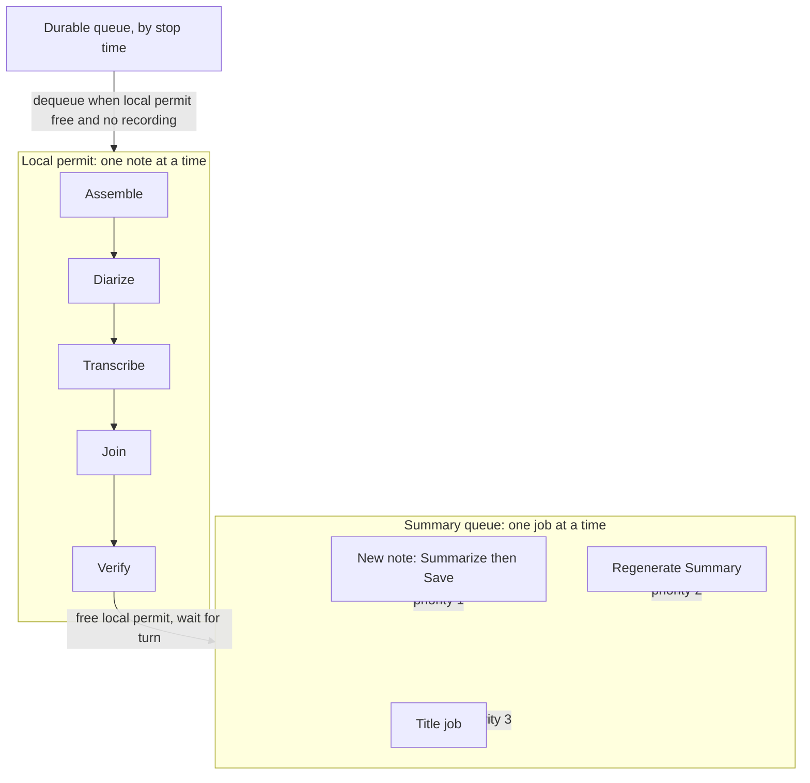

# Separate Summary Queue - Plan

## Goal Capsule

- **Objective:** A slow summary endpoint does not delay the audio processing of a new note, and old notes' regenerations and titles do not delay its save. A summary that the endpoint makes in up to 30 minutes is saved, not cut off. A second Regenerate Summary of the same note is refused. The app log shows each request to the endpoint and how each regeneration ends.
- **Means:** The local permit for audio stages and a summary queue for the endpoint work and the writes to the note folder (KTD1, KTD2).
- **Product authority:** This Product Contract. The idea file is `docs/ideas/next/summary-queue.md`.
- **Dependency:** PR #17 (merged as `352a2c2`) changed the context probe, the saved plan and `SessionDetail.regenerating`. This plan starts from that code.
- **Open blockers:** None.
- **Stop conditions:** Stop and ask the user when a change would send a request to the endpoint again after the endpoint can have received it, or when a note would be saved twice for one run.
- **Ships as:** One PR, type `fix` (patch release).

---

## Product Contract

### Summary

The runner gets a second queue, the summary queue. It runs one job at a time: the Summarize and Save stages of a new note, a Regenerate Summary, or a title job. The audio stages (Assemble, Diarize, Transcribe, Join, Verify) keep the one local permit and the pause during a recording. A new note can transcribe while another note waits for its summary. The new note is saved, with its transcript, after its own summary. The reply wait goes up to 30 minutes. A second Regenerate Summary of a note is refused at once. The client logs each request, and the runner logs how each regeneration ends.

### Problem Frame

On 2026-10-14 the desktop app processed a new note 7.5 minutes after Stop. Three Regenerate Summary requests had the one processing permit before it. One note had two of them, and both ran. One request to the endpoint took 340 s. Another stopped at Longhand's 600 s reply deadline. The LiteLLM proxy has a per-attempt timeout of 600 s. It tried again and got the answer 1 s after Longhand closed the connection, so the summary was lost.

The one permit (skeleton plan R20c) exists because one recognition engine is loaded. A summary request does not use that engine, but today it holds the same permit. The 600 s deadline exists because a request that never ends would stop every later note (skeleton plan U10).

The app log does not show when a request to the endpoint starts or ends, or how a regeneration ends. The diagnosis needed the proxy log.

### Requirements

**Queues**

- R1. The audio stages of a note never wait for a request to the endpoint, a title job or a regeneration.
- R2. The summary queue runs one job at a time. A job is the Summarize and Save stages of one note, one Regenerate Summary, or one title job.
- R3. The summary queue takes the stages of a new note (also a Transcribe Again run) before a Regenerate Summary, and a Regenerate Summary before a title job. Jobs of one kind run in the order they arrived.
- R4. A note is saved once, with its transcript and its summary (or the summary stub) together. Save runs after the note's Summarize stage.
- R5. A recording does not pause the summary queue. The audio stages still pause during a recording (skeleton plan KTD20).
- R6. Cancel, Resume, Delete and quit stop the job of the note in either queue, also while the job waits for its turn.

**Reply wait**

- R7. Longhand waits up to 30 minutes for the reply to one request.
- R8. In one run of the app, a request that the endpoint can have received is not sent again. Only a failed connection is tried again (the current rule). A note that a relaunch reclaims sends its requests again, as today.

**Regenerate Summary**

- R9. Regenerate Summary of a note whose regeneration waits or runs is refused at once, with the message "This note's summary is already being made again."
- R10. Regenerate Summary of a note that is not saved is refused before it waits for its turn.

**Status and logs**

- R11. While a note waits for the summary queue, Home and the note page show "Waiting to summarize". "Waiting for the recording" shows only for a note whose next stage is an audio stage.
- R12. While a regeneration waits for its turn, the note page shows "Waiting to summarize". It shows "Summarizing" when the request starts.
- R13. The app log has one line when each request to the endpoint starts and one line when it ends. The lines give the note, the kind of request, the host, the model, the time waited in the queue, the duration and the result. They never contain the credential, the transcript or the summary.
- R14. The app log has one line when each regeneration ends, with the result or the error.
- R15. An app update does not restart the app while a job of the summary queue runs or waits.

### Acceptance Examples

- AE1. Covers R1, R4. Given note A waits for a 20-minute reply, when the user stops note B, then B transcribes at once. B waits for the summary queue after Verify. A is saved when its reply comes, and B is summarized after A.
- AE2. Covers R3. Given two regenerations of old notes wait for the summary queue, when note C finishes Verify, then C's Summarize and Save run before the regenerations.
- AE3. Covers R5. Given note A's request runs, when the user starts a recording, then the request continues and A is saved during the recording. Note B, queued, does not start its audio stages until the recording stops.
- AE4. Covers R9. Given the regeneration of note A waits behind note B's summary, when the user asks Regenerate Summary for A again, then the request is refused at once and only one regeneration of A runs.
- AE5. Covers R7, R8. Given the endpoint answers after 11 minutes, then the summary is saved. Given the endpoint does not answer in 30 minutes, then the note is saved with the summary stub and the request is not sent again.

### Key Decisions

- **Two queues, one summary job at a time.** The user rejected parallel requests to the endpoint and a setting for the queue. Governs R1, R2. (session-settled: user-approved — chosen over parallel LLM calls and a queue setting: one request at a time keeps load on the endpoint low and needs no setting.)
- **A longer wait, not streamed replies.** Governs R7. (session-settled: user-approved — chosen over streaming: a longer deadline is a small change, and the proxy log showed slow requests that finished.)
- **Refuse a second regeneration, do not merge it.** Governs R9. (session-settled: user-approved — chosen over merging the two requests: the first run already uses the current prompt and Background.)
- **The note saves once.** Governs R4. (session-settled: user-approved — chosen over saving the transcript first and the summary later: one save keeps the save state machine and its recovery unchanged.)

### Scope Boundaries

- Considered and not built: a durable record that a request was sent, so that a relaunch saves the stub and does not send the request again. Today a relaunch sends it again, and this plan does not change that. Evidence that would change this: a log that shows an endpoint that billed or ran twice after a relaunch.

- No automatic retry of a summary stub. See `docs/ideas/someday/retry-a-failed-summary-later.md`.
- No parallel requests to the endpoint, and no setting for the queue.
- No streamed replies.
- No change to how the note page reports a regeneration that failed while the user was on another page. See `docs/ideas/someday/failed-regeneration-on-return.md`. The log line of R14 is the only change for it.
- Considered and not built: a timer that does not stop while the Mac sleeps. A tokio timer stops during sleep, so a 30-minute wait can last longer than 30 minutes of wall time. A request that fails because the connection broke during sleep fails at once. Evidence that would change this: a log that shows a request waiting much longer than 30 minutes after a wake.
- Considered and not built: a limit on how long a job waits for its turn. Each request has a 30-minute reply limit, and a job sends one request for each part of a long transcript, so one job can hold the queue for more than 30 minutes. The queue holds few jobs. Evidence that would change this: a report of a queue that did not move.

---

## Planning Contract

### Key Technical Decisions

- KTD1. **The summary queue runs Summarize and Save of a note in one turn.** The local permit stays for the audio stages. The summary queue owns everything that writes the note folder: Save, regeneration and the title job. Two comments rely on this: `crates/pipeline/src/save.rs` `reconcile_after_done` and `regenerate_summary` say that only one folder rename runs at a time "because the caller holds the one processing permit". With Save in the summary queue, that stays true for the summary queue. Save waits for the note's own summary in any case (R4), so it adds no wait for other notes.
- KTD2. **The summary queue is a small priority queue, not a tokio `Semaphore`.** A semaphore is first come, first served, so three old regenerations could delay a new note's save by up to 90 minutes. The queue has three classes (new note, regeneration, title) and is first in, first out in each class (R3). It gives a guard that frees the turn when dropped, like `acquire_owned`.
- KTD3. **One task for each note.** `Runner::run` spawns `run_session` for each dequeued note and waits only until the note leaves its last audio stage. The note's task gives the result of its audio stages back to the loop. When that result is `Waiting` (a model is not on disk), the loop waits for a wake or `POLL` before the next dequeue, as today, so it does not claim the same note again and again. So only one note is in the audio stages at a time, and the queue order by stop time stays (R20c). `run_next` keeps its test contract: it waits for the whole note and gives the final `Outcome`.
- KTD4. **`current` becomes a map from note id to its cancel token.** Each token is a child of `shutdown`. `cancel`, `shutdown` and the end of `run_session` use the map. Today `current` holds one note, so a cancel or a quit would miss a note in the summary queue (R6).
- KTD5. **One heartbeat for each note, from dequeue to the end of `run_session`.** Today the heartbeat runs only while a stage runs. A note that waits for the summary queue would look dead after 30 s (`CLAIM_STALE_AFTER`), and another instance could reclaim it.
- KTD6. **Summary-queue jobs do not check `suspended`.** Each kind of job keeps its own stop rule: Summarize and Save of a new note stop on cancel, on quit, and when the note is no longer `Processing` (`StageControl::taken_back`). A regeneration stops on cancel and quit (`Unattended`). A title job stops when it is no longer due (`TitleControl`). Each keeps a power lease while the job runs and does not release it during a recording. The audio stages keep `StageControl` with the pause. This removes one path that reads capture state, so the lock order (capture, then store) has fewer places to break.
- KTD7. **The reply deadline is 30 minutes.** `Limits::completion` gets `response` 30 min and `total` 32 min. `connect` (10 s) and `idle` (60 s) do not change. The proxy's 600 s attempt plus one retry then fits in one Longhand request. A deadline stays an `Answered` failure, so it is not sent again (R8).
- KTD8. **The second regeneration is refused in `Claims::regenerate`.** The check and the new claim happen under one lock. `Claims::regenerate` returns a typed refusal (regenerating, deleting, held) in place of `None`. A held note still waits, as today. The not-saved check (R10) runs before the wait for a turn, and runs again in `save::regenerate_summary`.
- KTD9. **The client logs each request.** `Client::send` gets a label (note id and request kind: probe, chunk, merge, single, title). It logs start and end at Info level, with host, model, the time spent in the queue, the duration and the HTTP status or the error kind. The label and the queue time come from the caller.
- KTD10. **The runner tells the app when a job waits for the summary queue.** A new `RunnerEvent::WaitingToSummarize { session_id }` and a runner method that says if a note waits. `SessionDetail` and the list entry get a field that the page and Home read. A new note's `jobs.stage` is set to `summarize` when it starts to wait, so a restart shows the right stage. When a job gets its turn, the runner sends `RunnerEvent::StageStarted { stage: Summarize }` for the note, also for a regeneration.
- KTD11. **`is_working` is true while any job runs or waits in either queue.** The updater uses it (`src-tauri/src/lib.rs`). A restart would end a 30-minute request (R15).

### High-Level Technical Design



The note's task lives from dequeue to the end of Save. It holds the local permit until Verify ends, then waits for a turn in the summary queue. While it waits, the note is `Processing`, its claim and heartbeat stay, and its in-use marker stays fresh.

```mermaid
sequenceDiagram
  participant Loop as Runner loop
  participant A as Note A task
  participant B as Note B task
  participant SQ as Summary queue
  Loop->>A: dequeue A, spawn
  A->>A: audio stages (local permit)
  A->>Loop: local permit free
  A->>SQ: wait for turn (class: new note)
  SQ-->>A: turn
  Loop->>B: dequeue B, spawn
  B->>B: audio stages (local permit)
  A->>A: Summarize (request up to 30 min), Save
  A->>SQ: free turn
  B->>SQ: wait for turn
```

### Assumptions

- The LiteLLM proxy keeps its own per-attempt timeout of 600 s and sends the request again when it ends. R7 removes only Longhand's limit. For a reply that takes more than 10 minutes in one attempt, the proxy timeout must also be at least 30 minutes. That is a change to the proxy configuration, not to the app.

- The summary queue holds few jobs. A priority queue with a `Mutex<VecDeque>` per class and a `Notify` is enough.
- The live worker and the audio stages share the engine slot. The summary queue does not touch it.

### Sequencing

U3 needs U1 for the request labels. U2 and U4 need U3. U5 needs U3 and U4. U6 is last.

---

## Implementation Units

### U1. Reply wait and request log in the client

- **Goal:** Wait up to 30 minutes for a reply, and log each request.
- **Requirements:** R7, R8, R13. KTD7, KTD9.
- **Dependencies:** None.
- **Files:** `crates/summarize/src/client.rs`, `crates/summarize/src/context.rs`, `crates/pipeline/src/summarize.rs`, `crates/summarize/tests/client.rs`.
- **Approach:**
  1. Change `Limits::completion` (KTD7). Rewrite the module comment at the top of `client.rs`: the deadline now protects the summary queue, not every later note.
  2. Add a request label to `Client::send` and log start and end (KTD9). Keep `send_once` and the `NotReached`/`Answered` split as they are.
  3. Pass the label from `context::probe`, `Calls::call_as` and `send_title_request` in `crates/pipeline/src/summarize.rs`.
- **Patterns to follow:** The `log::warn!` for a failed connection in `Client::send`. The host comes from the existing `without_url` helper, so the URL path and query do not go to the log.
- **Test scenarios:**
  - An endpoint that answers after a delay longer than the old 600 s reply limit, with test limits scaled down, gives the reply.
  - An endpoint that never answers fails with the response deadline, and the mock sees one request.
  - A connection refused, then accepted, is sent twice (the current retry still works).
  - The log line of a request has the label, host and status, and has no part of the request body or the key (check with a test logger, or test the formatting function).
- **Verification:** The three "not sent again" tests and the new tests pass.

### U2. Refuse a second regeneration

- **Goal:** Refuse a second Regenerate Summary of a note at once, and refuse one for a note that is not saved before it waits.
- **Requirements:** R9, R10. KTD8.
- **Dependencies:** U3.
- **Files:** `crates/session-core/src/jobs.rs`, `crates/pipeline/src/runner.rs`, `src-tauri/src/managers/processing.rs`, `src/session/SessionPage.tsx`, `crates/pipeline/tests/runner.rs`, `src/session/SessionPage.test.tsx`.
- **Approach:**
  1. `Claims::regenerate` returns a typed refusal. Check for an entry with the same id and push under one lock.
  2. `regenerate_claimed` maps "regenerating" to the R9 message, keeps the wait for "held", and keeps the delete message.
  3. Read the note state before the turn wait. Refuse a note that is not `Saved` with the message that `save::regenerate_summary` gives today.
  4. Disable the Summary-tab Regenerate button and the note type offer button while `summarizing` is true. The backend check is the guard, and the buttons only show it.
- **Patterns to follow:** The delete refusal in `regenerate_claimed`. The test `a_regeneration_while_a_delete_removes_the_folder_is_refused`.
- **Test scenarios:**
  - Covers AE4. Two `regenerate_summary` calls on one note while the endpoint hangs: the second returns the R9 message at once, and the mock sees one regeneration's requests.
  - A second regeneration after the first ended runs.
  - A regeneration of a `Processing` note is refused before it waits, while another note holds the summary queue.
  - The Summary-tab button is disabled while the page shows a running regeneration.
- **Verification:** The new tests pass. The delete and move tests for claims still pass.

### U3. Two queues in the runner

- **Goal:** Audio stages run under the local permit while the summary queue runs one job at a time.
- **Requirements:** R1, R2, R3, R4, R5, R6, R15. KTD1 to KTD6, KTD11.
- **Dependencies:** U1.
- **Files:** `crates/pipeline/src/runner.rs`, `crates/pipeline/src/summary_queue.rs` (new), `crates/pipeline/src/lib.rs`, `crates/pipeline/src/save.rs` (comments), `crates/pipeline/tests/runner.rs`, `crates/summarize/tests/common/mod.rs`.
- **Approach:**
  1. Add the summary queue (KTD2) with classes and a guard.
  2. Make `current` a map with child tokens (KTD4). Update `cancel`, `shutdown`, and the end of `run_session`.
  3. Spawn `run_session` from `run`, and hand the result of the audio stages back to the loop (KTD3). `run_next` keeps its rules: no start during a recording, no start after quit, the first ready note in stop order.
  4. In `run_session`, run the audio stages with the local permit. Then free the local permit, set `jobs.stage` to `summarize`, emit the wait event (KTD10), and wait for a turn of class "new note". Run Summarize and Save in that turn. A note whose Save has begun (for example after a relaunch) does not take the local permit and goes straight to the summary queue.
  5. Move the heartbeat to `run_session` (KTD5).
  6. Add the summary-queue form of `StageControl` (KTD6) and use it for Summarize and Save.
  7. `is_working` reads both queues and the map (KTD11).
  8. After the turn starts, and after each reply, the job checks that the note is still `Processing` (the control's `taken_back` does this at each `proceed`).
  9. Rewrite the two comments in `save.rs` to name the summary queue.
- **Execution note:** Write the AE1 test first, and see it fail on the current runner. Give every cargo test run a time limit (`perl -e 'alarm 600; exec @ARGV' cargo test ...`), because a deadlock in this unit hangs the test run.
- **Patterns to follow:** `regenerate_claimed` for a job that waits for a turn. `ActivePower` for leases. The lock-order rule in `docs/solutions/logic-errors/runner-store-lock-before-suspended-check-deadlocks.md`: never call `suspended` while the store lock is held.
- **Test scenarios:**
  - Covers AE1. Note A's summary request is held by a gated mock. Note B is queued: B's audio stages start and finish while A's request is held. A's Save comes after its reply. B's Summarize starts after A's Save.
  - The audio stages of two notes never overlap (the `overlapped` flag stays false).
  - Covers AE3. A recording starts while A's request runs: the request ends and A is saved during the recording. Note B does not start until the recording stops.
  - A resume of note A while it waits for its turn: A leaves the queue without a request, and its transcription is kept.
  - A cancel of note A while its request runs stops the request, and B continues.
  - Quit while one note transcribes and another waits for a reply: both stop. A restart reclaims both and runs them again.
  - A note that ends its audio stages with `Waiting` (missing weights) is not dequeued again until a wake or `POLL`.
  - A reclaimed note whose Save has begun saves while another note holds the local permit.
  - A note that waits for its turn for longer than `CLAIM_STALE_AFTER` keeps its claim (the heartbeat is fresh).
  - `is_working` is true while a job only waits for its turn.
  - Rework `two_queued_sessions_run_one_stage_at_a_time_in_stop_order`, `nothing_starts_while_capture_is_active`, and the unit tests that read `runner.permit`, so that each checks the new rule instead of the old one.
- **Verification:** The pipeline crate tests pass with a time limit. A read of the lock order finds no path that holds the store lock while it reads capture state.

### U4. Regenerations and title jobs in the summary queue

- **Goal:** Regenerations and title jobs take turns in the summary queue, do not pause during a recording, and log how they end.
- **Requirements:** R2, R3, R5, R14. KTD2, KTD6.
- **Dependencies:** U3.
- **Files:** `crates/pipeline/src/runner.rs`, `src-tauri/src/managers/processing.rs`, `crates/pipeline/tests/runner.rs`.
- **Approach:**
  1. `regenerate_claimed` waits for a turn of class "regeneration" in place of the permit. It uses the summary-queue form of `Unattended` (KTD6), and sends `StageStarted` when it gets its turn (KTD10).
  2. `title_job` waits for a turn of class "title". `run_titles` runs title jobs as their own tasks, so a title job does not wait for a note's audio stages. A recording does not stop it.
  3. `Runner::regenerate_summary` logs the end: the note id, the time it waited, the duration, and the path or the error.
  4. Keep the title-job claim rules of the title plan KTD13: a delete or move cancels a waiting title job and deletes its request.
- **Patterns to follow:** `queue_title_if_pending` and `title_gate`.
- **Test scenarios:**
  - Covers AE2. Two regenerations wait, then a new note reaches the summary queue: its Summarize and Save run first.
  - A title job of a saved note runs while another note transcribes.
  - A title job waits while a new note's Summarize runs, and runs after its Save.
  - Deleting a note while its title job waits cancels the job and leaves no title request (rework `deleting_the_note_while_its_title_job_waits_for_the_permit_cancels_the_job`).
  - A regeneration runs during a recording and keeps a power lease (rework `processing_power_releases_during_capture_and_after_summary_regeneration`).
  - A regeneration publishes and releases its claim before its title turn (keep the existing test).
  - A failed regeneration writes one log line with the error.
- **Verification:** The title and regeneration tests in `crates/pipeline/tests/runner.rs` pass.

### U5. "Waiting to summarize" on Home and the note page

- **Goal:** Show which notes wait for the summary queue, and stop showing "Waiting for the recording" for them.
- **Requirements:** R11, R12. KTD10.
- **Dependencies:** U3, U4.
- **Files:** `crates/pipeline/src/runner.rs`, `src-tauri/src/managers/processing.rs`, `src-tauri/src/commands/session.rs`, `src/bindings.ts` (generated), `src/processing/describe.ts`, `src/processing/describe.test.ts`, `src/session/useSessions.ts`, `src/session/ProcessingStatus.tsx`, `src/session/SessionPage.tsx`, `src/home/SessionRow.tsx`, `src/home/PreviewPanel.tsx`.
- **Approach:**
  1. Map `RunnerEvent::WaitingToSummarize` to a new `ProcessingStep`. Add a field to `SessionDetail` and to the list entry that says the note waits for the summary queue.
  2. `entryStatus` shows "Waiting to summarize" for such a note. It applies `waits` only to a queued note or a note in an audio stage.
  3. `RegenerateStatus` shows "Waiting to summarize" until the `StageStarted` event of the regeneration.
  4. `stageRows` and the summarize row of `ProcessingStatus.tsx` show "Waiting to summarize" with the pending marker while the note waits, so the note page and Home agree.
  5. Use the `apple-design` skill before the UI change. The text replaces the status text in place, with no new notice (CLAUDE.md, UI design).
- **Patterns to follow:** How `SessionDetail.regenerating` reached the page in PR #17. The `stage_started` handling in `useSessions.ts`.
- **Test scenarios:**
  - `entryStatus` gives "Waiting to summarize" for a processing note that waits, also when `waits` is true.
  - `entryStatus` gives "Waiting for the recording" for a queued note and for a note in Transcribe when `waits` is true.
  - The note page shows "Waiting to summarize" for a regeneration that waits, then "Summarizing" after its `StageStarted` event.
  - `stageRows` marks the summarize row as waiting, not running, for a note that waits for the summary queue.
- **Verification:** `bun test ./src/` and the typecheck pass. A Playwright preview shows the two texts.

### U6. Documents

- **Goal:** Record the new rules in the plans and the glossary.
- **Requirements:** R1 to R15 (documentation).
- **Dependencies:** U1 to U5.
- **Files:** `docs/plans/2026-09-21-2052-feat-longhand-walking-skeleton-plan.md`, `docs/plans/2026-09-30-1604-feat-title-instructions-plan.md`, `CONCEPTS.md`.
- **Approach:**
  1. Add an "Amended 2026-10-14" note to skeleton R20c (one stage at a time applies to the audio stages), KTD20 (the summary queue does not pause), and U10 (the reply deadline and its reason).
  2. Add an amended note to the title plan KTD13 (the title job takes a turn in the summary queue and does not pause during a recording).
  3. Add a "Summary queue" entry to `CONCEPTS.md`.
- **Test expectation:** none -- documents only.
- **Verification:** `bun scripts/ideas.ts check` passes.

---

## Verification Contract

| Gate | Command | When |
|---|---|---|
| Client tests | `cargo test -p summarize` | U1 |
| Pipeline tests | `perl -e 'alarm 600; exec @ARGV' cargo test -p pipeline` | U2, U3, U4 |
| Session-core tests | `cargo test -p session-core` | U2 |
| Frontend | `bun test ./src/` and the typecheck | U2, U5 |
| Workspace | full `cargo test --workspace`, `cargo clippy --workspace --all-targets`, `cargo fmt --all --check` | once at the end |
| Ideas | `bun scripts/ideas.ts check` | U6 |
| Manual | Signed build. Record note A with a slow model. Stop. Record note B and stop while A summarizes. B's audio stages finish and B shows "Waiting to summarize" while A's request runs. B is saved after A. Regenerate Summary twice on one note: the second is refused. The log has the request lines. | before the PR |

Read [Checks and CI](docs/development-workflow.md#checks-and-ci) before the push.

---

## Definition of Done

- Each R has a test or a manual check in the Verification Contract.
- The two comments in `save.rs`, the module comment in `client.rs` and the amended plan text name the summary queue.
- No test uses a fixed delay from the start of the test. Timing tests wait on an event or on a request that the mock received.
- No code from an approach that was not used stays in the diff.
- The PR title is a `fix` Conventional Commit that names the summary queue, the longer reply wait and the refused second regeneration.

---

## Appendix

### Sources

- `crates/pipeline/src/runner.rs`: `Runner` fields, `run`, `run_next`, `run_session`, `run_stage`, `regenerate_claimed`, `title_job`, `is_working`.
- `crates/session-core/src/jobs.rs`: `Claims`, `CLAIM_STALE_AFTER`, `reclaim_at_launch`.
- `crates/summarize/src/client.rs`: `Limits::completion`, `send`, `send_once`.
- `src/processing/describe.ts`: `entryStatus`.
- `docs/solutions/logic-errors/runner-store-lock-before-suspended-check-deadlocks.md`: lock order.
- `docs/solutions/logic-errors/retry-showed-failed-speaker-attempt-progress.md`: clear saved attempt state before a wait.
- `docs/solutions/logic-errors/summary-in-a-wake-with-no-network-kept-the-default-budget.md`: the "not sent again" rule.
- `docs/solutions/logic-errors/save-state-machine-crash-window-recovery.md`: Save recovery.
- Desktop log and LiteLLM proxy log of 2026-10-14 (not in the repo).
