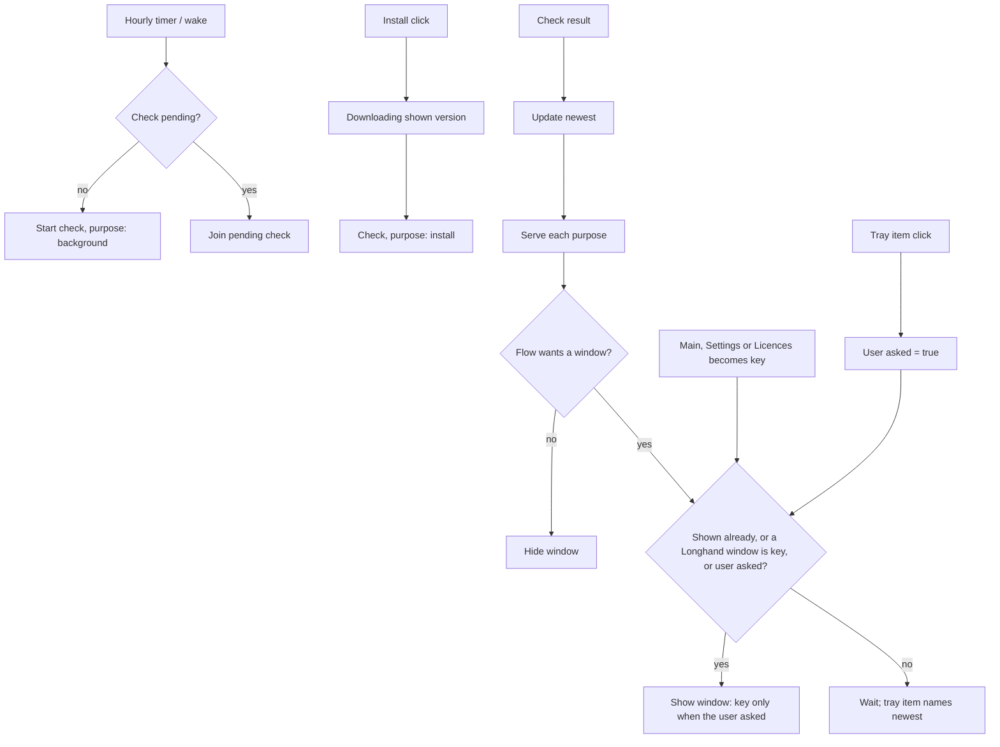

# Update Notice Timing - Plan

## Goal Capsule

- **Objective:** A user sees an update notice only when they use Longhand, and one install takes them to the newest release.
- **Means:** The update flow records the newest release that a check found and holds automatic notices until a Longhand window is active (KTD1, KTD2).
- **Product authority:** This Product Contract. It changes R13, R16 and KTD9 of `docs/plans/2026-09-28-1240-feat-preview-builds-and-updates-plan.md` where they conflict; the other rules of that plan stay. On product behaviour, an R-ID wins; on mechanism, a KTD wins.
- **Open blockers:** None.
- **Stop conditions:** Stop and ask when a requirement cannot be met without a change to the busy rules, the 24-hour delays or the consent before a download.
- **Execution profile:** One feature branch in a worktree, one commit per unit, one PR. The PR title type is `fix` unless the user chooses otherwise. Manual tests run on a signed build (`docs/development-workflow.md#manual-tests`).
- **Product Contract preservation:** changed: R6, AE7 — clarified to match the confirmed planning call-out that a shown ready question keeps its version, and that the tray item never opens "Relaunch Now" for an old download. The deferred focus question is resolved in KTD6.

---

## Product Contract

### Summary

Automatic update notices wait until the user brings a Longhand window to the front. Until then, a tray menu item shows that an update is available and opens the notice. The notice is a normal window, not on top of other apps. Install always gets the newest release at the time of the click.

### Problem Frame

The update window opens as soon as a check finds a newer release. It floats over all apps, also when the user works in a different app and does not use Longhand. Other Mac apps (for example ChatGPT and Claude) show their update notice only when the user brings the app to the front.

When the window opens, it keeps the version that the check found. While the window is open, no other check runs. If a newer release comes out before the user clicks Install, Longhand downloads and installs the older release. After the relaunch, the next check finds the newer release, and the user gets a second update immediately. A saved download that installs at launch can cause the same problem.

### Key Decisions

- **Wait for a Longhand window, not for any app activation.** A window in front shows that the user uses Longhand. The tray menu and the recording widget do not show this. Governs R1, R2.
- **A tray menu item for users who keep no window open.** With "Hide from Dock" on, a user can go days with no Longhand window in front. The tray item shows the update without an interruption. (session-settled: user-directed — chosen over "wait for a window only" and over "show a normal window after a long wait (for example 3 days)": the tray item tells the user and does not interrupt.) Governs R4, R5.
- **The newest release, always.** Each step that starts a download or an install uses the newest release that a check found. This prevents two updates in a row. Governs R6 to R9.

### Requirements

**When the notice shows**

- R1. An automatic update notice shows only when a Longhand window (the main window, Settings or another app window) is the active window. If a notice is due while no Longhand window is active, it waits and shows when one becomes active.
- R2. The tray menu, the recording widget and the menu bar icon do not make a waiting notice show.
- R3. R1 applies to each automatic notice: the offer, the ready question ("Relaunch Now" or "Later") and the download error. The rules for busy (R14 and R17 of the earlier plan) still apply first. "Check for Updates…" shows its result immediately, as before.

**Tray menu item**

- R4. While a newer release is available and not installed, the tray menu shows an item that names the version, for example "Update Available: 1.0.5…". A click on the item opens the update notice and brings it to the front.
- R5. The tray item stays during the 24 hours after "Remind Me Later" or "Later". It shows nothing by itself, so it does not count as a reminder.

**Newest release**

- R6. The hourly checks continue while a notice waits or shows, and during the 24-hour delays after "Remind Me Later" and "Later". A check that finds a newer release changes the version in the offer and in the tray item. A shown ready question keeps its version, and "Relaunch Now" then gets the newer release by R7. The delays still stop the notice from showing by itself.
- R7. A click on "Install and Relaunch" starts a new check and downloads the release that this check names, also when the notice shows an older version. If the check fails, the download uses the newest release that an earlier check found. The progress shows the version that downloads.
- R8. At launch, Longhand does not install a saved download when the update manifest names a newer release. It offers the newer release by the rules above.
- R9. "Relaunch Now" and the install at quit install a saved download only when no check has found a newer release. If a check has found a newer release, Longhand does not install the saved download and offers the newer release by the rules above.

**Window**

- R10. The update notice is a normal window. It does not stay on top of other apps. When the user changes to a different app, the notice goes behind that app.

### Acceptance Examples

- AE1. **Covers R1, R2.** Given Longhand runs with no window open and the user types in a different app, when an hourly check finds 1.0.5, then no window opens and the tray menu shows "Update Available: 1.0.5…". When the user opens the main window, the offer shows.
- AE2. **Covers R6, R7.** Given the offer for 1.0.4 waits for a Longhand window, when 1.0.5 comes out and the user then opens Longhand and clicks Install, then 1.0.5 downloads and installs, and after the relaunch no offer shows.
- AE3. **Covers R4, R5.** Given the user clicks "Remind Me Later", when they open the tray menu during the next 24 hours, then the tray item is there and a click on it opens the offer.
- AE4. **Covers R8.** Given 1.0.4 is downloaded and saved, and the user quits before an install, when Longhand launches and the manifest names 1.0.5, then Longhand does not install 1.0.4 and offers 1.0.5.
- AE5. **Covers R3.** Given no Longhand window is active, when the user chooses "Check for Updates…" in the tray menu, then the result shows immediately.
- AE6. **Covers R10.** Given the offer shows, when the user changes to a different app, then the offer goes behind that app's windows.
- AE7. **Covers R6, R9.** Given 1.0.4 is saved and the user clicks "Later", when 1.0.5 comes out during the 24-hour delay and the user quits, then 1.0.4 does not install. When the user then clicks the tray item, the offer names 1.0.5.

### Scope Boundaries

- Deferred: a badge or dot on the Dock icon or the tray icon.
- Unchanged: the busy rules, the 24-hour delays, the consent before a download, and the update settings.
- Unchanged: the Windows app, which does not check for updates.

### Sources / Research

- `src-tauri/src/managers/updates/flow.rs` — `timer` checks only from `Idle` and `WaitingForQuit`, so no check runs while an offer waits or shows.
- `src-tauri/src/managers/updates.rs` — `download` uses the `Update` of the last check; `install_at_launch` installs the saved version when the manifest names that version or a newer one.
- `src-tauri/src/window.rs` — `show_update_window` builds the window with `always_on_top(true)` and `focused(false)`.
- `src-tauri/src/tray.rs` — the tray menu, which already has "Check for Updates…".
- `docs/solutions/ui-bugs/window-showed-before-tao-applied-saved-frame.md` — why the update window is built hidden, shown without key, and has a 1 s show fallback.
- `docs/solutions/ui-bugs/tauri-stale-close-listener-blocks-next-window.md` — the update window must keep no close listener, because the tray click reopens the same label.
- `docs/solutions/ui-bugs/cmd-h-window-came-back-because-widget-sync-unhid-app.md` — a show while the app is hidden unhides the app; the notice gate prevents this.
- `docs/solutions/ui-bugs/folder-notice-for-a-move-the-app-does-without-help.md` — no message for a skipped old download or for the check at Install, because the app corrects these without help.

---

## Planning Contract

### Key Technical Decisions

- KTD1. **The flow records the newest release that a check found.** `Flow` gets a `newest` version. A check that returns a release sets it, a check that returns no release clears it, and a failed check keeps it. Versions compare with `semver`, never as text. `newest` drives the tray item (R4), the version in a notice (R6) and the install guards (R8, R9). A "highest ever seen" value would keep a withdrawn release in the tray item and block the saved install for ever.
- KTD2. **A show condition, not a gate flag on transitions.** The manager shows the update window when the flow wants a window and one of these is true: the window already shows for this notice, a Longhand window is active, or the user asked (manual check or tray click). The flow owns "the user asked" as a field that a close clears. The manager owns "a Longhand window is active" as a fact. A flag set on each transition would need a rule for every path (Offered to Held to Offered, a version change, Ready to Offered), and each missed path would show or hide the notice wrongly. The condition applies only when the window changes from hidden to visible. A state change while the window is visible (Downloading to Ready or Failed, a version change in Offered) changes the page content in place and does not bring the window to the front. Governs R1 to R3.
- KTD3. **A Longhand window is active when `main`, `settings` or `licences` is the key window.** The manager reads `is_focused()` of those windows at each step, and a `WindowEvent::Focused(true)` of those labels sends the manager a message. The widget panel can never become key, and the update window itself does not count. A Longhand window that is key also means that the app is not hidden, so a show cannot unhide the app.
- KTD4. **One pending check with a set of purposes.** The flow holds at most one check in flight, with the purposes that wait for it: background, manual and install. A result always updates `newest` first, then serves each purpose. An Install click while a check runs joins that check. The rule "a result outside `Checking` does nothing" becomes "a result with no pending check does nothing". This lets hourly checks run from every resting state, including Offered, Held, Ready, ReadyHeld, WaitingForQuit, Failed, UpToDate and CheckFailed, without replacing the shown state with `Checking`.
- KTD5. **The delays decide whether a notice may show by itself, not whether a check runs.** The timer checks every hour while automatic checks are on and no download or install runs. While `remind_until` or `later_until` is active, a result changes only `newest` and the tray item. After the delay, the next timer offers `newest`. Governs R5, R6.
- KTD6. **An automatic notice shows at normal level without key; a tray click shows it with key.** The window loses `always_on_top`. An automatic notice keeps `order_front_without_key` and the page's Enter and Space guard, so text that the user types stays in the note. A tray click is a request for the notice, so it shows with focus, also when the window already shows (today `show_update_window(true, Some)` does nothing). Governs R4, R10.
- KTD7. **Install shows the download at once and checks with a short timeout.** A click on Install goes to `Downloading` with the shown version and starts a check with the 5 s launch timeout. The result changes the version that downloads. A failed check or a check that names no release downloads the last known `Update`. A check that names the saved version goes straight to `Installing`. Busy and Close follow the existing `Downloading` rules. "Try Again" in `Failed` takes the same path, so it also gets the newest release. Governs R7.
- KTD8. **The install version is fixed when the flow enters `Installing`.** The "newer than saved" test (R9) runs at that transition and in `install_at_quit` for `WaitingForQuit`, never in `install_at_exit`. A check that returns between a restart request and the exit cannot cancel a confirmed install. The manager keeps two `Update` slots: the newest `Update` from the last check, and the `Update` of the version to install. While the flow is in `Installing`, `ReadyHeld` after a restart request, or `WaitingForQuit`, a check result replaces only the newest slot. `install_at_exit` uses the install slot.
- KTD9. **A choice uses `newest`, and the shown view does not change under the pointer.** While Ready shows, a newer result changes only `newest`. "Relaunch Now" with a newer `newest` takes the Install path of KTD7. A choice that arrives for the state before a change still acts (for example `(RelaunchNow, Offered)`).
- KTD10. **The tray item is inserted into and removed from a managed tray menu.** Tauri 2.11.6 `MenuItem` has no `set_visible`, so the tray `Menu` moves into managed state, and the item is inserted at a fixed position or removed. Its text comes from a pure function of `newest`, like `set_widget_item`, and changes run on the main thread.
- KTD11. **The launch install requires an exact version match.** `install_at_launch` installs the saved archive only when the manifest names exactly that version (`==`, was `>=`). The comparison moves into a pure helper with tests. Governs R8.

### High-Level Technical Design

The show condition (KTD2) and the place of each new input:

The tray click maps each state to the notice that it shows (R4):

| State when clicked | Notice shown |
|---|---|
| Idle, `newest` is the saved version | Ready |
| Idle, `newest` is newer than saved or none is saved | Offered `newest` |
| Held, ReadyHeld, hidden Downloading | Offered, Ready, Downloading (busy is ignored, as for "Check for Updates…") |
| WaitingForQuit | Ready if `newest` is the saved version, else Offered `newest` |
| Offered, Ready, Failed, Downloading, manual results | The same view, brought to the front with key |
| Checking (background) | Offered `newest`; the result updates it |
| Installing | Nothing |

### Assumptions

- A tray item text of "Update Available: 1.0.4…" is correct also when 1.0.4 is already downloaded and waits.
- After a relaunch during a delay, the tray item comes back with the first check, 30 s after launch. `newest` and the show condition are not saved.
- With automatic checks off, `newest` comes only from manual checks, and the tray item stays until the next relaunch.

---

## Implementation Units

### U1. Newest release and pending check in the flow

**Goal:** The flow knows the newest release at all times and checks from every resting state.

**Requirements:** R6, R8, R9; KTD1, KTD4, KTD5, KTD8.

**Dependencies:** None.

**Files:**
- `src-tauri/src/managers/updates/flow.rs`

**Approach:**
1. Add `newest` and the pending-check record (KTD1, KTD4). `Checking { manual }` stays as the view of a manual check only.
2. Change `timer` to check from every resting state, and move the delay tests from "is a check due" to "may this result show a notice" (KTD5).
3. In `checked`, update `newest` first, then serve each purpose. A background result in a notice state changes the version of `Offered` in place, and does not change `Ready` (KTD9).
4. Apply the R9 guard at the transition into `Installing` and in `install_at_quit` (KTD8).

**Execution note:** Rewrite the two tests that encode "no check during a delay" first, so that they fail before the change.

**Patterns to follow:** The existing `Flow::step` tests in `flow.rs` (`facts`, `busy`, `offering`, `ready` helpers).

**Test scenarios:**
- Covers AE2. Offered 1.0.4 shows; a timer check returns 1.0.5; the state is Offered 1.0.5 and no new window effect starts.
- Remind Me Later at 09:00; a timer at 10:00 starts a check; the result 1.0.5 sets `newest` and the state stays Idle.
- The first timer after `remind_until` with `newest` 1.0.5 gives Offered 1.0.5.
- Covers AE7. Later on saved 1.0.4; a check during the delay returns 1.0.5; `install_at_quit` returns none and the state stays WaitingForQuit.
- Ready 1.0.4 shows; a check returns 1.0.5; the state stays Ready 1.0.4 and `newest` is 1.0.5.
- Installing 1.0.4 after Relaunch Now; a check returns 1.0.5; `install_at_quit` still returns 1.0.4.
- A check returns no release; `newest` is cleared. A failed check keeps `newest`.
- Version compare: `1.0.10` is newer than `1.0.9`.
- A timer while a manual check is pending starts no second check.
- A timer from Failed, UpToDate or CheckFailed starts a check and the shown state stays.
- A manual check from Offered that fails, then Close, returns to Offered, not Idle.

**Verification:** The flow tests pass, and no test still encodes "no check during a delay".

### U2. Show condition and tray-open input in the flow

**Goal:** The flow says when a notice may show and what a tray click shows.

**Requirements:** R1 to R5; KTD2, KTD6, KTD9.

**Dependencies:** U1.

**Files:**
- `src-tauri/src/managers/updates/flow.rs`

**Approach:**
1. Add a "user asked" field that a manual check and a tray click set, and that a close of the notice clears (KTD2).
2. Add a tray-open input that maps each state to its notice per the table in the High-Level Technical Design.
3. Add a query that gives the tray item version (`newest`, or none while Installing or when the current version is the newest).
4. Accept a choice for the state before a background change (KTD9), and send Relaunch Now with a newer `newest` to the Install path.

**Patterns to follow:** `manual_check` for the busy bypass; `window_visible` for a pure query.

**Test scenarios:**
- Covers AE3. Remind Me Later, then a tray click: Offered `newest` shows with "user asked" set, and `remind_until` is unchanged.
- Covers AE5. A manual check while no window is key sets "user asked".
- A tray click in Held gives Offered; in ReadyHeld gives Ready; in hidden Downloading makes it visible.
- A tray click in WaitingForQuit with `newest` equal to saved gives Ready; with a newer `newest` gives Offered `newest`.
- A tray click in Installing changes nothing.
- A Close after a tray click clears "user asked".
- `(RelaunchNow, Offered)` after a background change starts the Install path.
- The tray query names `newest` in Idle, Offered and WaitingForQuit, and names nothing when no newer release is known.

**Verification:** Each row of the tray table has a passing test.

### U3. Fresh check at Install

**Goal:** Install downloads the release that a check at the click names.

**Requirements:** R7; KTD7.

**Dependencies:** U1.

**Files:**
- `src-tauri/src/managers/updates/flow.rs`
- `src-tauri/src/managers/updates.rs`

**Approach:**
1. In the flow, Install and "Try Again" go to `Downloading` with the shown version and add the install purpose to the pending check (KTD4, KTD7).
2. The install-purpose result decides the download: the checked version, the last known version on failure or no release, or `Installing` when the checked version is saved.
3. In the manager, the install-purpose check uses `LAUNCH_CHECK_TIMEOUT`. The download starts only after that result, with the `Update` of that check.

**Test scenarios:**
- Covers AE2. Offered 1.0.4, Install, the check returns 1.0.5: the effect is Download 1.0.5 and the state shows 1.0.5.
- Install, the check fails: Download of the shown version.
- Install, the check names the saved version: Installing and Restart.
- Failed 1.0.4; a background check returns 1.0.5; Try Again gives Download 1.0.5.
- Install while a background check runs: no second check starts, and the result serves both purposes.
- Busy starts during the install check: the state follows the Downloading busy rule.
- Close during the install check: the window hides and the download continues.

**Verification:** Flow tests pass; in the manager, no download starts before the install-purpose result.

### U4. Manager: active window fact and install guards

**Goal:** The manager shows the window only by the show condition, and every install path skips an old download.

**Requirements:** R1, R2, R8, R9; KTD2, KTD3, KTD8, KTD11.

**Dependencies:** U1, U2.

**Files:**
- `src-tauri/src/managers/updates.rs`
- `src-tauri/src/window.rs`
- `src-tauri/src/lib.rs`

**Approach:**
1. In `handle`, compute "a Longhand window is active" (KTD3) and apply the show condition before `show_update_window` (KTD2).
2. Add a manager message for "a Longhand window became key", sent from the `Focused(true)` arm of `window::on_window_event` for `main`, `settings` and `licences`.
3. Split the stored `Update` into the newest slot and the install slot, and make `install_at_exit` use the install slot (KTD8).
4. `install_at_launch` uses the pure exact-match helper (KTD11).
5. Show no message for a skipped old download or for the Install check.

**Patterns to follow:** `recording_changed` for a message from another module; `window::toggle_action` for a pure helper with tests.

**Test scenarios:**
- The launch helper: saved 1.0.4 and manifest 1.0.4 installs; manifest 1.0.5 does not; manifest 1.0.3 does not; a version that does not parse does not.
- Covers AE4. With saved 1.0.4 and manifest 1.0.5, the launch does not install, and the manager's first check offers 1.0.5.
- The show-condition helper: wanted and key gives show; wanted, not key, not shown, not asked gives wait; wanted and shown already gives show; not wanted gives hide.
- Downloading to Ready with the window visible and no Longhand window key: no front action.
- Installing 1.0.4, then a check returns 1.0.5: the install slot still holds the 1.0.4 `Update`.

**Verification:** Helper tests pass. The signed-build manual test (Verification Contract) confirms AE1 and that a notice does not show while Longhand is hidden.

### U5. Update window level and focus

**Goal:** The notice is a normal window, and a tray click brings it to the front with key.

**Requirements:** R4, R10; KTD6.

**Dependencies:** U2, U4.

**Files:**
- `src-tauri/src/window.rs`
- `src/update/UpdateWindow.tsx`
- `src-tauri/src/commands/updates.rs`
- `src/bindings.ts` (regenerated)
- `src/update/UpdateWindow.test.tsx`
- `docs/solutions/ui-bugs/window-showed-before-tao-applied-saved-frame.md`

**Approach:**
1. Remove `.always_on_top(true)` from the update window builder.
2. Keep the key decision in Rust. `show_update_window` records "show with key" with the build, beside `UPDATE_OPENS`, and `show_built_update_window` and the 1 s fallback read it. A tray click on an existing window focuses it.
3. Add a `with_key` field to `UpdateStateChanged` and to the `update_state` result, so that the page chooses between the Enter and Space guard and Return on the default button.
4. Keep the Enter and Space guard for a window shown without key, and the 1 s show fallback with its build count.
5. Update the solution entry: the window no longer floats, and why.

**Patterns to follow:** `show(app, window, focus)` and `front` in `window.rs`; `useWindowFitsContent` sizing stays unchanged.

**Test scenarios:**
- The page enables Return on the default button only when the state says `with_key`.
- With key, Return activates the default button; without key, Return and Space do nothing (assert `document.activeElement`, per `docs/solutions/ui-bugs/wkwebview-click-does-not-focus-button-breaks-shortcut-capture.md`).

**Verification:** Page tests pass. The signed-build manual test confirms AE6 and that typed text stays in the note when an automatic notice shows.

### U6. Tray item

**Goal:** The tray menu shows "Update Available: <version>…" while a newer release is known.

**Requirements:** R4, R5; KTD10.

**Dependencies:** U2, U4.

**Files:**
- `src-tauri/src/tray.rs`
- `src-tauri/src/managers/updates.rs`
- `src-tauri/src/lib.rs`

**Approach:**
1. Keep the tray `Menu` in managed state, and insert or remove the update item above "Check for Updates…" (KTD10).
2. The manager updates the item after each step from the flow's tray query, on the main thread.
3. A click on the item sends the tray-open input.

**Patterns to follow:** `set_widget_item` and its pure text function; the `check_updates` menu event.

**Test scenarios:**
- The text function gives "Update Available: 1.0.5…" for 1.0.5 and no item for none.
- Covers AE1. With no window key, a check that finds 1.0.5 adds the item and shows no window (manager-level, with the show helper of U4).

**Verification:** Tests pass. The signed-build manual test confirms that the item appears, opens the notice, and goes away after an install.

---

## Verification Contract

| Gate | Command or check | Applies to |
|---|---|---|
| Rust format | `cargo fmt --all --check` | Each push |
| Rust lint | `cargo clippy --workspace --all-targets -- -D warnings` | End of work |
| Rust tests | `cargo test -p longhand updates` per unit; `cargo test --workspace` once at the end | U1 to U4, U6 |
| Frontend | `bun run typecheck` and `bun test ./src/` | U5 |
| Windows lint | `scripts/check-windows.sh` | End of work |
| Manual, signed build | Release-like signed build per `docs/development-workflow.md#manual-tests`. Check AE1, AE5, AE6, the tray item, typed text with an automatic notice, and Cmd-H with a due notice. A real update needs a published newer release, so use a local manifest or a test build with a lower version. | End of work |

---

## Definition of Done

- Each R1 to R10 has a passing test or a manual-test result, and each AE1 to AE7 is covered as cited in the units.
- The flow has no test that still encodes "no check during a delay" or "the window floats".
- The verification gates pass.
- The solution entry for the update window describes the new level and focus.
- No code from an abandoned approach is left in the diff.
