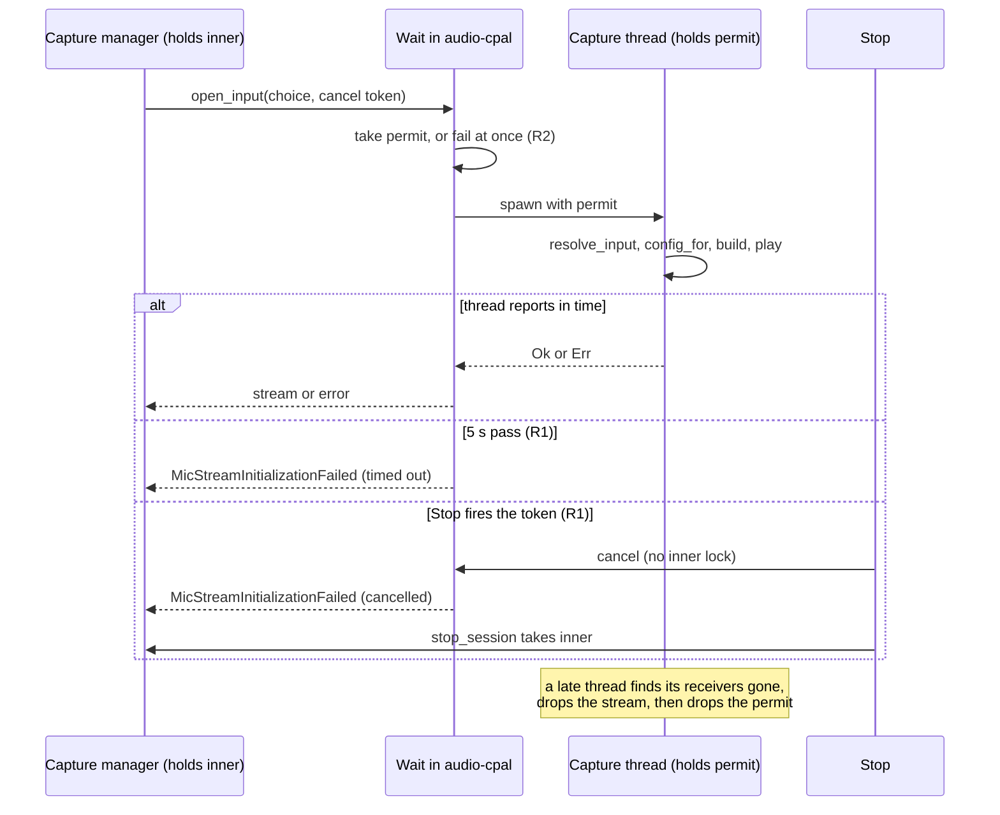

# Reference review fixes, October 2026 - Plan

## Goal Capsule

- **Objective:** A microphone that does not start cannot stop the user from stopping or controlling a recording. On Windows, a change of the default microphone does not prevent recording until a restart. The note editor applies its link rules to the correct text. The editor runs on prosemirror-view 1.42.3 with one copy of prosemirror-model. The voice detector does not send audio twice.
- **Means:** Four independent fixes from the reference source review of 2026-10-15, one commit each, in one PR. The PR title is a `fix` title that names each fix.
- **Product authority:** The user chose these four fixes on 2026-10-15 after the review in `docs/reference/reference-source-reviews.md`. R1-R7 govern behavior.
- **Open blockers:** None.
- **Execution profile:** Implement in a managed worktree from `origin/main`, named for this topic. U1 comes before U2. U3, U4 and U5 have no dependencies on the microphone units.
- **Stop conditions:** If the Bluetooth start in the manual test takes more than about 3 s, stop and report it before the merge, because a 5 s limit would then be too small. If the prosemirror-view 1.42.3 install leaves two copies of prosemirror-view or prosemirror-model, stop U4 and ship the other units.
- **Finish:** The implementer opens the PR and runs `ce-babysit-pr` until it is ready to merge.

## Product Contract

### Summary

Put a time limit on the microphone start, and refuse a second start while an earlier start is still blocked. On Windows, when the default microphone does not open, open the same device by its ID. Port anarlog's corrected changed-range calculation to the note editor. Update prosemirror-view to 1.42.3. Port Handy's fix to the voice detector's pre-roll.

### Problem Frame

The review of 304 upstream commits found five defects that Longhand has. The user chose them as four fixes, because the two microphone defects are one choice. Code reading found each one. Nobody has seen one of them in Longhand.

- **Microphone start.** `crates/audio-cpal/src/lib.rs` waits for the capture thread to report the start with no time limit. The capture manager holds its lock during that wait. If CoreAudio blocks the stream start, Stop, status and all other capture commands wait too. anarlog added a 5-second limit (`9a9ed32f`) and a guard against a second start (`69350022`) for this case.
- **Windows default microphone.** With cpal 0.18.2, after the default device changes during a session, each open of the default handle can fail with `RPC_E_CHANGED_MODE` until the app restarts. Shorthand saw this and fixed it in `19029f4` and `22ef0ed`. Longhand uses the same cpal, opens the default handle when no microphone is chosen (`crates/audio-cpal/src/config.rs`), and resolves it again on each source restart.
- **Editor changed ranges.** `src/editor/plugins/changed-ranges.ts` (copied from anarlog `39613e5`) reports each step's range in that step's own intermediate document. In a transaction with more than one step, autolink and the link boundary guard can check the wrong text. anarlog fixed this in `a84a8a5d`.
- **prosemirror-view.** Longhand pins 1.41.7, which came from anarlog. anarlog's Dependabot security group moved to 1.42.3 and pinned prosemirror-model so that only one copy is installed (`a112ca8a`).
- **Voice detector pre-roll.** In `crates/vad/src/smoothed.rs` (borrowed from Handy), when speech starts again soon after a hangover, frames already sent are sent again. No production code calls `SmoothedVad` today. Handy fixed it in `7b2a28a`.

### Requirements

**Microphone start**

- R1. A microphone start that does not complete in a fixed time fails with an error, and the capture manager is available again. Stop and the commands that supersede a recording do not wait for a blocked start. Status and the other capture commands wait at most the time limit.
- R2. While an earlier microphone start is still blocked, a new start fails at once and does not start a second capture thread.
- R3. On Windows, when no microphone is chosen and the open of the default device fails, Longhand opens the same device once more by its ID.

**Note editor**

- R4. Changed ranges are positions in the final document of all the transactions in a group, so autolink and the link boundary guard check the text that the user changed.
- R5. The editor uses prosemirror-view 1.42.3, and only one copy of prosemirror-model is installed.

**Voice detector**

- R6. When speech starts, the pre-roll contains only frames that were not sent before.

**Provenance**

- R7. Each changed borrowed file has its `PROVENANCE.md` entry updated to the upstream revision of the fix.

### Acceptance Examples

- AE1. Covers R1. A test microphone source that never reports its start makes the start fail after the time limit. A Stop sent during the wait returns without waiting for the limit.
- AE2. Covers R2. A second start during that wait fails at once.
- AE3. Covers R3. A forced failure of the first default open on Windows (as Shorthand does with `SHORTHAND_DEBUG_FAIL_DEFAULT_MIC`) leads to a recording from the same device.
- AE4. Covers R4. anarlog's regression test passes: a typed bullet that joins the list above it gives ranges in the final document.
- AE5. Covers R6. Speech, a hangover, then speech again inside the pre-roll window sends no frame twice.

### Key Decisions

- One PR for all four fixes, with one commit for each implementation unit, as for the review of 2026-09-29. Each fix is small, all come from one review, and the PR makes one patch release. (session-settled: user-approved — chosen over one PR for each fix: the user selected all four for "the fix PR".)
- Port the voice detector fix although no production code calls `SmoothedVad`. The file is borrowed, and a later use would otherwise bring the defect back. (session-settled: user-directed — chosen over leaving the latent defect: the user selected it from the shown options with its latent status stated.)
- The Windows retry is in scope although nobody has seen the fault in Longhand. (session-settled: user-approved — chosen with the note that it is Windows-only and not seen.)
- **Stop does not wait for a blocked microphone start.** Governs R1. (session-settled: user-directed — chosen over "Stop waits at most the time limit": Stop is the main control during a recording.)

### Scope Boundaries

- No change to how Longhand chooses a microphone, or to the Bluetooth avoidance in `config.rs`.
- No change to system audio capture. `crates/audio-system` opens loopback through the `wasapi` crate, not a cpal default handle.
- No other dependency updates in this PR.
- The other review findings are ideas in `docs/ideas/someday/` or notes in `docs/reference/borrowing-notes.md`. The transcribe-cpp update and the Handy recorder crates are separate ideas (`transcribe-cpp-update`, `handy-recorder-crates`).

### Sources / Research

- `docs/reference/reference-source-reviews.md`, log entry 2026-10-15.
- anarlog `69350022`, `9a9ed32f` (microphone start), `a84a8a5d` (changed ranges), `a112ca8a` (prosemirror-view).
- Shorthand `19029f4`, `22ef0ed` (Windows default microphone).
- Handy `7b2a28a` (voice detector pre-roll).

**Product Contract preservation:** changed: R1 — the user approved that status and the other capture commands wait at most the time limit; only Stop and superseding commands do not wait. A Key Decision about Stop was added (Governs R1). The Objective names prosemirror-view 1.42.3, and the Problem Frame and the PR Key Decision state five defects in four fixes, with one commit for each unit. The three planning questions are answered in KTD2, KTD3 and U4.

---

## Planning Contract

### Key Technical Decisions

- KTD1. **Stop cancels a blocked start through a token outside the capture lock.** The open path gets a cancellation token that is kept in its own field beside `inner`, not inside it. Stop, and each command that supersedes a recording, fires the token before it takes `inner`. The wait in `crates/audio-cpal` checks the token in short steps, in the same way as `sleep_unless` in `src-tauri/src/managers/capture.rs`. The microphone still opens while `inner` is held. Moving the open out of the lock would change the state rules of every open path. Governs R1. (session-settled: user-directed — chosen over "Stop waits at most the time limit": Stop is the main control during a recording.)
- KTD2. **A timed-out start is an ordinary open error; a cancelled start is its own outcome.**
  - A timeout returns `audio::Error::MicStreamInitializationFailed` with a message that says why. At Start, the existing negative notice shows it, with no retry. During a recording, it is one attempt of `supervisor::recover`. When the budget (3 attempts, 1/2/4 s) is used up, the note goes to Interrupted(device) with the existing alert and device watch.
  - A cancel returns a separate `audio::Error` variant, so that the manager does not read message text. On a cancel, `start_session_with_config`, the Continue and Resume paths (`reopen_failed`) and the restart path raise no alert, start no device watch and show no failed-start notice. Before the opener releases `inner`, it leaves the note where the Stop that fired the token finds it (for Continue and Resume, `inner.paused`), so that Stop ends that note normally and does not return `NotCapturing`.
  - Governs R1.
- KTD3. **The time limit is 5 s, as in anarlog, and covers the whole microphone open.** The device lookup and config query of `prepare_input` move into the timed capture thread. Today `open_microphone` calls `prepare_input` under `inner` before the thread starts, and each reopen calls `forget()`, so the restart, device-watch and switch paths always query the audio HAL under `inner` with no limit. The thread returns the resolved `Input` and native rate with its start result, and calculates the chunk size. A hit on the prepared cache gives the thread the cached config. The only measured start is the built-in microphone (about 150 ms). The manual test step measures a Bluetooth headset start before merge. Governs R1.
- KTD4. **The start guard is a process-wide permit that the capture thread holds until its driver calls return.** It is the shape of anarlog's `StartupPermit` and of the RAII permit in `docs/solutions/performance-issues/one-permit-made-audio-wait-for-summary-requests.md`. The permit moves into the thread, so a start that timed out keeps it until the driver returns. A new start fails at once with `MicStreamInitializationFailed`. Governs R2.
- KTD5. **The Windows retry covers the two places that activate the default handle.** In cpal 0.18.2 the WASAPI default handle activates in `default_input_config` and in `build_input_stream`. After U1 (KTD3), both calls run in the capture thread. A helper in `crates/audio-cpal/src/config.rs` gets the default device by its ID (`host.default_input_device()?.id()`, then `host.device_by_id`). The capture thread retries the config query and the stream build once with that device when no microphone is chosen, the device came from the default handle, and the first try failed. The code is `#[cfg(windows)]`. A pure decision function (when to retry) is compiled on all platforms so that it can be tested on macOS. Governs R3.
- KTD6. **A debug-only switch forces the first default open to fail on Windows.** `LONGHAND_DEBUG_FAIL_DEFAULT_MIC`, read only under `#[cfg(all(windows, debug_assertions))]`, as Shorthand does. The value `all` also fails the retry. A release build never reads it. Governs R3.
- KTD7. **The changed-ranges port is a copy of upstream.** `src/editor/plugins/changed-ranges.ts` gets anarlog's `a84a8a5d` function. `prosemirror-transform` becomes a direct dependency at the version that is installed now (1.12.1), because the fix imports `Mapping`. Governs R4.
- KTD8. **prosemirror-view moves through a bun `overrides` field.** `@handlewithcare/react-prosemirror` 3.2.6 declares the peer `prosemirror-view` 1.41.7 exactly. As anarlog did, `package.json` sets `prosemirror-view` to 1.42.3 and adds `overrides` for `prosemirror-view` 1.42.3 and `prosemirror-model` 1.25.12. Governs R5.
- KTD9. **Provenance.** The permit and the time limit get a new `src/lib.rs` record in `crates/audio-cpal/PROVENANCE.md`: anarlog `693500220d8e253b175e7a5b88fd831c48b4583b`, `crates/audio-actual/src/mic.rs`, status `modified` (Longhand adds the cancellation token). The Windows retry is Longhand's own code on cpal's public API and gets no Shorthand record, as in the 2026-09-29 plan. `changed-ranges.ts` and `smoothed.rs` move to the revisions of the fixes. Governs R7.

### High-Level Technical Design

The microphone start after U1 and U2. The capture manager holds `inner` from Start until the result returns. Stop fires the token without `inner`.

### Sequencing

U1 and U2 change the same open path, so U2 starts after U1. U3, U4 and U5 have no dependencies. U4 depends on nothing in U3, but both change `package.json` and `bun.lock`, so do U3 first to keep one lock change for each commit.

---

## Implementation Units

### U1. Microphone start limit, start guard and Stop cancel

**Goal:** A blocked microphone start fails after 5 s or at once on Stop, and a second start cannot begin while the first one is blocked.

**Requirements:** R1, R2, R7. KTD1, KTD2, KTD3, KTD4, KTD9.

**Dependencies:** None.

**Files:**
- `crates/audio-cpal/src/lib.rs` (the spawn and wait; the permit)
- `crates/audio-cpal/src/startup.rs` (new, if the permit and the wait are clearer in their own module)
- `src-tauri/src/managers/capture.rs` (the token field; Stop and supersede fire it; `open_microphone` passes it)
- `crates/audio-cpal/PROVENANCE.md`
- Tests: `crates/audio-cpal/src/lib.rs` or `crates/audio-cpal/src/startup.rs` `mod tests`; `src-tauri/src/managers/capture.rs` `mod tests`

**Approach:**
1. Split the spawn and wait of `open_input` into a function that takes the start closure, the time limit and the token. Tests can then give it a closure that blocks.
2. Add the permit (KTD4). Take it before the spawn, and move it into the thread. Drop it after `play` returns or fails.
3. Wait on `init_rx` with `recv_timeout` in short steps, and check the token between steps. On a timeout or a cancel, return the error of KTD2 and do not join the thread. The late thread already exits cleanly: `init_tx.send` fails, and `drain` returns at `tx.is_closed()`.
4. On a timeout, clear the config cache entry for the device, as the thread does on a late error, so that the next start queries the device again.
5. Move the `prepare_input` step of `open_microphone` into the capture thread (KTD3). Return the resolved input and native rate with the start result, and keep the prepared-cache behavior.
6. In the capture manager, keep a token that each open uses, in a field outside `inner`. Stop and `supersede` fire it before they take `inner`. Start fires it only after its own checks pass (restart claim, models), so that a refused Start does not cancel a restart attempt. Each new open gets a new token, so a cancel cannot reach a later start.
7. Close the race in which a background opener (restart, device watch, capture watch) takes `inner` after Stop fired the token and before Stop takes `inner`: Stop sets a stop-pending flag in the same field before it fires the token. An open that starts while the flag is set fails at once as cancelled. Stop clears the flag after it takes `inner`.
8. Handle the cancel outcome of KTD2 on each path that opens under `inner`: Start, Continue and Resume, the restart closure, `switch_to` and the device watch.
6. Keep the lock order capture `inner`, then store (`docs/solutions/logic-errors/runner-store-lock-before-suspended-check-deadlocks.md`). The token field has its own lock, which is never held while `inner` is taken.

**Patterns to follow:** `sleep_unless` and `CancellationToken` in `src-tauri/src/managers/capture.rs`. The RAII permit in `docs/solutions/performance-issues/one-permit-made-audio-wait-for-summary-requests.md`.

**Test scenarios:**
- Covers AE1. A start closure that never reports returns the timed-out error after the limit. Use a short limit in the test.
- Covers AE1. A start closure that never reports, with the token fired after 50 ms, returns the cancelled error well before the limit.
- Covers AE2. While a blocked start holds the permit, a second start fails at once with the permit error, and its closure never runs.
- After the blocked closure returns, the permit is free and a new start succeeds.
- A closure that reports success in time returns the stream. A closure that reports an error in time returns that error.
- A token fired before the open starts makes the open fail at once.
- In `capture.rs` tests: the token of a superseded recording is fired, and a new open gets a token that is not fired.
- In `capture.rs` tests: with the stop-pending flag set, a new open fails at once as cancelled. After Stop clears the flag, an open runs normally.
- In `capture.rs` tests: the decision of what a failed open does gives no alert, no device watch and no failed-start notice for a cancel, and the existing handling for a timeout.
- A device lookup that blocks inside the thread is covered by the limit: a start closure that blocks before its build returns the timed-out error.
- Manual, signed build: Stop during a blocked Continue cannot be forced on a real device. The manual check confirms that Stop, Continue and Resume work as before.

**Verification:** The new tests pass. In a signed build, a normal start, a stop, a device switch and a restart after unplug behave as before.

### U2. Windows: open the default microphone by ID after a failure

**Goal:** On Windows, a failed open of the default microphone is retried once with the same device opened by its ID.

**Requirements:** R3. KTD5, KTD6.

**Dependencies:** U1.

**Files:**
- `crates/audio-cpal/src/config.rs` (the by-ID helper and the decision function)
- `crates/audio-cpal/src/lib.rs` (the retry in `prepare_input` and in the capture thread)
- Tests: `crates/audio-cpal/src/config.rs` `mod tests`

**Approach:**
1. Add a helper that returns the current default input device opened by its ID, or none.
2. Add a decision function: retry when no microphone is chosen, the device came from the default handle (not from the Bluetooth swap), and the first try failed. It is not cfg-gated.
3. Under `#[cfg(windows)]`, apply it in the capture thread around `config_for`, `build` and `play` (after U1 these all run there). Log one warning line when the retry runs.
4. Add the switch of KTD6.
5. Run `scripts/check-windows.sh`, because `audio-cpal` has had no `cfg(windows)` code until now.

**Patterns to follow:** `#[cfg(windows)]` in `crates/power/src/sleep/mod.rs`. Device IDs in `crates/audio-cpal/src/config.rs` (`cache_key`).

**Test scenarios:**
- No microphone chosen, the device came from the default handle, and the first try failed: retry.
- A chosen microphone failed: no retry.
- A Bluetooth swap device failed: no retry.
- The first try succeeded: no retry.
- Covers AE3 (manual, Windows only): with `LONGHAND_DEBUG_FAIL_DEFAULT_MIC=1` in a debug build, a recording starts on the default device and the log shows the retry. With `all`, the start fails with the open error.

**Verification:** The decision tests pass on macOS and in Windows CI. `scripts/check-windows.sh` passes. The manual Windows check runs only when the user asks for Windows steps.

### U3. Editor: changed ranges in the final document

**Goal:** Autolink and the link boundary guard check the text that the user changed, also in a transaction with more than one step.

**Requirements:** R4, R7. KTD7, KTD9.

**Dependencies:** None.

**Files:**
- `src/editor/plugins/changed-ranges.ts`
- `src/editor/plugins/changed-ranges.test.ts` (new)
- `package.json`, `bun.lock` (`prosemirror-transform` as a direct dependency)
- `src/editor/PROVENANCE.md`
- `licences/generated/*` only if the licence check reports a change

**Approach:**
1. Copy `getChangedRanges` from anarlog `a84a8a5d`.
2. Port upstream's regression transaction as a `getChangedRanges` test with Longhand's schema (`src/editor/note/schema.ts` has `bulletList` and `listItem`). Upstream's test uses a plugin that Longhand does not have.
3. Update the `plugins/changed-ranges.ts` record to `a84a8a5df1666a1ea19383548c246f03f9584687`, and add a record for the test, as for `widgets/format-toolbar.test.tsx`.

**Execution note:** Write the test first and see it fail on the current code.

**Patterns to follow:** The `EditorState` and `applyTransaction` tests in `src/editor/plugins/autolink.test.ts`.

**Test scenarios:**
- Covers AE4. A bullet typed after a list at the end of the document joins that list: each range is inside the final document and covers the new list item.
- A single-step insert gives the same range as before.
- A transaction group with no document change gives no ranges.
- Autolink still links a URL that is typed in a transaction with more than one step.

**Verification:** `bun test ./src/` passes. The new test fails on the old function.

### U4. Editor: prosemirror-view 1.42.3

**Goal:** The editor runs on prosemirror-view 1.42.3, with one copy of prosemirror-model.

**Requirements:** R5. KTD8.

**Dependencies:** U3 (only to keep one lock change for each commit).

**Files:**
- `package.json`, `bun.lock`
- `licences/generated/js-packages.json`, `licences/generated/macos.txt`, `licences/generated/windows.txt`
- `docs/solutions/ui-bugs/typed-text-went-to-hidden-notes-after-tab-click.md` (the line citation)

**Approach:**
1. Apply KTD8 and install.
2. Confirm that `node_modules` has one `prosemirror-view` (1.42.3) and one `prosemirror-model` (1.25.12), and that bun reports no peer conflict.
3. Generate the licence lists again. Do not change `scripts/licences/fixtures/js-packages.json`.
4. Find `handlers.focus` in the new `dist/index.js` and correct the line numbers in the solution doc.

**Execution note:** This is a dependency change. Prove it with the install check, the full frontend tests and a manual editor check, not with new unit tests.

**Test expectation:** none -- a dependency update with no behavior change in Longhand code. The existing editor tests and the manual check cover it.

**Verification:** `bun test ./src/` and the typecheck pass. `scripts/check-licences.sh` passes. In the signed build: type in My Notes, use the format toolbar, type a link, and switch tabs while typing (the case of the solution doc).

### U5. Voice detector: no frame twice in the pre-roll

**Goal:** When speech starts again soon after a hangover, the pre-roll contains only frames that were not sent before.

**Requirements:** R6, R7. KTD9.

**Dependencies:** None.

**Files:**
- `crates/vad/src/smoothed.rs`
- `crates/vad/PROVENANCE.md`

**Approach:**
1. Port the filter of Handy `7b2a28a` in the onset loop.
2. Correct the `BufferedFrame` comment: `emitted` now also decides what the pre-roll sends.
3. Update the record to `7b2a28a30aa24174292ddd7f4e92e12e6e3bd501`, with status `modified`, because of the comment and the test.

**Execution note:** Write the test first and see it fail on the current code.

**Patterns to follow:** The `ScriptedVad` tests in `crates/vad/src/smoothed.rs`.

**Test scenarios:**
- Covers AE5. Script speech, speech, noise, noise, noise, speech, speech (onset 2, prefill 3, hangover 2): no frame value is in more than one output, and the second onset sends only the frames after the hangover.
- A first onset with no earlier speech sends the full pre-roll, as before.
- `crates/vad/tests/speech_span.rs` passes unchanged.

**Verification:** `cargo test -p vad` passes.

---

## Verification Contract

- For each unit: the new tests fail before the change and pass after it. Then run the tests of the crate or folder (`cargo test -p audio-cpal`, `cargo test -p longhand` for `capture.rs`, `cargo test -p vad`, `bun test ./src/`). Give each cargo run a time limit.
- Before the push: `cargo fmt --all --check`, `cargo clippy --workspace -- -D warnings`, one `cargo test --workspace`, the frontend typecheck, `bun test ./src/`, `scripts/check-windows.sh`, `scripts/check-licences.sh` and `scripts/check-provenance.sh`.
- Manual test in a signed, non-notarized macOS build (`docs/development-workflow.md#manual-tests`), built without waiting for a request:
  - Start, stop, pause and resume a recording on the built-in microphone.
  - Start a recording with a Bluetooth headset as the default input, and read the start time in the log. It must be well below 5 s (KTD3).
  - Unplug or switch the microphone during a recording: the restart works as before.
  - The editor checks of U4.
- Windows: CI runs the workspace tests. The forced-failure check of U2 runs only when the user asks for Windows steps.

## Definition of Done

- R1-R7 are met, and AE1, AE2, AE4 and AE5 have passing tests. AE3 has its decision tests. Its manual check is done or reported as not run.
- The manual macOS checks passed, and the Bluetooth start time is in the PR.
- All local checks and CI pass.
- One PR with one commit for each unit (five commits). Its title is a `fix` title that names all four fixes, for example `fix: limit microphone start, retry the Windows default mic by ID, and port editor and VAD fixes`.
- The idea `docs/ideas/next/reference-review-fixes-2026-10.md` moves to `done/` after the merge.
- No code from abandoned attempts remains in the diff.
