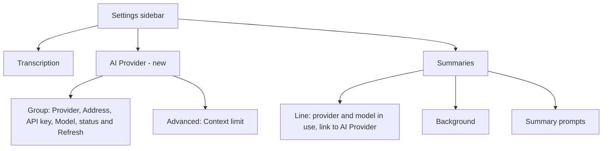

# Rig Engine and Provider Presets - Plan

## Goal Capsule

- **Objective:** A user sets up summaries by choosing a provider from a short list, entering a key or nothing, and choosing a model. Summaries stay the same as today, and they come from an engine that the later agent plans (summary tools, chat) can use.
- **Means:** Replace the request layer of the summary client with the Rust crate Rig, and move the provider settings into one group in a new AI Provider pane.
- **Product authority:** This plan. The summary tools, the chat and the Anthropic format for Custom are not active scope (see Scope Boundaries).
- **Open blockers:** None before planning. Planning must first confirm that Rig can carry the safety rules of R3; if it cannot, planning stops and asks the user (see Outstanding Questions).

---

## Product Contract

### Summary

Rig sends every summary and title request, for every provider. Longhand keeps its own chunking, budget, prompts, error messages and safety rules.
A new AI Provider pane offers OpenAI, Anthropic, Gemini, OpenRouter, Ollama, LM Studio and Custom (OpenAI-compatible) in one settings group. One provider is active at a time, and each provider remembers its own key and model, and its address where the user can change it.

### Problem Frame

To get summaries today, the user must know an OpenAI-compatible address for their provider, and also whether that address must end in `/v1`. Claude, for example, works only through a gateway such as LiteLLM, because Longhand sends only `chat/completions` requests. Ollama's OpenAI-compatible route can use a small context size, so a long transcript can be cut short with no warning.

The Summaries pane splits one connection across three cards (Endpoint, Credential, Model), and it mixes the connection with the summary content settings (Background, Summary prompts).

The next planned work (a summary agent with tools, then questions about a note while it records) needs a tool-calling agent loop. The current client is one non-streaming request with no tools, so it cannot carry that work.

### Key Decisions

- **Rig and the presets ship together in one PR.** The swap by itself gives users nothing to see. Native Anthropic and Ollama behind the presets give the release its value, and the tools plan then starts from a tested engine. Governs R1, R7. (session-settled: user-approved — chosen over presets on the current client first and over a swap with no settings change: the swap alone has no user value, and the presets alone do not need Rig)
- **Rig carries every request, including Custom.** One engine; Longhand keeps its own logic and safety rules around it. Governs R1, R2, R3. (session-settled: user-approved — chosen over Rig for native presets only with the current client kept for Custom, and over a zero-tool Rig agent now: one engine, and the agent setup belongs in the tools plan)
- **One active provider, with remembered settings for each provider.** Switching back to a provider needs no re-entry. Other providers are not active. Governs R7, R10. (session-settled: user-directed — chosen over several saved providers used at once, and over one provider stored as a list: later tasks may use different models from the same provider, not different providers)
- **All provider and model settings live in one AI Provider pane.** The user preferred one place to understand over a model picker in each task's pane, until Longhand actually has more than one model in use. Governs R16, R17, R19, R20. (session-settled: user-directed — chosen over connection-only in AI Provider with the model in Summaries, and over keeping everything in Summaries: simpler to understand while only summaries use a model)
- **Six presets plus Custom.** Governs R7. (session-settled: user-directed — chosen from a longer list; Mistral, Groq and xAI were left out to keep the list short)
- **A new install has no provider chosen.** No provider is implied as the default, which agrees with the strategy boundary "No provider is forced on you". Governs R11. (session-settled: user-approved — chosen over OpenAI as today and over Ollama by default)
- **Custom stays OpenAI-compatible only.** The Anthropic format gives almost no caching gain for today's one-call summary; it pays off in the agent plans, where each turn sends the transcript again. (session-settled: user-directed — chosen over a request-format choice on Custom now; the summary-tools plan adds it and measures the caching gain)
- **The project moves to Rust 1.95 to use current Rig.** Rig 0.43 and later need Rust 1.95; the tools plan needs current Rig's fixes for local servers. Governs R24. (session-settled: user-approved — chosen over pinning Rig 0.42 on Rust 1.94: an older API, and a later upgrade needs the toolchain change anyway)
- **API keys are stored by provider and host.** Each provider keeps its own key, and the host binding stays. Governs R10, R23. (session-settled: user-directed — chosen over keeping keys by host only and sharing one key between providers on one host)
- **Custom accepts its address with or without `/v1`.** Longhand does not add `/v1` blindly, because some servers use another path (OpenRouter uses `/api/v1`). Governs R14. (session-settled: user-approved — proposed after the user asked that the `/v1` requirement stop being something the user must know)

### Requirements

**Engine**

- R1. Rig sends every summary request and every title request, for every provider, Custom included.
- R2. For the same transcript, notes, prompt and model, the summary request has the same content as today: the chunking, the context budget, the hierarchical merge, the summary prompts and the Background do not change.
- R3. The current safety rules stay: no redirect is followed (a 3xx is a failure that names its target), the connect, response, idle and total deadlines apply, the reply size cap applies, a request is sent again only when the provider could not be reached, and logs never contain the URL path, the API key, the prompt or the reply. Longhand maps each Rig error to its own error kind before it logs anything, never logs the error text of Rig or of the request library (which can contain the URL, a key in the query string or the reply body), and keeps Rig's own log output out of Longhand's log.
- R4. Each failure gives the user the same message as today, for example "check the credential stored for this host" for a refused key, and the current context-exceeded and reply-cut-off handling. For each kind of provider request (OpenAI-compatible, Anthropic, Gemini, Ollama), Longhand maps that provider's own cut-off and context-exceeded signals to these messages, and a test covers each kind.
- R5. Longhand pins Rig to one exact version.
- R6. With the Ollama provider, Longhand sends a context size large enough for the request (the prompt estimate plus the reply cap), and never more than the context limit (R15).

**Providers**

- R7. The provider list is OpenAI, Anthropic, Gemini, OpenRouter, Ollama, LM Studio and Custom (OpenAI-compatible). Exactly one provider is active at a time.
- R8. A cloud provider (OpenAI, Anthropic, Gemini, OpenRouter) needs only an API key; the user does not enter its address. A local provider (Ollama, LM Studio) needs no key and shows its usual address on this computer, which the user can change.
- R9. Custom takes an address and an optional API key.
- R10. Each provider remembers, on this computer, its last API key, model and, where the user can change it, address. A switch to another provider and back restores them with no re-entry. Each API key is stored in the Keychain for its provider and its host together: two providers on one host keep separate keys, and a key is never sent to a host other than the one it was saved for.
- R11. A new install has no provider chosen. Longhand sends no request, and the processing page says that no provider is set and the note is saved without a summary, with a link that opens the AI Provider pane.
- R12. Longhand contacts only a provider that the user acted on: a key is saved for it, or the user chose a provider or address that needs no key. This is today's endpoint gate, applied to each provider.
- R13. The provider settings stay on each computer. They are not shared settings in the storage folder.
- R14. For Custom, Longhand first uses the address as typed. When the server does not answer as an OpenAI-compatible server and the address does not end in `/v1`, Longhand tries the address with `/v1` added; when that works, Longhand saves that form and shows it. Longhand never changes an address that works as typed.
- R15. The context limit is automatic when the provider reports it, a value that the user enters wins, and otherwise Longhand uses 128,000 tokens, as today.

**Settings**

- R16. Settings has a new pane, AI Provider, after Transcription and before Summaries.
- R17. The AI Provider pane has one group with these rows, in this order: Provider; Address (local providers and Custom only); API key (cloud providers and Custom only); Model; a status row with the connection state, the model count and Refresh. A row shows only when the chosen provider needs it. The status row has these states: not set up (no key saved, so no request is sent), checking, connected with the model count, key refused, cannot reach the address, and connected with no model list (the Model row is then a text field). The first time the user chooses a provider, the Model row has no model until the user picks one. A remembered model that the provider no longer lists stays selected, and the status row says that the provider does not list it.
- R18. The API key row keeps today's behaviour: Save, Remove, Repair Keychain Access, and the status "Saved in Keychain for {host} · fingerprint …".
- R19. An Advanced group in the AI Provider pane holds the context limit.
- R20. The Summaries pane keeps Background and Summary prompts, and shows one line that names the provider and model that summaries use, or "No provider set", with a link to the AI Provider pane.
- R21. The warning for an address that sends the transcript and key over plain HTTP to another computer stays.
- R22. The processing page line "Sends the transcript and notes to …" names the provider and the model. For Custom and the local providers, it also names the host.

**Existing settings**

- R23. An existing endpoint (address, model and Keychain key) becomes the Custom provider with the same values. The existing key, which the Keychain holds by host only, moves to the Custom provider's entry for that host (R10). No other migration is needed, because nobody else uses Longhand yet.

**Build**

- R24. The project moves to Rust 1.95 in this PR: the toolchain file, the workspace `rust-version`, the CI toolchain steps and the Rust rule in `CLAUDE.md`.

### Acceptance Examples

- AE1. **Covers R10.** **Given** Anthropic is active with a saved key and the model `claude-haiku-5-5`, **when** the user selects Ollama and then selects Anthropic again, **then** the key and the model `claude-haiku-5-5` show again, and the status row shows a connection, with no re-entry.
- AE2. **Covers R11, R12.** **Given** a new install, **when** the user records a note and stops, **then** Longhand sends no request to any provider, and the processing page says that no provider is set and the note is saved without a summary.
- AE3. **Covers R14.** **Given** Custom with the address `https://litellm.example.com`, which answers only at `/v1`, **when** Longhand checks the connection, **then** it uses `https://litellm.example.com/v1`, saves that address, and shows it in the Address row.
- AE4. **Covers R14.** **Given** Custom with the address `https://openrouter.ai/api/v1`, **when** Longhand checks the connection, **then** it uses the address as typed and does not add `/v1`.
- AE5. **Covers R8, R17.** **Given** the user selects Ollama and Ollama is not running, **when** the pane checks the connection, **then** the status row says that Longhand cannot reach Ollama at the shown address, and no API key row shows.
- AE6. **Covers R6.** **Given** Ollama with a model whose context limit is 32,000 tokens, **when** Longhand summarizes a chunk that needs about 20,000 tokens with the reply cap, **then** it sends a context size of at least 20,000 and at most 32,000, and the model receives the whole chunk. A short note gets a small context size, not 32,000.
- AE8. **Covers R10.** **Given** the OpenRouter preset with key A saved, **when** the user selects Custom, enters `https://openrouter.ai/api/v1` and saves key B, **then** switching back to the OpenRouter preset shows key A, and Custom still has key B.
- AE7. **Covers R23.** **Given** an existing setup with the base URL `https://litellm.ewal.io/v1`, a model and a Keychain key for that host, **when** the user opens the new build, **then** Custom is active with the same address, model and key, and summaries work with no change.

### Scope Boundaries

- Tools for the summary model, and the agent loop (the `agentic-summary` idea).
- Questions about a note while it records (the `ask-about-the-note-while-recording` idea).
- The Anthropic request format for Custom (the `summary-endpoint-anthropic-format` idea). The summary-tools plan adds it and measures the prompt-caching gain through LiteLLM.
- Streaming replies.
- More than one active provider, and a model for each task.
- The presets Mistral, Groq and xAI, and any other provider.
- Sharing the provider settings between computers.

<!-- ce-section: work-relationships -->
### How This Work Fits Together

This plan covers the engine swap and the provider settings. The later areas below are the current understanding, not a committed roadmap.

- A summary agent with tools (`docs/ideas/someday/agentic-summary.md`)
  - Depends on this plan's Rig engine.
  - Shares the provider and model chosen in the AI Provider pane.
  - Adds the Anthropic format for Custom, and measures prompt caching.
- Questions about a note while it records (`docs/ideas/someday/ask-about-the-note-while-recording.md`)
  - Depends on the summary agent's tools and loop.
  - Still to decide: whether it uses the summary model or its own model.

### Dependencies / Assumptions

- Rig 0.44.x is the current release (crates.io, 2026-10-07). It changes its API often, so each upgrade can need code changes (R5). Rig 0.43 and later need Rust 1.95 (crates.io index `rust_version`), which R24 provides.
- Assumption, not verified: Rig accepts a request client that Longhand configures, so R3's no-redirect rule, deadlines and size cap still hold.
- Assumption, not verified: Rig has native providers for Anthropic, Gemini and OpenRouter, and an OpenAI-compatible path with a custom base URL for LM Studio and Custom.
- Assumption, not verified: Rig's Ollama provider can set the context size (R6).
- Assumption, not verified: some Rig providers can list models. Where a provider cannot, the Model row falls back to a text field, as it does today for a server that lists no models.

### Outstanding Questions

**Resolve Before Planning**

None.

**Deferred to Planning**

- First step of planning: confirm in the Rig source that Longhand can supply its own request client with R3's rules, that Rig's own log output can be kept out of Longhand's log, and that Longhand can read the HTTP status and reply body that R4's messages need before Rig turns them into its own error text. If any of these fails, stop and ask the user before any other planning.
- Confirm the other three Rig assumptions above, and choose the route for each preset (native or OpenAI-compatible), with LM Studio and OpenRouter as the open cases.
- How each preset gets its model list and context limit, given that the current probes (LiteLLM, LM Studio, vLLM, OpenRouter, llama.cpp) were made for OpenAI-compatible servers.
- How Longhand gets an Ollama model's context limit from Ollama's own model information, so that an unknown limit does not fall back to 128,000 tokens for a model that accepts less.
- Which Rig route Custom and LM Studio use: it must be the Chat Completions request, because many OpenAI-compatible servers (LiteLLM routes, llama.cpp, vLLM) do not serve the newer Responses request, and AE7 depends on it.
- What happens to a summary job that runs while the user changes the provider.
- What R14's "does not answer as an OpenAI-compatible server" means as a check (for example, a model-list request that fails or returns no OpenAI-shaped list).
- The wording of the pane name and the Summaries line, in a plain-language review.

### Sources / Research

- Current client and its rules: `crates/summarize/src/client.rs`, `crates/summarize/src/context.rs`, `crates/summarize/src/models.rs`.
- Per-computer endpoint settings and the endpoint gate: `src-tauri/src/managers/settings.rs`; Keychain keyed by host: `crates/secrets/src/lib.rs`.
- Current Summaries pane: `src/settings/EndpointForm.tsx`, `src/settings/SettingsWindow.tsx`; processing line: `src/session/ProcessingStatus.tsx`.
- Earlier scope that left presets out: `docs/plans/2026-09-25-1244-feat-summary-model-picker-plan.md`.
- Related lessons: `docs/solutions/logic-errors/summary-in-a-wake-with-no-network-kept-the-default-budget.md`, `docs/solutions/ui-bugs/single-line-setting-lost-at-close-or-pane-change.md`.
- Rig: https://github.com/0xPlaygrounds/rig and https://crates.io/crates/rig-core.
