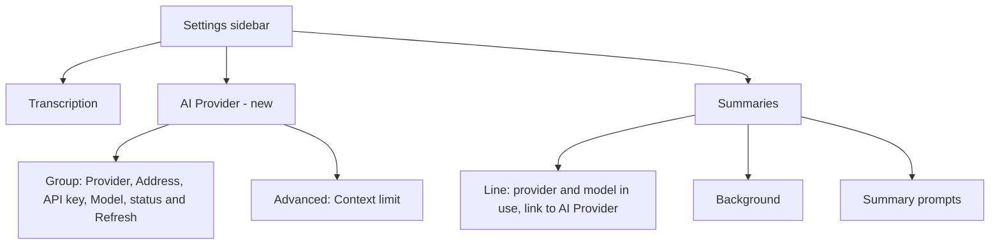
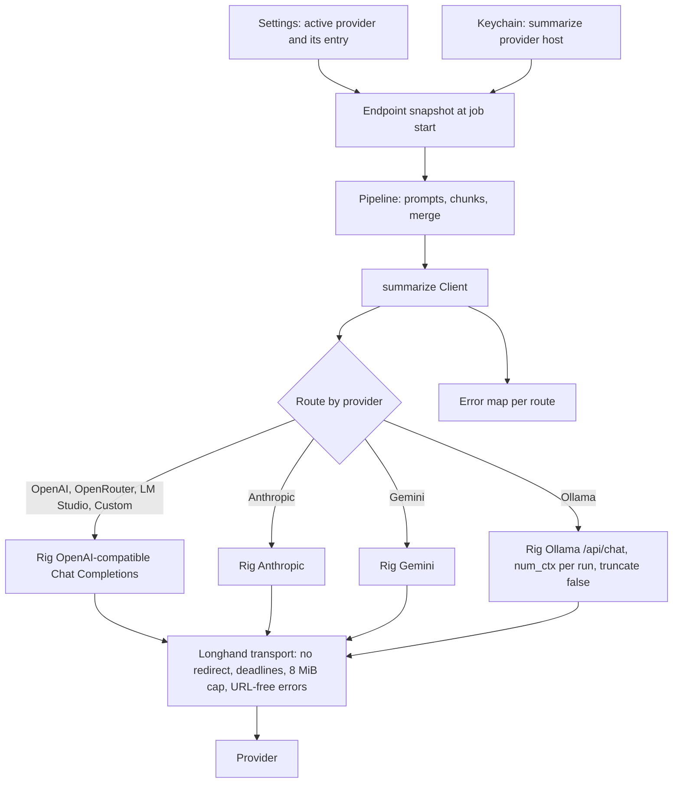
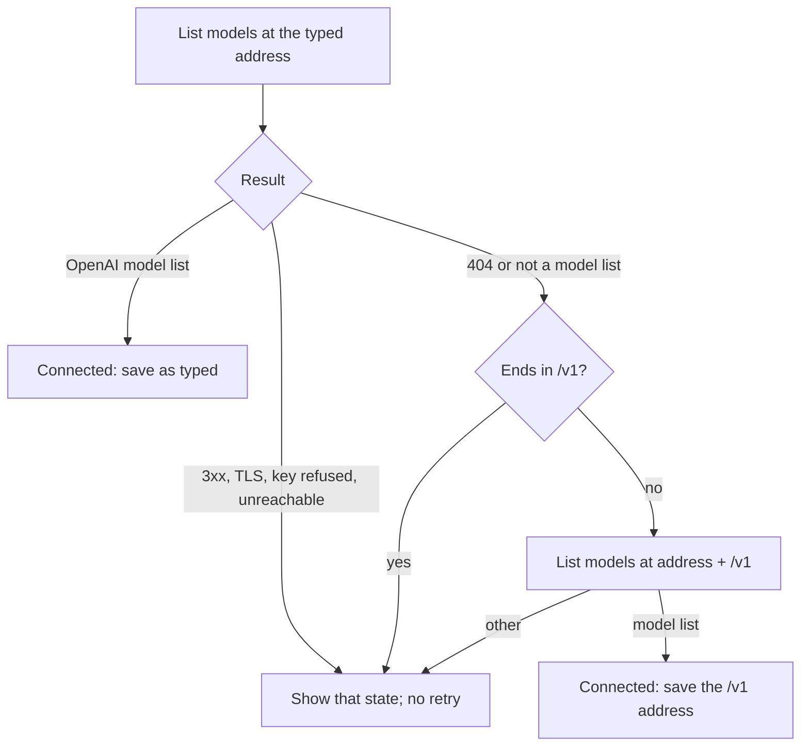

# Rig Engine and Provider Presets - Plan

## Goal Capsule

- **Objective:** A user sets up summaries by choosing a provider from a short list, entering a key or nothing, and choosing a model, and gets the same summaries as today.
- **Means:** Rig sends every summary and title request through a Longhand transport (KTD1, KTD2), and one AI Provider pane holds the provider settings (R16–R19). This engine is the base for the summary-tools plan.
- **Product authority:** This plan. The Product Contract wins on behaviour; a KTD wins on mechanism within its cited requirements. The summary tools, the chat and the Anthropic format for Custom are not active scope (see Scope Boundaries).
- **Open blockers:** None. The Rig source check (rig-core 0.44.0) confirmed the three conditions in Dependencies / Assumptions.
- **Stop conditions:** Stop and ask the user when a pinned Rig behaviour that a KTD depends on is not as recorded, when R3's rules cannot be held for a provider, or when the summary request content of an existing test changes (R2).
- **Execution profile:** One feature, one PR (`feat`), units committed in order in one worktree. The implementer finishes with the PR, the signed-build manual test, and `ce-babysit-pr` until the PR is ready to merge.

---

## Product Contract

### Summary

Rig sends every summary and title request, for every provider. Longhand keeps its own chunking, budget, prompts, error messages and safety rules.
A new AI Provider pane offers OpenAI, Anthropic, Gemini, OpenRouter, Ollama, LM Studio and Custom (OpenAI-compatible) in one settings group. One provider is active at a time, and each provider remembers its own key and model, and its address where the user can change it.

### Problem Frame

To get summaries today, the user must know an OpenAI-compatible address for their provider, and also whether that address must end in `/v1`. Claude, for example, works only through a gateway such as LiteLLM, because Longhand sends only `chat/completions` requests. Ollama's OpenAI-compatible route can use a small context size, so a long transcript can be cut short with no warning.

The Summaries pane splits one connection across three cards (Endpoint, Credential, Model), and it mixes the connection with the summary content settings (Background, Summary prompts).

The next planned work (a summary agent with tools, then questions about a note while it records) needs a tool-calling agent loop. The current client is one non-streaming request with no tools, so it cannot carry that work.

### Key Decisions

- **Rig and the presets ship together in one PR.** The swap by itself gives users nothing to see. Native Anthropic and Ollama behind the presets give the release its value, and the tools plan then starts from a tested engine. Governs R1, R7. (session-settled: user-approved — chosen over presets on the current client first and over a swap with no settings change: the swap alone has no user value, and the presets alone do not need Rig)
- **Rig carries every request, including Custom.** One engine; Longhand keeps its own logic and safety rules around it. Governs R1, R2, R3. (session-settled: user-approved — chosen over Rig for native presets only with the current client kept for Custom, and over a zero-tool Rig agent now: one engine, and the agent setup belongs in the tools plan)
- **One active provider, with remembered settings for each provider.** Switching back to a provider needs no re-entry. Other providers are not active. Governs R7, R10. (session-settled: user-directed — chosen over several saved providers used at once, and over one provider stored as a list: later tasks may use different models from the same provider, not different providers)
- **All provider and model settings live in one AI Provider pane.** The user preferred one place to understand over a model picker in each task's pane, until Longhand actually has more than one model in use. Governs R16, R17, R19, R20. (session-settled: user-directed — chosen over connection-only in AI Provider with the model in Summaries, and over keeping everything in Summaries: simpler to understand while only summaries use a model)
- **Six presets plus Custom.** Governs R7. (session-settled: user-directed — chosen from a longer list; Mistral, Groq and xAI were left out to keep the list short)
- **A new install has no provider chosen.** No provider is implied as the default, which agrees with the strategy boundary "No provider is forced on you". Governs R11. (session-settled: user-approved — chosen over OpenAI as today and over Ollama by default)
- **Custom stays OpenAI-compatible only.** The Anthropic format gives almost no caching gain for today's one-call summary; it pays off in the agent plans, where each turn sends the transcript again. (session-settled: user-directed — chosen over a request-format choice on Custom now; the summary-tools plan adds it and measures the caching gain)
- **The project moves to Rust 1.95 to use current Rig.** Rig 0.43 and later need Rust 1.95; the tools plan needs current Rig's fixes for local servers. Governs R24. (session-settled: user-approved — chosen over pinning Rig 0.42 on Rust 1.94: an older API, and a later upgrade needs the toolchain change anyway)
- **API keys are stored by provider and host.** Each provider keeps its own key, and the host binding stays. Governs R10, R23. (session-settled: user-directed — chosen over keeping keys by host only and sharing one key between providers on one host)
- **Custom accepts its address with or without `/v1`.** Longhand does not add `/v1` blindly, because some servers use another path (OpenRouter uses `/api/v1`). Governs R14. (session-settled: user-approved — proposed after the user asked that the `/v1` requirement stop being something the user must know)

### Requirements

**Engine**

- R1. Rig sends every summary request and every title request, for every provider, Custom included.
- R2. For the same transcript, notes, prompt and model, the summary request has the same content as today: the chunking, the context budget, the hierarchical merge, the summary prompts and the Background do not change.
- R3. The current safety rules stay: no redirect is followed (a 3xx is a failure that names its target), the connect, response, idle and total deadlines apply, the reply size cap applies, a request is sent again only when the provider could not be reached, and logs never contain the URL path, the API key, the prompt or the reply. Longhand maps each Rig error to its own error kind before it logs anything, never logs the error text of Rig or of the request library (which can contain the URL, a key in the query string or the reply body), and keeps Rig's own log output out of Longhand's log.
- R4. Each failure gives the user the same message as today, for example "check the credential stored for this host" for a refused key, and the current context-exceeded and reply-cut-off handling. For each kind of provider request (OpenAI-compatible, Anthropic, Gemini, Ollama), Longhand maps that provider's own cut-off and context-exceeded signals to these messages, and a test covers each kind.
- R5. Longhand pins Rig to one exact version.
- R6. With the Ollama provider, Longhand sends a context size large enough for the request (the prompt estimate plus the reply cap), and never more than the context limit (R15).

**Providers**

- R7. The provider list is OpenAI, Anthropic, Gemini, OpenRouter, Ollama, LM Studio and Custom (OpenAI-compatible). At most one provider is active at a time, and the list also offers None, which stops all summary requests.
- R8. A cloud provider (OpenAI, Anthropic, Gemini, OpenRouter) needs only an API key; the user does not enter its address. A local provider (Ollama, LM Studio) needs no key and shows its usual address on this computer, which the user can change.
- R9. Custom takes an address and an optional API key.
- R10. Each provider remembers, on this computer, its last API key, model and, where the user can change it, address. A switch to another provider and back restores them with no re-entry. Each API key is stored in the Keychain for its provider and its host together: two providers on one host keep separate keys, and a key is never sent to a host other than the one it was saved for.
- R11. A new install has no provider chosen. Longhand sends no request, and the processing page says that no provider is set and the note is saved without a summary, with a link that opens the AI Provider pane.
- R12. Longhand contacts only a provider that the user acted on: a key is saved for it, or the user chose a provider or address that needs no key. This is today's endpoint gate, applied to each provider.
- R13. The provider settings stay on each computer. They are not shared settings in the storage folder.
- R14. For Custom, Longhand first uses the address as typed. When the server does not answer as an OpenAI-compatible server and the address does not end in `/v1`, Longhand tries the address with `/v1` added; when that works, Longhand saves that form and shows it. Longhand never changes an address that works as typed.
- R15. The context limit is automatic when the provider reports it, a value that the user enters wins, and otherwise Longhand uses 128,000 tokens, as today. Each provider remembers its own entered limit (R10).
- R25. A summary or title job uses the provider, address, model and key that were in effect when the job started. A change in Settings applies from the next job.
- R26. When the provider, the host or the model differs from the one that made a note's saved partial summary progress, Longhand discards that progress and starts the summary again.

**Settings**

- R16. Settings has a new pane, AI Provider, after Transcription and before Summaries.
- R17. The AI Provider pane has one group with these rows, in this order: Provider; Address (local providers and Custom only); API key (cloud providers and Custom only); Model; a status row with the connection state, the model count and Refresh. A row shows only when the chosen provider needs it. The status row has these states: not set up (no key saved, so no request is sent), checking, connected with the model count, key refused, cannot reach the address, and connected with no model list (the Model row is then a text field). The first time the user chooses a provider, the Model row has no model until the user picks one. A remembered model that the provider no longer lists stays selected, and the status row says that the provider does not list it.
- R18. The API key row keeps today's behaviour: Save, Remove, Repair Keychain Access, and the status "Saved in Keychain for {host} · fingerprint …".
- R19. An Advanced group in the AI Provider pane holds the context limit.
- R20. The Summaries pane keeps Background and Summary prompts, and shows one line that names the provider and model that summaries use, or "No provider set", with a link to the AI Provider pane.
- R21. The warning for an address that sends the transcript and key over plain HTTP to another computer stays.
- R22. The processing page line "Sends the transcript and notes to …" names the provider and the model. For Custom and the local providers, it also names the host.

**Existing settings**

- R23. An existing endpoint (address, model and Keychain key) becomes the Custom provider with the same values. An install that never saved an address but has a model becomes the OpenAI preset with that model, and a cleared address becomes None. The existing key, which the Keychain holds by host only, moves to the new provider's entry for that host (R10), and the old entry is deleted only after the new one is saved. No other migration is needed, because nobody else uses Longhand yet.

**Build**

- R24. The project moves to Rust 1.95 in this PR: the toolchain file, the workspace `rust-version`, the CI toolchain steps and the Rust rule in `CLAUDE.md`.

### Acceptance Examples

- AE1. **Covers R10.** **Given** Anthropic is active with a saved key and the model `claude-haiku-5-5`, **when** the user selects Ollama and then selects Anthropic again, **then** the key and the model `claude-haiku-5-5` show again, and the status row shows a connection, with no re-entry.
- AE2. **Covers R11, R12.** **Given** a new install, **when** the user records a note and stops, **then** Longhand sends no request to any provider, and the processing page says that no provider is set and the note is saved without a summary.
- AE3. **Covers R14.** **Given** Custom with the address `https://litellm.example.com`, which answers only at `/v1`, **when** Longhand checks the connection, **then** it uses `https://litellm.example.com/v1`, saves that address, and shows it in the Address row.
- AE4. **Covers R14.** **Given** Custom with the address `https://openrouter.ai/api/v1`, **when** Longhand checks the connection, **then** it uses the address as typed and does not add `/v1`.
- AE5. **Covers R8, R17.** **Given** the user selects Ollama and Ollama is not running, **when** the pane checks the connection, **then** the status row says that Longhand cannot reach Ollama at the shown address, and no API key row shows.
- AE6. **Covers R6.** **Given** Ollama with a model whose context limit is 32,000 tokens, **when** Longhand summarizes a chunk that needs about 20,000 tokens with the reply cap, **then** it sends a context size of at least 20,000 and at most 32,000, and the model receives the whole chunk. A short note gets a small context size, not 32,000.
- AE9. **Covers R26.** **Given** a note whose summary failed after two of five parts with Custom, **when** the user switches to Anthropic and selects Regenerate Summary, **then** Longhand discards the two saved parts and summarizes all five parts with Anthropic.
- AE10. **Covers R25.** **Given** a summary that runs with Ollama, **when** the user selects Anthropic before it ends, **then** that summary finishes with Ollama, and the next summary uses Anthropic.
- AE8. **Covers R10.** **Given** the OpenRouter preset with key A saved, **when** the user selects Custom, enters `https://openrouter.ai/api/v1` and saves key B, **then** switching back to the OpenRouter preset shows key A, and Custom still has key B.
- AE7. **Covers R23.** **Given** an existing setup with the base URL `https://litellm.ewal.io/v1`, a model and a Keychain key for that host, **when** the user opens the new build, **then** Custom is active with the same address, model and key, and summaries work with no change.

### Scope Boundaries

- Tools for the summary model, and the agent loop (the `agentic-summary` idea).
- Questions about a note while it records (the `ask-about-the-note-while-recording` idea).
- The Anthropic request format for Custom (the `summary-endpoint-anthropic-format` idea). The summary-tools plan adds it and measures the prompt-caching gain through LiteLLM.
- Streaming replies.
- More than one active provider, and a model for each task.
- The presets Mistral, Groq and xAI, and any other provider.
- Sharing the provider settings between computers.
- Considered and not built: a check that the user's computer has enough memory for an Ollama context size. The size of KTD7 follows the request, which keeps memory in proportion to the note; a load failure shows as an Ollama error that the user can act on.
- Considered and not built: Rig's own retries or fallbacks. Longhand keeps its current retry rule (R3), so a Rig retry would break it.

#### Deferred to Follow-Up Work

- Update `rusqlite_migration` from its pinned 2.5.0, which Rust 1.95 now allows (`crates/session-core/Cargo.toml`). Filed as an idea.

<!-- ce-section: work-relationships -->
### How This Work Fits Together

This plan covers the engine swap and the provider settings. The later areas below are the current understanding, not a committed roadmap.

- A summary agent with tools (`docs/ideas/someday/agentic-summary.md`)
  - Depends on this plan's Rig engine.
  - Shares the provider and model chosen in the AI Provider pane.
  - Adds the Anthropic format for Custom, and measures prompt caching.
- Questions about a note while it records (`docs/ideas/someday/ask-about-the-note-while-recording.md`)
  - Depends on the summary agent's tools and loop.
  - Still to decide: whether it uses the summary model or its own model.

### Dependencies / Assumptions

- Rig 0.44.0 is the current release (crates.io, 2026-10-07). It changes its API often, so each upgrade can need code changes (R5). Rig 0.43 and later need Rust 1.95 (crates.io index `rust_version`), which R24 provides.
- Verified in the Rig 0.44.0 source: each provider client accepts a caller-supplied HTTP transport, Rig follows no redirects, retries nothing and sets no timeouts, so a Longhand transport holds R3 (KTD1).
- Verified: Anthropic and Gemini are native Rig providers; OpenRouter, LM Studio and Custom use Rig's OpenAI-compatible Chat Completions route with a base URL (KTD2).
- Verified: Rig's native Ollama route accepts `num_ctx` and `truncate` per request and reports the stop reason (KTD7).
- Verified: Rig lists models for OpenAI-compatible providers, Anthropic, Gemini and Ollama. Where a server lists none, the Model row falls back to a text field, as today.
- Verified: Rig's error type gives the raw HTTP status and reply body, and each provider's reply gives a finish reason (KTD4).

### Outstanding Questions

**Resolve Before Planning**

None.

**Deferred to Planning**

All resolved in the Planning Contract (KTD1–KTD12). The wording of the pane name and the Summaries line gets a plain-language review in U7.

### Sources / Research

- Current client and its rules: `crates/summarize/src/client.rs`, `crates/summarize/src/context.rs`, `crates/summarize/src/models.rs`.
- Per-computer endpoint settings and the endpoint gate: `src-tauri/src/managers/settings.rs`; Keychain keyed by host: `crates/secrets/src/lib.rs`.
- Current Summaries pane: `src/settings/EndpointForm.tsx`, `src/settings/SettingsWindow.tsx`; processing line: `src/session/ProcessingStatus.tsx`.
- Earlier scope that left presets out: `docs/plans/2026-09-25-1244-feat-summary-model-picker-plan.md`.
- Related lessons: `docs/solutions/logic-errors/summary-in-a-wake-with-no-network-kept-the-default-budget.md`, `docs/solutions/ui-bugs/single-line-setting-lost-at-close-or-pane-change.md`.
- Rig: https://github.com/0xPlaygrounds/rig (tag v0.44.0, commit 2d1071e) and https://crates.io/crates/rig-core.

**Product Contract preservation:** changed: R7, R15, R23, R25, R26 — the planning synthesis that the user confirmed on 2026-10-18 added None to the provider list, a context limit per provider, the provider snapshot per job, the discard of saved partial progress after a provider change, and the migration of a never-saved address and a cleared address.

---

## Planning Contract

### Key Technical Decisions

- KTD1. **`rig-core = "=0.44.0"` with `default-features = false`, and a Longhand transport over the existing reqwest 0.12 native-tls client.** Rig's bundled transport uses reqwest 0.13 and rustls and has no size cap. A Longhand type that implements Rig's `HttpClientExt` keeps one TLS stack and holds R3: `redirect::Policy::none()`, the connect and idle deadlines, the 8 MiB body cap on success and error replies, and transport errors with the URL removed. The total deadline wraps each Rig call in a `tokio` timeout. Governs R1, R3, R5.
- KTD2. **One route per preset.** OpenAI, OpenRouter, LM Studio and Custom use Rig's OpenAI-compatible Chat Completions route (`.chat()`) with the preset's base URL; Anthropic and Gemini use their native Rig clients; Ollama uses the native `/api/chat` route. The OpenAI preset does not use Rig's default Responses route, so the request content and the `/v1/chat/completions` path stay as today (R2). Dialects: OpenAI uses Rig's `OPENAI` dialect with `.chat()`; OpenRouter uses `OPENROUTER`; Custom and LM Studio use a Longhand `Dialect::gateway(...)` with OpenAI quirks, the legacy `max_tokens` field and `Auth::OptionalBearer`, so they send no key header when no key is saved and Rig never renames the token field for a model id that looks like a reasoning model. Longhand never serializes that gateway config. Governs R1, R2, R8, R9.
- KTD3. **Longhand keeps its own request building and its parity rules.** The prompts, the chunking and the merge stay in `crates/summarize`; Longhand sends a system preamble and one user message through Rig's `CompletionRequest` builder. Rig's Chat encoder sends the system message as an array of text parts and omits `stream`; on the OpenAI-compatible route, Longhand therefore sends today's `messages` (string content) and `"stream": false` in Rig's additional parameters, which Rig merges over its encoded body, so the body stays byte-for-byte as today. Longhand keeps the `max_tokens` → `max_completion_tokens` fallback through the same parameters, and sends an explicit `max_tokens` on Anthropic. Governs R2.
- KTD4. **Errors are mapped from Rig's raw status, body and finish reason, one table per route.** Longhand logs only its own error kinds; Rig's targets (`rig`, `rig_core`) are turned off in the log builder. The table:

  | Signal | OpenAI-compatible | Anthropic | Gemini | Ollama |
  |---|---|---|---|---|
  | Key refused (`Unauthorized`) | 401, 403 | 401, 403 | 400 or 403 whose body names an invalid key | not applicable |
  | Context exceeded | 400/413/422 with a context phrase (today's list), or a 2xx reply whose raw body has `truncated: true` (llama.cpp) | 400 with a context phrase; `model_context_window_exceeded` stop reason | 400 with "exceeds the maximum number of tokens" | error reply when `truncate: false` refuses a long prompt |
  | Reply cut off | `finish_reason: length` | `stop_reason: max_tokens` | `finishReason: MAX_TOKENS` | `done_reason: length` |
  | Unreachable (retry per R3) | connect error | connect error | connect error | connect error |

  Every `SummarizeError` built from a Rig result carries only text that Longhand writes: the status, the error kind and today's capped excerpt of the provider's error body. It never carries the display text of a Rig or reqwest error, which can contain the URL, a key in the query string or a whole reply body. Governs R3, R4.
- KTD5. **Model lists come from Rig; the context limit comes from Longhand's probes.** Rig's model listing serves every provider through the KTD1 transport. Longhand keeps its context probes for OpenAI-compatible servers (LiteLLM, LM Studio, vLLM, OpenRouter, llama.cpp), reads Gemini's limit from its model list, and reads an Ollama model's limit from Ollama's `/api/show`. OpenAI and Anthropic report none, so the entered value or 128,000 applies. Governs R15.
- KTD6. **Settings shape: an active provider plus one entry for each provider in `LocalSettings`, at schema version 7.** Each entry holds the model, the address where the user can change it, and the entered context limit. A pure migration maps the old endpoint fields per R23. Settings commands take the provider. Governs R7, R10, R13, R15, R23.
- KTD7. **Ollama context size from the current room, given with each request.** For a note that fits one call, `num_ctx` is that call's prompt estimate plus its current reply reserve. For a run in parts, it is the room limit of the run, which bounds every chunk and merge request. The value is rounded up to a multiple of 2,048 tokens, at least 4,096 or the context limit when that is smaller, and never more than the context limit. Longhand computes it again when the cut-off path raises the reply reserve, and passes it with each `complete` call, not on the endpoint. A run in parts keeps one value, so Ollama does not reload the model for each request. Longhand sends `truncate: false`, so Ollama refuses a prompt that is too long instead of cutting it. Governs R6.
- KTD8. **Keychain account `summarize:{provider}:{host}`, with a lazy move of the old entry.** When a provider's entry is missing and an old `summarize:{host}` entry exists for the migrated provider, Longhand copies it into the new account and deletes the old one only after the write succeeds. A locked Keychain leaves both entries in place and shows the locked state. Governs R10, R23.
- KTD9. **Custom `/v1` resolution runs in the connection check.** The check lists models at the typed address. When that fails with 404 or returns a reply that is not an OpenAI model list, and the address does not end in `/v1`, it tries `{address}/v1`; on success it saves that address. A 3xx, a TLS failure or a key refusal does not start the retry. When neither address gives a model list, the check sends one Chat Completions request with a 1-token cap to the typed address, and to `{address}/v1` when the typed address gives 404; it saves the address whose chat route does not give 404, and the Model row becomes a text field. The check runs when the Address field commits, never while the user types, and keeps the existing request counter, so a slow reply never saves over a newer address. Governs R14.
- KTD10. **Settings can open on a given pane.** `open_settings` takes an optional pane; a new Settings window reads it from its URL, and an open one receives an event. The processing page, the recording bar, the Status pane and the Summaries line use it. Governs R11, R20.
- KTD11. **A job snapshots its endpoint at start, and the saved partial progress carries the provider, the host and the model.** `SummaryEndpoint` gains the provider. The saved plan's agreement check compares the provider, the host and the model as well as the limit; a difference discards the saved progress. Governs R25, R26.
- KTD12. **The toolchain moves to Rust 1.95 first, in its own commit.** New clippy warnings are fixed in that commit, so the Rig change starts from a clean build. Governs R24. (session-settled: user-approved — chosen over pinning Rig 0.42 on Rust 1.94: an older API, and a later upgrade needs the toolchain change anyway)

### High-Level Technical Design

The request path after the change:

The Custom address check (KTD9):

### Assumptions

- Rig 0.44.0 facts that the KTDs depend on, from the tag v0.44.0 source (`crates/rig-core`, `crates/rig-http`); the exact pin (R5) holds them:
  - Providers take a caller transport that implements `HttpClientExt` (`send`, `send_multipart`, `send_streaming`).
  - Additional parameters merge at the top level of a Chat Completions body, and into `options` on the native Ollama route.
  - Anthropic's `model_context_window_exceeded` stop reason becomes `FinishReason::Length`; Longhand reads the raw reply to tell it apart.
  - Gemini sends the key as `?key=` in the URL.
  - The display text of `ProviderError` contains the reply body.
  - The Chat encoder sends the system message as text parts and omits `stream` (KTD3).
- An Ollama server older than the `truncate` option ignores it; such a server can still cut a long prompt. Supported Ollama versions are not pinned.

### Risks

| Risk | Effect | Mitigation |
|---|---|---|
| Rig breaks its API in minor releases | an upgrade needs code changes | exact pin (R5); the U3 parity tests show what changed at each upgrade |
| Gemini sends the key in the URL query string | a transport error text could carry the key | KTD1 removes the URL from every transport error; U2 tests it |
| `onnx` turns on tracing's `log` feature, so Rig's INFO lines reach the log facade | provider, model and token counts in the log | KTD4 turns the Rig targets off; U9 tests it |
| An old Ollama ignores `truncate: false` | a long prompt can still be cut without a warning | KTD7 sizes `num_ctx` to the request, so the cut needs a wrong limit as well; recorded under Assumptions |
| `SummaryEndpoint` is built in many test literals | the U4 change touches many tests | one test helper replaces the literal copies where it can |

### Sequencing

U1 first (the toolchain), then U2 → U3 → U4 for the engine, then U5 → U6 → U7 → U8 for settings and UI. U9 closes with docs and the licence lists. Each unit is one commit.

---

## Implementation Units

### U1. Move the toolchain to Rust 1.95

**Goal:** Build and lint the workspace on Rust 1.95.0 before Rig is added.

**Requirements:** R24; KTD12.

**Dependencies:** None.

**Files:** `rust-toolchain.toml`, `Cargo.toml` (`rust-version`), `.github/workflows/ci.yml` (the three `dtolnay/rust-toolchain` steps, SHA-pinned to the 1.95.0 commit), `CLAUDE.md`, `AGENTS.md`, `README.md`, `crates/session-core/Cargo.toml` (the comment about 1.94 only).

**Approach:**
1. Change each pin; resolve the action's 1.95.0 commit SHA (the repository refuses unpinned actions).
2. Run clippy on the whole workspace and fix the new warnings in this commit.
3. Change the comment in `crates/session-core/Cargo.toml` so it no longer gives 1.94 as the reason; the version stays (see Deferred to Follow-Up Work).

**Test expectation:** none -- toolchain and text only; the existing test suite and clippy are the check.

**Verification:** `cargo fmt --all --check`, `cargo clippy --workspace --all-targets -- -D warnings` and the workspace tests pass on 1.95.0.

### U2. Longhand transport for Rig

**Goal:** A Rig HTTP transport in `crates/summarize` that holds R3 for every request.

**Requirements:** R3, R5; KTD1.

**Dependencies:** U1.

**Files:** `crates/summarize/Cargo.toml`, `crates/summarize/src/transport.rs` (new), `crates/summarize/src/lib.rs`, `crates/summarize/tests/transport.rs` (new), `crates/summarize/tests/common/mod.rs`.

**Approach:**
1. Add `rig-core = { version = "=0.44.0", default-features = false }`.
2. Implement Rig's `HttpClientExt` over one reqwest 0.12 client built as `Client::new` builds it today (`crates/summarize/src/client.rs`): no redirects, connect timeout, idle deadline while the body is read, 8 MiB cap for success and error bodies, errors through `without_url()`.
3. Streaming and multipart sends return an error, because this plan uses neither.

**Patterns to follow:** the body reader and deadline handling in `crates/summarize/src/client.rs`; the mock server in `crates/summarize/tests/common/mod.rs`.

**Test scenarios:**
- A 302 reply returns an error with its status and location, and the mock at the location receives nothing.
- A body larger than 8 MiB fails as too large, for a success reply and for an error reply.
- A server that stops sending mid-body fails at the idle deadline.
- A connect failure to a closed port is reported as unreachable.
- A transport error for a URL with `?key=secret` contains no `key=` and no host path.
- A TLS failure is reported as TLS, not as unreachable.

**Verification:** the transport tests pass, and `cargo tree -p summarize` shows no reqwest 0.13 or rustls from Rig.

### U3. Route summary requests through Rig

**Goal:** `summarize::Client::complete` sends through Rig for every provider with today's request content and error behaviour.

**Requirements:** R1, R2, R3, R4, R6; KTD2, KTD3, KTD4, KTD7.

**Dependencies:** U2.

**Files:** `crates/summarize/src/client.rs`, `crates/summarize/src/provider.rs` (new), `crates/summarize/src/lib.rs`, `crates/summarize/tests/client.rs`, `crates/summarize/tests/providers.rs` (new), `crates/summarize/tests/common/mod.rs`.

**Approach:**
1. Add a `Provider` kind to `Endpoint` with the seven values and their default addresses.
2. Build the Rig client for the route of KTD2 over the U2 transport, and send the system preamble plus one user message (KTD3).
3. Map the reply and the errors with the KTD4 table to the existing `Completion` and `SummarizeError` kinds; keep `is_context_pressure` and `ReplyCutOff` semantics.
4. Keep the retry rule: only an unreachable endpoint is sent again, with `retry_waits`.
5. For Ollama, take `num_ctx` as an argument of each `complete` call (computed by U4) and always send `truncate: false`.
6. Remove the reqwest request code that Rig replaces; keep the probe GETs that U5 still needs.

**Execution note:** Port the existing `tests/client.rs` cases to the Rig path first and keep them failing until the route works; they define parity.

**Patterns to follow:** `crates/summarize/tests/client.rs` (every existing case is kept); the `Reply` builders in `crates/summarize/tests/common/mod.rs`, extended with Anthropic, Gemini and Ollama reply shapes.

**Test scenarios:**
- Covers AE7. A Custom endpoint sends `POST /v1/chat/completions` with the same JSON body (model, messages, token cap, `"stream": false`) as the current golden request, with the bearer key; the system message content is a string, not an array.
- A Custom model id that looks like a reasoning model (for example `gpt-5-mini`) still sends `max_tokens`.
- A Custom reply with `truncated: true` and `finish_reason: stop` maps to context pressure.
- A malformed reply and an error reply on the Gemini route each give a `SummarizeError` whose display text contains no `key=`, no URL path and no Rig error prefix.
- The OpenAI preset sends Chat Completions, not `/responses`.
- Anthropic sends `/v1/messages` with `x-api-key`, an explicit `max_tokens` and the system text as the system field.
- Gemini puts the key where Rig sends it, and a Gemini 400 "API key not valid" maps to Unauthorized.
- Ollama sends `/api/chat` with `options.num_ctx` from the endpoint and `truncate: false`.
- For each route, a cut-off reply maps to ReplyCutOff and a context error maps to context pressure (one case per row of the KTD4 table).
- An Anthropic `model_context_window_exceeded` stop reason maps to context pressure, not ReplyCutOff.
- A 400 that names `max_completion_tokens` is sent once more with that field (today's test, kept).
- A request that reached the server and failed is not sent again; an unreachable one is sent again after each retry wait.
- A request that passes the total deadline fails with the deadline error.
- LM Studio and Custom with no saved key send no Authorization header.

**Verification:** all old and new `summarize` tests pass; no test in `crates/summarize/tests/prompts.rs` or the golden file changed.

### U4. Pipeline: provider snapshot, saved progress and Ollama size

**Goal:** Summary and title jobs carry the provider, discard stale partial progress, and set Ollama's context size once per run.

**Requirements:** R6, R25, R26; KTD7, KTD11.

**Dependencies:** U3.

**Files:** `crates/pipeline/src/summarize.rs`, `crates/pipeline/src/runner.rs`, `crates/pipeline/src/save.rs`, `crates/pipeline/src/lib.rs`, `crates/pipeline/tests/runner.rs`, `crates/pipeline/tests/common/mod.rs`, `src-tauri/src/managers/processing.rs`.

**Approach:**
1. Add the provider to `SummaryEndpoint`; update its constructions (one helper in the tests replaces the literal copies where it can).
2. Record the provider, host and model in the private `Plan` in `crates/pipeline/src/summarize.rs`; make `Plan::agrees_with` compare them, and treat a saved plan without them as not agreeing.
3. Compute the Ollama `num_ctx` per KTD7 from the current room, again after the cut-off path raises the reply reserve, and pass it with each request.
4. Change the context-limit message that names "Settings > Summaries" to the AI Provider pane, and its test.

**Patterns to follow:** `Plan::agrees_with` and its repair path described in `docs/solutions/logic-errors/summary-in-a-wake-with-no-network-kept-the-default-budget.md`; the runner test helpers in `crates/pipeline/tests/runner.rs`.

**Test scenarios:**
- Covers AE9. A run that failed after two parts with Custom, regenerated with Anthropic, discards the saved parts and requests all parts from the Anthropic mock.
- A regenerate with the same provider, host and model keeps the saved parts (today's behaviour).
- A saved plan from before this change (no provider fields) is discarded, not reused.
- Covers AE10. A summary that started with the Ollama mock finishes there after the settings change to Anthropic; the next job goes to the Anthropic mock.
- Covers AE6. An Ollama note that fits one call and needs about 20,000 tokens with its reply reserve sends `num_ctx` 20,480, and a short note sends 4,096.
- An Ollama run in parts sends the room limit as `num_ctx` on every chunk and merge request of the run.
- A cut-off reply on a short Ollama note is sent again with a larger `num_ctx`, never above the context limit.
- An Ollama model with a context limit of 2,048 gets `num_ctx` 2,048, not 4,096.
- The title job sends to the provider that was in effect when the title job started.

**Verification:** `cargo test -p pipeline` passes, and the runner tests still see `/v1/chat/completions` for Custom.

### U5. Model lists, context limits and the Custom address check

**Goal:** The settings connection check lists models and finds the context limit for each provider, and resolves a Custom address without `/v1`.

**Requirements:** R14, R15, R17; KTD5, KTD9.

**Dependencies:** U3.

**Files:** `crates/summarize/src/models.rs`, `crates/summarize/src/context.rs`, `crates/summarize/tests/models.rs`, `crates/summarize/tests/context.rs`, `src-tauri/src/commands/settings.rs` (`list_endpoint_models`, its `ListStep`).

**Approach:**
1. List models through Rig for every provider over the U2 transport; keep `ModelList` as the result type.
2. Keep the existing probes for OpenAI-compatible servers; add Gemini's limit from its model list and Ollama's from `/api/show`.
3. Add the KTD9 retry to the Custom check and return the address that worked, so the command saves it.

**Test scenarios:**
- Covers AE3. A Custom address `http://127.0.0.1:{port}` whose mock answers only under `/v1` resolves to the `/v1` address.
- Covers AE4. An address that ends in `/api/v1` and answers is used as typed, with no second request.
- A 302 at the typed address does not start the `/v1` retry.
- A key refusal at the typed address does not start the retry.
- A Custom mock with no model list and a chat route only under `/v1` resolves to the `/v1` address, with the Model row as a text field.
- A Custom mock with no model list and a chat route at the typed address keeps the typed address.
- An Ollama model with `context_length` 32,768 in `/api/show` gives a limit of 32,768.
- A Gemini model list entry with an input token limit gives that limit.
- Anthropic and OpenAI give no probed limit, so the entered value or 128,000 applies.
- The existing LiteLLM, LM Studio, vLLM, OpenRouter and llama.cpp probe tests pass unchanged.

**Verification:** `cargo test -p summarize` passes, including the existing model and context tests.

### U6. Settings shape, Keychain accounts and migration

**Goal:** Local settings hold the active provider and an entry for each provider; keys use provider and host; old settings and keys move per R23.

**Requirements:** R7, R10, R11, R12, R13, R15, R23; KTD6, KTD8.

**Dependencies:** U3.

**Files:** `src-tauri/src/managers/settings.rs`, `src-tauri/src/managers/local_store.rs`, `src-tauri/src/managers/secrets.rs`, `crates/secrets/src/lib.rs`, `src-tauri/src/managers/processing.rs`, `src-tauri/src/commands/settings.rs`, `src-tauri/src/commands/readiness.rs`, `src-tauri/src/commands/session.rs` (`EndpointView`), `src-tauri/src/lib.rs` (command list), `src/bindings.ts` (generated).

**Approach:**
1. Add the provider kind and the per-provider entry to `LocalSettings` and `Settings` (KTD6); bump the schema version to 7 and add the pure migration (read `docs/solutions/workflow-issues/parallel-branches-bump-same-schema-version.md` first).
2. Change the secrets key to `{provider}:{host}` under the `summarize` scope, with the lazy move of KTD8 run through `SecretsManager::run`.
3. Replace `endpoint_gate` with a gate per provider (R12): a cloud provider needs a saved key; a local provider or Custom with no key needs the user to have chosen it.
4. Replace the endpoint commands with provider commands (choose provider, set address, set model, set limit, credential status/set/delete by provider); keep each command that touches the network or Keychain `async` and off the settings lock.
5. Add the provider name to `EndpointView` and fix its `encrypted` flag to treat loopback HTTP as local, like the summarize crate.
6. Regenerate `src/bindings.ts`.

**Patterns to follow:** the migration tests near `settings_from_value`; `docs/solutions/performance-issues/settings-lock-held-across-a-slow-shared-save.md`; `docs/solutions/integration-issues/store-plugin-saved-defaults-over-unreadable-settings.md`; `MemoryBackend` tests in `crates/secrets/src/lib.rs`.

**Test scenarios:**
- Covers AE7. Version 6 settings with `https://litellm.ewal.io/v1` and a model migrate to Custom with the same address and model.
- Version 6 settings with no saved address and a model migrate to the OpenAI preset with that model.
- Version 6 settings with no saved address and no model migrate to no provider.
- A cleared address migrates to None.
- Covers AE8. Saving key A for OpenRouter and key B for Custom at `openrouter.ai` keeps both, under different accounts.
- The lazy move copies `summarize:litellm.ewal.io` into `summarize:custom:litellm.ewal.io` and then deletes the old entry; a failed write keeps the old entry.
- A locked Keychain during the move leaves both entries and reports the locked state.
- Covers AE2. With no provider, the gate sends nothing and the processing view says no provider is set.
- A cloud provider with no key is gated as not set up; Ollama with no key is allowed after the user chose it.
- Covers AE1. Switching from Anthropic to Ollama and back restores Anthropic's model and key status.
- Each provider keeps its own entered context limit.

**Verification:** `cargo test -p longhand -p secrets` passes, and `src/bindings.ts` matches the export.

### U7. AI Provider pane

**Goal:** A new Settings pane with the one provider group of R17, and a Summaries pane without the connection cards.

**Requirements:** R8, R9, R14, R16, R17, R18, R19, R20, R21; KTD9.

**Dependencies:** U5, U6.

**Files:** `src/settings/ProviderForm.tsx` (new, from the endpoint parts of `src/settings/EndpointForm.tsx`), `src/settings/ProviderForm.test.tsx` (new), `src/settings/EndpointForm.tsx` (reduced to the Summaries pane, or renamed), `src/settings/SettingsWindow.tsx`, `src/settings/SettingsWindow.test.ts`, `src/settings/Status.tsx`, `src/settings/setup.ts`, `src/settings/icons.tsx`, `src/settings/ui.tsx` (a select control if none fits), test fixtures with `Settings` literals (`Status`, `EndpointForm`, `Background`, `SummaryPrompts`, `Recording` tests).

**Approach:**
1. Invoke `apple-design` before the UI work (project rule).
2. Add the `provider` pane between Transcription and Summaries, with its icon and tone.
3. Build the group: Provider select (the seven providers and None), Address, API key (the existing `Credential` behaviour), Model (`ModelPicker` or a text field), status row with the R17 states and Refresh; Advanced group with the context limit. In the not-set-up and key-refused states, the Model row stays visible as a text field with the remembered model, and the status row names the action ("Enter an API key"). The Custom address check runs when the Address field commits, and its result never replaces a value that the user is still editing.
4. Save each field to the provider that was active when the edit started, through `CommitField` close and unmount saves.
5. Show the R21 warning under Address for remote plain HTTP.
6. Summaries pane: the line with provider and model, or "No provider set", linking to the pane, then Background and Summary prompts.
7. Review the pane name, the status texts and the Summaries line in plain language.

**Patterns to follow:** `statusLine` and the request counter in `src/settings/EndpointForm.tsx`; `docs/solutions/ui-bugs/single-line-setting-lost-at-close-or-pane-change.md`; `docs/solutions/ui-bugs/wkwebview-click-does-not-focus-button-breaks-shortcut-capture.md`; `mockTauri` in `src/test/tauri.ts`.

**Test scenarios:**
- A cloud preset shows API key and Model rows and no Address row.
- Covers AE5. Ollama shows Address and Model rows and no API key row; an unreachable mock shows "cannot reach" with the address.
- Custom shows Address, API key and Model rows.
- Each status state renders its text: not set up, checking, connected with count, key refused, cannot reach, connected with no model list (Model becomes a text field), Keychain locked.
- A first choice of a provider shows no model; a remembered model that the list lacks stays selected with the "not listed" status.
- An address edit that is still open when the user switches provider is saved to the old provider.
- A slow model-list reply for an old address does not replace the status of a newer address.
- Choosing None hides the other rows and the Summaries line says "No provider set".
- The remote plain-HTTP warning shows for `http://example.com` and not for `http://127.0.0.1`.

**Verification:** `bun run typecheck` and `bun test ./src` pass; a browser preview of the pane in light and dark shows each provider's rows.

### U8. Links to the AI Provider pane and the processing line

**Goal:** Every "no provider" message can open the AI Provider pane, and the processing line names the provider.

**Requirements:** R11, R20, R22; KTD10.

**Dependencies:** U6, U7.

**Files:** `src-tauri/src/commands/window.rs`, `src/main.tsx`, `src/settings/SettingsWindow.tsx`, `src/session/ProcessingStatus.tsx`, `src/session/ProcessingStatus.test.tsx`, `src/session/RecordingBar.tsx`, `src/session/SessionPage.tsx`, `src/home/Home.tsx` (callers of `openSettings`).

**Approach:**
1. Add the optional pane to `open_settings`: a query parameter for a new window, an event for an open window.
2. Processing line: "Sends the transcript and notes to {provider} ({model})", with the host for Custom and local providers, and the unencrypted note for remote plain HTTP.
3. The no-provider texts on the processing page and the recording bar link to the pane; make the recording bar agree that the note is saved without a summary.

**Test scenarios:**
- Covers AE2. With no provider, the processing page shows the message and its link calls `open_settings` with the provider pane.
- An open Settings window that receives the event shows the AI Provider pane.
- The processing line for Anthropic names "Anthropic" and the model, with no host.
- The processing line for Custom names the host.
- The recording bar with no provider says the note is saved without a summary.

**Verification:** `bun test ./src` passes; in the app, the link from a note with no provider opens Settings on the AI Provider pane.

### U9. Log filter, docs and licences

**Goal:** Rig writes nothing to Longhand's log, the docs name the new pane, and the licence lists include Rig.

**Requirements:** R3, R24; KTD4.

**Dependencies:** U2–U8.

**Files:** `src-tauri/src/lib.rs` (log builder), `CONCEPTS.md` (context limit location), `licences/generated/*`, `about.toml` or `deny.toml` only if a new licence needs adding.

**Approach:**
1. Turn the `rig` and `rig_core` log targets off next to the `ort` filter.
2. Update the CONCEPTS.md context-limit entry to name Settings > AI Provider.
3. Run `scripts/check-licences.sh` and `cargo deny check`, and commit the generated lists.

**Test scenarios:**
- A summary request with log capture at the app's configured filter writes no line from a `rig` target, and no line contains the prompt, the reply, the key or a URL path.
- A failed summary request (an error reply from a mock) writes a failure line with the error kind and status only, with no reply body, key or URL path.

**Verification:** the log test passes; `scripts/check-licences.sh` and `cargo deny check` pass.

---

## Verification Contract

| Gate | Command or check | When |
|---|---|---|
| Format | `cargo fmt --all --check` | before each push |
| Lint | `cargo clippy --workspace --all-targets -- -D warnings` | end of U1 and before the PR |
| Rust tests | new and related crate tests per unit (`cargo test -p summarize`, `-p pipeline`, `-p secrets`, `-p longhand`); one `cargo test --workspace --features nemo-runtime/test-helper` before the PR | each unit; before the PR |
| Bindings | `cargo test -p longhand export_bindings`, then `git diff --exit-code src/bindings.ts` | U6 and before the PR |
| Frontend | `bun run typecheck` and `bun test ./src` | U7, U8 |
| Windows lint | `scripts/check-windows.sh` | before the PR |
| Licences | `scripts/check-licences.sh`, `cargo deny check` | U9 |
| Ideas | `bun scripts/ideas.ts check` | U9 |
| Mutation proof | each new test fails when the behaviour in its name is broken (`docs/solutions/test-failures/tests-passed-while-the-behaviour-in-their-names-was-broken.md`) | each unit |
| Manual | signed (not notarized) build per `docs/development-workflow.md#manual-tests`: summaries through the migrated LiteLLM Custom setup, through Ollama with a long note, and through one cloud preset; switch providers and back; open the pane from a note with no provider | after U8 |

---

## Definition of Done

- Every requirement R1–R26 is met, and AE1–AE10 pass as tests or in the manual test.
- The Verification Contract gates pass locally and in CI on the PR.
- No reqwest 0.13 or rustls enters the build through Rig, and Rig is pinned to `=0.44.0`.
- The PR title is a `feat` Conventional Commit, with patch or minor chosen by the user before it opens.
- Code from abandoned attempts is removed from the diff.
- The idea `ai-provider-presets` moves to `done/` after the merge.
