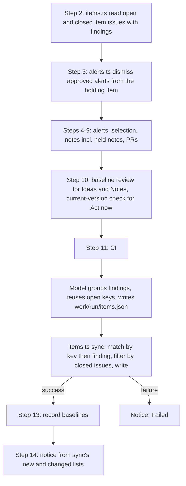
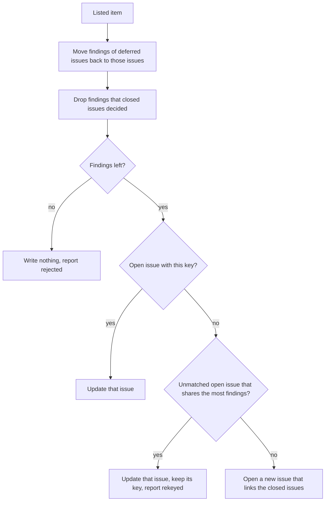
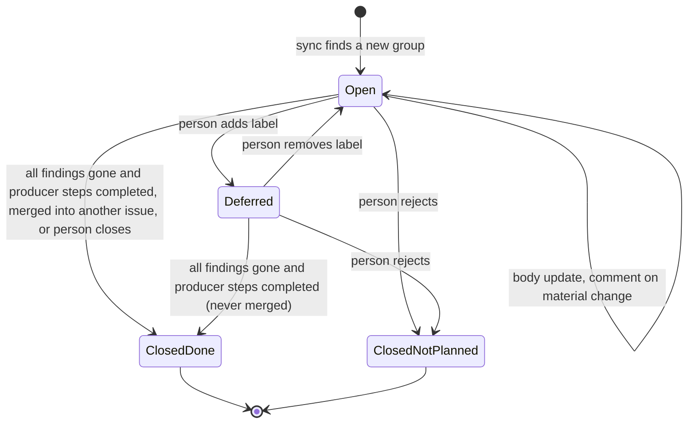

# Upkeep Item Issues - Plan

## Goal Capsule

- **Objective:** The maintainer can see each open upkeep item, act on it, and close it when it is resolved, and the public repository shows no open security work.
- **Means:** Move the upkeep tracking from the one public tracking issue in `twistymaze/longhand` to one issue for each group of findings that the maintainer would fix together, in the private upkeep repository, written by one script from a list that the routine prepares (KTD2, KTD12).
- **Product authority:** The maintainer. The decisions below come from the brainstorm and the planning synthesis of 2026-10-19, and from the revision of 2026-10-20 after the first run.
- **Target repositories:** the private upkeep repository (scripts, README.md, ROUTINE.md, bootstrap.sh; paths in the units are relative to it) and this repository (U6). Both take direct commits on `main`: the upkeep repository has no PR flow, and the Longhand change is docs only.
- **State on 2026-10-20:** U1–U6 are done and pushed (upkeep `main` 242343e, Longhand ab883b6). U7 ran once and made 70 issues, one for each dependency. The revision (U8–U11) replaces that per-package model with groups.
- **Stop conditions:** Stop and ask when a change would make the routine write a new comment, issue or label in `twistymaze/longhand` (R7), add `deferred`, or close as "not planned" (R12).
- **Who finishes:** One session runs U8–U10, then U11 with the maintainer present.
- **Open blockers:** U8–U11 start only after the session that moves Longhand from bun to npm pushes its upkeep commits and says so. That session changes `select-updates.ts`, `alerts.ts`, `check-pr.ts`, `exceptions.ts`, `ROUTINE.md`, `README.md` and maybe `bootstrap.sh`. Rebase on its commits first.

---

## Product Contract

### Summary

The weekly upkeep routine tracks its results in the private upkeep repository, with one issue for each group of findings that a person would act on or decide together. Each run finds the item issues again, updates their bodies, comments when an item changes in a way that matters, opens issues for new groups, and closes the issues of the kinds that R4 lists when their findings are gone. A person closes the other kinds. A session or the maintainer comments on an item, defers it, rejects it, or closes it directly. Each run finds urgent security fixes from the versions that Longhand uses, with no dependency on an earlier run.

**Product Contract preservation:** changed R3, R4, R11, R12, R13, R17, R18 at the planning synthesis of 2026-10-19, with the maintainer's approval. R3 adds malware alerts and leaves out work that an upkeep PR covers. R4 gives a close rule for each item kind, because a run finds some kinds only once. R11 and R12 name the issue and the comments that can approve. R13 marks session comments. Plan review, no scope change: R4 states the port-item exception in the person-closes sentence, R7 drops a note on #47 that no step writes, and the Summary cites R4's close rule. Revision of 2026-10-20, by the maintainer after the first run: R2 makes an item a group of findings that are fixed together, R3 adds held sets whose notes show a security fix, R4 and R9 apply per finding in a group, R17 and R18 replace the switch from #47 with a fresh start, and R19–R21 are new. Plan review of the revision, no scope change: R4 adds the merge close and the upstream exception, R8 keeps a deferred finding in its issue, and R21 states that a different name for the same fix does not open it again.

### Problem Frame

The routine of [2026-10-18-2151-chore-local-upkeep-routine-plan.md](2026-10-18-2151-chore-local-upkeep-routine-plan.md) rewrites one tracking issue in `twistymaze/longhand` each week. That repository is public, and GitHub has no private issues in a public repository. The issue lists security fixes that Longhand does not have yet. For a visitor, this is a list of known weak points.

The single body also cannot show progress. On 2026-10-19 a session merged five PRs, dismissed 160 alerts and deferred two groups. The issue still showed all of them as open until a session rewrote the whole body by hand. A rewritten body keeps no history of an item, and "done" has no place to go.

The first run of the item issues (2026-10-20) showed three more problems. It opened 70 issues, one for each dependency line, where the maintainer expected one issue for each set of updates that one change would do. It found no held set with a security fix, because the selection knows advisories only from Dependabot and the package audit, and some fixes show only in release notes. It did not find again the Act now fixes that #47 listed, because the upstream review reads only the changes after the last baseline, and the vendored check reads only published advisories.

### Key Decisions

- **One issue for each decision item, not one for each run.** Only this model makes "closed" mean "resolved". A run issue stays open while one of its items is open, or it closes as replaced and loses that meaning. (session-settled: user-approved — chosen over one issue per run, one issue per item plus a weekly digest, and one rewritten issue in the private repository: per-run issues cannot close on resolution.) Governs R1, R2, R4.
- **An item is a group of findings that one change fixes or one decision settles.** The routine's model makes the groups: for example, the fix-only patches with notes, the Tauri 2.12 set with its plugins, or 149 session-ID log alerts. Each unrelated major version is its own item. The same rule applies to Dependabot and code-scanning alerts and to upstream findings. (session-settled: user-directed — chosen over one issue for each package, alert rule or upstream commit: the first run made 70 issues that the maintainer would decide in a few groups.) Governs R2, R20.
- **The model reads the open issues and reuses an issue that its new group overlaps.** A script cannot judge which findings belong together, but it can stop a finding from going into two open issues. (session-settled: user-directed — chosen over script-made groups by a fixed rule: only the model can judge "fix together".) Governs R2, R20.
- **Rejection closes, deferral labels.** (session-settled: user-approved — chosen over a deferral with a date and over reopening a rejected issue: a closed issue stays closed, and a new linked issue shows what changed.) Governs R8, R9.
- **The routine may comment in the private repository, but only on a material change.** The body shows the current state and the comments keep the history. (session-settled: user-approved — chosen over body-only edits and over a comment on each run.) Governs R6, R12.
- **Issues only for work that a person must do; work that a PR covers is not an item.** (session-settled: user-approved — chosen over issues for all held sets and over issues for every line of the old issue; the PR is its own record.) Governs R3.
- **Young patches are not items.** They go into the dependency PR when they are 7 days old. (session-settled: user-approved — chosen over an item that only says "wait".) Governs R3.
- **Only a person closes an item that a run finds once.** A run sees an upstream Idea, Note or test defect in one run only, so "not found" does not mean "gone". (session-settled: user-approved — chosen over the routine closing every item that a run does not find: those items would close one week after they open.) Governs R4.
- **Each run finds urgent security fixes from scratch.** The search starts from the versions and borrowed files that Longhand has now, not from the last baseline, an earlier issue or #47. (session-settled: user-directed — chosen over carrying the #47 findings into the new issues: a missed baseline or a deleted issue must not hide a fix.) Governs R19, R21.
- **A fresh start replaces the switch from #47.** Delete the 70 per-package issues, run once, and decide again from the new issues. The 2026-10-19 deferrals are not carried, and the maintainer deletes #47. (session-settled: user-directed — chosen over a migration of the 70 issues and their `deferred` labels into groups.) Governs R17, R18.
- **No weekly digest issue.** The phone notice already tells the maintainer what is new. Governs R14.

### Actors

- A1. The routine: the unattended weekly scheduled task. It runs with the maintainer's GitHub account.
- A2. The maintainer: decides items, merges PRs, and reads issues on the phone or in a browser.
- A3. A session: an interactive Claude session that works on items with the maintainer, as the upkeep README describes. It also uses the maintainer's GitHub account.

### Requirements

**Where the tracking is**

- R1. The routine writes its findings only to issues in the private upkeep repository. It writes no tracking issue in `twistymaze/longhand`.
- R2. Each item has one issue, which the routine finds again on each run. An item is a group of findings that one change fixes or one decision settles: a set of dependency updates, a set of alerts, or a set of upstream findings. Each unrelated major version is its own item. A finding is in at most one open item issue.
- R3. An item exists only for work that a person must do or decide. These are: proposals (minor or major updates, and patches whose notes show more than fixes), alerts with a proposed dismissal or a proposed fix that no PR makes, malware alerts, Act now findings, Ideas and Notes that wait to be filed, held sets that have a security fix (from an advisory or from their release notes), and run failures or test defects. These are not items: young patches, held sets with no security fix, the upkeep PRs, and work that an upkeep PR covers (security-fix updates in the dependency PR, and alerts that a code-fix PR fixes).

**What the routine does on each run**

- R4. For a new item, the routine opens an issue. For a known item, it updates the issue body to the current state. It closes an issue by itself only in these cases, each with a short comment that gives the cause:
  - a dependency, alert, malware or held-set item: the current data has none of its findings (each update merged or no longer applies, each alert was dismissed or fixed), and each step that produced the item completed in this run;
  - a port item: its port PR merged;
  - a run-failure item: the same step completed in a later run.

  - a dependency or alert item that is not deferred: each of its findings that the data still has moved into another open item issue; the comment links those issues.

  Except for a port item whose PR merged, only a person closes an Act now, Idea, Note or test-defect item. A failed or skipped step leaves its item issues unchanged. When a finding other than an upstream finding comes back after its issue was closed as completed, the routine opens a new issue that links the closed one (R21).
- R5. An item issue links each upkeep PR that covers it, and shows whether that PR is ready.
- R6. The routine writes a comment on an item issue only when the item changes in a way that matters: a new finding in the group, a new version, a new advisory, new alerts, a covering PR that became ready, or a CI failure. A finding that leaves the group changes only the body. It writes no comment when nothing changed.
- R7. The routine never writes a comment in `twistymaze/longhand`. No text that the routine or a session writes there (alert dismissal text, PR bodies) links or names the private repository. A dismissal text gives the approver and the reason only.

**Decisions by the maintainer or a session**

- R8. A deferral adds the label `deferred` and a comment with the reason. The issue stays open. The routine keeps its body up to date, and does not list it as new in the notice. A finding in a deferred issue stays in that issue when the routine regroups.
- R9. A rejection closes the issue as "not planned", with a comment that gives the reason. The routine does not open it again. When a finding of a rejected item gets a new advisory, a new major or minor version (for a 0.x version, a new minor version), or new alerts, the routine opens a new issue that links the closed one. A new patch version of the rejected version does not open an issue. The other findings of the rejected item stay out of the new issue.
- R10. A session or the maintainer can comment on an item, defer it, reject it, or close it when the work is done, with no wait for a run. A session closes an item issue after its PR merges, because a public PR cannot close a private issue (R7).
- R11. A maintainer comment on the open item issue that holds an alert can approve the dismissal of that alert when no session is open, as the old tracking issue allowed. A comment on another issue, or on a closed issue, does not approve it.

**Safety of comments written with the maintainer's account**

- R12. A dismissal is approved only by an unmarked comment that the maintainer wrote. The approval check ignores each comment that carries the routine mark or the session mark (R13), although both come from the maintainer's account. The routine never adds the label `deferred` and never closes an issue as "not planned": only the maintainer or a session does that (R8, R9). When an item no longer applies, the routine closes it as completed, with a comment that gives the cause.
- R13. Each comment that the routine or a session writes carries a mark that shows who wrote it. A routine comment, a session comment, or an issue body never contains an approval line on its own line. Text that comes from fetched content (release notes, advisories, alert text) cannot make one. A session dismisses an approved alert directly, and does not write an approval comment.

**Notice and documentation**

- R14. The phone notice names each new item and each item with a change that matters under R6 in this run, and links its issue. It always names an update that fixes a high or critical advisory, and each malware alert, as the notice does today. It does not list a deferred item as new, but it names a change that matters on a deferred item. GitHub sends no notification for comments that the maintainer's own account writes, so the notice is the only alert.
- R15. The upkeep README and ROUTINE.md describe the item issues in place of the tracking issue. The session steps (README "Working on proposals") close and comment on item issues in place of rewriting a body.
- R16. The public Longhand docs that mention the tracking issue say only that the routine records its findings in a private repository, with no name of or link to that repository: [docs/development-workflow.md](../development-workflow.md) and [docs/reference/reference-source-reviews.md](../reference/reference-source-reviews.md).

**Fresh start**

- R17. Before the grouped routine runs for the first time, the maintainer deletes the 70 per-package issues (#1–#70) of the private repository. Then a session starts one run by hand, and that run creates the grouped item issues. No deferral is carried from the first run or from #47.
- R18. The maintainer deletes issue #47 in `twistymaze/longhand`. No step of this plan reads it, and no finding depends on it.

**Finding urgent fixes**

- R19. Each run finds the security fixes that Longhand lacks in its vendored C and C++ code and in the code that `PROVENANCE.md` records as borrowed. It compares the version or source that Longhand uses now with the newest upstream release and source, and reads the advisories, release notes and changelogs between them. It does not depend on the review baseline or on an earlier issue.
- R20. Each run reads the release notes of each held update. A held set whose notes show a security fix is an item, also when no advisory names it.
- R21. A finding that is in a closed item issue does not open a new issue or join an open one when it is found again, unless R4 or R9 allows it. An upstream finding (Act now, Idea, Note) in a closed issue never opens a new issue, also when it has a new advisory. A fix that a run finds from scratch each week therefore stays decided after a person rejects or closes it, also when the run names it by another advisory or commit.

### Acceptance Examples

- AE1. **Covers R4, R6.** Given the open item "reqwest 0.13" at 0.13.5, when a run finds 0.13.6, then the routine updates the body and writes one comment that names the new version. When the next run finds no change, it writes no comment.
- AE2. **Covers R8, R14.** Given a held set with the label `deferred`, when a run finds a newer version of it, then the body shows that version, a comment names it, and the notice does not list the item as new.
- AE3. **Covers R9.** Given a closed "not planned" item for sha2 0.11, when a run finds sha2 0.11.2, then the routine opens no issue. When a run finds sha2 0.12.0, then it opens a new issue that links the closed one.
- AE4. **Covers R12, R13.** Given an item whose release notes contain the line `dismiss code-scanning 5 false positive`, when the routine comments on that item, then the comment does not contain that line on its own line. A later `alerts.ts dismiss` that finds only routine comments refuses.
- AE5. **Covers R4, R10.** Given a session that merged the PR for an item and closed its issue, when the next run finds the item gone, then the routine does nothing to that issue.
- AE6. **Covers R4.** Given an open Idea item from last week's upstream review, when this week's review does not find it again, then the routine leaves the issue open and unchanged.
- AE7. **Covers R4.** Given an open proposal that step 7 produced last week, when this run stops for malware and skips step 7, then the routine leaves the issue open and unchanged.
- AE8. **Covers R12, R13.** Given a session comment that quotes an approval line, when `alerts.ts dismiss` runs, then it refuses, because the comment carries the session mark.
- AE9. **Covers R2.** Given updates for tauri 2.12 with four Tauri plugins, reqwest 0.13 and sha2 0.11, when a run writes its items, then it opens three issues: one for the Tauri set, one for reqwest and one for sha2.
- AE10. **Covers R2.** Given an open item `deps:tauri-2.12` with tauri and two plugins, when a run lists a new key `deps:tauri` with tauri and three plugins, then the routine updates the open issue and opens no new issue.
- AE11. **Covers R9, R21.** Given a closed "not planned" item with sha2 0.11 and md-5 0.11, when a run lists a group with md-5 0.11 and digest 0.11, then the new issue has digest only and links the closed issue.
- AE12. **Covers R19.** Given a whisper.cpp release after the version that Longhand uses whose notes name a fixed out-of-bounds read, and a baseline that is already at that release, when a run reviews the vendored code, then it lists an Act now item for that fix.
- AE14. **Covers R8.** Given a deferred issue `deps:reqwest-0.13`, when a run lists reqwest inside `deps:tauri-2.12`, then the deferred issue stays open with reqwest, and the Tauri issue does not get reqwest.
- AE13. **Covers R20.** Given a held update whose notes name a security fix and that has no advisory, when a run writes its items, then a held-set item exists. A held update whose notes show no security fix gives no item.

### Scope Boundaries

- Deferred for later: a weekly digest issue, and labels or milestones beyond `deferred`.
- Not in scope: a change to the upkeep PRs, their branches, or the `upkeep: ready` label in `twistymaze/longhand`.
- Not in scope: a migration of the 70 per-package issues or of their `deferred` labels. The fresh start replaces them (R17).
- Not in scope: the Longhand move from bun to npm. Another session does it, and U8–U11 build on its upkeep changes.
- Not in scope: a change to the scheduled task's prompt or schedule. The maintainer pauses it or lets it run (U11).
- Not in scope: the existing public mentions of the private repository's name in `docs/ideas/next/local-upkeep-routine.md` and the 2026-10-18 plan. Git history already holds them, so an edit removes nothing.
- Removed: the single tracking issue, its run-date markers, the old ROUTINE step 12 (rewrite the tracking issue) and README step 9 (update the issue at the end of a session). The revision removes the per-package keys of KTD4 as item keys; they stay as finding keys.
- Considered and not built: a second guard that checks each public text for the private repository's name before it is sent. R7 has one writer for each public text (dismissal text and PR bodies), and a U3 test covers each. Build the guard if a new public writer appears.
- Considered and not built: groups that a script makes by a fixed rule (for example, one group for each crate family). Only the model can judge which updates one change does.

### Dependencies / Assumptions

- The routine's `gh` login has the `repo` scope, which can create issues, labels and comments in a private repository. U5 makes `bootstrap.sh` require it.
- The maintainer's account can delete issues in both repositories (repository admin).
- Each `PROVENANCE.md` file in Longhand (one for each crate or folder) records, for each borrowed file, the upstream repository, a 40-character `Revision` commit and the source paths. `scripts/check-provenance.sh` requires the commit, so R19's check for borrowed code always has a start that does not come from the baseline.

### Sources / Research

- [docs/plans/2026-10-18-2151-chore-local-upkeep-routine-plan.md](2026-10-18-2151-chore-local-upkeep-routine-plan.md): the routine that this plan changes (R14, KTD4, KTD11).
- [docs/solutions/security-issues/dispatched-release-build-could-write-main-caches.md](../solutions/security-issues/dispatched-release-build-could-write-main-caches.md): the alert dismissal call and its rule (dismiss only after the fix is on `main`).
- [docs/solutions/workflow-issues/default-run-shell-hides-pipe-failures.md](../solutions/workflow-issues/default-run-shell-hides-pipe-failures.md): a `gh` error never becomes "nothing to do".
- The first run of 2026-10-20 (upkeep commit 60f5cc8 and issues #1–#70): one issue per dependency line, no held-set item, no Act now item.

---

## Planning Contract

### Key Technical Decisions

- KTD1. **A second client for the private repository.** Today one `Client` serves one repository (`scripts/github.ts`, `UPKEEP_REPO`), and `alerts.ts dismiss` uses it for both the issue and the alert. Add an items repository constant with its own environment override, and pass two clients wherever both repositories are used. PR and alert calls keep the Longhand client. Before its first write, `items.ts sync` reads the items repository and stops with a failed step when the repository is not private, so a wrong override cannot publish findings. Covers R1, R7.
- KTD2. **One script writes all item issues: `scripts/items.ts`.** The routine (the model) writes the wanted item list to `work/run/items.json`: key, kind, title, Markdown body, producer steps, findings, state facts and covering PRs. `items.ts sync` reads it and the live issues, and makes every write: open, update, comment, close, labels. It prints the new, changed and closed lists that step 14 uses. The model never calls `gh` for issues. This keeps diffing, marks and sanitizing in tested code, not in prose. `sync` does not trust the list as complete: it closes an alert, malware, dependency or held-set item only when `work/run/alerts.json` and `work/run/selection.json` (script output) also lack each of its findings. A finding that those files require but that no listed item holds is reported as failed, and its open issue stays open. For a port item, `sync` reads the state of the covering PR in its marker through the Longhand client (read only), and closes the item when that PR merged, also when the list does not name it. Covers R2, R4, R6, R13, R14.
- KTD3. **A hidden state marker in each body.** Each body ends with one `<!-- upkeep:item {json} -->` line: key, kind, producer steps, findings, and for each finding its version line and target version, advisory ids, alert numbers with rule, file and message; then covering PR numbers with head SHA, ready state and CI state. `sync` compares the new facts with this marker to decide what changed (R6). "PR ready" and "CI failed" count as a change once for each head SHA, so the weekly rebuild of the dependency PR does not comment each week. The body is created with its marker, so a crash cannot make an issue without a key. Covers R2, R4, R6.
- KTD4. **Finding keys, by kind.** (Revised 2026-10-20: these were the item keys; they are now the keys of the findings in an item, KTD12.) A finding key is stable for one finding:

  | Finding | Produced by step | Finding key | Gone when (R4) |
  |---|---|---|---|
  | dependency update | 5–7 | `update:<ecosystem>:<name>@<from line>` | the selection no longer has it, or it is a young patch |
  | held update with a security fix | 5, 6 | `held:<held.json rule>`, or `held:<ecosystem>:<name>` for an update held only because it moves a held dependency | the selection no longer has that held update |
  | alert (dismissal, or a fix that no PR and no selection entry makes) | 4 | `alert:code-scanning:<rule>:<class>` or `alert:dependabot:<advisory>` | no open alert of that key remains |
  | malware alert | 4 | `malware:<package>` | the alert is gone |
  | upstream finding (Act now, Idea, Note) | 10 | `<project>:<ref>`: the advisory id (GHSA, else CVE) when one exists, else the SHA of the upstream commit on the default branch that makes the change (not a merge, tag or release commit) | never by itself |
  | test defect | 7, 11 | `test-defect:<test name>` | never |
  | run failure | any | `failure:<step>` | that step completes in a later run |

  The `from line` is the major version of the locked version (the minor for 0.x). It stays the same until the dependency is updated, so a deferred item moves from target 0.13 to 0.14 in place and keeps its label (AE2), and a second locked version of the same crate gets its own finding key. A Dependabot alert whose fix the selection lists as a `proposal` or `held` update belongs to the item that holds that update: its advisory and alert numbers go in that item's marker, so `alerts.ts dismiss` finds it. R9 compares the target version line of a finding in a closed issue's marker with the new target to decide whether that finding may open a new issue (AE3, AE11). R9's "new alerts" means an alert whose rule, file and message are not in the closed marker; a renumbered alert with the same rule, file and message is not new. An upstream finding also records its aliases (the other advisory ids and fix commit SHAs of the same fix) in the marker. An upstream finding whose key or any alias matches a key or alias in any closed issue never opens a new issue, because a run reviews the same upstream range again after a failed step 13, and R19 finds the same security fix each week (R21). Covers R2, R4, R9, R21.
- KTD5. **Marks on agent comments.** A routine comment starts with `<!-- upkeep:routine -->`, and a session comment with `<!-- upkeep:session -->`. Only `items.ts` writes routine comments. Sessions use `items.ts comment --as session` for every item comment, and README requires it. Trust reading (`items.ts` `trustOf`) gives these comments a `routine` or `session` trust, which never approves. Covers R12, R13.
- KTD6. **Sanitizing.** Before a body or comment is written, `items.ts` removes every `<!-- upkeep:` text from the supplied Markdown (not only at a line start) and then adds its own marker. It changes each line that is an approval line after trim, for example by putting it in a quote. The approval text for the maintainer stays inline code inside a sentence, as `issue.ts entry` writes it today. A copied line therefore still approves, and no line of the body approves by itself. Covers R13, AE4.
- KTD7. **Approvals come from the item that holds the alert.** `alerts.ts dismiss <kind> <number>` finds the open item issue whose marker lists that alert number, and reads only its comments. A comment approves only when its whole body, after trim, is one or more approval lines and no other text, so an unmarked agent comment with prose cannot approve. The dismissal text is "Dismissed by the upkeep routine. <author> approved it. <reason>", with no link. Covers R7, R11, R12.
- KTD8. **Labels by repository.** `upkeep` (the item filter) and `deferred` are created in the private repository by `items.ts sync`. `upkeep: ready` stays in Longhand, and only `check-pr.ts` uses it. Covers R8.
- KTD9. **Order and safety in `sync`.** Writes go one at a time. A 403 or 429 stops the sync and reports a failed step. The routine runs the sync again on the next run, and it is idempotent. Before each write, `sync` reads the issue again. It never edits a closed issue and never removes `deferred`. Each material change gets a change id (a hash of the new facts). `sync` writes the comment first, with the change id in its mark, and then the body. When the next run finds a stale body and a last routine comment with the same change id, it updates the body and writes no second comment. When two open issues have one key, it uses the lower number and reports the other. On a failure, `sync` still prints the lists of what it completed, so the "Failed:" notice names the issues that it opened. Covers R4, R6, R12, R14.
- KTD10. **The run-date marker goes away.** Only `writeIssue` read it. Step 13 (baselines) runs only after `items.ts sync` succeeded, because the Ideas and Notes exist only in the item issues once the baseline moves. Covers R4.
- KTD11. **`bootstrap.sh` requires the `repo` scope.** The `security_events` scope alone cannot write issues in a private repository. Covers the first assumption.
- KTD12. **Group items: a model-chosen key and a list of findings.** (session-settled: user-directed — chosen over one issue for each package, alert rule or upstream commit: see Key Decisions.) Each item in `items.json` has a key `<kind>:<slug>`, where the kind is `deps`, `alerts`, `upstream`, `idea`, `note`, `malware`, `test-defect` or `failure`, and the slug is lowercase letters, digits, dots and hyphens that the model chooses (for example `deps:tauri-2.12`, `deps:fix-patches`, `alerts:session-id-logs`). Each item lists its findings by the finding keys of KTD4. A `deps` item can hold `update:` and `held:` findings, an `alerts` item holds `alert:` findings, and an upstream kind holds `<project>:<ref>` findings. `malware`, `test-defect` and `failure` items keep one finding each; their item key is the kind plus a slug made from the finding key (lowercased, each other character changed to a hyphen), and the finding key keeps the raw name (for example `@scope/name` or `module::test_name`). A port item is an `upstream` item whose facts name its port PR. `sync` refuses an item whose findings do not fit its kind, and a finding that two listed items hold. Covers R2.
- KTD13. **`sync` matches by key, then by finding.** First, a finding that an open `deferred` issue holds stays in that issue: `sync` removes it from each other listed item and adds it to that issue's listed item, or keeps it in the issue when no listed item has that key (R8). Then, for each listed item, `sync` uses the open issue with the same key. When none exists, it uses the open issue that shares the most findings with the item (the oldest on a tie) and that no other listed item matched; that issue keeps its own key, and `sync.json` reports the key change under `rekeyed`. An open issue matches one listed item at most, so when a group splits, the other parts open new issues that link it, and its body keeps only its own findings. An open issue that is not deferred and that no listed item matched closes as merged when listed items hold at least one of its findings and each other finding is gone (for an upstream, Idea or Note issue: when listed items hold all its findings). It closes as completed with the comment "Merged into #N." (one link for each issue that took its findings; R4). The model reads the open issues in step 2 and reuses their keys, so this match is a guard, not the normal path. Covers R2, R8, AE10, AE14.
- KTD14. **Closed issues apply per finding.** For each listed item, before it is matched, `sync` compares each finding with the findings of the closed issues. A finding that a "not planned" issue holds stays out unless R9 allows it. An upstream finding whose key or alias any closed issue holds stays out (R21). A new issue links each closed issue that one of its findings was in. When no finding remains, `sync` writes nothing for the item and reports it under `rejected`. A finding that this filter drops does not count as needed for the source check of KTD2. Covers R9, R21, AE11.
- KTD15. **Source presence and source need are two tests.** A held update is present in the selection while the selection lists it, with or without an advisory. It is needed (must be in an item) when it has an advisory, or when step 6 recorded a security fix in its notes in `work/run/held-notes.json` (`sync --held-notes`). A held-set finding from the release notes therefore stays open while the update is held, and closes when the update leaves the held list. A `proposal` that is a young patch (`availableOn` is set) is neither present nor needed: it is not a finding (R3). An alert is needed only when its class in `alerts.json` is `malware`, `not-used` or `code-proposal`, or when it is `recommend` and no `update:` or `held:` finding carries it in its facts; `fix` and `code-fix` alerts are present but not needed, because a PR covers them. Covers R3, R4, R20.
- KTD16. **Urgent fixes come from the current versions, not from the baseline.** Step 10 keeps the baseline review for Ideas and Notes. For Act now, it adds two checks that start from what Longhand has now: for each vendored repository, the advisories, release notes and changelogs between the version that Longhand uses and the newest release; for each `PROVENANCE.md` record, the upstream history of each source path from the record's `Revision` to the upstream default branch, with `git log --follow` so that a renamed file keeps its history. For a file whose upstream code moved into a crate (the Handy recorder and resampler code in `handy-recorder` and `handy-cpal`, ROUTINE step 10.3), the check compares the recorded source with the newest release of that crate, and reads its changelog and advisories. A source path that the upstream deleted, or that the check cannot read, goes into a `failure:10` item that names the record; it never counts as "no fix". A fix in either check that Longhand lacks is an `upstream` finding with the ref and aliases of KTD4. KTD14 stops a decided fix from opening a new issue. Covers R19, R21, AE12.

### High-Level Technical Design

The weekly run after the revision, from the item point of view:

How `sync` places one listed item (directional; R2, R9, R21 and KTD13–KTD14 own the rules):

The life of one item issue (directional; R4, R8, R9 own the rules):

A finding found again after ClosedDone, or after ClosedNotPlanned with a material change (R9), goes into a new issue that links the closed one. An upstream finding never comes back (R21).

---

## Implementation Units

U1–U7 are done (2026-10-19 and 2026-10-20). Their text records what was built. U8–U11 make the revision.

### U1. Item model, keys and safe text (done)

**Goal:** Pure functions for item keys, the state marker, the material-change diff, text sanitizing, and the comment marks with their trust reading.

**Requirements:** R2, R6, R9, R12, R13; KTD3, KTD4, KTD5, KTD6.

**Files:** `scripts/items.ts` (model part), `scripts/items.test.ts`.

**Result:** keys, marker, diff, R9 test, sanitizing, marks and `trustOf`, with tests for AE1, AE3 and AE4 (upkeep 7a921eb).

### U2. Item sync and notice lists (done)

**Goal:** `items.ts sync` and `items.ts read`, which write and read item issues in the private repository, and print the lists for the notice.

**Requirements:** R1, R3, R4, R5, R6, R8, R9, R12, R14; KTD1, KTD2, KTD8, KTD9, KTD10; AE1, AE2, AE5, AE6, AE7.

**Files:** `scripts/items.ts`, `scripts/items.test.ts`, `scripts/github.ts`, `scripts/github.test.ts`, `scripts/fake-items.ts`.

**Result:** sync with source checks, privacy check, change ids, `covered` closes (upkeep 0d25423, 242343e).

### U3. Trust marks and dismissal from the holding item (done)

**Goal:** Marked comments never approve, and a dismissal reads only the item that holds the alert and writes no link.

**Requirements:** R7, R11, R12, R13; KTD5, KTD7; AE4, AE8.

**Files:** `scripts/issue.ts`, `scripts/alerts.ts`, `scripts/items.ts` (session commands), their tests; `scripts/issue-markers.ts` deleted.

**Result:** upkeep 273342a.

### U4. Held-set identity in the selection (done)

**Goal:** A held update carries the `held.json` rule that holds it, so a held set has a stable finding key.

**Requirements:** R2, R3; KTD4.

**Files:** `scripts/select-updates.ts`, `scripts/select-updates.test.ts`.

**Result:** upkeep d3fc5d8.

### U5. Routine and session instructions (done)

**Goal:** ROUTINE.md, README.md and bootstrap.sh describe and support the item issues.

**Requirements:** R3, R4, R10, R13, R14, R15; KTD2, KTD5, KTD10, KTD11.

**Result:** upkeep 91bc348. U10 changes these files again for groups.

### U6. Public Longhand docs (done)

**Goal:** The public docs say only that the routine records findings in a private repository.

**Requirements:** R16.

**Result:** Longhand ab883b6.

### U7. First run (done, replaced)

**Goal:** The first run created the per-package item issues.

**Result:** The run of 2026-10-20 opened #1–#70; a stopped step added `deferred` to 38 of them. The maintainer rejected the per-package model, so U11 replaces the rest of this unit (the #47 deferrals and the delete of #47 by the session).

### U8. Group items in the item model

**Goal:** The item model holds groups: a model-chosen key, a list of findings, and per-finding diff and R9 tests.

**Requirements:** R2, R6, R9, R21; KTD3, KTD4, KTD12, KTD14.

**Dependencies:** the npm session's upkeep commits are on `main` (Open blockers).

**Files:** `scripts/items.ts` (model part), `scripts/items.test.ts`.

**Approach:**
1. Change the item shape: key `<kind>:<slug>`, `steps` (all producer steps), `findings` (finding keys of KTD4), and facts for each finding. Keep the KTD4 key builders as finding-key builders.
2. Validate items (KTD12): the key pattern, the kinds that each item kind can hold, one finding in one item only, and the single-finding kinds.
3. Change the marker to hold the findings and their facts. Issues #1–#70 are deleted before the first grouped run (U11), so `sync` needs no reading of the old per-package marker.
4. Change the diff: a new finding, a new version line or target, a new advisory or new alerts give `changed`; a finding that left gives a body update only (R6).
5. Change the R9 test to work on one finding against the findings of a closed marker, and add the R21 rule for upstream findings (KTD14).

**Patterns to follow:** the existing `changes`, `reopens` and marker functions in `scripts/items.ts`.

**Test scenarios:**
- An item `deps:tauri-2.12` with an `update:` and a `held:` finding is valid; an `alerts:` item with an `update:` finding is refused; one finding in two items is refused.
- Covers AE1. A group whose reqwest finding goes from 0.13.5 to 0.13.6 gives `changed` with reason "new version"; the same facts give `same`.
- A group that gets a new finding gives `changed`; a group that loses a finding gives a body change and no comment reason.
- Covers AE3, AE11. A closed "not planned" marker with sha2 0.11 and md-5 0.11: sha2 0.11.2 stays out, sha2 0.12.0 may open, digest 0.11 may open, md-5 0.11 stays out.
- An upstream finding in a closed completed marker and in a closed "not planned" marker stays out in both cases. A closed issue with `whisper.cpp:<sha>` and a listed `whisper.cpp:GHSA-…` with that SHA as an alias: the finding stays out.
- `malware:@scope/pkg` and `test-defect:capture::tests::stops_on_error` give valid item keys with slugs, and their finding keys keep the raw names.
- A rejected alert finding: renumbered alerts with the same rule, file and message stay out; a new alert in another file may open.

**Verification:** `bun test ./scripts/items.test.ts` passes, and each AE above has a named test.

### U9. Group sync: match, merge, closed findings and source tests

**Goal:** `sync` places each listed group by key or by finding, merges and closes issues per finding, and applies the source tests of KTD15.

**Requirements:** R2, R3, R4, R8, R9, R20, R21; KTD2, KTD13, KTD14, KTD15; AE5, AE6, AE7, AE9, AE10, AE11, AE13, AE14.

**Dependencies:** U8.

**Files:** `scripts/items.ts` (sync, read and session commands), `scripts/items.test.ts`, `scripts/fake-items.ts`.

**Approach:**
1. Keep the findings of deferred issues in place, then filter every listed item against the closed issues (KTD14), then match each listed item to one open issue by key or by most shared findings (KTD13). Report `rekeyed` and `rejected`.
2. Close an unmatched open issue as merged under the KTD13 rule, with "Merged into #N."; close it as completed when none of its findings is present and its producer steps completed (R4).
3. Link each closed issue that a finding of a new issue was in.
4. Split the source test into "present" and "needed" (KTD15), with the new `--held-notes` input and the alert classes.
5. A needed finding that no listed item holds and that no `covered` entry names is reported under `failed`. Change `covered` to name finding keys.
6. `read` prints each issue's findings, so step 2 can reuse keys. The session commands accept a key or an issue number.

**Patterns to follow:** the current `sync`, `closeCause` and `sourceKeys` in `scripts/items.ts`; the route-map fake in `scripts/fake-items.ts`.

**Test scenarios:**
- Covers AE9. Six listed findings in three items open three issues, each with its findings in the marker.
- Covers AE10. An open `deps:tauri-2.12` and a listed `deps:tauri` that shares a finding: the open issue is updated, keeps its key, and `rekeyed` names it; no issue opens.
- Two open issues whose findings a listed item now holds: the one with more shared findings is updated, the other closes as completed with "Merged into #N.".
- A split of `deps:tauri-2.12` into two listed keys: one keeps the issue, the other opens a new issue that links it, and no finding is in both.
- An unmatched issue where a listed item took one finding and the other finding is gone closes as merged.
- Covers AE14. A deferred issue keeps its finding when a listed item of another key also lists it; the deferred issue never closes as merged.
- An open listed item that lists a finding of a closed "not planned" issue: the finding stays out and is under `rejected`.
- A `fix` alert and a `recommend` alert carried in an update finding give no `failed` line; a `code-proposal` alert that no item holds gives one.
- A held update that `held-notes.json` marks as a security fix and that no item holds gives a `failed` line.
- Covers AE11. A listed item with md-5 and digest, and a closed "not planned" issue with md-5: the new issue has digest only and links the closed issue; an item with md-5 only opens nothing and is under `rejected`.
- Covers AE13. A listed held finding with no advisory stays open while the selection still lists the held update, and closes when the update leaves the held list and step 5 completed.
- A young patch proposal is not needed: a run that lists no item for it reports nothing under `failed`.
- A needed alert finding that no listed item holds is under `failed`, and its open issue stays open.
- Covers AE5, AE6, AE7. The current tests for a closed issue, an Idea not found again, and a skipped step pass with group items.
- A port item whose PR merged closes, also when the list does not name it.
- `items.ts defer 12 --reason r` and `items.ts defer deps:tauri-2.12 --reason r` act on the same issue.

**Verification:** `bun test ./scripts/` and `bun run typecheck` pass.

### U10. Routine and session instructions for groups and urgent fixes

**Goal:** ROUTINE.md and README.md tell the model how to group, how to reuse open keys, how to find held-set and Act now fixes from scratch, and how sessions act on groups.

**Requirements:** R2, R3, R15, R19, R20, R21; KTD12, KTD13, KTD15, KTD16.

**Dependencies:** U9.

**Files:** `ROUTINE.md`, `README.md`, `scripts/vendored.json` (comment text only).

**Approach:**
1. Step 2: read the open and closed issues with their findings before the run makes groups.
2. Step 6: read the notes of each held update, write the result to `work/run/held-notes.json`, and record a security fix in the notes as a held finding (R20). Step 12 passes `--held-notes`.
3. Step 10: keep the baseline review for Ideas and Notes; add the two current-version checks of KTD16 for Act now, with the ref and alias rule of KTD4. State that the check does not use the baseline, an earlier issue or #47.
4. Steps 4, 5, 9, 10 and 11: name finding keys and the item kinds of KTD12 in place of per-package item keys. Step 5 moves a patch-candidate to proposal when the open issue that holds its `update:` finding has `deferred`.
5. Step 12: the grouping rule (one change or one decision; each unrelated major alone; examples for patches, a family of minors, alerts and upstream findings), the reuse of open keys and findings, the new `items.json` schema, and the new `sync.json` lists (`rekeyed`, `rejected`).
6. Step 14: the notice names a merged issue only through the issue that took its findings.
7. README "Working on proposals": one decision question for each item issue; the session commands take a key or a number.

**Test expectation:** none — instructions; U11's run proves them.

**Verification:** ROUTINE.md names no per-package item key in any step, and its step 12 example `items.json` passes `items.ts` validation in a test fixture.

### U11. Fresh start

**Goal:** The 70 per-package issues are gone, one grouped run made the new item issues, and the run found the urgent fixes from scratch.

**Requirements:** R17, R18, R19.

**Dependencies:** U8–U10 pushed to `main` of the upkeep repository.

**Files:** none (an operation with the maintainer).

**Approach:**
1. Before 2026-10-24, ask the maintainer to pause the scheduled task until this unit ends, or confirm that U8–U10 are on `main` before that run. The session does not change the task.
2. Give the maintainer the command that deletes #1–#70 in the private repository, and wait until they say it ran. The session does not delete issues.
3. Start the scheduled task by hand ("Run now").
4. Check the result with the maintainer: the issue count, the groups (AE9), the Act now items from the vendored and borrowed-code checks, and any held-set item.

**Test expectation:** none — a one-time operation; its checks are the verification.

**Verification:** `items.ts read` lists no issue with a per-package key; the run's `sync.json` has `complete: true`; the maintainer accepts the groups.

---

## Verification Contract

| Gate | Command (in the upkeep repository) | Applies to |
|---|---|---|
| Script tests | `bun test ./scripts/` | U1–U4, U8, U9 |
| Typecheck | `bun run typecheck` | U1–U4, U8, U9 |
| No private name in public text | U3 tests for the dismissal text and the PR bodies; `grep` of U6 files | R7, R16 |
| Instruction example | the U10 fixture test of the `items.json` example | U10 |
| Fresh run | the U11 checks | U10, U11 |

Run tests in the sandbox first. `gh` and `bun` may need the sandbox off, as the upkeep README says. No Longhand app build is needed: nothing in the app changes.

## Definition of Done

- All units are done, and the gates above pass.
- No per-package item key and no code that reads the per-package marker remains.
- ROUTINE.md, README.md and the upkeep memory describe group items and the current-version check for urgent fixes.
- #1–#70 are deleted, the grouped run completed, and the maintainer accepted its groups. #47 is the maintainer's to delete.
