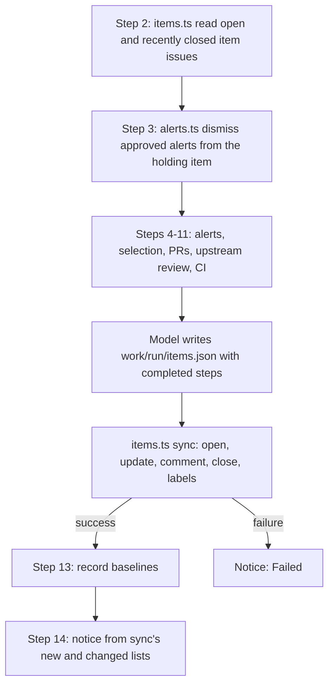
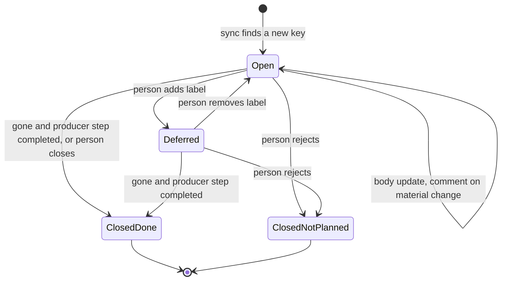

# Upkeep Item Issues - Plan

## Goal Capsule

- **Objective:** The maintainer can see each open upkeep item, act on it, and close it when it is resolved, and the public repository shows no open security work.
- **Means:** Move the upkeep tracking from the one public tracking issue in `twistymaze/longhand` to one issue for each item in the private upkeep repository, written by one script from a list that the routine prepares (KTD2).
- **Product authority:** The maintainer. The decisions below come from the brainstorm and the planning synthesis of 2026-10-19.
- **Target repositories:** the private upkeep repository (scripts, README.md, ROUTINE.md, bootstrap.sh; paths in U1–U5 are relative to it) and this repository (U6). Both take direct commits on `main`: the upkeep repository has no PR flow, and the Longhand change is docs only.
- **Stop conditions:** Stop and ask when a change would make the routine write a new comment, issue or label in `twistymaze/longhand` (R7), add `deferred`, or close as "not planned" (R12).
- **Who finishes:** One session runs U1–U6, then U7 with the maintainer present.
- **Open blockers:** None.

---

## Product Contract

### Summary

The weekly upkeep routine tracks its results in the private upkeep repository, with one issue for each item that a person must act on or decide. Each run finds the item issues again, updates their bodies, comments when an item changes in a way that matters, opens issues for new items, and closes the issues of the kinds that R4 lists when their items are gone. A person closes the other kinds. A session or the maintainer comments on an item, defers it, rejects it, or closes it directly.

**Product Contract preservation:** changed R3, R4, R11, R12, R13, R17, R18 at the planning synthesis of 2026-10-19, with the maintainer's approval. R3 adds malware alerts and leaves out work that an upkeep PR covers. R4 gives a close rule for each item kind, because a run finds some kinds only once. R11 and R12 name the issue and the comments that can approve. R13 marks session comments. R17 and R18 let the session, not the routine, add the 2026-10-19 deferrals (the old R17 conflicted with R12). Plan review, no scope change: R4 states the port-item exception in the person-closes sentence, R7 drops a note on #47 that no step writes, and the Summary cites R4's close rule.

### Problem Frame

The routine of [2026-10-18-2151-chore-local-upkeep-routine-plan.md](2026-10-18-2151-chore-local-upkeep-routine-plan.md) rewrites one tracking issue in `twistymaze/longhand` each week. That repository is public, and GitHub has no private issues in a public repository. The issue lists security fixes that Longhand does not have yet. For a visitor, this is a list of known weak points.

The single body also cannot show progress. On 2026-10-19 a session merged five PRs, dismissed 160 alerts and deferred two groups. The issue still showed all of them as open until a session rewrote the whole body by hand. A rewritten body keeps no history of an item, and "done" has no place to go.

### Key Decisions

- **One issue for each decision item, not one for each run.** Only this model makes "closed" mean "resolved". A run issue stays open while one of its items is open, or it closes as replaced and loses that meaning. (session-settled: user-approved — chosen over one issue per run, one issue per item plus a weekly digest, and one rewritten issue in the private repository: per-run issues cannot close on resolution.) Governs R1, R2, R4.
- **An item is one decision, so related findings share one issue.** For example, the 149 session-ID log alerts were one issue, not 149. Governs R2.
- **Rejection closes, deferral labels.** (session-settled: user-approved — chosen over a deferral with a date and over reopening a rejected issue: a closed issue stays closed, and a new linked issue shows what changed.) Governs R8, R9.
- **The routine may comment in the private repository, but only on a material change.** The body shows the current state and the comments keep the history. (session-settled: user-approved — chosen over body-only edits and over a comment on each run.) Governs R6, R12.
- **Issues only for work that a person must do; work that a PR covers is not an item.** (session-settled: user-approved — chosen over issues for all held sets and over issues for every line of the old issue; the PR is its own record.) Governs R3.
- **Only a person closes an item that a run finds once.** A run sees an upstream finding or a test defect in one run only, so "not found" does not mean "gone". (session-settled: user-approved — chosen over the routine closing every item that a run does not find: those items would close one week after they open.) Governs R4.
- **The session adds the 2026-10-19 deferrals after the first run.** (session-settled: user-approved — chosen over the first run adding `deferred`: the routine never adds that label.) Governs R17.
- **No weekly digest issue.** The phone notice already tells the maintainer what is new. Governs R14.

### Actors

- A1. The routine: the unattended weekly scheduled task. It runs with the maintainer's GitHub account.
- A2. The maintainer: decides items, merges PRs, and reads issues on the phone or in a browser.
- A3. A session: an interactive Claude session that works on items with the maintainer, as the upkeep README describes. It also uses the maintainer's GitHub account.

### Requirements

**Where the tracking is**

- R1. The routine writes its findings only to issues in the private upkeep repository. It writes no tracking issue in `twistymaze/longhand`.
- R2. Each item has one issue, which the routine finds again on each run by a stable key. Findings that need the same decision share one item: one dependency update, or a set that must move together; one upstream finding; or one alert rule with the alerts that share its decision.
- R3. An item exists only for work that a person must do or decide. These are: proposals (minor or major updates, and patches whose notes show more than fixes), alerts with a proposed dismissal or a proposed fix that no PR makes, malware alerts, Act now findings, Ideas and Notes that wait to be filed, held sets that have a security fix, and run failures or test defects. These are not items: young patches, held sets with no security fix, the upkeep PRs, and work that an upkeep PR covers (security-fix updates in the dependency PR, and alerts that a code-fix PR fixes).

**What the routine does on each run**

- R4. For a new item, the routine opens an issue. For a known item, it updates the issue body to the current state. It closes an issue by itself only in these cases, each with a short comment that gives the cause:
  - a dependency, alert, malware or held-set item: the current data no longer has it (the update merged or no longer applies, the alert was dismissed or fixed), and the step that produced the item completed in this run;
  - a port item: its port PR merged;
  - a run-failure item: the same step completed in a later run.

  Except for a port item whose PR merged, only a person closes an Act now, Idea, Note or test-defect item, because a run finds those once. A failed or skipped step leaves its item issues unchanged. When an item comes back after its issue was closed as completed, the routine opens a new issue that links the closed one.
- R5. An item issue links each upkeep PR that covers it, and shows whether that PR is ready.
- R6. The routine writes a comment on an item issue only when the item changes in a way that matters: a new version, a new advisory, new alerts of the rule, a covering PR that became ready, or a CI failure. It writes no comment when nothing changed.
- R7. The routine never writes a comment in `twistymaze/longhand`. No text that the routine or a session writes there (alert dismissal text, PR bodies) links or names the private repository. A dismissal text gives the approver and the reason only.

**Decisions by the maintainer or a session**

- R8. A deferral adds the label `deferred` and a comment with the reason. The issue stays open. The routine keeps its body up to date, and does not list it as new in the notice.
- R9. A rejection closes the issue as "not planned", with a comment that gives the reason. The routine does not open it again. When a rejected item gets a new advisory, a new major or minor version (for a 0.x version, a new minor version), or new alerts of its rule, the routine opens a new issue that links the closed one. A new patch version of the rejected version does not open an issue.
- R10. A session or the maintainer can comment on an item, defer it, reject it, or close it when the work is done, with no wait for a run. A session closes an item issue after its PR merges, because a public PR cannot close a private issue (R7).
- R11. A maintainer comment on the open item issue that holds an alert can approve the dismissal of that alert when no session is open, as the old tracking issue allowed. A comment on another issue, or on a closed issue, does not approve it.

**Safety of comments written with the maintainer's account**

- R12. A dismissal is approved only by an unmarked comment that the maintainer wrote. The approval check ignores each comment that carries the routine mark or the session mark (R13), although both come from the maintainer's account. The routine never adds the label `deferred` and never closes an issue as "not planned": only the maintainer or a session does that (R8, R9). When an item no longer applies, the routine closes it as completed, with a comment that gives the cause.
- R13. Each comment that the routine or a session writes carries a mark that shows who wrote it. A routine comment, a session comment, or an issue body never contains an approval line on its own line. Text that comes from fetched content (release notes, advisories, alert text) cannot make one. A session dismisses an approved alert directly, and does not write an approval comment.

**Notice and documentation**

- R14. The phone notice names each new item and each item with a change that matters under R6 in this run, and links its issue. It always names an update that fixes a high or critical advisory, and each malware alert, as the notice does today. It does not list a deferred item as new, but it names a change that matters on a deferred item. GitHub sends no notification for comments that the maintainer's own account writes, so the notice is the only alert.
- R15. The upkeep README and ROUTINE.md describe the item issues in place of the tracking issue. The session steps (README "Working on proposals") close and comment on item issues in place of rewriting a body.
- R16. The public Longhand docs that mention the tracking issue say only that the routine records its findings in a private repository, with no name of or link to that repository: [docs/development-workflow.md](../development-workflow.md) and [docs/reference/reference-source-reviews.md](../reference/reference-source-reviews.md).

**Switch from the old issue**

- R17. The session that ships this change starts one run by hand, and that run creates the item issues. Before the run, the session handles each maintainer approval comment on issue #47 directly (on 2026-10-19, #47 had none). After the run, the session adds the label `deferred` and a comment with the recorded reason to each item that the "Decided in session" section of #47 records as deferred. The notice of the first run can list those items as new.
- R18. After R17, the session deletes issue #47 in `twistymaze/longhand`. A closed issue keeps its body and its edit history readable, so only a delete removes the list of open security fixes from public view.

### Acceptance Examples

- AE1. **Covers R4, R6.** Given the open item "reqwest 0.13" at 0.13.5, when a run finds 0.13.6, then the routine updates the body and writes one comment that names the new version. When the next run finds no change, it writes no comment.
- AE2. **Covers R8, R14.** Given a held set with the label `deferred`, when a run finds a newer version of it, then the body shows that version, a comment names it, and the notice does not list the item as new.
- AE3. **Covers R9.** Given a closed "not planned" item for sha2 0.11, when a run finds sha2 0.11.2, then the routine opens no issue. When a run finds sha2 0.12.0, then it opens a new issue that links the closed one.
- AE4. **Covers R12, R13.** Given an item whose release notes contain the line `dismiss code-scanning 5 false positive`, when the routine comments on that item, then the comment does not contain that line on its own line. A later `alerts.ts dismiss` that finds only routine comments refuses.
- AE5. **Covers R4, R10.** Given a session that merged the PR for an item and closed its issue, when the next run finds the item gone, then the routine does nothing to that issue.
- AE6. **Covers R4.** Given an open Act now item from last week's upstream review, when this week's review does not find it again, then the routine leaves the issue open and unchanged.
- AE7. **Covers R4.** Given an open proposal that step 7 produced last week, when this run stops for malware and skips step 7, then the routine leaves the issue open and unchanged.
- AE8. **Covers R12, R13.** Given a session comment that quotes an approval line, when `alerts.ts dismiss` runs, then it refuses, because the comment carries the session mark.

### Scope Boundaries

- Deferred for later: a weekly digest issue, and labels or milestones beyond `deferred`.
- Not in scope: a change to the upkeep PRs, their branches, or the `upkeep: ready` label in `twistymaze/longhand`.
- Not in scope: a move of today's open items by hand. The first run creates the item issues (R17).
- Not in scope: the existing public mentions of the private repository's name in `docs/ideas/next/local-upkeep-routine.md` and the 2026-10-18 plan. Git history already holds them, so an edit removes nothing.
- Removed: the single tracking issue, its run-date markers, ROUTINE step 12 (rewrite the tracking issue) and README step 9 (update the issue at the end of a session).
- Considered and not built: a second guard that checks each public text for the private repository's name before it is sent. R7 has one writer for each public text (dismissal text and PR bodies), and a U3 test covers each. Build the guard if a new public writer appears.

### Dependencies / Assumptions

- The routine's `gh` login has the `repo` scope, which can create issues, labels and comments in a private repository. U5 makes `bootstrap.sh` require it.
- The maintainer's account can delete issues in `twistymaze/longhand` (repository admin).

### Sources / Research

- [docs/plans/2026-10-18-2151-chore-local-upkeep-routine-plan.md](2026-10-18-2151-chore-local-upkeep-routine-plan.md): the routine that this plan changes (R14, KTD4, KTD11).
- [docs/solutions/security-issues/dispatched-release-build-could-write-main-caches.md](../solutions/security-issues/dispatched-release-build-could-write-main-caches.md): the alert dismissal call and its rule (dismiss only after the fix is on `main`).
- [docs/solutions/workflow-issues/default-run-shell-hides-pipe-failures.md](../solutions/workflow-issues/default-run-shell-hides-pipe-failures.md): a `gh` error never becomes "nothing to do".

---

## Planning Contract

### Key Technical Decisions

- KTD1. **A second client for the private repository.** Today one `Client` serves one repository (`scripts/github.ts`, `UPKEEP_REPO`), and `alerts.ts dismiss` uses it for both the issue and the alert. Add an items repository constant with its own environment override, and pass two clients wherever both repositories are used. PR and alert calls keep the Longhand client. Before its first write, `items.ts sync` reads the items repository and stops with a failed step when the repository is not private, so a wrong override cannot publish findings. Covers R1, R7.
- KTD2. **One script writes all item issues: `scripts/items.ts`.** The routine (the model) writes the wanted item list to `work/run/items.json`: key, kind, title, Markdown body, producer step, state facts and covering PRs. `items.ts sync` reads it and the live issues, and makes every write: open, update, comment, close, labels. It prints the new, changed and closed lists that step 14 uses. The model never calls `gh` for issues. This keeps diffing, marks and sanitizing in tested code, not in prose. `sync` does not trust the list as complete: it closes an alert, malware, dependency or held-set item only when `work/run/alerts.json` and `work/run/selection.json` (script output) also lack its key. A key that those files still have but the list leaves out is reported as failed and stays open. For a port item, `sync` reads the state of the covering PR in its marker through the Longhand client (read only), and closes the item when that PR merged, also when the list does not name it. Covers R2, R4, R6, R13, R14.
- KTD3. **A hidden state marker in each body.** Each body ends with one `<!-- upkeep:item {json} -->` line: key, kind, producer step, version line and target version, advisory ids, alert numbers with rule, file and message, covering PR numbers with head SHA, ready state and CI state. `sync` compares the new facts with this marker to decide what changed (R6). "PR ready" and "CI failed" count as a change once for each head SHA, so the weekly rebuild of the dependency PR does not comment each week. The body is created with its marker, so a crash cannot make an issue without a key. Covers R2, R4, R6.
- KTD4. **Item keys, by kind.** The key is stable for one decision:

  | Kind | Produced by step | Key | Closes by itself when (R4) | Covering PR |
  |---|---|---|---|---|
  | dependency proposal | 5–7 | `update:<ecosystem>:<name>@<from line>` | the selection no longer has it | none |
  | held set with a security fix | 5 | `held:<held.json rule>`, or `held:<ecosystem>:<name>` for an update held only because it moves a held dependency | the selection no longer has a security fix for it | none |
  | alert proposal (dismissal, or a fix that no PR and no selection entry makes) | 4 | `alert:code-scanning:<rule>:<class>` or `alert:dependabot:<advisory>` | no open alert of that key remains | none |
  | malware alert | 4 | `malware:<package>` | the alert is gone | none |
  | Act now (port or larger fix) | 10 | `upstream:<project>:<commit or advisory>` | its port PR merged | `upkeep/port-…` |
  | Idea, Note | 10 | `idea:<project>:<commit>` or `note:<project>:<commit>` | never (a person closes it) | none |
  | test defect | 7, 11 | `test-defect:<test name>` | never | none |
  | run failure | any | `failure:<step>` | that step completes in a later run | none |

  The `from line` is the major version of the locked version (the minor for 0.x). It stays the same until the dependency is updated, so a deferred item moves from target 0.13 to 0.14 in place and keeps its label (AE2), and a second locked version of the same crate gets its own key. A Dependabot alert whose fix the selection lists as a `proposal` or `held` update belongs to that dependency or held item: its advisory and alert numbers go in that item's marker, so one decision has one issue (R2) and `alerts.ts dismiss` finds it. R9 compares the target version line in a closed issue's marker with the new target to decide whether to open a new issue (AE3). R9's "new alerts of its rule" means an alert whose rule, file and message are not in the closed marker; a renumbered alert with the same rule, file and message is not new. For `upstream:`, `idea:` and `note:` keys, a closed issue with the same key stops `sync` from opening a new issue, because a run reviews the same upstream range again after a failed step 13. Covers R2, R4, R9.
- KTD5. **Marks on agent comments.** A routine comment starts with `<!-- upkeep:routine -->`, and a session comment with `<!-- upkeep:session -->`. Only `items.ts` writes routine comments. Sessions use `items.ts comment --as session` for every item comment, and README requires it. Trust reading (`issue.ts` `trustOf`) gives these comments a `routine` or `session` trust, which never approves. Covers R12, R13.
- KTD6. **Sanitizing.** Before a body or comment is written, `items.ts` removes every `<!-- upkeep:` text from the supplied Markdown (not only at a line start) and then adds its own marker. It changes each line that is an approval line after trim, for example by putting it in a quote. The approval text for the maintainer stays inline code inside a sentence, as `issue.ts entry` writes it today. A copied line therefore still approves, and no line of the body approves by itself. Covers R13, AE4.
- KTD7. **Approvals come from the item that holds the alert.** `alerts.ts dismiss <kind> <number>` finds the open item issue whose marker lists that alert number, and reads only its comments. A comment approves only when its whole body, after trim, is one or more approval lines and no other text, so an unmarked agent comment with prose cannot approve. The dismissal text is "Dismissed by the upkeep routine. <author> approved it. <reason>", with no link. Covers R7, R11, R12.
- KTD8. **Labels by repository.** `upkeep` (the item filter) and `deferred` are created in the private repository by `items.ts sync`. `upkeep: ready` stays in Longhand, and only `check-pr.ts` uses it. Covers R8.
- KTD9. **Order and safety in `sync`.** Writes go one at a time. A 403 or 429 stops the sync and reports a failed step. The routine runs the sync again on the next run, and it is idempotent. Before each write, `sync` reads the issue again. It never edits a closed issue and never removes `deferred`. Each material change gets a change id (a hash of the new facts). `sync` writes the comment first, with the change id in its mark, and then the body. When the next run finds a stale body and a last routine comment with the same change id, it updates the body and writes no second comment. When two open issues have one key, it uses the lower number and reports the other. On a failure, `sync` still prints the lists of what it completed, so the "Failed:" notice names the issues that it opened. Covers R4, R6, R12, R14.
- KTD10. **The run-date marker goes away.** Only `writeIssue` read it. Step 13 (baselines) runs only after `items.ts sync` succeeded, because the upstream findings exist only in the item issues once the baseline moves. Covers R4.
- KTD11. **`bootstrap.sh` requires the `repo` scope.** The `security_events` scope alone cannot write issues in a private repository. Covers the first assumption.

### High-Level Technical Design

The weekly run after this change, from the item point of view:

The life of one item issue (directional; R4, R8, R9 own the rules):

A key found again after ClosedDone, or after ClosedNotPlanned with a material change (R9), opens a new issue that links the closed one.

---

## Implementation Units

### U1. Item model, keys and safe text

**Goal:** Pure functions for item keys, the state marker, the material-change diff, text sanitizing, and the comment marks with their trust reading.

**Requirements:** R2, R6, R9, R12, R13; KTD3, KTD4, KTD5, KTD6.

**Dependencies:** none.

**Files:** `scripts/items.ts` (new; model part), `scripts/items.test.ts` (new).

**Approach:**
1. Define the item kinds and the key builders of KTD4.
2. Define the marker read and write, and a diff that returns `new`, `changed` (with the reasons of R6), `same` or `gone`.
3. Define the R9 test: new version line (0.x minor), new advisory, or more alerts than recorded.
4. Define sanitizing: strip every `<!-- upkeep:` text, and neutralize any line that is an approval line after trim.
5. Define the routine and session marks (with the change id of KTD9), and the trust reading that gives a marked maintainer comment `routine` or `session` trust (KTD5). U2 and U3 both use them.

**Patterns to follow:** `scripts/issue.ts` `approvalText` and `plain()`; header comment and `///` doc comments as in `scripts/issue.ts`.

**Test scenarios:**
- Covers AE1. Marker with target 0.13.5 and new target 0.13.6 gives `changed` with reason "new version"; the same target gives `same`.
- Covers AE3. A closed marker at sha2 0.11 and target 0.11.2 gives no reopen; target 0.12.0 gives a reopen; a rejected 1.2 target reopens on 1.3 and not on 1.2.5 (R9).
- A rejected rule item with alerts A and B: renumbered alerts with the same rule, file and message give no reopen; B gone and a new alert C in another file gives a reopen.
- A dependency with one locked version keeps its key when a second locked version appears or goes away.
- A maintainer comment that starts with the routine mark reads as `routine`, with the session mark as `session`, with no mark as `maintainer`; a bot comment with a mark stays `data`.
- PR ready on a head SHA already in the marker gives `same`; ready on a new head SHA gives `changed`.
- Covers AE4. Text with a line `dismiss code-scanning 5 false positive` comes out with no line that equals an approval line after trim; inline code inside a sentence stays.
- Text with `<!-- upkeep:item {...} -->` in the middle of a line comes out without it.
- A dependency with two lockfile versions gives two keys.

**Verification:** `bun test ./scripts/items.test.ts` passes, and each AE above has a named test.

**Note:** U1 and U4 have no dependency on each other; U2 needs both.

### U2. Item sync and notice lists

**Goal:** `items.ts sync` and `items.ts read`, which write and read item issues in the private repository, and print the lists for the notice.

**Requirements:** R1, R3, R4, R5, R6, R8, R9, R12, R14; KTD1, KTD2, KTD8, KTD9, KTD10; AE1, AE2, AE5, AE6, AE7.

**Dependencies:** U1, U4.

**Files:** `scripts/items.ts` (sync and read commands), `scripts/items.test.ts`, `scripts/github.ts` (items repository constant and client), `scripts/github.test.ts`.

**Approach:**
1. `read` lists every open and every closed issue that carries the `upkeep` label, at any age, with markers, labels and comments with trust (U1). R9 must hold for a rejection of any age.
2. `sync <items.json> --alerts <alerts.json> --selection <selection.json> --completed <steps>` checks that the items repository is private (KTD1), matches wanted items to issues by key, and applies R4 with the source checks of KTD2: open new, update body, comment on change, close by kind rule, open a linked new issue after a completed or rejected close (R9, KTD4).
3. Before each write it re-reads the issue (KTD9). It creates `upkeep` and `deferred` in the private repository when missing.
4. It prints JSON: `new` (not deferred), `changed` (deferred included), `closed`, `failed`, and `malware`. Step 14 takes the high or critical security-fix updates from `selection.json`, because those are not items (U5).

**Patterns to follow:** route-map `fakeClient` in `scripts/issue.test.ts`; `allPages`, `errorStatus` and 422 handling in `scripts/github.ts`; `ensureLabels`.

**Test scenarios:**
- A new key opens one issue whose first body already has the marker, with the `upkeep` label, in the private repository only.
- Covers AE1. A changed version updates the body, then writes one routine comment; a second sync with no change writes nothing.
- Covers AE2. A deferred issue with a new version gets a body update and a comment, is in `changed`, and is not in `new`.
- Covers AE5. A key that is gone and whose issue is already closed causes no call.
- Covers AE6. An Act now key that is missing this week leaves its issue open, with no call.
- Covers AE7. With `--completed` that lacks step 7, a missing proposal from step 7 stays open.
- A dependency key that is missing while its step completed closes the issue as completed, with a cause comment.
- An alert key that `items.json` leaves out but `alerts.json` still has is reported as failed, and its issue stays open.
- An Act now item that `items.json` does not list, whose marker names a merged port PR, closes as completed.
- An Idea key found again after a person closed its issue opens nothing.
- A "not planned" issue closed 200 days ago, with no material change, causes no new issue.
- A `recommend` Dependabot alert whose fix is a selection proposal gives exactly one issue, the dependency item.
- An items repository that is not private stops the sync before any write.
- A failure after the comment and before the body update: the next sync updates the body and writes no second comment.
- A key that comes back after a completed close opens a new issue that links the old one.
- An issue that a person closed while the run was in progress is not edited.
- Two open issues with one key: sync uses the lower number and reports the other.
- A 403 on the third write stops the sync, reports it as failed, and makes no later write.
- No call path of the sync contains `twistymaze/longhand`.

**Verification:** `bun test ./scripts/` passes; a dry run against the fake client prints the expected lists.

### U3. Trust marks and dismissal from the holding item

**Goal:** Marked comments never approve, and a dismissal reads only the item that holds the alert and writes no link.

**Requirements:** R7, R11, R12, R13; KTD5, KTD7; AE4, AE8.

**Dependencies:** U1, U2.

**Files:** `scripts/issue.ts` (use the U1 trust reading; remove the single-issue `read`/`write`), `scripts/issue.test.ts`, `scripts/issue-markers.ts` and `scripts/issue-markers.test.ts` (delete), `scripts/alerts.ts`, `scripts/alerts.test.ts`, `scripts/items.ts` (session commands), `scripts/items.test.ts`, `scripts/github.test.ts`, `scripts/check-pr.test.ts`.

**Approach:**
1. Only `maintainer` trust approves (U1 gives marked comments `routine` or `session`).
2. `alerts.ts dismiss` takes the Longhand client and the items client, finds the open item issue whose marker lists the alert, and checks only its comments.
3. The dismissal text has no link (KTD7).
4. Keep `issue.ts entry` for the alert line, with the approval text inline.
5. Add session commands that each write one session-marked comment: `items.ts comment <key> --as session`, and `items.ts defer|reject|close <key> --reason <text>`, which also add `deferred`, close as "not planned", or close as completed.

**Patterns to follow:** existing `dismissAlert` tests in `scripts/alerts.test.ts`; fake `gh` on PATH in the same file.

**Test scenarios:**
- Covers AE4. Only routine-marked comments with the approval line: dismiss refuses and sends nothing.
- Covers AE8. A session-marked comment with the approval line: dismiss refuses.
- An unmarked maintainer comment on the holding open item approves, and the PATCH text names the author and reason and contains no `github.com` link and no private repository name.
- An approval on another item, or on a closed item, refuses.
- An unmarked maintainer comment that has an approval line plus other text refuses; a comment with two approval lines and nothing else approves each.
- A collaborator or bot comment never approves (existing behavior stays).
- `items.ts defer <key> --reason r` adds `deferred` and one session-marked comment; `reject` closes as "not planned"; `close` closes as completed; each refuses a key with no open issue.
- The PR bodies that the routine writes in Longhand (`github.ts` and `check-pr.ts`) and the dismissal text never contain the private repository's name.

**Verification:** `bun test ./scripts/` passes; `grep` finds no use of the removed single-issue functions.

### U4. Held-set identity in the selection

**Goal:** A held update carries the `held.json` rule that holds it, so a held set has a stable key.

**Requirements:** R2, R3; KTD4.

**Dependencies:** none.

**Files:** `scripts/select-updates.ts`, `scripts/select-updates.test.ts`.

**Approach:** Add the matched rule (`name` or `prefix`) to each `held` update, also for a dependency that a held crate holds (`holdsDependencies`). An update held only because it moves a held dependency gets no rule, and keeps its `moves` list for the body (KTD4 gives it its own key).

**Test scenarios:**
- An update of `tauri-build` is held with the rule `tauri-build`.
- A crate that only a held crate uses is held with that crate's rule.
- An exact pin is held with a rule marked as a pin.
- A package whose security fix moves a held package is held with no rule and with its `moves` list.

**Verification:** `bun test ./scripts/select-updates.test.ts` passes.

### U5. Routine and session instructions

**Goal:** ROUTINE.md, README.md and bootstrap.sh describe and support the item issues.

**Requirements:** R3, R4, R10, R13, R14, R15; KTD2, KTD5, KTD10, KTD11.

**Dependencies:** U2, U3.

**Files:** `ROUTINE.md`, `README.md`, `bootstrap.sh`, `task/SKILL.md` (only if its text names the tracking issue).

**Approach:**
1. Rules 2 and 4: comments are trusted by the marks; the routine comments only through `items.ts`, only in the private repository.
2. Step 2 reads items. Step 3 dismisses from the holding item. Steps 4–11 add wanted items instead of issue sections.
3. Replace step 12 with "write `work/run/items.json` and run `items.ts sync`". Step 13 runs only after a successful sync. Step 14 builds the notice from the sync output, plus the high or critical security-fix updates from `work/run/selection.json`.
4. README: the maintainer and session steps use item issues; sessions use the `items.ts` session commands (U3) for every item comment, deferral, rejection and close; remove step 9; the supervised-run checks name item issues.
5. `bootstrap.sh` requires `repo`.

**Test expectation:** none — instructions and a shell check; U7's first run proves them.

**Verification:** No text in ROUTINE.md or README.md names the tracking issue or `issue.ts write`; `bootstrap.sh --dry-run` reports the scope check.

### U6. Public Longhand docs

**Goal:** The public docs say only that the routine records findings in a private repository.

**Requirements:** R16.

**Dependencies:** none.

**Files:** `docs/development-workflow.md`, `docs/reference/reference-source-reviews.md`.

**Approach:** Replace "tracking issue (label `upkeep`)" with neutral text in each mention; add no name or link.

**Test expectation:** none — docs only.

**Verification:** `grep -n 'tracking issue' docs/development-workflow.md docs/reference/reference-source-reviews.md` finds nothing, and neither file names the private repository.

### U7. Switch from issue #47

**Goal:** The item issues exist with the 2026-10-19 deferrals, and #47 is gone from public view.

**Requirements:** R17, R18.

**Dependencies:** U1–U6 pushed to `main` of both repositories.

**Files:** none (an operation with the maintainer).

**Approach:**
1. Check #47 for maintainer comments, and dismiss any approved alert directly (R17). Then start the scheduled task by hand ("Run now").
2. Check the run's item issues against #47. When the sync stopped on a rate limit (KTD9), start the task by hand again; the sync is idempotent.
3. Run `items.ts defer <key> --reason <recorded reason>` for each item that #47's "Decided in session" section defers.
4. Ask the maintainer, then delete #47.

**Test expectation:** none — a one-time operation; its checks are the verification.

**Verification:** Each 2026-10-19 deferral has an open issue with `deferred`; `gh issue view 47 -R twistymaze/longhand` reports that the issue does not exist.

---

## Verification Contract

| Gate | Command (in the upkeep repository) | Applies to |
|---|---|---|
| Script tests | `bun test ./scripts/` | U1–U4 |
| Typecheck | `bun run typecheck` | U1–U4 |
| No private name in public text | U3 tests for the dismissal text and the PR bodies; `grep` of U6 files | R7, R16 |
| First run | the U7 checks | U5, U7 |

Run tests in the sandbox first. `gh` and `bun` may need the sandbox off, as the upkeep README says. No Longhand app build is needed: nothing in the app changes.

## Definition of Done

- All units are done, and the gates above pass.
- `scripts/issue-markers.ts`, the single-issue `read`/`write` code and their tests are deleted, with no leftover code from abandoned attempts.
- ROUTINE.md, README.md, the upkeep memory and the two public docs name no tracking issue.
- The first run created the item issues, the session applied the 2026-10-19 deferrals, and #47 is deleted.
