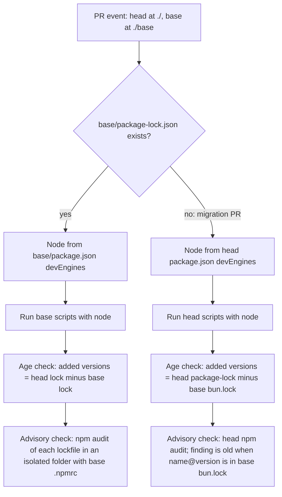
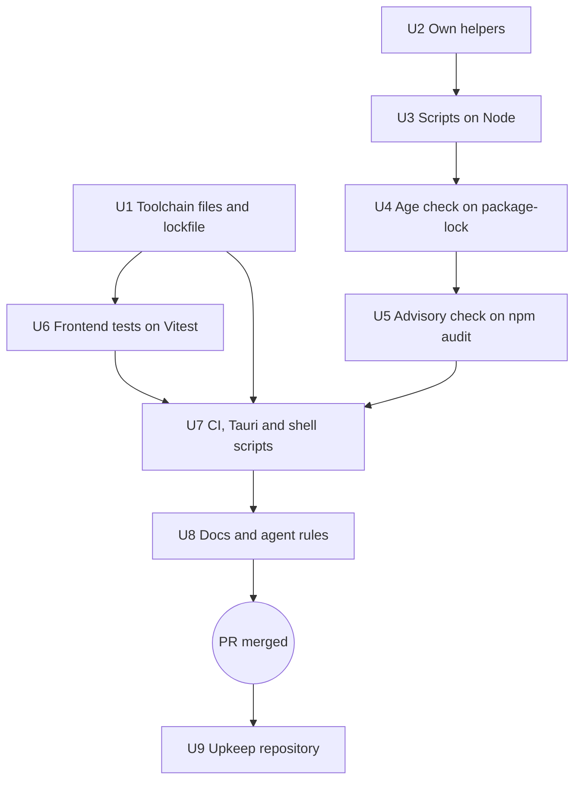

# Bun to npm - Plan

## Goal Capsule

- **Objective:** GitHub Dependabot reports advisories for all JavaScript packages of Longhand, including the packages that other packages bring in, and the project needs only one JavaScript tool.
- **Means:** Remove Bun completely. npm 12 installs the packages, Vitest runs the frontend tests, and Node runs the repository scripts. The weekly upkeep routine changes to match.
- **Product authority:** The maintainer. The shipped app does not change.
- **Open blockers:** None.
- **Execution profile:** U1–U8 in one worktree branch and one Longhand PR; U9 as direct commits on the upkeep `main` after that PR merges (R23).
- **Stop conditions:** Stop and report when a settled decision proves unworkable (for example, the required `cargo deny` check cannot pass on the migration PR with KTD11), or when a change would alter the shipped app.
- **Who finishes:** `ce-work` implements and opens the PR, and `ce-babysit-pr` watches it. Only the maintainer merges.

---

## Product Contract

### Summary

Longhand stops using Bun. npm 12 installs the JavaScript packages and writes `package-lock.json`, with a 7-day minimum release age and no dependency install scripts. Vitest runs the frontend tests, and Node runs the repository scripts and their tests. Small functions in the repository replace the Bun functions for version comparison, TOML and YAML, so that the jobs that run without a package install stay that way. The upkeep routine in the private upkeep repository treats Longhand as an npm project after the Longhand change merges.

### Problem Frame

The GitHub dependency graph does not read `bun.lock`. It reads only `package.json`, so it knows only the packages that Longhand names directly. Dependabot therefore does not report advisories for most JavaScript packages. For example, `bun audit` reports GHSA-68fv-2mgg-jv7q in `source-map-js`, which Vite brings in, and Dependabot does not. The weekly upkeep routine runs `bun audit` to fill this gap, but that is a temporary measure that the maintainer does not accept for the long term (`docs/ideas/next/move-javascript-packages-to-npm.md`).

Longhand uses Bun because Handy uses it (KTD2 of the walking skeleton plan), not because of a decision about Bun. Bun now does four jobs: it installs packages, it holds back package versions for 7 days, it runs the tests, and it runs the repository scripts with Bun-only functions. The Bun setup in CI also caused failures on the self-hosted Windows runner (`docs/solutions/build-errors/setup-bun-ebusy-on-shared-windows-runner.md`).

### Key Decisions

- **Remove Bun completely, not only the package manager.** One JavaScript tool in CI, local work and agent rules; the Bun setup failures on Windows stop. Governs R1, R9, R11, R17. (session-settled: user-directed — chosen over npm for packages only, and over npm plus Vitest with the scripts left on Bun: both keep two JavaScript tools in CI)
- **npm, not pnpm.** npm is the standard tool and comes with Node. pnpm's main extra advantage, a built-in minimum release age, now exists in npm (`min-release-age`, npm 11.10 and later). anarlog uses pnpm because it has a large workspace; Longhand has one `package.json`. Governs R1. (session-settled: user-approved — chosen over pnpm: no remaining advantage that matters for one package)
- **npm 12 is the minimum, and a guard stops on an older npm.** npm 12 does not run dependency install scripts by default, as Bun does now. npm 11 ignores those settings and runs every install script, so an old npm would reduce the protection without a warning. Governs R5, R7, R8, R21. (session-settled: user-directed — the user required npm 12 for its install-script defaults)
- **Own code for version comparison, TOML and YAML.** Node has no built-in functions for these. A package would make the publish jobs and the check job need a package install, which the releases plan forbids for the publish jobs (R25 of `docs/plans/2026-10-11-1323-ci-releases-in-source-repository-plan.md`). Governs R12, R13. (session-settled: user-approved — chosen over npm packages for semver, TOML and YAML: they would need `npm ci` in jobs that can write to the repository)
- **The upkeep scripts stay on Bun.** Only the way that the upkeep routine handles Longhand changes. Governs R19, R22. (session-settled: user-directed — chosen over moving the upkeep scripts to Node)
- **The upkeep changes are part of this work and come after the Longhand PR merges.** No upkeep run happens between the merge and the upkeep commits, so the plan does not guard that window. Governs R23. (session-settled: user-directed — the user put the upkeep sync in scope and set the order)
- **One PR with a `chore` title and no release.** The shipped app does not change, so users get no update notice. Governs R24.

### Requirements

**Packages**

- R1. npm installs the JavaScript packages, and `package-lock.json` is the only JavaScript lockfile. `bun.lock` and `bunfig.toml` are removed.
- R2. CI, `scripts/check-licences.sh` and the upkeep routine install with `npm ci`, which fails when `package-lock.json` does not match `package.json`.
- R3. npm takes a package version only when it is at least 7 days old, from a setting in the repository. To add an exact younger version that `min-age-exceptions.toml` lists, the lockfile update may exempt that one package from npm's age filter; the repository setting stays at 7 days.
- R4. The CI dependency-age check (`scripts/check-dependency-age.ts`) reads `package-lock.json` in place of `bun.lock`. Its rules do not change: `min-age-exceptions.toml` allows one exact version with a reason, and an entry that does not come from the npm registry fails unless the exceptions file lists it. An entry comes from the npm registry only when its download URL is the registry.npmjs.org tarball of the name and version that the check looks up, it has an integrity hash, and it is not an alias for another package.
- R5. No dependency install script runs unless the repository approves that package. Each approval has a reason. At the start no package is approved, unless a package does not work without its script.
- R6. npm refuses git and remote-URL dependencies, as the npm 12 defaults do.

**npm version**

- R7. Each place that runs npm stops with a clear message before it installs a package when npm is older than 12. This includes CI, the local npm scripts and `scripts/check-licences.sh`. In local work, npm itself makes the check before it installs, for example with the `devEngines` package-manager field, because npm runs the project's own install scripts only after it installs the dependencies.
- R8. One place in the repository names the Node version and the npm version, and CI reads them from there.

**Tests**

- R9. Vitest runs the frontend tests in `src/`. The happy-dom page is registered before each test file, as `bunfig.toml` does now.
- R10. Node runs the tests of the repository scripts.
- R11. All tests that pass with Bun pass after the move. A changed test waits for the event that it checks, not for a delay.

**Repository scripts**

- R12. Node runs each script in `scripts/`. No script and no test uses a Bun function, the Bun-only `import.meta.dir`, or `bun:test`.
- R13. Version comparison, TOML reading (`Cargo.lock` and `min-age-exceptions.toml`) and YAML frontmatter reading (`docs/ideas`) are functions in the repository, with tests. They use no npm package.
- R14. The publish jobs and the base-checkout check job still run no package install.
- R15. A file that a PR adds or changes cannot change how the base-checkout check job runs its scripts. This replaces the `bunfig.toml` protection (`docs/solutions/security-issues/pr-bunfig-controls-base-check-scripts.md`). It includes the tools that the scripts start: the advisory check audits the head lockfile with the base npm settings only, so a `.npmrc` that the PR adds or changes has no effect.
- R16. On the PR that makes the move, the base has only the Bun check scripts, which read `bun.lock`. For that one PR, the base-checkout check job runs the head's Node scripts against `package-lock.json`, and the PR description records this. Every later PR follows R15.

**Tools, docs and agent rules**

- R17. No current file names Bun as a tool of the project: CI workflows, composite actions, the Tauri build commands, shell scripts, `package.json`, `tsconfig.json`, `README.md`, `CLAUDE.md`, `AGENTS.md`, `docs/development-workflow.md`, `licences/README.md`, `native/nemo-helper/README.md` and `scripts/icons/`. Earlier plans and solutions stay as they are.
- R18. The agent rule says "JavaScript packages only through npm".

**Upkeep routine** (private upkeep repository)

- R19. The upkeep routine handles Longhand as an npm project. It reads `package-lock.json` for alerts, the malware stop, the update selection, the age exceptions and the PR checks. It uses the npm commands for update, audit and outdated, and `npm ci` for installs.
- R20. The upkeep PR check refuses a change to `.npmrc` in place of `bunfig.toml`. It also refuses a change to the install-script approvals (R5) and to the Node and npm versions (R8), wherever planning puts them.
- R21. The upkeep routine and its setup script stop when npm is older than 12.
- R22. The upkeep routine runs Longhand's own scripts with Node. The upkeep scripts themselves continue to run on Bun.
- R23. The upkeep changes are direct commits on the upkeep `main`, made after the Longhand PR merges. They do not change `scripts/items.ts` or its tests, which another session will change next.

**Delivery**

- R24. The Longhand change is one PR with a `chore` title.

### Acceptance Examples

- AE1. **Covers R7.** **Given** a CI runner whose npm is 11. **When** the job reaches its first npm step. **Then** the job stops with a message that names the required npm version, and no package is installed.
- AE2. **Covers R4.** **Given** a PR that adds a package version that the npm registry published 3 days ago. **When** the dependency-age check runs. **Then** the check fails, unless `min-age-exceptions.toml` lists that exact version with a reason.
- AE3. **Covers R5.** **Given** a PR that adds a package with a `postinstall` script. **When** `npm ci` runs. **Then** the script does not run. When the package needs the script, the PR approves the package with a reason.
- AE4. **Covers R20.** **Given** an upkeep PR that changes `.npmrc`. **When** the upkeep PR check runs. **Then** the check refuses the PR.
- AE5. **Covers R15.** **Given** a PR whose `.npmrc` sets the registry to another host and whose lockfile adds a version with an advisory. **When** the advisory check runs. **Then** the check fails.
- AE6. **Covers R4.** **Given** a PR whose lockfile keeps an old name and version but downloads it from another host. **When** the dependency-age check runs. **Then** the check fails, unless the exceptions file lists that entry.

### Success Criteria

- After the merge, the GitHub dependency graph of `twistymaze/longhand` lists JavaScript packages that Longhand does not name directly, for example `source-map-js` at the version in `package-lock.json`. When that version has a current advisory, Dependabot shows its alert.
- A new clone builds, tests and bundles the app with Node and npm, without Bun installed.
- CI passes on the macOS and Windows runners, including the release build and the installed-helper smoke test.
- A signed macOS build works as before at the manual test step.
- The first upkeep run after the upkeep commits completes without a "Failed:" notice that comes from the move.

### Scope Boundaries

- Dependabot version-update PRs (`dependabot.yml`) are out of scope. The upkeep routine selects updates.
- The upkeep scripts do not move to Node.
- The upkeep item issues (`scripts/items.ts`) do not change.
- Earlier plans and solutions keep their Bun text as history.
- A JavaScript formatter or linter is not added.

### Dependencies / Assumptions

- No Node release ships npm 12 (Node 24.22 ships npm 11.19.1, Node 26.12 ships npm 11.20.0). CI installs npm 12 itself (KTD1), and the maintainer's Mac and the upkeep Mac need npm 12 installed.
- esbuild works without its `postinstall` script. Of the installed top-level packages, only esbuild has an install script. Nested packages were not checked.
- Vitest gives an equivalent for each `bun:test` function in use: `test`, `it`, `describe`, `expect`, the hooks, `mock`, `spyOn` and `jest` (4 files, probably fake timers). One frontend test (`src/settings/About.test.tsx`) also reads a file with `Bun.file`.
- The GitHub dependency graph reads `package-lock.json`.

### Outstanding Questions

The questions deferred to planning are resolved in the Planning Contract: Node and npm versions (KTD1), the version guard (KTD2), install-script strictness (KTD3), the base-checkout isolation (KTD10, KTD11), the TOML subset (KTD8) and the upkeep commands (KTD16).

### Sources / Research

- `docs/ideas/next/move-javascript-packages-to-npm.md`: the idea and its list of Bun uses.
- `docs/plans/2026-10-11-1323-ci-releases-in-source-repository-plan.md`: R25, no build code in the publish jobs.
- `docs/solutions/security-issues/pr-bunfig-controls-base-check-scripts.md` and `docs/solutions/build-errors/setup-bun-ebusy-on-shared-windows-runner.md`.
- `reference-source/anarlog`: pnpm 11 with `allowBuilds`, Vitest for app packages, and Node `.mjs` scripts with `node --test`.
- Bun functions in use: `Bun.spawn`, `Bun.spawnSync`, `Bun.file`, `Bun.write`, `Bun.CryptoHasher`, `Bun.sleep`, `Bun.which`, `Bun.semver` (`check-new-advisories.ts`, `publish-release.ts`, `release-version.ts`), `Bun.TOML` (`lockfiles.ts`, `check-dependency-age.ts`) and `Bun.YAML` (`ideas.ts`). The Bun-only `import.meta.dir` is in 9 scripts, 4 script tests and `src/settings/About.test.tsx`; in Node it is undefined, with no error.
- npm `min-release-age`: npm 11.10.0 and later, in days (https://dev.classmethod.jp/articles/npm-v11-min-release-age/).
- npm 12.0.0 (July 2026): dependency install scripts, git dependencies and remote-URL dependencies are off by default; `npm approve-scripts` records approvals (https://www.infoq.com/news/2026/08/npm-12-released/).
- Upkeep repository: `ROUTINE.md`, `README.md`, `bootstrap.sh`, `scripts/select-updates.ts`, `scripts/alerts.ts`, `scripts/check-pr.ts`, `scripts/exceptions.ts`, `scripts/sensitive-paths.json`.

---

## Planning Contract

**Product Contract preservation:** Product Contract unchanged. The Outstanding Questions that were deferred to planning are resolved below and point to their KTDs. Two facts in Dependencies / Assumptions are updated from research: no Node release ships npm 12, and the 4 `jest` files use only fake timers.

### Key Technical Decisions

- KTD1. **`devEngines` in `package.json` is the one source of the Node and npm versions (R8).** `devEngines.runtime` is node `^24.15.0 || ^26.0.0`, and `devEngines.packageManager` is npm `>=12.2.0 <13`, each with `onFail: "error"`. `packageManager: bun@1.4.3` is removed. CI reads both values from that file: `actions/setup-node` with `node-version-file: package.json`, then an install of npm into a job-local prefix (`$RUNNER_TEMP`) from the `devEngines` range, with `--min-release-age=7` and `--ignore-scripts`, and that prefix's bin folder first on `PATH`. The npm install runs from a new empty folder with empty `--userconfig` and `--globalconfig` files and `--registry=https://registry.npmjs.org/`, so no `.npmrc` in a checkout can change which npm is installed. In the base-checkout check job, the Node and npm ranges come from the `package.json` that KTD11 picks. The job-local prefix keeps the shared tool folders of the self-hosted runners unchanged (`docs/solutions/build-errors/setup-bun-ebusy-on-shared-windows-runner.md`). An exact npm pin in a workflow file was rejected because it would be a second source.
- KTD2. **The version guard has two layers (R7).** `devEngines` stops `npm ci`, `npm install` and `npm run` before any install on every npm that reads it (npm 10.9 and later, which includes the npm 11 that Node 24 and 26 ship). A shell check of `npm --version` stops CI, `scripts/check-licences.sh` and the upkeep routine when the major version is below 12, because an npm that does not read `devEngines` would ignore it. A root `preinstall` script was rejected: npm runs it only after it installs the dependencies.
- KTD3. **Committed `.npmrc` with strict install-script policy (R3, R5, R6).** `.npmrc` sets `min-release-age=7`, `strict-allow-scripts=true`, `allow-git=none` and `allow-remote=none`. `package.json` `allowScripts` is `{"esbuild": false}`: esbuild takes its binary from an optional platform package and needs no `postinstall`, and a `false` entry is skipped silently even in strict mode. With strict mode, a new package with an unreviewed install script fails the install before any script runs; the PR must then add an `allowScripts` entry, and `docs/development-workflow.md` records each entry's reason. `package.json` `allowScripts` outranks every `.npmrc` `allow-scripts` value.
- KTD4. **A young security fix uses a one-time exclusion (R3).** The developer or the upkeep routine installs the exact fixing version, `npm install <name>@<version> --package-lock-only --ignore-scripts --min-release-age-exclude=<name>`. The exclusion removes the age limit for that package completely, so the result is accepted only when the resolved version equals the exact fixing version; any other result is not used. The `min-age-exceptions.toml` entry and the age check (R4) keep control of the exact version. `docs/development-workflow.md` gives the commands for a direct and a transitive package.
- KTD5. **Vitest 5 runs only the frontend tests (R9).** A `test` block in `vite.config.ts` sets `include` to `src/**/*.test.{ts,tsx}` (Vitest does not skip `target/`), environment `node`, and `setupFiles: ["./src/test/setup.ts"]`, which keeps the existing `GlobalRegistrator` setup. The mapping is: `mock` to `vi.fn`, `spyOn` to `vi.spyOn`, and `jest` timers to `vi` timers. Vitest 5 clears mock call history before each test, which matches the `clearMocks` in `src/test/setup.ts`.
- KTD6. **`node --test` runs the script tests (R10).** The 9 script test files change from `bun:test` to `node:test` with `node:assert/strict`, and run as `node --test "scripts/**/*.test.ts"` (an explicit glob, because the default glob takes `src/test/setup.ts`). They need no package install, and they prove that plain Node loads each script. Vitest for the script tests was rejected: Vite's resolver loads extensionless imports that Node refuses.
- KTD7. **Scripts use Node's built-in type stripping (R12).** Relative imports name the `.ts` file, `import.meta.dir` becomes `import.meta.dirname`, and no script uses enums, namespaces or parameter properties. A new `tsconfig.scripts.json` (`module: nodenext`, `allowImportingTsExtensions`, `verbatimModuleSyntax`, `noEmit`, types `node`, include `scripts/**/*.ts`) runs as part of `npm run typecheck`, so an extensionless import or a Bun-only name fails before CI runs the script. `scripts/licences/group.ts` stays import-free, because the app bundle and `vite.config.ts` import it. TypeScript stays at `~5.6`, which supports these settings.
- KTD8. **Own helpers live in `scripts/lib/` and fail closed on input outside their subset (R13).** `version.ts` orders plain `x.y.z` versions (all that `release-version.ts` and `publish-release.ts` compare), and tests a version against an npm advisory range made of comparators (`<`, `<=`, `>`, `>=`, `=`) joined by spaces and `||`. `toml.ts` reads comments, `[table]`, `[[array-of-tables]]`, and `key = value` with a basic string, an integer, a boolean or an array of basic strings, which covers `Cargo.lock` (`version = 4`) and `min-age-exceptions.toml`. `frontmatter.ts` reads the subset that `docs/ideas` uses: `key: plain`, `key: "quoted"` and `key: [a, b]`, with every value kept as a string. Any other syntax is an error with the line number, not a guess.
- KTD9. **`lockfiles.ts` reads `package-lock.json` v3 (R4).** Each `packages` entry except the root `""` is a JavaScript version. An entry counts as a registry entry only when its `resolved` URL equals the registry.npmjs.org tarball URL computed from the package name and version, it has an `integrity` value, and its `name` field, when present, equals the name in its key. Every other entry is a non-registry entry with its `resolved` value (or "missing") as its source. The `bun.lock` reader stays only as the reader of a legacy base (KTD11).
- KTD10. **The advisory check audits each lockfile in an isolated folder (R15).** For each checkout, the script copies only that checkout's `package.json` (without its `devEngines` field, which would stop the audit when a PR changes the versions) and `package-lock.json` into a new temporary folder with the base `.npmrc`, then runs `npm audit --json --package-lock-only --ignore-scripts --registry=https://registry.npmjs.org/ --userconfig=<empty file>` there. npm has no switch that turns off a project `.npmrc`, so the copy is the isolation. Findings come from the advisory objects in `vulnerabilities[*].via` and the entry's `nodes`, which are `package-lock.json` keys, so the installed version is read from the lockfile. An advisory applies to a node only when the node's version is in the advisory's `range` (KTD8); when the range is outside the supported subset, the advisory applies to every node of that package. Every spawned tool gets a large output buffer (Node's default 1 MB is too small for cargo-deny's JSON).
- KTD11. **The migration PR treats a base with no `package-lock.json` as a legacy base (R16).** The base-checkout check job picks the head's scripts and the head's `package.json` for the Node version only when `base/package-lock.json` does not exist; otherwise it uses the base scripts and `base/package.json`, so a PR cannot choose the Node that judges it. With a legacy base, the age check reads the base JavaScript versions from `base/bun.lock`, and the advisory check counts a JavaScript advisory as already present when its package name and version are in `base/bun.lock`. The fallback and the `bun.lock` reader are removed in a follow-up `ci` PR (see Deferred to Follow-Up Work).
- KTD12. **One composite action sets up Node and npm, with no package cache.** A new `.github/actions/node-setup` (KTD1 steps and the KTD2 shell check) replaces `setup-bun` in the `checks` job, `windows-build-setup`, `release-build` and the `cargo deny` job. The installed npm is a tool, not a project package, so the `cargo deny` job still meets R14. The write jobs (`release-publish`, `attach`) use only `actions/setup-node` and run `node scripts/publish-release.ts`, with no npm. Every `setup-node` step sets `package-manager-cache: false`, so no job restores a cache that a PR could have written (`docs/solutions/security-issues/dispatched-release-build-could-write-main-caches.md`).
- KTD13. **Commands call Node and npm directly.** `tauri.conf.json` uses `npm run dev` and `node scripts/prepare-nemo.ts && npm run build`. CI runs `npm run tauri -- build ...`. The release-version step stays `node scripts/release-version.ts ... | tee -a "$GITHUB_OUTPUT"` under an explicit `shell: bash`, not `npm run`, so npm's header lines cannot reach `GITHUB_OUTPUT` (`docs/solutions/workflow-issues/default-run-shell-hides-pipe-failures.md`). Scripts that start `bun` start `process.execPath`, and `scripts/build-nemo.sh` calls `node`.
- KTD14. **The licence list is regenerated after the first `npm ci`.** npm's `node_modules` layout can differ from Bun's, so `licences/generated/js-packages.json` can change. The implementer runs `scripts/check-licences.sh`, reviews the diff and commits it. `.gitattributes` gets `package-lock.json text eol=lf`.
- KTD15. **Upkeep keeps its own `package-lock.json` reader (R19, R22).** The upkeep scripts run on Bun and do not import Longhand's scripts, so a change in Longhand cannot break the routine's code silently.
- KTD16. **Upkeep npm commands (R19).** The update selection uses `npm update --package-lock-only --ignore-scripts` with `--min-release-age=7`, and uses the KTD4 exact-version command for a security fix; an excluded update that resolves to any version other than the lowest fixing version goes to `proposal`. `npm audit --json --package-lock-only` replaces `bun audit`, through an adapter to the current report shape. An install whose strict script check fails moves that update to `proposal` with the reason. A missing `package-lock.json` is an error in the alerts step, not an empty result.

### High-Level Technical Design

The base-checkout check job (`cargo deny`) decides which scripts, which Node version and which base lockfile to use:

Unit order:

### Assumptions

- The maintainer was away and authorized planning and implementation without a scope confirmation. These calls were made without the maintainer: Node `^24.15.0 || ^26.0.0` (KTD1), script tests on `node:test` (KTD6), and no npm cache in CI (KTD12).
- The base-checkout fallback (KTD11) ends naturally: `pull_request.base.sha` is the current `main` tip at each PR event, so after the merge only a PR with no new event since the merge can still see a legacy base.
- The release path (release-version, release build, publish, Windows attach) first runs under Node on the first release after the merge, because the migration PR makes no release. The script tests (U3) and the `checks` job cover the scripts; the first release is the end-to-end proof.

### Scope Boundaries (planning)

**Deferred to Follow-Up Work**

- A `ci` PR that removes the legacy-base fallback and the `bun.lock` reader (KTD11), after the migration PR merges and no open PR has an older base.

**Considered and not built**

- A TypeScript upgrade to 5.8 for `erasableSyntaxOnly`: `verbatimModuleSyntax` catches type-only imports, and the script tests catch an enum or other non-erasable syntax in the scripts that they load. Build it if a script without a test starts to use a TypeScript-only feature.
- A gate that limits the head-script fallback (KTD11) to the migration PR, and loading `node-setup` from the base checkout: a PR can already change `ci.yml` itself, and review of workflow files is the control (`docs/solutions/security-issues/pr-bunfig-controls-base-check-scripts.md`). The upkeep PR check refuses `.github/` changes.
- A dry-run release job: the release scripts have tests, and a failed first release is visible on `main` and can be fixed and run again.

---

## Implementation Units

### U1. Toolchain files and lockfile

**Goal:** npm 12 installs the packages from `package-lock.json`, with the settings of KTD1 and KTD3, and Bun's files are gone.

**Requirements:** R1, R3, R5, R6, R7, R8; KTD1, KTD2, KTD3, KTD14.

**Dependencies:** None.

**Files:**
- Modify: `package.json` (remove `packageManager` and `@types/bun`; add `devEngines`, `allowScripts`, `vitest` devDependency; scripts `test` = `vitest run`, `test:scripts` = `node --test "scripts/**/*.test.ts"`)
- Create: `.npmrc`, `package-lock.json`
- Delete: `bun.lock`, `bunfig.toml`
- Modify: `.gitattributes`, `.gitignore` (`.vitest/`), `tsconfig.json` (types without `bun`)

**Approach:**
1. Write `.npmrc` and the `package.json` fields.
2. Create `package-lock.json` with no `node_modules` present, so that npm records the optional packages of every platform, and so that each package keeps its `bun.lock` version (the shipped app does not change). One way: let Bun write a `yarn.lock`, which npm reads when no `package-lock.json` exists, then run `npm install --package-lock-only` with npm 12. The `bun.lock` versions are at least 7 days old already.
3. Keep the existing `overrides` entry; npm reads the same key.
4. Check `npm ci` on a clean `node_modules`: esbuild works without its script, and the strict check passes.

**Execution note:** This is mostly configuration; prove it with a clean `npm ci` and the build, not with unit tests.

**Patterns to follow:** The existing `overrides` entry in `package.json`; the comment style of `bunfig.toml` (move its explanations to `.npmrc` comments).

**Test scenarios:**
- Covers AE1. With npm 11 on `PATH`, `npm ci` stops with the `devEngines` error before it installs a package.
- Covers AE3. Adding a test package with a `postinstall` script and no `allowScripts` entry makes `npm ci` fail before any script runs (manual check, not committed).
- A clean `npm ci` with npm 12 finishes, and `npm run build` succeeds.

**Verification:** `bun.lock` and `bunfig.toml` are gone; a clean `npm ci` and `npm run build` succeed with npm 12; `package-lock.json` has `lockfileVersion: 3` and entries for the win32-x64 packages of rollup, esbuild and `@tauri-apps/cli`; every registry package name and version in `package-lock.json` is also in the old `bun.lock`, and the PR description lists each exception.

### U2. Own helpers for versions, TOML and frontmatter

**Goal:** Small repository functions replace `Bun.semver`, `Bun.TOML` and `Bun.YAML`.

**Requirements:** R13; KTD8.

**Dependencies:** None.

**Files:**
- Create: `scripts/lib/version.ts`, `scripts/lib/toml.ts`, `scripts/lib/frontmatter.ts`
- Test: `scripts/lib/version.test.ts`, `scripts/lib/toml.test.ts`, `scripts/lib/frontmatter.test.ts`

**Approach:** Each helper has no imports except `node:` modules and other `scripts/lib` files, and throws an error with the line number for input outside its subset (KTD8).

**Execution note:** Implement test-first; the inputs are fixed real files.

**Test scenarios:**
- `version.ts` orders `1.10.0` after `1.9.3` and treats `0.3.0` and `0.3.0` as equal.
- `version.ts` rejects `1.2`, `v1.2.3` and `1.2.3-beta.1`.
- `version.ts` puts `1.2.3` in `>=1.0.0 <1.2.4` and in `<0.2.1 || >=1.2.0 <1.3.0`, and not in `>=1.2.4`.
- `version.ts` reports a range with `^`, `~` or an `x` placeholder as outside its subset.
- `toml.ts` reads the repository's own `Cargo.lock`: the integer `version = 4`, and every `[[package]]` with its `name`, `version` and optional `source`.
- `toml.ts` reads `min-age-exceptions.toml` with zero entries (comments only) and with two `[[exception]]` entries.
- `toml.ts` rejects an inline table and a multi-line string, with the line number in the error.
- `frontmatter.ts` reads every file in `docs/ideas/` and keeps `added: 2026-10-18` as a string.
- `frontmatter.ts` reads `related: [a, b]` as a list and `title: "x: y"` as one string.
- `frontmatter.ts` rejects a nested mapping.

**Verification:** The three test files pass under `node --test`.

### U3. Scripts on Node

**Goal:** Plain Node loads and runs every script in `scripts/` and every script test, with no Bun function.

**Requirements:** R10, R12, R14; KTD6, KTD7, KTD13.

**Dependencies:** U1, U2.

**Files:**
- Modify: `package.json` (`typecheck` also runs `tsc -p tsconfig.scripts.json`)
- Modify: every `scripts/**/*.ts` that uses Bun functions or extensionless imports (`check-pr-title.test.ts`, `ideas.ts`, `release-version.ts`, `publish-release.ts`, `licences/generate.ts`, `patch-nemo.ts`, `package-nemo.ts`, `prepare-nemo.ts`, `test-nemo.ts`, `validate-recognition/*.ts`), `scripts/build-nemo.sh`
- Create: `tsconfig.scripts.json`
- Modify: `tsconfig.node.json` (`allowImportingTsExtensions`) and `vite.config.ts`, `src/licences/LicencesWindow.tsx` import specifiers only if the `.ts` extension is needed
- Test: `scripts/ideas.test.ts`, `scripts/release-version.test.ts`, `scripts/publish-release.test.ts`, `scripts/check-pr-title.test.ts`, `scripts/patch-nemo.test.ts`, `scripts/windows-redist.test.ts`, `scripts/licences/group.test.ts` (move to `node:test`)

**Approach:**
1. Replace `Bun.spawnSync`/`Bun.spawn` with `node:child_process`, `Bun.file`/`Bun.write` with `node:fs` (`fs.openAsBlob` for the upload body in `publish-release.ts`), `Bun.CryptoHasher` with `node:crypto`, `Bun.sleep` with `node:timers/promises`, and `Bun.which` with a `PATH` lookup.
2. Use the U2 helpers for versions and frontmatter.
3. Spawn `process.execPath` where a script started `bun` (KTD13).
4. Change usage text from `bun scripts/...` to `node scripts/...`.
5. Leave `check-dependency-age.ts`, `check-new-advisories.ts` and `lockfiles.ts` to U4 and U5.

**Patterns to follow:** The `import.meta.main` guards that the scripts already have; the existing tests' fixtures.

**Test scenarios:**
- The existing assertions of each moved test still hold under `node --test` (the behavior is unchanged; only the runner and assertion library change).
- `release-version.test.ts` and `check-pr-title.test.ts` start their script with `process.execPath`, which proves that Node loads it.
- `ideas.ts check` reports no problems on the current `docs/ideas/`.
- `publish-release.test.ts` uploads a file body that `fs.openAsBlob` reads.
- `tsc -p tsconfig.scripts.json` fails when an import has no `.ts` extension (manual check while implementing).

**Verification:** `node --test "scripts/**/*.test.ts"` passes for the files that U3 moved; `npm run typecheck` passes; the files that U3 changed contain no `Bun.`, `bun:test` or `import.meta.dir`. U5 runs the repository-wide search.

### U4. Dependency-age check on `package-lock.json`

**Goal:** The CI age check reads `package-lock.json` with the registry rule of R4, and handles a legacy base on the migration PR.

**Requirements:** R4, R14, R16; KTD9, KTD11. Covers AE2, AE6.

**Dependencies:** U2, U3.

**Files:**
- Modify: `scripts/lockfiles.ts`, `scripts/check-dependency-age.ts`, `min-age-exceptions.toml` (comments only)
- Test: `scripts/check-dependency-age.test.ts` (move to `node:test`)

**Approach:**
1. Read `Cargo.lock` and the exceptions file with `scripts/lib/toml.ts`.
2. Read `package-lock.json` per KTD9; keep the `bun.lock` reader for a base that has no `package-lock.json` (KTD11).
3. Keep the ecosystem name `package` and the error texts' meaning; replace `bun.lock` with `package-lock.json` in the texts.

**Test scenarios:**
- Covers AE2. A head lockfile that adds a version published 3 days ago fails; the same with a matching exception entry passes.
- Covers AE6. An entry whose `resolved` URL is on another host fails as a non-registry entry, unless the exceptions file lists it.
- An alias entry (key `node_modules/x` with `name: "y"`) is a non-registry entry.
- An entry with no `integrity` is a non-registry entry.
- A scoped package (`@scope/name`) with the correct tarball URL counts as a registry entry.
- With a base that has only `bun.lock`, versions already in `bun.lock` are not added, and a new version is checked.
- A version in the lockfile at two paths is checked once.

**Verification:** The age-check tests pass under `node --test`; running the script on the current repository against itself reports no added versions.

### U5. Advisory check on `npm audit`

**Goal:** The CI advisory check uses `npm audit` with the base npm settings only, and handles a legacy base.

**Requirements:** R14, R15, R16; KTD10, KTD11. Covers AE5.

**Dependencies:** U4.

**Files:**
- Modify: `scripts/check-new-advisories.ts`
- Test: `scripts/check-new-advisories.test.ts` (move to `node:test`)

**Approach:**
1. Build the isolated audit folder per KTD10 for each checkout (copied `package.json` without `devEngines`), and remove it after the run.
2. Map `npm audit --json` findings to `package-lock.json` versions through `nodes` and each advisory's `range` (KTD10); string entries in `via` are pointers to other findings, not advisories.
3. With a legacy base, run the audit only on the head and treat findings whose name and version are in `base/bun.lock` as already present (KTD11).
4. Keep cargo-deny's part unchanged except the larger output buffer.

**Test scenarios:**
- A head lockfile with a new vulnerable version produces one finding with the advisory id, package name and version.
- A finding present in both base and head is not reported.
- Two lockfile paths with the same vulnerable version count as two copies, as today.
- An audit result whose `via` has only name strings produces no finding of its own.
- An audit that exits non-zero with no JSON reports "could not run" and fails the check.
- Covers AE5. A head `.npmrc` that sets `registry=` to another host has no effect: the audit folder holds only the base `.npmrc`, and the command passes `--registry`.
- With a legacy base, a head finding for a name and version in `base/bun.lock` is not reported, and a finding for a new version is.
- A lockfile with two versions of one package and two advisories with different ranges gives each advisory only for the version in its range.
- A head `package.json` whose `devEngines` needs a newer npm than the job's npm still gives a normal audit result.

**Verification:** The advisory tests pass under `node --test`; a run on the current repository against itself reports no new advisories; a search of `scripts/` finds no `Bun.`, `bun:test` or `import.meta.dir` except the legacy `bun.lock` reader of KTD11.

### U6. Frontend tests on Vitest

**Goal:** Vitest runs the frontend tests with the same results as Bun.

**Requirements:** R9, R11; KTD5.

**Dependencies:** U1.

**Files:**
- Modify: `vite.config.ts` (`test` block), `src/test/setup.ts`
- Modify: the 71 `src/**/*.test.{ts,tsx}` files that import `bun:test`; `src/settings/About.test.tsx` (`Bun.file` to `node:fs` with `import.meta.dirname`); `src/test/smoke.test.tsx`

**Approach:**
1. Change the imports to `vitest`, `mock` to `vi.fn`, `spyOn` to `vi.spyOn`, and `jest` timers to `vi` timers in the 4 fake-timer files.
2. Import `afterEach` in `src/test/setup.ts` from `vitest`.
3. Keep the `inspect.custom` printer only if `src/test/smoke.test.tsx` still needs it under Vitest; measure, do not port blindly (`docs/solutions/test-failures/failed-expect-on-happy-dom-node-blocks-waitfor.md`).
4. Keep every `waitFor(...)` check and do not raise timeouts (R11).

**Test scenarios:**
- The full frontend suite passes under `vitest run`, with the same test count as `bun test ./src/` before the change.
- `src/test/smoke.test.tsx` still shows that a failed `expect` on an element prints its HTML and not a symbol dump.
- `src/settings/SummaryPrompts.test.tsx` still passes its `waitFor` while fake timers are on.

**Verification:** `npm test` passes with the same test count, and no test file imports `bun:test`.

### U7. CI, Tauri and shell scripts

**Goal:** Every CI job, the Tauri build commands and the shell scripts use Node and npm, and the migration PR passes the required checks.

**Requirements:** R2, R7, R8, R14, R15, R16; KTD1, KTD2, KTD11, KTD12, KTD13, KTD14.

**Dependencies:** U1, U3, U5, U6.

**Files:**
- Create: `.github/actions/node-setup/action.yml`
- Modify: `.github/workflows/ci.yml`, `.github/workflows/release-windows.yml`, `.github/actions/windows-build-setup/action.yml`, `src-tauri/tauri.conf.json`, `scripts/check-licences.sh`, `licences/generated/js-packages.json`, `.github/workflows/PROVENANCE.md` if it names Bun

**Approach:**
1. `node-setup`: `actions/setup-node` (SHA-pinned, `node-version-file` input, `package-manager-cache: false`), the job-local npm install, `PATH` per OS (the npm prefix's bin folder differs on Windows), and the version check.
2. `checks` job (macOS and Windows): `node-setup`, `npm ci`, then the script tests with `node --test`, `npm run typecheck`, `npm run build`, `npm test`, and the Tauri builds with `npm run tauri -- build ...`.
3. `cargo deny` job: the branch of the diagram in the High-Level Technical Design, with `--ignore-scripts` on any npm call and no `npm ci`.
4. `release-build`: `node-setup`, `node scripts/release-version.ts` under `shell: bash`, `npm ci`, `npm run tauri -- build ...`.
5. `release-publish` and `attach`: `actions/setup-node` only and `node scripts/publish-release.ts`.
6. `scripts/check-licences.sh`: the KTD2 version check, then `npm ci` (R2), `node --test` for its self-test, `npm run build`, `node scripts/licences/generate.ts`.
7. Run `scripts/check-licences.sh`, review the `js-packages.json` diff, and commit it (KTD14).

**Execution note:** Prove this on the PR's own CI run, on the self-hosted macOS and Windows runners; the release jobs are proven on the first release after the merge (see Assumptions).

**Patterns to follow:** The SHA-pinned `uses:` lines (`docs/solutions` and the repository rule that rejects unpinned actions); the existing base/head layout of the `cargo deny` job.

**Test scenarios:**
- Test expectation: none -- workflow and configuration changes; the PR's CI run is the proof, and U4 and U5 test the check logic.

**Verification:** The migration PR's CI passes on all jobs, including the required `cargo deny` job, with no `setup-bun` and no `bun` command left in `.github`, `src-tauri/tauri.conf.json` or `scripts/*.sh`; `scripts/check-licences.sh` passes from a clean checkout.

### U8. Docs and agent rules

**Goal:** No current document tells a person or an agent to use Bun.

**Requirements:** R17, R18; KTD3, KTD4.

**Dependencies:** U7.

**Files:**
- Modify: `README.md`, `CLAUDE.md`, `AGENTS.md`, `docs/development-workflow.md`, `docs/ideas/README.md` (the `bun scripts/ideas.ts` commands), `docs/releases.md`, `licences/README.md`, `native/nemo-helper/README.md`, `scripts/icons/README.md`, `scripts/icons/make_icons.py`, `.claude/codebase-sweep-profile.md`, `src/editor/PROVENANCE.md` (the `bun:test` mentions), `docs/reference/recognition-timings-2026-09-27.md` only where it gives a command to run

**Approach:**
1. `CLAUDE.md` and `AGENTS.md`: "JavaScript packages only through npm", the test command, and the `bun scripts/ideas.ts` command.
2. `docs/development-workflow.md`: worktree setup with `npm ci`; the npm 12 requirement; the age exception steps with the KTD4 commands; the `allowScripts` reasons (esbuild); the check commands.
3. Leave earlier plans and solution docs unchanged (R17).

**Test scenarios:**
- Test expectation: none -- documentation only.

**Verification:** A search for `bun` in current docs and agent files finds only historical plans, solutions and the legacy-base note.

### U9. Upkeep repository

**Goal:** The upkeep routine handles Longhand as an npm project.

**Requirements:** R19, R20, R21, R22, R23; KTD2, KTD4, KTD15, KTD16. Covers AE4.

**Dependencies:** The Longhand PR is merged.

**Target repo:** the private upkeep repository (`longhand-upkeep`); paths below are relative to it.

**Files:**
- Modify: `scripts/select-updates.ts`, `scripts/alerts.ts`, `scripts/check-pr.ts`, `bootstrap.sh`, `ROUTINE.md`, `README.md`
- Test: `scripts/select-updates.test.ts`, `scripts/alerts.test.ts`, `scripts/check-pr.test.ts`

**Approach:**
1. Replace the `bun.lock` parser with a `package-lock.json` reader (KTD15) in `select-updates.ts` and `alerts.ts`.
2. Change the commands per KTD16, and adapt the fake tool in the tests from `bun` to `npm`.
3. `check-pr.ts`: `package-lock.json` in the deps file list; refuse `.npmrc`, a change to `allowScripts` or `devEngines` in `package.json`, for every PR kind (R20).
4. `bootstrap.sh` and routine step 1: the npm 12 check (KTD2).
5. `ROUTINE.md` and `README.md`: npm commands, `node work/longhand/scripts/...` calls (R22), `npm test` and `npm ci` in place of the Bun commands.
6. Do not touch `scripts/items.ts` or its tests, then tell the other upkeep session that the commits are pushed.

**Test scenarios:**
- A patch update in `package-lock.json` gives a `patch-candidate` with an `npm update --package-lock-only --ignore-scripts` command.
- A security fix younger than 7 days gives a command with `--min-release-age-exclude` for that package.
- An `npm audit` report with one advisory converts to the current report shape.
- A missing `package-lock.json` makes the alerts step fail with a clear error.
- Covers AE4. A PR that changes `.npmrc` is refused.
- A port PR that adds an `allowScripts` entry or changes `devEngines` is refused.

**Verification:** `bun test ./scripts/` and `bun run typecheck` pass in the upkeep repository; the commits are pushed before the next Saturday run.

---

## Verification Contract

| Gate | Command | Applies to |
|---|---|---|
| Clean install | `npm ci` with npm 12 | U1, U7 |
| Typecheck (app and scripts) | `npm run typecheck` | U1, U3 |
| Script tests | `node --test "scripts/**/*.test.ts"` | U2–U5 |
| Frontend tests | `npm test` | U6 |
| Frontend build | `npm run build` | U1, U6 |
| Licence list | `scripts/check-licences.sh` | U1, U7 |
| Ideas check | `node scripts/ideas.ts check` | U3, U8 |
| Rust format | `cargo fmt --all --check` | before each push |
| App bundle | `npm run tauri -- build --debug --bundles app` locally, then a signed build at the manual test step | U7 |
| CI | All jobs of the PR pass, including `cargo deny` on the self-hosted runners | U7 |
| Upkeep | `bun test ./scripts/` and `bun run typecheck` in the upkeep repository | U9 |

## Definition of Done

- Every unit's Verification holds, and every R in the Product Contract is met or, for R19–R23, met in the upkeep repository after the merge.
- The PR has a `chore` title, passes CI, and is watched by `ce-babysit-pr` until it is ready; only the maintainer merges it.
- No `bun`, `bun.lock`, `bunfig.toml` or `@types/bun` remains in current files, except the legacy-base reader of KTD11 and historical docs.
- `licences/generated/js-packages.json` matches the npm install.
- No dead-end or experimental code from abandoned approaches remains in the diff.
- The upkeep commits are pushed, and the other upkeep session has been told.
