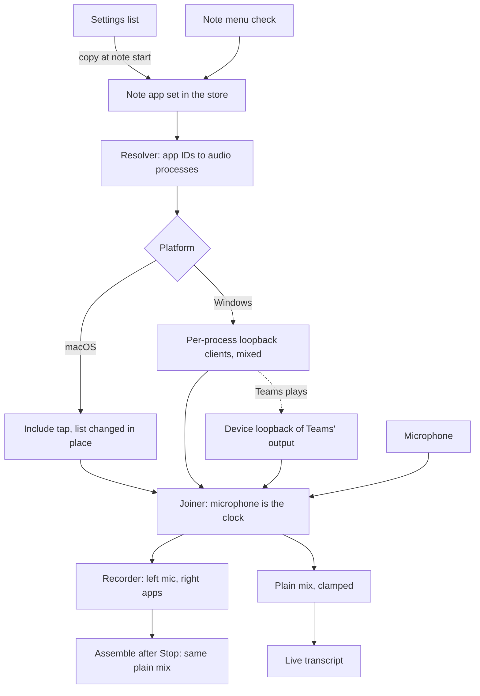
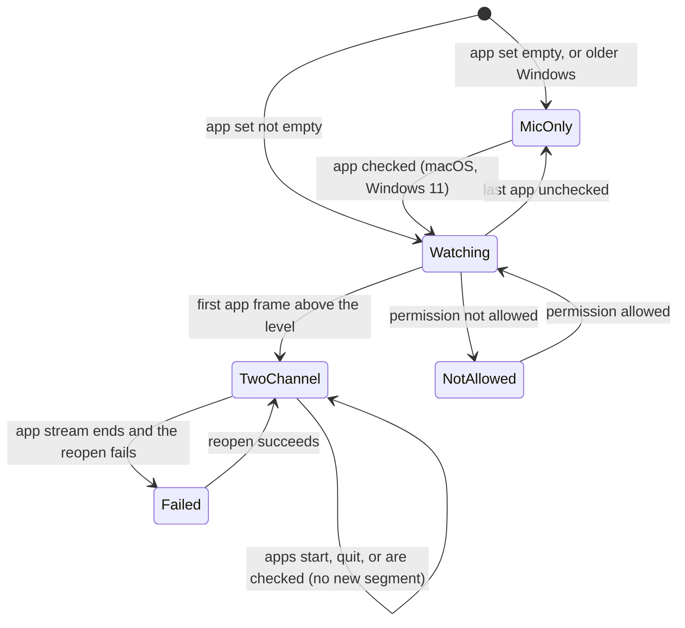

# App Audio - Plan

## Goal Capsule

- **Objective:** A user records a meeting on a call (Teams, Zoom, Discord, FaceTime or a browser) with Longhand only, and gets a transcript and summary as good as the user's notes recorded through a Rogue Amoeba Loopback device. No other audio app is necessary.
- **Means:** Longhand records the microphone plus the audio of the apps on a list that the user makes, as Loopback does (KD1). The note saves two channels and processes a plain mix of them (KD5).
- **Product authority:** This Product Contract. It replaces the Computer audio part of `docs/plans/2026-09-26-0827-feat-system-audio-and-microphone-choice-plan.md` (R6–R17 of that plan). The microphone choice of that plan stays as it is. The R wins on product behavior; a KTD wins on mechanism within the Rs that it cites.
- **Stop conditions:** Stop and ask the user when U1 shows that a common call app on macOS (Teams, Zoom, Discord, FaceTime, Chrome) gives silence to an include tap, when a change would alter a Key Decision, or when the Windows Teams fallback (R19) records nothing on a real Teams call.
- **Execution profile:** Ten units on one branch, one PR (one feature, one release). `ce-work` implements in a worktree named `app-audio`. Commit per unit. U1 needs real hardware: a signed macOS bundle and a Windows 11 computer with Teams. Local checks are the gate (Verification Contract).
- **Open blockers:** None.

---

## Product Contract

Product Contract preservation: changed R2, R9, R12 and R16, and added R19–R21, KD12 and AE8. R2 now says which running apps the add list shows. R12 now defines "plays" and accepts a short loss at the change to two channels. R16 now shows a failure message only after the automatic reopen fails. R9 and R19–R20 and KD12 add the Windows Teams exception (user-directed after research showed that per-app capture gives Teams silence on Windows). R21 says which app set a resumed note uses. The user confirmed each change at the plan scoping step.

### Summary

Settings gets a list of apps whose audio Longhand records. The list is empty on a new install. The user adds running apps one at a time, or adds the common call apps that are running in one step. Every note records the microphone plus the apps on the list. The note menu can add or remove an app for one note. The note saves the microphone and the apps as two channels and processes a plain mix of the two.

### Problem Frame

Longhand records one input. For calls, the user made a Loopback virtual device, "Mic & Meeting Audio", that mixes the MacBook Pro microphone with Discord, FaceTime, Google Chrome, Teams, Zoom and other apps into one stereo stream. Longhand records that device. For several weeks this gave good transcripts and summaries. The user always heard the calls on the speakers, so the microphone also heard the call. Another user would have to buy Loopback and build the same device.

Longhand already has parked system audio capture (`docs/ideas/parked/system-audio-capture.md`). It records all audio that the computer plays. It is hidden because two Teams test calls failed Verify:

- A mixer app (Elgato Wave Link) played the call again about four times, and it played a late copy of the microphone onto the system channel.
- Speaker echo gave false hits in the microphone-copy check.

The parked fix was a new processing design for each channel. The Loopback weeks show a simpler path. A list of chosen apps keeps mixer apps out, and a plain mix of the microphone and those apps transcribes well, also with speaker echo.

### Key Decisions

- KD1. **Record the apps on a list, not all computer audio.** (session-settled: user-directed — chosen over the parked whole-computer capture: the list keeps mixer apps out and copies the proven Loopback setup.) Governs R1, R6, R8.
- KD2. **Every note records the apps on the list. There is no Computer audio switch for each note.** (session-settled: user-directed — chosen over a switch for each note and over "always on, with an off switch": an app that is not in a call makes no sound, and the user has nothing to remember.) Governs R6.
- KD3. **The list is empty on a new install. App audio is recorded only after the user adds an app.** (session-settled: user-directed — chosen over a list of installed call apps that is filled in advance: Longhand must not record other apps until the user explicitly asks.) Governs R1, R3.
- KD4. **The user adds only apps that are running.** (session-settled: user-directed — chosen over any installed app: a running app shows the processes that actually play its sound, and this is how Loopback works.) Governs R2, R3.
- KD5. **The note saves two channels and processes a plain mix of them.** (session-settled: user-approved — chosen over one mixed stream after the tradeoff was shown: the mix is the same as a live mix, so the risk is the same as with Loopback, and per-channel processing stays possible later at about twice the file size.) Governs R12, R13, R14.
- KD6. **No echo removal, no level balancing and no microphone-copy check.** (session-settled: user-approved — the user's Loopback notes, always on speakers, had none of these and were good.) Governs R14.
- KD7. **A change in the note menu applies to that note only.** (session-settled: user-directed — chosen over a change that also updates the Settings list: one rule for the Microphone and app audio menus.) Governs R10.
- KD8. **A change to the Settings list during a recording applies from the next note.** (session-settled: user-approved — confirmed in the scope summary: the note menu changes the current note.) Governs R11.
- KD9. **App audio replaces the parked Computer audio feature.** (session-settled: user-approved — confirmed in the scope summary.) Governs R18.
- KD10. **Windows is in scope.** (session-settled: user-approved — confirmed in the scope summary, from "cross-platform correctness from day one" in `STRATEGY.md`.) Governs R17.
- KD11. **On Windows, app audio needs Windows 11.** (session-settled: user-directed — chosen over a whole-device capture on Windows 10: per-process capture needs build 20348 or later, Windows 10 support ended in October 2025, and a whole-device capture brings back the mixer-app problem.) Governs R17.
- KD12. **On Windows, Teams is recorded as whole-device sound while it plays.** (session-settled: user-directed — chosen over "Teams unsupported on Windows", a silence detector with a fallback, and "Windows later": Windows gives only silence to per-app capture of new Teams, in Microsoft's own sample, OBS, OpenWhispr and anarlog, and Teams is a main call app.) Governs R9, R19, R20.

---

### Requirements

**The app list**

- R1. The Recording pane in Settings holds a list of apps whose audio Longhand records. The list is empty on a new install.
- R2. The user adds an app from a list of the running apps that have a window and are not on the list yet. Longhand reads the running apps each time this list opens. When there is no app to add, the control is disabled with a short reason.
- R3. One action adds the common call apps that are running at that moment and are not on the list yet. When there is no such app, the action is disabled with a short reason.
- R4. The user can remove an app from the list.
- R5. Each app on the list shows its name and icon, also when the app is not running.

**Recording**

- R6. Every note records the microphone plus the audio of each app in the note's app set, from the start of the note.
- R7. An app in the note's app set does not have to run. When it starts, quits or starts again during a note, Longhand records it while it plays, and the microphone recording continues with no gap. The recording page shows no message for this.
- R8. The audio of an app includes the sound of all its processes, also the helper processes that play its sound (for example, Chrome tabs).
- R9. Longhand's own sounds, for example the alert sound, are never in the app audio, except under R19.
- R21. A note keeps its own app set. A new note, also a recording into an empty note, takes a copy of the Settings list. Continue after a pause and Resume of a stopped note use the note's own app set.

**Changes during a recording**

- R10. During a recording, the note menu has an app audio submenu next to Microphone. It lists the running apps and also the apps that the note records but that are not running, with a check mark next to each app that the note records. Choosing an app starts or stops its recording at once, for this note only. Only running apps can be added. The Settings list does not change.
- R11. A change to the Settings list during a recording applies from the next note.

**Saved audio and processing**

- R12. From the first moment that a recorded app plays, the note saves the microphone on the left channel and the app audio on the right channel. An app plays when its sound is first above a low level; an open audio stream alone does not count. Up to about half a second of that first sound can be lost at the change. Before that moment, the note saves only the microphone. From that moment, the right channel holds silence while no recorded app plays. A note in which no recorded app plays saves its audio as today.
- R13. With a streaming model and the Live transcript switch on, the live transcript reads a plain mix of the microphone and the app audio.
- R14. Processing after Stop and Transcribe Again use the same plain mix as R13. They do not remove echo, balance levels or check for copies of the microphone.

**Permission and failures**

- R15. On macOS, Longhand requests the "Screen & System Audio Recording" permission when the user adds the first app, in Settings or in the note menu. The General pane shows this permission next to the microphone permission.
- R16. When the permission is not allowed or app audio fails during a note, the microphone recording continues. The recording page says that app audio is not recorded and, for a permission that is not allowed, how to allow it. A permission problem shows at once; a failure shows only when Longhand's automatic reopen also fails. This includes a denial when the user adds the first app in the note menu. There is no message when no app is on the list or checked, or when a recorded app is not running or makes no sound. The messages of the parked Computer audio feature for silence, another output device and a copy of the microphone are removed.

**Platforms and the parked feature**

- R17. App audio works on macOS and on Windows 11. On older Windows, the app list in Settings is disabled with a short reason, the note menu has no app audio submenu, and notes record the microphone only.
- R18. The parked Computer audio feature is removed: the Computer audio default in Settings, the "Record Computer Audio" item in the note menu, and the whole-computer capture.
- R19. On Windows, while Teams plays sound in a note that records Teams, the note's app audio is all sound of the output device that Teams plays to, in place of the per-app capture. This includes other apps and Longhand's own sounds on that device. When Teams stops playing, the per-app capture continues.
- R20. On Windows, the Teams row in the Settings list shows one line of secondary text that gives the reason and the effect: Windows cannot record Teams by itself, so while Teams plays, Longhand records all sound on that output device. For example: "Windows can't record Teams by itself, so Longhand records all computer sound while Teams plays." Nothing else in the app shows this.

---

### Acceptance Examples

- AE1. **Covers R6, R13, R14.** Given Teams on the list and a Teams call on the laptop speakers, when the user stops the note, the transcript holds the remote people and the user, and its quality is equal to a note recorded through the user's Loopback device.
- AE2. **Covers R7.** Given Zoom on the list and not running when the note starts, when the user joins a Zoom call 10 minutes later, the note records Zoom from that time, and the recording page shows no message.
- AE3. **Covers R10, R11.** Given a note that records with Discord not on the list, when the meeting moves to Discord and the user checks Discord in the note menu, the note records Discord from that time. The next note does not record Discord.
- AE4. **Covers R1, R6.** On macOS, given Elgato Wave Link running and not on the list, when a call on a listed app is recorded, the app audio channel holds no sound that Wave Link plays again and no late copy of the microphone. Call sound that the microphone hears from the speakers is expected in the microphone channel and in the mix.
- AE5. **Covers R16.** Given the permission is denied and Teams on the list, when a note starts, the microphone records, and the recording page says that app audio is not recorded and how to allow it.
- AE6. **Covers R12, R16.** Given an empty list, when the user records a room meeting, the note is the same as today: one channel and no message.
- AE7. **Covers R8.** Given Chrome on the list and a video playing in a Chrome tab during a room meeting, the note records the video audio. This is expected.
- AE8. **Covers R19, R20.** On Windows 11, given Teams and Zoom on the list, when a Teams call plays on the headset, the note records the headset's whole sound for the call. After the call, a Zoom call is recorded through per-app capture only.

---

### Success Criteria

- The user stops using Loopback for meeting notes, and the notes are as good as before.

### Scope Boundaries

- Per-app volume, mute and on/off switches, as in Loopback. To stop recording an app during a note, the user unchecks it in the note menu (R10). A removal from the Settings list applies from the next note (R11).
- Apps that are installed but not running in the add list.
- Recording of all computer audio, and the exclusion of mixer apps. The Windows Teams exception (R19) is the only whole-device capture.
- Echo removal, level balancing and the microphone-copy check.
- Per-channel recognition and diarization, and Room/Call labels on speakers. The two-channel recording keeps these possible later ([per-channel processing](../ideas/parked/system-audio-capture.md#process-each-channel-on-its-own)).
- A message or hint when the list is empty.
- A choice of output device.
- A choice of apps for the next note before it starts. The note menu changes apps only during a recording.

### Dependencies / Assumptions

- The existing Core Audio process tap (macOS 15.0 or later, KD15 of the earlier plan) can record a chosen set of processes.
- On Windows, app audio uses per-process loopback, which needs Windows 11 (build 20348 or later).

### Sources / Research

- `docs/ideas/parked/system-audio-capture.md` — why the parked feature is hidden, the mixer-app findings, and per-channel processing.
- `docs/plans/2026-09-26-0827-feat-system-audio-and-microphone-choice-plan.md` — the parked Computer audio plan and the microphone choice.
- Windows Teams silence: [microsoft/Windows-classic-samples #414](https://github.com/microsoft/Windows-classic-samples/issues/414) (open since 2025-12-03), [OBS forum, 2023-11-30](https://obsproject.com/forum/threads/application-audio-capture-beta-doesnt-work-in-new-teams-app.171446/), [OpenWhispr #1265](https://github.com/OpenWhispr/openwhispr/issues/1265) and [#1935](https://github.com/OpenWhispr/openwhispr/pull/1935), [anarlog #7590](https://github.com/fastrepl/anarlog/pull/7590). anarlog's "all sound except our own process" loopback also gave Teams silence, so R19 uses device loopback.

---

## Planning Contract

### Key Technical Decisions

- KTD1. **An app is identified by the bundle ID of its outermost `.app` on macOS and by its lowercase executable name without `.exe` on Windows.** anarlog maps every helper inside a bundle (Chrome Helper, Teams and Zoom helpers) to its outermost app in the same way (`reference-source/anarlog/crates/detect/src/list/macos.rs`, `find_outermost_app`). The Settings entry also stores the display name and the app path, so R5 can read the icon of an app that is not running. Covers R2, R5, R8.
- KTD2. **A pure resolver maps a listed app to the audio processes that play its sound.** Each Core Audio process object (macOS) or audio session process (Windows) maps to an app ID through the outermost-bundle rule, plus fixed aliases for system processes:
  - `com.apple.avconferenced` and `com.apple.TelephonyUtilities.callservicesd` belong to FaceTime (anarlog's `APPLE_CALL_DAEMON_IDS`).
  - `com.apple.WebKit.*` processes belong to the app that is responsible for them, through the private `responsibility_get_pid_responsible_for_pid`. This covers Safari and other WebKit apps.
  The resolver takes an injected process lookup and is unit-tested like `is_mixer`. U1 confirms the mapping on real calls. Covers R8.
- KTD3. **macOS uses one include tap (`TapDesc::with_mono_mixdown_of_processes`) and changes its process list in place.** The existing `drain` loop already calls `tap.set_desc` every 500 ms without a restart (`crates/audio-system/src/macos.rs`). The include list is resolved again at each check, so apps that start or quit (R7) and checks in the note menu (R10) change the tap with no new segment. When the note's app set has no running process, the thread keeps no tap and delivers silence; U1 decides whether a tap can start with an empty list. Longhand's own process is never in an include list (R9). Covers R6, R7, R9, R10.
- KTD4. **Windows uses one per-process loopback client for each running listed app, mixed in the capture thread.** The client is `AudioClient::new_application_loopback_client(root_pid, true)` (`wasapi` 0.23). The flag must be `true`: `false` means "all sound except this tree". One client is opened per root process of each listed app, at f32 48 kHz with autoconvert. A client sends no packets while its app is silent, and the joiner already fills an empty queue with silence (KTD5 of the earlier plan). A version check (`RtlGetVersion`, build 20348 or later) gates the whole feature (R17). Covers R6, R7, R17.
- KTD5. **The Windows Teams fallback is device loopback, active while Teams' own output meter shows sound.** The thread reads the peak meter (`IAudioMeterInformation`) of each render session that belongs to Teams, every 200 ms. A session belongs to Teams when its process, or a parent in its process chain, is `ms-teams`; U1 records which process owns the call session. At the first reading above the threshold, the thread stops the per-process clients and captures all sound of that session's render endpoint, with the parked endpoint loopback. The Teams session only selects the mode and the device. After 2 s with no Teams sound, it returns to per-process clients. A session that is open but silent does not start the mode, so R19's "while Teams plays" holds. Process loopback in exclude mode is not used, because anarlog found it also gives Teams silence. If U1 shows that per-process loopback now records Teams, stop and ask the user before KTD5, R19–R20 and KD12 are removed. (session-settled: user-directed — chosen over "Teams unsupported", a silence detector and "Windows later"; see KD12.) Governs R19.
- KTD6. **The note turns two-channel when the first app frame is above a low level.** While the note records at least one app and is still one channel, the app stream is open as a watch stream. Its first frame with a peak above a fixed threshold (the value is set in U1 from idle-app recordings) starts the existing mono-to-stereo switch. The watch stream becomes the attached stream (`EarlySpeaker`), so the gap at the split stays a few milliseconds. App sound from the trigger frame until the stereo segment is attached is lost, because the joiner keeps only 60 ms of queued app audio. U8 measures this loss; it must stay within R12's half second. If it does not, U8 writes the queued frames from the trigger into the start of the stereo segment. Covers R12.
- KTD7. **The note's app set is stored in the session store.** A new migration (the next free number, `0021` today) adds an app set column with the IDs, names and paths of the note's apps. It replaces the parked `system_audio` flag as the source of the per-note choice. Covers R10, R21.
- KTD8. **The Settings list is a per-computer setting.** `LocalSettings` gets the list with `#[serde(default)]`, so no settings migration is needed. App IDs differ by platform, so the list is not a shared setting. `system_audio_default` is removed. Covers R1, R11.
- KTD9. **One shared function makes the plain mix: the sum of both channels, clamped to the sample range.** The live mix (`crates/pipeline/src/live/archive.rs`) and processing after Stop (`crates/pipeline/src/assemble.rs`) call the same function, so the live text and the final text hear the same audio. The clamp is the overflow rule. Covers R13, R14.
- KTD10. **Echo processing is deleted, and the echo row stays as a "done" record.** Assemble saves the existing echo row of a stereo segment with no spans and gains of 1.0. The Assemble checkpoint (`assemble.rs`, `echo::saved`) and the Transcribe merge (`without_echo`) then stay unchanged. The echo probe, the canceller (`crates/aec` and its model), the live echo gate, `mic_copy.rs` and the silence check are deleted. If per-channel processing returns, git has the code. Covers R14, R16, R18.
- KTD11. **The permission prompt keeps the parked whole-computer tap of about 0.5 s.** It is not a capture under R18: no audio is read or kept. It excludes only Longhand's own process, and it triggers the same `kTCCServiceAudioCapture` prompt. The status still comes from the preflight with the child-process re-check (`docs/solutions/integration-issues/tcc-preflight-stale-after-tap-prompt-grant.md`), never from the audio. Covers R15.
- KTD12. **The add list reads running apps with a window.** macOS: `NSWorkspace` running applications with the regular activation policy. Windows: processes that own a visible top-level window, deduplicated by app ID. Longhand is left out; mixer apps are not. Each read is numbered so a stale reply is dropped (`docs/solutions/performance-issues/sync-tauri-commands-froze-the-app-on-a-slow-folder-or-microphone.md`). Covers R2, R3, R10.
- KTD13. **The common call apps are a fixed table of dedicated call apps, with no browsers.** macOS: Teams (`com.microsoft.teams2`), Zoom (`us.zoom.xos`), Discord (`com.hnc.Discord`), Slack (`com.tinyspeck.slackmacgap`), Webex and FaceTime (`com.apple.FaceTime`). Windows: the same apps by executable name. U2 verifies each ID on a real install. Covers R3.

### High-Level Technical Design

Data flow of one note with app audio:

App capture state of one note:

After the first stereo segment, every reopen (restart, Continue, wake, Resume) opens a two-channel segment, as the stereo mark already does (KTD3 and KTD18 of the earlier plan).

### Assumptions

- Teams on macOS can be captured with an include tap, because Loopback captures it. U1 checks this first.
- A peak threshold separates an idle app (Teams or Chrome in the background) from real sound. U1 measures it.

### Sequencing

U1 runs first and can change KTD2, KTD3, KTD5 and KTD6. U5 does not depend on capture work and can run in parallel with U2–U4. The frontend (U9) comes after the commands (U6, U8). Each unit's commit compiles the workspace: a unit deletes only code with no caller outside its own crate, and U8 deletes the parked items that `capture.rs` still uses (`is_mixer` callers, `mic_copy.rs`, `silence.rs`, the other-output status, `system_audio_default` and `CaptureChoice.system_audio`).

### System-Wide Impact

- **Storage:** a note with app audio stores two Opus streams, about twice the size of a microphone-only note (KTD7 of the earlier plan). The storage estimate already doubles for stereo segments.
- **Bindings:** `RecordingStatus`, the settings types and the capture commands change, so `src/bindings.ts` is regenerated in U6 and U8.
- **Bundle size:** deleting `crates/aec` removes the echo canceller model from the app.
- **Agent skill:** the `longhand-notes` skill in `plugins/` reads note text, not audio channels; it does not change.

### Risks

| Risk | Decision |
|---|---|
| Speaker echo makes doubled lines in the plain mix. | Accepted (KD6). The AE1 manual test checks the transcript for doubled lines and reports them. |
| An app plays its sound through a process that the resolver does not map (for example a new Teams helper). | U1 measures each call app before the resolver is fixed; a failed mapping stops the work (Goal Capsule). |
| The Safari mapping uses a private function (`responsibility_get_pid_responsible_for_pid`). | Loaded at run time like the TCC preflight; when it is missing, WebKit processes map to nothing and Safari records silence, with no crash. |
| An idle app crosses the level threshold and turns a room note two-channel. | The threshold comes from U1's idle measurements. The cost of a wrong switch is only file size. |
| Windows Teams changes again, so the fallback records the wrong device or per-app capture starts to work. | U1 checks both on the current Teams; if per-app capture works, the user decides whether KTD5 is removed. |

### Considered and Not Built

- **A buffer that keeps the first app sound at the change to two channels, when the measured loss is within half a second.** It needs a new path past the joiner's 60 ms limit. U8 builds it only when its measurement exceeds R12's bound (KTD6).
- **A detector for silent per-app capture on Windows.** OpenWhispr built one; Longhand avoids the need by choosing the Teams mode from Teams' session state (KTD5). Build it if another app shows the Teams problem.
- **A refusal to add mixer apps.** The user chooses the list; adding a mixer app is a deliberate choice.
- **The macOS 26 tap restore by bundle ID (`set_bundle_ids`).** The minimum macOS is 15.0, so the polling include list is needed anyway.

---

## Implementation Units

| U-ID | Title | Key files | Depends on |
|---|---|---|---|
| U1 | Hardware check of per-app capture | `crates/audio-system/tests/hardware.rs` | — |
| U2 | App identity, resolver and running apps | `crates/audio-system/src/apps.rs` | U1 |
| U3 | macOS include tap | `crates/audio-system/src/macos.rs` | U2 |
| U4 | Windows per-app capture and Teams fallback | `crates/audio-system/src/windows.rs` | U2 |
| U5 | Plain mix; delete echo processing | `crates/audio`, `crates/pipeline`, `crates/aec` | — |
| U6 | Settings list and commands | `src-tauri/src/managers/settings.rs`, `src-tauri/src/commands/` | U2 |
| U7 | Note app set in the store | `crates/session-core` | — |
| U8 | Capture manager: app set, first sound, note menu | `src-tauri/src/managers/capture.rs` | U3, U4, U6, U7 |
| U9 | Frontend | `src/settings/`, `src/session/` | U6, U8 |
| U10 | Docs, glossary and provenance | `CONCEPTS.md`, `PROVENANCE.md`, `docs/` | U9 |

### U1. Hardware check of per-app capture

- **Goal:** Find, on real calls, which processes play each call app's sound, whether an include tap and per-process loopback record it, and the idle-level threshold.
- **Requirements:** R8, R12, R19; KTD2, KTD3, KTD5, KTD6.
- **Dependencies:** None.
- **Files:** `crates/audio-system/tests/hardware.rs`.
- **Approach:**
  1. Add `#[ignore]` hardware tests that list the Core Audio process objects with bundle ID, PID, responsible PID and `is_running_output`, and print their outermost app.
  2. Add a test that opens an include tap for one app's processes, reports the peak level for 10 s, and changes the list from empty to one app with `set_desc`.
  3. On Windows 11, add a test that opens a per-process loopback client for a named executable and reports its peak, and the same for device loopback. The test also lists every render session with its state, peak meter, process ID, executable and parent chain. Run it while Teams is idle, during a Teams call, and after the call.
  4. Run them during real calls in Teams, Zoom, Discord, FaceTime, Chrome (Google Meet) and Safari on macOS, and in Teams and Zoom on Windows 11. Also record the peak of each app while it is idle.
  5. Record the results in the PR description and in a new `docs/solutions/` entry. Change KTD2, KTD3, KTD5 or KTD6 in this plan when a result contradicts them.
- **Execution note:** This is a manual hardware step. Build the signed bundle identity before the macOS run (TCC attributes the tap to it), and give the user the exact steps for each call.
- **Patterns to follow:** the existing `crates/audio-system/tests/hardware.rs` tests and their run command.
- **Test scenarios:** Test expectation: none -- these are measurement tests that print results; they assert only that the APIs open.
- **Verification:** Each listed call app has a recorded process mapping and peak result on each platform, the executable that owns the Teams call session on Windows is recorded, and the plan's KTDs match the results.

### U2. App identity, resolver and running apps

- **Goal:** One module that names apps, maps them to audio processes, lists running apps with icons, and gates Windows by version.
- **Requirements:** R2, R3, R5, R8, R17; KTD1, KTD2, KTD12, KTD13.
- **Dependencies:** U1.
- **Files:** `crates/audio-system/src/apps.rs` (new), `crates/audio-system/src/lib.rs`, `crates/audio-system/Cargo.toml`, `crates/audio-system/tests/apps.rs` (new).
- **Approach:**
  1. Define the app record (ID, name, path) and the resolver with an injected process lookup, following `is_mixer` and its captured-log test style in `lib.rs`.
  2. Add the system aliases of KTD2 and the call-app table of KTD13.
  3. Add `running_apps()` for each platform (KTD12) and an icon read from the app path that returns PNG bytes, or nothing when it fails (the UI then shows a generic icon).
  4. Add the Windows build check of KTD4. macOS always reports supported.
  5. Add an ignored hardware test that reads the bundle ID or executable name of each installed call app in the KTD13 table and reports a mismatch.
  6. Record the borrowed anarlog mapping in `PROVENANCE.md`.
- **Patterns to follow:** `reference-source/anarlog/crates/detect/src/list/macos.rs` (`find_outermost_app`, `APPLE_CALL_DAEMON_IDS`) and `list/windows.rs`; `crates/power` for the `objc2-app-kit` `NSWorkspace` use.
- **Test scenarios:**
  - A Chrome Helper process inside `Google Chrome.app` resolves to `com.google.Chrome`.
  - `com.apple.avconferenced` resolves to FaceTime when FaceTime is in the app set, and to nothing when it is not.
  - A `com.apple.WebKit.GPU` process whose responsible PID is Safari resolves to Safari; one whose responsible PID is another app resolves to that app.
  - A process with no bundle and no responsible app resolves to nothing and is logged once.
  - An app set with two apps returns the union of their process IDs, with Longhand's own process never in it.
  - The call-app table adds only running apps that are not on the list, and returns an empty result when none runs.
  - Windows: an executable name `MS-Teams.exe` gives the ID `ms-teams`.
  - The version check accepts build 20348 and later, and refuses 19045.
- **Verification:** The resolver tests pass, the U1 hardware test prints the same mapping as the resolver, and the call-app ID test reports no mismatch on the installed apps.

### U3. macOS include tap

- **Goal:** The macOS backend records the note's app set, and the set can change while the tap runs.
- **Requirements:** R6, R7, R8, R9, R10; KTD3.
- **Dependencies:** U2.
- **Files:** `crates/audio-system/src/macos.rs`, `crates/audio-system/src/lib.rs`, `crates/audio-system/src/permission.rs`, `crates/audio-system/tests/hardware.rs`.
- **Approach:**
  1. `open` takes the app set. The thread resolves it with U2 at each 500 ms check and calls `set_desc` with the include list when the process set changed.
  2. Add a command to replace the app set while the stream runs, for R10.
  3. With no running process in the set, deliver silence and keep or create no tap, as U1 decided.
  4. Keep a private function that opens the whole-computer tap with only Longhand's own process excluded, and make `permission::request_unless` call it in place of `open` (KTD11).
  5. Delete the mixer exclusion (`Exclusion`, `mixers()`). The mixer constants, `is_mixer`, `silence.rs` and the other-output status go in U8, with their callers.
- **Patterns to follow:** the current `drain` loop and its `Exclusion::now()` comparison.
- **Test scenarios:**
  - The process-set comparison reports a change when an app's process appears and when it quits, and no change when the order differs.
  - Replacing the app set with an empty set gives a silence-only stream with no error.
  - The permission request opens a tap also when the app set is empty.
  - Hardware (ignored): Zoom started after the tap opens is recorded within one check (AE2).
- **Verification:** The hardware test records a call app that starts after the tap opens, and the unit tests pass.

### U4. Windows per-app capture and Teams fallback

- **Goal:** The Windows backend records the note's app set with one loopback client per app, and uses device loopback while Teams plays.
- **Requirements:** R6, R7, R17, R19; KTD4, KTD5.
- **Dependencies:** U2.
- **Files:** `crates/audio-system/src/windows.rs`, `crates/audio-system/src/follow.rs`, `crates/audio-system/tests/hardware.rs`.
- **Approach:**
  1. Open one include-tree client for each root process of each running listed app. The thread waits on all client events, buffers each client, and emits the sum in fixed 10 ms blocks timed by the wall clock. A client with no samples for a block adds silence; samples older than one block are dropped.
  2. Open clients for new processes from audio-session notifications (`IAudioSessionNotification`), and keep the existing 2 s poll to find ended processes and missed events.
  3. Add the Teams mode of KTD5: read the Teams sessions' peak meters every 200 ms, enter device loopback at the first reading above the threshold, and return to per-process clients after 2 s with no Teams sound.
  4. Refuse to open on a build before 20348, with a status the UI reads (R17).
- **Patterns to follow:** `EndpointFollower` and `has_foreign_active_session` in `windows.rs` and `follow.rs`.
- **Test scenarios:**
  - The mode decision returns device loopback at the first Teams meter reading above the threshold, and returns per-process only after 2 s of readings below it.
  - An open Teams session whose meter stays below the threshold never starts device loopback.
  - A session owned by a helper process whose parent chain includes `ms-teams` counts as a Teams session.
  - Two clients whose packets arrive 5 ms apart give one stream with real-time length, not twice the length.
  - The mode decision never uses device loopback when Teams is not in the app set, also when Teams plays.
  - Two clients with frames at the same time give their sum; a client with no packets adds nothing.
  - Hardware (ignored, Windows 11): a Teams call gives a non-zero peak in Teams mode (AE8); a Zoom call gives a non-zero peak through per-process capture.
- **Verification:** `scripts/check-windows.sh` passes, and the Windows hardware tests record Teams and Zoom calls.

### U5. Plain mix; delete echo processing

- **Goal:** The live transcript and processing use the same plain mix, and the echo code is gone.
- **Requirements:** R13, R14, R16; KTD9, KTD10.
- **Dependencies:** None.
- **Files:** `crates/audio/src/live_mix.rs`, `crates/audio/tests/live_mix.rs`, `crates/pipeline/src/live/archive.rs`, `crates/pipeline/src/echo.rs`, `crates/pipeline/src/assemble.rs`, `crates/pipeline/tests/assemble.rs`, `crates/pipeline/tests/live.rs`, `crates/pipeline/tests/runner.rs`, `crates/aec` (delete), `crates/audio-sync` (delete if unused), `Cargo.toml`, `licences/generated/`.
- **Approach:**
  1. Replace `LiveMix` with the shared plain mix of KTD9 and use it in the live archive and in Assemble.
  2. Make Assemble save the echo row with no spans and gains of 1.0 (KTD10).
  3. Delete the probe, the canceller, the echo gate, the `aec` crate and its model, and any crate that is no longer used. `mic_copy.rs` goes in U8, with its callers in `capture.rs`. Run `scripts/check-licences.sh` and commit its output.
  4. Rewrite the stereo tests in `assemble.rs`, `live.rs` and `runner.rs` to expect the plain mix.
- **Execution note:** Write the new plain-mix tests first, with sample-exact expected values, so they fail on the old gain-matched mix (`docs/solutions/test-failures/tests-passed-while-the-behaviour-in-their-names-was-broken.md`).
- **Test scenarios:**
  - Left 0.25 and right 0.5 give 0.75.
  - Left 0.75 and right 0.75 give 1.0 (clamped), and -0.75 with -0.75 gives -1.0.
  - A silent right channel gives the left channel unchanged.
  - The live mix and the Assemble mix of the same stereo chunk are equal sample by sample.
  - A stereo segment is done after Assemble, with an echo row that has no spans, and Transcribe keeps all live words of that segment.
  - Transcribe Again on a saved stereo note uses the plain mix.
- **Verification:** The pipeline and audio crate tests pass, `crates/aec` is gone, and the licence list matches.

### U6. Settings list and commands

- **Goal:** Settings stores the app list, and commands list running apps, add apps, add call apps, remove apps and read icons.
- **Requirements:** R1–R5, R11, R15, R17, R20; KTD8, KTD11, KTD12, KTD13.
- **Dependencies:** U2.
- **Files:** `src-tauri/src/managers/settings.rs`, `src-tauri/src/commands/settings.rs`, `src-tauri/src/commands/readiness.rs`, `src-tauri/src/lib.rs`, `src/bindings.ts`.
- **Approach:**
  1. Add the list to `LocalSettings` and `Settings`. `system_audio_default` goes in U8, with its callers.
  2. Add async commands that run through `commands::blocking`: running apps, add one app, add call apps, remove an app, app icon, and app audio availability (R17).
  3. On macOS, any add while the permission is "not asked" starts the existing request (KTD11). U8 calls the same function for an add in the note menu. One add of several call apps asks once.
  4. Remove `set_system_audio_default`; regenerate the bindings.
- **Patterns to follow:** `set_microphone` and its validation; the settings tests for missing keys, round trip and a malformed value.
- **Test scenarios:**
  - A settings file without the list reads as an empty list.
  - Adding an app that is already on the list keeps one entry.
  - Adding call apps adds only the running ones that are not on the list, and adds nothing when none runs.
  - A malformed list entry is dropped and the rest of the settings stay.
  - Removing an app during a recording changes the list and does not change the open note's app set (R11).
  - On a Windows build before 20348, the add commands refuse with an "unavailable" result.
- **Verification:** The settings tests pass and the bindings export without changes after regeneration.

### U7. Note app set in the store

- **Goal:** Each note stores its own app set.
- **Requirements:** R10, R21; KTD7.
- **Dependencies:** None.
- **Files:** `crates/session-core/migrations/0021_note_app_set.sql` (new; take the next free number at merge), `crates/session-core/src/schema.rs`, `crates/session-core/src/jobs.rs`, `crates/session-core/tests/` (the store tests).
- **Approach:** Add the column and read and write it with the capture choice (`CaptureChoice`). The `system_audio` field stays until U8 removes its callers.
- **Patterns to follow:** `0006_capture_choice_and_channels.sql` and `capture_choice` / `set_capture_choice`.
- **Test scenarios:**
  - A database at the previous schema with rows migrates, and old notes read an empty app set.
  - A note's app set written and read back is equal, with names and paths.
  - Two notes keep different app sets.
- **Verification:** The session-core tests pass, including the migration test from an old schema with rows.

### U8. Capture manager: app set, first sound, note menu

- **Goal:** The capture manager records the note's app set, turns the note two-channel at the first app sound, and lets the note menu change the set.
- **Requirements:** R6, R7, R10, R11, R12, R16, R17, R18, R21; KTD6, KTD7.
- **Dependencies:** U3, U4, U6, U7.
- **Files:** `src-tauri/src/managers/capture.rs`, `src-tauri/src/audio.rs`, `src-tauri/src/commands/capture.rs`, `src-tauri/src/lib.rs`, `src/bindings.ts`.
- **Approach:**
  1. At note start, copy the Settings list into the note's app set (R21). Continue, Resume and every reopen use the stored set. Re-resolve processes at each reopen, also after wake.
  2. Replace the `system_audio` flag with the app set in `capture_choice_at_start`, `ActiveSegment` and `segment_channels`. Remove `SYSTEM_AUDIO_AVAILABLE` and `held_system_audio`.
  3. While the note is one channel and the set is not empty, open the app stream as a watch stream on its own thread. On its first frame above the threshold, run the existing `ToStereo` switch with the stream as `EarlySpeaker` (KTD6).
  4. Replace `set_note_system_audio` with `set_note_apps`. It stores the set, sends the new set to the running stream, opens a watch stream when the set was empty, and closes it when the set becomes empty before the note is two-channel. On macOS, an add while the permission is "not asked" starts the request of U6.
  5. Trim `RecordingStatus` to the app audio state: recording, not allowed, failed. Show "failed" only after the capture watcher's reopen fails (R16). Remove the silence, other-output and microphone-copy fields, and delete the code that only they used: `mic_copy.rs`, `silence.rs`, the other-output status, the mixer constants and `is_mixer`, `system_audio_default` and `CaptureChoice.system_audio`.
  6. Measure the app sound lost at the switch (KTD6) in a test with a fake stream; if it exceeds half a second, write the queued frames from the trigger into the start of the stereo segment.
  7. Return no app set and open no app stream on Windows before build 20348.
- **Patterns to follow:** `set_note_system_audio`, `open_speaker_later`, `EarlySpeaker`, the capture watcher (`run_capture_watch`, `speaker_reopens`) and the `stereo(id, on)` test helpers.
- **Test scenarios:**
  - A note with an empty set opens a one-channel segment and no app stream (AE6).
  - A note with a set opens a one-channel segment and a watch stream; a frame below the threshold changes nothing; the first frame above it gives a two-channel segment with the watch stream attached (R12).
  - After the switch, an app that quits and starts again causes no new segment (R7).
  - `set_note_apps` with Discord added during a two-channel segment sends the new set to the stream and does not change the Settings list (AE3).
  - Unchecking the last app before the switch closes the watch stream and the note stays one channel.
  - A Resume of a stopped two-channel note opens a two-channel segment with the note's stored set, not the current Settings list (R21).
  - A Settings change during a recording leaves the open note's set unchanged (R11).
  - Permission "not allowed" with a non-empty set gives the "not allowed" status at once; an app stream that ends gives "failed" only after the reopen fails.
  - A stale loss report from an older stream does not mark the current stream as failed.
- **Verification:** The capture manager tests pass, and the bindings no longer contain the system audio fields.

### U9. Frontend

- **Goal:** Settings shows the app list, the note menu has the app audio submenu, and the recording page shows only the R16 messages.
- **Requirements:** R1–R5, R10, R15–R18, R20.
- **Dependencies:** U6, U8.
- **Files:** `src/settings/Recording.tsx`, `src/settings/Recording.test.tsx`, `src/settings/Permissions.tsx`, `src/settings/setup.ts`, `src/settings/Status.tsx`, `src/settings/Status.test.tsx`, `src/settings/SettingsWindow.tsx`, `src/session/SessionPage.tsx`, `src/session/SessionPage.test.tsx`, `src/session/RecordingBar.tsx`, `src/session/RecordingBar.test.tsx`, `src/lib/features.ts`.
- **Approach:**
  1. Invoke `apple-design` (and `emil-design-eng` for the rows) before UI work, as CLAUDE.md requires.
  2. Replace the `SystemAudio` group with an app list group: rows with icon, name and a Remove button; an add menu read on open; an "Add Call Apps" action; disabled controls with a short reason (R2, R3); the Teams secondary line on Windows (R20); a disabled group with a reason on older Windows (R17); the permission access row below the list on macOS.
  3. Change the `system_audio` setup item to show when the list is not empty and the permission is not allowed (R15).
  4. Replace "Record Computer Audio" with an "App Audio" submenu of checkbox items (R10), shown in the same states as the Microphone submenu.
  5. Remove `SystemAudioToggle` and the silent, other-output and microphone-copy warnings; reword the kept warnings for app audio.
  6. Remove `features.systemAudio`.
- **Patterns to follow:** `MicrophoneGroup` and `microphoneOptions()`; `microphoneItems()` and `readMicrophones()`; `inputWarnings()`; the `mockTauri` test harness.
- **Test scenarios:**
  - An empty list shows no rows and no message.
  - The add menu lists running apps that are not on the list; when none remains, the add control is disabled with its reason.
  - "Add Call Apps" is disabled with its reason when no call app runs that is not on the list.
  - A row of an app that is not running shows its name and icon.
  - On Windows, the Teams row shows the secondary line and other rows do not.
  - On older Windows, the group is disabled with its reason and the note menu has no App Audio submenu.
  - The App Audio submenu shows running apps and checked apps that do not run; choosing an item calls `set_note_apps` with the changed set.
  - A stale running-apps reply that arrives after a newer one is dropped.
  - The rail shows the "not allowed" message with how to allow it, and the "failed" message, and no message for a status with no problem.
  - The setup item shows only when the list is not empty and the permission is not allowed.
- **Verification:** `npm run typecheck` and `npm test` pass, and no code refers to `features.systemAudio`.

### U10. Docs, glossary and provenance

- **Goal:** The docs describe app audio and no longer describe the removed parts.
- **Requirements:** R18.
- **Dependencies:** U9.
- **Files:** `CONCEPTS.md`, `PROVENANCE.md`, `docs/ideas/done/app-audio.md`, `docs/ideas/parked/system-audio-capture.md`, `docs/solutions/` (the U1 entry).
- **Approach:**
  1. In `CONCEPTS.md`, replace the "System audio", "Echo removal" and "Echo span" entries with the "App audio" entry, updated to the shipped behavior.
  2. Update the parked idea: the whole-computer capture and echo removal are gone; per-channel processing stays parked.
  3. Check that `PROVENANCE.md` names the borrowed anarlog code.
- **Test scenarios:** Test expectation: none -- docs only.
- **Verification:** `scripts/check-provenance.sh` and `node scripts/ideas.ts check` pass.

---

## Verification Contract

| Gate | Command or check | Applies to |
|---|---|---|
| Rust format | `cargo fmt --all --check` | before each push |
| Scoped tests per unit | `cargo test -p audio-system`, `-p audio`, `-p pipeline`, `-p session-core`, `-p longhand` for the crate the unit changes | U2–U8 |
| Full Rust run | `cargo test --workspace` and `cargo clippy --workspace --all-targets -- -D warnings`, once at the end | all |
| Bindings | `cargo test -p longhand export_bindings`, then no diff in `src/bindings.ts` | U6, U8 |
| Frontend | `npm run typecheck` and `npm test` | U9 |
| Windows lint | `scripts/check-windows.sh` | U2, U4, U8 |
| Licences | `scripts/check-licences.sh`, commit `licences/generated/*` | U2, U5 |
| Provenance and ideas | `scripts/check-provenance.sh`, `node scripts/ideas.ts check` | U2, U10 |
| Hardware | `cargo test -p audio-system --test hardware -- --ignored --nocapture --test-threads=1` from the signed identity on macOS, and on Windows 11 | U1, U3, U4 |

Every test run that a worker starts has a time limit. Time tests compare parsed times, not RFC 3339 text.

**Manual tests (signed bundle, `npm run tauri -- build --bundles app`; never `tauri dev`):**

- AE1: a Teams call on the laptop speakers with Teams on the list; compare the transcript with a Loopback note. Check the transcript for doubled lines from speaker echo, and report them if they occur.
- AE2: a Zoom call joined 10 minutes after the note starts.
- AE3: Discord checked in the note menu during a note; the next note does not record it.
- AE4: Elgato Wave Link running and not on the list during a call.
- AE5: the permission denied (`tccutil reset AudioCapture net.ewal.longhand`, then deny), with Teams on the list.
- AE6: a room meeting with an empty list.
- AE7: Chrome on the list and a video playing in a Chrome tab during a room meeting.
- AE8: on Windows 11, a Teams call and then a Zoom call, from the release installer of the PR's merge or a CI build.

---

## Definition of Done

- Every unit's verification holds, and all gates in the Verification Contract pass.
- The manual tests AE1–AE7 pass on macOS in the signed bundle, and AE8 passes on Windows 11.
- No code refers to `SYSTEM_AUDIO_AVAILABLE`, `features.systemAudio`, `system_audio_default`, `mic_copy` or `crates/aec`.
- Code from abandoned attempts, for example a U1 approach that did not work, is removed from the diff.
- The PR title is a `feat` Conventional Commit; ask the user "patch or minor?" before the PR opens.
