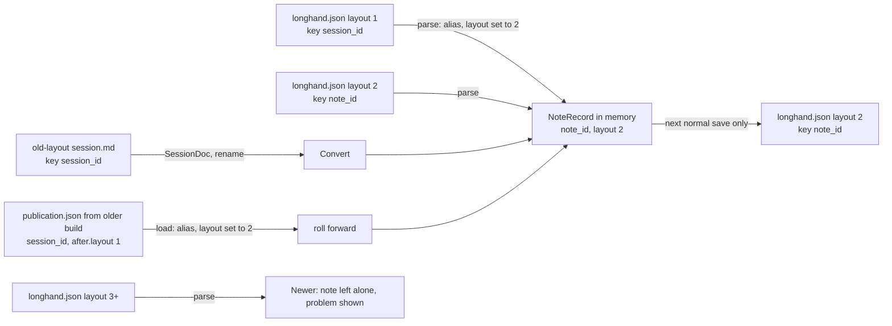

# Note Id and Note Terminology - Plan

## Goal Capsule

- **Objective:** A PR that logs or prints the id of a note no longer fails the CodeQL check, and the `rust/cleartext-logging` rule stays fully on for real secrets. New code and docs call the whole item a "note".
- **Means:** Rename the session id to "note id" in code, in the note record file and in the database (KTD1–KTD5). Make "note" the umbrella term and "manual notes" the term for the typed text.
- **Product authority:** The user chose each decision below in the brainstorm on 2026-10-23. The Product Contract wins over the Planning Contract; the Planning Contract wins over a unit's Approach. The rename of the other `session_*` code names is not active scope (see `docs/ideas/someday/rename-session-to-note-in-code.md`).
- **Execution profile:** One branch and one PR, titled `refactor: rename the session id to note id`, which makes a patch release. One commit per unit. Work in a worktree named for this plan.
- **Stop conditions:** Stop and ask when a unit needs a change to an applied migration, when an older stored form cannot be read without a new product rule, or when CodeQL still flags a `rust/cleartext-logging` alert on the id after U3.
- **Who finishes:** `ce-work` implements and opens the PR; `ce-babysit-pr` takes it to merge-ready. The user does the two-computer manual test in a signed build and tells current users to update every computer.
- **Open blockers:** None.

---

## Product Contract

### Summary

The session id becomes the note id everywhere: in code names, in the `longhand.json` key and in the database column. "Note" becomes the term in CONCEPTS.md, in the living docs and in new code for the whole item (audio, transcript, summary and manual notes). "Manual notes" becomes the term for the text that the user types. Other existing `session_*` names stay.

### Problem Frame

CodeQL guesses sensitive data from names. Its shared rule treats any variable, field or function whose name matches `session.?(id|key)` as account data (`SensitiveDataHeuristics.qll`, `maybeAccountInfo`). Longhand logs the session id in many places, so the `rust/cleartext-logging` rule raises high alerts. These alerts fail the CodeQL check on the PR. On 2026-10-23, about 100 such alerts had been dismissed by hand as false positives, and PR #61 failed on a test panic message (`docs/solutions/test-failures/codeql-cleartext-logging-from-a-test-panic.md`).

The id is not sensitive. It is a random UUID v4 that Longhand uses as a folder name, and it is written in clear text to `longhand.json` in the synced storage folder. It gives no access. A person who can read the log can already read the storage folder.

Default setup gives no way to tell CodeQL that one name is not sensitive. The name is also a technical word: users know the item as a "note", and the UI already says "note".

### Key Decisions

- **Rename instead of changing the CodeQL setup.** Advanced setup with a local copy of the query would move the whole CodeQL configuration for six languages into the repo. A rename removes the cause and keeps default setup. (session-settled: user-directed — chosen over a narrowed local query in advanced setup: the user preferred a clear name to a scanner exception.) Governs R1, R2.
- **"Note" is the umbrella term; "manual notes" is the typed text.** "Notes" alone already means the typed text in code (`load_session_notes`, `notes.md`), so the typed text needs its own term. (session-settled: user-directed — chosen over "typed notes", "written notes", "markdown notes" and Granola's "raw notes": "manual" says that the user writes it; the transcript and summary are Markdown too.) Governs R6, R7, R8.
- **Rename the stored names too.** No code name or stored name keeps `session_id`, except where Longhand reads data that an older Longhand wrote. (session-settled: user-approved — chosen over keeping `session_id` in `longhand.json` and the database: a small read-old/write-new rule, and the existing layout rule protects older builds.) Governs R3, R4, R5.
- **No CI check against `session_id`.** CodeQL already fails a PR that logs a value with that name, and R7 adds the note id term to CONCEPTS.md, so agents write `note_id`. (session-settled: user-directed — chosen over a CI name check: no added CI complexity for a rare case.)
- **Only the id is renamed in existing code.** Other names such as `SessionState`, `session_dir` and the `session-core` crate stay. (session-settled: user-approved — chosen over a full session → note rename in this change: the id fixes CodeQL, and the full rename is filed as an idea.)

### Requirements

**Code names**

- R1. No Rust or TypeScript identifier names the session id with `session_id`, `sessionId` or `session_key`; the replacements are `note_id` and `noteId`. This includes variables, fields, function names (for example `check_session_id`, `valid_session_id`, `session_id_of`), parameters and Tauri command arguments.
- R2. The CodeQL check passes on the PR, and the first analysis of `main` after the merge reports no open `rust/cleartext-logging` alert about the id of a note.

**Stored data**

- R3. Longhand writes the note id in `longhand.json` with the key `note_id`, in a higher `layout` number. An older build already leaves a note with a higher layout alone, by the existing layout rule.
- R4. Longhand still reads `session_id` from a `longhand.json` in the current layout and from an old-layout `session.md`, and writes `note_id` at the next save. It also reads `session_id` from a save recovery file (`publication.json`) that an older build wrote, finishes that save, and writes the note record with `note_id` in the new layout. Outside the database migrations (R5) and the test data for older files, these readers are the only places where the text `session_id` stays.
- R5. One new database migration renames each column named `session_id` to `note_id` on each install and keeps all rows. The applied migrations stay byte for byte as they are, because Longhand checks their hashes.
- R6. The longhand-notes plugin knows both layouts: the current one with `session_id` and the new one with `note_id`. It reads a note in either layout. It still reports a layout or key that it does not know, as it does now.

**Terms and docs**

- R7. CONCEPTS.md defines "Note" (the whole item: audio, transcript, summary and manual notes), "Note id" and "Manual notes", and says that existing code uses "session" for a note and "notes" for manual notes.
- R8. Living docs (CONCEPTS.md, CLAUDE.md, AGENTS.md and the guides under `docs/`) use "note" and "manual notes" for these concepts. Plans, solution notes and ideas are dated records and stay as written, except the solution note in R9.
- R9. `docs/solutions/test-failures/codeql-cleartext-logging-from-a-test-panic.md` says that the rename removed the cause, and keeps its test rule for other sensitive-looking names, such as `secret`.

### Acceptance Examples

- AE1. **Covers R3, R4.** Given a note whose `longhand.json` has `layout: 1` and `session_id`, when the new build opens it, the note shows as usual. When the new build saves the note, the file has `note_id`, the new layout and no `session_id`.
- AE2. **Covers R3.** Given two computers on one storage folder, one updated and one not, when the updated computer saves a note, the older computer does not use or change that note, and it shows the note as a problem at once, as it does today for a note from a newer Longhand. When that save also renamed the note's folder, the older computer shows a problem folder with no link to the note after about a minute, and nothing is lost. This continues until the older computer is updated. Notes that only the older computer saves stay usable on both.
- AE3. **Covers R4.** Given a note in the old layout, with `session_id` in `session.md`, Convert still converts it, and the new note record file has `note_id`.
- AE4. **Covers R6.** Given the plugin from `main` and an app release from before this change, the plugin reads and changes notes as before.

### Scope Boundaries

- Renaming other `session_*` code names, the `session-core` and `session-save` crates, SQL table names and the `session.md` file name. Filed as `docs/ideas/someday/rename-session-to-note-in-code.md`.
- Renaming existing code that uses "notes" for manual notes. New code uses `manual_notes`.
- UI text. It already says "note" and "My Notes".
- CodeQL configuration. Default setup and every rule stay as they are.
- A CI check that blocks `session_id`.
- Considered and not built: a guard for a downgrade on the same computer. An older build that opens the migrated database rebuilds the notes list and can lose unfinished work with no alert. Downgrades are not a supported path. Evidence that users downgrade would change this.
- Considered and not built: special handling for a Transcribe Again or Regenerate Summary that runs across the update. The existing rule keeps the earlier result when the record changed during the rerun (`crates/pipeline/src/reprocess.rs`). A report of lost results would change this.
- Considered and not built: a rewrite of all notes to the new layout at launch. It would hide every note from a computer that is not updated yet, at once (KTD2).

### Dependencies / Assumptions

- A handful of people use Longhand. The user will tell them to update every computer that uses the same storage folder (AE2).
- The plugin change and the app change merge in one PR. The plugin updates from `main` at the merge, and the app release follows, so the plugin knows the new layout before any app writes it (R6).

### Outstanding Questions

None. Planning resolved both deferred questions: the new layout is 2 (KTD1), and the two readers stay separate because they read different files (KTD2).

### Sources / Research

- CodeQL name rule: `shared/concepts/codeql/concepts/internal/SensitiveDataHeuristics.qll` in github/codeql (`maybeAccountInfo`: `session.?(id|key)`, and the `uid` pattern). Rust sources in `rust/ql/lib/codeql/rust/security/SensitiveData.qll` match function, variant, variable and field names.
- Id format and checks: `crates/session-core/src/note_record.rs` (`LAYOUT`, `check_session_id`, `valid_session_id`). Ids are made with `uuid::Uuid::new_v4()` in `src-tauri/src/managers/capture.rs` and `src-tauri/src/commands/session.rs`.
- Plugin reader: `plugins/longhand/skills/longhand-notes/scripts/_longhand.py`.
- Earlier CodeQL lessons: `docs/solutions/test-failures/codeql-cleartext-logging-from-a-test-panic.md`, `docs/solutions/security-issues/dispatched-release-build-could-write-main-caches.md`.
- Granola calls the typed text "raw notes" and the AI output "enhanced notes" (https://docs.granola.ai/help-center/taking-notes/ai-enhanced-notes).

**Product Contract preservation:** changed: AE2 — adds what an older computer shows for a note whose folder was renamed; the user accepted this on 2026-10-23. Outstanding Questions resolved in place (KTD1, KTD2), and three considered-not-built items added to Scope Boundaries.

---

## Planning Contract

### Key Technical Decisions

- KTD1. **The new note record layout is 2, and the parsed record carries layout 2.** Today `NoteRecord::parse` and `Publication::load` keep the layout that is in the file, every writer writes `record.layout` back unchanged, and only `NoteRecord::new` sets `LAYOUT` (`crates/session-core/src/note_record.rs`, `crates/session-save/src/note_files.rs`, `crates/session-save/src/publication.rs`). So a parse of a layout-1 file sets the in-memory layout to `LAYOUT`. Without this, the next save writes `layout: 1` with `note_id`, and an older build fails to parse that file instead of treating it as newer. Covers R3, R4.
- KTD2. **Convert on the next normal save, never on read.** A scan, a launch or an open does not write `longhand.json`. A note changes layout only when Longhand saves it for another reason. This keeps notes usable on a computer that is not updated yet, for as long as nobody edits them. (`docs/solutions/integration-issues/shared-settings-in-a-synced-folder-rules.md`, `docs/solutions/integration-issues/app-owned-note-record-file.md`) Covers R3, R4, AE2.
- KTD3. **Read the old key with a serde alias.** `note_id` takes `#[serde(alias = "session_id")]` on `NoteRecord` and on `ResultFields`. The repo has no alias yet; this is the smallest form. A file with both keys gives a serde "duplicate field" error. No Longhand build writes both, so this needs no handling. The old-layout `SessionDoc` field becomes `note_id` with `#[serde(rename = "session_id")]`, because its serialised form is the old-layout `session.md` format. The id check (`valid_note_id`) stays on every parse path and on delete (`docs/solutions/security-issues/synced-note-id-became-a-delete-path.md`). Covers R1, R4.
- KTD4. **One new migration, `0022`, renames the 10 columns with `ALTER TABLE … RENAME COLUMN`.** The tables are `segments`, `jobs`, `checkpoints`, `rename_intents`, `owed_renames`, `recognition_output`, `recognition_epochs`, `result_state`, `move_notes` and `type_moves`. The bundled SQLite supports the statement, and it keeps the primary and foreign key definitions. Applied migrations and the version-2 hook SQL in `crates/session-core/src/schema.rs` keep `session_id` byte for byte, because the hash check (`crates/session-core/src/inspect.rs`) rebuilds a database whose applied migration changed. Covers R5.
- KTD5. **Tauri command arguments and IPC payload fields are renamed, and `src/bindings.ts` is regenerated.** Tauri camel-cases arguments, so the TypeScript side sends `noteId`. Event payloads with a snake-case `session_id` field send `note_id`. The bindings file is generated by tauri-specta, and CI fails when it differs. Covers R1.
- KTD6. **The plugin knows layouts 1 and 2, each with its own key set, and its list output says `note_id`.** `_longhand.py` changes from one `LAYOUT` and one `RECORD_KEYS` to a key set per known layout. `list_notes.py` writes `note_id`, so agents see the same term as the app. The plugin's tests that use "layout 2" as the newer layout move to 3. Covers R6, AE4.
- KTD7. **Remaining `session_id` text is in strings and serde attributes only.** CodeQL's Rust rule matches variable, field, function and enum-variant names, not string literals or attribute values. So the old-data readers, the applied migrations and the test data can keep the text without new alerts. Covers R1, R2.

### High-Level Technical Design

How each stored form is read and written after the change:

### Sequencing

U1 and U2 are independent, and each leaves the workspace building: U2 renames every access to the fields that it renames, in all crates. U3 then renames the remaining variables, parameters, functions and IPC names. U4 depends on U3 (generated bindings). U5 depends on U2 (test data comes from the Rust writers). U6 can run at any point; do it last so its text matches the code.

### Risks

- **A friend with two computers sees problem notices.** After one computer saves a note in layout 2, a computer that is not updated shows that note as a problem at once (`crates/library/src/status.rs`, `NewerRecord`). The user tells current users to update every computer (Dependencies / Assumptions).
- **An older build can lose the link to a renamed note.** An older build finds the id of a newer-layout note only from a `session_id` key or from the folder path that it knows (`crates/library/src/scan.rs`, `record_id`). When the updated computer saves a note and also renames its folder, for example after a title change, the older computer shows a problem folder with no id after about a minute, and its row of that note waits with no link to the folder. Nothing is lost; it is fixed when the older computer is updated. The manual test covers this case.
- **A large mechanical rename can touch text that must stay.** A search and replace across the repo would also change applied migrations, old-format test data and the version-2 hook SQL. Each unit names what keeps `session_id`; the final check in the Verification Contract lists every remaining place.
- **CodeQL runs only in CI, about 13 minutes after a push.** A remaining identifier with "session_id" in its name shows up late. The local check in the Verification Contract finds identifiers before the push.

---

## Implementation Units

### U1. Rename the database columns

**Goal:** Every database column named `session_id` is named `note_id` on each install, and all rows stay.

**Requirements:** R5. KTD4.

**Dependencies:** None.

**Files:**
- `crates/session-core/migrations/0022_note_id_columns.sql` (new)
- `crates/session-core/src/schema.rs` (add the migration to `MIGRATION_SQL`; keep the version-2 hook SQL as it is; rename its Rust locals)
- `crates/session-core/src/jobs.rs`, `crates/session-core/src/recognition.rs` (SQL text and the method parameters)
- `crates/session-core/tests/migrations.rs`, `crates/session-core/tests/inspect.rs`, `crates/session-core/tests/jobs.rs`

**Approach:**
1. Write one `ALTER TABLE … RENAME COLUMN session_id TO note_id` per table, for the 10 tables in KTD4.
2. Change the SQL strings in `jobs.rs` and `recognition.rs` to `note_id`, and rename the Rust parameters and locals that hold the id in those files.
3. Change the SQL in tests that runs after all migrations to `note_id`. Keep the SQL in tests that runs at an earlier version (for example the pre-migration inserts in `migrations.rs`).
4. Leave every applied migration file and the version-2 hook SQL text unchanged.

**Patterns to follow:** `migration_twenty_one_gives_existing_notes_an_empty_app_set` in `crates/session-core/tests/migrations.rs` (migrate to version N, insert rows, open the store, assert).

**Test scenarios:**
- A database at version 21 with one row in each of the 10 tables migrates to version 22, and each row is readable through the `Store` methods with the same id.
- After the migration, no table has a column named `session_id` (read from `pragma_table_info`).
- Deleting a session row still deletes its rows in the other tables (the foreign keys survive the rename).
- The applied-migration hashes for versions 1 to 21 are unchanged, so `inspect` reports the database as Longhand's own.

**Verification:** `cargo test -p session-core` passes, and the earlier migration tests pass without edits to their pre-migration SQL.

### U2. Read and write the note id in stored files

**Goal:** Longhand writes `note_id` in layout 2 and still reads every older stored form.

**Requirements:** R3, R4, AE1, AE3. KTD1, KTD2, KTD3.

**Dependencies:** None.

**Files:**
- `crates/session-core/src/note_record.rs` (`LAYOUT = 2`, field `note_id` with the alias, layout set at parse, `note_id_of`, `valid_note_id`, `check_note_id`)
- `crates/session-core/src/folder.rs` (`SessionDoc.note_id` with `rename = "session_id"`)
- `crates/session-core/src/note_folder.rs` (the old-layout key detection keeps looking for `session_id`; rename the function to say what it detects)
- `crates/session-save/src/publication.rs` (`ResultFields.note_id` with the alias; layout of `after` set to `LAYOUT` at load; the id compare uses the one field)
- `crates/pipeline/src/convert.rs` (its record-key list for `session.md` keeps `session_id`)
- `crates/session-core/tests/note_record.rs`, `crates/session-core/tests/folder.rs`, `crates/session-save/tests/publication.rs`, `crates/pipeline/tests/convert.rs`
- Every access to the three renamed fields in other crates (about 27 places, for example `crates/pipeline/src/early_home.rs`, `tags.rs`, `move_notes.rs`, `recognition/saved_prefix.rs`, `crates/library/src/reconcile.rs` and `src-tauri/src/**`)

**Approach:**
1. Change the record field and `LAYOUT`, and set the in-memory layout to `LAYOUT` when a layout-1 file parses (KTD1). Rename every access to `NoteRecord.session_id`, `SessionDoc.session_id` and `ResultFields.session_id` in all crates, so this commit builds.
2. Make `note_id_of` read the `note_id` key of a newer-layout file; the older key never appears in a layout above 2.
3. Apply the alias to `ResultFields` and set `after.layout` at load, so a roll-forward of an older `publication.json` writes layout 2.
4. Keep `session_id` in old-format test data; change the tests that list the keys of a newly rendered file to `note_id`.
5. Move the tests that use layout 2 as "newer" to layout 3 (`crates/session-core/tests/note_record.rs`, `crates/library/tests/two_computers.rs`).

**Execution note:** Write the old-format read tests first and see them fail against the renamed field, then add the alias and the layout step.

**Test scenarios:**
- Covers AE1. A layout-1 `longhand.json` with `session_id` parses as `Current`; the record has the same id and layout 2; rendering it gives `note_id`, `"layout": 2` and no `session_id`.
- A layout-2 file with `note_id` parses and renders byte for byte the same.
- A layout-1 file whose `session_id` fails the id check gives the same `FolderError` as before; the test asserts with `matches!` and does not print the error.
- A layout-3 file parses as `Newer`, and `note_id_of` returns its `note_id`.
- Parsing a layout-1 file does not write it (the file bytes on disk are unchanged after a scan of its folder).
- Covers AE3. An old-layout folder with `session_id` in `session.md` converts, and the new `longhand.json` has `note_id` and layout 2.
- A `publication.json` from an older build (`session_id` in `before` and in `after`, `after.layout` 1) loads, rolls forward, and the written record has `note_id` and layout 2.
- A `publication.json` whose `before` and `after` ids differ is still refused.

**Verification:** `cargo build --workspace --all-targets` succeeds; `cargo test -p session-core -p session-save -p pipeline` passes; each new old-format test fails when its alias or layout step is removed.

### U3. Rename the id in all Rust code and the app interface

**Goal:** No Rust identifier names the id with `session_id` or `session_key`, and the frontend interface uses `noteId` / `note_id`.

**Requirements:** R1, R2. KTD5, KTD7.

**Dependencies:** U1, U2.

**Files:**
- `crates/pipeline/src/**`, `crates/library/src/**`, `crates/session-save/src/**`, `crates/recorder/src/**` and their `tests/`
- `src-tauri/src/commands/*.rs` (23 commands), `src-tauri/src/managers/*.rs`, IPC event and payload types
- `src/bindings.ts` (regenerated, not edited by hand)

**Approach:**
1. Rename variables, fields, parameters, functions (for example `delete_session`'s id parameter, `session_id_of` callers, `valid_session_id` users) and the snake-case IPC payload fields.
2. Do not touch the files and text that U1 and U2 keep: applied migrations, the version-2 hook SQL, old-format test data, serde attribute values.
3. Regenerate `src/bindings.ts` with the export test.
4. In tests that can print an error that holds the id, use `assert!(matches!(..), "<input>")` (`docs/solutions/test-failures/codeql-cleartext-logging-from-a-test-panic.md`).

**Test scenarios:**
- Test expectation: the existing workspace tests pass after the rename with no change to what they assert, except argument and field names. This unit adds no behaviour.

**Verification:** `cargo test --workspace` and `cargo clippy --workspace --all-targets -- -D warnings` pass; the bindings export leaves `src/bindings.ts` unchanged after regeneration; the identifier check in the Verification Contract finds no Rust identifier.

### U4. Rename the id in the frontend

**Goal:** The TypeScript code and its tests use `noteId` and the renamed payload fields.

**Requirements:** R1. KTD5.

**Dependencies:** U3.

**Files:**
- `src/**/*.ts`, `src/**/*.tsx` (29 hand-written files; the largest are `src/App.test.tsx`, `src/session/NotesTab.test.tsx`, `src/session/SessionPage.test.tsx`, `src/session/LiveTranscript.test.tsx`, `src/session/useLiveTranscript.ts`, `src/recording/useCapture.test.ts`)

**Approach:**
1. Rename variables, props and object keys that hold the id.
2. Change the IPC mocks in tests to the new argument and field names, so a mock still matches the call it stands for.

**Test scenarios:**
- Test expectation: the existing frontend tests pass with the renamed mocks. A mock keyed by the old name must fail, which shows that the mocks check the argument name.

**Verification:** `npm run typecheck` and `npm test` pass.

### U5. Teach the plugin both layouts

**Goal:** The longhand-notes plugin reads notes in layout 1 and layout 2 and reports its output with `note_id`.

**Requirements:** R6, AE4. KTD6.

**Dependencies:** U2.

**Files:**
- `plugins/longhand/skills/longhand-notes/scripts/_longhand.py`, `list_notes.py`, `check.py`
- `plugins/longhand/skills/longhand-notes/references/layout.md` and any skill text that names `session_id`
- `plugins/longhand/skills/longhand-notes/scripts/tests/test_check.py`, `test_list_notes.py`, `test_rules.py`
- `testdata/storage-folder/` (regenerated by `crates/library/tests/test_storage_folder.rs`)
- `crates/library/tests/skill_drift.rs`

**Approach:**
1. Replace the one layout and key set with a key set for each known layout; require `session_id` in layout 1 and `note_id` in layout 2.
2. Change the list output key and the check messages to say note id.
3. Regenerate the test storage folder from the Rust writers, then add a plugin test that rewrites a copied record to layout 1 with `session_id`, because the regenerated folder has no layout-1 note.
4. Decide during implementation whether `SNAPSHOT_FORMAT` in `check.py` must increase: it must if a snapshot stores record keys or the layout.

**Test scenarios:**
- Covers AE4. A layout-1 record with `session_id` reads as a note, and `list_notes` reports its id under `note_id`.
- A layout-2 record with `note_id` reads as a note.
- Covers AE4. A change through the plugin to a note whose `longhand.json` is layout 1 with `session_id` (for example its tags in `session.md`) is saved, and the note still reads afterwards.
- A layout-1 record with `note_id`, or a layout-2 record with `session_id`, is reported as having keys that the skill does not know.
- A layout-3 record is reported with the "update the Longhand plugin" message.
- An old-layout `session.md` with `session_id` is still refused for edits, as now.

**Verification:** The script tests pass on Python 3.9 and the current Python, and `cargo test -p library --test skill_drift` passes.

### U6. Update the terms and the docs

**Goal:** CONCEPTS.md and the living docs use "note", "note id" and "manual notes".

**Requirements:** R7, R8, R9.

**Dependencies:** None; do it last.

**Files:**
- `CONCEPTS.md` (the `## Sessions` section, `### Session`, `### Note record file`, `### Old layout`, `## Saving a session`)
- `CLAUDE.md` (line 3; `AGENTS.md` is a symlink to it)
- `docs/development-workflow.md` (the one concept use, "long-session state")
- `docs/solutions/test-failures/codeql-cleartext-logging-from-a-test-panic.md`

**Approach:**
1. Rename the `### Session` entry to `### Note`, and define the note as the audio, the transcript, the summary and the manual notes.
2. Add `### Note id` and `### Manual notes`, and say that existing code uses "session" for a note and "notes" for manual notes.
3. Leave "session" where it means an agent session or a recording length, not the concept.
4. Add to the solution note that the rename removed the cause, and keep its test rule for other names such as `secret`.

**Test scenarios:**
- Test expectation: none -- documentation only.

**Verification:** Each changed doc uses the three terms the same way as CONCEPTS.md.

---

## Verification Contract

- Rust: `cargo fmt --all --check`, `cargo clippy --workspace --all-targets -- -D warnings`, `cargo test --workspace`, and `scripts/check-windows.sh`.
- Frontend: `npm run typecheck`, `npm test`, `npm run test:scripts`.
- Bindings: regenerate with `cargo test -p longhand export_bindings`, and `git diff --exit-code src/bindings.ts` is clean.
- Plugin: the script tests on Python 3.9 and the current Python through `uv`, as `.github/workflows/ci.yml` runs them, and `cargo test -p library --test skill_drift`.
- Identifier check: `git grep -nE 'session_?id|sessionId|session_?key'` lists only applied migrations, the version-2 hook SQL, serde attribute values, the old-layout key detection, the plugin's layout-1 key set, old-format test data, test SQL that runs before migration 0022, text that describes the older stored forms (the CONCEPTS.md Old layout entry, the plugin's `references/layout.md`, code comments and messages about those forms) and dated docs (plans, solutions, ideas). No Rust or TypeScript identifier is in the list.
- CodeQL: the PR's CodeQL check passes, and the first analysis of `main` after the merge shows no open `rust/cleartext-logging` alert about the id (R2).
- Manual test, in a signed build (`docs/development-workflow.md#manual-tests`), on a disposable copy of a storage folder that an older release wrote:
  1. With the new build, edit one note, and change the title of a second note so that its folder is renamed. Check that both now have `note_id` and layout 2.
  2. Open the same copy with the older release on a second computer, or with its own separate app data folder, so that it never opens the new build's database (opening it would rebuild the notes list; see Scope Boundaries).
  3. Check that the edited note shows as a problem, the renamed note shows as a problem folder, and the other notes work.

## Definition of Done

- R1 to R9 and AE1 to AE4 hold, each with the test or check named in its unit.
- The identifier check lists only the allowed places.
- All checks in the Verification Contract pass locally and in CI, and CI was not re-run to get a pass.
- The idea `docs/ideas/next/note-id-and-note-terminology.md` moves to `done/` after the merge.
- No code from abandoned attempts is left in the diff.
