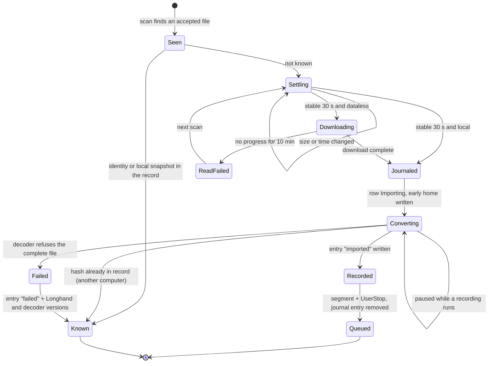

# Import Audio Recordings - Plan

## Goal Capsule

- **Objective:** A recording that another device made, for example a phone, becomes a normal Longhand note with a transcript and a summary. The user drags it in on the Mac, or the user does nothing on the Mac because a watched folder brings it in.
- **Means:** Decode the file and write it as the chunks of a normal recording, so the existing processing stages run unchanged (KTD4). A shared import record of one small file per imported file decides what is new (KTD2).
- **Product authority:** The user chose each product decision in the brainstorm and the plan review on 2026-10-24. The Product Contract wins over the Planning Contract; the Planning Contract wins over a unit's Approach. Reading the private Voice Memos folder and an iPhone app are not active scope (see `docs/ideas/someday/iphone-capture.md`).
- **Execution profile:** One branch and one PR with a `feat` title, which makes a release; ask the user "patch or minor?" before the PR opens. One commit per unit. Work in a worktree named for this plan. U1 is a spike whose results can change U2 and U6 (see its stop conditions).
- **Stop conditions:** Stop and ask when U1 shows that a session-settled decision cannot work, when Symphonia and the platform decoders both fail on real recordings, when the last release breaks on the new `.longhand/imports/` folder, or when a unit needs a change to an applied migration.
- **Who finishes:** `ce-work` implements and opens the PR; `ce-babysit-pr` takes it to merge-ready. The user does the manual tests in a signed build.
- **Open blockers:** None.

---

## Product Contract

### Summary

Longhand gets two ways to make a note from an audio file. The user can drop or pick files, and a small sheet sets the note type and tags before processing starts. Or the user can turn on a watched folder on one computer, and each new audio file in it becomes a note with no action. Longhand never changes the files in the watched folder, and a plain-file import record in the storage folder makes sure that no file is imported twice.

### Problem Frame

Some conversations happen where a laptop is not available or not suitable, for example in a hallway or at a table. A phone is available, and any recorder app on it can record the conversation. Today Longhand cannot use that recording, so the transcript and the summary are missing for exactly those conversations.

`STRATEGY.md` permits this input: "A recording you made on another device counts as what you record."

Voice Memos is the most common recorder on an iPhone, but it syncs its recordings only into a private folder that macOS protects (`~/Library/Group Containers/group.com.apple.VoiceMemos.shared/Recordings/`). Access to it needs Full Disk Access, and its layout is not a public interface. Other recorder apps can save into a normal iCloud Drive, OneDrive or Dropbox folder by themselves, and Voice Memos can do the same with Share › Save to Files.

### Key Decisions

- **Both a manual import and a watched folder.** Some users want each file to process with no action; others want to choose each file. Governs R1–R10. (session-settled: user-directed — chosen over manual import only, and over reading the private Voice Memos folder: one generic folder works with any recorder app and needs no special permission.)
- **Longhand never changes the files in the watched folder.** It reads them, and it can ask the sync service to download them. Governs R7. (session-settled: user-directed — chosen over moving each file into an "Imported" subfolder and over deleting it: the user's folder stays the user's.)
- **The import record is in plain files, not only in the database.** Governs R11, R12. (session-settled: user-directed — chosen over a record in the database alone: the record must survive a database rebuild and reach other computers.)
- **A deleted note does not come back.** Governs R12. (session-settled: user-directed — chosen over importing the file again and over asking at delete time.)
- **The watched folder is a setting of one computer.** Governs R4, R13. (session-settled: user-directed — chosen over a shared setting with claim files and over a shared setting with a named computer: two computers that watch one synced folder can both import a file before the other's record syncs.)
- **Ask once about files that are already in the folder.** Governs R6. (session-settled: user-directed — chosen over importing all of them and over skipping all of them: an old archive could start hours of processing.)
- **The manual sheet has title, type and tags only.** Type and tags go into every summary call, and the type chooses the summary prompt, so setting them first prevents a second summary. Governs R2, R2a. (session-settled: user-directed — chosen over a sheet that also has a Notes field: the sheet must stay small.)
- **A watched-folder note gets the default note type and no tags.** Governs R5. (session-settled: user-directed — chosen over a type and tags on the folder setting, and over holding the summary until the user confirms.)
- **The file name gives only the first title.** Governs R15. (session-settled: user-directed — the summary sets the final title, as for a recording.)
- **The audio becomes normal note audio, and a file's identity is its content.** Governs R12, R17. (session-settled: user-approved — proposed in the scoping synthesis with the alternatives of keeping the original file and identifying by name; the user accepted.)
- **Content identity for every file, also when that downloads a skipped archive.** A user who chooses a folder wants Longhand to read the files in it, so the downloads are expected. Governs R12b. (session-settled: user-directed — chosen over a check by name, size and date for skipped files: that check avoids downloads, but a skipped file that is renamed could come back as new.)
- **The first-pick count matches by name and size.** The count must show before any download, and only content is exact. Governs R6. (session-settled: user-directed — chosen over a count of all audio files: exact in the normal case; a renamed file that was imported can count as new, and the content check still stops a second import.)
- **The watched folder includes its subfolders.** Some recorder apps save into dated subfolders. Governs R5. (session-settled: user-directed — chosen over the top level only: a user who chooses a broad folder sees the count in the R6 question.)

### Requirements

**Manual import**

- R1. The user can drop one or more audio files on Home, or choose them with an Import Audio action, and Longhand makes one new note for each file.
- R2. Before processing starts, a small sheet shows the note type and the tags. The type is preset to the default note type and the tags are empty, so one Import click accepts it. Cancel makes no notes.
- R2a. For one file, the sheet also has a title field, filled with the file name. A title that the user edits in the sheet counts as a title that the user set (R15). For several files, the sheet lists the file names and has no title field: the same type and tags apply to all of them, and each note gets its first title from its own file.
- R3. A manual import always makes a new note, also for a file that the import record already holds.

**Watched folder**

- R4. Each computer has its own watched-folder setting, off by default. The user chooses the folder with the system folder dialog.
- R5. While Longhand runs, each new audio file in the watched folder or its subfolders becomes a new note with the default note type and no tags, and it processes fully with no user action. A file that arrives while Longhand is closed is imported at the next launch.
- R6. When the user chooses a folder that already holds audio files that are not in the import record, Longhand says how many there are and asks once: import them, or import only new files. The question shows at once, before any download, with the number and the total size of the audio files whose name and size match no entry in the import record. The content check still decides each import. The files that the user does not import go into the import record as skipped; Longhand reads and records them in the background after the answer. The same question appears when the storage folder changes and the watched folder holds audio files that the new storage folder's import record does not hold.
- R7. Longhand never changes, moves, renames or deletes a file in the watched folder.
- R8. Longhand imports a file only when it is complete. It first downloads a file that is online only, and it waits while a file still changes.
- R9. The watched folder cannot be the storage folder, cannot be inside it and cannot contain it. It also cannot contain Longhand's own app data (which holds the Working location), and it cannot be the user's home folder or the root of a volume. The setting refuses such a folder and says why.
- R10. The user can turn the watched folder off or choose another folder at any time. Turning it off stops new imports and does not change notes that were already made.

**Import record**

- R11. Each import, manual or from the watched folder, is recorded in two places: in the note, which records its source file, and in a plain-file import record in the hidden `.longhand` folder of the storage folder. A Move to a new storage folder takes the import record with the notes.
- R12. The watcher never imports a file that the import record holds, also after the user deletes the note. A file's identity is its content, so a file that was renamed or saved again with the same content is the same file.
- R12b. Every file in the import record, also a skipped file (R6), is identified by its content. Longhand downloads an online-only file to read it, also when the user chose to skip it.
- R12a. A file that downloaded completely and still cannot be decoded goes into the import record as failed. The watcher tries it again only when its content changes or a newer Longhand build runs. A file that cannot be read yet (a stalled download, a missing permission, a file that another app holds open) is not a failure: the watcher tries it again later and shows no message.
- R13. Before it imports a file, a computer reads the shared import record, so it does not import a file that another computer already imported and whose record has synced. Two computers that watch one folder can still import one file twice before the record syncs (see Dependencies / Assumptions).

**The note**

- R14. An imported note is a normal note. It processes on this computer in the same queue as a recorded note, and it has manual notes, Transcribe Again, Regenerate Summary, type changes and audio removal like a recorded note.
- R15. The note's first title is the file name without its extension. The summary sets the final title, as it does for a recording, unless the user set a title before that, in the sheet (R2a) or by a rename.
- R16. The note's start time is the recording time from the file's metadata. When the file has none, it is the file's modification time.
- R17. Longhand converts the audio to the normal audio of a note. The note keeps no copy of the original file.
- R14a. A recorded note goes ahead of every imported note that waits in the queue, so a batch of imports never delays the notes of a meeting.
- R21. An imported note shows on Home at once. While its file downloads and converts, it shows a quiet "Preparing" state, with no message.
- R22. A conversion does not start when it would leave less free disk space than a recording needs.
- R18. An import never interrupts a recording or makes it worse. Its audio stages wait while a recording runs, also when they started before the recording, as the audio stages of a recorded note do today (`crates/pipeline/src/runner.rs`).

**Formats and messages**

- R19. Longhand accepts m4a (AAC), wav and mp3. The watcher ignores all other files and shows no message for them.
- R20. Longhand shows a message only when the user must act or the import failed: the watched folder stays unavailable after Longhand tries again, a file in an accepted format failed (R12a), or the user dropped or chose a file that is not in an accepted format. A failed file gets one message (R12a). The folder message clears when the folder is available again.

### Key Flows

- F1. Manual import
  - **Trigger:** The user drops audio files on Home, or chooses Import Audio.
  - **Steps:** The sheet shows the title, the default note type and empty tags. The user changes them or not, and selects Import. Each file becomes a note that processes like a recording.
  - **Covered by:** R1, R2, R2a, R3, R14–R18
- F2. Phone to watched folder
  - **Trigger:** The user records on the phone. The recorder app saves into a synced folder, or the user selects Share › Save to Files in Voice Memos.
  - **Steps:** The file syncs to the Mac. When it is complete, the computer with the watched folder records it in the import record and makes a note with the default type. The note processes and appears in the library on every computer.
  - **Outcome:** The user finds a finished note. If the type or tags are wrong, the user changes them and selects Regenerate Summary.
  - **Covered by:** R4, R5, R8, R11–R18
- F3. First choice of a folder
  - **Trigger:** The user turns on the watched folder and chooses a folder.
  - **Steps:** Longhand checks R9. If the folder holds audio files that are not in the import record, Longhand asks once (R6). Watching starts.
  - **Covered by:** R4, R6, R9

### Acceptance Examples

- AE1. **Covers R12.** **Given** a note made from `Team sync.m4a` in the watched folder, **when** the user deletes the note and the file stays in the folder, **then** Longhand makes no new note from it, also after a relaunch.
- AE2. **Covers R3, R12.** **Given** the same deleted note, **when** the user drags `Team sync.m4a` onto Home, **then** Longhand makes a new note.
- AE3. **Covers R12.** **Given** an imported file, **when** the user renames it in the folder, **then** Longhand makes no new note.
- AE4. **Covers R6, R12b.** **Given** an iCloud folder with 40 old recordings that are online only, **when** the user chooses it and selects "only new files", **then** Longhand downloads and records the 40 files as skipped, makes no note for them, and a 41st file that arrives later becomes a note.
- AE5. **Covers R8.** **Given** a new file in an iCloud folder that is still online only or still syncing, **when** the watcher sees it, **then** Longhand waits and makes the note only from the complete file.
- AE6. **Covers R13.** **Given** two computers that share a storage folder, where computer A watches a folder and imported a file, **when** the user also turns on watching of the same folder on computer B after the import record synced, **then** computer B does not import that file again.
- AE7. **Covers R15.** **Given** an imported note that is processing, **when** the user renames it before the summary finishes, **then** the summary does not change the user's title.
- AE8. **Covers R12a, R19, R20.** **Given** a `.txt` file and a damaged `.m4a` file in the watched folder, **when** the watcher sees them, **then** the `.txt` file gets no message and no note, and the `.m4a` file shows one message that names it. Later scans and launches show no new message for it until its content changes.

### Scope Boundaries

- Reading the private Voice Memos folder, and Voice Memos' internal `.qta` files.
- An iPhone app (`docs/ideas/someday/iphone-capture.md`).
- A Notes field in the import sheet.
- A note type or tags on the watched-folder setting.
- More than one watched folder on one computer.
- Holding the summary of a watched-folder note until the user confirms its type and tags.
- Moving, renaming or deleting files in the watched folder.

### Dependencies / Assumptions

- Longhand is not App Sandboxed: `src-tauri/Entitlements.plist` has only the microphone keys, and no security-scoped bookmark code exists. A folder that the user chooses in the system dialog stays readable after a relaunch for Desktop, Documents and Downloads. iCloud Drive and File Provider folders (`~/Library/CloudStorage`) use a separate macOS permission and can show a prompt or refuse; U1 tests this in a signed build.
- An older Longhand drops fields of `longhand.json` that it does not know. The note's own source field is therefore not reliable, and only the import record decides whether a file was imported (KTD10).
- Two computers that both watch the same folder at the same moment can still import one file twice before the import record syncs. R4 makes this a deliberate user setup, not a default.

### Sources / Research

- `docs/ideas/next/import-recording-file.md`: the original idea for a manual import.
- `src-tauri/src/managers/library.rs`: the existing `notify` watcher, with a 900 ms debounce and a full scan each minute because FSEvents can drop events and File Provider folders do not always report changes.
- `src-tauri/src/commands/settings.rs` (`pick_storage_folder`): the only folder dialog today.
- `src-tauri/src/managers/local_store.rs`: where settings that belong to one computer are stored.
- `crates/session-core/src/state.rs`: the stages Assemble, Diarize, Transcribe, Join, Verify, Summarize, Save.
- `crates/summarize/src/prompts.rs`: every summary call carries the note's type, tags and title.
- `docs/solutions/integration-issues/shared-settings-in-a-synced-folder-rules.md`: an online-only iCloud file can block a read, so do every read off the main thread.

**Product Contract preservation:** changed: R6, R9, R11, R12a, R20 and new R14a, R21, R22 — the user confirmed these in the plan's scoping synthesis on 2026-10-24 (an immediate count for the first-pick question, more refused folders, manual imports recorded, read failures retried quietly, recordings ahead of imports, a "Preparing" state, a disk check). All other R/F/AE IDs and their meaning are unchanged.

---

## Planning Contract

### Key Technical Decisions

- KTD1. **Decode m4a and mp3 with Symphonia 0.6, after a spike on real files.** Symphonia is pure Rust and gives one decoder for macOS and Windows. It is MPL-2.0, so `deny.toml` and `about.toml` get an exception for the Symphonia crates only. If U1 shows that it fails on real recordings, U2 uses AudioToolbox (`objc2-audio-toolbox` and `objc2-avf-audio` are already in `Cargo.lock` through `cpal`) and Media Foundation instead. wav keeps `hound`. (session-settled: user-directed — chosen over the platform decoders from the start and over Symphonia with no spike: one decoder for both systems, with a tested way back.)
- KTD2. **The import record is one folder per content identity, with one small JSON file per computer:** `.longhand/imports/<sha256>/<computer_id>.json`. Automatic writes from several computers must never lose an entry. One shared file with read-modify-write loses entries in the sync window, which `docs/solutions/integration-issues/shared-settings-in-a-synced-folder-rules.md` accepts only for settings that people edit. With one file per computer, no two computers ever write the same file, so a sync conflict cannot replace a state. A lookup reads every computer's file for the identity and resolves the state as `imported` over `skipped` over `failed`. Governs the shape of R11, R12, R13.
- KTD3. **The content identity is the SHA-256 of the whole file, computed while the worker copies the file in one sequential pass into the note's Working location.** The decoder then reads the copy, never the source. A decoder seeks inside m4a containers (the `moov` atom often follows `mdat`) and can stop early on a damaged file, so a hash of the decoder's reads is not the file's hash. The copy also gives the decoder a file that cannot change during the decode, and it works with the platform decoders of KTD1. The worker deletes the copy after the chunks are written. The skip work (KTD12) hashes with the same sequential read and no copy. `session_core::recognition::file_digest` is the streaming model.
- KTD4. **An import enters processing as a normal microphone recording.** The decoder downmixes every file to mono (the average of the channels), because a 2-channel segment means microphone plus app audio in processing (`crates/pipeline/src/assemble.rs`). The mono audio goes through `recorder::ChunkedWriter` into `<working>/<id>/audio-recovery/` as 16-bit chunks, then a segment row and `UserStop` queue it. Assemble, Diarize and the later stages do not change. `crates/pipeline/tests/common/mod.rs` already uses this sequence. Chunk names carry the recording time from R16 as `capture_started_at`.
- KTD5. **A new note state, `Importing`, holds a note while its file downloads and converts.** A note in `Capturing` or `Interrupted` is stopped or interrupted by launch recovery and by each recording start (`recover_crashed`, `hold_unregistered`), and its chunks would read as a crashed recording. Only the import worker and a user delete change an `Importing` note. Its exits are `Queued` (done) and removal of the note (a delete by the user, a duplicate found during conversion, or a decode failure). Home shows it as "Preparing" (R21). The state is stored in the database, and an older `SessionState` cannot parse it, so the new migration of KTD13 also raises the schema version: an older build on this computer then refuses the database and takes its existing rebuild path (`docs/solutions/runtime-errors/older-build-panicked-on-newer-database-at-launch.md`).
- KTD6. **Each import has a local journal entry, written before any other step.** The journal is a file in the app data folder, next to `settings.json`, because data must never live only in the database (`docs/solutions/runtime-errors/older-build-panicked-on-newer-database-at-launch.md`). The order of steps, each one recorded before the next starts:
  1. Journal entry (source path, identity when known, note id).
  2. Note row in `Importing`, with type, tags, title and start time, and the early home write.
  3. Download, copy with hash (KTD3) and convert into the note's Working location.
  4. Import record entry `imported`.
  5. Segment row and `UserStop` in one store lock, so the note is `Queued`.
  6. Journal entry removed.

  At launch, the import worker reads the journal and continues each entry from the last recorded step. When the user deletes an `Importing` note, the worker stops the conversion and removes the note, but keeps the journal entry, marked deleted. It then finishes the download and the hash with no conversion, writes the `imported` entry, and only then removes the journal entry, so the file does not come back (R12). While a deleted entry is open, the watcher does not import its source path.
- KTD7. **The watched folder gets its own watcher manager,** modelled on `src-tauri/src/managers/library.rs`: one thread, a `notify` debouncer, a command channel, a scan at launch and a full scan each minute. An event only asks for a scan; no file is imported from an event alone, because FSEvents and File Provider folders drop and delay events. The watched folder is never a library root, because the reconcile would try to adopt its audio files.
- KTD8. **Stability before import.** A file is a candidate only when its size and modification time have not changed for 30 s across scans, and, on macOS, it is not dataless (`st_flags & SF_DATALESS`). The worker downloads a dataless file with a coordinated read on its own thread. Before each download, of an import or of the skip work, the worker checks the disk as KTD9 does, with the file's `st_size`, and it starts no new download while a recording runs. A download with no progress for 10 minutes ends as a read failure (KTD11) and is tried again at a later scan. On Windows, a plain read hydrates a placeholder.
- KTD9. **The conversion waits for a recording, and checks the disk first.** The conversion runs outside the runner, so it polls the runner's `suspended` predicate (`src-tauri/src/managers/processing.rs`, capture active or draining) at each decode block and pauses while it is true. Before the copy starts, the worker checks that free space minus the file size (the copy) and the expected size of the chunks stays above `DISK_RESERVE_BYTES` plus a margin. If not, the import waits, the disk notice shows (U8, because only the user can free space), and the worker checks again at each scan and launch. A download in progress can finish during a recording; hashing can continue. Covers R18, R20, R22.
- KTD10. **The note's own source field is optional and can be lost.** `NoteRecord` gets an optional `import` object (source file name and identity) with `serde(default, skip_serializing_if)`, and `layout` stays at 2. An older build drops the field at its next write, so dedupe reads only the import record (KTD2). A `layout` bump would make every imported note a problem note on older builds.
- KTD11. **Read failures stay local; decode failures are shared.** A file that cannot be read yet (TCC, a stalled download, a sharing violation) is kept in the watcher's memory and tried again at later scans, with no message. Only a file that was copied completely and that the decoder refuses gets a shared `failed` entry, with the Longhand version and the decoder name and version. A Longhand version newer than the one in the entry tries the file again (R12a).
- KTD12. **The first-pick question counts from file names, and the skip work runs later.** The count and size come from a directory listing compared by name and size with the import record (`st_size` is correct for placeholders), so the question shows at once (R6). At the answer "only new files", the watcher writes a local snapshot of the files then present (path, size, modification time). It holds those files from import until each has a `skipped` entry, which the worker writes in the background after it downloads and hashes the file (R12b).
- KTD13. **Recorded notes go ahead of imported notes.** A new migration in `crates/session-core/src/schema.rs` adds an import flag column to the sessions table, set when the row is created in `Importing`. `Store::queue()` and `Store::dequeue()` both order by (import flag, `queue_seq`); the runner walks `Store::queue()` and calls `dequeue_session` (`crates/pipeline/src/runner.rs`). Covers R14a.
- KTD14. **Drag-and-drop uses Tauri's native file drop.** `getCurrentWebview().onDragDropEvent` gives absolute paths (HTML5 `drop` gives none and does not fire while the native handler is on). The import command takes the paths and checks in Rust that each is a regular file with an accepted extension. The file dialog runs in Rust (`blocking_pick_files` with an extension filter), as `pick_storage_folder` does.

### High-Level Technical Design

The life of one watched file. Local state is on this computer only; shared state is in the import record.

"Hash already in record" covers the case where another computer imported the same file while this one was converting: the worker deletes its own `Importing` note and its Working location.

### Implementation Constraints

- Every file read in the watched folder, every hash and every conversion runs off the main thread and outside the store lock (`docs/solutions/performance-issues/sync-tauri-commands-froze-the-app-on-a-slow-folder-or-microphone.md`). Lock order is capture state first, then store.
- Readers of `.longhand/imports/` follow `shared-settings-in-a-synced-folder-rules.md`: a read never writes, exact file names only (no conflict copies), a file that does not parse is never overwritten and makes its identity wait, unknown fields are kept, the schema version never goes down, links that point outside the storage folder are refused, and reads have a size limit. A folder name is accepted only as 64 lowercase hex characters, and a file name only as a computer id (`docs/solutions/security-issues/synced-note-id-became-a-delete-path.md`).
- A computer that only receives a sync writes nothing into the import record (`docs/solutions/logic-errors/receiving-computer-renamed-synced-folder-back.md`).
- No message for normal behaviour: waiting, downloading, a duplicate, or a read failure that the next scan can fix (`CLAUDE.md`, `docs/solutions/ui-bugs/folder-notice-for-a-move-the-app-does-without-help.md`).
- New code says "note" and `note_id`. Text follows ASD-STE100.

### System-Wide Impact

- **Other computers that share the storage folder:** they see imported notes through the normal library sync, and they read the import record before their own watched folder imports (R13). An older Longhand must ignore `.longhand/imports/` and keep imported notes readable (U1 step 5; KTD10).
- **The processing queue:** imports join the one FIFO, behind recorded notes (KTD13). A large batch delays later imports, not recordings.
- **Disk:** an import holds a copy of the file and chunks of about its decoded size in the Working location until Assemble finishes, and downloads stay on disk; KTD8 and KTD9 keep the recording reserve.
- **The agent skill:** `plugins/` longhand-notes reads the storage folder; it must treat `.longhand/imports/` as Longhand's own and the `import` field as optional (U9).

### Risks

| Risk | Mitigation |
|---|---|
| Symphonia decodes some phone recordings badly | U1 decodes real files first; KTD1 falls back to the platform decoders. |
| macOS refuses or prompts for an iCloud or CloudStorage watched folder after a relaunch | U1 step 4 tests it; U6 adds the usage keys; the folder notice (U8) tells the user when access stays refused. |
| A crash between steps imports a file twice or drops a deleted note's entry | The journal order of KTD6, the deleted mark, and one crash-window test per step (U4). |
| Two computers that both watch one folder import one file twice | Accepted (Dependencies / Assumptions); the per-computer setting makes it a deliberate setup. |
| Hashing an archive downloads many GB on first pick | Accepted by the user (R12b); the R6 question shows the total size first. |

---

## Implementation Units

### U1. Spike: decoder, cloud files and folder access

- **Goal:** Prove the assumptions that KTD1, KTD8 and the access assumption rest on, before the code depends on them.
- **Requirements:** R8, R16, R17, R19; KTD1, KTD8.
- **Dependencies:** None.
- **Files:** `docs/solutions/integration-issues/import-audio-spike-results.md` (new; private sample files stay in gitignored `fixtures/`).
- **Approach:**
  1. Decode the private `sample.m4a` (about 3 h of AAC), an HE-AAC file, an iPhone Voice Memo, an mp3 and a file of 8 h or more with Symphonia 0.6 (`aac`, `isomp4`, `mp3`, `id3v2`), streaming. Record time, memory, and whether the PCM matches `afconvert` output.
  2. Read the m4a `mvhd` creation time (1904 epoch) and `©day`, and the mp3 ID3 `TDRC`, through Symphonia tags or a small own atom reader. Compare each with the known recording time of the sample, and record the time zone that each writer uses. Confirm that the decode of an m4a with `moov` after `mdat` seeks.
  3. On macOS: detect an online-only iCloud file with `SF_DATALESS`, download it with a coordinated read, and observe a stalled download.
  4. In a signed bundle: choose an iCloud Drive folder and a `~/Library/CloudStorage` folder, relaunch, and check access to old and new files. Record any prompt and the usage keys needed.
  5. Put `.longhand/imports/<hash>.json` into a storage folder and run the last release on it: launch, library scan, Move, settings save.
  6. On Windows 11: read a OneDrive placeholder and confirm that it hydrates.
- **Execution note:** Throwaway code only; keep the results, not the code.
- **Test expectation:** none -- a spike; its output is a results document.
- **Verification:** The results document answers each step. If Symphonia fails on real recordings, U2 switches to the platform decoders (KTD1). If the last release breaks on `.longhand/imports/`, stop and ask.

### U2. Decoder crate

- **Goal:** Functions that copy a file with its SHA-256, decode the copy to mono PCM blocks, and read the recording time.
- **Requirements:** R16, R17, R19; KTD1, KTD3.
- **Dependencies:** U1.
- **Files:** `crates/audio-import/` (new crate: `Cargo.toml`, `src/lib.rs`, `src/decode.rs`, `src/metadata.rs`, `tests/decode.rs`); `Cargo.toml` (workspace member); `deny.toml`; `about.toml`; `licences/generated/*`; `testdata/audio-import/` (small synthetic m4a, mp3 and wav files made from a generated tone, with a note on how they were made).
- **Approach:**
  1. A sequential copy with SHA-256 into a given folder (KTD3), and the same sequential hash with no copy for the skip work (KTD12).
  2. A decode of the copy to blocks of mono f32 at the file's rate, the average of the channels (KTD4); the caller writes chunks (U4).
  3. The recording time: m4a `mvhd` or `©day`, mp3 `TDRC`. A value that is zero, before 2000, or later than the file's modification time plus one day counts as none (the caller then uses the modification time, R16).
  4. A decoder name and version constant for `failed` entries (KTD11).
- **Patterns to follow:** `session_core::recognition::file_digest` (streaming SHA-256); `crates/pipeline/src/resample.rs`.
- **Test scenarios:**
  - A 5 s mono m4a copied and decoded gives 5 s of samples at its rate, and the copy's hash equals the SHA-256 of the source.
  - An m4a with `moov` after `mdat` gives the same hash as `shasum -a 256` of the file.
  - A stereo mp3 decodes to one channel that is the average of the two.
  - A wav decodes through the same function.
  - An m4a with `mvhd` set to a known time returns that time; an mp3 with `TDRC` returns its time; a file with neither returns none; an m4a with `mvhd` zero returns none.
  - A truncated m4a returns a decode error, not a panic, and not a partial success.
  - A file with an accepted extension that is not audio (text renamed `.m4a`) returns a decode error.
  - The hash with no copy gives the same hash as the copy for the same file.
- **Verification:** The tests pass; `cargo deny check` passes with the MPL-2.0 exception for the Symphonia crates only; `scripts/check-licences.sh` passes.

### U3. Import record

- **Goal:** Read and write the shared import record safely from several computers.
- **Requirements:** R11, R12, R12a, R12b, R13; KTD2, KTD11.
- **Dependencies:** None.
- **Files:** `crates/import-record/` (new crate: `src/lib.rs`, `src/entry.rs`, `src/store.rs`, `src/merge.rs`, `tests/record.rs`, `tests/two_computers.rs`); `Cargo.toml`.
- **Approach:**
  1. An entry holds schema version, state (`imported`, `skipped`, `failed`), source file name, size, the writing computer's id, the time, and for `failed` the Longhand version and the decoder name and version. Unknown fields are kept.
  2. A computer writes only its own file, `imports/<hash>/<computer_id>.json`, through the atomic write that `crates/shared-settings` uses (KTD2).
  3. A lookup by identity reads the files in exactly `imports/<hash>/` and resolves `imported` over `skipped` over `failed`. A file that does not parse returns "unknown, wait".
  4. A merge copies each entry from an old storage folder into a new one when the new one has no file for that identity (for U7).
  5. Link and path checks use `crates/shared-settings/src/inside.rs`.
- **Patterns to follow:** `crates/shared-settings/src/file.rs` (patch-only save, unknown fields, schema version); `crates/shared-settings/tests/two_computers.rs`.
- **Test scenarios:**
  - An `imported` entry written and read back gives the same state and fields.
  - An entry with an unknown field keeps the field after a state change.
  - An entry with a newer schema version is read, and a write does not lower the version.
  - A file that does not parse makes the lookup return "wait", and a write for that identity does not overwrite it.
  - A conflict copy `<computer_id> 2.json` has no effect on the lookup.
  - A symbolic link in `imports/<hash>/` that points outside the storage folder is refused.
  - A folder name that is not 64 lowercase hex characters, and a file name that is not a valid computer id, are ignored.
  - `failed` written by Longhand 1.4 allows a retry on 1.5, and not on 1.4.
  - Computer A writes `skipped` and computer B writes `failed` for the same identity; after both syncs, the lookup on each gives "skipped".
  - Computer A writes `imported` and computer B writes `failed`; the lookup gives "imported".
  - The merge copies an entry that the new folder lacks and does not replace one that it has.
- **Verification:** The tests pass. The rules in `shared-settings-in-a-synced-folder-rules.md` that apply each have a test.

### U4. Import worker and the Importing state

- **Goal:** Turn one file into a queued note, crash-safe, with the recording wait and the disk check.
- **Requirements:** R11, R12, R14, R14a, R15, R16, R17, R18, R21, R22; KTD4, KTD5, KTD6, KTD9, KTD10, KTD13.
- **Dependencies:** U2, U3.
- **Files:** `crates/session-core/src/state.rs` (new `Importing` state and its events); `crates/session-core/src/jobs.rs` (create an import row; `queue()` and `dequeue()` order); `crates/session-core/src/note_record.rs` (optional `import` field); `crates/session-core/src/schema.rs` and a new migration (import flag column, schema version raised; KTD5, KTD13); `crates/pipeline/src/import.rs` (new: the worker steps); `src-tauri/src/managers/import.rs` (new: the manager, its journal and its thread); `src-tauri/src/managers/processing.rs` (start and stop the manager, share the `suspended` predicate); `src-tauri/src/commands/session.rs` (Home row state "Preparing"); `crates/pipeline/tests/import.rs`; `crates/session-core/tests/` for the state.
- **Approach:**
  1. The journal is a JSON file in the app data folder, written atomically, read at launch (KTD6).
  2. Create the row in `Importing` with `TitleSource::Proposed` from the file name or `TitleSource::User` from the sheet (R15, R2a), the type and tags, `created_at` and `opened = true` at the recording time (R16), `live_transcript = false`, and the recognition snapshot and model that a recording start stores (`record_in_store` in `src-tauri/src/managers/capture.rs`). Then `begin_home` and the early home write.
  3. Copy with hash, then decode into `ChunkedWriter`, with the disk check before the copy and the `suspended` wait (KTD3, KTD9).
  4. Look up the identity again; if another computer imported it meanwhile, delete this note and its Working location (state diagram).
  5. Write the `imported` entry, then the segment and `UserStop` in one store lock.
  6. Queue order: non-import `Queued` notes first (KTD13).
  7. Delete of an `Importing` note: as KTD6 (journal entry marked deleted until the `imported` entry is written).
  8. The note view of an `Importing` note shows the pending view that a `Queued` note shows, with "Preparing"; only rename and delete are available.
- **Patterns to follow:** `crates/pipeline/src/early_home.rs` (step-then-record); `open_note` in `src-tauri/src/managers/capture.rs`; `crates/pipeline/tests/common/mod.rs` (`write_segment`, `queue_session`); `docs/solutions/logic-errors/save-state-machine-crash-window-recovery.md`.
- **Execution note:** Write one crash-window test for each journal step before the worker code.
- **Test scenarios:**
  - A 10 s m4a import gives a `Queued` note whose Assemble output is 10 s, with the proposed title from the file name and the start time from the file's `mvhd`.
  - An import with a sheet title keeps that title after the summary's title job.
  - Covers AE7. The user renames an importing note before its summary ends; the summary does not change the title.
  - A crash after each journal step, followed by a launch, ends with exactly one queued note and one `imported` entry.
  - A launch with an `Importing` row and no journal entry removes the row and its Working location.
  - Launch recovery and a recording start leave an `Importing` note unchanged.
  - A recording starts during a conversion: the conversion pauses until capture ends (wait for the pause event), then completes.
  - Free space below the reserve: the copy does not start, the import waits, and the disk notice is set; when space returns, the import continues and the notice clears.
  - Another computer's `imported` entry appears during the conversion: the note is removed and no second entry is written.
  - The user deletes an `Importing` note before its hash is known: the worker finishes the hash, writes the `imported` entry, and a later scan makes no note.
  - A crash after a delete and before the `imported` entry, then a launch: the entry is written and no note returns.
  - A recorded note queued after three imports is claimed before them.
  - The `import` field survives a round trip; a `longhand.json` with no `import` field still reads.
  - A decode error on a complete copy writes a `failed` entry with the Longhand and decoder versions and removes the note.
  - A database with an `Importing` row has a schema version above the last release's version.
  - The note view of an `Importing` note offers rename and delete only.
- **Verification:** The tests pass. An imported note runs through Save and its summary in the existing runner tests' harness, and the test waits for the end of the title job (`docs/solutions/test-failures/runner-test-stopped-before-the-title-job-that-the-save-queued.md`).

### U5. Manual import: menu, drop and sheet

- **Goal:** The user drops or chooses files, sets type and tags in a small sheet, and gets one note for each file.
- **Requirements:** R1, R2, R2a, R3, R19, R20; F1; KTD14.
- **Dependencies:** U4.
- **Files:** `src-tauri/src/commands/import.rs` (new: `pick_audio_files`, `import_files`); `src-tauri/src/lib.rs` (register commands); `src/bindings.ts` (generated); `src/home/NewNoteButton.tsx` ("Import Audio…" menu entry); `src/home/Home.tsx` (drop target state); `src/home/ImportSheet.tsx` (new); `src/home/useFileDrop.ts` (new); tests `src/home/ImportSheet.test.tsx`, `src/home/NewNoteButton.test.tsx`, `src-tauri/src/commands/import.rs` inline tests.
- **Approach:**
  1. Invoke `apple-design` before the sheet design.
  2. The sheet: for one file, a title field filled with the file name; for several, a list of file names. Type (default note type) and tags (`TagPicker`). Import and Cancel. Call `focus()` on open (`docs/solutions` WebKit focus lesson).
  3. `import_files` checks each path in Rust (regular file, accepted extension) and the storage-folder refusal that New Note uses (`destination::note_start_refusal`), then hands each file to the U4 manager.
  4. A dropped folder or a file with another extension gets one message that names it (R20); the other files import.
  5. A manual import that fails to decode always shows its own failure notice (U8), also when the file already has a `failed` entry.
  5. The drop target shows only while files are dragged over the window.
- **Patterns to follow:** `src/lib/NewTypeDialog.tsx`, `src/lib/ConfirmDialog.tsx`, `src/lib/TagPicker.tsx`; `pick_storage_folder` in `src-tauri/src/commands/settings.rs`; `start_recording` in `src-tauri/src/commands/capture.rs` (type resolution).
- **Test scenarios:**
  - One file: the sheet shows the title field with the file name, the default type and no tags; Import calls `import_files` with them.
  - An edited title is sent as a user title.
  - Three files: the sheet lists three names and has no title field; one type and tag set goes with all three.
  - Cancel calls nothing.
  - Covers AE2. `import_files` for a file that the import record holds makes a new note.
  - `import_files` with a `.txt` path and an `.m4a` path imports the `.m4a` and returns one refusal that names the `.txt`.
  - `import_files` while the storage folder is unavailable refuses all files with the New Note reason.
  - The sheet's first field has focus when it opens (`document.activeElement`).
- **Verification:** The tests pass. In the signed bundle, a drop from Finder and a choice with "Import Audio…" each make notes (manual test M1).

### U6. Watched folder

- **Goal:** A per-computer watched folder that imports each new stable audio file with no user action.
- **Requirements:** R4, R5, R6, R7, R8, R9, R10, R12, R12a, R12b, R13, R19, R20; F2, F3; KTD7, KTD8, KTD11, KTD12.
- **Dependencies:** U3, U4.
- **Files:** `src-tauri/src/managers/watched_folder.rs` (new: watcher, scans, local state, snapshot); `src-tauri/src/managers/settings.rs` (`watched_folder` in `LocalSettings` only); `src-tauri/src/managers/destination.rs` (R9 checks); `src-tauri/src/commands/settings.rs` (`pick_watched_folder`, `set_watched_folder`, `watched_folder_preview` for the R6 count); `src-tauri/Info.plist` (folder usage keys from U1); `src/settings/WatchedFolder.tsx` (new, in the Storage pane); `src/settings/DestinationPicker.tsx`; tests inline in `watched_folder.rs`, `src/settings/WatchedFolder.test.tsx`.
- **Approach:**
  1. The setting is local (`LocalSettings` is `serde(default)`, so no schema bump). It shows in Settings > Storage outside the shared-settings footer. Invoke `apple-design` first. Its states: off (Choose Folder…); on, with the path, Change… and Turn Off; refused, with one reason for each R9 case; folder unavailable; preview being read; preview that cannot be read.
  2. R9 check at each change of the watched folder and of the storage folder: reuse `check_new_folder` logic in reverse, plus app data, home folder and volume roots.
  3. The R6 question uses the `useFolderChange` pattern: pick, preview, ask, then set. The question gives the count and the total size, with the buttons "Import Them" and "Only New Files"; Cancel leaves the setting as it was.
  4. Each scan walks the folder recursively, skips dot files, temporary files and other extensions, and moves each file through the KTD8 stability check and the KTD12 snapshot.
  5. Only the R6 snapshot is written to a file in the app data folder; read failures and settling files stay in memory, because the next scan finds them again.
  6. The folder unavailable for 3 scans in a row sets the folder notice (U8); the next successful scan clears it.
  7. Stop the watcher in `ProcessingManager::shutdown`.
- **Patterns to follow:** `src-tauri/src/managers/library.rs` (thread, debouncer, timing struct, `fast()` test timing); `src/settings/OldNotesDialog.tsx` and `useFolderChange`.
- **Test scenarios:**
  - A new m4a in the folder becomes one note after it is stable (wait for the import event, write again each 1 s, 120 s hang limit only).
  - A file in a dated subfolder imports (R5).
  - A file that grows across scans waits until it is stable.
  - A `.txt` and a dot file are ignored with no message.
  - Covers AE3. A renamed imported file makes no note.
  - Covers AE1. The user deletes a finished note from a watched file; after a relaunch, the file makes no note.
  - A skip-work download does not start while free space is below the reserve or a recording runs, and continues after.
  - Covers AE4. A folder with 40 files and the answer "only new files": no notes; each file gets a `skipped` entry; a 41st file imports. A quit before the skip work ends, then a launch: still no notes for the 40.
  - Covers AE5. A dataless file waits, downloads, then imports (macOS, with a fake dataless check in the unit test).
  - A download with no progress ends as a read failure with no message and is tried at the next scan.
  - Covers AE6. A file with an `imported` entry from another computer makes no note.
  - Covers AE8. A damaged m4a gives one `failed` entry and one notice; later scans add no notice.
  - R9: the storage folder, a folder inside it, a folder that contains it, the app data folder's parent, the home folder and `/` are each refused with a reason.
  - Turning the setting off stops imports; existing notes stay.
  - The folder removed: no "deleted" handling, the notice after 3 failed scans, cleared when it returns.
- **Verification:** The tests pass. Manual tests M2–M4 pass in the signed bundle.

### U7. Storage folder change and Move

- **Goal:** The import record follows a Move, and a Leave Them change asks R6 again.
- **Requirements:** R6, R9, R11; KTD2.
- **Dependencies:** U3, U6.
- **Files:** `crates/pipeline/src/move_notes.rs` (merge step); `src-tauri/src/commands/settings.rs` (`change_folder`: pause the watcher, R9 check against the new folder, R6 after Leave Them); `src/settings/OldNotesDialog.tsx` (`useFolderChange`); tests in `crates/pipeline/tests/move_notes.rs` and `src/settings/DestinationPicker.test.tsx`.
- **Approach:**
  1. The Move worker merges the old `.longhand/imports/` into the new folder (U3 merge) before it reports done; a crash continues the merge from what is on disk.
  2. The watcher pauses while the storage folder changes and in-flight imports finish.
  3. If the watched folder fails R9 against the new storage folder, the setting turns off and a notice says why (the user must act).
  4. After Leave Them, the R6 preview runs against the new folder's empty record.
- **Patterns to follow:** the step-then-record Move in `crates/pipeline/src/move_notes.rs`; `docs/solutions/logic-errors/move-dropped-notes-when-old-folder-went-away.md`.
- **Test scenarios:**
  - A Move copies every import entry; a deleted note's file does not import in the new folder.
  - A crash during the merge, then a launch, completes the merge with no lost entry.
  - Leave Them with 5 audio files in the watched folder shows the R6 question with 5.
  - A new storage folder that contains the watched folder turns the watched folder off with a notice.
- **Verification:** The tests pass.

### U8. Notices

- **Goal:** One notice for each failure the user must know about, and none for normal waits.
- **Requirements:** R20, R21, R22; AE8.
- **Dependencies:** U5, U6.
- **Files:** `src-tauri/src/commands/session.rs` (`LibraryNotices`: watched folder unavailable, failed files); `src/home/LibraryNotices.tsx`; `src/home/useLibraryNotices.ts`; tests `src/home/LibraryNotices.test.tsx` and the command's inline tests.
- **Approach:**
  1. A failed-file notice names the file and has a Dismiss action. A dismissal is stored locally for that failure (identity and attempt time), so the same failure does not come back, but a new failed attempt, for example a new manual import, shows a new notice.
  2. The folder notice has no Dismiss; it clears when the folder returns.
  3. A disk notice names the file that waits for free space; it clears when the copy starts (KTD9).
  4. Home rows in `Importing` show "Preparing" in the row's status text, not as a notice.
- **Patterns to follow:** `CautionBanner` and `ProblemNotice` in `src/home/LibraryNotices.tsx`; `docs/solutions/ui-bugs/one-capture-failure-gave-two-messages.md`.
- **Test scenarios:**
  - A failed entry from this computer shows one notice with the file name; Dismiss removes it, and later scans do not show it again.
  - A second manual import of the same bad file after a Dismiss shows a new notice.
  - An import waiting for disk space shows the disk notice; it clears when the copy starts.
  - A failed entry written by another computer shows no notice here (the computer that tried owns the message).
  - The folder notice shows and clears with the folder state.
  - An `Importing` row shows "Preparing" and no notice.
- **Verification:** The tests pass.

### U9. Docs, agent skill and test data

- **Goal:** The docs and the agent skill describe the new files.
- **Requirements:** R11.
- **Dependencies:** U3, U4.
- **Files:** `CONCEPTS.md` (Import record covers manual imports and failed entries; the Importing state); `plugins/` longhand-notes skill text (the `.longhand/imports/` folder is Longhand's own, and the `import` field of `longhand.json`); `testdata/storage-folder/` (one imported note and one import entry); the skill drift test (`skill_drift.rs`); `PROVENANCE.md` if code is borrowed.
- **Approach:** Update the skill so that an agent never edits `.longhand/imports/` and reads the `import` field as optional.
- **Test expectation:** the skill drift test passes with the new test data.
- **Verification:** `scripts/check-provenance.sh` and `node scripts/ideas.ts check` pass.

---

## Verification Contract

| Gate | Command | Units |
|---|---|---|
| Scoped Rust tests per unit | `cargo test -p audio-import`, `-p import-record`, `-p session-core`, `-p pipeline --test import`, `-p longhand watched_folder` | U2–U8 |
| Full Rust run | `cargo test --workspace` and `cargo clippy --workspace --all-targets -- -D warnings`, once at the end | all |
| Format | `cargo fmt --all --check` before each push | all |
| Bindings | `cargo test -p longhand export_bindings`, then no diff in `src/bindings.ts` | U5, U6, U8 |
| Frontend | `npm run typecheck` and `npm test` | U5–U8 |
| Windows lint | `scripts/check-windows.sh` | U2, U4, U6 |
| Licences | `cargo deny check` and `scripts/check-licences.sh`, commit `licences/generated/*` | U2 |
| Provenance and ideas | `scripts/check-provenance.sh`, `node scripts/ideas.ts check` | U9 |

Every test run that a worker starts has a time limit. A watcher test waits for the event it checks, never for a delay.

**Manual tests (signed bundle, `npm run tauri -- build --bundles app`; never `tauri dev`):**

- M1: drop one Voice Memo from Finder onto Home, edit the title in the sheet, import; then "Import Audio…" with three files and one tag. Check titles, type, tags and the start times.
- M2: watched folder in iCloud Drive. Record a Voice Memo on the iPhone, Share › Save to Files into the folder, and check that a note appears with no action on the Mac. Quit and relaunch, and repeat.
- M3: choose a watched folder that holds old recordings, answer "only new files", then add one file.
- M4: start a recording while an import converts; the recording is normal and the import finishes after it.
- M5: two Macs with one storage folder, watching on one Mac only; the note appears on both, and no duplicate after a delete.
- M6: on Windows 11, a watched OneDrive folder with an online-only file, from a CI build.

---

## Definition of Done

- Every unit's verification holds, and all gates in the Verification Contract pass.
- The manual tests M1–M5 pass on macOS in the signed bundle, and M6 passes on Windows 11.
- The U1 results document is committed, and its findings are reflected in U2 and U6.
- An older release, run on a storage folder with imported notes and `.longhand/imports/`, shows no problem notice (U1 step 5).
- Code from abandoned attempts, for example a decoder that U1 ruled out, is removed from the diff.
- The PR title is a `feat` Conventional Commit; ask the user "patch or minor?" before the PR opens.
