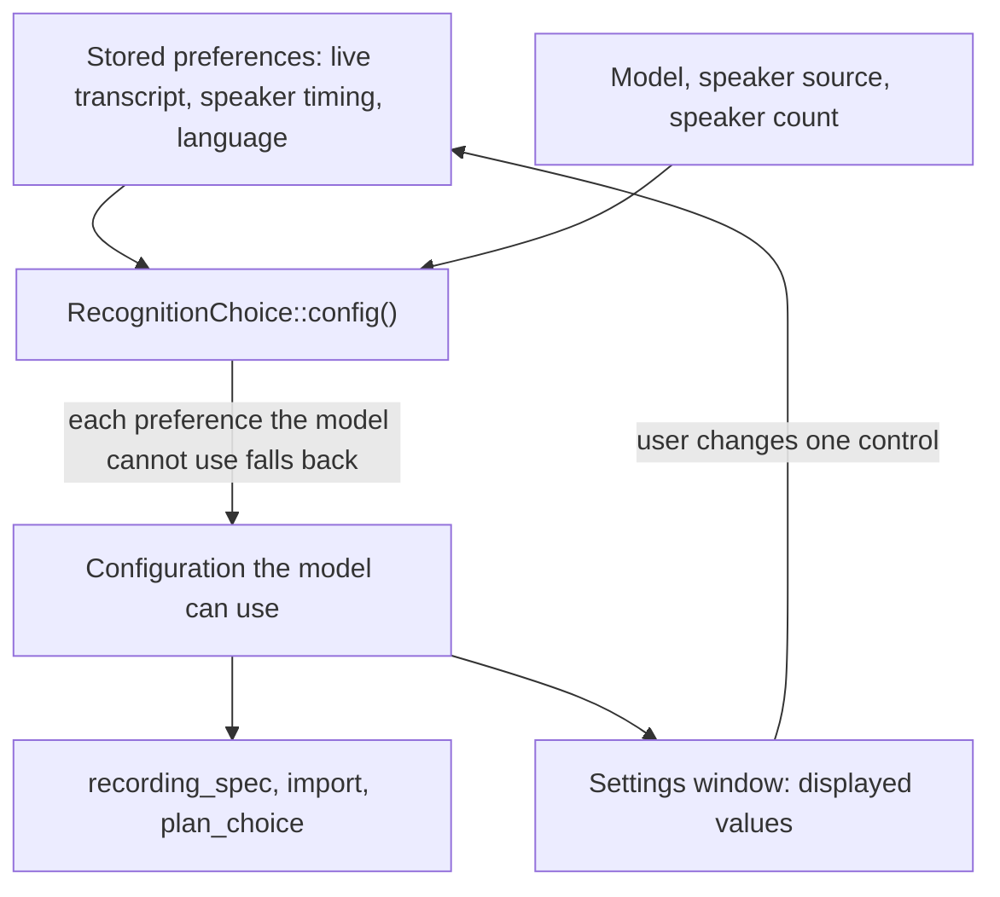

# Recognition Preferences Survive a Model Change - Plan

## Goal Capsule

- **Objective:** A user who selects a transcription model that cannot do live transcript, live speaker recognition, or their language, and then selects a model that can, gets their earlier choices back with no action.
- **Means:** The chosen configuration stores transcript timing, speaker timing and language as preferences. Longhand finds the configuration that each model can use from them when it resolves a recording (KTD1, KTD2).
- **Authority:** The Product Contract requirements win on behaviour. The KTDs win on mechanism. A unit overrides neither.
- **Stop conditions:** Stop and ask when the fix needs a new shared settings field or a settings schema version change (Key Decisions). Also stop and ask when an existing test shows that a recording can fail to start with a stored preference.
- **Execution profile:** One PR with a `fix` title. Units are commits on one branch in the `recognition-preferences` worktree.
- **Who finishes:** `ce-work` implements, runs the local checks, opens the PR and runs `ce-babysit-pr` until the PR is ready to merge.

---

## Product Contract

### Summary

Transcript timing, speaker timing and language become preferences in the chosen configuration. A model change does not change them. A model that cannot use a preference records with the value that it supports, and the preference applies again when the user selects a model that can use it. The Transcription settings show what the selected model will do, and they show no message when a preference does not apply.

### Problem Frame

A user had live transcript and live speaker recognition on. They selected a model with no live transcript to test it, then selected their usual model again. The transcript timing was still "After Stop", so they had to set it again.

The cause is in the Transcription settings. When the model changes, the settings find the configuration that the new model can use, show it, and save it as the chosen configuration (`src/settings/RecognitionOptions.tsx`, then `set_recognition_defaults` and `RecognitionChoice::from_config`). The backend already treats `live_transcript` as a preference: `RecognitionChoice::config()` uses After Stop when the model does not stream. But the settings replace the stored value before the backend can use it. Language has the same fault: a model that does not support the chosen language saves Automatic. The test "a model that does not support the chosen language saves with Automatic" in `src/settings/Models.test.tsx` specifies this behaviour today.

Every catalog model has a live speaker choice (`nemotron` in `speaker_preferences.during_recording`). So today speaker timing falls back only when the user selected an engine with no live mode, or when the speaker count is above the limit of the live engine. In the second case the window also selects the next after-Stop speaker source of the model, because the source limit applies at both timings.

### Key Decisions

- **Timing and language are preferences; the speaker engine is not.** A model change keeps transcript timing, speaker timing and language. The speaker engine override under Advanced keeps its current behaviour. Governs R1, R2, R3. (session-settled: user-directed — chosen over "timing only" and over "timing, language and speaker engine": one rule for the three choices that have a clear fallback; engines differ per model.)
- **No new stored fields; older builds can show an error.** The existing shared fields hold the preferences. An older build that reads a preference its model cannot use shows a failure for the chosen model and keeps its previous configuration in use until it updates. Governs R7. (session-settled: user-directed — chosen over new preference fields that older builds ignore: one value per setting, and the agent skill edits the same fields.)

### Requirements

**Preferences**

- R1. A model change does not change the stored transcript timing, speaker timing or language.
- R2. Only a direct change of a setting by the user changes its stored preference. This includes a change in Settings, a change in the shared settings file, and a change by the agent skill.
- R3. When the selected model, speaker engine or speaker count cannot use a preference, a new note records with After Stop for that timing, or with Automatic language. When the model can use it again, the preference applies again.

**Transcription settings**

- R4. The timing and language controls show the value that the selected model will use, and they disable each option that the model cannot use.
- R5. The settings show no message when a preference does not apply to the selected model. The "No compatible choice" error stays.

**Recording and compatibility**

- R6. A stored preference that the model cannot use never stops a recording from starting, and it never shows as a download failure in this build.
- R7. The shared settings file keeps its fields and schema version.

### Acceptance Examples

- AE1. **Covers R1, R3.** Given live transcript on and the streaming model selected, when the user selects Whisper and then the streaming model again, the transcript timing shows "During recording" and a new note has a live transcript.
- AE2. **Covers R1, R3, R4.** Given language German and a multilingual model, when the user selects an English-only model, the language shows Automatic. When the user selects the multilingual model again, the language shows German.
- AE3. **Covers R3, R4.** Given live speaker recognition on, when the user sets the expected speakers to 9, speaker timing shows "After Stop". When the user sets 3, it shows "During recording".
- AE4. **Covers R2.** Given Whisper selected, when the user changes the language to French, the stored language is French.

### Scope Boundaries

- The speaker engine override under Advanced keeps its current behaviour: a model change clears it.
- Preferences that an earlier build already overwrote stay as they are. The user sets them again once. No migration.
- No hint line under the timing controls.
- Considered and not built: a check in the agent skill that a model supports the chosen language. The skill cannot read the model list (`settings.md`), and R3 makes any combination safe in this build. Evidence that would change this: a skill user who expects the skill to reject the combination.

---

## Planning Contract

### Key Technical Decisions

- KTD1. **`RecognitionChoice::config()` owns the fallback.** It returns the configuration that the choice's model can use: the stored preferences, with each preference that does not resolve replaced by its fallback (R3). The fallbacks are: a language that the model does not list becomes `None`; transcript `DuringRecording` on a model that does not stream becomes `AfterStop`; speaker `DuringRecording` with a speaker source that has no live mode becomes `AfterStop`. A speaker count above the limit of the speaker source is not a timing fallback: the limit applies at both timings, so the window changes the speaker source (KTD3), and `config()` keeps the `SpeakerLimit` error. It changes only those three fields, so a configuration that still does not resolve keeps its error for the other fields. Rationale: `config()` already does the transcript fallback, and recording (`recording_spec`), import, `plan_choice` and Transcribe Again all read the configuration through it. So one change covers each path.
- KTD2. **The save command takes the preferences.** `set_recognition_defaults` gets the user's preferences together with the model, speaker source and speaker count. It validates that `config()` of that choice resolves, instead of the raw configuration. Today the window sends the resolved configuration, and `RecognitionChoice::from_config` reads `live_transcript` from `processing_mode`, so the save discards the preference. The exact shape of the argument (the `RecognitionChoice` itself, or the configuration plus preference fields) is for the implementer, but the generated `src/bindings.ts` must match it.
- KTD3. **The settings window keeps two values.** `RecognitionOptions` keeps the preference values separately from the configuration that it resolves for the selected model. The resolve step chooses the best valid configuration as today, but it changes only the displayed configuration, not the preferences. `chooseMode` and the language control change only the preference of the control that the user changed (R2). Rationale: the window must display the configuration that the model will use (R4) and save the preference (R1).
- KTD4. **`recording_spec` needs no change.** With KTD1, `resolve(in_use)` fails only for an unknown model or an invalid speaker count. So the existing fallback, which sets both timings to After Stop, runs only in those cases. The tests in U1 prove that a preference that the model cannot use does not reach that fallback.

### High-Level Technical Design

### Sources

- `src-tauri/src/managers/settings.rs`: `RecognitionChoice`, `config()`, `from_config()`, `from_shared()`, `in_use()`, `chosen_config()`.
- `src-tauri/src/commands/settings.rs`: `set_recognition_defaults`, `set_live_transcript`, `choose_recognition`.
- `src-tauri/src/managers/capture.rs`: `recording_spec`, `note_recognition`, `import_recognition`.
- `src-tauri/src/managers/models.rs`: `plan_choice` (a chosen configuration that does not resolve becomes a `RecognitionFailure`).
- `crates/models/src/recognition.rs`: `resolve`, `resolve_transcribe` (the errors `Language`, `NoLiveTranscription`, `NoLiveSpeakerAnalysis`, `SpeakerLimit`).
- `src/settings/RecognitionOptions.tsx`, `src/settings/Models.tsx`, `src/settings/useAppSettings.ts`.
- `CONCEPTS.md`: Chosen configuration, Configuration in use, Live transcript.

---

## Implementation Units

### U1. Fallback for each preference in the backend

- **Goal:** `RecognitionChoice::config()` returns a configuration that the model can use for each preference (KTD1).
- **Requirements:** R3, R6
- **Dependencies:** none
- **Files:** `src-tauri/src/managers/settings.rs` (code and its test module), `src-tauri/src/managers/capture.rs` (tests only)
- **Approach:**
  1. Extend `config()` with the language and speaker-timing fallbacks next to the existing transcript fallback.
  2. Find whether a field is unsupported from the catalog and from the same rules as `resolve`, or by resolving and reading the error kind. The implementer chooses. Keep one fallback order so the result is deterministic.
  3. Do not change `from_shared`, `set_in_use` or the shared field parsing (R7).
- **Patterns to follow:** the existing `live_supported` check in `config()`. The test `live_speaker_analysis_does_not_enable_live_transcription` in `settings.rs`.
- **Test scenarios:**
  - A choice with `live_transcript: true` on `whisper-large-v3-turbo-q5km` gives `processing_mode: AfterStop` (current behaviour stays).
  - A choice with language `de` on `parakeet-unified-en-0.6b-q80` gives `language: None`. The same choice on `nemotron-3.5-asr-streaming-0.6b-q80` gives `Some("de")`.
  - A choice with speaker `DuringRecording`, source `pyannote` and an exact count of 9 gives speaker `AfterStop`, and the result resolves.
  - A choice with speaker `DuringRecording`, source `nemotron` and an exact count of 3 gives speaker `DuringRecording`.
  - A choice with source `nemotron` and an exact count of 9 still fails to resolve with `SpeakerLimit` at either timing. `config()` does not change the source.
  - A choice with speaker `DuringRecording` and source `pyannote` gives speaker `AfterStop`.
  - A choice with language `de`, speaker `DuringRecording` and source `pyannote` on `parakeet-unified-en-0.6b-q80` gives `language: None` and speaker `AfterStop`, and the result resolves. The stored choice keeps both preferences.
  - The stored choice keeps each preference after `config()`. `config()` does not change the choice.
  - Each returned configuration from the cases above, except the `SpeakerLimit` case, resolves with `models::recognition::resolve`.
  - In `capture.rs`: `recording_spec` with an in-use choice of language `de` on an English-only model whose files are ready records with that model and `language: None`. It does not fall back to the chosen configuration.
- **Verification:** The new tests pass. The existing `settings.rs` and `capture.rs` recognition tests pass unchanged.

### U2. The save keeps the preferences

- **Goal:** `set_recognition_defaults` stores the user's preferences, not the configuration that the window resolved (KTD2).
- **Requirements:** R1, R2, R6
- **Dependencies:** U1
- **Files:** `src-tauri/src/commands/settings.rs`, `src-tauri/src/managers/settings.rs` (`from_config` and its callers), `src/bindings.ts` (generated)
- **Approach:**
  1. Change the command argument per KTD2. Validate with `resolve(&choice.config())`.
  2. Keep `start_bundle_downloads` on the choice's model.
  3. Remove `RecognitionChoice::from_config` if it has no other callers. Otherwise keep it only where the argument is a real configuration.
  4. Regenerate `src/bindings.ts` the way the repo generates it.
- **Patterns to follow:** `choose_recognition` and `set_live_transcript` in `commands/settings.rs`.
- **Test scenarios:**
  - A save of live transcript on with Whisper stores `live_transcript: true` in `chosen_recognition`, and `chosen_config()` gives `AfterStop`.
  - A save of language `de` with an English-only model stores `de`, and `plan_choice` gives no failure for it.
  - A save of a choice whose model is unknown returns an error and changes nothing.
- **Verification:** The command tests pass. `npm run typecheck` passes with the new bindings.

### U3. The Transcription settings keep the preferences

- **Goal:** The window displays the configuration of the selected model and saves the preferences (KTD3).
- **Requirements:** R1, R2, R4, R5
- **Dependencies:** U2
- **Files:** `src/settings/RecognitionOptions.tsx`, `src/settings/Models.tsx`, `src/settings/useAppSettings.ts`, `src/settings/Models.test.tsx`
- **Approach:**
  1. Read the initial preferences from `settings.chosen_recognition` (`recognitionDefaults` today converts them to a configuration).
  2. Keep the preferences in their own state. The resolve effect and `choiceScore` use them as the wanted values. `setDraft(best.config)` no longer writes them. `resolveRecognition` resolves the raw configuration, not `config()`, so the resolve effect sends the effective language: the preferred language when the selected model's `languages` include it, else null. Key the effect on that effective language.
  3. The `engine` initializer treats a stored speaker source as automatic (no override) when it is the first source in the model's `during_recording` list, or the first source in its `after_stop` list that resolves with the stored count. This is the rule of `automatic_speaker_source` in `src-tauri/src/managers/settings.rs`. Without it, a source that the window selected for a high count reads as an override when Settings opens again, and live speaker recognition never comes back.
  4. `chooseMode` and the language control update only the preference of the changed control. A model change does not update preferences.
  5. `onChanged` and `defaults.save` send the preferences with the resolved model, speaker source and speaker count. Update `configKey` and `OwnSaves` so this window's own save is still known when settings come back.
  6. Remove the "The processing choices changed to match this model…" notice and its state (R5).
- **Patterns to follow:** the existing resolve effect and its guard against late responses. The test "late resolver responses cannot replace the current model choice".
- **Test scenarios:**
  - Covers AE1. Select Whisper with live transcript on: the timing shows "After Stop" with "During recording" disabled, and the save sends live transcript on. Select the streaming model again: the timing shows "During recording".
  - Covers AE2. Language German on a multilingual model, select an English-only model: the language shows Automatic, and the save sends `de`. Select the multilingual model again: German shows.
  - Covers AE3. Live speakers on, set 9 speakers: speaker timing shows "After Stop", and the save keeps speaker `during_recording`. Set 3: "During recording" shows.
  - Covers AE3. Save a count of 9, mount the window again from the saved settings, and set 3: speaker timing shows "During recording", and no engine override shows under Advanced.
  - Covers AE4. With Whisper selected, choose French: the save sends `fr`.
  - A model change shows no notice text.
  - Replace "model changes reset incompatible timing visibly and apply the complete configuration" and "a model that does not support the chosen language saves with Automatic". Their expected behaviour is now wrong.
  - "opening settings does not save and changes save without an Apply step", "rapid setting changes save in order and keep the latest choice" and "this computer's own choice does not read the choices again" still pass.
- **Verification:** `npx vitest run src/settings/Models.test.tsx` passes. A manual test in a signed build: switch from the streaming model to Whisper and back, and the live transcript shows in a new note.

### U4. Docs and the agent skill

- **Goal:** The shared docs and the skill describe the three settings as preferences.
- **Requirements:** R2, R3
- **Dependencies:** U1
- **Files:** `CONCEPTS.md`, `plugins/longhand/skills/longhand-notes/references/settings.md`
- **Approach:**
  1. In `CONCEPTS.md`, Chosen configuration: add that live transcript, speaker processing mode and language apply only when the model, speaker source and speaker count support them, and that a model change does not change them.
  2. In `settings.md`, the rows for `live_transcript`, `speaker_processing_mode` and `recognition_language`: say that Longhand uses After Stop or automatic language when the model cannot use the value, and keeps the value.
- **Test expectation:** none -- documentation only.
- **Verification:** The text follows ASD-STE100 and the terms in `CONCEPTS.md`.

---

## Verification Contract

| Gate | When |
|---|---|
| `cargo test -p longhand` scoped to the `settings`, `capture` and `models` manager tests, and the `commands::settings` tests | After U1 and U2 |
| `npm run typecheck` and `npx vitest run src/settings/Models.test.tsx` | After U2 and U3 |
| `cargo fmt --all --check`, `cargo clippy --workspace --all-targets`, `npm test`, a full workspace `cargo test` | Once, before the push |
| Signed (not notarized) macOS build and manual test of AE1 and AE2 | Before the PR is ready |

Check the exact package name and test filters in `docs/development-workflow.md` before the first run.

---

## Definition of Done

- R1 to R7 hold, and AE1 to AE4 have passing tests.
- The local checks in the Verification Contract pass.
- The user has done the manual test in a signed build.
- The PR title is a `fix` Conventional Commit, for example `fix(settings): keep live and language choices when a model cannot use them`.
- No code from abandoned attempts remains in the diff.
